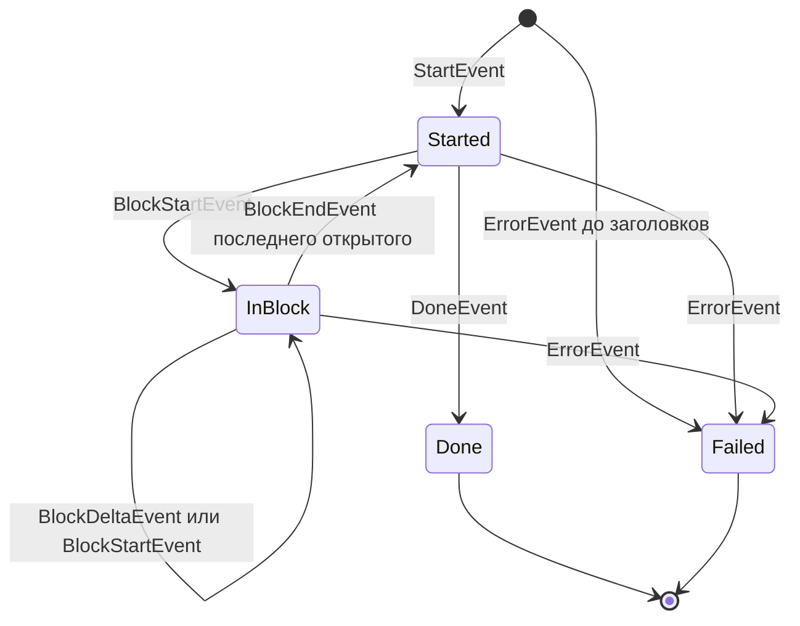
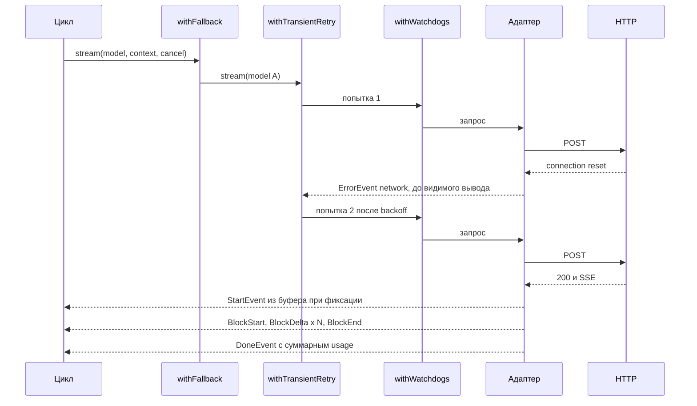

# 2. LLM-контракт

> Часть [архитектуры ядра агента CodeLab](../agent-core-architecture.md). Status: Accepted. Общие соглашения, термины и порядок чтения — в оглавлении.

← [1. Слои и пакеты](01-layers-and-packages.md) · [Оглавление ядра](../agent-core-architecture.md) · [3. Отмена](03-cancellation.md) →

## 2.1. Назначение

Слой между циклом и HTTP-эндпоинтом модели: модель сообщений, протокол стриминговых событий,
контракт `StreamFunction`, SSE-декодер, адаптеры провайдеров, декораторы устойчивости, учёт
токенов и стоимости, кэш промпта, каталог моделей и уровень рассуждения. Главные свойства: **ошибки — это события, а не исключения**; **каждое
событие несёт полный снимок частичного ответа**; **попытка, показавшая вывод, не повторяется**.

## 2.2. Контракт: модель сообщений

```dart
/// Блок контента. Сериализуется в JSON с дискриминатором `type` (таблица ниже).
sealed class ContentBlock { const ContentBlock(); }

final class TextContent extends ContentBlock {
  const TextContent(this.text);
  final String text;
}

final class ThinkingContent extends ContentBlock {
  const ThinkingContent(this.thinking, {this.signature, this.redacted = false, this.api});
  final String thinking;        // при redacted == true — непрозрачные данные провайдера
  final String? signature;      // подпись рассуждения; отправляется обратно только своему api
  final bool redacted;
  final ProviderApi? api;       // диалект, который выдал блок и подпись
}

final class ToolCall extends ContentBlock {
  const ToolCall({required this.id, required this.name, required this.arguments, this.signature});
  final String id;              // уникален во всём транскрипте (LOOP-11)
  final String name;
  final Map<String, Object?> arguments;   // всегда разобранный JSON-объект (LLM-6)
  final String? signature;   // подпись рассуждения вызова; только своему api (§17.10.3)
}

final class ImageContent extends ContentBlock {
  const ImageContent({required this.base64, required this.mimeType});
  final String base64;          // без префикса data:
  final String mimeType;        // image/png | image/jpeg | image/gif | image/webp
}

enum ProviderApi { openaiChat, anthropicMessages, gemini }   // gemini — после MVP (§17.10.3)
```

```dart
sealed class Message { DateTime get timestamp; }

final class UserMessage extends Message {
  UserMessage(this.content, {required this.timestamp});
  final List<ContentBlock> content;          // только TextContent | ImageContent
  @override final DateTime timestamp;
}

final class AssistantMessage extends Message {
  AssistantMessage({required this.content, required this.model, required this.usage,
      required this.stopReason, required this.timestamp,
      this.rawStopReason, this.errorMessage, this.errorClass});
  final List<ContentBlock> content;          // TextContent | ThinkingContent | ToolCall
  final ModelRef model;                      // кто реально ответил (после fallback)
  final Usage usage;
  final StopReason stopReason;
  final String? rawStopReason;               // finish/stop reason провайдера как есть
  final String? errorMessage;                // для error/aborted и для заметок (усечение)
  final LlmErrorClass? errorClass;           // только при stopReason error/aborted
  @override final DateTime timestamp;
  Iterable<ToolCall> get toolCalls => content.whereType<ToolCall>();
}

final class ToolResultMessage extends Message {
  ToolResultMessage({required this.toolCallId, required this.toolName,
      required this.content, required this.isError, required this.timestamp});
  final String toolCallId, toolName;
  final List<ContentBlock> content;          // TextContent | ImageContent
  final bool isError;
  @override final DateTime timestamp;
}

enum StopReason { stop, length, toolUse, error, aborted }

enum LlmErrorClass {
  network, timeout, rateLimited, overflow, auth, badRequest, server, terminalFinish, aborted, unknown,
}
```

```dart
final class Usage {
  const Usage({this.input = 0, this.output = 0, this.cacheRead = 0, this.cacheWrite = 0,
      this.reasoning, this.cost = UsageCost.zero});
  final int input;        // входные токены БЕЗ прочитанных из кэша
  final int output;       // выходные токены, включая рассуждение
  final int cacheRead, cacheWrite;
  final int? reasoning;   // часть output, если провайдер сообщает
  final UsageCost cost;
  int get total => input + output + cacheRead + cacheWrite;
  static const zero = Usage();
  Usage operator +(Usage o) => Usage(input: input + o.input, output: output + o.output,
      cacheRead: cacheRead + o.cacheRead, cacheWrite: cacheWrite + o.cacheWrite,
      reasoning: (reasoning == null && o.reasoning == null) ? null : (reasoning ?? 0) + (o.reasoning ?? 0),
      cost: cost + o.cost);
}

final class UsageCost {   // доллары США
  const UsageCost({this.input = 0, this.output = 0, this.cacheRead = 0, this.cacheWrite = 0});
  final double input, output, cacheRead, cacheWrite;
  double get total => input + output + cacheRead + cacheWrite;
  static const zero = UsageCost();
  UsageCost operator +(UsageCost o) => UsageCost(input: input + o.input, output: output + o.output,
      cacheRead: cacheRead + o.cacheRead, cacheWrite: cacheWrite + o.cacheWrite);
}

final class ModelCost {   // доллары за 1 000 000 токенов; null у ModelRef.cost = цены неизвестны
  const ModelCost({required this.input, required this.output, this.cacheRead = 0, this.cacheWrite = 0});
  final double input, output, cacheRead, cacheWrite;
}

final class ModelRef {
  const ModelRef({required this.provider, required this.id, required this.api,
      required this.baseUrl, required this.contextWindow, required this.maxOutputTokens,
      this.cost, this.supportsImages = false, this.supportsReasoning = false, this.reasoningEffort,
      this.hiddenReasoning = false, this.thinkingMode = ThinkingMode.adaptive,
      this.supportsTools = true});
  final String provider;          // имя записи провайдера из конфига, например "openrouter"
  final String id;                // id модели у провайдера
  final ProviderApi api;
  final Uri baseUrl;
  final int contextWindow, maxOutputTokens;   // разрешены каталогом моделей (§2.12.2)
  final ModelCost? cost;
  final bool supportsImages, supportsReasoning;
  final ReasoningEffort? reasoningEffort;   // low | medium | high; null — рассуждение выключено (§2.12.3)
  final bool hiddenReasoning;     // модель рассуждает без байтов в потоке до ответа (§2.10.5)
  final ThinkingMode thinkingMode;  // adaptive | budget — форма thinking у Anthropic (§2.8, §2.12.3)
  final bool supportsTools;   // false — вызов инструментов через промпт (§17.10.11)
}

enum ReasoningEffort { low, medium, high }

final class ToolSchema {
  const ToolSchema({required this.name, required this.description, required this.parameters});
  final String name, description;
  final Map<String, Object?> parameters;    // JSON Schema объекта (§6.3.2)
}

final class LlmContext {
  const LlmContext({required this.systemPrompt, required this.messages, this.tools = const [],
      this.cacheKey});
  final String systemPrompt;
  final List<Message> messages;
  final List<ToolSchema> tools;
  final String? cacheKey;         // ключ кэша промпта (§2.12.1): id сессии; null — не передавать
}
```

Все типы неизменяемы; списки внутри — неизменяемые копии (`List.unmodifiable`). Каноническая
JSON-форма (она же формат журнала, §8):

| Тип | JSON |
|---|---|
| `TextContent` | `{"type":"text","text":"..."}` |
| `ThinkingContent` | `{"type":"thinking","thinking":"...","signature":"...","redacted":false,"api":"anthropicMessages"}`; пустые поля опускаются |
| `ToolCall` | `{"type":"toolCall","id":"call_1","name":"read","arguments":{...},"signature":"..."}`; пустые поля опускаются |
| `ImageContent` | `{"type":"image","data":"<base64>","mimeType":"image/png"}` |
| `UserMessage` | `{"role":"user","content":[...],"timestamp":"<ISO-8601 UTC>"}` |
| `AssistantMessage` | `{"role":"assistant","content":[...],"model":{"provider":"...","id":"..."},"usage":{...},"stopReason":"toolUse","rawStopReason":"tool_calls","errorMessage":null,"errorClass":null,"timestamp":"..."}` |
| `ToolResultMessage` | `{"role":"toolResult","toolCallId":"call_1","toolName":"read","content":[...],"isError":false,"timestamp":"..."}` |
| `Usage` | `{"input":900,"output":40,"cacheRead":0,"cacheWrite":0,"reasoning":null,"cost":{"input":0.0027,"output":0.0006,"cacheRead":0,"cacheWrite":0}}` |

Поля со значением `null` при записи опускаются; при чтении отсутствующее поле = `null` или
значение по умолчанию. Неизвестные поля при чтении игнорируются (прямая совместимость журнала).

## 2.3. Контракт: стриминговые события и грамматика

```dart
sealed class AssistantMessageEvent { AssistantMessage get partial; }   // снимок на момент события

final class StartEvent extends AssistantMessageEvent {}                 // заголовки ответа получены
final class BlockStartEvent extends AssistantMessageEvent { int get index; BlockKind get kind; }
final class BlockDeltaEvent extends AssistantMessageEvent { int get index; String get delta; }
final class BlockEndEvent extends AssistantMessageEvent { int get index; ContentBlock get block; }
final class DoneEvent extends AssistantMessageEvent { AssistantMessage get message; }
final class ErrorEvent extends AssistantMessageEvent {
  AssistantMessage get error;      // stopReason: error | aborted, errorMessage, errorClass, частичный контент
  Duration? get retryAfter;        // из заголовков 429/503, если был
  RateLimitInfo? get rateLimit;    // после MVP: структура 429, разобрана один раз адаптером (§17.10.4.1)
  StallClass? get stallClass;      // после MVP: класс простоя для timeout, ставит withWatchdogs (§17.10.10)
}
enum BlockKind { text, thinking, toolCall }
```

`index` — позиция блока в `partial.content`. Для ToolCall-блоков `BlockDeltaEvent.delta` — сырой
фрагмент JSON аргументов; в `partial` у незакрытого вызова `arguments` = `{}` (LLM-6), аргументы
разбираются один раз, в `BlockEndEvent`. У `DoneEvent` поле `partial` совпадает с `message`, у
`ErrorEvent` — с `error`.

Грамматика потока:



Правила грамматики:

1. Первое событие — `StartEvent` или (при сбое до заголовков) сразу `ErrorEvent`.
2. Одновременно открытых блоков может быть несколько (параллельные вызовы инструментов приходят перемешанными); `BlockDeltaEvent` и `BlockEndEvent` относятся к открытому блоку с тем же `index`.
3. Перед `DoneEvent` все блоки закрыты (адаптер закрывает их сам при финише).
4. `ErrorEvent` может прийти при открытых блоках; их контент в `error.content` — как есть (текст до сбоя, вызовы с `arguments: {}`).
5. После терминального события (`DoneEvent` или `ErrorEvent`) событий нет.

## 2.4. Контракт и алгоритм: EventStream

`EventStream` — поток с ожидаемым итогом: производитель пушит события, потребитель читает их
через `await for` и/или ждёт `result`.

```dart
class EventStream<T, R> extends Stream<T> {
  EventStream({required bool Function(T) isTerminal, required R Function(T) resultOf})
      : _isTerminal = isTerminal, _resultOf = resultOf;
  final bool Function(T) _isTerminal;
  final R Function(T) _resultOf;
  final _controller = StreamController<T>();   // single-subscription: буферизует до подписки
  final _result = Completer<R>();
  var _closed = false;

  void push(T event) {
    if (_closed) return;                         // после терминала и end() — игнор
    _controller.add(event);
    if (_isTerminal(event)) { _complete(_resultOf(event)); end(); }
  }

  void end([R? result]) {
    if (_closed) return;                         // идемпотентно
    _closed = true;
    if (result != null) _complete(result);
    if (!_result.isCompleted) {
      _result.future.ignore();                   // нет unhandled error, если result никто не ждёт
      _result.completeError(StateError('stream ended without a terminal event'));
    }
    _controller.close();
  }

  void _complete(R value) { if (!_result.isCompleted) _result.complete(value); }  // первая резолюция выигрывает
  Future<R> get result => _result.future;

  @override
  StreamSubscription<T> listen(void Function(T)? onData,
          {Function? onError, void Function()? onDone, bool? cancelOnError}) =>
      _controller.stream.listen(onData, onError: onError, onDone: onDone, cancelOnError: cancelOnError);
}

final class AssistantMessageEventStream extends EventStream<AssistantMessageEvent, AssistantMessage> {
  AssistantMessageEventStream() : super(
      isTerminal: (e) => e is DoneEvent || e is ErrorEvent,
      resultOf: (e) => switch (e) { DoneEvent(:final message) => message,
                                    ErrorEvent(:final error) => error, _ => throw StateError('not terminal') });
}
```

Почему single-subscription: производитель может начать `push` до того, как потребитель подписался
(адаптер запускается в microtask), и ни одно событие не теряется. Потребитель обязан подписаться
ровно один раз; второй `listen` — `StateError` (ошибка программиста).

## 2.5. Контракт: StreamFunction, состояние адаптера, снимки

```dart
typedef StreamFunction = AssistantMessageEventStream Function(
    ModelRef model, LlmContext context, {CancelToken? cancel});
```

Контракт `StreamFunction` (обязателен для адаптеров и декораторов):

1. Возвращает поток **синхронно** и никогда не бросает — ни синхронно, ни через `result` (LLM-1).
2. Работа начинается не раньше следующего microtask: синхронный код вызывающего успевает подписаться.
3. В потоке ровно одно терминальное событие, и оно последнее (LLM-2).
4. Отмена `cancel` даёт `ErrorEvent` со `stopReason: aborted`, `errorClass: aborted` (LLM-7).

Общий каркас адаптера:

```dart
AssistantMessageEventStream runProvider(ModelRef model, CancelToken? cancel, Clock clock,
    Future<void> Function(ProviderStreamState state) body) {
  final out = AssistantMessageEventStream();
  final state = ProviderStreamState(model, clock, out);
  scheduleMicrotask(() async {
    try {
      cancel?.throwIfCancelled();
      await body(state);                                 // body пушит события через state
      if (!state.isTerminated) state.failUnexpectedEnd(); // защита: тело забыло терминал
    } on CancelledException {
      state.fail(LlmErrorClass.aborted, 'Request was aborted', aborted: true);
    } catch (e) {
      state.fail(classifyException(e), describeException(e));   // таблица §2.9
    } finally {
      out.end();
    }
  });
  return out;
}
```

`ProviderStreamState` — изменяемый аккумулятор адаптера:

| Метод | Что делает | Событие |
|---|---|---|
| `start()` | фиксирует время, обнуляет блоки | `StartEvent` |
| `openBlock(kind, {id, name})` → `index` | добавляет блок в конец списка | `BlockStartEvent` |
| `append(index, fragment)` | дописывает фрагмент текста, рассуждения или сырого JSON | `BlockDeltaEvent` |
| `setSignature(index, s)`, `setUsage(u)`, `setRawStopReason(r)` | меняют метаданные снимка | нет события |
| `closeBlock(index)` | для вызова — разбирает JSON аргументов (пустая строка = `{}`; ошибка разбора = `{}` + заметка в `errorMessage`); помечает блок закрытым | `BlockEndEvent` |
| `finish(StopReason, {note})` | закрывает все открытые блоки, считает стоимость | `BlockEndEvent`…, `DoneEvent` |
| `fail(cls, message, {aborted, retryAfter, rateLimit})` | не закрывает блоки, считает стоимость | `ErrorEvent` |

**Снимки без квадратичной стоимости.** Каждое событие несёт `partial`, но копировать весь ответ
на каждую дельту нельзя: ответ в 50 КиБ из 10 000 дельт дал бы сотни мегабайт копирования. Поэтому:

1. Каждый блок аккумулятора хранит фрагменты в списке `chunks`, который только растёт.
2. Событие запоминает ссылку на список блоков и длину каждого `chunks` на момент события — это O(число блоков).
3. Геттер `partial` строит `AssistantMessage` лениво при первом обращении (склеивает фрагменты до запомненной длины) и кэширует результат в событии.
4. Потребитель, которому нужна только дельта (ACP-проекция), не платит за склейку.

## 2.6. Алгоритм: SSE-декодер

SSE-декодер — `StreamTransformer<String, ServerSentEvent>`. `SseDecoder` и `ServerSentEvent` экспортируются из бареля ядра: ими же читает потоки streamable HTTP пакет `codelab_agent_mcp` (второй реализации SSE нет; change `add-agent-mcp-client`, D10). Байты тела ответа декодируются выше
по цепочке: `response.stream.transform(const Utf8Decoder(allowMalformed: true))` — декодер UTF-8
сам склеивает многобайтовые символы, разрезанные границей чанка.

```dart
final class ServerSentEvent {
  const ServerSentEvent({this.event, required this.data, this.id, this.retry});
  final String? event;    // поле event:, null = "message"
  final String data;      // строки data:, склеенные через \n
  final String? id;
  final Duration? retry;  // последнее поле retry: (только ASCII-цифры, мс); для MCP legacy
}
```

Алгоритм:

1. **Нарезка строк.** Чанки произвольной длины. Разделитель строки — `\n`, `\r` или `\r\n`. Флаг `skipLf`: после `\r` следующий `\n` (в том числе в начале следующего чанка) пропускается — так `\r\n`, разрезанный между чанками, даёт одну строку.
2. **BOM.** Если самый первый символ потока — `U+FEFF`, он отбрасывается. Пустые чанки в начале не считаются «первым символом».
3. **Комментарии.** Строка, начинающаяся с `:`, игнорируется (keep-alive провайдеров).
4. **Поле и значение.** Строка делится по первому `:`. Нет двоеточия — вся строка = имя поля, значение пустое. Если значение начинается с одного пробела, он срезается (ровно один).
5. **Поля.** `event` — тип события; `data` — значение добавляется в список строк данных; `id` — запоминается, если не содержит `U+0000`; `retry` — запоминается как `Duration` в миллисекундах, если значение непусто, состоит только из ASCII-цифр и не больше `maxSseRetry` = 24 ч (`int.tryParse`; сверх предела или при переполнении поле игнорируется, а не бросает исключение), иначе игнорируется; LLM-провайдеры его не используют (ядро не переподключается), а MCP-транспорт legacy берёт из него паузу возобновления потока (change `add-agent-mcp-client`, D10); прочие поля — игнорируются.
6. **Диспетчеризация.** Пустая строка завершает событие: если список `data` непуст, выдаётся `ServerSentEvent(event, data.join('\n'), id, retry)`; затем `event` и `data` сбрасываются (`id` и `retry` сохраняются между событиями потока). Пустая строка без накопленных `data` ничего не выдаёт.
7. **Конец потока.** Незавершённая строка и незавершённое событие (нет финальной пустой строки) отбрасываются.

```dart
final class SseDecoder extends StreamTransformerBase<String, ServerSentEvent> {
  const SseDecoder();
  @override
  Stream<ServerSentEvent> bind(Stream<String> source) async* {
    final line = StringBuffer();
    final data = <String>[];
    String? event, id;
    var skipLf = false, atStart = true;

    ServerSentEvent? feed(String l) {
      if (l.isEmpty) {
        if (data.isEmpty) { event = null; return null; }
        final e = ServerSentEvent(event: event, data: data.join('\n'), id: id);
        data.clear(); event = null;
        return e;
      }
      if (l.startsWith(':')) return null;
      final colon = l.indexOf(':');
      final field = colon < 0 ? l : l.substring(0, colon);
      var value = colon < 0 ? '' : l.substring(colon + 1);
      if (value.startsWith(' ')) value = value.substring(1);
      switch (field) {
        case 'event': event = value;
        case 'data': data.add(value);
        case 'id': if (!value.contains('\u0000')) id = value;
      }
      return null;
    }

    await for (final chunk in source) {
      var start = 0;
      if (atStart && chunk.isNotEmpty) { atStart = false; if (chunk.codeUnitAt(0) == 0xFEFF) start = 1; }
      for (var i = start; i < chunk.length; i++) {
        final c = chunk.codeUnitAt(i);
        if (skipLf) { skipLf = false; if (c == 0x0A) continue; }
        if (c == 0x0A || c == 0x0D) {
          skipLf = c == 0x0D;
          final e = feed(line.toString());
          line.clear();
          if (e != null) yield e;
        } else {
          line.writeCharCode(c);
        }
      }
    }
  }
}
```

Реализация МОЖЕТ копировать отрезки чанка через `indexOf` вместо посимвольной записи — поведение
должно совпадать с алгоритмом выше (это проверяют тесты §2.15).

Пример: чанки `"data: a\r"`, `"\ndata:b\n\n: ping\n"`, `"event: x\ndata: c\n\n"` дают два
события: `ServerSentEvent(data: "a\nb")` и `ServerSentEvent(event: "x", data: "c")`.

## 2.7. Адаптер OpenAI-совместимого API

Покрывает OpenAI, OpenRouter, Ollama, LM Studio, llama.cpp server, LiteLLM Proxy и любой сервер
с эндпоинтом `POST {baseUrl}/chat/completions` и SSE-стримингом.

```dart
final class ProviderConfig {
  const ProviderConfig({required this.name, required this.api, required this.baseUrl,
      this.apiKey, this.authHeader = 'Authorization', this.headers = const {},
      this.maxTokensField = 'max_completion_tokens', this.includeUsage = true,
      this.reasoningFormat = ReasoningFormat.openai, this.systemRole = 'system',
      this.anthropicVersion = '2023-06-01', this.anthropicBeta = const [],
      this.promptCacheKey = false, this.listModels = true,
      this.timeouts = LlmTimeouts.defaults, this.retry = const RetryPolicy(),
      this.quirks = ProviderQuirks.none, this.credentials});
  final String name;
  final ProviderApi api;
  final Uri baseUrl;
  final String? apiKey;             // значение уже прочитано хостом из SecretStore; null = без авторизации
  final String authHeader;          // 'Authorization' → "Bearer <key>"; иное имя → "<key>" как есть
  final Map<String, String> headers;
  final String? maxTokensField;     // 'max_completion_tokens' | 'max_tokens' | null (не отправлять)
  final bool includeUsage;          // stream_options.include_usage
  final ReasoningFormat reasoningFormat;   // openai: reasoning_effort; openrouter: reasoning.effort
  final String systemRole;          // 'system' | 'developer'
  final String anthropicVersion;
  final List<String> anthropicBeta;
  final bool promptCacheKey;        // отправлять prompt_cache_key (§2.12.1); только openaiChat
  final bool listModels;            // запрашивать список моделей endpoint (§2.12.2)
  final LlmTimeouts timeouts;       // connect / idle / idleReasoning провайдера (§2.10.1, §2.10.5, §15.4)
  final RetryPolicy retry;          // бюджеты повторов провайдера (§2.10.2, §15.4)
  final ProviderQuirks quirks;      // после MVP: особенности сервера, задаёт пресет (§17.10.2)
  final CredentialSource? credentials;   // после MVP: пул ключей или OAuth-токен (§17.10.4, §17.10.6)
}
enum ReasoningFormat { openai, openrouter, none }
```

**Запрос.** Заголовки: `Content-Type: application/json`, `Accept: text/event-stream`,
авторизация по `authHeader` (нет ключа — нет заголовка: локальные серверы), затем
`ProviderConfig.headers`. Тело:

| Поле | Значение |
|---|---|
| `model` | `ModelRef.id` |
| `messages` | преобразование по алгоритму ниже |
| `tools` | `[{"type":"function","function":{"name","description","parameters"}}]`; поле не отправляется, если инструментов нет (часть серверов отвергает пустой массив) |
| `tool_choice` | `"auto"`, только если есть `tools` |
| `stream` | `true` |
| `stream_options` | `{"include_usage": true}`, если `includeUsage` |
| `<maxTokensField>` | `ModelRef.maxOutputTokens`; не отправляется при `maxTokensField == null` |
| `reasoning_effort` / `reasoning` | при `reasoningEffort != null` и `supportsReasoning`: формат `openai` → `"reasoning_effort":"medium"`, `openrouter` → `"reasoning":{"effort":"medium"}`, `none` → ничего (таблица §2.12.3) |
| `prompt_cache_key` | `context.cacheKey`, только при `promptCacheKey == true` и `cacheKey != null` (§2.12.1); иначе поле не отправляется |

Алгоритм преобразования сообщений:

1. Первое сообщение — `{"role": systemRole, "content": systemPrompt}` (если промпт непуст).
2. `UserMessage`: если все блоки текстовые — `content` строкой (тексты через `\n\n`): старые локальные серверы не принимают массив. Иначе — массив частей: `{"type":"text","text"}` и `{"type":"image_url","image_url":{"url":"data:<mime>;base64,<data>"}}`. Если у модели нет `supportsImages`, картинка заменяется частью `{"type":"text","text":"[image omitted: the current model does not accept images]"}`.
3. `AssistantMessage`: `content` — склейка текстовых блоков или `null`, если текста нет; `tool_calls` — `[{"id","type":"function","function":{"name","arguments":"<канонический JSON-текст>"}}]`. Блоки рассуждения не отправляются (у Chat Completions нет повторной передачи рассуждений). Сообщение со `stopReason` `error`/`aborted` и без контента пропускается.
4. `ToolResultMessage`: `{"role":"tool","tool_call_id": id,"content": "<тексты через \n>"}`. Картинки из результата нельзя положить в сообщение `tool`, поэтому текст получает строку `[image attached in the next message]`, а сразу после серии `tool`-сообщений добавляется одно `user`-сообщение с этими картинками и текстом `Images returned by tool call <id>:`.
5. Каноническая сериализация аргументов — ключи в порядке вставки, без пробелов (`jsonEncode`): одинаковый транскрипт даёт побайтово одинаковый payload (prompt cache).

Пример тела:

```json
{
  "model": "gpt-4.1-mini",
  "messages": [
    {"role": "system", "content": "You are CodeLab, a coding agent..."},
    {"role": "user", "content": "Fix the failing test"},
    {"role": "assistant", "content": null, "tool_calls": [
      {"id": "call_1", "type": "function", "function": {"name": "read", "arguments": "{\"path\":\"test/a_test.dart\"}"}}]},
    {"role": "tool", "tool_call_id": "call_1", "content": "1| void main() {}"}
  ],
  "tools": [{"type": "function", "function": {"name": "read", "description": "Read a text file...",
    "parameters": {"type": "object", "properties": {"path": {"type": "string"}}, "required": ["path"]}}}],
  "tool_choice": "auto",
  "stream": true,
  "stream_options": {"include_usage": true},
  "max_completion_tokens": 16384
}
```

**Разбор потока.** После заголовков 200 с `Content-Type: text/event-stream` — `StartEvent`.
Каждое SSE-событие: `data` = `[DONE]` → конец; иначе JSON-объект чанка.

| Поле чанка | Действие адаптера |
|---|---|
| `error` (объект) | `fail` с классом по `error.code` / `error.type` / тексту (§2.9) |
| `choices[0].delta.reasoning_content` или `delta.reasoning` (строка) | если открытый «текущий» блок не thinking — закрыть его и открыть thinking; `append` |
| `choices[0].delta.content` (непустая строка) | если текущий блок не text — закрыть его и открыть text; `append` |
| `choices[0].delta.tool_calls[]` | накопление вызовов, алгоритм ниже; текущий text/thinking-блок закрывается при первом фрагменте вызова |
| `choices[0].finish_reason` (не `null`) | запомнить как `rawStopReason`; не завершать — чанк с `usage` может прийти позже |
| `usage` (верхний уровень) | `setUsage` по таблице usage ниже |
| `choices: []` без `usage` | игнорировать |
| `choices[0].usage` при `quirks.usageInChoice` и без `usage` верхнего уровня (после MVP) | `setUsage` (§17.10.7) |
| `delta.content` при `quirks.thinkTags` (после MVP) | алгоритм §17.10.7 |
| пустой `delta`, `role` | игнорировать |

Накопление вызовов инструментов. Адаптер держит две карты: `byIndex` (индекс провайдера →
блок) и `byId` (id провайдера → блок). Для каждого элемента `tool_calls`:

1. `key` = `item.index`, если поле есть, иначе позиция элемента в массиве.
2. Блок ищется в `byIndex[key]`, затем в `byId[item.id]`.
3. Найден по индексу, но `item.id` непуст и отличается от id блока, а у блока уже есть имя и непустые аргументы — это **новый** вызов (часть серверов переиспользует индекс 0 для последовательных вызовов): открыть новый блок и переназначить `byIndex[key]`.
4. Не найден — открыть новый ToolCall-блок: `id` = `item.id` или синтетический `call_<номер блока>`; `name` = `item.function.name` или пустая строка.
5. `function.name`: если имя блока пустое — установить; если фрагмент равен имени — игнорировать (повтор); иначе дописать.
6. `function.arguments`: если накопленный JSON непуст и фрагмент **равен** всему накопленному — игнорировать (повторно присланный кадр); иначе `append` (событие `BlockDeltaEvent` с сырым фрагментом).

Завершение. По `[DONE]` или по концу тела:

| Ситуация | Итог |
|---|---|
| `finish_reason` = `stop`, `eos`, `end_turn`, `stop_sequence` | `stop`; если есть вызовы инструментов — `toolUse` (часть серверов шлёт `stop` вместе с вызовами) |
| `length`, `max_tokens` | `length` |
| `tool_calls`, `function_call` | `toolUse` |
| `content_filter`, `refusal`, `safety` | `ErrorEvent`, `terminalFinish`, текст `Provider finish_reason: content_filter` |
| конец тела без `finish_reason`, контента нет | `ErrorEvent`, `network`: `stream ended without finish_reason and without content` |
| конец тела без `finish_reason`, контент есть | `stop`/`toolUse` с заметкой `stream ended without finish_reason; the response may be truncated`; если аргументы какого-то вызова не разбираются — `length` (цикл такие вызовы не исполнит, LOOP-5) |
| любое другое значение | `ErrorEvent`, `unknown`, текст `Provider finish_reason: <value>`; лог уровня warning `llm.finish_reason.unknown` |
| 200, но ни одного SSE-события | `ErrorEvent`, `network`: `provider returned an empty event stream; check baseUrl and model id` |

Usage OpenAI-совместимого ответа:

| Поле `Usage` | Источник |
|---|---|
| `input` | `prompt_tokens − cacheRead − cacheWrite`, не меньше 0 |
| `cacheRead` | `prompt_tokens_details.cached_tokens`; нет поля — `prompt_cache_hit_tokens` (так сообщают часть совместимых серверов); нет и его — 0 |
| `cacheWrite` | `prompt_tokens_details.cache_write_tokens`, если сервер его сообщает (шлюзы к моделям с явной записью кэша); иначе 0 — OpenAI запись кэша не сообщает |
| `output` | `completion_tokens` |
| `reasoning` | `completion_tokens_details.reasoning_tokens`, если есть |

Пример потока и событий:

```text
data: {"choices":[{"index":0,"delta":{"role":"assistant","content":"Let me check"}}]}
data: {"choices":[{"index":0,"delta":{"tool_calls":[{"index":0,"id":"call_1","type":"function","function":{"name":"read","arguments":""}}]}}]}
data: {"choices":[{"index":0,"delta":{"tool_calls":[{"index":0,"function":{"arguments":"{\"path\":"}}]}}]}
data: {"choices":[{"index":0,"delta":{"tool_calls":[{"index":0,"function":{"arguments":"\"a.txt\"}"}}]}}]}
data: {"choices":[{"index":0,"delta":{},"finish_reason":"tool_calls"}]}
data: {"choices":[],"usage":{"prompt_tokens":900,"completion_tokens":40,"prompt_tokens_details":{"cached_tokens":512}}}
data: [DONE]

→ StartEvent
→ BlockStartEvent(0, text), BlockDeltaEvent(0, "Let me check")
→ BlockEndEvent(0, TextContent), BlockStartEvent(1, toolCall)
→ BlockDeltaEvent(1, "{\"path\":"), BlockDeltaEvent(1, "\"a.txt\"}")
→ BlockEndEvent(1, ToolCall(call_1, read, {path: a.txt}))
→ DoneEvent(stopReason: toolUse, usage: input 388, cacheRead 512, output 40)
```

## 2.8. Адаптер Anthropic Messages API

**Запрос.** `POST {baseUrl}/v1/messages`. Заголовки: `x-api-key: <key>`,
`anthropic-version: <anthropicVersion>`, `content-type: application/json`,
`accept: text/event-stream`, `anthropic-beta: <через запятую>` (если список непуст). Тело:

| Поле | Значение |
|---|---|
| `model` | `ModelRef.id` |
| `max_tokens` | `ModelRef.maxOutputTokens` (поле обязательно в этом API) |
| `system` | `[{"type":"text","text": systemPrompt,"cache_control":{"type":"ephemeral"}}]` |
| `messages` | преобразование по алгоритму ниже |
| `tools` | `[{"name","description","input_schema"}]`; у последнего — `"cache_control":{"type":"ephemeral"}`; поле не отправляется, если инструментов нет |
| `tool_choice` | `{"type":"auto"}`, только если есть `tools` |
| `stream` | `true` |
| `thinking` | при `reasoningEffort != null`, по `ModelRef.thinkingMode`. `adaptive` (Claude 4.6 и новее; Claude 5.x отвечают на `budget_tokens` ошибкой 400): `{"type":"adaptive","display":"summarized"}` — модель сама решает, сколько рассуждать, а `summarized` возвращает читаемую сводку рассуждения вместо пустых блоков (умолчание API — `omitted`). `budget` (Claude 4.5 и старше): `{"type":"enabled","budget_tokens": B}`, `B` = 2048 / 8192 / 16384 для low / medium / high, затем `B = min(B, max_tokens − 1024)`; если `B < 1024` — рассуждение не включается. В обоих режимах рассуждение помещается **внутри** `max_tokens`, а не сверх него. Откуда берётся `reasoningEffort` — §2.12.3 |
| `output_config` | только в режиме `adaptive` при `reasoningEffort != null`: `{"effort": "low" \| "medium" \| "high"}` |

Алгоритм преобразования сообщений:

1. `UserMessage` → `{"role":"user","content":[...]}`: текст `{"type":"text","text"}`, картинка `{"type":"image","source":{"type":"base64","media_type": mime,"data": base64}}` (или текстовый плейсхолдер, как в §2.7, если модель без картинок). Пустые текстовые блоки опускаются — API их отвергает.
2. `AssistantMessage` → `{"role":"assistant","content":[...]}` в исходном порядке блоков: `ThinkingContent` с `api == anthropicMessages` и непустой `signature` → `{"type":"thinking","thinking","signature"}`; `redacted` → `{"type":"redacted_thinking","data": thinking}`; рассуждения других диалектов или без подписи **отбрасываются**; `TextContent` → `text`; `ToolCall` → `{"type":"tool_use","id","name","input": arguments}`.
3. Серия подряд идущих `ToolResultMessage` → одно сообщение `user` с блоками `{"type":"tool_result","tool_use_id": id,"content":[text|image блоки],"is_error": isError}`.
4. Подряд идущие сообщения одной роли сливаются в одно (блоки по порядку): API требует чередования ролей.
5. Id вызовов нормализуются детерминированной функцией: символы вне `[A-Za-z0-9_-]` → `_`, длина не больше 64. Одна и та же функция применяется к `tool_use.id` и к `tool_result.tool_use_id`, поэтому пары сохраняются.
6. `cache_control` ставится ещё на последний блок последнего `user`-сообщения, который пришёл из транскрипта; блоки, существующие только в payload и меняющиеся от запроса к запросу, идут после него (§2.12.1, правило стабильности 3). Всего не больше трёх маркеров (system, последний инструмент, последний user) — в пределах лимита API в четыре маркера.

Пример тела:

```json
{
  "model": "claude-opus-5-5",
  "max_tokens": 128000,
  "system": [{"type": "text", "text": "You are CodeLab...", "cache_control": {"type": "ephemeral"}}],
  "messages": [
    {"role": "user", "content": [{"type": "text", "text": "Fix the failing test"}]},
    {"role": "assistant", "content": [
      {"type": "thinking", "thinking": "Need to look at the test.", "signature": "EqQBCkYI..."},
      {"type": "tool_use", "id": "call_1", "name": "read", "input": {"path": "test/a_test.dart"}}]},
    {"role": "user", "content": [
      {"type": "tool_result", "tool_use_id": "call_1", "content": [{"type": "text", "text": "1| void main() {}"}],
       "is_error": false, "cache_control": {"type": "ephemeral"}}]}
  ],
  "tools": [{"name": "read", "description": "Read a text file...", "input_schema": {"type": "object",
    "properties": {"path": {"type": "string"}}, "required": ["path"]}, "cache_control": {"type": "ephemeral"}}],
  "tool_choice": {"type": "auto"},
  "stream": true,
  "thinking": {"type": "adaptive", "display": "summarized"},
  "output_config": {"effort": "medium"}
}
```

**Разбор потока.** SSE-события именованные (`event:`), `data` — JSON. Адаптер держит карту
«индекс блока провайдера → наш `index`».

| SSE-событие | Действие |
|---|---|
| `message_start` | `message.usage`: `input_tokens` → `input`, `cache_read_input_tokens` → `cacheRead`, `cache_creation_input_tokens` → `cacheWrite`, `output_tokens` → `output`. `StartEvent` уже отправлен по заголовкам |
| `content_block_start`, `content_block.type = text` | `openBlock(text)`; непустой начальный `text` → `append` |
| `content_block_start`, `thinking` | `openBlock(thinking)` с `api: anthropicMessages` |
| `content_block_start`, `redacted_thinking` | `openBlock(thinking)`, `redacted: true`, `thinking` = `data` |
| `content_block_start`, `tool_use` | `openBlock(toolCall, id, name)`; начальный `input` игнорируется (всегда `{}`), аргументы приходят дельтами |
| `content_block_delta`, `delta.type = text_delta` | `append(text)` |
| `content_block_delta`, `thinking_delta` | `append(thinking)` |
| `content_block_delta`, `signature_delta` | `setSignature(signature)`; события наружу нет |
| `content_block_delta`, `input_json_delta` | `append(partial_json)` |
| `content_block_stop` | `closeBlock` |
| `message_delta` | `delta.stop_reason` → `rawStopReason`; `usage.output_tokens` — накопительное значение, заменяет `output` |
| `message_stop` | `finish` по таблице stop reason ниже |
| `ping` | игнорировать |
| `error` | `fail` по `error.type` (§2.9) |
| неизвестное событие | игнорировать с debug-логом (API добавляет события) |

| `stop_reason` | Итог |
|---|---|
| `end_turn`, `stop_sequence` | `stop` |
| `tool_use` | `toolUse` |
| `max_tokens` | `length` |
| `model_context_window_exceeded` | `ErrorEvent`, `overflow` |
| `refusal` | `ErrorEvent`, `terminalFinish` |
| любое другое (в том числе `pause_turn`: серверных инструментов в ядре нет) | `ErrorEvent`, `unknown` + warning-лог |

Пример потока:

```text
event: message_start
data: {"type":"message_start","message":{"id":"msg_1","model":"claude-sonnet-4-5","usage":{"input_tokens":1200,"cache_read_input_tokens":0,"cache_creation_input_tokens":1100,"output_tokens":1}}}

event: content_block_start
data: {"type":"content_block_start","index":0,"content_block":{"type":"tool_use","id":"toolu_01","name":"read","input":{}}}

event: content_block_delta
data: {"type":"content_block_delta","index":0,"delta":{"type":"input_json_delta","partial_json":"{\"path\": \"a.txt\"}"}}

event: content_block_stop
data: {"type":"content_block_stop","index":0}

event: message_delta
data: {"type":"message_delta","delta":{"stop_reason":"tool_use"},"usage":{"output_tokens":35}}

event: message_stop
data: {"type":"message_stop"}
```

Общие правила обоих адаптеров:

* подписи рассуждений отправляются обратно только тому диалекту (`ProviderApi`), который их выдал; чужие подписи отбрасываются при сборке запроса, но остаются в транскрипте;
* картинки хранятся в транскрипте всегда; плейсхолдер для модели без `supportsImages` ставится только в payload;
* редиректы обрабатываются вручную: только same-origin (схема, хост и порт совпадают), не больше 5; иначе `badRequest` `redirect to another origin is not allowed`;
* отмена: адаптер ждёт гонку «ответ vs `cancel.onCancel`»; при отмене закрывает подписку на тело и отменяет запрос (`http.Client` хоста закрывает соединение по отмене подписки), затем `fail(aborted)`.

## 2.9. Классификация ошибок

Класс ставит адаптер в одном месте — функции `classifyHttpError(status, body)` и
`classifyException(e)`. Декораторы решают **только** по `LlmErrorClass`, а не по тексту.

| Ситуация | `LlmErrorClass` | Повтор до видимого вывода |
|---|---|---|
| исключение до ответа: сокет, DNS, TLS, `connection reset/refused/closed`, обрыв тела | `network` | да |
| сработал watchdog `connect` или `idle`; HTTP 408 | `timeout` | да |
| HTTP 429; Anthropic `rate_limit_error` | `rateLimited` | отдельный бюджет |
| HTTP 500, 502, 503, 504, 529, прочие 5xx кроме 501 и 505; Anthropic `overloaded_error`, `api_error` | `server` | да |
| неразбираемый JSON в `data` чанка | `server` | да |
| HTTP 400/413/422 с признаком переполнения (§2.11) | `overflow` | нет |
| HTTP 400, 404, 405, 413, 415, 422, 501, 505; Anthropic `invalid_request_error`, `not_found_error`; редирект на чужой origin | `badRequest` | нет |
| HTTP 401, 403; Anthropic `authentication_error`, `permission_error` | `auth` | нет |
| 200, но `Content-Type` не `text/event-stream`: JSON с объектом `error` — класс по нему; иначе | `badRequest`, текст `endpoint did not return an event stream (content-type: <ct>); check baseUrl` | нет |
| `content_filter`, `refusal`, `safety` | `terminalFinish` | нет |
| неизвестный `finish_reason` / `stop_reason` | `unknown` | да, с warning-логом |
| отмена через `CancelToken` | `aborted` | нет |

`errorMessage` формируется как `<Provider name> <HTTP status>: <message из тела>`; тело ошибки
обрезается до 2000 символов и проходит редакцию секретов (§12). `retryAfter` берётся из заголовков
по алгоритму §2.10.4.

После MVP (L-32, §17.10.4.1): для `rateLimited` тело в `errorMessage` не входит — `classifyHttpError`
один раз вызывает `decodeRateLimit`, кладёт `RateLimitInfo` в `ErrorEvent.rateLimit`, а
`errorMessage` — короткий текст `describeRateLimit`; тело — только лог debug после редакции.

Фразы `quirks.overflowPhrases` проверяются в тексте ошибки при любом статусе (§17.10.8). Повторы
адаптера после 400 — только §17.10.3 и §17.10.9.

## 2.10. Декораторы

```dart
StreamFunction withWatchdogs(StreamFunction inner, {required Duration connect, required Duration idle,
    Duration? idleReasoning, required Clock clock});   // idleReasoning: §2.10.5; null = idle
StreamFunction withTransientRetry(StreamFunction inner, RetryPolicy policy, {required Clock clock, required Random random, required Logger logger, StallKeyRotation? keys});   // keys — после MVP (§17.10.10.1)
StreamFunction withFallback(List<ModelRef> chain, StreamFunction Function(ModelRef) forModel,
    {required void Function(FallbackNotice) onNotice});
StreamFunction withCredentials(CredentialSource? source, StreamFunction Function(String? credential) adapterFor, {required Logger logger});   // после MVP (§17.10.4, §17.10.6)
StreamFunction withPromptTools(StreamFunction inner, {required Random random, required Logger logger});   // после MVP (§17.10.11)
StreamFunction createStreamFunction(ProviderConfig config, CoreLlmServices services);   // собирает всю цепочку
// CoreLlmServices — порты хоста для LLM (http.Client, Clock, Random, Logger); после MVP —
// поле final LlmDiagnostics? diagnostics;   // снимки зависаний (§17.10.10), из AgentCoreServices.llmDiagnostics (§10.3)

final class RetryPolicy {
  const RetryPolicy({this.maxAttempts = 4, this.baseDelay = const Duration(seconds: 1),
      this.maxDelay = const Duration(seconds: 30), this.rateLimitRetries = 3,
      this.rateLimitBaseDelay = const Duration(seconds: 2), this.rateLimitMaxDelay = const Duration(seconds: 60),
      this.maxRetryAfter = const Duration(seconds: 120),
      this.stallRetries = 1, this.stallBaseDelay = const Duration(seconds: 5),
      this.stallMaxDelay = const Duration(seconds: 60), this.stallKeyRotations = 2});
  final int maxAttempts;               // всего попыток на транзиентные сбои, включая первую;
                                       // из конфига: maxAttempts = transient_retries + 1 (§15.4)
  final Duration baseDelay, maxDelay;
  final int rateLimitRetries;          // повторов после 429 (отдельный бюджет); = rate_limit_retries (§15.4)
  final Duration rateLimitBaseDelay, rateLimitMaxDelay, maxRetryAfter;
  // после MVP (§17.10.10.1): лестница зависания
  final int stallRetries;              // = llm.retry.stall_retries (1)
  final Duration stallBaseDelay, stallMaxDelay;   // 5 с, 60 с
  final int stallKeyRotations;         // = llm.retry.stall_key_rotations (2)
}

final class FallbackNotice { final ModelRef from, to; final LlmErrorClass cause; final String message; final StallClass? stallClass; final RateLimitInfo? rateLimit; }   // два последних — после MVP (§17.10.4.1, §17.10.10.1)
```

Порядок обёрток (изнутри наружу): адаптер провайдера → `withCredentials` (§17.10.4, §17.10.6) →
`withWatchdogs` → `withPromptTools` (только при `supportsTools == false`, §17.10.11) →
`withTransientRetry` → `withFallback`; цепочку `withFallback` даёт `ModelRoleResolver` (§17.10.5). Хост получает уже собранную функцию из `createStreamFunction`. Цикл получает
`FallbackNotice` через `onNotice` и эмитит `AgentError(cls: fallback, retrying: true)`.

### 2.10.1. Watchdogs

1. Для каждого вызова создаётся дочерний `CancelTokenSource(parent: cancel)` попытки (§3); внутренний поток получает его токен.
2. Таймер `connect` взводится при вызове и снимается на первом событии (`StartEvent` или терминал).
3. Таймер `idle` перевзводится на каждом событии внутреннего потока — одинаково для блоков `text`, `thinking` (в том числе `redacted`) и `toolCall` (§2.10.5). Keep-alive провайдера (SSE-комментарии, `ping`) событий не порождают и таймер не сбрасывают: они доказывают, что жив сокет, а не что идёт работа. Длительность таймера до первого контентного блока у модели с `hiddenReasoning` — `idleReasoning` (§2.10.5).
4. Срабатывание: `child.cancel(WatchdogFired(kind))`. Внутренний адаптер завершится `ErrorEvent(aborted)`; декоратор **переписывает** его в `stopReason: error`, `errorClass: timeout`, текст `connect_stall: no response headers within 30 s (connect watchdog)`, `first_byte_stall: no stream events for 120 s after response headers (idle watchdog)` или `mid_stream_idle: no stream events for 120 s (idle watchdog)` (классы — таблица §17.10.10).
5. Пользовательская отмена (родительский токен) не переписывается: остаётся `aborted`.

Значения по умолчанию: `connect` 30 с, `idle` 120 с, `idleReasoning` 600 с; переопределяются
общими значениями `llm.timeouts.*` (после MVP), конфигом провайдера (`connect_timeout`, `idle_timeout`, `idle_timeout_reasoning`, §15.4) и роли
(`llm.roles.<role>.connect_timeout`, `stream_idle_timeout`).

### 2.10.2. Повтор до видимого вывода

```dart
StreamFunction withTransientRetry(StreamFunction inner, RetryPolicy p,
    {required Clock clock, required Random random, required Logger logger}) {
  return (model, context, {cancel}) {
    final out = AssistantMessageEventStream();
    scheduleMicrotask(() async {
      var attempt = 0, rateLimitRetries = 0, startForwarded = false;
      var failedUsage = Usage.zero;
      final history = <String>[];
      while (true) {
        attempt++;
        var committed = false;
        StartEvent? bufferedStart;
        ErrorEvent? failure;
        await for (final e in inner(model, context, cancel: cancel)) {
          if (committed) { out.push(_withExtraUsage(e, failedUsage)); continue; }
          switch (e) {
            case StartEvent(): bufferedStart = e;                     // буфер до фиксации
            case BlockStartEvent() || DoneEvent():
              committed = true;
              if (!startForwarded && bufferedStart != null) { out.push(bufferedStart); startForwarded = true; }
              out.push(_withExtraUsage(e, failedUsage));
            case ErrorEvent(): failure = e;
            default: out.push(e);
          }
        }
        if (failure == null) break;                                    // успех или ошибка после фиксации
        final cls = failure.error.errorClass ?? LlmErrorClass.unknown;
        history.add('attempt $attempt ${cls.name} (${failure.error.errorMessage})');
        failedUsage += failure.error.usage;
        final delay = _retryDelay(cls, attempt, rateLimitRetries, failure.retryAfter, p, random);
        if (delay == null || (cancel?.isCancelled ?? false)) {
          if (!startForwarded && bufferedStart != null) out.push(bufferedStart);
          out.push(_withHistory(failure, history, failedUsage));       // наружу одна итоговая ошибка
          break;
        }
        if (cls == LlmErrorClass.rateLimited) rateLimitRetries++;
        logger.log(LogLevel.info, 'llm.retry', fields: {'attempt': attempt, 'class': cls.name, 'delay_ms': delay.inMilliseconds});
        try { await clock.delay(delay, cancel: cancel); } on CancelledException { /* следующий виток вернёт aborted */ }
      }
      out.end();
    });
    return out;
  };
}
```

`_retryDelay` возвращает `null`, если повторять нельзя:

1. `aborted`, `overflow`, `auth`, `badRequest`, `terminalFinish` → `null` (LLM-9).
2. `rateLimited`: `rateLimit.kind == quota` (после MVP, §17.10.4.1) → `null`. Если `rateLimitRetries >= p.rateLimitRetries` → `null`. Если есть `retryAfter`: больше `p.maxRetryAfter` → `null` (ждать не имеет смысла — пусть `withFallback` сменит модель); иначе задержка = `retryAfter + jitter(0..250 мс)`. Без `retryAfter` — формула ниже с `rateLimitBaseDelay`/`rateLimitMaxDelay` и `n = rateLimitRetries + 1`.
3. `network`, `timeout`, `server`, `unknown`: если `attempt >= p.maxAttempts` → `null`; иначе формула с `baseDelay`/`maxDelay` и `n = attempt`. После MVP (L-33) `timeout` до фиксации идёт по лестнице зависания §17.10.10.1 (бюджеты `stallRetries`, `stallKeyRotations`) и `maxAttempts` не тратит.

Формула backoff с джиттером («equal jitter»):

```text
cap   = min(maxDelay, baseDelay × 2^(n−1))
delay = cap / 2 + random.nextDouble() × cap / 2
```

Для значений по умолчанию: первый повтор ждёт 0,5–1 с, второй — 1–2 с. Итоговая ошибка содержит
историю: `request failed after 3 attempts in 4.2 s: attempt 1 network (connection reset); attempt 2 server (HTTP 503); attempt 3 server (HTTP 503)`.
Usage неудачных попыток суммируется в итоговое сообщение (`_withExtraUsage`, `_withHistory`).

### 2.10.3. Fallback

1. `chain` — упорядоченный список моделей (первая — основная). Список из одной модели делает декоратор прозрачным.
2. Для модели `i` вызывается `forModel(chain[i])` (уже обёрнутая retry и watchdogs). События буферизуются так же, как в retry: `StartEvent` — до фиксации, после фиксации — сквозная передача.
3. `ErrorEvent` **до фиксации** с классом `rateLimited`, `server`, `network`, `timeout`, `auth` или `unknown` и при наличии следующей модели → `onNotice(FallbackNotice(from, to, cause))`, переход к `i + 1` без задержки (свои задержки уже выдержал retry). Текст заметки — по причине: `timeout` — `Model <from> did not respond (<stall_class>); switched to <to>.` (§17.10.10.1); `rateLimited` — `Model <from> hit a rate limit (<kind>); switched to <to>.` (§17.10.4.1).
4. `aborted`, `overflow`, `badRequest`, `terminalFinish` не переключают модель: запрос неверен или запрещён, а не недоступен.
5. Ошибка после фиксации уходит потребителю как есть — переключение посреди ответа запрещено (LLM-8).
6. Итоговое сообщение несёт `ModelRef` модели, которая реально ответила. Usage неудачных моделей суммируется в итог.

### 2.10.4. Retry-After

1. Заголовок `retry-after-ms` (миллисекунды, число) — приоритетнее.
2. `retry-after`: целое число → секунды; иначе HTTP-date (RFC 7231) → разница с `clock.now()`.
3. Отрицательное значение → 0; неразбираемое → `null`.

### 2.10.5. Долгое рассуждение не считается простоем (L-31)

Модель с рассуждением может думать минутами. Если рассуждение приходит дельтами, поток не молчит
и таймер `idle` его не прерывает. Если провайдер рассуждение не показывает («закрытое»
рассуждение: после заголовков нет ни одного контентного байта до готового ответа), обычные
120 с простоя оборвали бы здоровый запрос. Правила `withWatchdogs`:

1. **Фазы попытки.** `connecting` — от вызова до первого события (`StartEvent` или терминал);
   `awaitingContent` — от `StartEvent` до первого `BlockStartEvent`; `streaming` — после него.
2. **Что сбрасывает `idle`.** Каждое событие внутреннего потока: `StartEvent`,
   `BlockStartEvent`, `BlockDeltaEvent`, `BlockEndEvent` любого `BlockKind`. Дельта рассуждения
   (`BlockKind.thinking`: OpenAI-совместимые `reasoning_content`/`reasoning`, Anthropic
   `thinking_delta`, начало `redacted_thinking`) сбрасывает таймер ровно так же, как дельта
   текста. Не сбрасывают: SSE-комментарии, `ping`, чанки без события (пустой `delta`, только
   `role`, `signature_delta`, `finish_reason` без контента, отдельный `usage`).
3. **Длительность `idle` по фазам.**

   | Фаза | `hiddenReasoning == false` | `hiddenReasoning == true` |
   |---|---|---|
   | `connecting` | `connect` (таймер `idle` не взведён) | `connect` |
   | `awaitingContent` | `idle` | `idleReasoning ?? idle` |
   | `streaming` | `idle` | `idle` |

   Переход в `streaming` перевзводит таймер с длительностью `idle`. `idleReasoning` меньше
   `idle` — ошибка конфигурации (`ConfigException` при загрузке, §15.5).
4. **Откуда `hiddenReasoning`.** Поле `ModelRef.hiddenReasoning` разрешается каталогом
   моделей (§2.12.2) по тому же порядку источников, что и окно контекста: явный
   `providers.<id>.models.<m>.hidden_reasoning` → данные endpoint → удалённый каталог →
   встроенный каталог → `false`. Флаг не зависит от `reasoningEffort`: модель, которая
   рассуждает всегда, получает длинный таймаут и без опции `effort`.
5. **Текст срабатывания.** В фазе `awaitingContent` у модели с `hiddenReasoning`:
   `first_byte_stall: no stream events for 600 s while waiting for hidden reasoning (idle watchdog)`;
   в остальных фазах — тексты §2.10.1 (таблица §17.10.10). Класс — `timeout`, повтор по §2.10.2 (до видимого вывода).
6. **Отображение.** Клиент показывает «думает N с» по `agent_thought_chunk` или по отсутствию
   вывода после начала хода; ядру для этого ничего не нужно, кроме правила 2 (дельты рассуждения
   идут в поток событий без буферизации).

Пример: модель с `hiddenReasoning`, `idle` 120 с, `idleReasoning` 600 с. Заголовки через 1 с,
первый текст через 410 с — запрос жив; после первого текста пауза 130 с — `timeout` по `idle`.
Та же пауза в 410 с у модели без флага — `timeout` через 120 с после `StartEvent`.

## 2.11. Переполнение контекста

`bool isContextOverflow(AssistantMessage m, {required int contextWindow})` — `true`, если:

1. `m.errorClass == overflow` (адаптер уже определил по коду, например OpenAI `context_length_exceeded` или Anthropic `model_context_window_exceeded`); или
2. `m.stopReason == error`, HTTP-статус 400/413/422, и текст ошибки (без учёта регистра) содержит одну из фраз: `prompt is too long`, `context length`, `context window`, `maximum context`, `too many tokens`, `exceeds the context`, `input is too long`, `reduce the length`, `context_length_exceeded`, `token limit` — **и** не содержит признаков rate limit: `rate limit`, `tokens per minute`, `per day`, `quota`; или
   2а. фраза из `quirks.overflowPhrases` провайдера при любом статусе ошибки или в объекте `error` потока, без признаков rate limit (§17.10.8); или
3. «тихое» переполнение: `stopReason == stop` и `usage.input + usage.cacheRead > contextWindow`; или
4. `stopReason == length`, `usage.output == 0` и `usage.input + usage.cacheRead ≥ 0.99 × contextWindow`.

Правила 2–4 применяет адаптер при формировании сообщения и ставит `errorClass: overflow`
(для 3 и 4 сообщение становится `ErrorEvent`). Цикл не повторяет такой запрос, а передаёт
ошибку сжатию (§9).

## 2.12. Usage и стоимость

```dart
Usage calculateCost(Usage u, ModelCost? c) => c == null ? u : Usage(
    input: u.input, output: u.output, cacheRead: u.cacheRead, cacheWrite: u.cacheWrite,
    reasoning: u.reasoning,
    cost: UsageCost(input: u.input * c.input / 1e6, output: u.output * c.output / 1e6,
        cacheRead: u.cacheRead * c.cacheRead / 1e6, cacheWrite: u.cacheWrite * c.cacheWrite / 1e6));
```

* Стоимость = Σ (токены категории × ставка категории / 10⁶). `reasoning` уже входит в `output` и отдельно не тарифицируется.
* Адаптер вызывает `calculateCost` в `finish` и в `fail`: частичный ответ тоже стоит денег.
* Usage шага = сумма usage всех попыток и моделей (декораторы суммируют). `TurnEnded.usage` = сумма шагов хода.
* Если цены неизвестны (`ModelRef.cost == null`), `cost` = 0, а `TurnBudget.maxCost` не проверяется (§5.2).

### 2.12.1. Кэш промпта (L-13)

Каждый шаг агента повторяет весь предыдущий payload и дописывает хвост. Если префикс запроса
побайтово тот же, провайдер читает его из кэша: дешевле и быстрее. Ядро делает три вещи:
ставит метки кэша там, где API их требует, передаёт ключ маршрутизации там, где сервер его
понимает, и держит префикс стабильным.

**Anthropic: метки `cache_control`.** `{"type":"ephemeral"}` на системном промпте, на последнем
определении инструмента и на последнем блоке последнего `user`-сообщения из транскрипта (§2.8,
правило 6). Порядок префикса у API — инструменты, система, сообщения, поэтому метка на последнем
инструменте кэширует все схемы, метка на системе — схемы и промпт, метка на последнем user —
весь разговор до текущего шага.

**OpenAI-совместимые: `prompt_cache_key`.** Кэш префикса у OpenAI автоматический; ключ
повышает долю попаданий: запросы с одинаковым ключом направляются на одни и те же узлы.

1. Поле тела `"prompt_cache_key": "<context.cacheKey>"` отправляется, только если
   `ProviderConfig.promptCacheKey == true` и `context.cacheKey != null`. В адаптере Anthropic поле
   не существует.
2. `promptCacheKey` = `providers.<id>.prompt_cache_key` из конфига (§15.4). Ключ не задан →
   встроенное значение по хосту `baseUrl`: `true` для `api.openai.com`, `false` для любого другого
   хоста. Причина умолчания: часть совместимых серверов отвергает неизвестные поля тела
   (`400`), а поле без поддержки ничего не даёт.
3. `cacheKey` ставит `AgentSession` при сборке `LlmContext` (§5): id сессии; у субагента — id
   его дочерней сессии (§17.3); у вызовов суммаризатора (сжатие §9, сводка ветки §17.6) —
   `<sessionId>:summary` (у них другой префикс, и смешивать маршрутизацию с основным разговором
   незачем). Ключ не содержит путей, имени пользователя и других данных.
4. Сервер ответил `400`, и текст ошибки упоминает `prompt_cache_key` → класс `badRequest`, как
   обычно (§2.9; запрос без поля автоматически не повторяется); к `errorMessage` добавляется
   подсказка `set providers.<id>.prompt_cache_key: false`.

**Правила стабильности префикса.**

1. Системный промпт побайтово одинаков между шагами хода (PR-3). Он пересобирается только при
   смене режима, модели, набора инструментов, закреплённых строк skills (§11.5, §17.2.7) и при
   применении перезагруженного конфига — на границе хода.
2. Порядок схем инструментов стабилен: встроенные — в порядке регистрации
   (`CorePlan.toolNames`, §10), затем инструменты MCP, отсортированные по паре
   `(имя сервера, имя инструмента)`. Новые инструменты MCP появляются на границе шага
   (§17.5.7). Схемы и аргументы сериализуются канонически (§2.7, шаг 5).
3. Контент, который существует только в payload и меняется от запроса к запросу (служебные
   заметки, счётчики, время), никогда не попадает в системный промпт и в схемы. Он ставится
   **после** последней метки кэша: в Anthropic — отдельными блоками после помеченного блока
   последнего `user`-сообщения, в OpenAI-совместимых — в конец списка сообщений. В MVP ядро
   такого контента не добавляет; правило обязательно для любой будущей секции.
4. Преобразования payload (§2.7, §2.8: плейсхолдеры картинок, слияние ролей, нормализация id)
   детерминированы и не зависят от времени и случайности: одинаковый снимок даёт одинаковые
   байты (SES-7).

**Учёт cache-токенов.** `Usage.cacheRead` и `Usage.cacheWrite` заполняются по таблицам адаптеров
(§2.7 — OpenAI-совместимые, §2.8 — `message_start` Anthropic). `Usage.input` всегда **без**
кэшированных токенов, поэтому `input + cacheRead + cacheWrite` — полный размер входа (на это
опираются оценщик §9.3 и переполнение §2.11). Стоимость — по ставкам `ModelCost.cacheRead` и
`cacheWrite` (§2.12). Лог `llm.request.end` несёт поля `cache_read` и `cache_write` (§12.3), журнал
usage сессии суммирует их отдельно (§12.6.1).

### 2.12.2. Каталог моделей (L-15)

`ModelCatalog` — единственный источник `ModelRef` для ядра: список моделей для опции `model`
(§13.6) и метаданные каждой модели (окно контекста, лимит ответа, цены, картинки,
рассуждение). Источники: конфиг, endpoint провайдера `/models`, удалённый каталог метаданных,
встроенный каталог.

Этапы: порт, `StaticModelCatalog` и источники без сети (конфиг или флаги бинаря, встроенный
каталог, безопасные значения) — этап 1 (dart-agent-and-clients §9.6, задача 1.12), их используют
`buildAgentCore` (§10.7, шаг 3) и опции `model`/`effort` этапа 4; endpoint `/models`, удалённый
каталог, кэш на диске и фоновое `refresh()` — этап 8 (L-15).

```dart
extension type const ModelId(String value) {     // "<provider>/<model>"; model может содержать '/'
  String get provider => value.substring(0, value.indexOf('/'));
  String get model => value.substring(value.indexOf('/') + 1);
}

/// Метаданные модели из одного источника; null — источник поле не знает.
final class ModelInfo {
  const ModelInfo({this.displayName, this.contextWindow, this.maxOutputTokens, this.cost,
      this.supportsImages, this.supportsReasoning, this.hiddenReasoning, this.thinkingMode,
      this.supportsTools});
  final String? displayName;
  final int? contextWindow, maxOutputTokens;
  final ModelCost? cost;
  final bool? supportsImages, supportsReasoning, hiddenReasoning;
  final ThinkingMode? thinkingMode;
  final bool? supportsTools;   // после MVP: false — вызов инструментов через промпт (§17.10.11)
}

enum ModelInfoSource { override, role, endpoint, remoteCatalog, builtIn, safeDefault }

final class ModelEntry {
  final ModelId id;
  final String name;                                  // имя для селектора
  final bool fromConfig;                              // модель объявлена в конфиге
  final Map<String, ModelInfoSource> provenance;      // поле ModelInfo → откуда значение (для /status и тестов)
}

abstract interface class ModelCatalog {
  List<ModelEntry> get models;                        // порядок публикации — шаг 6 алгоритма
  ModelRef? resolve(ModelId id, {ModelRole? role});   // null — модели нет в списке
  Stream<void> get changes;                           // изменились список или метаданные
  Future<void> refresh({bool force = false});         // фоновое обновление; никогда не бросает
}
```

**Endpoint провайдера.** Для каждого провайдера с `listModels == true`
(`providers.<id>.list_models`, по умолчанию `true`):

| `kind` | Запрос | Разбор ответа |
|---|---|---|
| `openai-compatible` | `GET {base_url}/models`; заголовок авторизации и `headers` — как у запроса чата (§2.7) | `data[].id` (обязателен, иначе элемент пропускается); окно — `context_length` \| `context_window` \| `max_context_length`; лимит ответа — `top_provider.max_completion_tokens` \| `max_output_tokens` \| `max_completion_tokens`; картинки — `architecture.input_modalities` содержит `"image"`; рассуждение — `supported_parameters` содержит `"reasoning"` или `"reasoning_effort"`; инструменты (после MVP) — `supported_parameters` есть и не содержит `"tools"` → `false`; цены — `pricing.prompt`, `pricing.completion`, `pricing.input_cache_read`, `pricing.input_cache_write` (USD за токен, строкой или числом) × 10⁶; имя — `name` |
| `anthropic` | `GET {base_url}/v1/models?limit=1000`; заголовки `x-api-key`, `anthropic-version`, `anthropic-beta` — как у `/v1/messages` (§2.8); пока `has_more == true` — следующая страница с `after_id=<last_id>`, не больше 10 страниц | `data[].id`; имя — `display_name`; окно — `max_input_tokens`; лимит ответа — `max_tokens`, если поля есть |
| `gemini` (после MVP, §17.10.3) | `GET {base_url}/v1beta/models?pageSize=1000`, страницы по `nextPageToken`, не больше 10 | элементы без `generateContent` в `supportedGenerationMethods` пропускаются; id — `name` без префикса `models/`; окно — `inputTokenLimit`; лимит ответа — `outputTokenLimit`; рассуждение — `thinking == true`; имя — `displayName` |

Поле неожиданного типа игнорируется (как будто его нет). Элементы с id, совпадающим с
`(?i)(^|[-_/.])(embedding|embed|whisper|tts|dall-e|moderation|transcribe|realtime)([-_/.]|$)`,
пропускаются: это не модели чата. `providers.<id>.list_models_include` (глобы по id, по
умолчанию пусто = все) сужает список; после фильтров у провайдера остаётся не больше 500 моделей
(по id лексикографически, остаток — warning `llm.catalog.truncated`). Таймаут запроса —
`model_catalog.fetch_timeout` (10 с). Ответы: `200` — список; `404`/`405` — провайдер не умеет
список, запоминается как `unsupported` на `ttl` (без повторов); `401`/`403`, сеть, таймаут, не
JSON — сбой: остаётся прежний кэш, лог warning `llm.catalog.failed {provider, error_class,
http_status}` без тела ответа; следующая попытка не раньше чем через 10 мин.

**Удалённый каталог метаданных.** `model_catalog.metadata_url` (по умолчанию не задан = выключен)
— HTTPS-адрес JSON-документа:

```json
{"version": 1, "models": {
  "gpt-4.1":        {"context_window": 1047576, "max_output_tokens": 32768, "image": true, "reasoning": false,
                     "cost_input": 2.0, "cost_output": 8.0, "cost_cache_read": 0.5},
  "o4-mini":        {"context_window": 200000, "max_output_tokens": 100000, "reasoning": true, "hidden_reasoning": true}
}}
```

После MVP запись может нести поле `"tools"` (bool): `false` — модель не принимает инструменты
API (§17.10.11).

Ключ — id модели у провайдера. Поиск: точный id, затем часть после последнего `/`
(`openai/gpt-4.1` у шлюза → `gpt-4.1`). Значения в примере условные. Каталог только **дополняет**
метаданные моделей, которые уже есть в списке (конфиг или endpoint), и никогда не добавляет
модель. Документ кэшируется на диске на `model_catalog.ttl` (24 ч); недоступен или невалиден
(`version != 1`, не JSON) — используется кэш (даже просроченный) или встроенный каталог, без
ошибки, лог warning `llm.catalog.failed {source: "remote"}`.

**Встроенный каталог** — таблица в коде ядра (`lib/src/llm/builtin_models.dart`) с теми же полями,
что у удалённого каталога. Поиск: точный id; затем самый длинный ключ таблицы, который является
префиксом id и за которым в id идёт `-` или конец строки (`claude-sonnet-4-5` находит
`claude-sonnet-4-5-20250929`); затем то же для части после последнего `/`. Значения таблицы
обновляются обычным изменением кода с тестом `builtin_models_test.dart` (каждая запись: окно > 0,
лимит ответа < окна).

**Безопасные значения по умолчанию:** окно 32 000, лимит ответа 4 096, без картинок, без
рассуждения, `hiddenReasoning: false`, `thinkingMode: adaptive`, `supportsTools: true`, цены неизвестны. Использование хотя бы одного такого поля,
кроме цен и `thinkingMode`, — одна warning-запись `llm.catalog.default_used {model, fields}` на модель за процесс.

**Кэш на диске.** `$CODELAB_HOME/cache/models/<provider-id>-<fnv1a32(base_url)>.json` (функция —
§8.9) и `$CODELAB_HOME/cache/models/metadata-<fnv1a32(metadata_url)>.json`; запись атомарная
(`.tmp` → `rename`). Хеш адреса в имени: смена `base_url` не подхватывает чужой кэш. Формат:

```json
{"version": 1, "provider": "openrouter", "baseUrl": "https://openrouter.ai/api/v1",
 "fetchedAt": "2026-10-21T08:00:00.000Z", "status": "ok",
 "models": [{"id": "anthropic/claude-sonnet-4", "name": "Claude Sonnet 4", "contextWindow": 200000,
             "maxOutputTokens": 64000, "supportsImages": true, "supportsReasoning": true,
             "cost": {"input": 3.0, "output": 15.0, "cacheRead": 0.3, "cacheWrite": 3.75}}]}
```

В кэше нет ключей, заголовков и тел ошибок. Профили без файловой системы состояния (`web`,
`mobile`, §10.4) держат кэш только в памяти.

**Алгоритм.**

```text
start(config):                                         // при сборке runtime, без сети
1. для каждого провайдера: cache := прочитать файл кэша (нет, битый, чужой baseUrl → пусто)
2. metadata := прочитать кэш удалённого каталога (если metadata_url задан)
3. построить список (шаг 6), опубликовать; сессии создаются сразу — запрос сети их не ждёт
4. запустить refresh() в фоне (unawaited, ошибки — в лог, OBS-4)

refresh(force):
1. для каждого провайдера с listModels: кэш свежий (now − fetchedAt < ttl) и не force → пропустить;
   status unsupported и не истёк → пропустить; иначе запрос по таблице выше
   успех → записать кэш; сбой → оставить прежний (stale-while-revalidate)
2. то же для metadata_url
3. перестроить список; новый список или метаданные отличаются от опубликованных
   (сравнение канонического JSON) → опубликовать, changes.add(), лог info llm.catalog.changed
   {added, removed, updated}

список (шаг 6):
1. модели конфига в порядке файла: providers в порядке ключей, models в порядке ключей
2. затем модели endpoint, которых нет в конфиге, — по провайдерам в порядке конфига, внутри
   по id лексикографически
3. дубликаты ModelId отбрасываются (первое вхождение выигрывает)
4. имя: name из конфига → displayName endpoint → displayName удалённого каталога → id модели

resolve(id, role):
для каждого поля ModelRef (contextWindow, maxOutputTokens, cost, supportsImages,
supportsReasoning, hiddenReasoning, thinkingMode, после MVP supportsTools) — первое не-null значение по порядку источников:
1. override      — providers.<p>.models.<m>.<поле> из конфига (явно записал человек)
2. role          — llm.roles.<role>.context_window / .max_output_tokens (только эти два поля,
                   только при вызове с role)
3. endpoint      — данные /models этого провайдера (из кэша)
4. remoteCatalog — удалённый каталог метаданных
5. builtIn       — встроенный каталог
6. safeDefault   — безопасные значения выше
затем: maxOutputTokens := min(maxOutputTokens, contextWindow − 1024), не меньше 256;
reasoningEffort := supportsReasoning ? эффективный effort сессии (§2.12.3) : null
```

Публикация: `changes` подписан ACP-адаптер; для каждой открытой сессии он пересчитывает опции
`model` (и `effort`, §2.12.3) и при изменении отправляет `config_option_update` с полным снимком
(§13.6). Модель идущей сессии, исчезнувшая из списка, остаётся текущей и остаётся в опциях
(§17.5.6). `/status` печатает происхождение окна: `Model: openai/gpt-4.1 (context 1047576 from
endpoint, max output 32768 from remote catalog)`.

### 2.12.3. Уровень рассуждения (L-16)

Опция сессии `effort` (`low` \| `medium` \| `high`, ACP — §13.6) выбирает глубину рассуждения.
Значение по умолчанию — `agent.effort` (`medium`, §15.4); выбор пользователя пишется записью
`config_change {optionId: "effort", value}` и восстанавливается при `session/load` (последняя на
ветке выигрывает, §8.2.4).

Эффективное значение для запроса: `ModelRef.reasoningEffort = supportsReasoning ? effort : null`
(шаг `resolve`, §2.12.2). Модель без рассуждения параметр не получает: значение опции хранится,
но не отправляется.

| Провайдер (`ProviderConfig`) | `low` | `medium` | `high` |
|---|---|---|---|
| Anthropic, `thinkingMode: adaptive` | `thinking: {"type":"adaptive","display":"summarized"}`, `output_config: {"effort":"low"}` | `"effort":"medium"` | `"effort":"high"` |
| Anthropic, `thinkingMode: budget` | `thinking: {"type":"enabled","budget_tokens": 2048}` | `budget_tokens: 8192` | `budget_tokens: 16384` |
| OpenAI (`reasoningFormat: openai`) | `"reasoning_effort": "low"` | `"medium"` | `"high"` |
| OpenRouter (`reasoningFormat: openrouter`) | `"reasoning": {"effort": "low"}` | `"medium"` | `"high"` |
| `reasoningFormat: none` | — | — | — |

Для Anthropic в режиме `budget` бюджет ограничивается `min(B, max_tokens − 1024)`; `B < 1024` — рассуждение не
включается (§2.8). Значение `reasoningFormat` по умолчанию — `openai`; для хоста `openrouter.ai`
— `openrouter`; конфиг `providers.<id>.reasoning_format` переопределяет.

**Смена модели.** Новая модель без `supportsReasoning`: значение `effort` сохраняется в сессии,
опция исчезает из `configOptions`, и пользователь получает **одну** заметку: при смене через
`/model` — в ответе команды, при смене через `session/set_config_option` — первым
`agent_message_chunk` следующего хода. Текст фиксирован:
`Reasoning effort is not supported by <provider/model>; the setting is kept and applies again after switching to a model with reasoning.`
Заметка не пишется в журнал и не уходит модели; повторно за ту же смену модели не выдаётся.
Обратная смена на модель с рассуждением возвращает опцию с сохранённым значением.

## 2.13. Инварианты

1. **LLM-1.** `StreamFunction` никогда не бросает: ни синхронно, ни через `result`. Любой сбой — `ErrorEvent`.
2. **LLM-2.** Каждый поток содержит ровно одно терминальное событие (`DoneEvent` или `ErrorEvent`), и оно последнее.
3. **LLM-3.** `EventStream.result` всегда завершается: значением терминального события или ошибкой `StateError`, если поток закрыт без терминала. Зависший `Future` недопустим.
4. **LLM-4.** Каждое событие несёт неизменяемый снимок `partial`; потребителю не нужно накапливать дельты.
5. **LLM-5.** На успешном пути у каждого `BlockStartEvent` есть парный `BlockEndEvent` с тем же `index`.
6. **LLM-6.** `ToolCall.arguments` в `BlockEndEvent` и в `DoneEvent` — разобранный JSON-объект. Неразбираемые аргументы дают `{}` и пометку в `errorMessage`; частичный JSON наружу не уходит.
7. **LLM-7.** Отмена через `CancelToken` даёт `ErrorEvent` со `stopReason: aborted` в пределах одного цикла событий после отмены.
8. **LLM-8.** После первого видимого вывода ни один декоратор не повторяет запрос с нуля и не переключает модель.
9. **LLM-9.** `terminalFinish`, `auth`, `badRequest`, `overflow`, `aborted` не повторяются ни одним декоратором.
10. **LLM-10.** Ядро не создаёт `http.Client`; все запросы идут через клиент хоста, отмена закрывает запрос.
11. **LLM-11.** Одинаковый снимок транскрипта, режим и набор инструментов дают побайтово одинаковые системный промпт и список схем инструментов в payload; контент, существующий только в payload и меняющийся между запросами, стоит после последней метки кэша (§2.12.1).
12. **LLM-12.** `prompt_cache_key` отправляется только при `promptCacheKey == true`; у прочих провайдеров тело запроса его не содержит.
13. **LLM-13.** Каталог моделей не делает сетевых запросов на пути создания сессии: сессия получает список из конфига и кэша, обновление идёт в фоне; сбой обновления не ошибка и не меняет опубликованный список.
14. **LLM-14.** Удалённый каталог метаданных не добавляет модель в список; каждое поле `ModelRef` разрешается по фиксированному порядку источников §2.12.2.
15. **LLM-15.** Параметр рассуждения (`thinking`, `reasoning_effort`, `reasoning`) отправляется только модели с `supportsReasoning`; значение опции `effort` при смене на модель без рассуждения сохраняется.
16. **LLM-16.** Таймер `idle` сбрасывается `StartEvent` и каждым событием блока любого вида, включая рассуждение, и только ими; keep-alive его не сбрасывает. До первого контентного блока у модели с `hiddenReasoning` действует `idleReasoning`.

После MVP: PRV-1 … PRV-18 (§17.10.13).



## 2.14. Обоснование решения

* **Ошибки как события.** Ошибка провайдера — нормальная часть работы агента. Как событие она
  попадает в транскрипт и журнал, видна пользователю, несёт частичный контент и не требует
  каскада `try/catch` в каждом декораторе. Цикл обрабатывает один тип терминала вместо двух
  механизмов (событие и исключение).
* **Типизированный класс ошибки вместо разбора текста.** Текст ошибки меняют провайдеры и
  рефакторинги; класс ставится один раз на границе адаптера, и лестница повторов от
  формулировок не зависит. Фразы переполнения проверяются только в одном месте (§2.11).
* **Три события блоков с `BlockKind`, а не по три на каждый вид.** Потребителю (цикл, ACP-проекция)
  нужна одинаковая логика для текста, рассуждения и вызова; вид — данные, а не тип события.
* **Повтор только до видимого вывода.** Повтор после показа даёт на экране дубли, а при вызовах
  инструментов — риск повторного исполнения. Продолжение ответа после сбоя посреди потока
  (склейка) сложно и в MVP не нужно: ошибка после вывода завершает шаг, пользователь видит частичный
  ответ и может продолжить.
* **Отдельный бюджет для 429.** Rate limit — не сбой сети: ждать надо дольше и по `Retry-After`,
  а если ждать слишком долго, выгоднее сменить модель. Общий бюджет смешал бы эти стратегии.
* **Неизвестный finish reason — транзиентный.** Провайдеры добавляют новые значения; если считать
  неизвестное терминальным, ход умирает на каждом новом слове вендора. Повтор с громким логом
  безопаснее, а явный терминальный список (`content_filter` и семейство отказов) не повторяется:
  повтор фильтра безопасности — дефект.
* **Снимки с ленивой склейкой.** Свойство «каждое событие — полный снимок» упрощает всех
  потребителей, а ленивое построение убирает квадратичную стоимость.
* **Ручные редиректы same-origin.** Ключ API уходит в заголовке; автоматический редирект на чужой
  хост передал бы его третьей стороне.
* **Без передачи per-call опций через `Zone`.** Неявные значения зоны трудно отлаживать; всё, что
  нужно вызову, передаётся в `ModelRef` или `LlmContext`.
* **`prompt_cache_key` выключен по умолчанию вне `api.openai.com`.** Выгода от ключа — только
  маршрутизация; цена неизвестного поля у строгого совместимого сервера — каждый запрос `400`.
  Явный флаг в конфиге дешевле эвристик по имени сервера.
* **Каталог: кэш сначала, сеть в фоне.** Запуск сессии не должен зависеть от того, ответил ли
  `/models` за 10 с; устаревший список лучше пустого. Опция `model` обновляется потом
  `config_option_update`, который клиенты уже умеют показывать.
* **Удалённый каталог только дополняет.** Документ по URL — внешние данные; если бы он добавлял
  модели, сторонний файл менял бы выбор, доступный пользователю. Метаданные же (окно, цены)
  ошибкой не опасны: явный override в конфиге всегда сильнее.
* **Безопасное окно по умолчанию маленькое.** Заниженное окно даёт лишнее сжатие, завышенное —
  ошибку переполнения посреди работы. Первое дешевле, и предупреждение в логе подсказывает, где
  дописать `context_window`.
* **`effort` хранится, а не сбрасывается.** Пользователь переключается между моделями туда и
  обратно; сброс выбора при каждой смене заставлял бы выставлять его заново.
* **Длинный таймаут только до первого контента.** Закрытое рассуждение идёт до первого байта
  ответа; после него поток обычный, и зависание надо ловить с обычным `idle`.

## 2.15. Как проверить

* `sse_decoder_test.dart`: фикстуры, нарезанные по одному символу и случайными кусками, дают одинаковые события; CRLF на границе чанка; одиночный `\r`; BOM только в начале; комментарии; многострочный `data`; событие без финальной пустой строки отбрасывается; поле без двоеточия.
* `event_stream_test.dart`: `push` после терминала игнорируется; `end()` без терминала → `result` завершается `StateError` и нет unhandled error (LLM-3); события до подписки не теряются.
* `openai_adapter_grammar_test.dart` и `anthropic_adapter_grammar_test.dart` на fake `http.Client` с записанными SSE-фикстурами: парность блоков, один терминал, снимки (LLM-2, LLM-4, LLM-5); маппинг каждой строки таблиц finish/stop reason; usage.
* `openai_tool_call_accumulation_test.dart`: перемешанные фрагменты двух вызовов; повторно присланный кадр аргументов не удваивает JSON; новый id на индексе 0 открывает второй вызов; вызов без id получает `call_<n>`.
* `adapter_never_throws_test.dart`: исключение внутри разбора чанка → `ErrorEvent`, не исключение (LLM-1); неразбираемые аргументы → `{}` и заметка (LLM-6).
* `adapter_cancel_test.dart`: отмена посреди ответа → `ErrorEvent(aborted)` до следующего события, подписка на тело отменена (LLM-7, LLM-10).
* `error_classification_test.dart`: таблица §2.9 строка за строкой; 200 с HTML → `badRequest` с подсказкой; пустой поток → `network`.
* `retry_matrix_test.dart` на scripted внутренней функции и `FakeClock`: сбой до вывода повторяется с задержками в пределах формулы; сбой после первого `BlockStartEvent` не повторяется; `content_filter`, 401, overflow не повторяются; 429 с `Retry-After: 200` не ждёт; `StartEvent` наружу ровно один раз (LLM-8, LLM-9).
* `watchdog_test.dart`: нет заголовков 30 с → `timeout`; тишина 120 с после события → `timeout`; пользовательская отмена остаётся `aborted`.
* `fallback_test.dart`: 429 до вывода → `FallbackNotice` и ответ модели B с `ModelRef` B; ошибка после вывода не переключает.
* `overflow_detection_test.dart`: каждая фраза; фраза + `rate limit` → не overflow; тихое переполнение; length с нулевым output.
* `cost_test.dart`: формула стоимости и суммирование usage попыток.
* `core/anthropic-cache-control-markers` (`anthropic_cache_control_test.dart`): payload из трёх шагов — ровно три метки (система, последний инструмент, последний блок последнего `user` из транскрипта); блок, добавленный только в payload, стоит после метки; системный промпт и `tools` побайтово одинаковы во всех трёх запросах (LLM-11); usage `cache_read_input_tokens`/`cache_creation_input_tokens` → `cacheRead`/`cacheWrite`.
* `core/openai-prompt-cache-key` (`openai_prompt_cache_key_test.dart`): `api.openai.com` без ключа конфига → `"prompt_cache_key": "<sessionId>"`; другой хост → поля нет; `prompt_cache_key: true` в конфиге другого хоста → поле есть; субагент → id дочерней сессии; суммаризатор → `<sessionId>:summary`; `cached_tokens` и `cache_write_tokens` → `cacheRead`/`cacheWrite`, `input` без них (LLM-12).
* `model_catalog_test.dart` на fake `http.Client` и `FakeClock`: старт без сети берёт кэш и конфиг, первый HTTP-запрос — после публикации списка (LLM-13); свежий кэш не запрашивается; просроченный — отдаётся сразу и обновляется в фоне; `404` → `unsupported` без повторов до истечения `ttl`; `401` и таймаут — прежний список; пагинация Anthropic по `after_id`; фильтр embedding-моделей; лимит 500.
* `model_resolution_order_test.dart`: таблица «поле × набор источников» — для каждого поля выигрывает первый источник по порядку §2.12.2; удалённый каталог с моделью, которой нет в списке, список не меняет (LLM-14); только безопасные значения → одно предупреждение `llm.catalog.default_used`.
* `reasoning_effort_mapping_test.dart`: таблица §2.12.3 для каждого провайдера и уровня; модель без `supportsReasoning` → ни одного из полей `thinking`, `reasoning_effort`, `reasoning` (LLM-15); в режиме `adaptive` — `thinking.type: adaptive` и `output_config.effort` без `budget_tokens`; в режиме `budget` `budget_tokens` ограничен `max_tokens − 1024`.
* `core/thinking-resets-idle-timeout` (`watchdog_reasoning_test.dart`, `FakeClock`): дельты рассуждения каждые 100 с в течение 400 с при `idle` 120 с — нет `timeout`; только `ping` каждые 30 с — `timeout` через 120 с; `hiddenReasoning` и 500 с тишины после `StartEvent` — нет `timeout`, 600 с — `timeout` с текстом про hidden reasoning; после первого блока тишина 121 с — `timeout` по `idle` (LLM-16).

---

← [1. Слои и пакеты](01-layers-and-packages.md) · [Оглавление ядра](../agent-core-architecture.md) · [3. Отмена](03-cancellation.md) →
