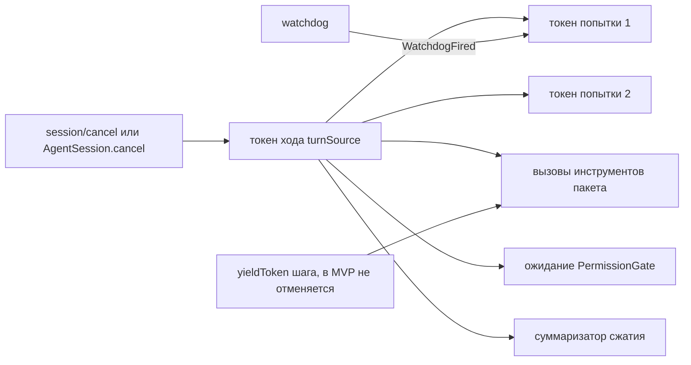

# 3. Отмена

> Часть [архитектуры ядра агента CodeLab](../agent-core-architecture.md). Status: Accepted. Общие соглашения, термины и порядок чтения — в оглавлении.

← [2. LLM-контракт](02-llm-contract.md) · [Оглавление ядра](../agent-core-architecture.md) · [4. ExecutionEnv](04-execution-env.md) →

## 3.1. Назначение

Отмена должна доходить до HTTP-запроса, процесса и ожидания ответа ACP-клиента. Отмена
кооперативная: каждый, кто держит токен, сам прерывает свою работу. Пишущая сторона
(`CancelTokenSource`) остаётся у владельца операции, читающая (`CancelToken`) передаётся вниз.

## 3.2. Контракт

```dart
final class CancelledException implements Exception {
  const CancelledException(this.reason);
  final Object? reason;
  @override String toString() => 'Operation cancelled${reason == null ? '' : ': $reason'}';
}

abstract interface class CancelToken {
  bool get isCancelled;
  Object? get reason;                    // первая причина; null, пока не отменён
  Future<void> get onCancel;             // завершается при отмене; никогда не завершается ошибкой
  void throwIfCancelled();               // бросает CancelledException(reason)
  static final CancelToken none = CancelTokenSource().token;   // никогда не отменяется
}

final class CancelTokenSource {
  CancelTokenSource({CancelToken? parent});   // дочерний токен отменяется вместе с родителем
  CancelToken get token;
  bool get isCancelled;
  void cancel([Object? reason]);              // идемпотентно, первая причина выигрывает
  void dispose();                             // отвязка от родителя; токен остаётся в своём состоянии
}

// Вспомогательные функции (ядро, lib/src/cancel/cancel_token.dart):
Future<T> raceCancel<T>(Future<T> work, CancelToken cancel);      // CancelledException, если отмена раньше
Future<void> delayCancellable(Clock clock, Duration d, CancelToken cancel);

/// Причины отмены, которые различает ядро.
final class UserCancel { const UserCancel(); }                 // session/cancel, AgentSession.cancel()
final class WatchdogFired { const WatchdogFired(this.kind); final String kind; }   // 'connect' | 'idle'
final class ShutdownCancel { const ShutdownCancel(); }         // остановка хоста
```

Эскиз реализации:

```dart
final class _Token implements CancelToken {
  final _done = Completer<void>();
  Object? _reason;
  var _cancelled = false;
  @override bool get isCancelled => _cancelled;
  @override Object? get reason => _reason;
  @override Future<void> get onCancel => _done.future;
  @override void throwIfCancelled() { if (_cancelled) throw CancelledException(_reason); }
  void _cancel(Object? reason) {
    if (_cancelled) return;                 // CAN-2: обратного перехода нет
    _cancelled = true;
    _reason = reason;
    scheduleMicrotask(_done.complete);      // CAN-1: слушатели не внутри cancel()
  }
}

final class CancelTokenSource {
  CancelTokenSource({CancelToken? parent}) {
    if (parent == null) return;
    if (parent.isCancelled) { _token._cancel(parent.reason); return; }
    parent.onCancel.then((_) { if (!_disposed) _token._cancel(parent.reason); });
  }
  final _token = _Token();
  var _disposed = false;
  CancelToken get token => _token;
  bool get isCancelled => _token.isCancelled;
  void cancel([Object? reason]) => _token._cancel(reason ?? const UserCancel());
  void dispose() => _disposed = true;      // после dispose отмена родителя сюда не распространяется
}
```

`raceCancel` — `Future.any([work, cancel.onCancel.then((_) => throw CancelledException(cancel.reason))])`
с подавлением позднего результата или ошибки `work` (`work.ignore()`), чтобы проигравшая ветка не
стала unhandled error. Владелец `work` (адаптер, env) сам освобождает ресурсы по `onCancel`.

## 3.3. Алгоритм: иерархия токенов



1. `AgentSession` создаёт `turnSource` в начале каждого `prompt()`; `cancel()` сессии и ACP `session/cancel` вызывают `turnSource.cancel(const UserCancel())`. Если в `prompt()` передан внешний `CancelToken`, `turnSource` создаётся с ним как с родителем.
2. Каждая попытка запроса к модели получает **дочерний** токен попытки (`withWatchdogs`, §2.10.1). Watchdog отменяет только его — токен хода не трогается, поэтому повтор после watchdog возможен, а отменённый пользователем ход не «воскресает».
3. Каждый вызов инструмента получает токен хода (в параллельном пакете — общий); отмена хода прерывает все вызовы пакета.
4. Ожидание `PermissionGate`, суммаризатор сжатия и задержки повторов (`delayCancellable`) получают токен хода.
5. После завершения хода `turnSource.dispose()`; дочерние источники попыток освобождаются по завершении попытки.

| Где | Что делает при отмене |
|---|---|
| Цикл | `throwIfCancelled()` перед запросом к модели (без обращения к провайдеру — синтетическое сообщение `aborted`), после `beforeToolCall`, между последовательными инструментами, перед `prepareNextStep` |
| Адаптер провайдера | гонка «ответ vs `onCancel`», отмена подписки на тело (закрывает соединение), `ErrorEvent(aborted)` |
| Декораторы | задержка повтора прерывается; новая попытка не начинается |
| `LocalExecutionEnv.exec` | завершение дерева процессов (SIGTERM, затем SIGKILL через 2 с), возврат `Err(ExecError(aborted))` с хвостом вывода |
| `AcpClientExecutionEnv.exec` | `terminal/kill`, затем `terminal/output` и `terminal/release` |
| `AcpPermissionGate` | ожидание ответа клиента прекращается, решение = `cancelled` → отказ |
| Сжатие | вызов суммаризатора отменяется; отмена пробрасывается наружу как `CancelledException`, а не превращается в «ничего не изменилось» (CMP-4) |

Синтетическое сообщение `aborted` (отмена до запроса): `AssistantMessage(content: [],
stopReason: aborted, errorClass: aborted, errorMessage: 'Request was aborted', usage: Usage.zero)`.

**Мягкая уступка между инструментами (soft yield).** Сообщение пользователя посреди хода
(`steer`) не отменяет работающий инструмент. Цикл доставляет его на ближайшей границе шага —
после всего пакета (любого режима): между вызовом и его результатом сообщение не вставляется
(TOOL-6, §5.5, STEER-2). В `ToolContext` зарезервирован отдельный `yieldToken`: инструмент,
умеющий уводить работу в фон, сможет по нему досрочно завершить вызов, не прерывая работу. В MVP
таких инструментов нет, токен никогда не отменяется; после MVP правило уступки — §17.9.7 (JOB-9),
связь со steering — §17.7.3.5, STEER-12.

## 3.4. Примеры

```dart
final turn = CancelTokenSource();
final attempt = CancelTokenSource(parent: turn.token);
attempt.cancel(const WatchdogFired('idle'));     // turn.token.isCancelled == false
final retry = CancelTokenSource(parent: turn.token);
turn.cancel();                                    // retry.token.isCancelled станет true в microtask
await retry.token.onCancel;                       // retry.token.reason is UserCancel
```

## 3.5. Инварианты

1. **CAN-1.** Слушатели `onCancel` никогда не исполняются синхронно внутри `cancel()`.
2. **CAN-2.** Отменённый токен не возвращается в неотменённое состояние; API `reset` отсутствует.
3. **CAN-3.** Отмена родителя отменяет всех потомков (с причиной родителя); отмена потомка не влияет на родителя.
4. **CAN-4.** После отмены хода цикл не начинает новый запрос к модели и новый инструмент; ход завершается `TurnEnded(reason: cancelled)`.
5. **CAN-5.** У каждого вызова инструмента, начатого до отмены, есть `ToolCallFinished` с `outcome: cancelled` (или фактическим исходом, если вызов успел завершиться).
6. **CAN-6.** `steer` не отменяет токен хода и не прерывает работающий инструмент.

## 3.6. Обоснование решения

* **Дочерние токены попыток вместо сброса токена.** Сброс отменённого токена (`reset`) теряет
  отмену, пришедшую в узкое окно между машинной отменой и сбросом, и ломает одноразовые
  `onCancel`-futures подписчиков. Дочерний токен на попытку решает задачу без гонок: watchdog
  отменяет только свою попытку.
* **Слушатели в microtask.** Синхронный вызов слушателей внутри `cancel()` даёт реентерабельность:
  слушатель может снова вызвать код, который как раз отменяет. Microtask делает порядок
  предсказуемым и тестируемым.
* **Yield-токен явным полем `ToolContext`, а не значением `Zone`.** Явная зависимость видна в
  сигнатуре и в тестах; значение зоны теряется при переходе через изоляты и сложно отлаживается.
* **Отмена — кооперативная.** Dart не умеет прерывать чужой `Future`; принудительного механизма
  нет, поэтому контракт каждого порта явно описывает реакцию на токен.

## 3.7. Как проверить

* `cancel_token_test.dart`: слушатель не вызван синхронно внутри `cancel()`, вызван в microtask (CAN-1); второй `cancel` не меняет причину; повторной активации нет (CAN-2); отмена родителя доходит до внука, отмена потомка не трогает родителя; потомок отменённого родителя создаётся отменённым (CAN-3).
* `race_cancel_test.dart`: отмена раньше работы → `CancelledException`, поздняя ошибка `work` не становится unhandled.
* `loop_cancel_test.dart` (scripted LLM): два последовательных инструмента, отмена во время первого → второй не стартует, у первого `cancelled`, `TurnEnded(cancelled)` (CAN-4, CAN-5); отмена до запроса → провайдер не вызван.
* `local_exec_cancel_test.dart` (`_io`): `exec` команды `sh -c 'sleep 60 & sleep 60'` с отменой → процесс и дочерний процесс мертвы, возврат не позже 5 с (ENV-5).
* `acp_env_cancel_test.dart`: отмена → последовательность `terminal/kill`, `terminal/output`, `terminal/release` (ENV-7).
* `steer_does_not_cancel_test.dart`: `steer` во время инструмента — токен хода не отменён, инструмент завершился, сообщение доставлено после пакета (CAN-6).

---

← [2. LLM-контракт](02-llm-contract.md) · [Оглавление ядра](../agent-core-architecture.md) · [4. ExecutionEnv](04-execution-env.md) →
