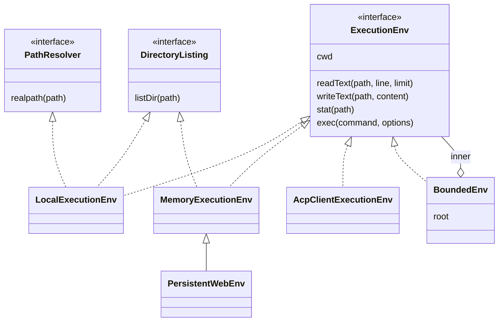

# 4. ExecutionEnv

> Часть [архитектуры ядра агента CodeLab](../agent-core-architecture.md). Status: Proposed. Общие соглашения, термины и порядок чтения — в оглавлении.

← [3. Отмена](03-cancellation.md) · [Оглавление ядра](../agent-core-architecture.md) · [5. Цикл агента](05-agent-loop.md) →

## 4.1. Назначение

Единственная точка, через которую ядро трогает файлы и процессы. Встроенные инструменты пишутся
один раз поверх порта и работают и локально, и через ACP-клиента, и в памяти.

## 4.2. Контракт

```dart
sealed class Result<T, E> { const Result(); }
final class Ok<T, E> extends Result<T, E> { const Ok(this.value); final T value; }
final class Err<T, E> extends Result<T, E> { const Err(this.error); final E error; }
// Использование: switch (r) { Ok(:final value) => ..., Err(:final error) => ... }

enum FileErrorCode { notFound, permissionDenied, isDirectory, notDirectory, outsideWorkspace,
    tooLarge, notText, unsupported, io }
final class FileError {
  const FileError(this.code, this.path, [this.message]);
  final FileErrorCode code; final String path; final String? message;
}

enum FileType { file, directory, link, other }
final class FileStat {
  const FileStat({required this.path, required this.type, this.size, this.modified});
  final String path;            // абсолютный нормализованный путь
  final FileType type;
  final int? size;              // байты; null — неизвестно (ACP-клиент)
  final DateTime? modified;
}

final class ExecOptions {
  const ExecOptions({required this.cwd, this.env = const {}, this.timeout,
      this.cancel = CancelToken.none, this.onOutput, this.onTerminal, this.outputByteLimit = 1 << 20});
  final String cwd;                                  // абсолютный путь
  final Map<String, String> env;                     // поверх минимального окружения (ENV-6)
  final Duration? timeout;
  final CancelToken cancel;
  final void Function(String chunk)? onOutput;       // поток вывода по мере поступления
  final void Function(String terminalId)? onTerminal;   // ACP: id терминала для встраивания в tool_call
  final int outputByteLimit;                         // хранится хвост не больше лимита; при выносе — max_file_bytes (§17.4.3)
}
final class ExecResult {
  const ExecResult({required this.exitCode, required this.output, required this.truncated,
      required this.duration, this.signal});
  final int? exitCode; final String? signal;         // код или сигнал завершения
  final String output;                               // stdout и stderr в порядке поступления
  final bool truncated;                              // начало вывода отброшено лимитом
  final Duration duration;
}
enum ExecErrorCode { aborted, timeout, shellUnavailable, spawnFailed, outsideWorkspace, unknown }
final class ExecError {
  const ExecError(this.code, {this.message, this.outputTail = '', this.duration});
  final ExecErrorCode code; final String? message;
  final String outputTail;                           // при aborted/timeout: хвост, не больше 64 КиБ
  final Duration? duration;
}
```

```dart
abstract interface class FileSystem {
  String get cwd;                                                     // корень сессии
  Future<Result<String, FileError>> readText(String path, {int? line, int? limit});   // line с 1
  Future<Result<void, FileError>> writeText(String path, String content);              // создаёт родителей
  Future<Result<FileStat, FileError>> stat(String path);
}
abstract interface class Shell {
  Future<Result<ExecResult, ExecError>> exec(String command, ExecOptions options);
}
abstract interface class ExecutionEnv implements FileSystem, Shell {}

// Опциональные возможности, проверяются через `is`:
abstract interface class DirectoryListing { Future<Result<List<FileStat>, FileError>> listDir(String path); }
abstract interface class BinaryFiles { Future<Result<Uint8List, FileError>> readBytes(String path); }
abstract interface class PathResolver { Future<Result<String, FileError>> realpath(String path); }
```

Семантика методов:

* Пути на входе — абсолютные или относительные `cwd`; на выходе (`FileStat.path`) — абсолютные нормализованные.
* `readText(path, line, limit)`: строки с номера `line` (с 1), не больше `limit`; без параметров — весь файл. Файл с невалидным UTF-8 → `notText`. Каталог → `isDirectory`.
* `writeText` пишет файл целиком, создаёт недостающие родительские каталоги, перезаписывает существующий.
* `exec` исполняет строку команды через shell хоста; ненулевой код возврата — это `Ok(ExecResult(exitCode: N))`, а не `Err`: ошибка исполнения команды — данные для модели.
* Ожидаемые ошибки — значения `FileError` / `ExecError` с кодом, а не исключения (ENV-1).

**Порт долгоживущего процесса** (после MVP, `env/process_port.dart`, §17.8.2). В отличие от
`Shell.exec` процесс живёт долго, с открытым `stdin`, и запускается без shell; нужен языковым
серверам (`codelab_agent_lsp`). Это отдельный порт, а не часть `ExecutionEnv`: его передаёт хост
только туда, где корень сессии лежит на локальной файловой системе агента (§10.4).

```dart
abstract interface class ByteProcessLauncher {
  int? get hostPid;                                  // pid агента для initialize.processId; null — неизвестен
  /// Запуск без shell: executable ищется в PATH окружения env. Окружение — базовый набор §4.5
  /// плюс env; окружение процесса хоста целиком не наследуется (ENV-6).
  Future<Result<ByteProcess, ExecError>> start(String executable, List<String> args,
      {required String workingDirectory, Map<String, String> env = const {}});
}
abstract interface class ByteProcess {
  int get pid;
  StreamSink<List<int>> get stdin;
  Stream<List<int>> get stdout;
  Stream<List<int>> get stderr;
  Future<int> get exitCode;
  /// Завершение дерева процессов: SIGTERM всем потомкам, через grace — SIGKILL (§4.6, шаг 6).
  Future<void> terminate({Duration grace = const Duration(seconds: 2)});
}
```

**Исполнение в фоне** (после MVP, `env/background_shell.dart`, §17.9.2.1). Опциональная
возможность `ExecutionEnv` `BackgroundShell`, проверяется через `is`, как `DirectoryListing`:
`spawn(command, options)` запускает команду через тот же shell, что `Shell.exec`, и возвращается
сразу после запуска процесса (локально) или ответа на `terminal/create` (ACP). Её реализуют
`LocalExecutionEnv` и `AcpClientExecutionEnv`; `BoundedEnv` пробрасывает её с теми же проверками
`cwd`, что у `exec` (§4.4); `MemoryExecutionEnv` — нет. На ней строятся фоновые команды (capability `backgroundJobs`,
§10.2).

## 4.3. Реализации и декораторы

| Реализация | Пакет | Что делает |
|---|---|---|
| `LocalExecutionEnv` | `codelab_agent_io` | `dart:io`: файлы, процессы, завершение дерева процессов, ограниченное чтение пайпов; реализует все опциональные возможности (§4.6); в профиле `mobile` — с корнем в каталоге документов приложения, `exec` выключен capability `shellExec` (§10.4) |
| `MemoryExecutionEnv` | ядро | файлы в памяти с POSIX-путями; `exec` → `Err(shellUnavailable)`; дефолт тестов и основа `PersistentWebEnv` профиля `web` (§4.8) |
| `PersistentWebEnv` | этап 10, место — в OpenSpec этапа | `MemoryExecutionEnv` с зеркалированием в IndexedDB |
| `AcpClientExecutionEnv` | `codelab_agent_acp` | файлы и команды исполняет ACP-клиент (§4.7) |
| `BoundedEnv` | ядро | декоратор: граница рабочей папки (§4.4) |
| `EnvVarsEnv` | ядро | декоратор: добавляет в `exec` переменные сессии и секреты по allowlist (§4.5) |
| `LocalProcessLauncher` (после MVP) | `codelab_agent_io` | порт `ByteProcessLauncher`: `Process.start(executable, args, runInShell: false, includeParentEnvironment: false)`, завершение дерева процессов как в §4.6; нет файла в `PATH` → `Err(ExecError(spawnFailed, message: 'command "<executable>" was not found'))` (§17.8.2) |

Цепочка декораторов собирается в `buildAgentCore` (§10) в фиксированном порядке:

```text
инструменты → BoundedEnv → EnvVarsEnv → базовый env хоста (Local | AcpClient | Memory)
```

Декоратор реализует опциональную возможность, только если её реализует внутренний env и
декоратор может сохранить свои гарантии (ENV-4). Поэтому декораторы — не один класс, а набор
вариантов, который выбирает фабрика `BoundedEnv.wrap(inner, root)` по `inner is DirectoryListing`,
`inner is BinaryFiles`, `inner is PathResolver`.



## 4.4. Алгоритм: BoundedEnv

Нормализация POSIX-пути `normalize(base, p)` (ядро, `posix_path.dart`):

1. Если `p` начинается с `~/` или равен `~` — `Err(outsideWorkspace)`: домашний каталог ядро не разворачивает.
2. Если `p` относительный — `p = base + '/' + p`.
3. Разбить по `/`, выбросить пустые сегменты и `.`; на `..` удалить последний сегмент результата (у корня `..` остаётся корнем).
4. Собрать `'/' + сегменты.join('/')`.

Проверка пути `p` для любой операции:

1. `abs = normalize(cwd, p)`.
2. Если внутренний env реализует `PathResolver`: найти самый длинный существующий префикс `abs` (идти от полного пути к корню, вызывая `stat`); `real = realpath(префикс) + оставшиеся сегменты`. Так ссылка в середине пути разрешается, а несуществующий хвост (новый файл) — нет.
3. Корень `root` нормализуется и разрешается (`realpath`) один раз при создании `BoundedEnv`.
4. Путь принимается, только если **сегменты** `real` начинаются с сегментов `root`: `real == root` или `real.startsWith(root + '/')`. Сравнение строк по префиксу без разделителя запрещено: `/proj_evil` не входит в `/proj`.
5. Иначе — `Err(FileError(outsideWorkspace, p))` **до** обращения к внутреннему env для самой операции.
6. Внутреннему env передаётся `abs` (не `real`): сообщения об ошибках и `locations` показывают путь так, как его видит пользователь.
7. Для `exec` проверяется `ExecOptions.cwd` (по тому же алгоритму). Содержимое команды `BoundedEnv` не ограничивает: это зона разрешений (§7).
8. `listDir` дополнительно фильтрует результат: записи-ссылки, разрешающиеся вне корня, остаются в списке как `FileType.link`, но последующие операции с ними отклоняются шагом 4.
9. **Корни только для чтения** (каталог выноса текущей сессии `<файл журнала без .jsonl>/spills/` — с этапа 3, §17.4.4; после MVP — корни skills, §17.2.3). `BoundedEnv(inner, root: …, readOnlyRoots: [...], readOnlyFs: fs)`: корни `readOnlyRoots` нормализуются и разрешаются через `readOnlyFs` один раз при создании, как `root`. Операции чтения (`readText`, `readBytes`, `stat`, `listDir`, поиск) принимают путь, если `real` лежит в `root` **или** в одном из `readOnlyRoots` по правилу сегментов шага 4; такой путь уходит в `readOnlyFs`, а не во внутренний env. Запись, правка, удаление и `ExecOptions.cwd` принимаются только в `root`: путь в `readOnlyRoots` для них — `Err(FileError(outsideWorkspace, p))`, **даже если** корень только для чтения лежит внутри `root` (например, `$CODELAB_HOME` внутри `cwd`): проверка `readOnlyRoots` выполняется до проверки `root`. `readOnlyFs == null` → `readOnlyRoots` игнорируются. В MVP список пуст.

Примеры при `root = /proj` (каталог `/proj/link` — ссылка на `/etc`, `/proj/docs` — ссылка на `/proj/site/docs`):

| Вход | `abs` | `real` | Итог |
|---|---|---|---|
| `src/a.dart` | `/proj/src/a.dart` | `/proj/src/a.dart` | принят |
| `/proj` | `/proj` | `/proj` | принят |
| `../x` | `/x` | `/x` | `outsideWorkspace` |
| `src/../../etc/passwd` | `/etc/passwd` | `/etc/passwd` | `outsideWorkspace` |
| `/proj_evil/x` | `/proj_evil/x` | `/proj_evil/x` | `outsideWorkspace` (общий префикс имени) |
| `link/passwd` | `/proj/link/passwd` | `/etc/passwd` | `outsideWorkspace` (ссылка наружу) |
| `docs/new/file.md` (каталога `new` нет) | `/proj/docs/new/file.md` | `/proj/site/docs/new/file.md` | принят |
| `~/.ssh/id_rsa` | — | — | `outsideWorkspace` |
| `./a//b/./c` | `/proj/a/b/c` | `/proj/a/b/c` | принят |

Пути Windows (`C:\proj`) в MVP не поддерживаются ядром: `LocalExecutionEnv` на Windows приводит
пути к виду `/c/proj` до передачи ядру (открытый вопрос §16.3).

## 4.5. Алгоритм: EnvVarsEnv и окружение процессов

1. Базовое окружение процесса (строит `LocalExecutionEnv`, не наследует окружение GUI-процесса целиком): `PATH`, `HOME`, `USER`, `LANG`, `LC_ALL`, `TMPDIR`, `SHELL` — значения из окружения хоста, если заданы; плюс фиксированные `TERM=dumb`, `PAGER=cat`, `GIT_PAGER=cat`, `GIT_TERMINAL_PROMPT=0` (команды не должны ждать интерактивного ввода).
2. `EnvVarsEnv` добавляет переменные сессии из конфигурации (`exec.env`, §15) и секреты по allowlist (`exec.secrets = [{env: GITHUB_TOKEN, secret: github/token}]`): `env` — имя переменной окружения процесса, `secret` — имя секрета в `SecretStore` (§17.5.4); значение читается из `SecretStore` по `secret` при каждом `exec` и передаётся как переменная `env`.
3. `ExecOptions.env` вызова перекрывает оба набора.
4. Значения секретов регистрируются в редакторе (§12): если команда или вывод содержат значение, в транскрипт и лог попадает `[REDACTED]`.

## 4.6. Алгоритм: LocalExecutionEnv.exec

1. Проверить, что `cwd` существует и это каталог; иначе `Err(spawnFailed, message: 'working directory does not exist')`.
2. Запустить `Process.start(shell, ['-c', command], workingDirectory: cwd, environment: env, includeParentEnvironment: false)`, где `shell` = `/bin/sh` (на Windows — `cmd.exe /d /s /c`); переопределяется конфигом `exec.shell`. Ошибка запуска → `Err(spawnFailed)`; нет shell → `Err(shellUnavailable)`.
3. Сразу закрыть `stdin` процесса: интерактивные команды получают EOF, а не зависают.
4. Читать `stdout` и `stderr` параллельно, декодировать `Utf8Decoder(allowMalformed: true)` и складывать в общий кольцевой буфер в порядке поступления чанков. Буфер хранит не больше `outputByteLimit` байт (инструмент `exec` передаёт 1 МиБ, а при включённом выносе — `tools.spill.max_file_bytes`, §17.4.3): при переполнении отбрасывается начало (по границе символа), ставится `truncated = true`. Каждый чанк передаётся в `onOutput`.
5. Ждать первое из трёх: `exitCode`, таймер `timeout`, `cancel.onCancel`.
6. Таймаут или отмена → **завершение дерева процессов**:
   1. Снимок таблицы процессов: `ps -A -o pid=,ppid=` (на Windows — `taskkill /T /F /PID <pid>` и сразу к шагу 7).
   2. Построить отображение «родитель → дети» и собрать всех потомков корневого процесса (обход в ширину).
   3. Отправить `SIGTERM` всем собранным pid одним проходом (сначала собираем, потом шлём: иначе убитый родитель «передаёт» детей процессу init, и они выпадают из следующего снимка).
   4. Подождать до 2 с выхода корня.
   5. Отправить `SIGKILL` всем собранным pid, которые ещё живы, плюс новым потомкам из повторного снимка.
7. После завершения процесса дождаться закрытия пайпов не дольше 1 с; затем отписаться от них принудительно (внук мог унаследовать дескриптор и держать пайп открытым). Общее время возврата после сигнала — не больше 5 с (ENV-5).
8. Результат: обычный выход → `Ok(ExecResult(exitCode, output, truncated, duration))`; таймаут → `Err(ExecError(timeout, outputTail: хвост ≤ 64 КиБ, duration))`; отмена → `Err(ExecError(aborted, ...))`.

## 4.7. Алгоритм: AcpClientExecutionEnv

Env выбирается, если клиент объявил в `initialize` `clientCapabilities.fs.readTextFile`,
`fs.writeTextFile` и `terminal`. Метод, для которого возможности нет, возвращает
`Err(unsupported)` и ни одного запроса не отправляет (`docs/acp/protocol/09-File System.md`,
`10-Terminal.md`: агент НЕ ДОЛЖЕН вызывать необъявленные методы).

| Метод env | ACP |
|---|---|
| `readText(path, line, limit)` | `fs/read_text_file` с `sessionId`, абсолютным `path`, `line`, `limit` |
| `writeText(path, content)` | `fs/write_text_file` |
| `stat(path)` | в ACP нет stat: `fs/read_text_file` с `limit: 1`; успех → `FileStat(type: file, size: null)`; ошибка «не найдено» → `notFound` |
| `exec(command, options)` | `terminal/create` → `terminal/wait_for_exit` → `terminal/output` → `terminal/release` |
| `listDir`, `readBytes`, `realpath` | не реализуются (в ACP таких методов нет) |

Ошибки JSON-RPC: код `-32002` (resource not found) → `notFound`; прочие коды → `io` с текстом
`message` ответа; разрыв соединения → `io` с текстом `client connection lost`.

После MVP (§17.11.2): в профиле `agent-serve` для stdio-клиента `BoundedEnv` получает
`BinaryFiles` от локальной ФС агента (та же, что даёт `listDir` для `fileListing` transport
`local`, §10.4); `readBytes` в ACP не отправляется. Для WebSocket-клиента `BinaryFiles` нет.

Алгоритм `exec`:

1. `terminal/create` с `command: "/bin/sh"`, `args: ["-c", command]`, `cwd`, `env` (массив `{name, value}`), `outputByteLimit`. Ответ — `terminalId`; вызвать `options.onTerminal(terminalId)` (ACP-проекция встраивает `{"type":"terminal","terminalId"}` в `tool_call`).
2. Гонка: `terminal/wait_for_exit` против таймера `timeout` и `cancel.onCancel`.
3. Таймаут или отмена → `terminal/kill`.
4. `terminal/output` → `output`, `truncated`, `exitStatus`.
5. `terminal/release` — **всегда**, в блоке `finally`, в том числе если шаги 2–4 завершились ошибкой (ENV-7). Ошибка самого `release` только логируется.
6. Результат: как в §4.6, шаг 8; `exitCode`/`signal` — из `wait_for_exit` или `exitStatus`.

Пример обмена (кадры укорочены):

```json
{"jsonrpc":"2.0","id":11,"method":"terminal/create","params":{"sessionId":"sess_1","command":"/bin/sh","args":["-c","dart test"],"cwd":"/work/demo","env":[{"name":"GIT_PAGER","value":"cat"}],"outputByteLimit":1048576}}
{"jsonrpc":"2.0","id":11,"result":{"terminalId":"term_7"}}
{"jsonrpc":"2.0","id":12,"method":"terminal/wait_for_exit","params":{"sessionId":"sess_1","terminalId":"term_7"}}
{"jsonrpc":"2.0","id":12,"result":{"exitCode":1,"signal":null}}
{"jsonrpc":"2.0","id":13,"method":"terminal/output","params":{"sessionId":"sess_1","terminalId":"term_7"}}
{"jsonrpc":"2.0","id":13,"result":{"output":"00:01 +3 -1: Some tests failed.\n","truncated":false,"exitStatus":{"exitCode":1,"signal":null}}}
{"jsonrpc":"2.0","id":14,"method":"terminal/release","params":{"sessionId":"sess_1","terminalId":"term_7"}}
{"jsonrpc":"2.0","id":14,"result":null}
```

При отмене между `id: 12` и ответом: агент отправляет `terminal/kill`, затем `terminal/output` и
`terminal/release`; ответ на `wait_for_exit`, если придёт позже, игнорируется.

`ls` и `search` поверх этого env недоступны (нет `DirectoryListing`): профиль выключает их с
причиной (§10). При подключении по stdio клиент и агент на одной машине, поэтому `ls` и `search` работают по локальной файловой системе под `BoundedEnv`; по WebSocket они выключены с причиной (§10.4, §16.2).

## 4.8. Алгоритм: MemoryExecutionEnv

1. Хранилище — `SplayTreeMap<String, _Node>` по абсолютному нормализованному пути; узел — файл (`Uint8List` + `modified`) или каталог. Корень `/` и `cwd` существуют всегда.
2. `writeText` создаёт все недостающие каталоги-предки; запись в путь, где предок — файл, → `notDirectory`.
3. `readText` декодирует UTF-8 строго (`allowMalformed: false`); ошибка → `notText`. Срез `line`/`limit` — по `\n`.
4. `listDir` — прямые потомки в лексикографическом порядке путей.
5. `modified` берётся из `Clock` хоста — тесты детерминированы.
6. `exec` → `Err(ExecError(shellUnavailable, message: 'shell is not available on this platform'))`.
7. Ссылок нет, поэтому `PathResolver` не реализуется: `BoundedEnv` обходится нормализацией.

## 4.9. Инварианты

1. **ENV-1.** Методы `FileSystem` и `Shell` не бросают для ожидаемых ошибок (нет файла, нет прав, таймаут, отмена); исключение — только дефект реализации.
2. **ENV-2.** Ни один инструмент не получает базовый env в обход `BoundedEnv`.
3. **ENV-3.** Путь вне корня сессии отклоняется до вызова базового env, в том числе через `..`, символическую ссылку и соседний каталог с общим префиксом имени. Единственное исключение — чтение из `readOnlyRoots` (§4.4, шаг 9; SKL-9, SPL-5): только операции чтения и только каталоги загруженных skills и каталог выноса текущей сессии; запись, правка, удаление и `cwd` команды в них отклоняются так же, даже если они лежат внутри корня сессии.
4. **ENV-4.** Декораторы пробрасывают опциональные возможности базового env только если могут сохранить свои гарантии (`BoundedEnv` проверяет путь и для `listDir`, и для `readBytes`).
5. **ENV-5.** `exec` с отменой или таймаутом возвращает управление не позже чем через 5 с после сигнала, даже если процесс не реагирует на SIGTERM.
6. **ENV-6.** Переменные окружения `exec` — только явные (`ExecOptions.env`, `EnvVarsEnv`) плюс минимальный базовый набор (§4.5); значения секретов не попадают в транскрипт.
7. **ENV-7.** `AcpClientExecutionEnv` всегда вызывает `terminal/release` для созданного терминала, включая пути ошибки и отмены.

## 4.10. Обоснование решения

* **Узкий базовый `FileSystem`.** В базовый интерфейс входят только операции, которые есть у
  всех реализаций, включая ACP-клиента. Листинг, бинарное чтение и `realpath` — опциональные
  возможности: инструмент, которому они нужны, проверяет их явно, а профиль выключает его, если
  возможности нет. Это честнее, чем эмулировать листинг там, где его нет.
* **Граница рабочей папки — отдельный обязательный декоратор.** Одна проверка в одном месте через
  нормализованный путь и сравнение сегментов: дефект «строковый префикс» (`/proj_evil` проходит
  проверку `/proj`) невозможен по построению. Отдельный декоратор проще протестировать на всех
  реализациях сразу.
* **`realpath` существующего префикса.** Проверка только нормализованной строки пропускает
  символическую ссылку наружу; проверка `realpath` целого пути не работает для нового файла.
  Разрешение самого длинного существующего префикса закрывает оба случая.
* **Ненулевой код возврата — `Ok`.** Упавший тест — нормальный результат команды, который модель
  должна увидеть с выводом; `Err` зарезервирован для случаев, когда команда не выполнилась.
* **Дерево процессов через снимок таблицы.** Dart не даёт создать новую process group при
  `Process.start`; обход потомков по `ps` работает одинаково на macOS и Linux и убивает внуков
  (`npm test` запускает node, node запускает воркеры).
* **Закрытый `stdin` и `GIT_TERMINAL_PROMPT=0`.** Агент не умеет отвечать на интерактивные
  вопросы команды; без этого команда висит до таймаута.

## 4.11. Как проверить

* `bounded_env_test.dart` — табличный тест §4.4 поверх `MemoryExecutionEnv` и (в `_io`) поверх `LocalExecutionEnv` с реальными ссылками во временном каталоге: все строки таблицы, включая `/proj_evil` и ссылку наружу; внутренний env не получает ни одного вызова для отклонённого пути (ENV-3).
* `bounded_env_capabilities_test.dart`: обёртка над env без `DirectoryListing` не реализует `DirectoryListing`; над env с ним — реализует и проверяет путь (ENV-4).
* `wiring_single_env_test.dart`: все инструменты сборки получили один и тот же экземпляр внешнего `BoundedEnv` (ENV-2).
* `execution_env_contract.dart` — общий набор, который прогоняется на `MemoryExecutionEnv`, `LocalExecutionEnv` и `AcpClientExecutionEnv` с fake-клиентом: чтение диапазона строк, запись с созданием родителей, `notFound`, `isDirectory`, `notText`, отсутствие исключений (ENV-1).
* `local_exec_test.dart`: ненулевой код → `Ok`; таймаут с `sh -c 'trap "" TERM; sleep 60'` → `Err(timeout)` не позже 5 с (ENV-5); вывод больше лимита → хвост и `truncated`; окружение не содержит переменной, заданной в тестовом процессе, но не в allowlist (ENV-6); `read` из `stdin` получает EOF.
* `acp_client_env_test.dart` на fake ACP-клиенте: успех, ненулевой код, таймаут, отмена, ошибка `wait_for_exit` — во всех случаях `terminal/release` вызван ровно один раз (ENV-7); без capability `terminal` — `Err(unsupported)` и ни одного кадра.

---

← [3. Отмена](03-cancellation.md) · [Оглавление ядра](../agent-core-architecture.md) · [5. Цикл агента](05-agent-loop.md) →
