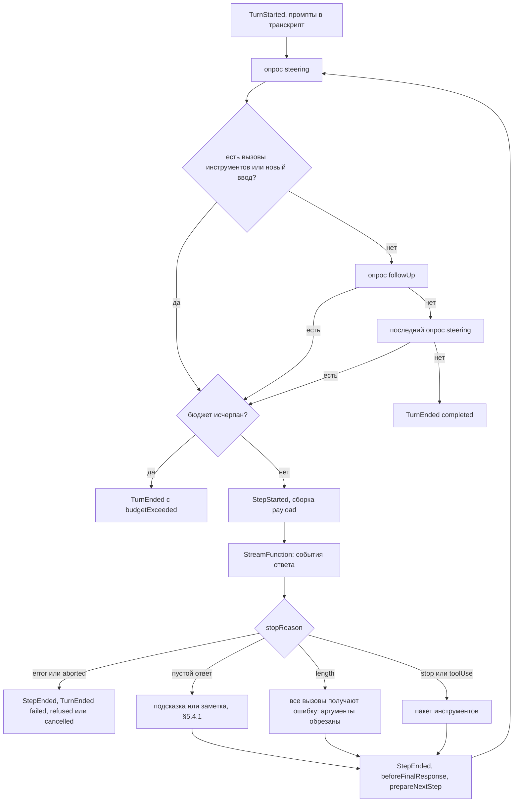
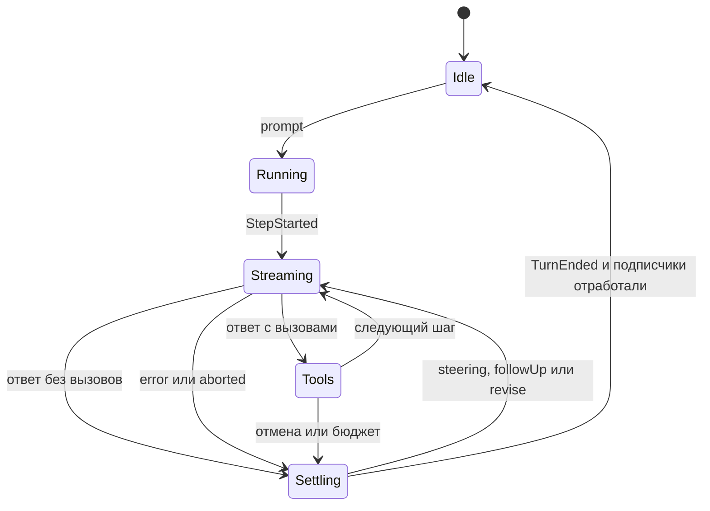

# 5. Цикл агента

> Часть [архитектуры ядра агента CodeLab](../agent-core-architecture.md). Status: Accepted. Общие соглашения, термины и порядок чтения — в оглавлении.

← [4. ExecutionEnv](04-execution-env.md) · [Оглавление ядра](../agent-core-architecture.md) · [6. Инструменты](06-tools.md) →

## 5.1. Назначение

Цикл — «мотор» ядра: вызвать модель, исполнить вызовы инструментов, повторить, пока модель не
перестанет звать инструменты. Он разделён на три уровня:

| Уровень | Что это | Владеет | Не владеет |
|---|---|---|---|
| `runAgentLoop` | чистая функция над внедрёнными `StreamFunction` и `ToolExecutor` | порядком событий, шагами, пакетами инструментов, очередями steering и follow-up, сборкой payload запроса | хранением, сжатием, UI, протоколом |
| `Agent` | объект с состоянием поверх `runAgentLoop` | транскриптом в памяти, очередями, подписчиками, отменой хода | провайдерами, политикой повторов |
| `AgentSession` | публичный API ядра ([proposal](../dart-agent-and-clients.md) §5.1) | журналом сессии, разрешениями, режимом, сжатием, `replay()` | транспортом и протоколом |

## 5.2. Контракт: функция цикла, конфигурация, хуки, бюджет

```dart
typedef AgentEventSink = FutureOr<void> Function(AgentEvent event);   // цикл ждёт каждый emit

/// Единая точка исполнения (§6.3.1) в две фазы: параллельный пакет сначала объявляет все вызовы
/// в порядке ответа (ToolCallStarted), потом исполняет их одновременно (§5.5).
abstract interface class ToolExecutor {
  Future<ToolCallHandle> announce(ToolCall call, ToolInvocation invocation);   // шаг 1: present, ToolCallStarted
  Future<ToolExecutionOutcome> complete(ToolCallHandle handle);                // шаги 1a–10
  Future<ToolExecutionOutcome> abandon(ToolCallHandle handle);                 // отмена до старта (§5.5, шаг 3)
}
final class ToolInvocation {             // что цикл передаёт точке исполнения на один вызов
  final SessionId sessionId; final CancelToken cancel;
  final List<String> stepTools;          // имена схем текущего шага
  final AgentEventSink emit;
  final List<BeforeToolCallHook> beforeToolCall; final List<AfterToolCallHook> afterToolCall;
}

Future<List<Message>> runAgentLoop({
  required List<Message> prompts,          // пусто = продолжение без новых сообщений
  required LoopContext context,            // systemPrompt, messages, tools: копируется
  required AgentLoopConfig config,
  required AgentEventSink emit,
  required CancelToken cancel,
});                                         // возвращает сообщения, добавленные этим ходом

final class LoopContext {
  const LoopContext({required this.systemPrompt, required this.messages, required this.tools});
  final String systemPrompt;
  final List<Message> messages;
  final List<AgentTool> tools;             // схемы шага = tools.map(toSchema)
}

final class AgentLoopConfig {
  const AgentLoopConfig({required this.sessionId, required this.model, required this.stream,
      required this.executor, required this.clock, required this.ids,
      this.budget = const TurnBudget(), this.transformContext, this.beforeToolCall = const [],
      this.afterToolCall = const [], this.prepareNextStep, this.beforeFinalResponse,
      this.maxResponseRevisions = 2, this.maxSteeringSteps = 20,
      this.emptyResponseRetries = 2, this.misuse = const MisuseLimits(),
      this.steering, this.followUp, this.approvalWait, this.logger,
      this.estimateTokens, this.emergencyCompact, this.deadline, this.imageRefs});
  final SessionId sessionId;
  final ModelRef model;
  final StreamFunction stream;
  final ToolExecutor executor;             // единая точка исполнения (§6.3.1)
  final Clock clock; final IdGenerator ids;
  final TurnBudget budget;
  final TransformContextHook? transformContext;
  final List<BeforeToolCallHook> beforeToolCall;     // [0] — всегда проверка разрешений (PERM-1); [1] — после MVP пользовательские хуки (§17.14.2)
  final List<AfterToolCallHook> afterToolCall;       // цепочка: хуки хоста, затем пользовательские хуки after_tool (§17.14.2), затем хук языковых серверов (§17.8.5)
  final PrepareNextStepHook? prepareNextStep;
  final BeforeFinalResponseHook? beforeFinalResponse;
  final int maxResponseRevisions, maxSteeringSteps;
  final int emptyResponseRetries;                    // повторы пустого ответа подряд (§5.4.1), loop.empty_response_retries
  final MisuseLimits misuse;                         // предохранитель неверных вызовов (§6.3.7), loop.misuse.*
  final MessageQueue<SteeringItem>? steering;        // опрашивается циклом; элемент несёт origin (§17.7.2.1)
  final MessageQueue<Message>? followUp;             // опрашивается циклом
  final ApprovalWaitMeter? approvalWait;             // тот же счётчик, что ToolServices.approvalWait; maxDuration
                                                     // считает время хода минус его прирост с начала хода
  final Logger? logger;                              // логи цикла (loop.empty_response, §5.4.1)
  final int Function(LlmContext)? estimateTokens;    // оценка payload (§9)
  final Future<LoopContext?> Function(CancelToken)? emergencyCompact;   // один аварийный вызов сжатия за ход, общий для preflight и overflow (CMP-8)
  final SessionDeadline? deadline;   // после MVP: дедлайн сессии (§17.12.5); null — нет срока
  final ImageRefRegistry? imageRefs; // после MVP: картинка уходит модели один раз (§17.11.2.2); null — как MVP
}
```

```dart
typedef TransformContextHook = Future<List<Message>> Function(List<Message> messages, CancelToken cancel);
typedef BeforeToolCallHook = Future<Block?> Function(ToolCall call, Map<String, Object?> args, ToolContext ctx);
typedef AfterToolCallHook = Future<ResultOverride?> Function(ToolCall call, ToolExecutionResult result, bool isError);
typedef PrepareNextStepHook = Future<StepUpdate?> Function(StepResult step);
typedef BeforeFinalResponseHook = Future<ResponseVerdict> Function(AssistantMessage message, TurnInfo turn);
// TurnInfo — §17.12.4; после MVP хук собирает AgentSession из SessionSpec.finalResponseChecks (composeFinalChecks)

final class Block { const Block(this.reason, {this.outcome = ToolOutcome.rejected}); final String reason; final ToolOutcome outcome; }
final class ResultOverride { const ResultOverride({this.content, this.isError}); final List<ContentBlock>? content; final bool? isError; }
final class StepUpdate { const StepUpdate({this.context, this.model}); final LoopContext? context; final ModelRef? model; }
final class StepResult { final int stepIndex; final AssistantMessage response; final List<ToolResultMessage> results; final Usage usage; }

sealed class ResponseVerdict { const ResponseVerdict(); }
final class Accept extends ResponseVerdict { const Accept(); }
final class Revise extends ResponseVerdict { const Revise(this.note); final String note; }
final class Hold extends ResponseVerdict { const Hold(this.reason); final String reason; }

abstract interface class MessageQueue<T> {
  bool get isEmpty;
  int get length;
  void add(T item);
  T? takeOne();                            // followUp: одно сообщение на точку опроса
  List<T> takeAll();                       // steering: все элементы в порядке FIFO за один опрос (§5.4)
}

final class TurnBudget {
  const TurnBudget({this.maxSteps = 50, this.maxTokens, this.maxCost, this.maxDuration});
  final int maxSteps;            // шаги модели за ход (ACP: max_turn_requests)
  final int? maxTokens;          // сумма input + output по usage всех шагов хода
  final double? maxCost;         // стоимость по ModelCost; не проверяется, если цены неизвестны
  final Duration? maxDuration;   // время хода по часам хоста, без ожидания одобрения
}
enum BudgetLimit { steps, tokens, cost, duration, deadline }   // deadline — §17.12.5
```

Хуки и точные места срабатывания:

| Хук | Когда | Семантика |
|---|---|---|
| `transformContext` | перед **каждым** запросом к модели, включая повтор после ремонта пар | меняет только payload, не транскрипт; исключение = сбой хода (`TurnEnded(failed)`) |
| `beforeToolCall` (цепочка) | после поиска инструмента и валидации аргументов, до исполнения | первый вернувший `Block(reason)` останавливает цепочку: результат-ошибка с текстом `reason`, инструмент не исполняется. **Первым** в цепочке всегда стоит проверка разрешений (§7). После MVP вторым звеном идут пользовательские хуки `before_tool` (§17.14.2), хуки хоста — последними |
| `afterToolCall` (цепочка) | после исполнения, до `ToolCallFinished` | хуки вызываются по порядку, каждый видит результат после переопределений предыдущих; переопределение по полям (`content`, `isError`); исключение = результат-ошибка с текстом исключения. Порядок: хуки хоста, затем (после MVP) хук сессии языковых серверов `LanguageServerSession.afterToolCall` — синхронизация документов и диагностика после правок (§17.8.5) |
| `prepareNextStep` | после `StepEnded`, до опроса steering | заменить контекст (сжатие) или модель для следующего шага |
| `beforeFinalResponse` | шаг завершился без вызовов инструментов, ход готов остановиться, до `TurnEnded` | `Accept` — ход завершается; `Revise(note)` — заметка добавляется в payload следующего шага последним `user`-сообщением, не более `maxResponseRevisions` раз за ход; `Hold(reason)` — ход завершается с ответом, помеченным `TurnEnded.held = reason`. В MVP — только интерфейс, хук не регистрируется; после MVP — составной хук проверок `FinalResponseCheck` с лимитом ревизий и политикой `loop.final_response.on_revise_limit` (§17.12.4) |

**Бюджет хода.** Проверяется на границе шага: после `StepEnded` и до следующего запроса к модели.
Исполняемый инструмент не прерывается. Лимит исчерпан, когда значение его достигло (`>=`): при
`maxTokens: 1000` ход, потративший ровно 1000 токенов, следующего шага не делает. Время ожидания
одобрения (`PermissionGate`) вычитается из `maxDuration`. При превышении ход завершается `TurnEnded(reason: completed, budgetExceeded: limit)`;
ACP-адаптер отдаёт `stopReason: max_turn_requests`, а вид лимита — в `_meta` (расширение через OpenSpec).

**Сборка payload** (каждый запрос, транскрипт не меняется — LOOP-7):

1. `messages = transformContext?.call(transcript)` или копия транскрипта.
1a. Пустые ответы модели (`isEmptyCompletion`, §5.4.1) удаляются из `messages`: провайдеры
    отвергают `assistant` без контента, а повторять модели её же пустоту бесполезно. Подсказки
    `LoopNudgeOrigin` и заметки `LoopNoteOrigin` остаются: два `user` подряд допустимы у обоих
    диалектов (§2.5; Anthropic объединяет соседние сообщения одной роли).
1b. После MVP (C-16, §17.11.2.2): `messages = imageRefs?.apply(messages)` — каждая картинка журнала
    передаётся блоком один раз (первое вхождение с подписью `[Image N]`), остальные вхождения —
    текст `[Image N]`; номера из журнала, стабильны в сессии.
2. Ремонт парности вызовов (§6.3.3); непустой отчёт → событие `ToolPairingRepaired`.
3. Если есть заметка `Revise` — добавить `UserMessage([TextContent(note)])` в конец payload.
3a. После MVP: если у сессии есть дедлайн (§17.12.5) — `UserMessage([TextContent(deadline.timeLeftLine(now))])` последним сообщением payload; в транскрипт не входит.
4. Оценка размера `estimateTokens(LlmContext)`; если больше окна модели — один вызов `emergencyCompact` за ход (CMP-8) и пересборка с шага 1; если сжатие не помогло или его нет — синтетический `AssistantMessage(stopReason: error, errorClass: overflow, errorMessage: 'context window exhausted')` без обращения к провайдеру.
5. `LlmContext(systemPrompt, messages, tools.map(toSchema))` → `ModelRequested` → `stream(...)`.

`systemPrompt` берётся из текущего `LoopContext` и между шагами меняется только через
`prepareNextStep` (`StepUpdate.context`). В MVP он постоянен в пределах хода; после MVP
`AgentSession` пересобирает его перед запросом, когда меняются закреплённые строки skills
(§11.5, §17.2.7).

## 5.3. Контракт: события

```dart
sealed class AgentEvent { SessionId get sessionId; }
final class TurnStarted extends AgentEvent { final TurnId turnId; final List<Message> input; }
final class StepStarted extends AgentEvent { final int stepIndex; }
final class ModelRequested extends AgentEvent { final ModelRef model; final int estimatedTokens; final int messageCount; }
final class MessageStarted extends AgentEvent {
  final Message message;
  final MessageOrigin? origin; }            // служебное сообщение цикла (§5.4.1); после MVP (§17.7.2.1) — steering или уведомление субагента; null — промпт или ответ
final class MessageDelta extends AgentEvent { final String delta; final AssistantMessage partial; }
final class ThoughtDelta extends AgentEvent { final String delta; final AssistantMessage partial; }
final class MessageEnded extends AgentEvent { final Message message; }
final class ToolCallStarted extends AgentEvent {
  final String toolCallId, tool; final ToolKind kind; final String title;
  final Map<String, Object?> input; final List<Location> locations; }
final class ToolCallProgress extends AgentEvent { final String toolCallId; final List<ToolCallContent> content; }
// После MVP (§17.12.3): вызов исполняется дольше порога / молчит дольше порога
final class ToolCallHeartbeat extends AgentEvent { final String toolCallId; final Duration elapsed, sinceOutput; }
final class ToolCallStuck extends AgentEvent { final String toolCallId; final Duration elapsed, sinceOutput; }
final class ToolCallFinished extends AgentEvent {
  final String toolCallId; final ToolOutcome outcome; final List<ContentBlock> content;
  final List<FileDiff> diffs;               // по одному на изменённый файл; пусто — правок нет (§6.2)
  final SpillRef? spill; }                  // с этапа 3 (§17.4.2): результат вынесен в файл
final class ToolPairingRepaired extends AgentEvent { final PairingReport report; }
final class StepEnded extends AgentEvent { final StepResult result; }
final class PlanUpdated extends AgentEvent { final List<PlanEntry> entries; }
final class ModeChanged extends AgentEvent { final ModeId mode; }
final class CommandsChanged extends AgentEvent { final List<SlashCommand> commands; }
final class ConfigOptionChanged extends AgentEvent { final String optionId, value; }   // уровень AgentSession (§8.3)
final class SessionTitleChanged extends AgentEvent { final String title; final DateTime updatedAt; }   // уровень AgentSession (§8.3)
final class ContextCompacted extends AgentEvent { final int tokensBefore, tokensAfter; }
final class AgentError extends AgentEvent { final AgentErrorClass cls; final LlmErrorClass? errorClass; final String message; final bool retrying; final RateLimitInfo? rateLimit; }   // rateLimit — после MVP (§17.10.4.1)
                                                  // errorClass — только при cls == provider (§2.2)
final class TurnEnded extends AgentEvent {
  final TurnEndReason reason; final Usage usage; final BudgetLimit? budgetExceeded; final String? held;
  final List<SteerId> returnedSteers; }     // после MVP (§17.7.3.3): принятые и не доставленные steering

// После MVP (§17.3.2): события уровня AgentSession, как ConfigOptionChanged; sessionId — родительский
final class SubagentStarted extends AgentEvent {
  final SubagentId subagentId; final String parentToolCallId, agent, description;
  final SessionId childSessionId; final String journalPath; }        // путь относительно sessions/
final class SubagentProgress extends AgentEvent { final SubagentSnapshot snapshot; }
final class SubagentFinished extends AgentEvent {
  final SubagentId subagentId; final String parentToolCallId;
  final SubagentState status; final SubagentFailure? failure;
  final Usage usage; final Duration duration; final String reportPreview; }   // первые 200 символов

// После MVP (§17.6.2): события уровня AgentSession, как SessionTitleChanged
final class BranchChanged extends AgentEvent { final String leafId, fromLeafId; final BranchReason reason; }
final class SessionAccessChanged extends AgentEvent {
  final SessionAccess access; final LeaseOwner? owner;
  final String reason; }                    // "leaseLost", "foreignWrite", "leaseAvailable"

// MessageOrigin — sealed-класс §17.7.2.1. В MVP он вводится ради служебных сообщений цикла
// (§5.4.1); варианты SteerOrigin и SubagentNoticeOrigin добавляются после MVP, JobNoticeOrigin — §17.9.6, DeadlineNoticeOrigin — §17.12.5.
enum LoopNudgeReason { emptyResponse, deadline }
final class LoopNudgeOrigin extends MessageOrigin {   // user-сообщение написал цикл, а не человек
  const LoopNudgeOrigin(this.reason, this.attempt);
  final LoopNudgeReason reason; final int attempt; }  // attempt — номер повтора с 1
final class LoopNoteOrigin extends MessageOrigin {    // синтетический assistant-ответ цикла (заметка)
  const LoopNoteOrigin(this.reason); final LoopNudgeReason reason; }

enum TurnEndReason { completed, maxTokens, refused, cancelled, failed }
enum ToolOutcome { completed, failed, cancelled, rejected }
enum AgentErrorClass { provider, fallback, compaction, hook, storage }

/// Slash-команда для `CommandsChanged` и ACP `available_commands_update` (§13.6, §17.2.6).
enum SlashCommandSource { builtin, template, skill, mcpPrompt, plugin }
final class SlashCommand {
  final String name;                            // без "/": "compact", "review", "skill:release-notes"
  final String description;
  final String? inputHint;                      // ACP AvailableCommand.input.hint
  final SlashCommandSource source;
}
```

В MVP источник команд — только `builtin` и `mcpPrompt` (MCP prompts, §13.6); `template` и `skill`
добавляет §17.2. `plugin` добавляет §17.14.3.

| Событие | Когда | Payload |
|---|---|---|
| `TurnStarted` | первым событием хода | `turnId`, входные сообщения |
| `StepStarted` | перед каждым запросом к модели | `stepIndex` (с 0) |
| `ModelRequested` | непосредственно перед вызовом `StreamFunction` (диагностика) | модель, оценка токенов, число сообщений |
| `MessageStarted` | сообщение вошло в транскрипт: промпт, steering, первый снимок ответа с блоком (ответ без блоков — на терминальном событии), результат инструмента, служебное сообщение цикла (§5.4.1) | `message`, `origin?` (`LoopNudgeOrigin`, `LoopNoteOrigin`; после MVP: `SteerOrigin`, `SubagentNoticeOrigin`, `JobNoticeOrigin` (§17.9.6) или `DeadlineNoticeOrigin` (§17.12.5), §17.7.2.1) |
| `MessageDelta` | каждое текстовое `BlockDeltaEvent` | `delta`, `partial` |
| `ThoughtDelta` | каждое `BlockDeltaEvent` рассуждения | `delta`, `partial` |
| `MessageEnded` | сообщение завершено (точка сохранения) | финальное `message` |
| `ToolCallStarted` | при входе вызова в единую точку исполнения (после `MessageEnded` ответа) | `toolCallId`, `tool`, `kind`, `title`, `input`, `locations` |
| `ToolCallProgress` | частичный результат через `onUpdate` или `onTerminal` | `toolCallId`, `content` |
| `ToolCallHeartbeat`, `ToolCallStuck` | после MVP: вызов исполняется дольше порога / молчит дольше порога (§17.12.3) | `toolCallId`, `elapsed`, `sinceOutput` |
| `ToolCallFinished` | вызов завершён | `toolCallId`, `outcome`, `content`, `diffs` (по одному на файл), `spill?` (§17.4: `content` — фрагмент вынесенного результата) |
| `ToolPairingRepaired` | payload запроса потребовал ремонта пар | отчёт о ремонте |
| `StepEnded` | шаг завершён | ответ модели, результаты в порядке вызовов |
| `PlanUpdated` | инструмент `update_plan` обновил план | `entries` |
| `ModeChanged`, `CommandsChanged` | смена режима, списка slash-команд | новое значение |
| `ContextCompacted` | сжатие записано в журнал (§9) | `tokensBefore`, `tokensAfter` |
| `SubagentStarted`, `SubagentProgress`, `SubagentFinished` | после MVP: эмитит `SubagentManager` сессии родителя, не цикл (§17.3.2) | идентификаторы ребёнка, снимок прогресса, итог |
| `BranchChanged` | после MVP: эмитит `AgentSession` после записи `branch` — переключение ветки или перемотка (§17.6.5); у читателя в режиме только чтения — после перечитывания снимка (§17.6.8) | `leafId`, `fromLeafId`, `reason` |
| `SessionAccessChanged` | после MVP: эмитит `AgentSession` при потере lease, чужой записи или освобождении lease владельцем (§17.6.8) | `access`, `owner?`, `reason` |
| `AgentError` | сбой или повтор: провайдер, fallback, сжатие, хук, журнал | `cls`, `errorClass?` (`LlmErrorClass` при `cls: provider`), `message`, `retrying` |
| `TurnEnded` | **последним** событием хода | `reason`, `usage` (сумма шагов), `budgetExceeded?`, `held?`, `returnedSteers` (после MVP, §17.7.3.3) |

Соответствие `TurnEnded.reason`: ответ `stop`/`toolUse` без вызовов → `completed`; `length` без
вызовов → `maxTokens`; `terminalFinish` → `refused`; отмена → `cancelled`; прочие ошибки →
`failed`. `ToolOutcome` — доменный исход вызова; в ACP нет `cancelled`/`rejected` — проекция в §13.

Порядок для шага с двумя параллельными вызовами:

```text
StepStarted, ModelRequested, MessageStarted, MessageDelta xN, MessageEnded(assistant),
ToolCallStarted(c1), ToolCallStarted(c2), ToolCallFinished(c2), ToolCallFinished(c1),
MessageStarted/Ended(result c1), MessageStarted/Ended(result c2), StepEnded
```

## 5.4. Алгоритм хода

```text
runAgentLoop(prompts, context, config, emit, cancel):
 1  emit TurnStarted; для каждого p из prompts: transcript.add(p); emit MessageStarted(p), MessageEnded(p)
 2  step = 0; steeringSteps = 0; revisions = 0; emptyStreak = 0; usage = 0; pendingCalls = false; emergencyUsed = false
 3  pollSteering()                                        # перед первым шагом
 4  loop:
 5    if not pendingCalls and not hasNewInput:
 6      m = followUp.takeOne(); if m == null: pollSteering()   # финальный опрос
 7      if m == null and not hasNewInput: break           # естественная остановка; ход запечатан
 8      if m != null: addInput(m)
 9    if deadlineReached() or budgetExceeded(step, usage, elapsed): reason = completed; budgetExceeded = limit; break   # дедлайн — первым, затем заметка LoopNoteOrigin(deadline), §17.12.5
10    if cancel.isCancelled: response = syntheticAborted(); goto 15
10a   notice = deadline?.takeDueNotice(now); если есть текст — addDeadlineNotice(notice)   # §17.12.5, не шаг
11    emit StepStarted(step); payload = buildPayload()     # §5.2, шаги 1–5
12    emit ModelRequested; stream = config.stream(model, payload, cancel)
13    consume(stream):                                    # первый снимок → transcript + MessageStarted,
                                                          # дальше замена последнего элемента на partial,
                                                          # MessageDelta / ThoughtDelta; уникализация id (LOOP-11)
14    if провайдер до первого блока вернул 400 с ошибкой парности и ремонт ещё не повторялся:
        пересобрать payload, ModelRequested, повторить запрос того же шага (без второго StepStarted)
14a   if response.stopReason == error and response.errorClass == overflow:   # §2.11, §9.5
        if not emergencyUsed and emergencyCompact != null:  # общий с preflight (§5.2, шаг 4) флаг: один раз за ход (CMP-8)
          emergencyUsed = true; ctx = emergencyCompact(cancel)
          if ctx != null: применить ctx; goto 11           # один повтор того же шага; ответ с ошибкой в транскрипт не входит
        # иначе — обычная ошибка шага: шаг 16, reason = failed
15    transcript[last] = response; emit MessageEnded(response); usage += response.usage
16    if response.stopReason in {error, aborted}:
        emit AgentError (если error); emit StepEnded; reason = cancelled|refused|failed; break
17    calls = response.toolCalls
17a   if not isEmptyCompletion(response): emptyStreak = 0  # §5.4.1
18    if response.stopReason == length: results = calls.map(truncatedArgsError)   # LOOP-5
      else: results = executeBatch(calls)                 # §5.5
19    для r из results в порядке calls: transcript.add(r); emit MessageStarted(r), MessageEnded(r)
20    emit StepEnded(step, response, results); step++
21    pendingCalls = calls.isNotEmpty
22    if not pendingCalls and isEmptyCompletion(response):  # §5.4.1, до beforeFinalResponse
        if emptyStreak < emptyResponseRetries: emptyStreak++; addNudge(emptyStreak); pendingCalls = true
        else: addEmptyNote(emptyStreak + 1); emptyStreak = 0   # ход идёт к опросу followUp, хук не зовётся
      elif not pendingCalls:
        verdict = beforeFinalResponse?(response) ?? Accept
        if verdict is Revise and revisions < maxResponseRevisions: revisions++; note = verdict.note; pendingCalls = true
        if verdict is Hold: held = verdict.reason        # составной хук §17.12.4 уже учёл лимит ревизий
23    update = prepareNextStep?(stepResult); применить update.context / update.model
24    if cancel.isCancelled: reason = cancelled; break
25    pollSteering()
26  emit TurnEnded(reason ?? fromStopReason(lastResponse), usage, budgetExceeded, held)
27  return сообщения, добавленные с шага 1
```

`pollSteering()` (§17.7.3.2): если `steeringSteps < maxSteeringSteps` и следующий шаг начнётся
(ход не отменён, бюджет не исчерпан), забирает **все** элементы очереди `steering` в порядке FIFO
(`takeAll`), добавляет их в транскрипт (`MessageStarted(origin)`/`MessageEnded`), увеличивает
`steeringSteps` на один — один шаг на опрос, а не на сообщение — и помечает «есть новый ввод».
Пользовательские сообщения и уведомления фоновых субагентов лежат в одной очереди в порядке
поступления. Если следующий шаг не начнётся, опрос ничего не забирает.

**Запечатывание.** Ход запечатывается синхронно в момент, когда цикл решил больше не начинать
шагов: финальный опрос (шаги 6–7) не нашёл ввода, сработал бюджет (шаг 9), ход отменён (шаги 10,
24) или ответ модели — `error`/`aborted` (шаг 16). После этого `Agent.trySteer` отвечает
`noActiveTurn` (§17.7.3.1). На `TurnEnded` пользовательские сообщения, оставшиеся в очереди,
удаляются из неё и перечисляются в `TurnEnded.returnedSteers`; уведомления субагентов остаются до
следующего хода (§17.7.3.3). Любое исключение хука или внутренней ошибки ловится вокруг всего
цикла и превращается в `AgentError(cls: hook)` + `TurnEnded(failed)` (LOOP-1).





### 5.4.1. Пустой ответ модели (C-07)

Модель иногда завершает ответ посреди задачи, не сказав ничего и не позвав инструмент. Без
обработки ход тихо заканчивается `end_turn`, и пользователь не понимает, сделана ли работа.
Цикл повторяет запрос с короткой подсказкой, а после исчерпания повторов завершает ход видимой
заметкой.

**Определение.** `isEmptyCompletion(response)` истинно, когда одновременно:

1. `response.stopReason` — `stop` или `toolUse` (`length`, `error`, `aborted` и `terminalFinish`
   обрабатываются своими путями шагов 16–18 и пустым ответом не считаются);
2. в ответе нет ни одного `ToolCall`;
3. у каждого `TextContent` ответа `text.trim()` пуст (или текстовых блоков нет вовсе).

Блоки рассуждений (`ThinkingContent`) не учитываются: ответ «только рассуждение» — пустой, потому
что пользователь и следующий шаг не получают из него ни текста, ни действия.

**Подсказка.** `addNudge(n)` добавляет в транскрипт `UserMessage([TextContent(nudge)])` с
`origin: LoopNudgeOrigin(emptyResponse, n)` и эмитит `MessageStarted(origin)`, `MessageEnded`.
Текст фиксирован:

```text
Your previous response was empty. Continue the task: call a tool or answer the user with text.
```

**Заметка.** `addEmptyNote(n)` добавляет синтетический
`AssistantMessage([TextContent(note)], stopReason: stop, usage: Usage.zero, model: текущая)` с
`origin: LoopNoteOrigin(emptyResponse)` и эмитит `MessageStarted` (пустой `partial`), один
`MessageDelta(note)` и `MessageEnded(note)` — так ACP-адаптер показывает заметку обычным
`agent_message_chunk`, без особой проекции. Шагом заметка не является: нет `StepStarted`,
`ModelRequested`, `StepEnded`, бюджет не тратится. Текст (`<N>` — число пустых ответов подряд,
`emptyResponseRetries + 1`):

```text
[Stopped: the model returned an empty response (attempts: <N>). Send a message to continue.]
```

**Правила.**

1. Счётчик `emptyStreak` считает пустые ответы **подряд** в пределах хода и сбрасывается любым
   непустым ответом (текстом или вызовом). Число повторов — `AgentLoopConfig.emptyResponseRetries`
   (конфиг `loop.empty_response_retries`, по умолчанию `2`, диапазон `0..5`); `0` — без
   повторов, первый же пустой ответ сразу даёт заметку.
2. Каждый повтор — обычный шаг: он входит в `maxSteps` (ACP `max_turn_requests`), его `usage`
   входит в `maxTokens` и `maxCost`. Бюджет проверяется как всегда, на шаге 9: если лимит
   исчерпан, ход завершается `budgetExceeded`, а не заметкой.
3. Пустой ответ не передаётся в `beforeFinalResponse`: финальный гейт оценивает ответ, а не его
   отсутствие. После заметки хук тоже не вызывается.
4. После заметки ход останавливается как после естественной остановки (для `codelab -p` это код выхода `0`: заметка — ответ, §13.10): шаги 6–7 (опрос
   `followUp` и финальный опрос steering) выполняются; если ввода нет, `TurnEnded(completed)`,
   ACP `stopReason: end_turn`.
5. Пустой ответ остаётся в транскрипте и журнале (это факт разговора, у него есть `usage`), но не
   уходит в payload (§5.2, шаг 1a). Подсказки и заметка пишутся в журнал обычными записями
   `message` с полем записи `origin` (`"loop_nudge"` с `nudge: "empty_response"` и `attempt`;
   `"loop_note"` с `nudge: "empty_response"`, после MVP — `"deadline"`), чтобы после `session/load` payload следующего хода был тем же, что в живой
   сессии. Реплей (§13.5) подсказку пропускает (это не слова пользователя), заметку отдаёт как
   `agent_message_chunk`; вживую ACP-адаптер на `MessageStarted(user, LoopNudgeOrigin)` ничего не
   отправляет.
6. Логи: `loop.empty_response` (warning: `attempt`, `model`, `stepIndex`) на каждый пустой ответ;
   `loop.empty_response.stopped` (warning: `attempts`) при заметке.

Пример (`emptyResponseRetries = 2`): шаг 0 — пустой ответ, подсказка 1; шаг 1 — только
рассуждение, подсказка 2; шаг 2 — текст `Done.` → ход завершён `end_turn`, в транскрипте
`[user, assistant(пусто), user(nudge 1), assistant(thinking), user(nudge 2), assistant("Done.")]`,
payload шага 2 — `[user, user(nudge 1), user(nudge 2)]`. Если и шаг 2 пуст, в транскрипт
добавляется заметка `[Stopped: ... (attempts: 3). ...]`.

## 5.5. Алгоритм пакета инструментов

0. В начале хода цикл создаёт один `MisuseBreaker(config.misuse)` (§6.3.7); каждый `ToolContext`
   этого хода получает его в поле `misuse`. Следующий ход начинает с пустого счётчика.
1. Режим пакета: `sequential`, если хотя бы для одного вызова пакета `tool.executionModeOf(args) == sequential` (по умолчанию — объявленный инструментом `executionMode`, §6.2; после MVP режим может зависеть от аргументов, например `lsp rename`, §17.8.9); иначе `parallel`.
2. **Parallel.** Для каждого вызова в порядке ответа: `emit ToolCallStarted`. Затем все вызовы исполняются через `executor` одновременно (`Future.wait`); каждый `ToolCallFinished` эмитится в момент завершения своего вызова (под общей очередью emit, LOOP-2). Результаты-сообщения добавляются после всего пакета в порядке вызовов (LOOP-3).
3. **Sequential.** Для каждого вызова: `ToolCallStarted` → исполнение → `ToolCallFinished`; перед следующим вызовом — проверка отмены. При отмене оставшиеся вызовы не исполняются и получают `ToolCallStarted` + `ToolCallFinished(cancelled)` с текстом `Tool call was cancelled before it started` — у каждого вызова ответа есть результат (парность, TOOL-6).
4. Steering во время пакета не прерывает его (CAN-6): сообщение ждёт в очереди до шага 25 алгоритма хода — после всего пакета любого режима; между вызовом и его результатом сообщение не вставляется (TOOL-6, STEER-2).
5. Частичные результаты (`onUpdate`) после завершения вызова игнорируются; цикл дожидается доставки уже отправленных `ToolCallProgress`, прежде чем эмитить `ToolCallFinished`.

## 5.6. Контракт: Agent и публичный API

```dart
final class Agent {
  Agent({required AgentLoopConfig config, required String systemPrompt,
      required List<AgentTool> tools, List<Message> history = const []});
  Future<void> prompt(List<Message> messages);     // StateError, если ход уже идёт (LOOP-10)
  /// Уведомления субагентов (§17.3.8, origin — SubagentNoticeOrigin); без хода — в начало следующего.
  void steer(Message m, {MessageOrigin? origin});
  /// После MVP (§17.7.2.1): пользовательский steering; принимается только в идущем и не запечатанном
  /// ходе. Синхронный: решение и место в очереди известны до возврата.
  SteerAdmission trySteer(UserMessage m, {required SteerId id});
  void followUp(Message m);                        // доставляется после естественной остановки
  void abort([Object? reason]);                    // отменяет токен хода
  Future<void> waitForIdle();                      // после TurnEnded и всех подписчиков
  void Function() subscribe(AgentEventSink listener);   // слушатели ждутся по порядку подписки
  List<Message> get messages;                      // неизменяемая копия транскрипта
  bool get isRunning;
  void replaceTranscript(List<Message> messages);  // только вне хода: после сжатия (§9)
  /// Общая очередь событий (LOOP-2): через неё эмитят цикл и сервисы сессии (PlanService → PlanUpdated).
  Future<void> emit(AgentEvent event);
  AgentLoopConfig config;                          // меняется между ходами (модель, режим)
}
```

Публичный API ядра ([proposal](../dart-agent-and-clients.md) §5.1):

```dart
abstract interface class AgentRuntime {
  Future<AgentSession> createSession(SessionSpec spec);   // cwd, mode, model, mcpServers, ports, extraBeforeToolCall, extraAfterToolCall
  /// После MVP режим открытия mode (§17.6.8): занятая другим процессом сессия при
  /// OpenMode.write → SessionLockedException(owner).
  Future<AgentSession> loadSession(SessionId id, SessionHostPorts ports,
      {OpenMode mode = OpenMode.write});
  Future<List<SessionSummary>> listSessions({String? cwd});
  Future<SessionSearchPage> searchSessions(SessionSearchQuery query);   // после MVP (§17.6.17, D-17): делегирует SessionStore.search
  /// После MVP (§17.6): работают и для незагруженной сессии.
  Future<String> renameSession(SessionId id, String title);   // §17.6.4
  Future<ForkResult> forkSession(ForkSpec spec);              // §17.6.7; lease источника не нужен
  Future<SessionTree> sessionTree(SessionId id);              // §17.6.3
  /// После MVP (§17.3.3): дочерняя сессия субагента. Журнал — в каталоге журнала родителя
  /// (§17.3.6), заголовок с полем parent; в listSessions не попадает.
  Future<AgentSession> createChildSession(ChildSessionSpec spec);
  /// После MVP (§17.3.8.1): открыть существующую дочернюю сессию из её журнала для нового прогона
  /// (task_send, task_resume). Под lease родителя; heal (§8.8) уже выполнен при open родителя.
  Future<AgentSession> openChildSession(ChildSessionSpec spec, SessionId childSessionId);
  Future<void> dispose();
}
final class ChildSessionSpec {                        // после MVP, §17.3.3
  final AgentSession parent; final SubagentId subagentId; final SubagentSpec subagent;
  final List<AgentTool> tools;                        // пересечение с родителем без task и update_plan (SUB-1)
  final ModelRef model; final TurnBudget budget;
  final PermissionMode Function() mode;               // narrow(parentMode(), type.mode) на каждое решение (SUB-2)
  final PermissionGate? gate;                         // SubagentPermissionGate над gate родителя
}
final class SessionSpec {
  final String cwd; final ModeId mode; final ModelRef model;
  final List<McpServerConfig> mcpServers;
  final SessionHostPorts ports;                       // env, gate, store, logger
  final List<BeforeToolCallHook> extraBeforeToolCall; // хуки хоста, ставятся последними в цепочке (§10)
  final List<AfterToolCallHook> extraAfterToolCall;   // хуки хоста; в цепочке afterToolCall идут первыми, до хука языковых серверов (§10.7, шаг 6)
  final SkillCatalog skills;                          // после MVP (§17.2.1): загружает хост; по умолчанию SkillCatalog.empty
}
abstract interface class AgentSession {
  SessionId get id;
  Stream<AgentEvent> get events;
  Future<TurnResult> prompt(List<ContentBlock> content, {CancelToken? cancel});
  SteerAdmission steer(List<ContentBlock> content);   // после MVP: результат приёма (§17.7.2.1)
  Future<void> cancel();
  Future<void> setMode(ModeId mode);
  Future<void> setConfigOption(String id, String value);
  Iterable<AgentEvent> replay();                  // проекция журнала для session/load (§8)
  // После MVP (§17.6.2): управление сессией
  SessionAccess get access;                       // write | readOnly (lease, §17.6.8)
  Future<String> rename(String title);            // можно во время хода
  SessionTree tree();                             // ветки, сообщения активной ветки, метки
  Future<BranchResult> switchBranch(String targetId, {bool? summarize, CancelToken? cancel});
  Future<RewindResult> rewind(String messageId,
      {bool? summarize, bool dryRun = false, CancelToken? cancel});
  Future<void> label(String targetId, String? label);
  // После MVP (§8.5.1, §17.9.9): закрыть сессию — остановить субагентов и фоновые команды;
  // seal: true дополнительно запечатывает журнал (поздние записи отбрасываются, SES-13).
  Future<void> close({bool seal = false});
}
enum OpenMode { write, readOnlyIfLocked, readOnly }   // после MVP, §17.6.2
final class TurnResult { final TurnEndReason reason; final Usage usage; final BudgetLimit? budgetExceeded; final String? held; }   // поля TurnEnded
```

`AgentSession` подписывается на `Agent` первым слушателем и пишет в журнал на `MessageEnded`
и `ModeChanged` («хост сохраняет, цикл эмитит»); запись `compaction` пишет компактор до события
`ContextCompacted` (§9.8); затем события уходят в
`events`. Поток `events` широковещательный; поздний подписчик получает события текущего хода с
начала (буфер одного хода). `prompt()` очищает grants разрешений на ход (PERM-8), редактирует
текстовые блоки пользователя (`Redactor.redact` с `RedactionPoint.userInput`, §12.4.1) до записи в
журнал, создаёт токен хода и после `TurnEnded` запускает проверку автосжатия (§9).

**Ключ кэша и уровень рассуждения.** `AgentSession` при сборке `LlmContext` ставит
`LlmContext.cacheKey` = id сессии (у субагента — id дочерней сессии; суммаризатор §9.7 —
`<sessionId>:summary`, §2.12.1). `ModelRef.reasoningEffort` берётся из опции сессии `effort`
(§13.6) через `ModelCatalog.resolve` (§2.12.2, §2.12.3).

**Steering и follow-up.** `steer` — «скорректировать текущую работу»: доставляется на ближайшей
границе шага и порождает ещё один шаг. `followUp` — «следующее задание»: ждёт, пока модель
закончит без вызовов, затем стартует шаг в том же ходе. `session/prompt`, пришедший во время
хода, ACP-адаптер по-прежнему отклоняет `turnActive`; сообщение посреди хода клиент передаёт
расширением `_codelab/session/steer` (§17.7), которое вызывает `AgentSession.steer`.

## 5.7. Инварианты

1. **LOOP-1.** `TurnEnded` — всегда последнее событие хода и эмитится ровно один раз, в том числе при исключении в хуке (оно превращается в `TurnEnded(failed)` с `AgentError`).
2. **LOOP-2.** Цикл ждёт завершения каждого `emit`; следующее событие не эмитится, пока подписчики не обработали предыдущее.
3. **LOOP-3.** `ToolCallFinished` в параллельном пакете приходят в порядке завершения; сообщения-результаты в транскрипте — в порядке вызовов в ответе модели.
4. **LOOP-4.** Пакет исполняется последовательно, если хотя бы для одного вызова пакета `executionModeOf(args)` — `sequential`.
5. **LOOP-5.** При `stopReason: length` ни один вызов из обрезанного ответа не исполняется; каждый получает результат-ошибку `Tool call arguments were truncated because the response hit the output token limit. Retry with smaller arguments.`
6. **LOOP-6.** Цикл не обращается к хранилищу и не знает о протоколе; всё сохранение делает подписчик.
7. **LOOP-7.** `transformContext`, ремонт парности, заметки `Revise` и (после MVP) ссылки на картинки `[Image N]` меняют только payload; транскрипт `Agent` после запроса равен транскрипту до запроса плюс новые сообщения.
8. **LOOP-8.** Число шагов, добавленных steering-ом за ход, не превышает `maxSteeringSteps`; один опрос steering добавляет не больше одного шага (§17.7.3.2).
9. **LOOP-9.** У каждого `ToolCallStarted` есть ровно один `ToolCallFinished` с тем же `toolCallId`.
10. **LOOP-10.** Повторный `prompt()` во время хода — `StateError` на прямом API; ACP-адаптер обрабатывает это сам (§13).
11. **LOOP-11.** id вызовов инструментов уникальны во всём транскрипте: дубликат от провайдера получает суффикс `_2`, `_3`… уже в первом снимке, до первого события наружу.
12. **LOOP-12.** Ход не начинает новый шаг, если исчерпан любой лимит `TurnBudget`; причина остановки видна в `TurnEnded`. Проверка — только на границе шага.
13. **LOOP-13.** `beforeFinalResponse` вызывается ровно один раз на каждый кандидат финального ответа; число `Revise` за ход не превышает `maxResponseRevisions`; без зарегистрированного хука поведение совпадает с `Accept`.

14. **LOOP-14.** Пустой ответ (`isEmptyCompletion`, §5.4.1) никогда не завершает ход молча: он даёт подсказку `LoopNudgeOrigin` и ещё один шаг, пока `emptyStreak < emptyResponseRetries`, затем — заметку `LoopNoteOrigin` и обычную остановку (`TurnEnded(completed)`). Повторы — шаги и входят в `TurnBudget`.
15. **LOOP-15.** Пустой ответ не попадает в payload ни одного запроса; подсказки и заметка попадают и в payload, и в журнал (поле записи `origin`), поэтому payload после `session/load` совпадает с payload живой сессии.
16. **LOOP-16.** Счётчики предохранителя неверных вызовов (`MisuseBreaker`, §6.3.7) живут ровно один ход: каждый ход начинается с пустого счётчика, а все вызовы хода, включая параллельные вызовы одного пакета, видят один и тот же экземпляр.

**Супервизоры.** Пустой ответ и предохранитель неверных вызовов специфицированы (§5.4.1, §6.3.7);
для остальных места подключения зарезервированы, реализации нет (после MVP):

| Супервизор | Проблема | Точка подключения |
|---|---|---|
| зависший инструмент | вызов молчит дольше порога | **специфицирован (C-09):** тикер в шаге 7 единой точки исполнения, события `ToolCallHeartbeat`, `ToolCallStuck` (§17.12.3) |
| предохранитель злоупотреблений | модель повторяет один и тот же невалидный вызов | **специфицирован (C-08):** `MisuseBreaker` хода в `ToolContext.misuse`, предупреждение и блокировка в единой точке исполнения (§6.3.7) |
| пустой ответ | модель вернула пустоту посреди задачи | **специфицирован (C-07):** проверка `isEmptyCompletion` после `StepEnded`, до `beforeFinalResponse` (§5.4.1) |
| финальный гейт | агент объявляет успех без проверки | **специфицирован (C-14):** составной хук `beforeFinalResponse` из `FinalResponseCheck` (§17.12.4) |

## 5.8. Обоснование решения

* **«Ход» = ACP prompt turn, «шаг» = вызов модели.** Совпадение терминов с протоколом убирает
  целый класс ошибок проекции: `TurnEnded` ↔ ответ на `session/prompt`, `maxSteps` ↔
  `max_turn_requests`.
* **Чистая функция цикла и отдельный `Agent`.** Функцию можно тестировать на scripted
  `StreamFunction` и fake `ToolExecutor` без HTTP, реестра и хранилища; состояние и очереди живут
  в одном объекте, который легко заменить.
* **`beforeToolCall` после валидации.** Пользователь одобряет уже приведённые аргументы — те, что
  будут исполнены; иначе одобрение `"timeout": "5"` и исполнение `5` расходятся.
* **Цикл ждёт подписчиков.** Журнал пишется подписчиком на `MessageEnded`; если цикл не ждёт,
  результат инструмента может не попасть на диск до следующего запроса (нарушение SES-9).
* **Результаты в порядке вызовов, `ToolCallFinished` в порядке завершения.** UI видит прогресс
  сразу, а транскрипт и payload детерминированы и корректны для провайдера.
* **`length` не исполняет вызовы.** Аргументы обрезанного ответа могут быть неполными, но
  синтаксически валидными (обрезанный `content` у `write`) — исполнять их опасно.
* **Повтор пустого ответа с подсказкой, а не молчаливая остановка.** Пустой ответ посреди
  задачи — сбой модели, а не её решение; одна фраза «продолжай» почти всегда возвращает её в
  работу. Повторов два: если модель трижды подряд молчит, дальше тратить шаги бессмысленно, и
  человек видит заметку вместо пустоты. Подсказка пишется в журнал, а пустой ответ не уходит в
  payload — иначе запрос после загрузки сессии отличался бы от живого, а провайдер мог бы
  отвергнуть `assistant` без контента.
* **Бюджет на границе шага.** Прерывать инструмент посреди работы ради лимита хуже, чем закончить
  шаг: файл может остаться наполовину записанным.

## 5.9. Как проверить

* `loop_sequences_test.dart` на scripted `StreamFunction` и fake `ToolExecutor`: эталонные последовательности событий для текста, одного вызова, двух параллельных, `length`, ошибки провайдера, отмены (LOOP-1, LOOP-3, LOOP-5, LOOP-9).
* `slow_subscriber_test.dart`: подписчик с `await Future.delayed` — события не обгоняют `await` (LOOP-2).
* `hook_throws_test.dart`: исключение в `transformContext` и в `prepareNextStep` → `AgentError(hook)` + `TurnEnded(failed)` ровно один раз (LOOP-1).
* `sequential_mode_test.dart`: пакет с одним `sequential`-инструментом исполняется по порядку; инструмент, у которого `executionModeOf(args)` зависит от аргументов, переводит пакет в `sequential` только при нужных аргументах (LOOP-4).
* `steering_test.dart`: `steer` во время инструмента доставляется после пакета; все сообщения очереди забираются одним опросом в порядке FIFO; 25 при лимите 20 → один шаг на опрос, не больше 20 шагов (LOOP-8, CAN-6, STEER-6).
* `payload_immutability_test.dart`: транскрипт до и после запроса с ремонтом пар и `transformContext` отличается только новыми сообщениями (LOOP-7).
* `duplicate_tool_ids_test.dart`: провайдер дважды присылает `call_1` в разных шагах → второй получает `call_1_2` уже в первом `MessageStarted` (LOOP-11).
* `budget_test.dart`: по шагам (`maxSteps: 2`), токенам и времени (с `FakeClock`) ход останавливается на границе шага с нужным `budgetExceeded`; ожидание одобрения не входит во время (LOOP-12).
* `final_response_hook_test.dart`: `Revise` даёт ещё один шаг с заметкой в payload, но не в транскрипте; лимит ревизий; `Hold` помечает `TurnEnded.held` (LOOP-13).
* `prompt_while_running_test.dart`: второй `prompt()` → `StateError` (LOOP-10).
* `empty_completion_test.dart` — критерий матрицы **`core/empty-completion-retried`** (C-07), scripted `StreamFunction`: (а) ответы «пусто», «только thinking», `Done.` → три шага, две подсказки с точным текстом §5.4.1 и `LoopNudgeOrigin(emptyResponse, 1)`, `(…, 2)`; payload шага 2 не содержит пустых `assistant` и содержит обе подсказки; транскрипт содержит пустые ответы; `TurnEnded(completed)`; (б) три пустых ответа → заметка `[Stopped: the model returned an empty response (attempts: 3). Send a message to continue.]` как `MessageStarted`/`MessageDelta`/`MessageEnded` без `StepStarted`, `TurnEnded(completed)`, `beforeFinalResponse` не вызван ни разу; (в) `emptyResponseRetries: 0` → заметка после первого пустого ответа; (г) `maxSteps: 2` и два пустых ответа → `budgetExceeded: steps`, заметки нет; (д) пустой ответ, текст с вызовом, пустой ответ → счётчик сброшен, подсказки обе с `attempt: 1`; (е) после записи в `MemorySessionStore` и `loadSession` payload следующего хода побайтово равен payload живой сессии, реплей не содержит подсказок и содержит заметку (LOOP-14, LOOP-15).
* `misuse_breaker_test.dart` — критерий матрицы **`core/misuse-breaker-blocks-repeat`** (C-08): см. §6.7; со стороны цикла — новый ход начинает с пустого счётчика, два одинаковых невалидных вызова в одном параллельном пакете засчитываются оба (LOOP-16).
* После MVP (§17.12): `core/stuck-tool-heartbeat` (§17.12.3), `core/final-response-hook-revise-limit` (§17.12.4), `core/session-deadline-stops-at-step` (§17.12.5).

---

← [4. ExecutionEnv](04-execution-env.md) · [Оглавление ядра](../agent-core-architecture.md) · [6. Инструменты](06-tools.md) →
