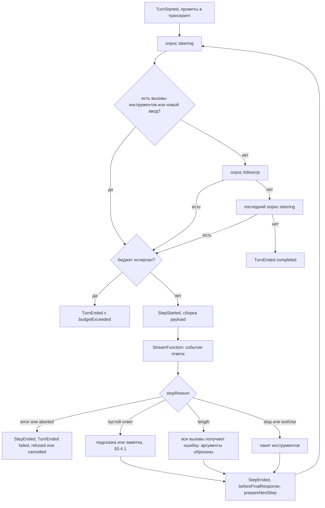
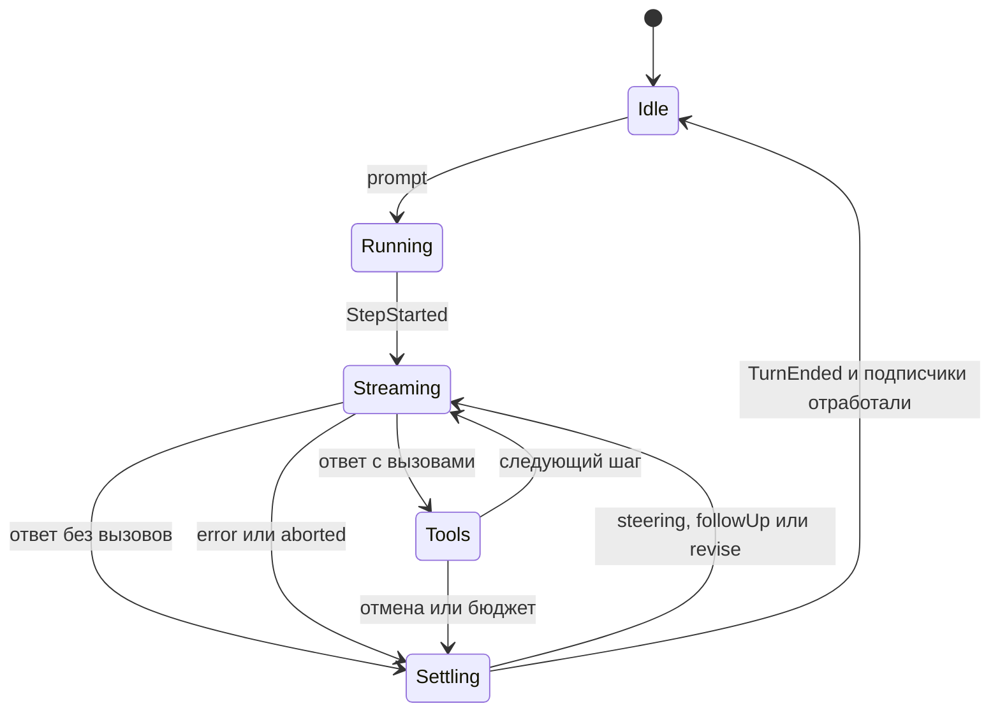
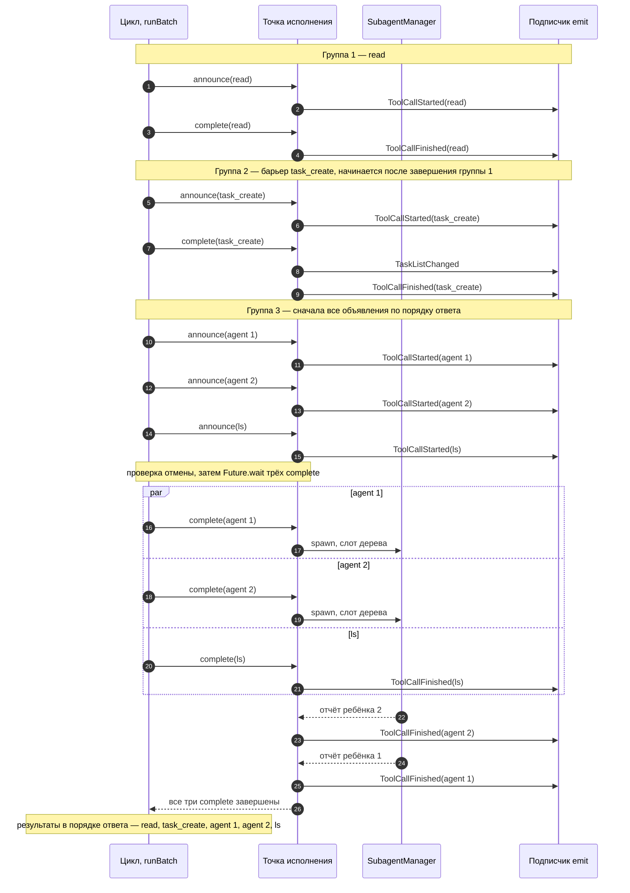

# 5. Цикл агента

> Часть [архитектуры ядра агента CodeLab](../agent-core-architecture.md). Status: Accepted. Общие соглашения, термины и порядок чтения — в оглавлении.

← [4. ExecutionEnv](04-execution-env.md) · [Оглавление ядра](../agent-core-architecture.md) · [6. Инструменты](06-tools.md) →

## 5.1. Назначение

Цикл — «мотор» ядра: вызвать модель, исполнить вызовы инструментов, повторить, пока модель не
перестанет звать инструменты. Он разделён на три уровня:

| Уровень | Что это | Владеет | Не владеет |
|---|---|---|---|
| `runAgentLoop` | чистая функция над внедрёнными `StreamFunction` и `ToolExecutor` | порядком событий, шагами, пакетами инструментов, очередями steering и follow-up, сборкой payload запроса | хранением, сжатием, UI, протоколом |
| `Agent` | объект с состоянием поверх `runAgentLoop` | транскриптом в памяти, очередями, подписчиками, отменой хода | провайдерами, политикой повторов |
| `AgentSession` | публичный API ядра ([proposal](../dart-agent-and-clients.md) §5.1) | журналом сессии, разрешениями, режимом, сжатием, `replay()` | транспортом и протоколом |

## 5.2. Контракт: функция цикла, конфигурация, хуки, бюджет

```dart
typedef AgentEventSink = FutureOr<void> Function(AgentEvent event);   // цикл ждёт каждый emit

/// Единая точка исполнения (§6.3.1) в две фазы: параллельная группа пакета сначала объявляет все
/// свои вызовы в порядке ответа (ToolCallStarted), потом исполняет их одновременно (§5.5).
abstract interface class ToolExecutor {
  Future<ToolCallHandle> announce(ToolCall call, ToolInvocation invocation);   // шаг 1: present, ToolCallStarted
  Future<ToolExecutionOutcome> complete(ToolCallHandle handle);                // шаги 1a–10
  Future<ToolExecutionOutcome> abandon(ToolCallHandle handle);                 // отмена до старта и откат упавшего объявления (§5.5, шаги 3a, 3c)
}
final class ToolInvocation {             // что цикл передаёт точке исполнения на один вызов
  final SessionId sessionId; final CancelToken cancel;
  final List<String> stepTools;          // имена схем текущего шага
  final AgentEventSink emit;
  final List<BeforeToolCallHook> beforeToolCall; final List<AfterToolCallHook> afterToolCall;
}

Future<TurnOutput> runAgentLoop({
  required List<Message> prompts,          // пусто = продолжение без новых сообщений
  required LoopContext context,            // systemPrompt, messages, tools: копируется
  required AgentLoopConfig config,
  required AgentEventSink emit,
  required CancelToken cancel,
});

final class TurnOutput {                   // транскрипт после хода = (history ?? старая история) + added
  final List<Message> added;               // сообщения хода после history
  final List<Message>? history;            // контекст аварийного сжатия (шаг 14a); null — история не заменялась
}

final class LoopContext {
  const LoopContext({required this.systemPrompt, required this.messages, required this.tools});
  final String systemPrompt;
  final List<Message> messages;
  final List<AgentTool> tools;             // схемы шага = tools.map(toSchema)
}

final class AgentLoopConfig {
  const AgentLoopConfig({required this.sessionId, required this.model, required this.stream,
      required this.executor, required this.clock, required this.ids,
      this.budget = const TurnBudget(), this.transformContext, this.beforeToolCall = const [],
      this.afterToolCall = const [], this.prepareNextStep, this.beforeFinalResponse,
      this.maxResponseRevisions = 2, this.maxSteeringSteps = 20,
      this.emptyResponseRetries = 2, this.misuse = const MisuseLimits(),
      this.steering, this.followUp, this.approvalWait, this.logger,
      this.estimateTokens, this.emergencyCompact, this.contextWindowCap,
      this.deadline, this.imageRefs});
  final SessionId sessionId;
  final ModelRef model;
  final StreamFunction stream;
  final ToolExecutor executor;             // единая точка исполнения (§6.3.1)
  final Clock clock; final IdGenerator ids;
  final TurnBudget budget;
  final TransformContextHook? transformContext;
  final List<BeforeToolCallHook> beforeToolCall;     // [0] — всегда проверка разрешений (PERM-1); [1] — после MVP пользовательские хуки (§17.14.2)
  final List<AfterToolCallHook> afterToolCall;       // цепочка: хуки хоста, затем пользовательские хуки after_tool (§17.14.2), затем хук языковых серверов (§17.8.5)
  final PrepareNextStepHook? prepareNextStep;
  final BeforeFinalResponseHook? beforeFinalResponse;
  final int maxResponseRevisions, maxSteeringSteps;
  final int emptyResponseRetries;                    // повторы пустого ответа подряд (§5.4.1), loop.empty_response_retries
  final MisuseLimits misuse;                         // предохранитель неверных вызовов (§6.3.7), loop.misuse.*
  final MessageQueue<SteeringItem>? steering;        // опрашивается циклом; элемент несёт origin (§17.7.2.1)
  final MessageQueue<Message>? followUp;             // опрашивается циклом
  final ApprovalWaitMeter? approvalWait;             // тот же счётчик, что ToolServices.approvalWait; maxDuration
                                                     // считает время хода минус его прирост с начала хода
  final Logger? logger;                              // логи цикла (loop.empty_response, §5.4.1)
  final int Function(LlmContext)? estimateTokens;    // оценка payload (§9.3); рантайм — с якорем сжатия сессии
  final Future<LoopContext?> Function(EmergencyCause cause, CancelToken cancel)? emergencyCompact;
                                                     // один аварийный вызов сжатия за ход, общий для preflight и overflow (CMP-8)
  final int? contextWindowCap;                       // окно preflight = effectiveContextWindow(model, cap) (CMP-6)
  final SessionDeadline? deadline;   // после MVP: дедлайн сессии (§17.12.5); null — нет срока
  final ImageRefRegistry? imageRefs; // после MVP: картинка уходит модели один раз (§17.11.2.2); null — как MVP
}
```

```dart
typedef TransformContextHook = Future<List<Message>> Function(List<Message> messages, CancelToken cancel);
typedef BeforeToolCallHook = Future<Block?> Function(ToolCall call, Map<String, Object?> args, ToolContext ctx);
typedef AfterToolCallHook = Future<ResultOverride?> Function(ToolCall call, ToolExecutionResult result, bool isError);
typedef PrepareNextStepHook = Future<StepUpdate?> Function(StepResult step);
typedef BeforeFinalResponseHook = Future<ResponseVerdict> Function(AssistantMessage message, TurnInfo turn);
// TurnInfo — §17.12.4; после MVP хук собирает AgentSession из SessionSpec.finalResponseChecks (composeFinalChecks)

final class Block { const Block(this.reason, {this.outcome = ToolOutcome.rejected}); final String reason; final ToolOutcome outcome; }
final class ResultOverride { const ResultOverride({this.content, this.isError}); final List<ContentBlock>? content; final bool? isError; }
final class StepUpdate {
  const StepUpdate({this.context, this.model, this.tools, this.systemPrompt});
  final LoopContext? context;        // заменить контекст целиком (сжатие); транскрипт цикла заменяется
  final ModelRef? model;
  final List<AgentTool>? tools;      // новый набор инструментов со следующего запроса; транскрипт не трогается (MCP list_changed)
  final String? systemPrompt;        // новый системный промпт со следующего запроса (секция mcp, §11.5)
}
final class StepResult { final int stepIndex; final AssistantMessage response; final List<ToolResultMessage> results; final Usage usage; }

sealed class ResponseVerdict { const ResponseVerdict(); }
final class Accept extends ResponseVerdict { const Accept(); }
final class Revise extends ResponseVerdict { const Revise(this.note); final String note; }
final class Hold extends ResponseVerdict { const Hold(this.reason); final String reason; }

abstract interface class MessageQueue<T> {
  bool get isEmpty;
  int get length;
  void add(T item);
  T? takeOne();                            // followUp: одно сообщение на точку опроса
  List<T> takeAll();                       // steering: все элементы в порядке FIFO за один опрос (§5.4)
}

final class TurnBudget {
  const TurnBudget({this.maxSteps = 50, this.maxTokens, this.maxCost, this.maxDuration});
  final int maxSteps;            // шаги модели за ход (ACP: max_turn_requests)
  final int? maxTokens;          // сумма input + output по usage всех шагов хода
  final double? maxCost;         // стоимость по ModelCost; не проверяется, если цены неизвестны
  final Duration? maxDuration;   // время хода по часам хоста, без ожидания одобрения
}
enum BudgetLimit { steps, tokens, cost, duration, deadline }   // deadline — §17.12.5
```

Хуки и точные места срабатывания:

| Хук | Когда | Семантика |
|---|---|---|
| `transformContext` | перед **каждым** запросом к модели, включая повтор после ремонта пар | меняет только payload, не транскрипт; исключение = сбой хода (`TurnEnded(failed)`) |
| `beforeToolCall` (цепочка) | после поиска инструмента и валидации аргументов, до исполнения | первый вернувший `Block(reason)` останавливает цепочку: результат-ошибка с текстом `reason`, инструмент не исполняется. **Первым** в цепочке всегда стоит проверка разрешений (§7). После MVP вторым звеном идут пользовательские хуки `before_tool` (§17.14.2), хуки хоста — последними |
| `afterToolCall` (цепочка) | после исполнения, до `ToolCallFinished` | хуки вызываются по порядку, каждый видит результат после переопределений предыдущих; переопределение по полям (`content`, `isError`); исключение = результат-ошибка с текстом исключения. Порядок: хуки хоста, затем (после MVP) хук сессии языковых серверов `LanguageServerSession.afterToolCall` — синхронизация документов и диагностика после правок (§17.8.5) |
| `prepareNextStep` | после `StepEnded`, до опроса steering | заменить контекст (сжатие), модель, набор инструментов или системный промпт для следующего шага; `tools` и `systemPrompt` применяются поверх `context` и транскрипт не меняют |
| `beforeFinalResponse` | шаг завершился без вызовов инструментов, ход готов остановиться, до `TurnEnded` | `Accept` — ход завершается; `Revise(note)` — заметка добавляется в payload следующего шага последним `user`-сообщением, не более `maxResponseRevisions` раз за ход; `Hold(reason)` — ход завершается с ответом, помеченным `TurnEnded.held = reason`. В MVP — только интерфейс, хук не регистрируется; после MVP — составной хук проверок `FinalResponseCheck` с лимитом ревизий и политикой `loop.final_response.on_revise_limit` (§17.12.4) |

**Бюджет хода.** Проверяется на границе шага: после `StepEnded` и до следующего запроса к модели.
Исполняемый инструмент не прерывается. Лимит исчерпан, когда значение его достигло (`>=`): при
`maxTokens: 1000` ход, потративший ровно 1000 токенов, следующего шага не делает. Время ожидания
одобрения (`PermissionGate`) вычитается из `maxDuration`. Вычитается настенное время, в которое шло
хотя бы одно ожидание: одобрения вызовов одной параллельной группы ждут одновременно, и сумма их
длительностей вычла бы одно время дважды — время хода уменьшалось бы, а лимит растягивался.
`ApprovalWaitMeter` поэтому считает объединение ожиданий (счётчик открытых ожиданий и момент, когда
он стал больше нуля), а политика открывает ожидание перед `gate.request` и закрывает его в `finally`
(change `fix-usage-pane-live-cards`, D6; решение пользователя 2026-11-18, Q3 (а)). Объединение
вычитает и работу параллельного инструмента, который выполняется, пока соседний вызов той же группы
ждёт одобрения (прежняя сумма вычитала то же и больше, регрессии нет). Поэтому модель может
растянуть настенное время хода парой «долгий разрешённый `execute` + вызов с одобрением», пока
пользователь не отвечает; лимит `maxDuration` такой ход не остановит (design.md change, R6). Ожидание
одобрения потомка в счётчик корня не входит: у потомка свои `ToolServices` и свой счётчик, поэтому
время корня, пока ждёт одобрение потомка, идёт (Q4 (а); клиент показывает так же, §12.3 A17 п. 6).
При превышении ход завершается `TurnEnded(reason: completed, budgetExceeded: limit)`;
ACP-адаптер отдаёт `stopReason: max_turn_requests`, а вид лимита — в `_meta` (расширение через OpenSpec).

**Прогресс бюджета** (change `add-desktop-usage-pane`, D8). `StepEnded` и `TurnEnded` несут прогресс
бюджета хода (`BudgetProgress`; имя — реализации): лимиты `TurnBudget` хода и израсходованное к
событию — завершённые шаги корня, токены `input + output` своих шагов и потомков (без кэша),
стоимость той же суммы или `null`, если у текущей модели нет цен, и время хода без ожидания
одобрения. Прогресс и проверку LOOP-12 считает одна функция, поэтому значение в `StepEnded` — то,
по которому на этой границе шага решается остановка. Поле заполняется при любых лимитах; передавать
ли его клиенту, решает адаптер (§13.12, поле `budget` в `_codelab/session/usage`).
Шаг, ответ модели которого — ошибка, тоже уходит в `StepEnded` и считается завершённым, хотя ход
на нём заканчивается: `TurnEnded.budget.steps` равно числу отправленных `StepEnded` хода. Иначе итог
хода был бы на шаг короче снимков `step`, которые уже видел клиент.

**Сборка payload** (каждый запрос, транскрипт не меняется — LOOP-7):

1. `messages = transformContext?.call(transcript)` или копия транскрипта.
1a. Пустые ответы модели (`isEmptyCompletion`, §5.4.1) удаляются из `messages`: провайдеры
    отвергают `assistant` без контента, а повторять модели её же пустоту бесполезно. Подсказки
    `LoopNudgeOrigin` и заметки `LoopNoteOrigin` остаются: два `user` подряд допустимы у обоих
    диалектов (§2.5; Anthropic объединяет соседние сообщения одной роли).
1b. После MVP (C-16, §17.11.2.2): `messages = imageRefs?.apply(messages)` — каждая картинка журнала
    передаётся блоком один раз (первое вхождение с подписью `[Image N]`), остальные вхождения —
    текст `[Image N]`; номера из журнала, стабильны в сессии.
2. Ремонт парности вызовов (§6.3.3); непустой отчёт → событие `ToolPairingRepaired`.
3. Если есть заметка `Revise` — добавить `UserMessage([TextContent(note)])` в конец payload.
3a. После MVP: если у сессии есть дедлайн (§17.12.5) — `UserMessage([TextContent(deadline.timeLeftLine(now))])` последним сообщением payload; в транскрипт не входит.
4. Оценка размера `estimateTokens(LlmContext)`; если больше окна `effectiveContextWindow(model, cap: contextWindowCap)` — один вызов `emergencyCompact(preflight, …)` за ход (CMP-8) и пересборка с шага 1; если сжатие не помогло или его нет — синтетический `AssistantMessage(stopReason: error, errorClass: overflow, errorMessage: 'context window exhausted')` без обращения к провайдеру и без `ModelRequested`. Оценщик передаёт рантайм: оценка сессии с якорями usage и последнего сжатия (§9.3, «Якорь на последнее сжатие»), поэтому сразу после сжатия проверка видит `tokensAfter` записи плюс изменившуюся часть (CMP-11); сигнатура `estimateTokens` при этом не меняется, и цикл о журнале и записях `compaction` не знает.
5. `LlmContext(systemPrompt, messages, tools.map(toSchema))` → `ModelRequested` → `stream(...)`.

`systemPrompt` и `tools` берутся из текущего `LoopContext` и между шагами меняются только через
`prepareNextStep` (`StepUpdate.context`, `StepUpdate.tools`, `StepUpdate.systemPrompt`). В MVP
промпт меняется в пределах хода только при обновлении MCP-инструментов по `tools/list_changed`
(секция `mcp`, design.md change `add-agent-mcp-client`, D6); после MVP
`AgentSession` пересобирает его перед запросом, когда меняются закреплённые строки skills
(§11.5, §17.2.7).

## 5.3. Контракт: события

```dart
sealed class AgentEvent { SessionId get sessionId; }
final class TurnStarted extends AgentEvent { final TurnId turnId; final List<Message> input; }
final class StepStarted extends AgentEvent { final int stepIndex; }
final class ModelRequested extends AgentEvent { final ModelRef model; final int estimatedTokens; final int messageCount; }
final class MessageStarted extends AgentEvent {
  final Message message;
  final MessageOrigin? origin; }            // служебное сообщение цикла (§5.4.1); после MVP (§17.7.2.1) — steering или уведомление субагента; null — промпт или ответ
final class MessageDelta extends AgentEvent { final String delta; final AssistantMessage partial; }
final class ThoughtDelta extends AgentEvent { final String delta; final AssistantMessage partial; }
final class MessageEnded extends AgentEvent { final Message message; }
final class ToolCallStarted extends AgentEvent {
  final String toolCallId, tool; final ToolKind kind; final String title;
  final Map<String, Object?> input; final List<Location> locations; }
final class ToolCallProgress extends AgentEvent { final String toolCallId; final List<ToolCallContent> content; }
// После MVP (§17.12.3): вызов исполняется дольше порога / молчит дольше порога
final class ToolCallHeartbeat extends AgentEvent { final String toolCallId; final Duration elapsed, sinceOutput; }
final class ToolCallStuck extends AgentEvent { final String toolCallId; final Duration elapsed, sinceOutput; }
final class ToolCallFinished extends AgentEvent {
  final String toolCallId; final ToolOutcome outcome; final List<ContentBlock> content;
  final List<FileDiff> diffs;               // по одному на изменённый файл; пусто — правок нет (§6.2)
  final SpillRef? spill; }                  // с этапа 3 (§17.4.2): результат вынесен в файл
final class ToolPairingRepaired extends AgentEvent { final PairingReport report; }
final class StepEnded extends AgentEvent { final StepResult result;
  final ContextFill? context; }            // change add-usage-extension (D5): used, window, compactAt?
// Change add-subagents-and-tasks (§17.16.2): заменяет PlanUpdated(List<PlanEntry> entries) инструмента update_plan
final class TaskListChanged extends AgentEvent { final List<TaskItem> items; final TaskChange change; }
final class ModeChanged extends AgentEvent { final ModeId mode; }
final class CommandsChanged extends AgentEvent { final List<SlashCommand> commands; }
final class ConfigOptionChanged extends AgentEvent { final String optionId, value; }   // уровень AgentSession (§8.3)
final class SessionTitleChanged extends AgentEvent { final String title; final DateTime updatedAt; }   // уровень AgentSession (§8.3)
final class ContextCompacted extends AgentEvent { final int tokensBefore, tokensAfter; final Usage? usage; final String? model; } // model — '<provider>/<id>' // usage, model — суммаризатор, change add-usage-ledger, D4; в TurnEnded.usage не входит
final class CompactionDiscarded extends AgentEvent { final int tokensBefore, tokensAfter; final Usage usage; final String model; } // суммаризатор оплачен, сжатие не записано (no reduction, stale; §9.8, CMP-13); change fix-discarded-compaction-usage, D2; в TurnEnded.usage не входит, реплей не даёт
final class AgentError extends AgentEvent { final AgentErrorClass cls; final LlmErrorClass? errorClass; final String message; final bool retrying; final RateLimitInfo? rateLimit; }   // rateLimit — после MVP (§17.10.4.1)
                                                  // errorClass — только при cls == provider (§2.2)
final class TurnEnded extends AgentEvent {
  final TurnEndReason reason; final Usage usage; final BudgetLimit? budgetExceeded; final String? held;
  final List<SteerId> returnedSteers; }     // после MVP (§17.7.3.3): принятые и не доставленные steering

// После MVP (§17.3.2): события уровня AgentSession, как ConfigOptionChanged; sessionId — родительский
final class SubagentStarted extends AgentEvent {
  final SubagentId subagentId; final String parentToolCallId, agent, description;
  final SessionId childSessionId; final String journalPath; }        // путь относительно sessions/
final class SubagentProgress extends AgentEvent { final SubagentSnapshot snapshot; }
final class SubagentFinished extends AgentEvent {
  final SubagentId subagentId; final String parentToolCallId;
  final SubagentState status; final SubagentFailure? failure;
  final Usage usage; final Duration duration; final String reportPreview; }   // первые 200 символов

// После MVP (§17.6.2): события уровня AgentSession, как SessionTitleChanged
final class BranchChanged extends AgentEvent { final String leafId, fromLeafId; final BranchReason reason; }
final class SessionAccessChanged extends AgentEvent {
  final SessionAccess access; final LeaseOwner? owner;
  final String reason; }                    // "leaseLost", "foreignWrite", "leaseAvailable"

// MessageOrigin — sealed-класс §17.7.2.1. В MVP он вводится ради служебных сообщений цикла
// (§5.4.1); варианты SteerOrigin и SubagentNoticeOrigin добавляются после MVP, JobNoticeOrigin — §17.9.6, DeadlineNoticeOrigin — §17.12.5.
enum LoopNudgeReason { emptyResponse, deadline }
final class LoopNudgeOrigin extends MessageOrigin {   // user-сообщение написал цикл, а не человек
  const LoopNudgeOrigin(this.reason, this.attempt);
  final LoopNudgeReason reason; final int attempt; }  // attempt — номер повтора с 1
final class LoopNoteOrigin extends MessageOrigin {    // синтетический assistant-ответ цикла (заметка)
  const LoopNoteOrigin(this.reason); final LoopNudgeReason reason; }

enum TurnEndReason { completed, maxTokens, refused, cancelled, failed }
enum ToolOutcome { completed, failed, cancelled, rejected }
enum AgentErrorClass { provider, fallback, compaction, hook, storage }

/// Slash-команда для `CommandsChanged` и ACP `available_commands_update` (§13.6, §17.2.6).
enum SlashCommandSource { builtin, template, skill, mcpPrompt, plugin }
final class SlashCommand {
  final String name;                            // без "/": "compact", "review", "skill:release-notes"
  final String description;
  final String? inputHint;                      // ACP AvailableCommand.input.hint
  final SlashCommandSource source;
}
```

В MVP источники команд — `template` (шаблоны промптов, этап 8.7; design.md change `add-agent-project-files`, D7), `builtin` и
`mcpPrompt` (MCP prompts, §13.6; change встроенных команд); `skill` добавляет §17.2, `plugin` —
§17.14.3. `CommandsChanged` на этапе 8.7 не эмитится: список шаблонов не меняется за жизнь сессии,
и адаптер берёт его из `AgentSession.commands` после создания и загрузки сессии (design.md change `add-agent-project-files`, D9);
событие вводит change, у которого набор меняется (MCP prompts, `/config reload`).

| Событие | Когда | Payload |
|---|---|---|
| `TurnStarted` | первым событием хода | `turnId`, входные сообщения |
| `StepStarted` | перед каждым запросом к модели | `stepIndex` (с 0) |
| `ModelRequested` | непосредственно перед вызовом `StreamFunction` (диагностика) | модель, оценка токенов, число сообщений |
| `MessageStarted` | сообщение вошло в транскрипт: промпт, steering, первый снимок ответа с блоком (ответ без блоков — на терминальном событии), результат инструмента, служебное сообщение цикла (§5.4.1) | `message`, `origin?` (`LoopNudgeOrigin`, `LoopNoteOrigin`; после MVP: `SteerOrigin`, `SubagentNoticeOrigin`, `JobNoticeOrigin` (§17.9.6) или `DeadlineNoticeOrigin` (§17.12.5), §17.7.2.1) |
| `MessageDelta` | каждое текстовое `BlockDeltaEvent` | `delta`, `partial` |
| `ThoughtDelta` | каждое `BlockDeltaEvent` рассуждения | `delta`, `partial` |
| `MessageEnded` | сообщение завершено (точка сохранения) | финальное `message` |
| `ToolCallStarted` | при входе вызова в единую точку исполнения (после `MessageEnded` ответа) | `toolCallId`, `tool`, `kind`, `title`, `input`, `locations` |
| `ToolCallProgress` | частичный результат через `onUpdate` или `onTerminal` | `toolCallId`, `content` |
| `ToolCallHeartbeat`, `ToolCallStuck` | после MVP: вызов исполняется дольше порога / молчит дольше порога (§17.12.3) | `toolCallId`, `elapsed`, `sinceOutput` |
| `ToolCallFinished` | вызов завершён | `toolCallId`, `outcome`, `content`, `diffs` (по одному на файл), `spill?` (§17.4: `content` — фрагмент вынесенного результата) |
| `ToolPairingRepaired` | payload запроса потребовал ремонта пар | отчёт о ремонте |
| `StepEnded` | шаг завершён | ответ модели, результаты в порядке вызовов; заполнение контекста после шага (`used`, `window`, `compactAt` — порог автосжатия или `null`; change `add-usage-extension`, D5) |
| `TaskListChanged` | после change `add-subagents-and-tasks`: операция `task_*` или назначение пункта субагенту (`assign`) изменила список задач, до `ToolCallFinished` вызова (§17.16.5), или список восстановлен из новой ветки после `BranchChanged` (`op: restore`, без записи `task`, §17.16.6); до change — `PlanUpdated` от `update_plan` | `items` (весь список), `change` |
| `ModeChanged`, `CommandsChanged` | смена режима, списка slash-команд | новое значение |
| `ContextCompacted` | сжатие записано в журнал (§9) | `tokensBefore`, `tokensAfter`, `usage` и `model` суммаризатора (`null` у реплея записи без `details.usage`; change `add-usage-ledger`, D4) |
| `CompactionDiscarded` | проход сжатия отброшен (`no reduction`, CMP-10, или `stale`, CMP-12) после оплаченного ответа суммаризатора; запись учёта `custom` `codelab.compaction_discarded` уже в журнале (§9.8, CMP-13) | `tokensBefore`, `tokensAfter` прохода, `usage` и `model` суммаризатора; в `TurnEnded.usage` не входит; реплей события не даёт (change `fix-discarded-compaction-usage`, D2) |
| `SubagentStarted`, `SubagentProgress`, `SubagentFinished` | после MVP: эмитит `SubagentManager` сессии родителя, не цикл (§17.3.2) | идентификаторы ребёнка, снимок прогресса, итог |
| `BranchChanged` | после MVP: эмитит `AgentSession` после записи `branch` — переключение ветки или перемотка (§17.6.5); у читателя в режиме только чтения — после перечитывания снимка (§17.6.8) | `leafId`, `fromLeafId`, `reason` |
| `SessionAccessChanged` | после MVP: эмитит `AgentSession` при потере lease, чужой записи или освобождении lease владельцем (§17.6.8) | `access`, `owner?`, `reason` |
| `AgentError` | сбой или повтор: провайдер, fallback, сжатие, хук, журнал | `cls`, `errorClass?` (`LlmErrorClass` при `cls: provider`), `message`, `retrying` |
| `TurnEnded` | **последним** событием хода | `reason`, `usage` (сумма шагов), `budgetExceeded?`, `held?`, `returnedSteers` (после MVP, §17.7.3.3) |

Соответствие `TurnEnded.reason`: ответ `stop`/`toolUse` без вызовов → `completed`; `length` без
вызовов → `maxTokens`; `terminalFinish` → `refused`; отмена → `cancelled`; прочие ошибки →
`failed`. `ToolOutcome` — доменный исход вызова; в ACP нет `cancelled`/`rejected` — проекция в §13.

Порядок для шага с двумя параллельными вызовами:

```text
StepStarted, ModelRequested, MessageStarted, MessageDelta xN, MessageEnded(assistant),
ToolCallStarted(c1), ToolCallStarted(c2), ToolCallFinished(c2), ToolCallFinished(c1),
MessageStarted/Ended(result c1), MessageStarted/Ended(result c2), StepEnded
```

## 5.4. Алгоритм хода

```text
runAgentLoop(prompts, context, config, emit, cancel):
 1  emit TurnStarted; для каждого p из prompts: transcript.add(p); emit MessageStarted(p), MessageEnded(p)
 2  step = 0; steeringSteps = 0; revisions = 0; emptyStreak = 0; usage = 0; pendingCalls = false; emergencyUsed = false
 3  pollSteering()                                        # перед первым шагом
 4  loop:
 5    if not pendingCalls and not hasNewInput:
 6      m = followUp.takeOne(); if m == null: pollSteering()   # финальный опрос
 7      if m == null and not hasNewInput: break           # естественная остановка; ход запечатан
 8      if m != null: addInput(m)
 9    if deadlineReached() or budgetExceeded(step, usage, elapsed): reason = completed; budgetExceeded = limit; break   # дедлайн — первым, затем заметка LoopNoteOrigin(deadline), §17.12.5
10    if cancel.isCancelled: response = syntheticAborted(); goto 15
10a   notice = deadline?.takeDueNotice(now); если есть текст — addDeadlineNotice(notice)   # §17.12.5, не шаг
11    emit StepStarted(step); payload = buildPayload()     # §5.2, шаги 1–5
12    emit ModelRequested; stream = config.stream(model, payload, cancel)
13    consume(stream):                                    # первый снимок → transcript + MessageStarted,
                                                          # дальше замена последнего элемента на partial,
                                                          # MessageDelta / ThoughtDelta; уникализация id (LOOP-11)
14    if провайдер до первого блока вернул 400 с ошибкой парности и ремонт ещё не повторялся:
        пересобрать payload, ModelRequested, повторить запрос того же шага (без второго StepStarted)
14a   if response.stopReason == error and response.errorClass == overflow:   # §2.11, §9.5
        if not emergencyUsed and emergencyCompact != null:  # общий с preflight (§5.2, шаг 4) флаг: один раз за ход (CMP-8)
          emergencyUsed = true; ctx = emergencyCompact(overflow, cancel)
          if ctx != null: применить ctx; goto 11           # один повтор того же шага, как в шаге 14: без второго
                                                           # StepStarted; ответ с ошибкой не входит в транскрипт и не эмитится
        # иначе — обычная ошибка шага: шаг 16, reason = failed
15    transcript[last] = response; emit MessageEnded(response); usage += response.usage
16    if response.stopReason in {error, aborted}:
        emit AgentError (если error); emit StepEnded; reason = cancelled|refused|failed; break
17    calls = response.toolCalls
17a   if not isEmptyCompletion(response): emptyStreak = 0  # §5.4.1
18    if response.stopReason == length: results = calls.map(truncatedArgsError)   # LOOP-5
      else: results = executeBatch(calls)                 # §5.5
19    для r из results в порядке calls: transcript.add(r); emit MessageStarted(r), MessageEnded(r)
20    emit StepEnded(step, response, results); step++
21    pendingCalls = calls.isNotEmpty
22    if not pendingCalls and isEmptyCompletion(response):  # §5.4.1, до beforeFinalResponse
        if emptyStreak < emptyResponseRetries: emptyStreak++; addNudge(emptyStreak); pendingCalls = true
        else: addEmptyNote(emptyStreak + 1); emptyStreak = 0   # ход идёт к опросу followUp, хук не зовётся
      elif not pendingCalls:
        verdict = beforeFinalResponse?(response) ?? Accept
        if verdict is Revise and revisions < maxResponseRevisions: revisions++; note = verdict.note; pendingCalls = true
        if verdict is Hold: held = verdict.reason        # составной хук §17.12.4 уже учёл лимит ревизий
23    update = prepareNextStep?(stepResult); применить update.context / update.model / update.tools / update.systemPrompt
24    if cancel.isCancelled: reason = cancelled; break
25    pollSteering()
26  emit TurnEnded(reason ?? fromStopReason(lastResponse), usage, budgetExceeded, held)
27  return сообщения, добавленные с шага 1
```

`pollSteering()` (§17.7.3.2): если `steeringSteps < maxSteeringSteps` и следующий шаг начнётся
(ход не отменён, бюджет не исчерпан), забирает **все** элементы очереди `steering` в порядке FIFO
(`takeAll`), добавляет их в транскрипт (`MessageStarted(origin)`/`MessageEnded`), увеличивает
`steeringSteps` на один — один шаг на опрос, а не на сообщение — и помечает «есть новый ввод».
Пользовательские сообщения и уведомления фоновых субагентов лежат в одной очереди в порядке
поступления. Если следующий шаг не начнётся, опрос ничего не забирает.

**Запечатывание.** Ход запечатывается синхронно в момент, когда цикл решил больше не начинать
шагов: финальный опрос (шаги 6–7) не нашёл ввода, сработал бюджет (шаг 9), ход отменён (шаги 10,
24) или ответ модели — `error`/`aborted` (шаг 16). После этого `Agent.trySteer` отвечает
`noActiveTurn` (§17.7.3.1). На `TurnEnded` пользовательские сообщения, оставшиеся в очереди,
удаляются из неё и перечисляются в `TurnEnded.returnedSteers`; уведомления субагентов остаются до
следующего хода (§17.7.3.3). Любое исключение хука или внутренней ошибки ловится вокруг всего
цикла и превращается в `AgentError(cls: hook)` + `TurnEnded(failed)` (LOOP-1).





### 5.4.1. Пустой ответ модели (C-07)

Модель иногда завершает ответ посреди задачи, не сказав ничего и не позвав инструмент. Без
обработки ход тихо заканчивается `end_turn`, и пользователь не понимает, сделана ли работа.
Цикл повторяет запрос с короткой подсказкой, а после исчерпания повторов завершает ход видимой
заметкой.

**Определение.** `isEmptyCompletion(response)` истинно, когда одновременно:

1. `response.stopReason` — `stop` или `toolUse` (`length`, `error`, `aborted` и `terminalFinish`
   обрабатываются своими путями шагов 16–18 и пустым ответом не считаются);
2. в ответе нет ни одного `ToolCall`;
3. у каждого `TextContent` ответа `text.trim()` пуст (или текстовых блоков нет вовсе).

Блоки рассуждений (`ThinkingContent`) не учитываются: ответ «только рассуждение» — пустой, потому
что пользователь и следующий шаг не получают из него ни текста, ни действия.

**Подсказка.** `addNudge(n)` добавляет в транскрипт `UserMessage([TextContent(nudge)])` с
`origin: LoopNudgeOrigin(emptyResponse, n)` и эмитит `MessageStarted(origin)`, `MessageEnded`.
Текст фиксирован:

```text
Your previous response was empty. Continue the task: call a tool or answer the user with text.
```

**Заметка.** `addEmptyNote(n)` добавляет синтетический
`AssistantMessage([TextContent(note)], stopReason: stop, usage: Usage.zero, model: текущая)` с
`origin: LoopNoteOrigin(emptyResponse)` и эмитит `MessageStarted` (пустой `partial`), один
`MessageDelta(note)` и `MessageEnded(note)` — так ACP-адаптер показывает заметку обычным
`agent_message_chunk`, без особой проекции. Шагом заметка не является: нет `StepStarted`,
`ModelRequested`, `StepEnded`, бюджет не тратится. Текст (`<N>` — число пустых ответов подряд,
`emptyResponseRetries + 1`):

```text
[Stopped: the model returned an empty response (attempts: <N>). Send a message to continue.]
```

**Правила.**

1. Счётчик `emptyStreak` считает пустые ответы **подряд** в пределах хода и сбрасывается любым
   непустым ответом (текстом или вызовом). Число повторов — `AgentLoopConfig.emptyResponseRetries`
   (конфиг `loop.empty_response_retries`, по умолчанию `2`, диапазон `0..5`); `0` — без
   повторов, первый же пустой ответ сразу даёт заметку.
2. Каждый повтор — обычный шаг: он входит в `maxSteps` (ACP `max_turn_requests`), его `usage`
   входит в `maxTokens` и `maxCost`. Бюджет проверяется как всегда, на шаге 9: если лимит
   исчерпан, ход завершается `budgetExceeded`, а не заметкой.
3. Пустой ответ не передаётся в `beforeFinalResponse`: финальный гейт оценивает ответ, а не его
   отсутствие. После заметки хук тоже не вызывается.
4. После заметки ход останавливается как после естественной остановки (для `codelab -p` это код выхода `0`: заметка — ответ, §13.10): шаги 6–7 (опрос
   `followUp` и финальный опрос steering) выполняются; если ввода нет, `TurnEnded(completed)`,
   ACP `stopReason: end_turn`.
5. Пустой ответ остаётся в транскрипте и журнале (это факт разговора, у него есть `usage`), но не
   уходит в payload (§5.2, шаг 1a). Подсказки и заметка пишутся в журнал обычными записями
   `message` с полем записи `origin` (`"loop_nudge"` с `nudge: "empty_response"` и `attempt`;
   `"loop_note"` с `nudge: "empty_response"`, после MVP — `"deadline"`), чтобы после `session/load` payload следующего хода был тем же, что в живой
   сессии. Реплей (§13.5) подсказку пропускает (это не слова пользователя), заметку отдаёт как
   `agent_message_chunk`; вживую ACP-адаптер на `MessageStarted(user, LoopNudgeOrigin)` ничего не
   отправляет.
6. Логи: `loop.empty_response` (warning: `attempt`, `model`, `stepIndex`) на каждый пустой ответ;
   `loop.empty_response.stopped` (warning: `attempts`) при заметке.

Пример (`emptyResponseRetries = 2`): шаг 0 — пустой ответ, подсказка 1; шаг 1 — только
рассуждение, подсказка 2; шаг 2 — текст `Done.` → ход завершён `end_turn`, в транскрипте
`[user, assistant(пусто), user(nudge 1), assistant(thinking), user(nudge 2), assistant("Done.")]`,
payload шага 2 — `[user, user(nudge 1), user(nudge 2)]`. Если и шаг 2 пуст, в транскрипт
добавляется заметка `[Stopped: ... (attempts: 3). ...]`.

## 5.5. Алгоритм пакета инструментов

0. В начале хода цикл создаёт один `MisuseBreaker(config.misuse)` (§6.3.7); каждый `ToolContext`
   этого хода получает его в поле `misuse`. Следующий ход начинает с пустого счётчика.
1. **Группы.** Режим вызова — `tool.executionModeOf(args)` (по умолчанию — объявленный инструментом `executionMode`, §6.2; после MVP режим может зависеть от аргументов, например `lsp rename`, §17.8.9). Пакет делится по порядку ответа модели на группы: подряд идущие `parallel`-вызовы — одна параллельная группа, каждый `sequential`-вызов — барьер, отдельная группа из одного вызова. Группы исполняются строго друг за другом: барьер начинается после завершения всех вызовов группы перед ним, следующая группа — после барьера. Пример: `[read, task_update, agent, agent]` → `{read}`, `{task_update}`, `{agent, agent}` (решение пользователя 2026-11-14, design.md change `add-subagents-and-tasks`, D39; прежде один `sequential`-вызов делал последовательным весь пакет).
2. **Параллельная группа.** Для каждого вызова группы в порядке ответа: `emit ToolCallStarted`. Затем вызовы группы исполняются через `executor` одновременно (`Future.wait`); каждый `ToolCallFinished` эмитится в момент завершения своего вызова (под общей очередью emit, LOOP-2).
3. **Барьер.** `ToolCallStarted` → исполнение → `ToolCallFinished`.
3a. **Отмена.** Перед исполнением каждой группы — проверка отмены (после объявления вызовов группы, §5.5.1, строка 8). При отмене вызовы ещё не начатых групп не исполняются и получают `ToolCallStarted` + `ToolCallFinished(cancelled)` с текстом `Tool call was cancelled before it started` — у каждого вызова ответа есть результат (парность, TOOL-6). Закрытие `abandon` запускается сразу для всех объявленных вызовов группы, поэтому сбой или зависание эмита одного из них не держит места в очереди пути остальных; каждый сбой закрытия пишется в лог `tool.abandon.error`, а первый из них завершает ход `failed` (LOOP-1). Уже идущие вызовы группы получают отмену через токен хода, как прежде.
3b. **Результаты.** Сообщения-результаты добавляются после всего пакета в порядке вызовов ответа (LOOP-3), независимо от групп.
3c. **Сбой объявления.** Если объявление вызова (`announce`, §6.3.1, шаг 1) бросило исключение — на практике это сбой `emit ToolCallStarted`, — упавший вызов сам отпускает своё место в очереди пути, а уже объявленные вызовы той же группы закрываются `abandon` (`ToolCallFinished(cancelled)` с тем же текстом) — все сразу, как при отмене; сбой самого `abandon` пишется в лог `tool.abandon.error` (§12.3) и не прерывает откат остальных. Затем исходная ошибка завершает ход (LOOP-1): упавший вызов, остальные вызовы группы и все следующие группы не объявляются вовсе. Подробно — §5.5.1.
4. Steering во время пакета не прерывает его (CAN-6): сообщение ждёт в очереди до шага 25 алгоритма хода — после всего пакета любого режима; между вызовом и его результатом сообщение не вставляется (TOOL-6, STEER-2).
5. Частичные результаты (`onUpdate`) после завершения вызова игнорируются; цикл дожидается доставки уже отправленных `ToolCallProgress`, прежде чем эмитить `ToolCallFinished`.

### 5.5.1. Алгоритм барьера D39 подробно

Раздел описывает текущую стратегию исполнения пакета (`agent_loop.dart`, `_runBatch`) так, чтобы её
можно было воспроизвести без чтения кода. Источник решения — D39 change `add-subagents-and-tasks`
(решение пользователя 2026-11-14, Q18); откат упавшего объявления и одновременный откат всей группы — исправления
утечки места в очереди пути (PR #324 и PR #326, TOOL-7). Что делает каждая фаза точки исполнения — §6.3.1.

**Три операции точки исполнения**, на которых построен алгоритм (§5.2, §6.3.1):

| Операция | Что делает | События | Место в очереди `PathLock` |
|---|---|---|---|
| `announce(call, inv)` | ищет инструмент в схемах шага, строит `ToolContext`, занимает место в очереди пути, вызывает `present` | `ToolCallStarted` | занимает (`reserve`), если `lockPath(rawArgs)` не `null`; при исключении внутри `announce` отпускает сам и пробрасывает исключение — handle не возвращается |
| `complete(handle)` | шаги 1a–9 §6.3.1: предохранитель, валидация, `preflight`, `beforeToolCall` (разрешения), проверка отмены, ожидание пути, `execute`, обработка результата, `afterToolCall` | `ToolCallProgress`, у `task_*` — `TaskListChanged`, затем `ToolCallFinished` | отпускает в `finally` после исполнения, до `ToolCallFinished` |
| `abandon(handle)` | закрывает объявленный вызов без исполнения: outcome `cancelled`, текст `Tool call was cancelled before it started` | `ToolCallFinished(cancelled)` | отпускает **первым действием**, до эмита: сбой эмита место уже не держит |

Для каждого handle вызывается ровно одно из `complete` или `abandon`.

**Откат группы** (`abandonAll`, строки 7 и 8 псевдокода) закрывает объявленные вызовы без
исполнения. Все `abandon` запускаются до первого ожидания, поэтому места в очереди пути всех
вызовов группы свободны раньше, чем цикл начнёт ждать хотя бы один `ToolCallFinished`: сбой или
зависание эмита одного вызова не держит пути остальных. Исходы ждутся по порядку объявления;
сбой каждого вызова пишется в лог `tool.abandon.error` (`error_class` — тип исключения, само оно —
в `error` и `stack` записи), а сбой самого логгера глотается, чтобы не
подменить ошибку хода.

**Псевдокод.**

```text
runBatch(calls):              # calls — вызовы ответа в порядке модели; id уже уникальны (LOOP-11)
1  if calls пуст: return []
2  inv := ToolInvocation(session, cancel хода, stepTools := имена схем текущего шага, emit,
          beforeToolCall, afterToolCall, misuse хода (LOOP-16), supportsImages модели шага)
3  # разбиение на группы — чистое, без событий и без мест в очереди пути
   groups := []; lastIsBarrier := false
   для call из calls по порядку:
     tool := первый инструмент схем шага с именем call.name, иначе null
     barrier := tool != null and tool.executionModeOf(call.arguments) == sequential
                # null-режим, parallel и «инструмента нет в схемах шага» — не барьер
     if barrier or groups пуст or lastIsBarrier: groups.add([call])   # новая группа
     else: groups.last.add(call)                                      # продолжить параллельную
     lastIsBarrier := barrier
4  results := {}                                  # toolCallId → ToolResultMessage
5  для group из groups по порядку:                # группа начинается после завершения предыдущей
6    handles := []
7    для call из group по порядку ответа:         # фаза объявления, по одному
       try:
         handles.add(await executor.announce(call, inv))     # ToolCallStarted, место в очереди пути
       catch e:                                   # announce уже отпустил своё место
         abandonAll(handles)                      # откат объявленных; его ошибка не пробрасывается
         rethrow e                                # ход → AgentError + TurnEnded(failed), LOOP-1
8    if cancel.isCancelled:                       # после объявления группы, до её исполнения
       (outcomes, first) := abandonAll(handles)
       if first != null: throw first              # ход failed с первой ошибкой отката, LOOP-1
     else:
       outcomes := await Future.wait([executor.complete(h) для h из handles])
                   # одновременно; ждёт все вызовы, даже если один бросил; группа из одного
                   # вызова (барьер) исполняется так же — Future.wait одного элемента
9    для o из outcomes: results[o.message.toolCallId] := o.message
10 return [results[call.id] для call из calls]   # порядок ответа (LOOP-3)

abandonAll(handles):                              # общий откат строк 7 и 8
a  pending := [(h, settle(executor.abandon(h))) для h из handles по порядку]
              # все abandon запускаются до первого ожидания: каждый синхронно отпускает своё
              # место в очереди пути, затем эмитит ToolCallFinished через общую очередь emit
              # (LOOP-2); settle превращает синхронный и асинхронный сбой в значение (ошибка, стек)
b  outcomes := []; first := null
c  для (h, p) из pending по порядку:
     r := await p                                 # зависший emit задерживает ход, но не пути
     if r — исход: outcomes.add(r); continue
     first := first ?? r.ошибка
     try: log warning 'tool.abandon.error' {session_id, tool, tool_call_id, error_class}, error, stack
     catch: ничего                                # сломанный логгер не подменяет ошибку хода
d  return (outcomes, first)
```

Цикл добавляет результаты в транскрипт и эмитит их `MessageStarted`/`MessageEnded` только после
`runBatch` (§5.4, шаг 19); `ToolCallFinished` каждого вызова эмитит сама точка исполнения в момент
его завершения под общей очередью `emit` (LOOP-2).

**Пример.** Ответ `[read, task_create, agent(task: "1"), agent(task: "2"), ls]`; `task_create` —
`sequential`, остальные — без режима или `parallel`. Строка 3 даёт группы `{read}`, `{task_create}`,
`{agent 1, agent 2, ls}`: `read` — отдельная группа, потому что за ним барьер; три вызова после
барьера идут одной группой.



`ToolCallFinished` третьей группы приходят в порядке завершения (здесь `ls`, затем ребёнок 2, затем
ребёнок 1); дети стартуют в порядке `ToolCallStarted`, то есть в порядке ответа, и занимают слоты
дерева в этом же порядке (§17.3.4, п. 2).

**Случаи.**

| Случай | Что происходит |
|---|---|
| Отмена до пакета или между группами | Вызовы очередной группы всё равно объявляются (`ToolCallStarted`), затем строка 8 видит отмену и закрывает их `abandonAll`: места в очереди пути всех вызовов отпущены сразу, `ToolCallFinished(cancelled)` с текстом `Tool call was cancelled before it started`. Так же проходит каждая следующая группа. Результат есть у каждого вызова; после пакета ход завершается `cancelled` (§5.4, шаг 24). |
| Отмена во время объявления группы | Объявление не проверяет отмену: группа объявляется до конца, затем строка 8 закрывает её целиком через `abandon`. |
| Отмена во время исполнения группы | Каждый `complete` видит токен хода: проверка после разрешений (§6.3.1, шаг 5) → `cancelled` с текстом `Tool call was cancelled`; ожидание пути прерывается отменой (шаг 6); инструмент в `execute` отвечает сам (`CancelledException`, `ToolCancelled`); `agent` отменяет детей каскадом и ждёт их не дольше `cancel_grace` (§17.3.4, п. 8). `Future.wait` ждёт все вызовы группы; следующие группы — как в первой строке. |
| Сбой `announce` (бросил `emit ToolCallStarted`; исключение `present` сбоем не считается — оно ловится, заголовком становится имя инструмента) | Упавший вызов сам отпускает своё место в очереди пути. Объявленные раньше вызовы этой группы закрываются `abandonAll` — все сразу. Исходная ошибка пробрасывается: ход завершается `AgentError` + `TurnEnded(failed)` (LOOP-1). Упавший вызов, вызовы группы после него и все следующие группы не получают ни `ToolCallStarted`, ни `ToolCallFinished`. Результаты уже завершённых групп в транскрипт не добавляются: `ToolCallFinished` у них был, а сообщений-результатов нет, поэтому следующий запрос к модели получает синтетические результаты ремонта парности (§6.3.3, TOOL-6). Если приёмник событий сломан насовсем, не доходят и `AgentError`/`TurnEnded` — исключение выходит из `prompt()`. |
| Сбой `abandon` при откате упавшего объявления | Места в очереди всех объявленных вызовов уже отпущены (`abandon` отпускает место первым действием, а все `abandon` запущены сразу); не доходит только `ToolCallFinished` упавшего. Лог `tool.abandon.error` (warning; `session_id`, `tool`, `tool_call_id`, исключение — в `error`/`stack` записи, §12.3) на каждый упавший вызов; остальные вызовы получают свой `ToolCallFinished(cancelled)`. Ход завершается исходной ошибкой объявления, а не ошибкой отката. |
| Сбой `abandon` в ветке отмены (строка 8) | Места в очереди всех вызовов группы отпущены; остальные вызовы получают свой `ToolCallFinished(cancelled)`; каждый сбой — запись `tool.abandon.error`. Когда закрыты все вызовы, первая ошибка отката пробрасывается: ход завершается `AgentError` с ней и `TurnEnded(failed)`, а не `cancelled` (LOOP-1). Сообщения-результаты пакета в транскрипт не добавляются — недостающие даёт ремонт парности (§6.3.3). |
| Зависание `emit ToolCallFinished` при откате (в любой ветке) | Места в очереди всех вызовов группы отпущены до ожидания: следующий `write`/`edit` того же пути в сессии или у детей проходит. Ход ждёт зависший эмит (LOOP-2); когда приёмник отпустит его, остальные вызовы тоже получают `ToolCallFinished(cancelled)`, и ход завершается как обычно: в ветке отмены — `cancelled`, в ветке сбоя объявления — `failed` с исходной ошибкой. |
| Сбой логгера на записи `tool.abandon.error` | Глотается: откат остальных вызовов продолжается, исход хода не меняется — исходная ошибка объявления в ветке сбоя, первая ошибка отката в ветке отмены. |
| Исключение из `complete` (практически — сбой `emit` прогресса или `ToolCallFinished`) | Место в очереди пути отпущено в `finally` до эмита. `Future.wait` дожидается остальных вызовов группы и пробрасывает первую ошибку; следующие группы не объявляются; ход `failed` (LOOP-1). У упавшего вызова может не быть `ToolCallFinished` — приёмник событий сломан. |
| Ошибка инструмента (исключение в `execute`, результат с `isError`) | Обычный результат-ошибка, outcome `failed` (TOOL-3). Пакет продолжается: барьер после такой группы стартует как обычно. |
| Отказ в разрешении (`Block` из `beforeToolCall`) | Результат-ошибка с текстом причины, outcome `rejected` (§6.3.1, шаг 4); пакет продолжается. Запросы разрешений вызовов одной группы идут одновременно; порядок их ответов не меняет порядок захвата путей — места в очереди заняты при объявлении. Барьер, ждущий решения человека, задерживает все следующие группы. |
| Steering во время пакета | Пакет не прерывается и не делится; сообщение ждёт в очереди до шага 25 алгоритма хода — после всего пакета, а не между группами (CAN-6, STEER-2, §17.7). |
| Вызов неизвестного или недоступного инструмента (имени нет в схемах шага: неизвестное, выключенное §6.3.8, вне набора агента, `agent` при малом окне — D40) | При разбиении `tool == null` → вызов не барьер и входит в параллельную группу соседей. `announce` эмитит `ToolCallStarted` с `kind: other` и заголовком-именем, места в очереди пути не занимает; `complete` возвращает ошибку шага 2 §6.3.1 (`Tool "<name>" is not available. …` или текст недоступности, CFG-7), которую считает предохранитель (§6.3.7). |
| Исключение в `executionModeOf(args)` | Строка 3 выполняется до любого объявления: ни одного `ToolCallStarted`, мест в очереди пути нет; ход `failed` (LOOP-1). Встроенные инструменты режим не вычисляют — это геттер без логики. |
| Ответ обрезан (`stopReason: length`) | `runBatch` не вызывается: каждый вызов получает ошибку обрезанных аргументов (LOOP-5). |

**Инварианты алгоритма.**

* **Парность (TOOL-6, LOOP-9).** Каждый объявленный вызов закрывается ровно одним `complete` или
  `abandon`, то есть ровно одним `ToolCallFinished`; вызов, объявление которого упало, и вызовы, до
  объявления которых дело не дошло, не получают ни одного события. Исключение — сломанный приёмник
  событий: тогда не доходит и сам `ToolCallFinished`. Сообщение-результат есть у каждого вызова
  ответа, если `runBatch` вернулся; если бросил — недостающие результаты даёт ремонт парности в
  payload (§6.3.3).
* **Порядок (LOOP-3, LOOP-4).** Внутри группы объявления идут в порядке ответа, группы — в порядке
  ответа, поэтому `ToolCallStarted` всего пакета идут в порядке ответа. `ToolCallFinished` — в
  порядке завершения внутри группы; ни один `ToolCallStarted` группы не опережает последний
  `ToolCallFinished` предыдущей группы. Результаты — в порядке ответа (строка 10).
* **Очередь путей (TOOL-7).** Место в очереди занимается при объявлении, а объявления всего пакета
  идут в порядке ответа, поэтому правки одного пути применяются в порядке вызовов. Место отпускается
  на каждом пути завершения: `complete` — в `finally`, `abandon` — первым действием, упавший
  `announce` — сам, до проброса исключения. При откате группы все `abandon` запускаются до первого
  ожидания, поэтому сбой или зависание эмита одного вызова не держит места остальных.
  Это важно, потому что `PathLock` живёт всю сессию и общий для дерева: не отпущенное место
  держало бы путь для всех следующих ходов корня и детей.
* **Конец хода (LOOP-1).** Любое исключение `runBatch` превращается в `AgentError` +
  `TurnEnded(failed)` ровно один раз; `runBatch` его не глотает. При сбое объявления ошибка
  отката только логируется, а наружу идёт исходная; в ветке отмены ошибкой хода становится первая
  ошибка отката. Сбой логгера исход хода не меняет.
* **Предохранитель (LOOP-16).** Все вызовы пакета видят один `MisuseBreaker` хода. Барьер
  завершается до начала следующей группы, поэтому вызовы после барьера видят его учёт; внутри
  параллельной группы порядок учёта — порядок завершения проверок.

**Связь с субагентами.**

* `agent` режима не объявляет, поэтому несколько `agent` подряд — одна параллельная группа; дети
  стартуют в порядке `ToolCallStarted` и встают в очередь слотов дерева (`max_concurrent`, §17.3.4,
  п. 2). Группа с `agent` завершается, только когда все её дети терминальны (`Future.wait`), поэтому
  барьер после неё ждёт самого долгого ребёнка: `[agent, task_update, agent]` исполняет детей не
  одновременно.
* `PathLock` один на дерево корневой сессии: рантайм создаёт его при сборке корня и передаёт
  каждому ребёнку (`ChildSessionSpec.locks` → `ToolCallExecutor(locks:)`, §17.3.3, шаг 3). Правка
  корня и правка ребёнка одного пути упорядочены по моменту объявления. Корень в группе
  `{agent, write a.txt}` объявляет `write` раньше, чем ребёнок успеет объявить свой `write a.txt`,
  поэтому ребёнок ждёт корня; правки двух параллельных детей одного пути упорядочены по моменту
  объявления у каждого ребёнка, а не по порядку ответа корня. Взаимоблокировки нет: держатель места
  в очереди пути ждёт только разрешения, отмены или своего инструмента, но не слота и не детей
  (SUB-23 для слотов).
* Детский цикл — тот же `runAgentLoop`, поэтому пакеты ребёнка исполняются этим же алгоритмом.
  В наборе ребёнка есть `task_update`, `task_list`, `task_get` (тоже `sequential`, барьеры в его
  пакете), нет `task_create` (§17.16.4); `agent` у ребёнка появится только с итерации 4 change
  (до неё эффективная глубина — 1, D36 Т16).
* `agent` не виден в схемах шага при эффективном окне меньше 32 768 токенов (D40): его вызов
  обрабатывается как вызов недоступного инструмента (таблица выше).

**Известные ограничения.**

* **Голова очереди.** Группа ждёт свой самый долгий вызов: барьер после группы `{agent, ls}` не
  начнётся, пока не завершится ребёнок, хотя `ls` давно готов. Параллельность `agent` по обе стороны
  барьера модель получает, только поставив `task_*` до или после всех `agent` ответа: пакет
  `[agent, task_*, agent]` идёт волнами. Описание `agent` просит модель ставить вызовы списка задач
  до первого `agent` ответа (§17.3.2; change `add-subagents-and-tasks`, D41 п. 4).
* **Режим — свойство инструмента, а не конфликт ресурсов.** Барьер ставит любой
  `sequential`-вызов, даже если соседи не трогают то же состояние; одновременные правки файлов
  упорядочивает не барьер, а очередь путей (§6.3.4).
* **Зависший приёмник событий задерживает ход.** Откат освобождает места в очереди путей, но не
  ход: цикл ждёт каждый `emit` (LOOP-2), поэтому зависший эмит `ToolCallFinished` держит ход до тех
  пор, пока приёмник его не отпустит. Тайм-аута на эмит нет.

**Сравнение с другими стратегиями** (D39, «Отклонено» и «Обоснование и источники»):

| Стратегия | Поведение | Почему не она |
|---|---|---|
| Весь пакет последовательно (прежний LOOP-4) | один `sequential`-вызов делает последовательным весь пакет | ответ «`task_update` и три `agent`» исполнял бы детей по одному; параллельность `agent` зависела бы от того, разнесёт ли модель вызовы по разным ответам |
| Разделяемая и исключительная блокировка (RwLock, Codex) | параллельные вызовы берут разделяемую блокировку, остальные — исключительную; по порядку прихода это даёт те же группы с барьерами | наблюдаемое поведение совпадает с барьером; блокировка нужна, когда вызовы стартуют по мере прихода из потока, а цикл ядра получает весь ответ до исполнения (§5.4, шаг 15) и делит его явно — проще проверить и детерминировать |
| Разбиение подряд идущих вызовов (partition, Claude Code) | безопасные для параллельности вызовы идут вместе, небезопасные — по одному | это то же правило; D39 воспроизводит только наблюдаемое поведение, код не заимствуется (`dart-agent-and-clients/07-decision-sources.md` §7а) |
| Отдельный режим `ordered` для `task_*`; снять режим с `task_*` | — | второй режим с той же семантикой барьера; без режима порядок операций и id пунктов одного ответа перестаёт совпадать с порядком вызовов (TSK-1, TSK-3, D35) |
| Очередь по ключу ресурса (D39-alt) | `task_*` без `sequential` и без барьеров берут ключ `tasks` (`AgentTool.lockKey`) и идут по очереди ключа в порядке ответа; `agent` с `task` встаёт в ту же очередь и отпускает ключ после проверки пункта; остальные вызовы ждут только тех, кто трогает тот же ключ | отложенная альтернатива D39-alt: PR #321 закрыт без влития, вернуться в итерации 4, если пакеты `[agent, task_*, agent]` окажутся частыми. Плюс — нет волн при любом порядке вызовов; минусы — новые члены контракта ядра, обязанность каждого читателя списка объявлять ключ, ожидание ключа не прерывается отменой. Подробно — design.md change `add-subagents-and-tasks`, D39 (д) |

## 5.6. Контракт: Agent и публичный API

```dart
final class Agent {
  Agent({required AgentLoopConfig config, required String systemPrompt,
      required List<AgentTool> tools, List<Message> history = const []});
  Future<void> prompt(List<Message> messages);     // StateError, если ход уже идёт (LOOP-10)
  /// Уведомления субагентов (§17.3.8, origin — SubagentNoticeOrigin); без хода — в начало следующего.
  void steer(Message m, {MessageOrigin? origin});
  /// После MVP (§17.7.2.1): пользовательский steering; принимается только в идущем и не запечатанном
  /// ходе. Синхронный: решение и место в очереди известны до возврата.
  SteerAdmission trySteer(UserMessage m, {required SteerId id});
  void followUp(Message m);                        // доставляется после естественной остановки
  void abort([Object? reason]);                    // отменяет токен хода
  Future<void> waitForIdle();                      // после TurnEnded и всех подписчиков
  void Function() subscribe(AgentEventSink listener);   // слушатели ждутся по порядку подписки
  List<Message> get messages;                      // неизменяемая копия транскрипта
  bool get isRunning;
  void replaceTranscript(List<Message> messages);  // только вне хода: после сжатия (§9)
  /// Общая очередь событий (LOOP-2): через неё эмитят цикл и сервисы сессии (TaskList → TaskListChanged, §17.16.2;
  /// до change add-subagents-and-tasks — PlanService → PlanUpdated).
  Future<void> emit(AgentEvent event);
  AgentLoopConfig config;                          // меняется между ходами (модель, режим)
}
```

Публичный API ядра ([proposal](../dart-agent-and-clients.md) §5.1):

```dart
abstract interface class AgentRuntime {
  Future<AgentSession> createSession(SessionSpec spec);   // cwd, mode, model, mcpServers, ports, extraBeforeToolCall, extraAfterToolCall
  /// После MVP режим открытия mode (§17.6.8): занятая другим процессом сессия при
  /// OpenMode.write → SessionLockedException(owner).
  /// cwd — рабочая папка клиента; отличается от заголовка → запись custom
  /// codelab.cwd_changed (§13.5, шаг 2). Модель — из журнала через каталог (§2.12.2).
  Future<AgentSession> loadSession(SessionId id, SessionHostPorts ports,
      {ModelRef? model, String? cwd, OpenMode mode = OpenMode.write});
  ModelCatalog get models;                            // каталог сборки; без services.models — одна defaultModel
  /// Страница сводок с курсором: ACP session/list пагинирует (design.md change
  /// add-agent-core-sessions-and-compaction, D5); неверный курсор — InvalidCursor.
  Future<SessionPage> listSessions({String? cwd, String? cursor, int pageSize = 50});
  Future<SessionSearchPage> searchSessions(SessionSearchQuery query);   // после MVP (§17.6.17, D-17): делегирует SessionStore.search
  /// После MVP (§17.6): работают и для незагруженной сессии.
  Future<String> renameSession(SessionId id, String title);   // §17.6.4
  Future<ForkResult> forkSession(ForkSpec spec);              // §17.6.7; lease источника не нужен
  Future<SessionTree> sessionTree(SessionId id);              // §17.6.3
  Future<void> dispose();
}
// Внутренняя фабрика рантайма, не часть публичного AgentRuntime: её вызывает только
// SubagentManager ядра (сверка с кодом, D36 change add-subagents-and-tasks, Т2).
//   createChildSession(ChildSessionSpec) — дочерняя сессия субагента (§17.3.3); журнал — через
//     SessionStore.createChild в каталоге subagents/ корня (§17.3.6), заголовок с полем parent;
//     в listSessions не попадает.
//   openChildSession(ChildSessionSpec, SessionId) — после MVP (§17.3.8.1): существующая дочерняя
//     сессия из её журнала (SessionStore.openChild) для agent_send, agent_resume; под lease родителя.
// Части родителя, из которых SubagentManager собирает ребёнка (внутренний тип ядра; D36, Т2, Т9, Т10):
// функции читаются при каждом spawn («текущее состояние родителя»), остальное постоянно для сессии.
final class SubagentParent {
  final List<AgentTool> Function() tools;             // схемы текущего шага родителя (base набора ребёнка)
  final ModelRef Function() model;
  final ModeResolution Function() mode;               // эффективный режим родителя для narrow (SUB-2)
  final PermissionGate? gate;                         // gate корня: вопросы потомков любой глубины (с итерации 3 change, D42 Т3); null — у корня нет gate (PERM-5)
  final SkillCatalog skills;                          // снимок каталога навыков (D34)
  final AgentConfigPaths? agentConfigPaths;           // набор PERM-11 корня (SUB-1)
  final PermissionDecisionStore decisions; final PolicyRules rules; final Set<ToolTier> extraDeniedTiers;   // корня, общие на дерево
  final ExecutionEnv env;                             // env родителя как есть (Т9)
  final TaskList tasks;                               // список задач дерева (Т7)
  final PathLock locks;                               // блокировки путей корня: одна очередь на дерево (TOOL-7, §6.3.4)
  final int maxChildDepth;                            // с итерации 4 — subagents.max_depth, снимок корневой сессии на дерево (D45 Т9, D46 п. 2)
  final int? Function() contextWindowCap;             // compaction.context_window_cap: правило окна ребёнка (D40, D45 Т10)
  final List<BeforeToolCallHook> hostBeforeToolCall;  // хуки хоста корня для потомков любой глубины; только хуки, префикс цепочки — SubagentSpec.sessionChain (D48 п. 1)
  SubagentParent nestedFor({tools, model, mode});     // части для менеджера потомка с agent: общие объекты корня, свои схемы шага, модель и режим (D45 Т2)
}
// Связь менеджера потомка со слотом его хэндла в менеджере родителя (внутренний тип ядра; D3, D45 Т4,
// D46 п. 1, §17.3.4 шаг 2). callBegan — запущен ещё один agent: 0 → 1 возвращает слот и переводит
// хэндл в waiting/subagents. callEnded — agent получил отчёт: 1 → 0 ставит родителя в очередь
// возвращающихся (до release слота ребёнка, SUB-23) и отдаёт Future<bool> повторного взятия слота
// (false — отмена в очереди; результат agent идёт после него). У менеджера корня связи нет.
abstract interface class SubagentSlotLink {
  void callBegan();
  Future<bool>? callEnded();
}
final class ChildSessionSpec {                        // после MVP, §17.3.3; внутренний тип ядра
  // Вместо ссылки на AgentSession родителя — его части (SubagentParent): env, хранилище решений и
  // PolicyRules корня, список задач дерева, блокировки путей, логгер (D36, Т2).
  final SubagentSpec subagent;                        // id ребёнка — subagent.id
  final List<AgentTool> tools;                        // пересечение с родителем без agent выше max_depth; задачи — детский набор (SUB-1, §17.16.4)
  final ModelRef model; final TurnBudget budget;
  final ModeResolution Function() mode;               // пара «режим разрешений и запрещённые уровни»: narrow(parentMode(), type.mode) на каждое решение (SUB-2; §7.2)
  final PermissionGate? gate;                         // SubagentPermissionGate над FIFO дерева у gate корня (с итерации 3 change, D42 Т3); null — у корня нет gate (PERM-5)
  // Навыки (D34 change add-subagents-and-tasks, итерация 2s): тот же неизменяемый снимок каталога
  // родителя, без повторной загрузки; null — у ребёнка нет skill и секции skills/catalog.
  // readOnlyRoots env ребёнка — каталоги навыков этого снимка и его каталог выноса (§17.3.6);
  // пока выноса (§17.4) нет, env ребёнка — env родителя как есть (D36, Т9).
  final SkillCatalog? skills;
  // Защищаемые пути конфигурации агента (PERM-11) — набор корневой сессии, не новый расчёт (SUB-1).
  final AgentConfigPaths? agentConfigPaths;
  final PermissionDecisionStore decisions; final PolicyRules rules; final Set<ToolTier> extraDeniedTiers;
  final ExecutionEnv env; final TaskList tasks;
  final PathLock locks;                               // PathLock корня: правки одного файла корнем и потомками — одна очередь (TOOL-7)
  final List<BeforeToolCallHook> hostBeforeToolCall;  // хуки хоста корня (ACP markInProgress) — последними после политики, вызов с цепочкой toolCallId; префикс — subagent.sessionChain (D48 п. 1, итерация 5)
  final Logger logger;                                // с root_session_id, subagent_id, parent_tool_call_id (D18)
  final void Function(Usage own) onOwnUsage;          // usage ребёнка в usage хода родителя (D4, Т8)
  final BudgetLimit? Function() ancestorBudget;       // бюджет предков на границе шага ребёнка (D4, Т8); у потомка — цепочка через бюджет ребёнка (D45 Т5)
  // Вложенность (D45 Т2): всё, из чего фабрика собирает ребёнку менеджер с agent.
  final SubagentParent? parent;                       // части родителя; из них — nestedFor
  final SubagentTree? tree;                           // тот же SubagentTree корня
  final SubagentSlotLink? link;                       // слот хэндла ребёнка в менеджере родителя (D46 п. 1)
  final SessionId? rootSessionId;                     // корень дерева: root_session_id логов (Т11)
  final TaskItem? task;                               // пункт после assign: строка «Your task: #id subject» (Т8)
}
// ChildSession (результат фабрики) несёт и subagents: SubagentManager потомков самого ребёнка (есть,
// если в его наборе agent); родитель берёт из него activeChildren (D45 Т5), close() останавливает внуков.
final class SessionSpec {
  final String cwd; final ModeId mode; final ModelRef model;
  final List<McpServerConfig> mcpServers;
  final SessionHostPorts ports;                       // env, gate, store, logger
  final List<BeforeToolCallHook> extraBeforeToolCall; // хуки хоста, ставятся последними в цепочке (§10)
  final List<AfterToolCallHook> extraAfterToolCall;   // хуки хоста; в цепочке afterToolCall идут первыми, до хука языковых серверов (§10.7, шаг 6)
  final SkillCatalog skills;                          // после MVP (§17.2.1): загружает хост; по умолчанию SkillCatalog.empty
}
abstract interface class AgentSession {
  SessionId get id;
  Stream<AgentEvent> get events;
  Future<TurnResult> prompt(List<ContentBlock> content, {CancelToken? cancel});
  SteerAdmission steer(List<ContentBlock> content);   // после MVP: результат приёма (§17.7.2.1)
  Future<void> cancel();
  Future<void> setMode(ModeId mode);
  Future<void> setConfigOption(String id, String value);
  Iterable<AgentEvent> replay();                  // проекция журнала для session/load (§8)
  // Change add-subagents-and-tasks, итерация 5 (D47 Т6): то же и SubagentActivity потомков сразу после
  // ToolCallFinished(agent) — журналы потомков через SessionStore.openChildReadOnly, без записи и lease;
  // для реплея клиенту с subagentToolCalls (§17.3.7). replay() не меняется.
  Future<List<AgentEvent>> replayTree();
  // После MVP (§17.6.2): управление сессией
  SessionAccess get access;                       // write | readOnly (lease, §17.6.8)
  Future<String> rename(String title);            // можно во время хода
  SessionTree tree();                             // ветки, сообщения активной ветки, метки
  Future<BranchResult> switchBranch(String targetId, {bool? summarize, CancelToken? cancel});
  Future<RewindResult> rewind(String messageId,
      {bool? summarize, bool dryRun = false, CancelToken? cancel});
  Future<void> label(String targetId, String? label);
  // С этапа 3 — close() без seal: отменить ход, дождаться очереди записи журнала (design.md
  // change add-agent-core-sessions-and-compaction, D4). После MVP (§8.5.1, §17.9.9): ещё и
  // остановить субагентов и фоновые команды; seal: true дополнительно запечатывает журнал
  // (поздние записи отбрасываются, SES-13).
  Future<void> close({bool seal = false});
}
enum OpenMode { write, readOnlyIfLocked, readOnly }   // после MVP, §17.6.2
final class TurnResult { final TurnEndReason reason; final Usage usage; final BudgetLimit? budgetExceeded; final String? held; }   // поля TurnEnded
```

`AgentSession` подписывается на `Agent` первым слушателем и пишет в журнал на `MessageEnded`
и `ModeChanged` («хост сохраняет, цикл эмитит»); запись `compaction` пишет компактор до события
`ContextCompacted`, запись учёта отброшенного прохода — до `CompactionDiscarded` (§9.8); затем события уходят в
`events`. Поток `events` широковещательный; поздний подписчик получает события текущего хода с
начала (буфер одного хода). `prompt()` очищает grants разрешений на ход (PERM-8), редактирует
текстовые блоки пользователя (`Redactor.redact` с `RedactionPoint.userInput`, §12.4.1) до записи в
журнал, создаёт токен хода и после `TurnEnded` запускает проверку автосжатия (§9).

**Ключ кэша и уровень рассуждения.** `AgentSession` при сборке `LlmContext` ставит
`LlmContext.cacheKey` = id сессии (у субагента — id дочерней сессии; суммаризатор §9.7 —
`<sessionId>:summary`, §2.12.1). `ModelRef.reasoningEffort` берётся из опции сессии `effort`
(§13.6) через `ModelCatalog.resolve` (§2.12.2, §2.12.3).

**Steering и follow-up.** `steer` — «скорректировать текущую работу»: доставляется на ближайшей
границе шага и порождает ещё один шаг. `followUp` — «следующее задание»: ждёт, пока модель
закончит без вызовов, затем стартует шаг в том же ходе. `session/prompt`, пришедший во время
хода, ACP-адаптер по-прежнему отклоняет `turnActive`; сообщение посреди хода клиент передаёт
расширением `_codelab/session/steer` (§17.7), которое вызывает `AgentSession.steer`.

## 5.7. Инварианты

1. **LOOP-1.** `TurnEnded` — всегда последнее событие хода и эмитится ровно один раз, в том числе при исключении в хуке (оно превращается в `TurnEnded(failed)` с `AgentError`).
2. **LOOP-2.** Цикл ждёт завершения каждого `emit`; следующее событие не эмитится, пока подписчики не обработали предыдущее.
3. **LOOP-3.** `ToolCallFinished` в параллельном пакете приходят в порядке завершения; сообщения-результаты в транскрипте — в порядке вызовов в ответе модели.
4. **LOOP-4.** Вызов, для которого `executionModeOf(args)` — `sequential`, — барьер внутри пакета: он начинается после завершения всех вызовов ответа перед ним, а вызовы после него — после его завершения; подряд идущие `parallel`-вызовы между барьерами исполняются одновременно; вызов, которого нет в схемах шага, барьером не считается (D39 change `add-subagents-and-tasks`; алгоритм — §5.5.1).
5. **LOOP-5.** При `stopReason: length` ни один вызов из обрезанного ответа не исполняется; каждый получает результат-ошибку `Tool call arguments were truncated because the response hit the output token limit. Retry with smaller arguments.`
6. **LOOP-6.** Цикл не обращается к хранилищу и не знает о протоколе; всё сохранение делает подписчик.
7. **LOOP-7.** `transformContext`, ремонт парности, заметки `Revise` и (после MVP) ссылки на картинки `[Image N]` меняют только payload; транскрипт `Agent` после запроса равен транскрипту до запроса плюс новые сообщения.
8. **LOOP-8.** Число шагов, добавленных steering-ом за ход, не превышает `maxSteeringSteps`; один опрос steering добавляет не больше одного шага (§17.7.3.2).
9. **LOOP-9.** У каждого `ToolCallStarted` есть ровно один `ToolCallFinished` с тем же `toolCallId`.
10. **LOOP-10.** Повторный `prompt()` во время хода — `StateError` на прямом API; ACP-адаптер обрабатывает это сам (§13).
11. **LOOP-11.** id вызовов инструментов уникальны во всём транскрипте: дубликат от провайдера получает суффикс `_2`, `_3`… уже в первом снимке, до первого события наружу.
12. **LOOP-12.** Ход не начинает новый шаг, если исчерпан любой лимит `TurnBudget`; причина остановки видна в `TurnEnded`. Проверка — только на границе шага.
13. **LOOP-13.** `beforeFinalResponse` вызывается ровно один раз на каждый кандидат финального ответа; число `Revise` за ход не превышает `maxResponseRevisions`; без зарегистрированного хука поведение совпадает с `Accept`.

14. **LOOP-14.** Пустой ответ (`isEmptyCompletion`, §5.4.1) никогда не завершает ход молча: он даёт подсказку `LoopNudgeOrigin` и ещё один шаг, пока `emptyStreak < emptyResponseRetries`, затем — заметку `LoopNoteOrigin` и обычную остановку (`TurnEnded(completed)`). Повторы — шаги и входят в `TurnBudget`.
15. **LOOP-15.** Пустой ответ не попадает в payload ни одного запроса; подсказки и заметка попадают и в payload, и в журнал (поле записи `origin`), поэтому payload после `session/load` совпадает с payload живой сессии.
16. **LOOP-16.** Счётчики предохранителя неверных вызовов (`MisuseBreaker`, §6.3.7) живут ровно один ход: каждый ход начинается с пустого счётчика, а все вызовы хода, включая параллельные вызовы одного пакета, видят один и тот же экземпляр.

**Супервизоры.** Пустой ответ и предохранитель неверных вызовов специфицированы (§5.4.1, §6.3.7);
для остальных места подключения зарезервированы, реализации нет (после MVP):

| Супервизор | Проблема | Точка подключения |
|---|---|---|
| зависший инструмент | вызов молчит дольше порога | **специфицирован (C-09):** тикер в шаге 7 единой точки исполнения, события `ToolCallHeartbeat`, `ToolCallStuck` (§17.12.3) |
| предохранитель злоупотреблений | модель повторяет один и тот же невалидный вызов | **специфицирован (C-08):** `MisuseBreaker` хода в `ToolContext.misuse`, предупреждение и блокировка в единой точке исполнения (§6.3.7) |
| пустой ответ | модель вернула пустоту посреди задачи | **специфицирован (C-07):** проверка `isEmptyCompletion` после `StepEnded`, до `beforeFinalResponse` (§5.4.1) |
| финальный гейт | агент объявляет успех без проверки | **специфицирован (C-14):** составной хук `beforeFinalResponse` из `FinalResponseCheck` (§17.12.4) |

## 5.8. Обоснование решения

* **«Ход» = ACP prompt turn, «шаг» = вызов модели.** Совпадение терминов с протоколом убирает
  целый класс ошибок проекции: `TurnEnded` ↔ ответ на `session/prompt`, `maxSteps` ↔
  `max_turn_requests`.
* **Чистая функция цикла и отдельный `Agent`.** Функцию можно тестировать на scripted
  `StreamFunction` и fake `ToolExecutor` без HTTP, реестра и хранилища; состояние и очереди живут
  в одном объекте, который легко заменить.
* **`beforeToolCall` после валидации.** Пользователь одобряет уже приведённые аргументы — те, что
  будут исполнены; иначе одобрение `"timeout": "5"` и исполнение `5` расходятся.
* **Цикл ждёт подписчиков.** Журнал пишется подписчиком на `MessageEnded`; если цикл не ждёт,
  результат инструмента может не попасть на диск до следующего запроса (нарушение SES-9).
* **Результаты в порядке вызовов, `ToolCallFinished` в порядке завершения.** UI видит прогресс
  сразу, а транскрипт и payload детерминированы и корректны для провайдера.
* **`length` не исполняет вызовы.** Аргументы обрезанного ответа могут быть неполными, но
  синтаксически валидными (обрезанный `content` у `write`) — исполнять их опасно.
* **Повтор пустого ответа с подсказкой, а не молчаливая остановка.** Пустой ответ посреди
  задачи — сбой модели, а не её решение; одна фраза «продолжай» почти всегда возвращает её в
  работу. Повторов два: если модель трижды подряд молчит, дальше тратить шаги бессмысленно, и
  человек видит заметку вместо пустоты. Подсказка пишется в журнал, а пустой ответ не уходит в
  payload — иначе запрос после загрузки сессии отличался бы от живого, а провайдер мог бы
  отвергнуть `assistant` без контента.
* **Бюджет на границе шага.** Прерывать инструмент посреди работы ради лимита хуже, чем закончить
  шаг: файл может остаться наполовину записанным.

## 5.9. Как проверить

* `loop_sequences_test.dart` на scripted `StreamFunction` и fake `ToolExecutor`: эталонные последовательности событий для текста, одного вызова, двух параллельных, `length`, ошибки провайдера, отмены (LOOP-1, LOOP-3, LOOP-5, LOOP-9).
* `slow_subscriber_test.dart`: подписчик с `await Future.delayed` — события не обгоняют `await` (LOOP-2).
* `hook_throws_test.dart`: исключение в `transformContext` и в `prepareNextStep` → `AgentError(hook)` + `TurnEnded(failed)` ровно один раз (LOOP-1).
* `sequential_mode_test.dart`: барьер делит пакет на группы — `[read, task_update, agent, agent]` даёт `{read}` → `{task_update}` → два `agent` одновременно; два `sequential` подряд — по одному; отмена во время группы — вызовы следующих групп `cancelled` до старта; порядок `ToolCallStarted`/`ToolCallFinished` по группам и результатов в порядке ответа; инструмент, у которого `executionModeOf(args)` зависит от аргументов, становится барьером только при нужных аргументах (LOOP-4, D39 change `add-subagents-and-tasks`).
* `batch_cancel_abandon_failure_test.dart` (PR #326): ветка отмены — эмит `ToolCallFinished` бросает на всех вызовах → записи `tool.abandon.error` для `c1` и `c2`, `AgentError` с ошибкой отката, `TurnEnded(failed)`, путь свободен; эмит `ToolCallFinished(c1)` повис → путь свободен ещё до его отпускания, затем оба вызова `cancelled`, `TurnEnded(cancelled)`; ветка сбоя объявления (`ToolCallStarted(c3)` бросает) — сбой отката `c1` не обрывает откат `c2`, `AgentError` с исходной ошибкой объявления; зависший откат `c1` не держит путь; логгер, бросающий на `tool.abandon.error`, исход хода не меняет (TOOL-7, LOOP-1, §5.5.1).
* `parallel_edit_test.dart`, группа `a failed announce does not leave the path taken`: в параллельной группе `ToolCallStarted` второго вызова бросает — первый вызов закрыт `abandon` ровно одним `ToolCallFinished(cancelled)`, у второго нет ни одного события, ход `failed`, путь свободен в следующем ходе той же сессии; приёмник ломается насовсем — `abandon` первого вызова падает, одна запись `tool.abandon.error` с его `tool_call_id`, путь всё равно свободен (TOOL-7, §5.5, шаг 3c, §5.5.1).
* `steering_test.dart`: `steer` во время инструмента доставляется после пакета; все сообщения очереди забираются одним опросом в порядке FIFO; 25 при лимите 20 → один шаг на опрос, не больше 20 шагов (LOOP-8, CAN-6, STEER-6).
* `payload_immutability_test.dart`: транскрипт до и после запроса с ремонтом пар и `transformContext` отличается только новыми сообщениями (LOOP-7).
* `duplicate_tool_ids_test.dart`: провайдер дважды присылает `call_1` в разных шагах → второй получает `call_1_2` уже в первом `MessageStarted` (LOOP-11).
* `budget_test.dart`: по шагам (`maxSteps: 2`), токенам и времени (с `FakeClock`) ход останавливается на границе шага с нужным `budgetExceeded`; ожидание одобрения не входит во время (LOOP-12).
* `tools/approval_wait_meter_test.dart` (change `fix-usage-pane-live-cards`, D6; §5.2 «Бюджет хода»): `одно ожидание — его длительность (прежнее поведение)`; `пересекающиеся ожидания считаются объединением, не суммой`; `одновременные ожидания параллельной группы — одно время`; `вложенные ожидания — длительность внешнего`; `непересекающиеся ожидания — сумма; зазор не считается`; `открытое ожидание входит в итог на момент чтения (D6)`; `после закрытия последнего ожидания итог перестаёт расти`; `итог не убывает между чтениями при закрытии одного из двух`; `reset() обнуляет сумму и открытые ожидания (новый ход)`; `end без пары игнорируется и не портит последующий учёт`; `reset() при открытом ожидании сбрасывает счётчик открытых`; `счётчики корня и потомка независимы (Q4 (а))`.
* `loop/turn_budget_parallel_approvals_test.dart` (тот же change, сценарии `agent-loop` «Параллельные одобрения вычитаются один раз» и «Ожидание одобрения не тратит время хода»; `FakeClock`): `два одновременных одобрения по 60 с, шаг 61 с: active 1 с`; `частично пересекающиеся ожидания 0–30 с и 0–60 с: вычитается 60 с, а не 90 с`; `время хода не убывает между границами шагов, maxDuration срабатывает вовремя`; `непересекающиеся ожидания разных шагов вычитаются как сумма`; `одно ожидание — прежнее значение, maxDuration не срабатывает`.
* `final_response_hook_test.dart`: `Revise` даёт ещё один шаг с заметкой в payload, но не в транскрипте; лимит ревизий; `Hold` помечает `TurnEnded.held` (LOOP-13).
* `prompt_while_running_test.dart`: второй `prompt()` → `StateError` (LOOP-10).
* `empty_completion_test.dart` — критерий матрицы **`core/empty-completion-retried`** (C-07), scripted `StreamFunction`: (а) ответы «пусто», «только thinking», `Done.` → три шага, две подсказки с точным текстом §5.4.1 и `LoopNudgeOrigin(emptyResponse, 1)`, `(…, 2)`; payload шага 2 не содержит пустых `assistant` и содержит обе подсказки; транскрипт содержит пустые ответы; `TurnEnded(completed)`; (б) три пустых ответа → заметка `[Stopped: the model returned an empty response (attempts: 3). Send a message to continue.]` как `MessageStarted`/`MessageDelta`/`MessageEnded` без `StepStarted`, `TurnEnded(completed)`, `beforeFinalResponse` не вызван ни разу; (в) `emptyResponseRetries: 0` → заметка после первого пустого ответа; (г) `maxSteps: 2` и два пустых ответа → `budgetExceeded: steps`, заметки нет; (д) пустой ответ, текст с вызовом, пустой ответ → счётчик сброшен, подсказки обе с `attempt: 1`; (е) после записи в `MemorySessionStore` и `loadSession` payload следующего хода побайтово равен payload живой сессии, реплей не содержит подсказок и содержит заметку (LOOP-14, LOOP-15).
* `misuse_breaker_test.dart` — критерий матрицы **`core/misuse-breaker-blocks-repeat`** (C-08): см. §6.7; со стороны цикла — новый ход начинает с пустого счётчика, два одинаковых невалидных вызова в одном параллельном пакете засчитываются оба (LOOP-16).
* После MVP (§17.12): `core/stuck-tool-heartbeat` (§17.12.3), `core/final-response-hook-revise-limit` (§17.12.4), `core/session-deadline-stops-at-step` (§17.12.5).

---

← [4. ExecutionEnv](04-execution-env.md) · [Оглавление ядра](../agent-core-architecture.md) · [6. Инструменты](06-tools.md) →
