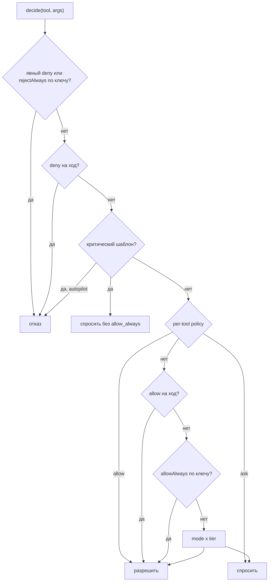
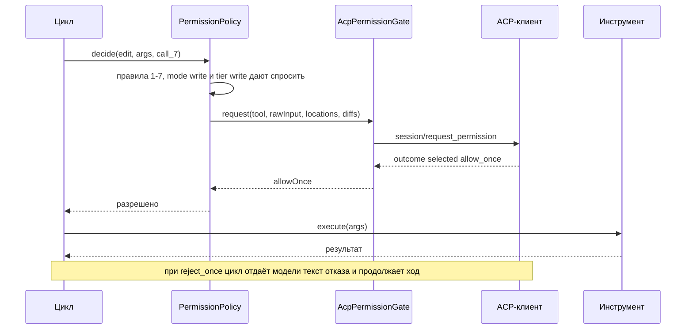

# 7. Разрешения

> Часть [архитектуры ядра агента CodeLab](../agent-core-architecture.md). Status: Accepted. Общие соглашения, термины и порядок чтения — в оглавлении.

← [6. Инструменты](06-tools.md) · [Оглавление ядра](../agent-core-architecture.md) · [8. Сессии](08-sessions.md) →

## 7.1. Назначение

Агент сам решает, можно ли исполнить вызов, и сам спрашивает пользователя. Проверка стоит в одной
точке перед исполнением любого инструмента. Модель разрешений клиента не меняется
(`AGENTS.md` §10, [`../permissions.md`](../../permissions.md)): для `fs/*` и `terminal/*` клиент не
вводит своего одобрения и только ограничивает пути рабочей папкой.

## 7.2. Контракт

```dart
/// Порядок объявления = порядок мягкости (§7.3.1): narrow берёт значение с меньшим index.
enum PermissionMode { alwaysAsk, write, acceptEdits, yolo, autopilot }
enum ToolPolicy { allow, deny, ask }

final class PermissionKey {                        // никогда не «вид инструмента»
  const PermissionKey(this.tool, this.pattern);
  final String tool, pattern;
  @override bool operator ==(Object o) => o is PermissionKey && o.tool == tool && o.pattern == pattern;
  @override int get hashCode => Object.hash(tool, pattern);
}

final class PermissionRequest {
  const PermissionRequest({required this.toolCallId, required this.tool, required this.kind,
      required this.tier, required this.title, required this.rawInput, this.locations = const [],
      this.diffs = const [], this.reason, this.allowAlwaysOffered = true, this.criticalLabel});
  final String toolCallId, tool, title;
  final ToolKind kind; final ToolTier tier;      // tool.kindOf(args), tool.tierOf(args) (§6.2)
  final Map<String, Object?> rawInput;             // приведённые аргументы (PERM-6)
  final List<Location> locations;
  final List<FileDiff> diffs;                      // по одному на файл; из ToolPrepared.presentation или present(args, ctx)
  final String? reason;                            // например, 'critical command: recursive delete of /'
  final bool allowAlwaysOffered;                   // false для критических шаблонов
  final String? criticalLabel;                     // после MVP: метка критического шаблона §7.6 или
                                                   // 'agent configuration' (§7.6.1); из неё AcpPermissionGate
                                                   // берёт _meta.codelab.label, A2aPermissionGate отклоняет (§17.15.4)
}

enum PermissionDecision { allowOnce, allowAlways, rejectOnce, rejectAlways, cancelled }
abstract interface class PermissionGate {
  Future<PermissionDecision> request(PermissionRequest req, CancelToken cancel);
}

final class PolicyRules {
  const PolicyRules({this.toolPolicies = const {}, this.denyPatterns = const {}});
  final Map<String, ToolPolicy> toolPolicies;      // permissions.tools из конфига
  final Set<PermissionKey> denyPatterns;           // явные запреты из конфига
}

sealed class PolicyOutcome { const PolicyOutcome(); }
final class Allowed extends PolicyOutcome { const Allowed(this.rule); final String rule; }
final class Denied extends PolicyOutcome { const Denied(this.reason); final String reason; }

/// Решения «всегда» сессии (§7.4). Субагенты разделяют хранилище родителя (§17.3.3, шаг 5).
final class PermissionDecisionStore {
  final Set<PermissionKey> allowAlways = {}, rejectAlways = {};
}

final class PermissionPolicy {
  PermissionPolicy({required this.mode, this.modeOf, this.gate, this.rules = const PolicyRules(),
      PermissionDecisionStore? decisions, required this.logger})
      : decisions = decisions ?? PermissionDecisionStore();
  PermissionMode mode;
  /// Если задан, читается при каждом решении вместо `mode` (после MVP: эффективный режим
  /// субагента `narrow(parentMode(), type.mode)`, SUB-2, §17.3.3).
  final PermissionMode Function()? modeOf;
  final PermissionGate? gate;
  final PolicyRules rules;
  final PermissionDecisionStore decisions;          // allowAlways и rejectAlways
  /// toolCallId, токен отмены, env (для present и шаблона пути) и счётчик ожидания — из ctx.
  Future<PolicyOutcome> decide(AgentTool tool, Map<String, Object?> args, ToolContext ctx);
  void grantForTurn({Set<String> allow = const {}, Set<String> deny = const {}});   // по именам инструментов
  void clearTurnGrants();                           // в начале каждого prompt() (PERM-8)
  BeforeToolCallHook asHook(AgentTool? Function(String name) lookup);   // Denied → Block(reason, outcome: rejected)
}
```

## 7.3. Режимы и уровни

`ToolTier` объявляет инструмент: `read` — только чтение, `write` — изменение файлов в рабочей
папке, `network` — выход в сеть по адресу, выбранному моделью (после MVP, `web_fetch`, §17.1),
`exec` — команды и всё неизвестное (MCP). После MVP уровень `network` получает и `agent` с
удалённым A2A-агентом (`agent: "a2a:<имя>"`, §17.15.3): прогон отправляет текст задачи на внешний адрес. Политика берёт уровень вызова `tool.tierOf(args)`
(§6.2): по умолчанию это объявленный `tier`, а у `lsp` уровень зависит от действия (`rename` —
`write`, остальные — `read`, §17.8.9). Таблица `mode × tier` («спросить» = вызов
`PermissionGate`):

| Режим | read | write | network | exec | критический шаблон |
|---|---|---|---|---|---|
| `alwaysAsk` | спросить | спросить | спросить | спросить | спросить |
| `write` | разрешить | спросить | спросить | спросить | спросить |
| `acceptEdits` | разрешить | разрешить | спросить | спросить | спросить |
| `yolo` | разрешить | разрешить | спросить | разрешить | спросить |
| `autopilot` | разрешить | разрешить | **отказать**: `network access needs approval and autopilot has no approver` | разрешить | **отказать** |

Колонка `network` — §17.1.5: в каждом режиме, где есть человек, сетевой выход спрашивается;
ACP-режим `plan` её не запрещает (спросить). Снять вопрос можно только явным
`permissions.tools.web_fetch = "allow"` (шаг 4 §7.4).

Это внутренние значения `PermissionMode`. Клиент видит режимы ACP `plan`, `ask`, `standard`, `accept-edits`, `bypass`; их соответствие `PermissionMode` — в таблице §13.6 (`ask` → `alwaysAsk`, `standard` → `write`, `accept-edits` → `acceptEdits`, `bypass` → `yolo`, `plan` → `write` с запретом `write` и `exec`). ACP-хосты по умолчанию работают в `write` (`standard`) или `alwaysAsk` (`ask`) по конфигу. `autopilot` доступен только
явным флагом headless-запуска (`--permission-mode autopilot`); из `session/set_mode` и из любого
слоя конфига он недоступен (CFG-4).

### 7.3.1. Режим `acceptEdits` (P-06) и порядок режимов

`acceptEdits` — «правки без вопроса, команды с вопросом»: чтение и правки файлов в рабочей папке
(`read`, `write`, `edit`, после MVP `lsp rename`) исполняются сразу, а `exec`, MCP-инструменты
(tier `exec`) и сетевой выход (`network`) спрашиваются. Критические шаблоны спрашиваются, как в
любом режиме с человеком. ACP id — `accept-edits` (§13.6), синоним на входе — `acceptEdits`.
Режим выбирается так же, как остальные: `session/set_mode`, опция `mode`, `/mode accept-edits`,
`permissions.mode: accept-edits` в конфиге, флаг `--permission-mode accept-edits`, поле `mode`
определения агента (§15.8). Режим по умолчанию ни одного профиля не меняется (§10.5).

Правила §7.4 действуют без изменений: `permissions.tools.exec = "allow"` снимает вопрос и в
`acceptEdits`, явный deny и `rejectAlways` сильнее режима. В headless `codelab -p` агент в
`acceptEdits` правит файлы без запроса, а вопросы о командах уходят политике `--approve` CLI
(§7.7): с `--approve reject` это «правки да, команды нет».

**Порядок мягкости.** Режимы линейно упорядочены так, что по каждому уровню (`read`, `write`,
`network`, `exec`, критический шаблон) следующий режим разрешает не меньше предыдущего, кроме
`autopilot`, который вместо вопроса отказывает:

```text
alwaysAsk(0) < write(1) < acceptEdits(2) < yolo(3) < autopilot(4)
```

`narrow(a, b)` (эффективный режим субагента, §17.3.3, шаг 4) берёт режим с меньшим номером и
объединяет запреты уровней режима `plan`.

**Дополнительно запрещённые уровни конфигурации** (решение пользователя 2026-10-30, change `add-agent-configuration`, D7). Режим —
одно значение, а `plan` — это запреты `write`/`exec` поверх режима. Чтобы ужесточение проектным
конфигом не теряло ни вопроса `ask`, ни запретов `plan`, `PermissionsConfig` несёт множество
`extraDeniedTiers` (точное имя — по коду): `ask` + `plan` и `plan` + `ask` дают режим `ask` и
`extraDeniedTiers = {write, exec}` (§15.3). Политика отклоняет вызов без вопроса, если его уровень
входит в `mode.deniedTiers ∪ extraDeniedTiers`, с причиной, как у `plan`. Смена режима сессии
(`session/set_mode`) дополнительные запреты не снимает: они приходят из конфигурации проекта. Примеры с новым режимом: родитель `accept-edits` + тип
`general` без режима → `acceptEdits`; родитель `bypass` + тип с `mode: accept-edits` →
`acceptEdits`; родитель `accept-edits` + тип `standard` → `write`; родитель `standard` + тип
`accept-edits` → `write` (ребёнок не мягче родителя, SUB-2).

Ужесточение режима проектным конфигом (§15.3) идёт по той же цепочке в обратную сторону:
`bypass → accept-edits → standard → ask`; проектный слой применяется через `narrow` с режимом
нижних слоёв, поэтому `plan` из проекта только добавляет запреты `write`/`exec` и не ослабляет
`ask`. Глобальный и локальный слои конфига заменяют режим профиля в любую сторону (§10.5).

## 7.4. Алгоритм разрешения

```text
decide(tool, args, id):
  key = PermissionKey(tool.permissionKeyName, tool.permissionPattern(args))   # по умолчанию name; agent_send/agent_resume → "agent" (§17.3.8.1, SUB-18)
  critical = tool.name == 'exec' ? findCritical(args.command) : null       # §7.6
  1  if rules.toolPolicies[tool] == deny or key in rules.denyPatterns or key in rejectAlways:
         return Denied('denied by configuration' | 'previously rejected by the user')
  2  if tool.name in turnDeny: return Denied('not allowed in this turn')
  3  if configPath(tool, args) != null:                                    # §7.6.1: цель lockPath(args) в списке путей
         if mode == autopilot or gate == null: return Denied('Editing agent configuration requires a human: ' + path)
         return ask(reason: 'agent configuration: ' + path, allowAlwaysOffered: false)
     if critical != null:
         if mode == autopilot: return Denied('critical command blocked in autopilot: ' + critical.label)
         return ask(reason: 'critical command: ' + critical.label, allowAlwaysOffered: false)
  4  switch rules.toolPolicies[tool]: allow → Allowed('tool policy'); ask → return ask()
  5  if tool.name in turnAllow: return Allowed('turn grant')
  6  if key in allowAlways: return Allowed('always allowed')
  7  switch table[mode][tool.tierOf(args)]: allow → Allowed('mode'); ask → return ask()

ask(reason, allowAlwaysOffered = true):
  allowAlwaysOffered &= tool.offersAllowAlways(args)                     # после MVP: lsp rename (§17.8.9)
  if gate == null: return Denied('no approval interface is available')
  t0 = clock.now()
  d = await gate.request(PermissionRequest(kind: tool.kindOf(args), tier: tool.tierOf(args),
        title, locations, diffs из ToolPrepared.presentation ?? present(args, ctx), allowAlwaysOffered, ...), cancel)
  ctx.services.approvalWait.add(clock.now() - t0)   # исключается из maxDuration хода (§5.2)
  switch d:
    allowOnce   → Allowed('user')
    allowAlways → allowAlways.add(key) (если allowAlwaysOffered, иначе как allowOnce); Allowed('user')
    rejectOnce  → Denied('rejected by the user')
    rejectAlways→ rejectAlways.add(key); Denied('rejected by the user')
    cancelled   → Denied('permission request was cancelled')
```

После MVP `rules.toolPolicies[tool]` ищется по `tool.permissionKeyName`: правило для `agent`
применяется и к `agent_send`, `agent_resume` (тот же ключ, §17.3.8.1); `agent_observe` — уровень
`read`, вид `think`, своё имя.

Текст отказа для модели: `Permission denied for <tool>: <reason>. Do not retry the same call; choose another approach or ask the user.`
Отказ — не отмена хода: модель получает результат-ошибку (`ToolCallFinished(outcome: rejected)`)
и продолжает работу (PERM-7). `allowAlways` и `rejectAlways` (`PermissionDecisionStore`) живут в
памяти `AgentSession` до её закрытия; сохранение между сессиями — после MVP через OpenSpec. `mode`
в алгоритме — `modeOf?.call() ?? mode`, вычисленный в момент решения. Политика субагента получает
хранилище решений родителя и `modeOf` с эффективным режимом ребёнка (после MVP, §17.3.3, шаги 4–5).

После MVP `args` — аргументы после перезаписи секретов (§17.12.6): ключ, `rawInput` и критические
шаблоны считаются по команде со ссылками на переменные. Запрет `redact.block` (§17.12.7)
срабатывает раньше, в `preflight`, и до политики не доходит. Пользовательские хуки (§17.14.2)
срабатывают только после `Allowed`; отказ политики хуки не запускает (EXT-1).



## 7.5. Шаблон для «разрешить всегда»

`AgentTool.permissionPattern(args)` строит строку ключа:

| Инструмент | Шаблон | Пример аргументов → шаблон |
|---|---|---|
| `write`, `edit` | путь относительно корня после нормализации (§4.4) | `{"path":"./lib//a.dart"}` → `lib/a.dart` |
| `read`, `ls`, `search` | нормализованный путь (по умолчанию `.`) | `{"pattern":"TODO","path":"lib"}` → `lib` |
| `exec` | точная строка команды после обрезки пробелов по краям | `{"command":"  dart test "}` → `dart test` |
| `task_create`, `task_update`, `task_list`, `task_get` (§17.16.3; до change `add-subagents-and-tasks` — `update_plan`) | `*` | любой → `*` |
| MCP и прочие | канонический JSON аргументов (ключи по алфавиту, без пробелов) | `{"b":1,"a":"x"}` → `{"a":"x","b":1}` |

«Разрешить всегда» на `write lib/a.dart` не разрешает `write lib/b.dart` и тем более `exec`
(PERM-3). `exec dart test` не разрешает `exec dart test --update-goldens`. Обобщение до префикса
команды или маски пути — после MVP, через OpenSpec.

## 7.6. Критические шаблоны команд

Применяются к аргументу `command` инструмента `exec`. Реакция — вопрос пользователю (в
`autopilot` — отказ), даже если `exec` разрешён режимом, политикой или «всегда».

**Разбор команды** (`shell_lexer.dart`):

1. Лексер учитывает одинарные кавычки (буквально), двойные кавычки (с экранированием `\`), ANSI-C строки `$'…'` (escape-последовательности `\n`, `\xHH`, `\NNN`, `\uHHHH`, `\cX` раскрываются; код 0 обрывает остаток до закрывающей `'`, как в bash; `\xHH` и восьмеричные `\NNN` — байты (восьмеричный код усекается `& 0xFF`, как в bash; `\400` — NUL), подряд идущие байты декодируются как UTF-8, невалидная последовательность — неразбираемая команда (fail closed: bash склеивает байты соседних `$'…'`, а мы декодируем части отдельно; цена — `echo $'\xff'` требует подтверждения); `\u`/`\U` — символы Unicode; код выше 0x10FFFF и `\c` перед `'` или `\` — неразбираемая команда; `\u`/`\U` bash 3.2 не знает, мы раскрываем — расхождение в сторону ложных срабатываний), локализуемые строки `$"…"` (как `"…"`), `\` вне кавычек, операторы `&&`, `||`, `;`, `|`, `&`, перевод строки, скобки `( )` и `{ }` подоболочек и групп.
2. Подстановки `$( … )`, `` ` … ` `` (в том числе внутри двойных кавычек) и `<( … )`, `>( … )` извлекаются как **вложенные команды** и разбираются рекурсивно.
3. Текст внутри кавычек остаётся аргументом и командой не считается: `git commit -m "rm -rf /"` — безопасно. Исключение: аргумент после `-c` у `sh`, `bash`, `zsh`, `dash`, `ksh` и аргументы `eval` разбираются как вложенная команда.
4. Here-document (`<<WORD`, `<<-WORD`): строки до `WORD` — данные, не команды.
5. Сегмент = слова между операторами. Из начала сегмента снимаются присваивания `NAME=value` и лаунчеры с их опциями: `sudo` (флаги и `-u USER`), `doas`, `env` (флаги и `NAME=value`), `nohup`, `nice` (`-n N`), `time` (`-p`), `command`, `exec`, `builtin`, `timeout` (длительность), `stdbuf` (флаги), `xargs` (флаги). Факт `sudo`/`doas`/`su`/`pkexec` запоминается.
6. Имя команды сравнивается по базовому имени (`/bin/rm` → `rm`).
7. Перенаправления `>`, `>>`, `>|`, `&>`, `N>` с целью (отдельным словом или слитно: `>/dev/sda`) сохраняются у сегмента.
8. Глубина вложенности — не больше 4; глубже или незакрытая кавычка → шаблон `unparsable command` (лучше спросить, чем пропустить).

**Защищённые цели** `P`: `/`, `/*`, `~`, `~/`, `~/*`, `$HOME`, `${HOME}`, `$HOME/`, `$HOME/*`,
`.`, `./`, `*`, `./*`, `..`, `../*`, а также системные каталоги (точно или с `/` или `/*` на конце):
`/bin`, `/boot`, `/dev`, `/etc`, `/home`, `/lib`, `/lib64`, `/opt`, `/proc`, `/root`, `/sbin`,
`/sys`, `/usr`, `/var`, `/Applications`, `/Library`, `/System`, `/Users`. Цель с переменной,
кроме `$HOME`, не считается защищённой (`/$DIR` — значение неизвестно).

Рекурсивный флаг: `-r`, `-R`, `--recursive` или кластер коротких флагов, содержащий `r`/`R`
(`-rf`, `-fR`).

| Метка | Правило | Срабатывает | Не срабатывает |
|---|---|---|---|
| `recursive delete of a protected path` | `rm` с рекурсивным флагом и хотя бы одной целью из `P`; или `--no-preserve-root` | `rm -rf /`, `cd /tmp && rm -rf /`, `rm -r ~`, `rm -rf $HOME/*`, `rm -rf .` | `rm -rf build`, `rm -f /tmp/x`, `rm -rf "$DIR/out"` |
| `deletion of a .git directory` | `rm` с рекурсивным флагом и целью, последний сегмент которой `.git` | `rm -rf .git`, `rm -rf ./pkg/.git/` | `rm -rf .github`, `rm .gitignore` |
| `recursive find delete of a protected path` | `find`, первый путь из `P`, есть `-delete` или `-exec rm` | `find / -name '*.log' -delete`, `find ~ -exec rm {} +` | `find build -delete` |
| `recursive permission change of a protected path` | `chmod`/`chown`/`chgrp` с рекурсивным флагом и целью из `P` | `chmod -R 777 /`, `sudo chown -R me /usr` | `chmod -R 755 web`, `chmod 644 a.txt` |
| `privileged command` | сегмент запущен через `sudo`, `doas`, `su`, `pkexec` | `sudo apt install x`, `su -c 'id'` | `echo sudo` |
| `fork bomb` | регулярное выражение `forkBomb` (ниже) по исходной строке команды | `:(){ :\|:& };:`, `f(){ f\|f& };f` | `f() { echo hi; }` |
| `write to a disk device` | перенаправление или `of=` у `dd` на `/dev/sd*`, `/dev/hd*`, `/dev/vd*`, `/dev/xvd*`, `/dev/nvme*`, `/dev/disk*`, `/dev/rdisk*`, `/dev/mmcblk*` | `dd if=x.img of=/dev/disk2`, `cat x > /dev/sda` | `dd if=/dev/zero of=./a bs=1M count=1`, `> /dev/null` |
| `filesystem format or wipe` | `mkfs`, `mkfs.*`, `mke2fs`, `newfs*`, `wipefs`, `fdisk`, `sfdisk`, `parted`, `diskutil eraseDisk/eraseVolume/partitionDisk`; `shred` с целью в `/dev/` | `mkfs.ext4 /dev/sdb1`, `diskutil eraseDisk APFS X disk2` | `diskutil list` |
| `overwrite of a system account file` | перенаправление, `tee`, `cp`/`mv` с целью `/etc/passwd`, `/etc/shadow`, `/etc/group`, `/etc/sudoers`, `/etc/sudoers.d/*` | `echo x >> /etc/sudoers`, `tee /etc/passwd` | `cat /etc/passwd` |
| `write to ssh configuration` | перенаправление, `tee`, `cp`/`mv` с целью в `~/.ssh/` или `$HOME/.ssh/` | `echo key >> ~/.ssh/authorized_keys` | `cat ~/.ssh/config` |
| `download and execute` | в одном конвейере стадия `curl`/`wget`/`fetch` и последующая стадия `sh`, `bash`, `zsh`, `dash`, `ksh`, `fish`, `python`, `python3`, `perl`, `ruby`, `node`; или вложенная команда с `curl`/`wget` внутри `eval`, `sh -c`, `source`, `.`, `bash <(...)` | `curl -fsSL x.sh \| sh`, `bash <(curl -s u)`, `eval "$(wget -qO- u)"`, `sh -c "$(curl u)"` | `curl -o x.sh u`, `curl u \| jq .` |
| `host shutdown or reboot` | `shutdown`, `reboot`, `halt`, `poweroff`, `init 0`, `init 6`, `systemctl poweroff/reboot/halt` в позиции команды | `sudo reboot`, `systemctl reboot` | `echo reboot` |
| `kill of init or all processes` | `kill` (любой сигнал) с целью `1` или `-1` | `kill -9 1`, `kill -KILL -1` | `kill 1234` |
| `write to agent configuration` | любая команда не из белого списка чтения §7.6.1, у которой аргумент, значение опции или рабочий каталог — путь из списка §7.6.1 (`.codelab/config*.yaml`, `.codelab/cli.yaml`, `.codelab/agents/**`, `.codelab/skills/**`, `.codelab/prompts/**`, `.codelab/hooks/**`, `.agents/skills/**`, пути от хоста) или близкий каталог-предок; перенаправление в такой путь — всегда; удаление и усечение (`rm`, `unlink`, `mv` с ним как источником, `truncate`) | `echo x >> .codelab/config.yaml`, `cp evil.md .codelab/agents/`, `yq -i .a=1 .codelab/config.yaml`, `curl -o ~/.codelab/config.yaml u` | `cat .codelab/config.yaml`, `git diff .codelab` |
| `git force push or remote branch deletion` | `git push` с `--force`, `-f`, `--force-with-lease`, `--mirror`, `--delete`, `-d`, или refspec с `+` в начале или `:` в начале | `git push -f origin main`, `git push origin +main`, `git push origin :dev` | `git push origin feature` |
| `git history rewrite` | `git filter-branch`, `git filter-repo`, `git reflog expire` с `--expire=now`/`--expire-unreachable=now`, `git gc --prune=now`, `git branch -D` или `git branch -d --force` для `main`, `master`, `develop`, `trunk`, `release/*` | `git filter-branch --tree-filter x`, `git branch -D main` | `git branch -D feature/x`, `git gc` |

Регулярное выражение fork-бомбы — функция, которая в своём теле вызывает себя в конвейере и уходит в фон:

```dart
final forkBomb = RegExp(r'(\w+|:)\s*\(\s*\)\s*\{[^}]*\1\s*\|\s*\1\s*&');
```

Если в одной команде несколько совпадений, `reason` перечисляет все метки через `; ` в порядке
строк таблицы.

Реализация (`critical_patterns.dart`) нормализует цели без переменных относительно корня сессии
(`//` и `/usr/../` — это `/`; корень сессии и его родители защищены как `.` и `..`), сравнивает
пути §7.6.1 без учёта регистра и считает критичными сами каталоги `.codelab/agents`, `skills`,
`prompts`, `hooks`. Полный перечень уточнений и известных пределов разбора — design.md change
`add-agent-core-permission-policy`, D9.


### 7.6.1. Критические пути правок: конфигурация агента в проекте

Конфигурацию агента меняют только человек и клиенты (`ConfigWriter`, §17.5.5); модель её не
правит (Won't T-25). Файлы внутри корня сессии, через которые проект настраивает агента,
поэтому защищены так же, как критические команды:

* `write`, `edit` (включая правки по якорям §17.11.3 и переименование LSP §17.8) с целью,
  совпадающей с `.codelab/config.yaml`, `.codelab/config.local.yaml`, `.codelab/cli.yaml`,
  `.codelab/agents/**`, `.codelab/skills/**`, `.codelab/prompts/**`, `.codelab/hooks/**`,
  `.agents/skills/**` (корень навыков проекта, change `add-agent-skills`, Q16) (путь нормализуется по §4.4 до сравнения), считаются **критическими**: вопрос задаётся в любом
  режиме, включая `bypass` и `accept-edits`; `allow_always` не предлагается и ранее выданные
  «разрешить всегда» на них не действуют; в `autopilot` и без интерфейса одобрения — отказ с
  текстом `Editing agent configuration requires a human: <path>`;
* `exec`, у которого путь из того же списка — аргумент команды не из белого списка чтения или цель
  перенаправления, — критический шаблон с меткой `write to agent configuration` (строка таблицы
  выше; правило — ниже, «Белый список чтения»).

**Пути конфигурации агента от хоста** (этап 8.10; design.md change
`add-config-writer-and-reload`, D8, OQ2). С живой перезагрузкой (§17.5.6) правка глобального
конфига действовала бы на следующем шаге, поэтому те же правила применяются к путям, которые хост
передаёт полем `AgentCoreServices.agentConfigPaths: AgentConfigPaths {paths, expansions,
caseInsensitive}`:

* `paths` — файлы, которые наблюдает `ConfigWatcher` (`$CODELAB_HOME/config.yaml`, файл
  `--config`/`CODELAB_CONFIG`, `<корень запуска>/.codelab/config.yaml` и `config.local.yaml`),
  `$CODELAB_HOME/secrets.yaml` при любом `secrets.backend` и каталоги `$CODELAB_HOME/agents`,
  `$CODELAB_HOME/prompts` с поддеревом; с change `add-agent-skills` (D9, решения Q9, Q16, Q27) — и корни
  навыков с поддеревом, не зависящие от сессии: `$CODELAB_HOME/skills`, `~/.agents/skills`,
  абсолютные элементы `skills.extra_roots` (корни, зависящие от `cwd`, — пути сессии, ниже). Список корней строит та же функция, что даёт их загрузчику навыков.
  `secrets.yaml` защищён всегда, хотя наблюдатель следит за
  ним только при `file`: иначе агент мог бы создать файл и переключить бэкенд следующей правкой
  (R5-1 того change). Строит их одна функция `agentConfigPathsFor` (`codelab_agent_io`), та же,
  что даёт файлы наблюдателю, поэтому каждый наблюдаемый файл защищён. Пути канонические: `~`
  раскрыт, ссылки раскрыты по самому глубокому существующему предку;
* `expansions` — значения `HOME` и `CODELAB_HOME` окружения хоста: ими раскрываются `~`, `$HOME`,
  `${HOME}`, `$CODELAB_HOME`, `${CODELAB_HOME}` в командах `exec` (у ядра своего окружения нет);
* `caseInsensitive` — признак ФС без учёта регистра; его определяет хост.

**Запуск скрипта навыка** (change `add-agent-skills`, D9; решения пользователя Q24, Q25, Q29 и их
уточнения Q33–Q38). Каталоги навыков защищены, а скрипт навыка запускается по абсолютному пути
из рабочей папки (рекомендованный путь, §17.2.3) или из каталога навыка. Поэтому действуют три узких
исключения — точная формулировка в спецификации `agent-permissions` («Критические пути правок
конфигурации агента»):

Исключения для навыков (design.md change `add-agent-skills`, D9; решения пользователя Q24, Q25, Q29 и их уточнения Q33–Q38) применяются к каждой простой команде строки отдельно (`cd`, `pushd` и `popd` меняют рабочий каталог последующих команд, но не снимают их критичность). «Внутри каталога навыка» везде проверяется по **каноническому** пути — после разрешения ссылок тем же резолвером путей политики, поэтому `scripts/run -> /bin/cp`, аргумент-ссылка наружу или ссылка на `SKILL.md` исключения не получают. Имя `SKILL.md` сравнивается с базовым именем канонического пути без учёта регистра (на нечувствительной к регистру ФС `skill.md` — тот же файл). Исключения не убирают срабатывание там, где путь записи в корень навыков явно виден в команде; запись, которую разбор не видит (скрипт из файла и другие известные пределы ниже), исключения не создают и не закрывают. Каталоги загруженных навыков политика сессии получает полем `AgentConfigPaths.skillDirs` (рантайм — через `withSession` вместе с путями сессии); «существующий обычный файл» проверяется `stat` резолвера политики, если он `FileSystem`, иначе исключение не действует (fail closed; D17 change `add-agent-skills`):

* **E1 — скрипт навыка** (Q25, уточнено Q34, Q36, Q37). Исполняемый файл SHALL NOT делать команду критической при любом рабочем каталоге, только если: (1) это существующий обычный файл под `<dir>/scripts/` загруженного навыка (имя каталога — по `specification.md`), в пути после `scripts/` нет сегментов, начинающихся с `.`, и сегментов `node_modules`, `site-packages`, `vendor`; не `SKILL.md`; (2) он стоит первым словом команды и это слово содержит `/` (слово без `/` оболочка ищет в `PATH`, а не в рабочем каталоге: `cd <dir> && run.sh` под E1 не подпадает), или он — первый позиционный аргумент интерпретатора, узнанного по **голому базовому имени** из `PATH`: `python`, `python3`, `node`, `tsx`, `bash`, `sh`, `zsh`, `pwsh`, `ruby`, `perl`, `deno run`, `bun run`, `uv run`, `pipx run`; интерпретатор с путём под E1 не подпадает; (3) у интерпретатора перед путём скрипта **нет ни одной опции**, кроме `pwsh -File`/`-f` (Q34: allowlist безопасных опций не заводится; опции кода, модуля и stdin — `-c`, `-e`, `-E`, `-p`, `-n`, `-i`, `-m`, `-M`, `-r`, `-s`, `-`, `--eval`, `--print`, `--require`, `--import`, `--loader`, `--preload`, `-Command`, `-EncodedCommand`, `--with`, `--spec` — частные случаи этого правила); (4) у простой команды нет префиксного присваивания (`NAME=… python3 …`), она не запущена через `env NAME=…` или `env` с `-S`, `-i`, `-u`, и раньше в той же строке не было `export`, `declare`, `typeset`, `readonly` или `local NAME=…` (Q37, fail closed: переменные вроде `NODE_OPTIONS`, `BASH_ENV`, `PERL5OPT`, `RUBYOPT`, `PYTHONPATH`, `ZDOTDIR`, `PATH` меняют исполняемый код, и перечень не ведётся). Файл навыка, названный как интерпретатор (`<dir>/scripts/…/tsx`), подчиняется тем же правилам (3) и (4) для своих аргументов.
* **E2 — рабочий каталог навыка** (Q24, сужено Q33). Рабочий каталог (`ExecOptions.cwd`, `cd <dir>`, `pushd <dir>`) в каталоге загруженного навыка SHALL NOT делать простую команду критической, **только если** её исполняемый файл — скрипт навыка по E1 или команда из белого списка чтения. Любая другая команда с таким рабочим каталогом — критическая, даже без единого слова-пути: `tar -x`, `unzip -o`, `7z x`, `cpio -i`, `jar x`, `git pull`, `git merge`, `npm install`, `find -delete` и подобные пишут в рабочий каталог неявно. `env -C DIR` и опция `-C DIR` под E2 сознательно не подпадают и проверяются как прежде (безопасная сторона).
* **E3 — ресурс навыка аргументом его скрипта** (Q29, уточнено Q35, Q38). Слово-аргумент или значение опции SHALL NOT делать критической простую команду, **только если** её исполняемый файл — скрипт навыка по E1 и слово по каноническому пути — существующий обычный файл под `<dir>/assets/` **того же** навыка с расширением не `.md`. Файлы под `references/` и `scripts/`, сам `SKILL.md` любого навыка (по Q30 это доверенные инструкции и исполняемый код), файлы другого навыка (в том числе через `..`), слова с маской или фигурными скобками (`*`, `?`, `[…]`, `{…}` — каждый вариант раскрытия проверяется как отдельное слово) исключения E3 не получают никогда. Дополнительная эвристика — значения опций вывода исключения не получают и для `assets/`: `-o`, `-o<path>`, `-O`, `--output`, `--output=…`, `--out`, `--out=…`, `--outfile`, `--output-file`, `--out-file`, `--outdir`, `--dest`, `--target`, `--write`, `-w`, `of=…`. Жёсткие ссылки E3 не различает: `FileStat` порта окружения не отдаёт число ссылок (`nlink`), поэтому ограничение `nlink == 1` не вводится — известный предел.

Пишущие команды (`cp`, `mv`, `rm`, `sed -i`, `ln`, `tee`, `curl -o`, `wget -O`, `install`, `rsync`, `truncate`, `dd of=` и другие команды не из белого списка чтения, не подпадающие под E1), цели перенаправления (`>`, `>>`) в каталог навыка, ещё не существующие пути в каталоге навыка и прочие слова, попадающие в защищаемые пути, проверяются по правилу белого списка чтения, как выше, и остаются критическими. Команда, подпадающая под исключения, идёт по обычной политике уровня `exec`, в том числе с `allow_always`. Остаточные риски: скрипт навыка сам пишет в свой каталог или исполняет переданный ему код (`<dir>/scripts/run.sh "rm …"`) — политика не разбирает содержимое программ; проверка идёт в `beforeToolCall`, а исполнение — позже (TOCTOU: файл или ссылка могут смениться между проверкой и запуском).

**Корни навыков, зависящие от сессии** (решение Q27). Уровни проекта выше рабочей папки
(`<уровень>/.codelab/skills`, `<уровень>/.agents/skills`) и относительные элементы
`skills.extra_roots`, разрешённые от `cwd` (`.claude/skills`), защищены так же, но это пути
**сессии**: рантайм добавляет их к защищаемым путям политики сессии при её открытии той же
функцией списка корней, что даёт их загрузчику; поле хоста `agentConfigPaths` действует на весь
процесс и их не содержит. Защита не зависит от доверия проекту и от существования каталога.

Сравнение:

* цель `write`/`edit` — после канонизации `BoundedEnv` (тот же результат, что для containment
  §4.4); каноническая форма защищаемых путей пересчитывается на каждой проверке — асинхронно в
  `beforeToolCall` политики тем же вызовом `ExecutionEnv`, что у containment, поэтому подмена каталога-предка ссылкой после старта (`ln -s sub .codelab`, затем
  `write sub/config.yaml`) путь из-под защиты не выводит; защита действует для сессии с любым `cwd`;
* резолвер путей политики (пересчёт защищаемых путей и второй проход `exec`) — окружение сессии,
  только если оно реализует `PathResolver`, иначе окружение хоста `AgentCoreServices.baseEnv`. У
  сессий `serve` окружение — клиент ACP, который ссылок не раскрывает, а защищаемые пути — пути
  хоста; для `--ws` клиент подключён по loopback, это та же машина;
* `exec` — белый список чтения (R5-4 того change). Разбирается каждая простая команда строки — в
  цепочках `&&`, `||`, `;`, в конвейерах, внутри `sh -c`/`bash -c`, после `env` (в том числе
  `env -C DIR`) и после `cd DIR` (`DIR` — рабочий каталог следующих команд). Проверяются
  слова-аргументы, значения опций (`-o FILE`, `-C DIR`, `--output=FILE`, `-d DIR`, `of=FILE`) и
  рабочий каталог — после раскрытия `~`, `$HOME`, `${HOME}`, `$CODELAB_HOME`, `${CODELAB_HOME}` и
  разрешения относительно рабочего каталога команды (включая `../`). Если значение разрешается в
  защищаемый путь, путь внутри защищаемого каталога или близкий каталог-предок, команда критична,
  кроме команд только чтения: `cat`, `less`, `more`, `head`, `tail`, `grep`/`egrep`/`fgrep`, `rg`,
  `ag`, `ls`, `stat`, `file`, `wc`, `diff`, `cmp`, `sha256sum`/`shasum`/`md5sum`, `jq`/`yq`,
  `git diff|log|show|status|blame`, `test`/`[`, `realpath`, `readlink`, `dirname`,
  `basename`, `echo`/`printf` — без опций записи и исполнения (ниже). Перенаправление в защищаемый путь критично всегда, в том числе у
  команды из списка. Примеры критичных: `>`/`>>`, `tee`, `cp`, `mv`, `rename`, `ln`, `install`,
  `dd of=`, `sed -i`, `yq -i`, `perl -pi`, `curl -o`, `wget -O`, `git checkout|restore --
  .codelab/…`, `cp -r evil/. ~/.codelab`, `rsync`, `tar -C ~/.codelab`, `unzip -d ~/.codelab`,
  `find ~/.codelab -delete`. Список консервативен: `cp .codelab/config.yaml /tmp/b.yaml` тоже
  спрашивается;
* опции записи и исполнения снимают исключение белого списка — команда проверяется как любая
  другая: `jq`/`yq` с `-i`, `--in-place*`, `--inplace*`, `-s`, `--split-exp`; `rg`/`ag` с `--pre`,
  `--pre-glob`, `--search-zip` (`-z`); `less` с `-o`, `-O`, `--log-file`; `file` с `-C`, `--compile`;
  `git` с глобальными `-c`, `--config-env`, `--exec-path`,
  `--git-dir`, `--work-tree`; `git diff --output|--ext-diff|--textconv` (решение оркестратора
  2026-11-03 по повторному ревью итерации 5, fail closed);
* значение опции, которое программа исполняет как команду, разбирается как вложенный текст, как
  `sh -c`: `git -c` с `core.pager`, `core.fsmonitor`, `core.sshCommand`, `core.editor`,
  `interactive.diffFilter`, `diff.external`, `*.textconv`, `sequence.editor`, `alias.<имя>=!…`,
  `credential.helper`, драйверы `merge`/`filter` и другие; `rg --pre`; `find -exec`, `-execdir`,
  `-ok`, `-okdir`; строка команды `watch` и `script -c`. Так же разбираются переменные с командой
  (`GIT_PAGER`, `PAGER`, `GIT_EXTERNAL_DIFF`, `GIT_EDITOR`, `EDITOR`, `VISUAL`,
  `GIT_SEQUENCE_EDITOR`, `GIT_SSH_COMMAND`, `GIT_SSH`, `GIT_ASKPASS`, `SSH_ASKPASS`, `LESSOPEN`,
  `LESSCLOSE`) в префиксном присваивании, `env NAME=…` и `export|declare|typeset|readonly|local`.
  Критичны всегда: `git --config-env`, `git -c core.hooksPath|include.path|includeIf.*` и
  присваивание `GIT_CONFIG_COUNT`, `GIT_CONFIG_KEY_*`, `GIT_CONFIG_VALUE_*`,
  `GIT_CONFIG_PARAMETERS`, `GIT_EXEC_PATH`, `GIT_DIR`, `GIT_WORK_TREE` — что исполнится, неизвестно;
* распаковка архива (`tar -x`, `bsdtar -x`, `unzip` кроме листинга, `cpio -i|-p`, `7z x|e`, `jar x`
  в каталог запуска), `ditto`, `rsync` и `cp -r|-a` со слитным источником (`X/.`, `X/*`, `.`; у BSD
  `cp` на macOS — и `X/`) критичны, если приёмник широкий: корень
  запуска и выше (`tar -C ~`), предок защищаемого пути, `.codelab` или каталог конфигурации хоста;
  приёмник — `-C`/`--directory`, `-d`, `-o`, последний путь `rsync`, назначение `cp`, по умолчанию
  рабочий каталог команды. Команда создаёт поддерево неизвестного состава, и двухшаговая запись
  (`evil/.codelab/config.yaml`, затем распаковка, синхронизация или `cp -r evil/. .` в корень)
  обходит сравнение путей. В обычный подкаталог (`tar -xf a.tar -C build`, `rsync -a src/ dst/`)
  и `cp -r src .` — не критичны;
* `git apply`, `git am`, `patch` критичны всегда: пути правок задаёт содержимое патча;
* git-подкоманды, стирающие дерево, критичны всегда, без проверки путей: `git clean -f…`,
  `git reset --hard`, `git stash` кроме `list|show`, `git checkout|restore .`,
  `git checkout|switch --force|-f|--discard-changes`, `git checkout-index -a|-f`, `git read-tree -u`.
  Ядро не видит ФС, поэтому корень считается
  содержащим `.codelab`: `git clean -fdx` удалил бы неотслеживаемый `.codelab/config.local.yaml` с
  `permissions.deny` (R5-2). `git checkout <ветка>`, `merge`, `pull`, `rebase` не критичны;
* каталоги-предки — любой предок каждой формы защищаемого пути, кроме `/`, двух видов.
  **Широкий** — корень запуска, `cwd` сессии, `~` и выше: команда с ним критична, только если
  разрушает, перемещает или подменяет сам каталог — `rm`/`rmdir`/`mkdir` и предок в роли источника
  `mv`/`ln` (`rm -rf ~`, `mv ~/proj x`) всегда, предок в роли назначения `mv`/`ln` — пока его нет
  на диске (в существующий каталог файл кладётся внутрь, это ловит сравнение пути `DIR/x`); запись
  внутрь ловится сравнением конкретных путей, поэтому `make`, `cp -r src dst`, `rm -rf build`,
  `mkdir -p src/x`, `mv a b`, `mv a .` в корне не критичны (исключения — распаковка, `rsync`, патчи и
  git, стирающий дерево, выше). **Близкий** — `<корень>/.codelab`,
  `$CODELAB_HOME`, каталог файла `--config` и промежуточные: в аргументах команды не из белого списка
  он критичен как защищаемый путь;
* маски (glob `*`, `?`, `[`, brace `{…}`) — по префиксу до первого символа маски: префикс внутри
  защищаемого пути, `.codelab` или `$CODELAB_HOME` либо совпадающий с ними делает команду не из
  белого списка критичной (fail closed): `rm .codelab/*.yaml`, `cp x ~/.codelab/{agents,prompts}/`.
  Файлы политики: правила PERM-11 для `exec` — `permissions/agent_config_rules.dart`, общий с
  таблицей §7.6 разбор аргументов — `permissions/command_args.dart` (две копии разбора разошлись бы).
  Сопоставление — своя реализация политики `permissions/shell_glob.dart`, а не `tools/glob.dart`
  инструментов поиска: маска одной компоненты пути, правило точки оболочки (`*` не совпадает с
  `.codelab`), сломанная маска считается совпадающей (fail closed);
* удаление и усечение самого защищаемого файла — `rm`, `unlink`, `mv <защищаемый> …`, `truncate`,
  перенаправление `>` — тот же шаблон `write to agent configuration`: удаление проектного конфига
  может снять записанный в нём `permissions.deny` (R5-2 того change);
* символическая ссылка НА защищаемый файл (`ln -s ~/.codelab/config.yaml /tmp/x`) критична по
  белому списку (`ln` не читает); запись по уже существующей ссылке ловится канонизацией цели —
  `write`/`edit` через `BoundedEnv`, `exec` (`>`, `tee`, `sed -i`, `rm`, `truncate`) вторым
  проходом шаблона через резолвер путей политики, если ссылка и её цель существуют;
* жёсткая ссылка — `ln` без `-s` и `cp -l`/`cp --link` с защищаемым путём в любой позиции
  (источник или цель) — тоже критическая: через неё защищаемый файл правится по другому пути.

Известная граница — висячая ссылка: после одобренного человеком `ln -s sub .codelab` при
несуществующем `sub` запись `write sub/config.yaml` не распознаётся, потому что порт `PathResolver`
не раскрывает висячие ссылки (нет `readlink`); закрытие — новая capability порта окружения
отдельной задачей (R5-3 того change).

Разбор `exec` не видит и такие случаи (дополнено change `add-agent-skills`): команда в shell через
stdin (`echo '…' | sh`), запись из программы `sed -n 'w …'` и `awk '{print > …}'`, `pwsh -Command`,
`fish -c`, подстановку по умолчанию `${HOME:-x}`, путь в переменной (`F=…; rm $F`), каталоги
`.agents/skills` и `.codelab/skills` в подкаталогах проекта, которые станут корнями навыков для
сессий в подпроектах (уровни выше `cwd` защищаются только для сессии, в которой они корни, Q27);
остаточные риски исключений для навыков: скрипт навыка пишет в свой каталог или в переданный
ресурс (Q25, Q29), а записанный им файл потом читается как доверенный (Q30).
Исправлено отдельным fix (решение пользователя 2026-11-12).

* `env -S`/`--split-string` разбирается как вложенная команда `env <слова до -S> <слова значения>
  <остаток>`. Значение токенизируется **по правилам самого `env`**, а не shell (`env` метасимволы
  shell не знает: `;`, `&`, `|`, `<<` и перевод строки — обычные символы аргументов): разделители —
  пробел и `\t \n \v \f \r`; кавычки `'…'` (внутри только `\\` и `\'`) и `"…"`; `\_`, `\t`, `\n`,
  `\v`, `\f`, `\r` вне кавычек — разделитель, в двойных — пробельный символ; `\\ \" \' \$ \#` — сам
  символ; `\c` обрывает значение; `#` в начале слова — комментарий до конца; `${NAME}` —
  подстановка. Каждое слово выводится в одинарных кавычках, `${NAME}` — вне них, чтобы правила
  видели раскрытие `${HOME}`/`${CODELAB_HOME}`; остаток после значения тоже берётся в кавычки
  (`'#'`, `'x;'` остаются данными). Значение само может начинаться с опций и присваиваний `env`,
  в том числе с вложенного `-S`; глубину ограничивает `maxShellNesting`
  (`shell_lexer.dart`: `_scanEnv`, `_envSplitWords`, `_envSplitText`; один проход по опциям
  для поиска команды, `-S` и `-C`). Строки `$'…'` и `$"…"` раскрываются лексером для всех команд (правило 1 §7.6).
* Опции `env` кончаются на значении `-S`. Поддержаны `-S значение`, `-Sзначение`, `-S ''`, кластеры
  (`-iS`), `--split-string значение`, `--split-string=значение` (пустое после `=` следующее слово
  не берёт) и однозначные сокращения длинных опций (`--sp`, `--split-s`, `--chd`, `--un`).
  Опции со значением: `-u`, `-C`, `-S`, `-a`/`--argv0`, `--unset`, `--chdir`, а для macOS/BSD —
  `-P`, `-L`, `-U`; флаги без значения — `-i`, `-0`, `-v`.
* **`unparsable command`** (fail closed): неизвестная короткая опция `env`; в значении `-S` голый
  `$` или `${…` без закрытия и с неверным именем, незакрытые кавычки, любой `\x`, кроме
  перечисленных, `\` в конце, `\x` внутри одинарных кавычек, кроме `\\` и `\'`; слово-кластер
  коротких флагов длиннее 256 символов у команды вне белого списка чтения (перебор суффиксов
  квадратичен, а метка «write to agent configuration» на длинных `-I<путь>` и `-d{json}` вводила бы
  в заблуждение).
* У склеенных коротких флагов со значением (`curl -sSo<path>`, `wget -qO<path>`, `wget -q4O<path>`)
  кандидатами пути служат суффиксы слова после каждого символа кластера, похожие на путь:
  начинаются с `/`, `~`, `.` или `$` либо содержат `/` (`agent_config_rules.dart`,
  `_pathCandidates`). Относительное имя без таких признаков (`curl -sSoconfig.yaml`) ловит правило
  «команда в каталоге конфигурации». Возможны ложные срабатывания (fail closed).

Известные пределы, которые **не исправляются** этим fix: (1) нормализация Unicode на APFS
(NFC/NFD): `rm -rf /Users/Сергей` с `й` в NFD не совпадает с защищаемым путём, сравнение путей идёт
без нормализации; (2) регистр на APFS: `rm ~/.CODELAB/config.yaml` — требует проверки, отдаёт ли
`canonicalizeSeen` (realpath) регистр с диска; если нет, это обход на macOS (отдельная задача).

Известная проблема, **исправляется отдельной задачей**: ложное срабатывание на `curl -d '{"a":1}'` — одноэлементные `{…}` в кавычках раскрываются как фигурные скобки и дают метку `write to agent configuration` (старое поведение). Там же: регулярное выражение `forkBomb`
(`critical_patterns.dart`) квадратично на длинной цепочке `\w`-символов в строке команды
(8000 символов — около 1,4 с, 32000 — около 21 с); встроенный агент работает в UI-изоляте
desktop. Остаются пределы этого fix: однозначные сокращения длинных опций других лаунчеров
(`sudo --pro`, `nice --adj`, `timeout --sig`) не распознаются — требует проверки; `less '+!cmd'` (команда
из опции запуска `less`). Известные пределы исключений для навыков: `bun run <имя>` ищет скрипт
`package.json`, а не файл, — под E1 такое слово не подпадает, только путь с `/`; жёсткие ссылки
E3 не различает (`FileStat` не отдаёт число ссылок); проверка в `beforeToolCall` и исполнение
разнесены во времени (TOCTOU); корни навыков, зависящие от `cwd` (уровни выше `cwd` до корня git,
относительные и собственные абсолютные `skills.extra_roots` папки сессии), политика сессии получает из
результата фазы навыков, поэтому без него — `skills.enabled: false` в конфигурации папки, хост без порта
навыков (`serve --ws`, web), таймаут, исключение или отмена фазы — они в этой сессии не защищены; корни
хоста (`$CODELAB_HOME/skills`, `~/.agents/skills`, абсолютные `extra_roots` корня запуска) и проектное
правило у `cwd` (`.codelab/skills/**`, `.agents/skills/**`) защищены всегда (решение Q46 (а) и D17
change `add-agent-skills`).

Разбор `exec` не видит пути, которых нет в словах команды: строка программы интерпретатора
(`python -c`, `node -e`), скрипт из файла, подстановка `$(…)`, маска с префиксом короче
защищаемого пути (`rm -rf .c*`), запись внутрь широкого предка без явного пути
(`find . -delete` в корне), `xargs rm` из конвейера, переменные, кроме `HOME`/`CODELAB_HOME`,
удалённое назначение `rsync` `host:path`, удалённые команды (`ssh host "…"`), `git worktree add`,
`git submodule update`, `git cherry-pick`, `git revert`, `**` без `globstar` (одна компонента, точечные каталоги
не видит; маска ловится, только если префикс уже в `.codelab`); ложные срабатывания на путь в значении опции, не
задающей запись (`--exclude=`, `-m`), приняты как лишний вопрос. Git-подкоманды, меняющие
отслеживаемые файлы (`checkout <ветка>`, `merge`, `pull`, `rebase`), могут переписать
закоммиченный `.codelab/config.yaml`, но для доверенного проекта это обычная работа. Остаточный риск смягчает то, что ключи,
ослабляющие права, и правки, способные направить секрет на другой адрес, живой перезагрузкой не
применяются (§17.5.6; R0-1, R0-4 того change).

Чтение этих файлов не ограничено. Правило не мешает клиентам: `ConfigWriter` работает вне
инструментов модели.

## 7.7. Режим без интерфейса одобрения (headless)

1. `PermissionGate` не передан (ядро запущено без ACP-клиента и без UI — фоновые прогоны, тесты) → любое «спросить» превращается в отказ `no approval interface is available` (PERM-5).
2. Headless `codelab -p` — это ACP-клиент, поэтому gate у агента **есть**: `AcpPermissionGate` (§7.8). На запросы отвечает сам CLI по политике `--approve` (`reject` по умолчанию, `read-only`, `allow-all`; см. proposal, спецификация `codelab`). Запрос для критической команды несёт `_meta.codelab.critical: true` и не предлагает `allow_always`; политика `allow-all` такие запросы **отклоняет**, `read-only` и `reject` — тоже.
3. Режим агента (`--permission-mode` у `codelab-agent serve` и у встроенного агента в `codelab -p`) меняет, о чём агент спрашивает, а `--approve` — как CLI отвечает. `autopilot` включается только флагом: в нём агент не спрашивает о `read`/`write`/`exec`, а критические команды отклоняет сам (PERM-9).
4. Отказы headless-прогона логируются (`permission.denied`, `reason`) и видны в выводе `codelab -p`.

## 7.8. AcpPermissionGate

`AcpPermissionGate` (`codelab_agent_acp`) реализует порт через `session/request_permission`
(`docs/protocols/acp/protocol/08-Tool Calls.md`):

1. `toolCall` — `ToolCallUpdate` с `toolCallId`, `title`, `kind`, `status: "pending"`, `rawInput`, `locations`; `content` — необязательный текстовый блок первым элементом (`reason`; у `lsp rename` — сводка `Rename "<old>" to "<new>": <n> edits in <f> files.`, §17.8.9), затем по одному `{"type":"diff","path","oldText","newText"}` на каждый элемент `diffs` (`write`/`edit` — один). Это стандартный `ToolCallContent`, расширений не требуется. Для критической команды — `_meta: {"codelab": {"critical": true, "label": "<метка правила>"}}` (расширение вводится через OpenSpec, `AGENTS.md` §3.4).
2. `options`: `allow_once`, `allow_always` (только если `allowAlwaysOffered`), `reject_once`, `reject_always`; `optionId` совпадает с `kind`. Варианты «всегда» называют шаблон `PermissionRequest.pattern` (`Always allow <pattern>`, `Always reject <pattern>`, §13.9); метка `_meta.codelab.critical.label` — `PermissionRequest.criticalLabel`.
3. Ответ `{"outcome":{"outcome":"selected","optionId":X}}` → решение по `kind` выбранного варианта; неизвестный `optionId` → `rejectOnce` + warning-лог. `{"outcome":{"outcome":"cancelled"}}` → `cancelled`.
4. Ошибка JSON-RPC или разрыв соединения → `rejectOnce` с причиной в логе.
5. Отмена токена хода → ожидание прекращается, решение `cancelled` (поздний ответ клиента игнорируется, PERM-4).

```json
{"jsonrpc":"2.0","id":21,"method":"session/request_permission","params":{
  "sessionId":"sess_1",
  "toolCall":{
    "toolCallId":"call_7","title":"Edit lib/main.dart","kind":"edit","status":"pending",
    "rawInput":{"path":"lib/main.dart","oldText":"debug: false","newText":"debug: true"},
    "locations":[{"path":"/work/demo/lib/main.dart","line":12}],
    "content":[{"type":"diff","path":"/work/demo/lib/main.dart",
                "oldText":"const config = (debug: false);\n","newText":"const config = (debug: true);\n"}]},
  "options":[
    {"optionId":"allow_once","name":"Allow once","kind":"allow_once"},
    {"optionId":"allow_always","name":"Always allow lib/main.dart","kind":"allow_always"},
    {"optionId":"reject_once","name":"Reject","kind":"reject_once"},
    {"optionId":"reject_always","name":"Always reject lib/main.dart","kind":"reject_always"}]}}

{"jsonrpc":"2.0","id":21,"result":{"outcome":{"outcome":"selected","optionId":"allow_once"}}}
```



## 7.9. Инварианты

1. **PERM-1.** Проверка разрешений — первый `beforeToolCall`-хук; до неё не исполняется ни один `execute` инструмента, ни один другой `beforeToolCall`- и `afterToolCall`-хук и ни один побочный эффект. До проверки допустимы только шаги без побочных эффектов единой точки исполнения (§6.3.1): перезапись аргументов `rewriteArgs` (шаг 0), валидация (шаг 3), `preflight` (шаг 3a) и `prepare` (шаг 3b). Единственное допустимое исключение — `prepare` инструмента `lsp` (после MVP, §17.8): ленивый запуск языкового сервера, заданного в доверенной конфигурации (LSP-11), и синхронизация документов с ним (`didOpen`/`didChange`, §17.8.5); запись на диск до проверки запрещена и здесь.
2. **PERM-2.** Явный deny сильнее всех правил; критический шаблон сильнее per-tool allow, allow на ход и `allowAlways`.
3. **PERM-3.** `allowAlways` хранится только по `PermissionKey(tool, pattern)`; решение для одного ключа не применяется к другому.
4. **PERM-4.** Решение пользователя относится к одному `toolCallId`; повторный или поздний ответ на тот же запрос игнорируется.
5. **PERM-5.** Нет `PermissionGate` — нет разрешения на то, что требует вопроса.
6. **PERM-6.** `PermissionRequest` всегда содержит `rawInput`; для правок (`write`, `edit`, после MVP `lsp rename`) — `locations` и diff каждого изменяемого файла.
7. **PERM-7.** `cancelled` от клиента → отказ; отказ даёт `ToolOutcome.rejected` и не завершает ход.
8. **PERM-8.** Grants на ход очищаются в начале каждого `prompt()`.
9. **PERM-9.** В `autopilot` критический шаблон отклоняется без вопроса; для критического шаблона вариант `allow_always` не предлагается.
10. **PERM-10.** В `acceptEdits` вызовы уровней `read` и `write` разрешаются режимом без вопроса, а `network`, `exec` и критические шаблоны спрашиваются; `narrow` и ужесточение конфигом используют один порядок `alwaysAsk < write < acceptEdits < yolo < autopilot`.
11. **PERM-11.** Правка конфигурационных файлов агента в проекте и путей конфигурации агента, переданных хостом (§7.6.1), спрашивается в любом режиме, не принимает `allow_always` и отклоняется без человека.

## 7.10. Обоснование решения

* **«Всегда» по `(tool, pattern)`, а не по инструменту или виду.** Запоминание по виду
  (`edit`) превращает одно согласие на правку файла в разрешение на любые правки и тем более на
  команды; ключ с шаблоном сужает согласие до того, что пользователь реально видел.
* **Критический шаблон сильнее «всегда» и без `allow_always`.** «Всегда разрешать `exec`» не
  должно отключать защиту от `rm -rf /`; запоминать согласие на разрушительную команду нельзя.
* **`autopilot` отклоняет критические команды.** В автономном режиме спросить некого; молча
  пропустить разрушительную команду — худший исход, а отказ модель обойдёт другим способом.
* **Разбор формы команды, а не поиск подстроки.** Подстрока `rm -rf /` в сообщении коммита — не
  команда; а `cd /tmp && rm -rf /` — команда, хотя строка начинается с `cd`. Лексер с сегментами и
  вложенными подстановками отличает эти случаи; ложное срабатывание стоит одного вопроса.
* **Проверка после валидации, `rawInput` обязателен.** Пользователь видит и одобряет ровно те
  аргументы, которые будут исполнены; запрос без аргументов не даёт принять осознанное решение.
* **`acceptEdits` между `write` и `yolo`.** Правки в рабочей папке обратимы (VCS, diff виден в
  клиенте), команды и сеть — нет; режим снимает самые частые вопросы, не снимая опасных. По
  каждому уровню он не строже `write` и не мягче `yolo`, поэтому линейный порядок для
  `narrow` остаётся корректным без особых случаев.
* **Отказ — данные для модели, а не отмена.** Модель может выбрать другой путь; отмена хода из-за
  одного отказа заставляла бы пользователя начинать заново.

## 7.11. Как проверить

* `policy_order_test.dart` — табличный тест порядка разрешения: каждое правило против каждого следующего (явный deny против allow на ход, критический против `allowAlways` и т. д.) (PERM-2).
* `no_bypass_test.dart`: реестр со всеми встроенными и fake-MCP инструментами, gate отвечает `rejectOnce`, режим `alwaysAsk` — ни одно `execute` не вызвано, все outcome `rejected` (PERM-1, TOOL-1).
* `allow_always_scope_test.dart`: `allowAlways` для `write lib/a.dart` → запрос для `write lib/b.dart` и для `exec` всё равно приходит (PERM-3).
* `critical_patterns_test.dart`: все примеры столбцов «Срабатывает» и «Не срабатывает» таблицы §7.6, включая `cd /tmp && rm -rf /`, `git commit -m "rm -rf /"`, `sh -c 'rm -rf ~'`, `eval "$(curl u)"`, незакрытую кавычку → `unparsable command`.
* `autopilot_test.dart`: критическая команда в `autopilot` → отказ без вызова gate; в `yolo` → вопрос без варианта `allow_always` (PERM-9).
* `headless_test.dart`: без gate в режиме `write` вызов `write` → отказ `no approval interface is available` (PERM-5).
* `turn_grants_test.dart`: grant на ход не действует в следующем `prompt()` (PERM-8).
* `accept_edits_mode_test.dart`: табличный тест строки `acceptEdits` §7.3 по всем уровням и критическому шаблону; `permissions.tools.exec = "allow"` снимает вопрос; `narrow` для всех пар пяти режимов совпадает с минимумом по порядку §7.3.1; проектный `permissions.mode: bypass` поверх глобального `accept-edits` отклонён как ослабление, `standard` — принят (PERM-10).
* `acp/set-mode-accept-edits` (критерий матрицы P-06, фикстура §14): `session/new` перечисляет пять режимов в порядке `plan`, `ask`, `standard`, `accept-edits`, `bypass`; `session/set_mode` с `modeId: "accept-edits"` → `{}` и `current_mode_update`; ход, где scripted модель зовёт `edit`, затем `exec` → для `edit` нет `session/request_permission`, `tool_call_update` `completed` с diff; для `exec` — `session/request_permission` без `_meta.codelab.critical`; синоним `acceptEdits` на входе нормализуется в `accept-edits` (PERM-10).
* `agent_config_paths_test.dart` (8.10): пути от хоста в `bypass` и `autopilot`, symlink dotfiles, проектный конфиг корня запуска из сессии с другим `cwd`, файл `--config`, `exec` с `mv`/`rename`/`ln -sf`/`install`/`dd of=`/`cd ~/.codelab && …`, пути `~/…`, `$HOME/…`, `${CODELAB_HOME}/…`, `../../.codelab/…`, регистр, подмена каталога ссылкой (PERM-11; design.md change `add-config-writer-and-reload`, D8).
* `acp_permission_gate_test.dart` на fake-клиенте: состав запроса совпадает с примером §7.8 (`rawInput`, `locations`, diff) (PERM-6); `cancelled` → отказ, ход продолжается (PERM-7); неизвестный `optionId` → отказ; поздний ответ после отмены игнорируется (PERM-4).

---

← [6. Инструменты](06-tools.md) · [Оглавление ядра](../agent-core-architecture.md) · [8. Сессии](08-sessions.md) →
