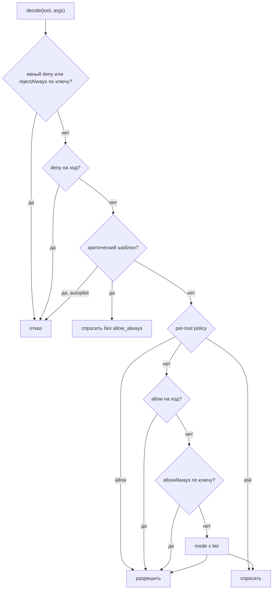
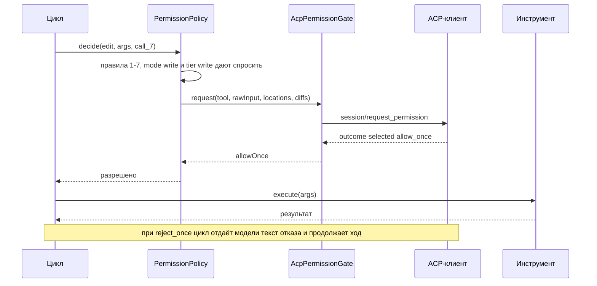

# 7. Разрешения

> Часть [архитектуры ядра агента CodeLab](../agent-core-architecture.md). Status: Accepted. Общие соглашения, термины и порядок чтения — в оглавлении.

← [6. Инструменты](06-tools.md) · [Оглавление ядра](../agent-core-architecture.md) · [8. Сессии](08-sessions.md) →

## 7.1. Назначение

Агент сам решает, можно ли исполнить вызов, и сам спрашивает пользователя. Проверка стоит в одной
точке перед исполнением любого инструмента. Модель разрешений клиента не меняется
(`AGENTS.md` §10, [`../permissions.md`](../../permissions.md)): для `fs/*` и `terminal/*` клиент не
вводит своего одобрения и только ограничивает пути рабочей папкой.

## 7.2. Контракт

```dart
/// Порядок объявления = порядок мягкости (§7.3.1): narrow берёт значение с меньшим index.
enum PermissionMode { alwaysAsk, write, acceptEdits, yolo, autopilot }
enum ToolPolicy { allow, deny, ask }

final class PermissionKey {                        // никогда не «вид инструмента»
  const PermissionKey(this.tool, this.pattern);
  final String tool, pattern;
  @override bool operator ==(Object o) => o is PermissionKey && o.tool == tool && o.pattern == pattern;
  @override int get hashCode => Object.hash(tool, pattern);
}

final class PermissionRequest {
  const PermissionRequest({required this.toolCallId, required this.tool, required this.kind,
      required this.tier, required this.title, required this.rawInput, this.locations = const [],
      this.diffs = const [], this.reason, this.allowAlwaysOffered = true, this.criticalLabel});
  final String toolCallId, tool, title;
  final ToolKind kind; final ToolTier tier;      // tool.kindOf(args), tool.tierOf(args) (§6.2)
  final Map<String, Object?> rawInput;             // приведённые аргументы (PERM-6)
  final List<Location> locations;
  final List<FileDiff> diffs;                      // по одному на файл; из ToolPrepared.presentation или present(args, ctx)
  final String? reason;                            // например, 'critical command: recursive delete of /'
  final bool allowAlwaysOffered;                   // false для критических шаблонов
  final String? criticalLabel;                     // после MVP: метка критического шаблона §7.6 или
                                                   // 'agent configuration' (§7.6.1); из неё AcpPermissionGate
                                                   // берёт _meta.codelab.label, A2aPermissionGate отклоняет (§17.15.4)
}

enum PermissionDecision { allowOnce, allowAlways, rejectOnce, rejectAlways, cancelled }
abstract interface class PermissionGate {
  Future<PermissionDecision> request(PermissionRequest req, CancelToken cancel);
}

final class PolicyRules {
  const PolicyRules({this.toolPolicies = const {}, this.denyPatterns = const {}});
  final Map<String, ToolPolicy> toolPolicies;      // permissions.tools из конфига
  final Set<PermissionKey> denyPatterns;           // явные запреты из конфига
}

sealed class PolicyOutcome { const PolicyOutcome(); }
final class Allowed extends PolicyOutcome { const Allowed(this.rule); final String rule; }
final class Denied extends PolicyOutcome { const Denied(this.reason); final String reason; }

/// Решения «всегда» сессии (§7.4). Субагенты разделяют хранилище родителя (§17.3.3, шаг 5).
final class PermissionDecisionStore {
  final Set<PermissionKey> allowAlways = {}, rejectAlways = {};
}

final class PermissionPolicy {
  PermissionPolicy({required this.mode, this.modeOf, this.gate, this.rules = const PolicyRules(),
      PermissionDecisionStore? decisions, required this.logger})
      : decisions = decisions ?? PermissionDecisionStore();
  PermissionMode mode;
  /// Если задан, читается при каждом решении вместо `mode` (после MVP: эффективный режим
  /// субагента `narrow(parentMode(), type.mode)`, SUB-2, §17.3.3).
  final PermissionMode Function()? modeOf;
  final PermissionGate? gate;
  final PolicyRules rules;
  final PermissionDecisionStore decisions;          // allowAlways и rejectAlways
  /// toolCallId, токен отмены, env (для present и шаблона пути) и счётчик ожидания — из ctx.
  Future<PolicyOutcome> decide(AgentTool tool, Map<String, Object?> args, ToolContext ctx);
  void grantForTurn({Set<String> allow = const {}, Set<String> deny = const {}});   // по именам инструментов
  void clearTurnGrants();                           // в начале каждого prompt() (PERM-8)
  BeforeToolCallHook asHook(AgentTool? Function(String name) lookup);   // Denied → Block(reason, outcome: rejected)
}
```

## 7.3. Режимы и уровни

`ToolTier` объявляет инструмент: `read` — только чтение, `write` — изменение файлов в рабочей
папке, `network` — выход в сеть по адресу, выбранному моделью (после MVP, `web_fetch`, §17.1),
`exec` — команды и всё неизвестное (MCP). После MVP уровень `network` получает и `task` с
удалённым A2A-агентом (`agent: "a2a:<имя>"`, §17.15.3): прогон отправляет текст задачи на внешний адрес. Политика берёт уровень вызова `tool.tierOf(args)`
(§6.2): по умолчанию это объявленный `tier`, а у `lsp` уровень зависит от действия (`rename` —
`write`, остальные — `read`, §17.8.9). Таблица `mode × tier` («спросить» = вызов
`PermissionGate`):

| Режим | read | write | network | exec | критический шаблон |
|---|---|---|---|---|---|
| `alwaysAsk` | спросить | спросить | спросить | спросить | спросить |
| `write` | разрешить | спросить | спросить | спросить | спросить |
| `acceptEdits` | разрешить | разрешить | спросить | спросить | спросить |
| `yolo` | разрешить | разрешить | спросить | разрешить | спросить |
| `autopilot` | разрешить | разрешить | **отказать**: `network access needs approval and autopilot has no approver` | разрешить | **отказать** |

Колонка `network` — §17.1.5: в каждом режиме, где есть человек, сетевой выход спрашивается;
ACP-режим `plan` её не запрещает (спросить). Снять вопрос можно только явным
`permissions.tools.web_fetch = "allow"` (шаг 4 §7.4).

Это внутренние значения `PermissionMode`. Клиент видит режимы ACP `plan`, `ask`, `standard`, `accept-edits`, `bypass`; их соответствие `PermissionMode` — в таблице §13.6 (`ask` → `alwaysAsk`, `standard` → `write`, `accept-edits` → `acceptEdits`, `bypass` → `yolo`, `plan` → `write` с запретом `write` и `exec`). ACP-хосты по умолчанию работают в `write` (`standard`) или `alwaysAsk` (`ask`) по конфигу. `autopilot` доступен только
явным флагом headless-запуска (`--permission-mode autopilot`); из `session/set_mode` и из любого
слоя конфига он недоступен (CFG-4).

### 7.3.1. Режим `acceptEdits` (P-06) и порядок режимов

`acceptEdits` — «правки без вопроса, команды с вопросом»: чтение и правки файлов в рабочей папке
(`read`, `write`, `edit`, после MVP `lsp rename`) исполняются сразу, а `exec`, MCP-инструменты
(tier `exec`) и сетевой выход (`network`) спрашиваются. Критические шаблоны спрашиваются, как в
любом режиме с человеком. ACP id — `accept-edits` (§13.6), синоним на входе — `acceptEdits`.
Режим выбирается так же, как остальные: `session/set_mode`, опция `mode`, `/mode accept-edits`,
`permissions.mode: accept-edits` в конфиге, флаг `--permission-mode accept-edits`, поле `mode`
определения агента (§15.8). Режим по умолчанию ни одного профиля не меняется (§10.5).

Правила §7.4 действуют без изменений: `permissions.tools.exec = "allow"` снимает вопрос и в
`acceptEdits`, явный deny и `rejectAlways` сильнее режима. В headless `codelab -p` агент в
`acceptEdits` правит файлы без запроса, а вопросы о командах уходят политике `--approve` CLI
(§7.7): с `--approve reject` это «правки да, команды нет».

**Порядок мягкости.** Режимы линейно упорядочены так, что по каждому уровню (`read`, `write`,
`network`, `exec`, критический шаблон) следующий режим разрешает не меньше предыдущего, кроме
`autopilot`, который вместо вопроса отказывает:

```text
alwaysAsk(0) < write(1) < acceptEdits(2) < yolo(3) < autopilot(4)
```

`narrow(a, b)` (эффективный режим субагента, §17.3.3, шаг 4) берёт режим с меньшим номером и
объединяет запреты уровней режима `plan`. Примеры с новым режимом: родитель `accept-edits` + тип
`general` без режима → `acceptEdits`; родитель `bypass` + тип с `mode: accept-edits` →
`acceptEdits`; родитель `accept-edits` + тип `standard` → `write`; родитель `standard` + тип
`accept-edits` → `write` (ребёнок не мягче родителя, SUB-2).

Ужесточение режима проектным конфигом (§15.3) идёт по той же цепочке в обратную сторону:
`bypass → accept-edits → standard → ask`; проектный слой применяется через `narrow` с режимом
нижних слоёв, поэтому `plan` из проекта только добавляет запреты `write`/`exec` и не ослабляет
`ask`. Глобальный и локальный слои конфига заменяют режим профиля в любую сторону (§10.5).

## 7.4. Алгоритм разрешения

```text
decide(tool, args, id):
  key = PermissionKey(tool.permissionKeyName, tool.permissionPattern(args))   # по умолчанию name; task_send/task_resume → "task" (§17.3.8.1, SUB-18)
  critical = tool.name == 'exec' ? findCritical(args.command) : null       # §7.6
  1  if rules.toolPolicies[tool] == deny or key in rules.denyPatterns or key in rejectAlways:
         return Denied('denied by configuration' | 'previously rejected by the user')
  2  if tool.name in turnDeny: return Denied('not allowed in this turn')
  3  if critical != null:
         if mode == autopilot: return Denied('critical command blocked in autopilot: ' + critical.label)
         return ask(reason: 'critical command: ' + critical.label, allowAlwaysOffered: false)
  4  switch rules.toolPolicies[tool]: allow → Allowed('tool policy'); ask → return ask()
  5  if tool.name in turnAllow: return Allowed('turn grant')
  6  if key in allowAlways: return Allowed('always allowed')
  7  switch table[mode][tool.tierOf(args)]: allow → Allowed('mode'); ask → return ask()

ask(reason, allowAlwaysOffered = true):
  allowAlwaysOffered &= tool.offersAllowAlways(args)                     # после MVP: lsp rename (§17.8.9)
  if gate == null: return Denied('no approval interface is available')
  t0 = clock.now()
  d = await gate.request(PermissionRequest(kind: tool.kindOf(args), tier: tool.tierOf(args),
        title, locations, diffs из ToolPrepared.presentation ?? present(args, ctx), allowAlwaysOffered, ...), cancel)
  ctx.services.approvalWait.add(clock.now() - t0)   # исключается из maxDuration хода (§5.2)
  switch d:
    allowOnce   → Allowed('user')
    allowAlways → allowAlways.add(key) (если allowAlwaysOffered, иначе как allowOnce); Allowed('user')
    rejectOnce  → Denied('rejected by the user')
    rejectAlways→ rejectAlways.add(key); Denied('rejected by the user')
    cancelled   → Denied('permission request was cancelled')
```

После MVP `rules.toolPolicies[tool]` ищется по `tool.permissionKeyName`: правило для `task`
применяется и к `task_send`, `task_resume` (тот же ключ, §17.3.8.1); `task_observe` — уровень
`read`, вид `think`, своё имя.

Текст отказа для модели: `Permission denied for <tool>: <reason>. Do not retry the same call; choose another approach or ask the user.`
Отказ — не отмена хода: модель получает результат-ошибку (`ToolCallFinished(outcome: rejected)`)
и продолжает работу (PERM-7). `allowAlways` и `rejectAlways` (`PermissionDecisionStore`) живут в
памяти `AgentSession` до её закрытия; сохранение между сессиями — после MVP через OpenSpec. `mode`
в алгоритме — `modeOf?.call() ?? mode`, вычисленный в момент решения. Политика субагента получает
хранилище решений родителя и `modeOf` с эффективным режимом ребёнка (после MVP, §17.3.3, шаги 4–5).

После MVP `args` — аргументы после перезаписи секретов (§17.12.6): ключ, `rawInput` и критические
шаблоны считаются по команде со ссылками на переменные. Запрет `redact.block` (§17.12.7)
срабатывает раньше, в `preflight`, и до политики не доходит. Пользовательские хуки (§17.14.2)
срабатывают только после `Allowed`; отказ политики хуки не запускает (EXT-1).



## 7.5. Шаблон для «разрешить всегда»

`AgentTool.permissionPattern(args)` строит строку ключа:

| Инструмент | Шаблон | Пример аргументов → шаблон |
|---|---|---|
| `write`, `edit` | путь относительно корня после нормализации (§4.4) | `{"path":"./lib//a.dart"}` → `lib/a.dart` |
| `read`, `ls`, `search` | нормализованный путь (по умолчанию `.`) | `{"pattern":"TODO","path":"lib"}` → `lib` |
| `exec` | точная строка команды после обрезки пробелов по краям | `{"command":"  dart test "}` → `dart test` |
| `update_plan` | `*` | любой → `*` |
| MCP и прочие | канонический JSON аргументов (ключи по алфавиту, без пробелов) | `{"b":1,"a":"x"}` → `{"a":"x","b":1}` |

«Разрешить всегда» на `write lib/a.dart` не разрешает `write lib/b.dart` и тем более `exec`
(PERM-3). `exec dart test` не разрешает `exec dart test --update-goldens`. Обобщение до префикса
команды или маски пути — после MVP, через OpenSpec.

## 7.6. Критические шаблоны команд

Применяются к аргументу `command` инструмента `exec`. Реакция — вопрос пользователю (в
`autopilot` — отказ), даже если `exec` разрешён режимом, политикой или «всегда».

**Разбор команды** (`shell_lexer.dart`):

1. Лексер учитывает одинарные кавычки (буквально), двойные кавычки (с экранированием `\`), `\` вне кавычек, операторы `&&`, `||`, `;`, `|`, `&`, перевод строки, скобки `( )` и `{ }` подоболочек и групп.
2. Подстановки `$( … )`, `` ` … ` `` (в том числе внутри двойных кавычек) и `<( … )`, `>( … )` извлекаются как **вложенные команды** и разбираются рекурсивно.
3. Текст внутри кавычек остаётся аргументом и командой не считается: `git commit -m "rm -rf /"` — безопасно. Исключение: аргумент после `-c` у `sh`, `bash`, `zsh`, `dash`, `ksh` и аргументы `eval` разбираются как вложенная команда.
4. Here-document (`<<WORD`, `<<-WORD`): строки до `WORD` — данные, не команды.
5. Сегмент = слова между операторами. Из начала сегмента снимаются присваивания `NAME=value` и лаунчеры с их опциями: `sudo` (флаги и `-u USER`), `doas`, `env` (флаги и `NAME=value`), `nohup`, `nice` (`-n N`), `time` (`-p`), `command`, `exec`, `builtin`, `timeout` (длительность), `stdbuf` (флаги), `xargs` (флаги). Факт `sudo`/`doas`/`su`/`pkexec` запоминается.
6. Имя команды сравнивается по базовому имени (`/bin/rm` → `rm`).
7. Перенаправления `>`, `>>`, `>|`, `&>`, `N>` с целью (отдельным словом или слитно: `>/dev/sda`) сохраняются у сегмента.
8. Глубина вложенности — не больше 4; глубже или незакрытая кавычка → шаблон `unparsable command` (лучше спросить, чем пропустить).

**Защищённые цели** `P`: `/`, `/*`, `~`, `~/`, `~/*`, `$HOME`, `${HOME}`, `$HOME/`, `$HOME/*`,
`.`, `./`, `*`, `./*`, `..`, `../*`, а также системные каталоги (точно или с `/` или `/*` на конце):
`/bin`, `/boot`, `/dev`, `/etc`, `/home`, `/lib`, `/lib64`, `/opt`, `/proc`, `/root`, `/sbin`,
`/sys`, `/usr`, `/var`, `/Applications`, `/Library`, `/System`, `/Users`. Цель с переменной,
кроме `$HOME`, не считается защищённой (`/$DIR` — значение неизвестно).

Рекурсивный флаг: `-r`, `-R`, `--recursive` или кластер коротких флагов, содержащий `r`/`R`
(`-rf`, `-fR`).

| Метка | Правило | Срабатывает | Не срабатывает |
|---|---|---|---|
| `recursive delete of a protected path` | `rm` с рекурсивным флагом и хотя бы одной целью из `P`; или `--no-preserve-root` | `rm -rf /`, `cd /tmp && rm -rf /`, `rm -r ~`, `rm -rf $HOME/*`, `rm -rf .` | `rm -rf build`, `rm -f /tmp/x`, `rm -rf "$DIR/out"` |
| `deletion of a .git directory` | `rm` с рекурсивным флагом и целью, последний сегмент которой `.git` | `rm -rf .git`, `rm -rf ./pkg/.git/` | `rm -rf .github`, `rm .gitignore` |
| `recursive find delete of a protected path` | `find`, первый путь из `P`, есть `-delete` или `-exec rm` | `find / -name '*.log' -delete`, `find ~ -exec rm {} +` | `find build -delete` |
| `recursive permission change of a protected path` | `chmod`/`chown`/`chgrp` с рекурсивным флагом и целью из `P` | `chmod -R 777 /`, `sudo chown -R me /usr` | `chmod -R 755 web`, `chmod 644 a.txt` |
| `privileged command` | сегмент запущен через `sudo`, `doas`, `su`, `pkexec` | `sudo apt install x`, `su -c 'id'` | `echo sudo` |
| `fork bomb` | регулярное выражение `forkBomb` (ниже) по исходной строке команды | `:(){ :\|:& };:`, `f(){ f\|f& };f` | `f() { echo hi; }` |
| `write to a disk device` | перенаправление или `of=` у `dd` на `/dev/sd*`, `/dev/hd*`, `/dev/vd*`, `/dev/xvd*`, `/dev/nvme*`, `/dev/disk*`, `/dev/rdisk*`, `/dev/mmcblk*` | `dd if=x.img of=/dev/disk2`, `cat x > /dev/sda` | `dd if=/dev/zero of=./a bs=1M count=1`, `> /dev/null` |
| `filesystem format or wipe` | `mkfs`, `mkfs.*`, `mke2fs`, `newfs*`, `wipefs`, `fdisk`, `sfdisk`, `parted`, `diskutil eraseDisk/eraseVolume/partitionDisk`; `shred` с целью в `/dev/` | `mkfs.ext4 /dev/sdb1`, `diskutil eraseDisk APFS X disk2` | `diskutil list` |
| `overwrite of a system account file` | перенаправление, `tee`, `cp`/`mv` с целью `/etc/passwd`, `/etc/shadow`, `/etc/group`, `/etc/sudoers`, `/etc/sudoers.d/*` | `echo x >> /etc/sudoers`, `tee /etc/passwd` | `cat /etc/passwd` |
| `write to ssh configuration` | перенаправление, `tee`, `cp`/`mv` с целью в `~/.ssh/` или `$HOME/.ssh/` | `echo key >> ~/.ssh/authorized_keys` | `cat ~/.ssh/config` |
| `download and execute` | в одном конвейере стадия `curl`/`wget`/`fetch` и последующая стадия `sh`, `bash`, `zsh`, `dash`, `ksh`, `fish`, `python`, `python3`, `perl`, `ruby`, `node`; или вложенная команда с `curl`/`wget` внутри `eval`, `sh -c`, `source`, `.`, `bash <(...)` | `curl -fsSL x.sh \| sh`, `bash <(curl -s u)`, `eval "$(wget -qO- u)"`, `sh -c "$(curl u)"` | `curl -o x.sh u`, `curl u \| jq .` |
| `host shutdown or reboot` | `shutdown`, `reboot`, `halt`, `poweroff`, `init 0`, `init 6`, `systemctl poweroff/reboot/halt` в позиции команды | `sudo reboot`, `systemctl reboot` | `echo reboot` |
| `kill of init or all processes` | `kill` (любой сигнал) с целью `1` или `-1` | `kill -9 1`, `kill -KILL -1` | `kill 1234` |
| `write to agent configuration` | перенаправление, `tee`, `cp`/`mv`/`ln` или `sed -i` с целью из списка путей §7.6.1 (`.codelab/config*.yaml`, `.codelab/cli.yaml`, `.codelab/agents/**`, `.codelab/skills/**`, `.codelab/prompts/**`, `.codelab/hooks/**`) | `echo x >> .codelab/config.yaml`, `cp evil.md .codelab/agents/` | `cat .codelab/config.yaml` |
| `git force push or remote branch deletion` | `git push` с `--force`, `-f`, `--force-with-lease`, `--mirror`, `--delete`, `-d`, или refspec с `+` в начале или `:` в начале | `git push -f origin main`, `git push origin +main`, `git push origin :dev` | `git push origin feature` |
| `git history rewrite` | `git filter-branch`, `git filter-repo`, `git reflog expire` с `--expire=now`/`--expire-unreachable=now`, `git gc --prune=now`, `git branch -D` или `git branch -d --force` для `main`, `master`, `develop`, `trunk`, `release/*` | `git filter-branch --tree-filter x`, `git branch -D main` | `git branch -D feature/x`, `git gc` |

Регулярное выражение fork-бомбы — функция, которая в своём теле вызывает себя в конвейере и уходит в фон:

```dart
final forkBomb = RegExp(r'(\w+|:)\s*\(\s*\)\s*\{[^}]*\1\s*\|\s*\1\s*&');
```

Если в одной команде несколько совпадений, `reason` перечисляет все метки через `; `.


### 7.6.1. Критические пути правок: конфигурация агента в проекте

Конфигурацию агента меняют только человек и клиенты (`ConfigWriter`, §17.5.5); модель её не
правит (Won't T-25). Файлы внутри корня сессии, через которые проект настраивает агента,
поэтому защищены так же, как критические команды:

* `write`, `edit` (включая правки по якорям §17.11.3 и переименование LSP §17.8) с целью,
  совпадающей с `.codelab/config.yaml`, `.codelab/config.local.yaml`, `.codelab/cli.yaml`,
  `.codelab/agents/**`, `.codelab/skills/**`, `.codelab/prompts/**`, `.codelab/hooks/**`
  (путь нормализуется по §4.4 до сравнения), считаются **критическими**: вопрос задаётся в любом
  режиме, включая `bypass` и `accept-edits`; `allow_always` не предлагается и ранее выданные
  «разрешить всегда» на них не действуют; в `autopilot` и без интерфейса одобрения — отказ с
  текстом `Editing agent configuration requires a human: <path>`;
* `exec` с перенаправлением, `tee`, `cp`/`mv`/`ln` или `sed -i` с целью из того же списка —
  критический шаблон с меткой `write to agent configuration` (строка таблицы выше).

Чтение этих файлов не ограничено. Правило не мешает клиентам: `ConfigWriter` работает вне
инструментов модели.

## 7.7. Режим без интерфейса одобрения (headless)

1. `PermissionGate` не передан (ядро запущено без ACP-клиента и без UI — фоновые прогоны, тесты) → любое «спросить» превращается в отказ `no approval interface is available` (PERM-5).
2. Headless `codelab -p` — это ACP-клиент, поэтому gate у агента **есть**: `AcpPermissionGate` (§7.8). На запросы отвечает сам CLI по политике `--approve` (`reject` по умолчанию, `read-only`, `allow-all`; см. proposal, спецификация `codelab`). Запрос для критической команды несёт `_meta.codelab.critical: true` и не предлагает `allow_always`; политика `allow-all` такие запросы **отклоняет**, `read-only` и `reject` — тоже.
3. Режим агента (`--permission-mode` у `codelab-agent serve` и у встроенного агента в `codelab -p`) меняет, о чём агент спрашивает, а `--approve` — как CLI отвечает. `autopilot` включается только флагом: в нём агент не спрашивает о `read`/`write`/`exec`, а критические команды отклоняет сам (PERM-9).
4. Отказы headless-прогона логируются (`permission.denied`, `reason`) и видны в выводе `codelab -p`.

## 7.8. AcpPermissionGate

`AcpPermissionGate` (`codelab_agent_acp`) реализует порт через `session/request_permission`
(`docs/acp/protocol/08-Tool Calls.md`):

1. `toolCall` — `ToolCallUpdate` с `toolCallId`, `title`, `kind`, `status: "pending"`, `rawInput`, `locations`; `content` — необязательный текстовый блок первым элементом (`reason`; у `lsp rename` — сводка `Rename "<old>" to "<new>": <n> edits in <f> files.`, §17.8.9), затем по одному `{"type":"diff","path","oldText","newText"}` на каждый элемент `diffs` (`write`/`edit` — один). Это стандартный `ToolCallContent`, расширений не требуется. Для критической команды — `_meta: {"codelab": {"critical": true, "label": "<метка правила>"}}` (расширение вводится через OpenSpec, `AGENTS.md` §3.4).
2. `options`: `allow_once`, `allow_always` (только если `allowAlwaysOffered`), `reject_once`, `reject_always`; `optionId` совпадает с `kind`.
3. Ответ `{"outcome":{"outcome":"selected","optionId":X}}` → решение по `kind` выбранного варианта; неизвестный `optionId` → `rejectOnce` + warning-лог. `{"outcome":{"outcome":"cancelled"}}` → `cancelled`.
4. Ошибка JSON-RPC или разрыв соединения → `rejectOnce` с причиной в логе.
5. Отмена токена хода → ожидание прекращается, решение `cancelled` (поздний ответ клиента игнорируется, PERM-4).

```json
{"jsonrpc":"2.0","id":21,"method":"session/request_permission","params":{
  "sessionId":"sess_1",
  "toolCall":{
    "toolCallId":"call_7","title":"Edit lib/main.dart","kind":"edit","status":"pending",
    "rawInput":{"path":"lib/main.dart","oldText":"debug: false","newText":"debug: true"},
    "locations":[{"path":"/work/demo/lib/main.dart","line":12}],
    "content":[{"type":"diff","path":"/work/demo/lib/main.dart",
                "oldText":"const config = (debug: false);\n","newText":"const config = (debug: true);\n"}]},
  "options":[
    {"optionId":"allow_once","name":"Allow once","kind":"allow_once"},
    {"optionId":"allow_always","name":"Always allow this file","kind":"allow_always"},
    {"optionId":"reject_once","name":"Reject","kind":"reject_once"},
    {"optionId":"reject_always","name":"Always reject","kind":"reject_always"}]}}

{"jsonrpc":"2.0","id":21,"result":{"outcome":{"outcome":"selected","optionId":"allow_once"}}}
```



## 7.9. Инварианты

1. **PERM-1.** Проверка разрешений — первый `beforeToolCall`-хук; до неё не исполняется ни один `execute` инструмента, ни один другой `beforeToolCall`- и `afterToolCall`-хук и ни один побочный эффект. До проверки допустимы только шаги без побочных эффектов единой точки исполнения (§6.3.1): перезапись аргументов `rewriteArgs` (шаг 0), валидация (шаг 3), `preflight` (шаг 3a) и `prepare` (шаг 3b). Единственное допустимое исключение — `prepare` инструмента `lsp` (после MVP, §17.8): ленивый запуск языкового сервера, заданного в доверенной конфигурации (LSP-11), и синхронизация документов с ним (`didOpen`/`didChange`, §17.8.5); запись на диск до проверки запрещена и здесь.
2. **PERM-2.** Явный deny сильнее всех правил; критический шаблон сильнее per-tool allow, allow на ход и `allowAlways`.
3. **PERM-3.** `allowAlways` хранится только по `PermissionKey(tool, pattern)`; решение для одного ключа не применяется к другому.
4. **PERM-4.** Решение пользователя относится к одному `toolCallId`; повторный или поздний ответ на тот же запрос игнорируется.
5. **PERM-5.** Нет `PermissionGate` — нет разрешения на то, что требует вопроса.
6. **PERM-6.** `PermissionRequest` всегда содержит `rawInput`; для правок (`write`, `edit`, после MVP `lsp rename`) — `locations` и diff каждого изменяемого файла.
7. **PERM-7.** `cancelled` от клиента → отказ; отказ даёт `ToolOutcome.rejected` и не завершает ход.
8. **PERM-8.** Grants на ход очищаются в начале каждого `prompt()`.
9. **PERM-9.** В `autopilot` критический шаблон отклоняется без вопроса; для критического шаблона вариант `allow_always` не предлагается.
10. **PERM-10.** В `acceptEdits` вызовы уровней `read` и `write` разрешаются режимом без вопроса, а `network`, `exec` и критические шаблоны спрашиваются; `narrow` и ужесточение конфигом используют один порядок `alwaysAsk < write < acceptEdits < yolo < autopilot`.
11. **PERM-11.** Правка конфигурационных файлов агента в проекте (§7.6.1) спрашивается в любом режиме, не принимает `allow_always` и отклоняется без человека.

## 7.10. Обоснование решения

* **«Всегда» по `(tool, pattern)`, а не по инструменту или виду.** Запоминание по виду
  (`edit`) превращает одно согласие на правку файла в разрешение на любые правки и тем более на
  команды; ключ с шаблоном сужает согласие до того, что пользователь реально видел.
* **Критический шаблон сильнее «всегда» и без `allow_always`.** «Всегда разрешать `exec`» не
  должно отключать защиту от `rm -rf /`; запоминать согласие на разрушительную команду нельзя.
* **`autopilot` отклоняет критические команды.** В автономном режиме спросить некого; молча
  пропустить разрушительную команду — худший исход, а отказ модель обойдёт другим способом.
* **Разбор формы команды, а не поиск подстроки.** Подстрока `rm -rf /` в сообщении коммита — не
  команда; а `cd /tmp && rm -rf /` — команда, хотя строка начинается с `cd`. Лексер с сегментами и
  вложенными подстановками отличает эти случаи; ложное срабатывание стоит одного вопроса.
* **Проверка после валидации, `rawInput` обязателен.** Пользователь видит и одобряет ровно те
  аргументы, которые будут исполнены; запрос без аргументов не даёт принять осознанное решение.
* **`acceptEdits` между `write` и `yolo`.** Правки в рабочей папке обратимы (VCS, diff виден в
  клиенте), команды и сеть — нет; режим снимает самые частые вопросы, не снимая опасных. По
  каждому уровню он не строже `write` и не мягче `yolo`, поэтому линейный порядок для
  `narrow` остаётся корректным без особых случаев.
* **Отказ — данные для модели, а не отмена.** Модель может выбрать другой путь; отмена хода из-за
  одного отказа заставляла бы пользователя начинать заново.

## 7.11. Как проверить

* `policy_order_test.dart` — табличный тест порядка разрешения: каждое правило против каждого следующего (явный deny против allow на ход, критический против `allowAlways` и т. д.) (PERM-2).
* `no_bypass_test.dart`: реестр со всеми встроенными и fake-MCP инструментами, gate отвечает `rejectOnce`, режим `alwaysAsk` — ни одно `execute` не вызвано, все outcome `rejected` (PERM-1, TOOL-1).
* `allow_always_scope_test.dart`: `allowAlways` для `write lib/a.dart` → запрос для `write lib/b.dart` и для `exec` всё равно приходит (PERM-3).
* `critical_patterns_test.dart`: все примеры столбцов «Срабатывает» и «Не срабатывает» таблицы §7.6, включая `cd /tmp && rm -rf /`, `git commit -m "rm -rf /"`, `sh -c 'rm -rf ~'`, `eval "$(curl u)"`, незакрытую кавычку → `unparsable command`.
* `autopilot_test.dart`: критическая команда в `autopilot` → отказ без вызова gate; в `yolo` → вопрос без варианта `allow_always` (PERM-9).
* `headless_test.dart`: без gate в режиме `write` вызов `write` → отказ `no approval interface is available` (PERM-5).
* `turn_grants_test.dart`: grant на ход не действует в следующем `prompt()` (PERM-8).
* `accept_edits_mode_test.dart`: табличный тест строки `acceptEdits` §7.3 по всем уровням и критическому шаблону; `permissions.tools.exec = "allow"` снимает вопрос; `narrow` для всех пар пяти режимов совпадает с минимумом по порядку §7.3.1; проектный `permissions.mode: bypass` поверх глобального `accept-edits` отклонён как ослабление, `standard` — принят (PERM-10).
* `acp/set-mode-accept-edits` (критерий матрицы P-06, фикстура §14): `session/new` перечисляет пять режимов в порядке `plan`, `ask`, `standard`, `accept-edits`, `bypass`; `session/set_mode` с `modeId: "accept-edits"` → `{}` и `current_mode_update`; ход, где scripted модель зовёт `edit`, затем `exec` → для `edit` нет `session/request_permission`, `tool_call_update` `completed` с diff; для `exec` — `session/request_permission` без `_meta.codelab.critical`; синоним `acceptEdits` на входе нормализуется в `accept-edits` (PERM-10).
* `acp_permission_gate_test.dart` на fake-клиенте: состав запроса совпадает с примером §7.8 (`rawInput`, `locations`, diff) (PERM-6); `cancelled` → отказ, ход продолжается (PERM-7); неизвестный `optionId` → отказ; поздний ответ после отмены игнорируется (PERM-4).

---

← [6. Инструменты](06-tools.md) · [Оглавление ядра](../agent-core-architecture.md) · [8. Сессии](08-sessions.md) →
