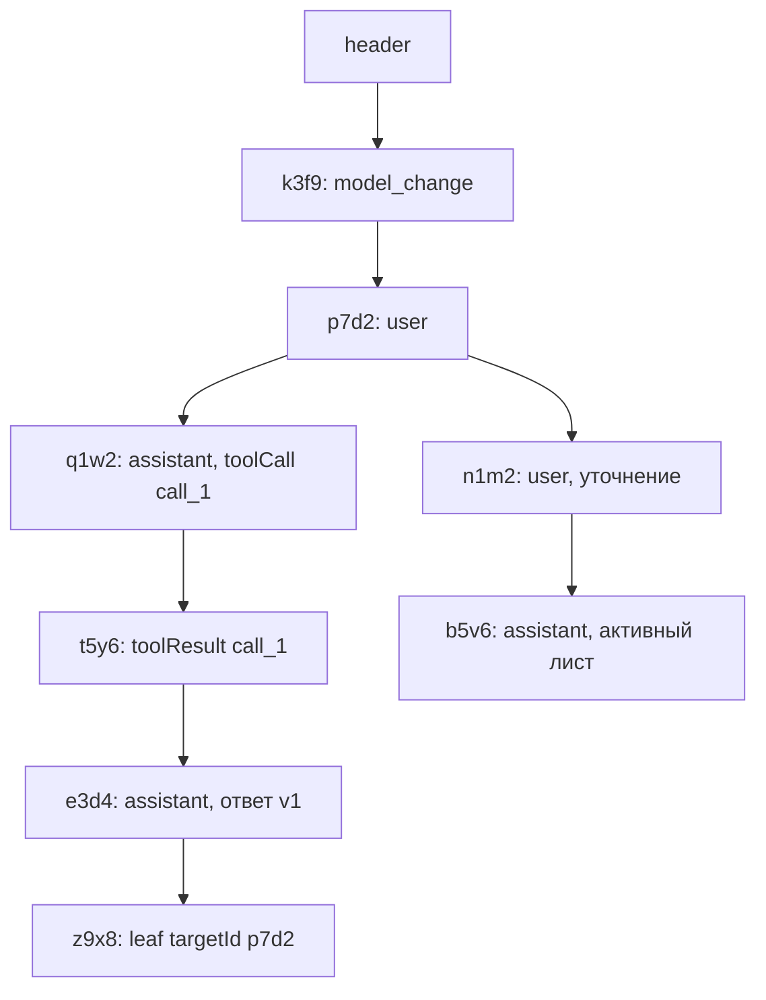

# 8. Сессии

> Часть [архитектуры ядра агента CodeLab](../agent-core-architecture.md). Status: Accepted. Общие соглашения, термины и порядок чтения — в оглавлении.

← [7. Разрешения](07-permissions.md) · [Оглавление ядра](../agent-core-architecture.md) · [9. Сжатие контекста](09-compaction.md) →

## 8.1. Назначение

Сессия — append-only дерево записей в одном JSONL-файле. Журнал — **единственный источник
истории**: контекст для модели (`buildLlmContext`), реплей `session/load` (`buildReplay`) и сводка
для `session/list` — чистые проекции журнала. Ничего не удаляется и не переписывается: сжатие,
смена режима, перемещение листа — это новые записи. Журнал одновременно является точкой
восстановления (checkpoint): после сбоя процесса сессия открывается и продолжается с последней
записанной границы.

Разбор строк (`parseSessionLines`), дерево и проекции живут в ядре (`lib/src/session/`), чтобы
файловое хранилище (`codelab_agent_io`), хранилище в документах приложения (мобильный профиль) и
IndexedDB (web) вели себя одинаково. Хранилища отвечают только за байты: добавить строку,
прочитать все строки, перечислить файлы.

## 8.2. Контракт: формат файла

Файл — UTF-8, одна JSON-запись на строку, разделитель `\n` (LF). Строка не содержит переводов
строк внутри: `jsonEncode` экранирует их. Пустые строки при чтении пропускаются. Порядок строк в
файле — порядок записи; логическая структура задаётся `parentId`, а не позицией.

### 8.2.1. Заголовок

Первая строка файла — всегда заголовок (`type: "session"`). Заголовок не входит в дерево: у него
нет `parentId`, на него никто не ссылается.

| Поле | Тип | Обязательно | Смысл |
|---|---|---|---|
| `type` | `"session"` | да | дискриминатор заголовка |
| `version` | int | да | версия формата; текущая — `1`. Читатель принимает только известные версии (§8.6) |
| `id` | string | да | `SessionId`, он же ACP `sessionId` (§8.4) |
| `cwd` | string | да | абсолютный нормализованный путь рабочей папки; источник истины для фильтра `session/list` (слаг каталога — только для раскладки) |
| `created` | string | да | ISO-8601 UTC с миллисекундами, время создания по `Clock` хоста |
| `agent` | object | да | `{"name": "codelab-agent", "version": "0.1.0"}` — кто создал файл; для диагностики |
| `metadata` | object | нет | свободные данные хоста, например `{"profile": "agent-serve"}`; ядро не интерпретирует |
| `parent` | object | нет | после MVP: только у журнала субагента — `{sessionId, toolCallId, subagentId, agent, depth}` (§17.3.6) |
| `forkedFrom` | object | нет | после MVP: только у сессии, созданной fork, — `{sessionId, recordId, position, journal}`; `position` — `"at"` \| `"before"`, `journal` — путь исходного файла относительно `sessions/` (§17.6.7). Ссылка информационная: новая сессия от исходного файла не зависит |

Читатель игнорирует неизвестные поля заголовка (при известной `version`): новое необязательное
поле не ломает старый код и не требует новой версии формата.

После MVP (S-10, §17.13.2) у сегментов `k ≥ 1` первая строка — `segment` (`version`, `sessionId`,
`seq`, `created`, `prev`); как заголовок, она не входит в дерево.

```json
{"type":"session","version":1,"id":"01JB8Q2W6R9T3M5K7N1P4X8Z0C","cwd":"/work/demo","created":"2026-10-21T08:00:00.000Z","agent":{"name":"codelab-agent","version":"0.1.0"},"metadata":{"profile":"agent-serve"}}
```

### 8.2.2. Общие поля записей

```dart
sealed class SessionRecord {
  String get type;          // дискриминатор
  String get id;            // RecordId, 8 символов (§8.4)
  String? get parentId;     // null только у первой записи дерева
  DateTime get timestamp;   // ISO-8601 UTC, мс
}
final class SessionHeader {
  final int version; final SessionId id; final String cwd; final DateTime created;
  final AgentInfo agent; final Map<String, Object?> metadata;
  final ForkOrigin? forkedFrom;   // после MVP, только у fork (§17.6.7)
}
```

Поля подкласса записываются на верхний уровень объекта рядом с общими (не во вложенный
`payload`): так строка короче и читается глазами. Неизвестные поля известной записи при
чтении сохраняются в `extra` и записываются обратно при копировании (forward compatibility),
но ядро на них не опирается.

После MVP (§17.13.2): `toJson` пишет ключи `type`, `id`, `parentId`, `timestamp` первыми и в этом
порядке — на этом стоит быстрый разбор индексатора.

### 8.2.3. Запись `message`

| Поле | Тип | Смысл |
|---|---|---|
| `message` | object | сообщение транскрипта в канонической JSON-форме §2.2; дискриминатор `role`: `user`, `assistant`, `toolResult` |
| `outcome` | string | только у `toolResult`: доменный `ToolOutcome` (`completed`, `failed`, `cancelled`, `rejected`) или `interrupted` для синтетического результата восстановления (§8.8) |
| `diff` | object | только у `toolResult` с правкой одного файла (`write`, `edit`): `{path, oldText, newText}` (`FileDiff`) |
| `diffs` | array | после MVP, только у `toolResult` с правкой двух и более файлов (`lsp rename`, §17.8.9): `[{path, oldText, newText}, …]`. Писатель пишет `diff` при одном файле и `diffs` при нескольких, никогда оба; читатель принимает оба поля и приводит их к списку `diffs` (`ToolExecutionResult.diffs`, §6.2) |
| `toolMeta` | object | только у `toolResult`: `title`, `kind`, `locations` из `ToolCallStarted` — для реплея без повторного вызова `present()` |
| `command` | object | необязательно, только у `user`; `source: "template"` — с этапа 8.7 (design.md change `add-agent-project-files`, D8), `skill` и `plugin` — после MVP: сообщение получено разворачиванием команды — `{"source": "skill" \| "template" \| "plugin", "name", "args"}` (`args` — как введены). По нему реплей показывает исходный текст `/skill:<name> <args>` или `/<name> <args>`, а пины узнают об активации skill (§17.2.3, §17.2.7); `plugin` — результат `CommandPrompt` команды плагина (§17.14.3.3) |
| `auxUsage` | object | после MVP, только у `toolResult`: `{model, usage}` вспомогательного запроса инструмента (`inspect_image`, §17.11.5); читается журналом usage (§12.6.1) |
| `spill` | object | с этапа 3, необязательно, только у `toolResult`: результат вынесен в файл — `{n, path, bytes, lines, trust, source}`; `path` — относительно `sessions/`, `trust` — `"trusted"` \| `"untrusted"`, `source` — `source` ограды исходного результата; `message.content` — огороженный фрагмент (§17.4.5) |
| `origin` | string | необязательно; откуда сообщение, если его написал не пользователь напрямую. `"steer"` (после MVP, только у `user`) — сообщение пользователя, доставленное посреди хода (steering, §17.7.5); вместе с ним `steerId`. Реплей его **не** пропускает: это слова пользователя, они уходят `user_message_chunk` с `_meta.codelab.steer` (§13.5, шаг 5). `"subagent_notice"` (после MVP, только у `user`) — уведомление фонового субагента, а не слова пользователя; вместе с ним `subagentId`. Реплей его пропускает, по нему восстанавливаются недоставленные уведомления (§17.3.8, SUB-14). `"job_notice"` (после MVP, только у `user`) — уведомление о завершении фоновой команды (§17.9.6); вместе с ним `jobId`. Реплей его пропускает, по нему восстанавливаются недоставленные уведомления (JOB-4). `"loop_nudge"` (MVP, только у `user`) — подсказка цикла после пустого ответа модели (§5.4.1); вместе с ним `nudge: "empty_response"` и `attempt` (int, номер повтора с 1). Реплей её пропускает; транскрипт после загрузки её содержит, поэтому payload следующего хода тот же, что в живой сессии. `"loop_note"` (MVP, только у `assistant`) — синтетическая заметка цикла, когда повторы пустого ответа исчерпаны (§5.4.1); вместе с ним `nudge`: `"empty_response"` или (после MVP) `"deadline"`. Реплей отдаёт её обычным текстом агента (`agent_message_chunk`). `"deadline_notice"` (после MVP, только у `user`) — уведомление о пороге дедлайна (§17.12.5); вместе с ним `deadlineId` и `thresholds` (`[50, 10, 1]`-подмножество). Реплей его пропускает. `"parent_message"` (после MVP, только у `user`, только в журнале субагента) — сообщение родителя `task_send` (§17.3.8.1); вместе с ним `run` и `toolCallId`. `"subagent_resume"` (после MVP, только у `user`, только в журнале субагента) — текст продолжения `task_resume`; вместе с ним `run` и `failure`. Какие значения — слова пользователя, решает только `isUserWords` (§8.2.5) |

`outcome`, `diff`/`diffs`, `toolMeta`, `spill`, `auxUsage`, `command` и `origin` (с `subagentId`, `steerId`, `jobId`, `deadlineId` и `thresholds`, `nudge` и `attempt` или `run`, `toolCallId`, `failure`) — поля **записи**, а не сообщения: модель их не видит, `Message`
остаётся ровно в форме §2.2, а реплей (§13.5) получает итоговый статус, diff и заголовок вызова.

Поля сообщения по ролям (как в §2.2):

| Роль | Поля | Допустимые блоки `content` |
|---|---|---|
| `user` | `content`, `timestamp` | `text`, `image` |
| `assistant` | `content`, `model` (`provider`, `id`), `usage`, `stopReason`, `rawStopReason?`, `errorMessage?`, `errorClass?`, `timestamp` | `text`, `thinking`, `toolCall` |
| `toolResult` | `toolCallId`, `toolName`, `content`, `isError`, `timestamp` | `text`, `image` |

Блоки `content`:

| `type` | Поля | Примечание |
|---|---|---|
| `text` | `text` | |
| `thinking` | `thinking`, `signature?`, `redacted`, `api?` | `api` — диалект провайдера (`openaiChat`, `anthropicMessages`), выдавший подпись; подпись отправляется обратно только ему |
| `toolCall` | `id`, `name`, `arguments` (объект) | аргументы уже разобраны; частичный JSON в журнал не попадает (LLM-6) |
| `image` | `data` (base64), `mimeType` | картинка хранится всегда, даже если модель её не принимает; после MVP (T-29, §17.11.2.1) картинки хранятся уже подготовленными: журнал содержит то, что получила модель, а не исходный файл |

`usage` — `{input, output, cacheRead, cacheWrite, reasoning?, cost: {input, output, cacheRead, cacheWrite}}`;
пропущенные числа читаются как `0`, `total` вычисляется. Поля со значением `null` не пишутся.

**Что в журнал не пишется.** Решения пользователя «разрешить всегда» и «отклонять всегда»
живут в памяти `AgentSession` до её закрытия (§7.4): после `session/load` или перезапуска
агент спросит снова. Частичные снимки ответа модели, дельты и события `ToolCallProgress` тоже не
пишутся — только завершённые сообщения.

```json
{"type":"message","id":"p7d2e8b4","parentId":"k3f9a1c2","timestamp":"2026-10-21T08:00:01.000Z","message":{"role":"user","timestamp":"2026-10-21T08:00:01.000Z","content":[{"type":"text","text":"Fix the failing test in test/a_test.dart"}]}}
{"type":"message","id":"q1w2e3r4","parentId":"p7d2e8b4","timestamp":"2026-10-21T08:00:03.000Z","message":{"role":"assistant","timestamp":"2026-10-21T08:00:03.000Z","model":{"provider":"openai","id":"gpt-4o"},"stopReason":"toolUse","rawStopReason":"tool_calls","usage":{"input":1830,"output":41,"cacheRead":0,"cacheWrite":0,"cost":{"input":0.0046,"output":0.0004,"cacheRead":0,"cacheWrite":0}},"content":[{"type":"thinking","thinking":"Read the test first.","redacted":false},{"type":"toolCall","id":"call_1","name":"read","arguments":{"path":"test/a_test.dart"}}]}}
{"type":"message","id":"t5y6u7i8","parentId":"q1w2e3r4","timestamp":"2026-10-21T08:00:03.200Z","outcome":"completed","toolMeta":{"title":"Read test/a_test.dart","kind":"read","locations":[{"path":"/work/demo/test/a_test.dart"}]},"message":{"role":"toolResult","timestamp":"2026-10-21T08:00:03.200Z","toolCallId":"call_1","toolName":"read","isError":false,"content":[{"type":"text","text":"1| void main() {\n2|   expect(1, 2);\n3| }"}]}}
```

### 8.2.4. Служебные записи

| `type` | Поля | В контекст модели | Назначение |
|---|---|---|---|
| `model_change` | `provider`, `modelId`, `baseUrl?` | нет | модель для следующих шагов; последняя на ветке выигрывает |
| `mode_change` | `modeId` | нет | режим сессии (§13.6); последняя на ветке выигрывает |
| `config_change` | `optionId`, `value` | нет | смена опции конфигурации, кроме `mode` и `model` (у них свои записи); после MVP `optionId` `model_role.<role>` со значением `provider/model` или `null` — переопределение роли на сессию (§17.10.5) |
| `plan` | `entries[]`: `content`, `priority`, `status` | нет | полный снимок плана после `update_plan` |
| `compaction` | `summary`, `firstKeptId`, `tokensBefore`, `tokensAfter`, `details?` (после MVP — также `details.usage`: usage суммаризатора в форме `usage` §8.2.3, читается журналом usage §12.6.1) | user-сообщение с резюме вместо записей до `firstKeptId` (§8.7) | сжатие (§9) |
| `label` | `targetId`, `label?` | нет | закладка на запись; `null` или пустая строка снимает метку |
| `leaf` | `targetId` | нет | перемещение активного листа (MVP); после §17.6 ядро её не пишет, но читает по правилу §8.4 |
| `branch` | `targetId`, `fromLeafId`, `reason` (`"switch"` \| `"rewind"` \| `"checkpoint"`; `checkpoint` — после MVP, откат к метке, §17.11.6), `summaryStatus` (`"generated"` \| `"skipped"` \| `"failed"`), `summary?`, `details` (с `details.usage` при сгенерированной сводке, §12.6.1; при `reason: "checkpoint"` — `details.checkpoint: {label, rewindToolCallId}`) | user-сообщение со сводкой покинутой ветки и/или заметкой о неоткатанных эффектах либо ничего (§8.7, шаг 6) | после MVP: переключение ветки или перемотка (§17.6.2); `parentId` равен `targetId`, лист после записи — её `id` |
| `session_info` | `title?`, `source?` | нет | заголовок сессии; последняя запись с непустым `title` выигрывает. После MVP `source`: `"auto"` (по умолчанию, поле отсутствует) \| `"user"`; заголовок с `source: "user"` автоматика не перезаписывает (§17.6.4, SESM-6) |
| `custom` | `customType`, `data` | нет | данные хоста; неизвестный `customType` сохраняется и игнорируется |
| `subagent` | `subagentId`, `toolCallId`, `agent`, `description`, `childSessionId?`, `journal?`, `status`, `failure?`, `report?`, `usage?`, `background?`, `remote?` (`{agent, contextId, taskId, state}`) | нет | после MVP: связь с журналом субагента и его итоговый отчёт; последняя запись с данным `subagentId` выигрывает (§17.3.6); `remote` — у удалённого A2A-агента (§17.15.3) |
| `job` | `jobId`, `toolCallId`, `command`, `cwd`, `kind` (`"local"` \| `"terminal"`), `status` (`"running"` \| `"exited"` \| `"killed"` \| `"timed_out"` \| `"lost"` \| `"interrupted"`), `exitCode?`, `signal?`, `killedBy?`, `notice?`, `pid?`, `procStart?`, `host?`, `terminalId?`, `log?` (`{path, bytes?, lines?, trust, source}`), `startedAt`, `endedAt?`, `maxDurationMs`, `yielded?` | нет | после MVP: состояние фоновой команды; последняя запись с данным `jobId` выигрывает; задачи принадлежат процессу, а не ветке — восстановление читает записи `job` по всем веткам (§17.9.10) |
| `memory_recall` | `noteIds`, `text` | user-сообщение с `text` | после MVP: заметки памяти перед сообщением пользователя (§17.11.4); реплей пропускает |
| `tools_mount` | `names` | нет | после MVP: подключённые инструменты режима `essential`; объединение по всему файлу (§17.11.9) |
| `deadline` | `deadlineAt` (ISO UTC или `null` — снят), `setAt`, `fired` (`[50, 10, 1]`-подмножество) | нет | после MVP: дедлайн сессии (§17.12.5); действует последняя запись по порядку файла **по всем веткам** |
| `response_hold` | `targetId`, `reason` | нет | после MVP: ответ ожидает одобрения (§17.12.4) |
| `response_review` | `targetId`, `decision` (`"approved"`), `note?` | нет | после MVP: `/approve` (§17.12.4) |
| `hide` | `n`, `mode` (`"elide"` \| `"fold"`), `items?` (`[{targetId, tool, tokens, isError, preview?, spillPath?}]`), `from?`, `to?`, `records?`, `tokens?`, `turns?`, `merges?`, `tokensBefore`, `tokensAfter` | маркеры вместо скрытых записей (§17.13.4) | после MVP: структурное сжатие (K-05) |
| `pin` | `targetIds`, `by` (`"model"`), `toolCallId?` | нет | после MVP: записи, которые структурное сжатие не скрывает (§17.13.4) |

Строка `segment` (после MVP, §17.13.2) — не служебная запись, а заголовок сегмента журнала
(§8.2.1): в дерево не входит и в таблице выше не значится.

### 8.2.5. Слова пользователя (S-16)

**Назначение.** В журнале с ролью `user` лежат не только слова человека: уведомления субагентов и
фоновых команд, подсказки цикла, уведомления дедлайна, тексты продолжения субагента. Заголовок
сессии, сжатие, перемотка, реплей, экспорт и поиск должны одинаково отвечать на вопрос «это написал
пользователь?». Раньше каждый из них перечислял значения `origin` сам, и новое значение (например,
`deadline_notice`) приходилось вносить в пять мест; пропуск в одном месте давал, например, заголовок
сессии из текста уведомления. Ответ даёт **одна чистая функция ядра** над записью журнала;
собственных проверок `origin` у потребителей нет.

**Контракт** (`codelab_agent_core/lib/src/session/user_words.dart`, экспортируется из ядра):

```dart
/// Все значения поля записи origin (§8.2.3), известные этой версии ядра.
enum RecordOrigin {
  steer('steer'), subagentNotice('subagent_notice'), jobNotice('job_notice'),
  loopNudge('loop_nudge'), loopNote('loop_note'), deadlineNotice('deadline_notice'),
  parentMessage('parent_message'), subagentResume('subagent_resume');
  const RecordOrigin(this.wire);
  final String wire;
  static RecordOrigin? parse(String wire);       // null — значение неизвестно этой версии
}

enum OriginClass { userWords, service }

/// Единственное место классификации. switch без default: новое значение enum без ветки —
/// ошибка компиляции, а не молчаливое «служебное».
OriginClass classifyOrigin(RecordOrigin o) => switch (o) {
  RecordOrigin.steer || RecordOrigin.parentMessage => OriginClass.userWords,
  RecordOrigin.subagentNotice || RecordOrigin.jobNotice || RecordOrigin.loopNudge ||
  RecordOrigin.loopNote || RecordOrigin.deadlineNotice || RecordOrigin.subagentResume
      => OriginClass.service,
};

/// По записи журнала: написал ли текст человек (в журнале субагента — его принципал, родитель).
bool isUserWords(SessionRecord r);
/// То же для живых событий: MessageStarted(message, origin) (§5.3, §17.7.2.1).
bool isUserWordsEvent(Message m, MessageOrigin? origin);
/// Соответствие sealed MessageOrigin ↔ RecordOrigin (один к одному; тест полноты).
RecordOrigin recordOriginOf(MessageOrigin o);
```

**Алгоритм.**

```text
isUserWords(r):
1  r не запись message → false        (compaction, branch, memory_recall и прочие служебные
                                         записи проецируются в user-сообщения, но слов
                                         пользователя не содержат)
2  r.message.role != user → false     (assistant, toolResult; loop_note — assistant)
3  r.origin отсутствует → true        (промпт session/prompt; в журнале субагента — задача task)
4  o := RecordOrigin.parse(r.origin)
   o != null → classifyOrigin(o) == userWords
5  o == null (журнал записан более новой версией) → false;
   лог warning session.origin.unknown {origin} один раз на значение за процесс

isUserWordsEvent(m, origin): m.role != user → false; origin == null → true;
   иначе classifyOrigin(recordOriginOf(origin)) == userWords
```

Правило 5 выбрано осторожным: неизвестный текст не становится заголовком, не считается ходом
пользователя при сжатии и не показывается в ленте как реплика человека. Сам текст из контекста
модели не пропадает: `buildLlmContext` (§8.7) берёт все записи `message` независимо от `origin`.

**Журнал субагента.** Принципал дочерней сессии — родитель, а не человек: задача `task` (без
`origin`) и `parent_message` (§17.3.8.1) для ребёнка — «слова пользователя» (по ним ребёнок
сжимается и отвечает), `subagent_resume` — служебный текст. Журнал ребёнка в `session/list` не
попадает (SUB-9), поэтому заголовок и `/resume` его не видят.

**Потребители.** Каждый вызывает `isUserWords` (по записи) или `isUserWordsEvent` (по событию) и
не читает `origin` сам:

| Потребитель | Что решает по предикату |
|---|---|
| сводка и заголовок (§8.10, шаги 1, 3; автоматический заголовок; §8.10.1, шаг 4e) | заголовок `derived` — из первой записи со словами пользователя; ход только из уведомлений заголовка не создаёт; `messageCount` |
| пикер `/resume`, `session/list` (dart-agent-and-clients §9.11) и превью веток (§17.6.3, шаги 4, 6) | превью — текст первой записи со словами пользователя; список `userMessages` для перемотки |
| перемотка (§17.6.6, шаг 1) и откат к метке (§17.11.6) | цель перемотки — только запись со словами пользователя; откат не проходит через неё |
| сжатие (§9.6 `findCutPoint`, шаги 2, 5, 7; §9.7, шаг 1; CMP-7) | начала ходов пользователя, `keepRecentUserTurns`, `splitTurn`; дословная цитата сообщения пользователя; заголовок `[user]` или `[notice]` в сериализации |
| реплей `session/load` (§13.5, шаг 5) и живая проекция (§13.7) | `user_message_chunk` — только для слов пользователя (у `steer` — с `_meta.codelab.steer`); прочие user-записи пропускаются |
| экспорт траектории ATIF (§17.13.3, шаг 4) | шаг `user` или шаг `system` с `extra.origin` |
| поиск по сессии `session_history` (§17.11.8) | метка хита `user` или `notice` |
| поиск по тексту сессий `_codelab/session/search` (§17.6.17, шаг 4) | ищутся только записи со словами пользователя и ответы `assistant`; `role: user` в сниппете — только у слов пользователя |
| вставка заметок памяти (§17.11.4) и извлечение памяти при сжатии (K-08) | запрос `recallFor` — только из слов пользователя; ход без них заметок не получает; «решения пользователя» — только из его слов |
| сводка фоновых субагентов (C-19, §17.3.8) | новое служебное значение `origin` вносится в `RecordOrigin` с `OriginClass.service` |

**Добавление значения `origin`.** Автор нового значения: (1) добавляет элемент `RecordOrigin` и ветку
`classifyOrigin`; (2) класс `MessageOrigin` и строку `recordOriginOf`; (3) строку в описание поля
`origin` §8.2.3. Потребители не меняются. Тест полноты (ниже) падает, если пропущен любой из
шагов.

**Конфигурация.** Нет: правило не настраивается ни конфигом, ни профилем.

**ACP.** Предикат — внутреннее дело ядра; новых кадров и полей нет. Видимое следствие —
согласованность: что реплей не показывает как реплику пользователя, то не становится заголовком,
целью перемотки и шагом `user` в экспорте.

**Инварианты.**

* **SES-14.** Решение «слова пользователя» по записи журнала принимает только `isUserWords`
  (по событию — `isUserWordsEvent`, с тем же ответом для той же пары сообщение — `origin`); ни
  один модуль ядра, адаптера и клиента, кроме `user_words.dart`, не сравнивает значение `origin`
  со строкой для этого решения.
* **SES-15.** Классификация полна: каждый элемент `RecordOrigin` и каждый подкласс `MessageOrigin`
  имеют явный класс; запись `user` без `origin`, с `origin: "steer"` и (в журнале субагента)
  с `origin: "parent_message"` — слова пользователя; неизвестное значение — не слова пользователя.

**Как проверить.**

* `core/user-words-predicate` (`user_words_test.dart`) — критерий матрицы: таблица всех записей
  фикстуры `test/fixtures/sessions/all_origins.jsonl` (по одной на значение `origin`, `user` без
  `origin`, `assistant`, `toolResult`, `compaction`, `branch`, `memory_recall`) → ожидаемый ответ;
  таблица ожиданий теста содержит строку на каждый элемент `RecordOrigin.values`, и тест падает,
  если элементов больше, чем строк (новое значение без явного решения); каждый подкласс
  `MessageOrigin` отображается `recordOriginOf`, и `isUserWordsEvent` совпадает с `isUserWords`
  записи, которую из этого события пишет `SessionWriter` (SES-15).
* `user_words_unknown_origin_test.dart`: запись с `origin: "future_value"` → `false`, одно
  предупреждение `session.origin.unknown`; сессия открывается, сообщение есть в контексте модели.
* `user_words_consumers_test.dart`: сессия, где первый ход — пробуждение только из
  `subagent_notice`, второй — промпт «Fix login»: заголовок `Fix login`; реплей без уведомления;
  `rewind` к уведомлению → `InvalidTarget`; сжатие сохраняет дословно «Fix login», а не
  уведомление; ATIF — уведомление шагом `system` (SES-14).
* Проверка в CI (`tool/check_origin_literals.dart`): строковые литералы значений `origin` вне
  `user_words.dart`, писателя журнала и разбора записи — ошибка (SES-14).

Примеры (по одной строке на тип):

```json
{"type":"model_change","id":"k3f9a1c2","parentId":null,"timestamp":"2026-10-21T08:00:00.010Z","provider":"openai","modelId":"gpt-4o","baseUrl":"https://api.openai.com/v1"}
{"type":"mode_change","id":"m4n5b6v7","parentId":"t5y6u7i8","timestamp":"2026-10-21T08:01:00.000Z","modeId":"plan"}
{"type":"config_change","id":"c8x9z0a1","parentId":"m4n5b6v7","timestamp":"2026-10-21T08:01:05.000Z","optionId":"effort","value":"high"}
{"type":"plan","id":"r2t3y4u5","parentId":"c8x9z0a1","timestamp":"2026-10-21T08:01:10.000Z","entries":[{"content":"Read the test","priority":"high","status":"completed"},{"content":"Fix the expectation","priority":"high","status":"in_progress"}]}
{"type":"compaction","id":"h6j7k8l9","parentId":"r2t3y4u5","timestamp":"2026-10-21T09:30:00.000Z","summary":"## Open user requests\n- Fix test/a_test.dart ...","firstKeptId":"w1e2r3t4","tokensBefore":118400,"tokensAfter":21950,"details":{"readFiles":["test/a_test.dart"],"modifiedFiles":["lib/a.dart"],"splitTurn":false,"summaryModel":"openai/gpt-4o-mini"}}
{"type":"label","id":"g5f4d3s2","parentId":"h6j7k8l9","timestamp":"2026-10-21T09:31:00.000Z","targetId":"p7d2e8b4","label":"original task"}
{"type":"leaf","id":"z9x8c7v6","parentId":"g5f4d3s2","timestamp":"2026-10-21T09:32:00.000Z","targetId":"p7d2e8b4"}
{"type":"session_info","id":"a9s8d7f6","parentId":"z9x8c7v6","timestamp":"2026-10-21T09:32:01.000Z","title":"Fix a_test"}
{"type":"custom","id":"u1i2o3p4","parentId":"a9s8d7f6","timestamp":"2026-10-21T09:32:02.000Z","customType":"codelab.app.draft","data":{"text":"draft"}}
{"type":"branch","id":"w8e7r6t5","parentId":"p7d2e8b4","timestamp":"2026-10-21T09:40:00.000Z","targetId":"p7d2e8b4","fromLeafId":"u1i2o3p4","reason":"switch","summaryStatus":"generated","summary":"- Tried to fix the expectation in test/a_test.dart; dart test still failed.","details":{"abandonedMessages":4,"modifiedFiles":["/work/demo/test/a_test.dart"],"otherEffects":true}}
{"type":"job","id":"j4k5l6m7","parentId":"w8e7r6t5","timestamp":"2026-10-21T09:41:00.000Z","jobId":"job_k3f9a1c2","toolCallId":"call_5","command":"npm run dev","cwd":"/work/demo","kind":"local","status":"running","pid":48213,"procStart":"2026-10-21T09:41:00Z","host":"mbp.local","log":{"path":"work-demo-9c3e51a7/2026-10-21T08-00-00-000Z_01JB8Q2W6R9T3M5K7N1P4X8Z0C/spills/job_k3f9a1c2.log","trust":"trusted","source":"exec"},"startedAt":"2026-10-21T09:41:00.000Z","maxDurationMs":28800000}
```

## 8.3. Контракт: SessionStore и проекции

```dart
abstract interface class SessionStore {
  /// Создаёт файл и пишет заголовок. Ошибка, если сессия с таким id уже есть.
  Future<void> create(SessionHeader header);
  /// Одна полная строка JSON за операцию; завершается после записи байтов (§8.5).
  Future<void> append(SessionId id, SessionRecord record, {bool durable = false});
  /// Сброс записанного на носитель без новой записи — на TurnEnded (таблица ниже).
  Future<void> flush(SessionId id);
  /// Читает, ремонтирует (§8.6) и возвращает снимок. SessionNotFound, если файла нет.
  Future<SessionSnapshot> open(SessionId id);
  /// Сводки для session/list (§8.10), отсортированы по updatedAt по убыванию.
  Future<SessionPage> list({String? cwd, String? cursor, int pageSize = 50});
  /// Закрывает открытый дескриптор файла, дожидается очереди записи.
  Future<void> close(SessionId id);
  /// После MVP (§17.6.2): разбор и ремонт только в памяти, файл не меняется (как list, §8.10, шаг 2).
  Future<SessionSnapshot> openReadOnly(SessionId id);
  /// После MVP: новый файл целиком (заголовок и записи) через <file>.tmp и rename — fork (§17.6.7).
  Future<void> createFrom(SessionHeader header, List<SessionRecord> records);
  /// После MVP (§17.6.17, D-17): поиск по тексту сообщений; только чтение, без lease и ремонта на диске.
  Future<SessionSearchPage> search(SessionSearchQuery query, {required Redactor redactor});
  /// После MVP: текущая длина файла в байтах — сравнение ревизии перед append (§17.6.8).
  Future<int> lengthOf(SessionId id);
  /// После MVP (§17.13.2): оконное открытие большого или многосегментного журнала.
  Future<SessionSnapshot> openWindowed(SessionId id, WindowRequest request);
  /// После MVP (§17.13.2): чтение записей ниже пола окна по индексу смещений.
  JournalReader get reader;
}

final class SessionSnapshot {
  final SessionHeader header;
  final List<SessionRecord> records;          // порядок файла, без заголовка
  final Map<String, SessionRecord> byId;      // первая копия id выигрывает
  final String? leafId;                       // вычислен по §8.4
  final RepairReport repair;                  // что исправлено при открытии
  final JournalWindow? window;                // после MVP, §17.13.2; null — полный снимок
}
final class RepairReport {
  final int quarantinedLines; final bool headerMissing; final String? healedLeafFrom;
  final int brokenLinks; final List<String> interruptedToolCalls;
  final bool windowed; final bool indexRebuilt; final int truncatedBytes;   // после MVP, §17.13.2
  bool get isClean;
}

// Чистые функции ядра:
List<SessionRecord> pathToLeaf(SessionSnapshot s, [String? leafId]);    // root-first
LlmContextProjection buildLlmContext(SessionSnapshot s);                 // §8.7
Iterable<AgentEvent> buildReplay(SessionSnapshot s);                     // §13.5
SessionSummary summarize(SessionSnapshot s);                             // §8.10; экспортируется: её зовут хранилища
List<ToolCall> findInterruptedCalls(SessionSnapshot s);                  // §8.8, шаг 1
List<MessageRecord> healInterruptedTurn(SessionSnapshot s, IdGenerator ids, Clock c,
    {Map<String, ToolMeta> meta = const {}});                             // §8.8; meta — заголовки из present()
```

`SessionWriter` — объект ядра, через который `AgentSession` пишет журнал. Он держит текущий
лист, выдаёт id записей (§8.4), проставляет `parentId` и `timestamp` и вызывает
`SessionStore.append`. Писатель — подписчик событий `Agent` («хост сохраняет, цикл эмитит»):

| Событие | Что пишется | `durable` |
|---|---|---|
| `MessageEnded` (user, assistant) | `message`; у user-сообщения из steering — поля записи `origin: "steer"` и `steerId` из `MessageStarted.origin` (после MVP, §17.7.5); у сообщений с `LoopNudgeOrigin` — `origin: "loop_nudge"`, `nudge`, `attempt`, с `LoopNoteOrigin` — `origin: "loop_note"`, `nudge` (§5.4.1); после MVP в журнале субагента у сообщения прогона — `origin: "parent_message"`, `run`, `toolCallId` или `origin: "subagent_resume"`, `run`, `failure` (§17.3.8.1) | нет |
| `MessageEnded` (toolResult) | `message` с полями записи `outcome`, `diff` (после MVP при нескольких файлах — `diffs`, §17.8.9), `toolMeta` и (с этапа 3) `spill` — из `ToolCallFinished` того же вызова (§17.4.5) | **да** (точка восстановления SES-9) |
| `ModeChanged` | `mode_change` | нет |
| смена модели (`setConfigOption("model")`, fallback не пишет) | `model_change` | нет |
| `ConfigOptionChanged` (событие уровня `AgentSession`, дополняет §5.3) | `config_change` | нет |
| `PlanUpdated` | `plan` | нет |
| `ContextCompacted` | `compaction` (пишется **до** события, событие подтверждает запись) | **да** |
| `SessionTitleChanged` (событие уровня `AgentSession`, дополняет §5.3) | `session_info` | нет |
| `SubagentStarted` (после MVP, уровень `AgentSession`, §17.3.2) | `subagent` со `status: "running"` | **да** |
| `SubagentFinished` (после MVP) | `subagent` с итоговым `status`, `report`, `usage` (пишется **до** `ToolCallFinished(task)`, SUB-10) | **да** |
| `SubagentProgress` (после MVP) | ничего | — |
| `switchBranch` / `rewind` `AgentSession` (после MVP, §17.6.5) | `branch` (пишется **до** `BranchChanged`, событие подтверждает запись) | **да** |
| `rename` (после MVP, §17.6.4) | `session_info` с `source: "user"` | нет |
| `JobStarted` (после MVP, уровень `AgentSession`, §17.9.3) | `job` со `status: "running"` (пишется **до** `ToolCallFinished(exec)`, JOB-2) | **да** |
| `JobSettled` (после MVP) | итоговая `job` (`exited`, `killed`, `timed_out`, `lost`, `interrupted`); у остановки `job_kill` модели — `notice: false` | **да** |
| уведомление задачи доставлено (после MVP, §17.9.6) | `message` user с `origin: "job_notice"` и `jobId` | нет |
| вставка заметок (`MemoryService.recallFor`, после MVP, §17.11.4) | `memory_recall`, до `message` пользователя | нет |
| `discover_tools mount` (после MVP, §17.11.9) | `tools_mount` | **да** |
| откат к метке (`checkpoint rewind`, после MVP, §17.11.6) | `branch` (`reason: checkpoint`) | **да** |
| `setDeadline` (после MVP, §17.12.5) | `deadline` | **да** |
| уведомление дедлайна доставлено (после MVP, §17.12.5) | `message` user с `origin: "deadline_notice"`, `deadlineId`, `thresholds` | нет |
| `TurnEnded` с `held` (после MVP, §17.12.4) | `response_hold` до сброса | **да** |
| `/approve` (после MVP, §17.12.4) | `response_review` | **да** |
| проход структурного сжатия; `pin` в `context_expand` (после MVP, §17.13.4) | `hide`; `pin` | **да** |
| `TurnEnded` | ничего; сброс на диск (`durable` для последней записи хода) | **да** |

Два события уровня сессии дополняют иерархию §5.3. Их эмитит `AgentSession` (не цикл), они
нужны журналу и ACP-проекции (§13.7):

```dart
final class ConfigOptionChanged extends AgentEvent { final String optionId, value; }   // кроме mode
final class SessionTitleChanged extends AgentEvent { final String title; final DateTime updatedAt; }
```

## 8.4. Алгоритм: идентификаторы, дерево, лист

**Идентификатор сессии.** `SessionId` — 26 символов в формате ULID (Crockford base32, первые
10 символов — время в мс от `Clock`, остальные 16 — случайные от `IdGenerator`). Время в начале
даёт сортировку файлов по созданию без чтения; случайный хвост исключает коллизии между
процессами. Тот же id уходит в ACP как `sessionId`.

**Идентификатор записи** (`RecordId`):

1. Взять 8 символов из алфавита `0-9a-z` у `IdGenerator.nextChars(8, alphabet)` (порт
   `IdGenerator` — `nextId()` и `nextChars(count, alphabet)`; реализация над `Random` хоста —
   `RandomIdGenerator`, design.md change `add-agent-core-sessions-and-compaction`, D3).
2. Если id уже есть в `byId` текущего снимка — повторить, не более 16 раз.
3. После 16 неудач — 12 символов (практически недостижимо: 36^8 ≈ 2,8·10^12).
4. Id записи никогда не переиспользуется и не меняется. Ссылки (`parentId`, `targetId`,
   `firstKeptId`) — только по id, не по номеру строки (SES-3).

Короткие id выбраны потому, что ими пестрит каждая строка (`parentId`, ссылки сжатия), а
уникальность нужна лишь в пределах одного файла. id вызова инструмента (`toolCallId`) приходит от
провайдера и уникализируется циклом (LOOP-11), к `RecordId` отношения не имеет.

**Правила дерева.**

1. Новая запись получает `parentId` = текущий лист (для первой записи — `null`); единственное
   исключение после MVP — запись `branch` (правило 2).
2. Лист после обычной записи — её `id`; после записи `leaf` — её `targetId`. Сама запись `leaf`
   висит дочерним узлом старого листа, но следующая запись прикрепится к `targetId`. После MVP
   (§17.6.2) переключение пишется записью `branch`: её `parentId` — не текущий лист, а её
   `targetId`, и лист после неё — её собственный `id`. Ядро §17.6 записей `leaf` не пишет, но
   старые записи `leaf` по-прежнему читаются по этому правилу.
3. Активная ветка — путь от листа к корню по `parentId`, развёрнутый в порядке root-first.
4. Записи вне активной ветки остаются в файле навсегда: из них строятся список веток,
   переключение, перемотка и fork (§17.6).

**Алгоритм `pathToLeaf(snapshot, leafId)`:**

```text
1. id := leafId ?? snapshot.leafId; если id == null → вернуть []
2. path := [], seen := {}
3. пока id != null:
     если id ∈ seen → лог session.cycle(id); прервать          // цикл parentId
     rec := snapshot.byId[id]; если rec == null → лог session.broken_link(id); прервать
     seen.add(id); path.add(rec)
     если path.length > snapshot.records.length → прервать      // защита от враждебного файла
     id := rec.parentId
4. вернуть reversed(path)                                        // root-first
```

У оконного снимка (§17.13.2) путь — `window.statePrefix` и записи от пола окна; на родителе ниже
пола обход останавливается без `session.broken_link`. Проверка уникальности id (шаг 2)
дополнительно спрашивает `index.mayContainId`.

**Вычисление листа при открытии** (`leafId` снимка): обойти записи в порядке файла и
применить правило 2 к каждой; результат — лист после последней записи. Если вычисленный лист
указывает на отсутствующий id — ремонт по §8.6.



На схеме после `leaf → p7d2` следующая запись `n1m2` стала сиблингом `q1w2`; активная ветка —
`k3f9 → p7d2 → n1m2 → b5v6`. После MVP то же переключение — одна запись `branch` с
`parentId == targetId`, к которой прикрепляется следующая запись; ветки, метки, перемотка и fork
и схема с ними — в §17.6.3.

## 8.5. Алгоритм: запись

`JsonlSessionStore` (`codelab_agent_io`). Web- и мобильное хранилища повторяют те же шаги своими
средствами.

```text
append(sessionId, record, durable):
1. line := jsonEncode(record.toJson())                       // кодируется один раз, вне очереди
   если line содержит '\n' или '\r' → StateError (дефект кодирования)
2. path := pathOf(sessionId)                                  // §8.9
3. поставить операцию в очередь queues[path] (Future-цепочка на путь, общая для процесса):
   a. raf := handles[path] ?? open(path, FileMode.append)    // дескриптор живёт до close()
   b. raf.writeString(line + '\n')                            // одна строка — один вызов write
   c. если durable или policy == always → raf.flush()         // fsync
   d. обновить индекс снимка в памяти: records.add, byId, leafId
4. ошибка шага 3 → дескриптор закрыть и забыть, ошибка уходит вызывающему,
   очередь продолжает работу (следующая операция не наследует сбой)
5. вернуть Future операции
```

Правила:

* **Строка целиком.** Одна запись — один системный вызов `write` строки с завершающим `\n`.
  При обрыве процесса в файле может остаться только хвост последней строки без `\n`: это
  «оборванная строка», её обрабатывает открытие (§8.6). После MVP запись идёт в активный
  сегмент; ротация — §17.13.2; сравнение ревизии lease — по паре `(seq, bytes)` активного
  сегмента.
* **Порядок «файл → индекс».** Индекс в памяти (`byId`, лист) обновляется только после успешной
  записи. Ошибка записи не оставляет в памяти записи, которой нет в файле.
* **Сериализация.** Очередь на путь общая для всех писателей процесса (сообщения, план, сжатие),
  поэтому байты строк не перемешиваются (SES-4). Межпроцессной блокировки в MVP нет: одна сессия
  — один процесс-писатель; второй процесс, открывший тот же файл, — нарушение конфигурации.
  После MVP одного писателя обеспечивает lease (§17.6.8, цель S-09): `SessionWriter` перед
  каждым `append` (в очереди, шаг 3) проверяет состояние lease и сравнивает `lengthOf(id)` с
  длиной файла после своей последней записи; расхождение — чужая запись, lease считается
  потерянным, ход завершается `failed`, сессия переходит в режим только чтения (SESM-11).
* **Ошибка записи журнала** — ожидаемый сбой окружения: `AgentSession` логирует
  `session.append.failed`, эмитит `AgentError(cls: storage, retrying: false)` и завершает ход
  `TurnEnded(failed)`: продолжать ход, который нельзя сохранить, нельзя (SES-8).

**Политика `fsync`** (`sessions.fsync`, §15):

| Значение | Когда вызывается `flush()` | Что теряется при отключении питания |
|---|---|---|
| `checkpoints` (по умолчанию) | после результата инструмента, после `compaction`, на `TurnEnded` | текст ответа модели текущего шага, если шаг ещё не дошёл до инструмента или конца хода |
| `always` | после каждой записи | ничего, кроме оборванной строки |
| `never` | никогда (сброс решает ОС) | последние секунды |

При падении **процесса** (не ОС) данные не теряются ни в одном режиме: `writeString` отдаёт
байты ядру ОС без буфера в пространстве пользователя. `fsync` защищает от отключения питания.
Выбран `checkpoints`: точки восстановления SES-9 надёжны, а потоковые ответы модели не платят
`fsync` за каждый шаг. Заголовок нового журнала (`create`) пишется как `durable`. Сброс выполняет
`FileSync` хранилища (по умолчанию `RandomAccessFile.flush`); тесты подменяют его, чтобы считать
вызовы и имитировать сбой операции.

### 8.5.1. Запечатывание сессии (S-15)

**Назначение.** `codelab -p` печатает результат и выходит, но работа сессии на этом может не
кончиться: при закрытии останавливаются фоновые субагенты (§17.3.8) и фоновые команды (§17.9), и их
итоговые записи, поздний usage и уведомления дописались бы в журнал **после** того, как CI уже
сохранил вывод прогона. Тогда `--resume` той же сессии показал бы историю, которой не было в выводе.
Запечатывание — состояние писателя: после него ни одна запись не попадает в файл; файл журнала при
этом не меняется (маркера запечатывания в нём нет).

**Контракт** (после MVP):

```dart
final class SessionWriter {
  // ... §8.3
  /// Писатель перестаёт дописывать журнал. Необратимо для этого экземпляра; синхронно.
  void seal();
  bool get sealed;
}
abstract interface class AgentSession {
  // ... §5.6
  /// Закрытие сессии. seal: true — запечатать писатель до остановки фоновой работы (§17.9.9).
  Future<void> close({bool seal = false});
}
```

**Алгоритм.**

```text
close(seal):
1  идёт ход → отменить и дождаться TurnEnded (не дольше grace, как shutdown() §13.10):
   записи хода попадают в журнал до запечатывания
2  seal → writer.seal()
3  subagents.closeAll(); jobs.closeAll() (§17.3.8, §17.9.9); MCP и LSP отключаются
4  дождаться очереди записи; освободить lease (§17.6.8)

seal():
1  sealed := true; лог info session.sealed {sessionId, records}
2  операции, поставленные в очередь до seal, дописываются как обычно (§8.5, шаг 3)

append(record) при sealed:
1  запись не кодируется и в очередь не ставится; индекс снимка не меняется
2  kind := record.type; для message — "message:<role>"
3  kind впервые → лог warning session.sealed.dropped {sessionId, kind}; иначе — debug
4  вернуть завершённый Future без ошибки: после seal ходов нет, правило SES-8 не применяется
```

**Кто запечатывает.** Ядро не знает, headless ли клиент; решение принимает ACP-адаптер по флагу
открытия. `codelab -p` передаёт `_meta: {"codelab": {"sealOnClose": true}}` в параметрах
`session/new` и `session/load` (расширение через OpenSpec, §13.12). Адаптер запоминает флаг для
соединения и, когда это соединение отсоединяется (конец stdin, закрытие in-process транспорта или
WebSocket), закрывает сессию **сразу**, без `detachGrace`, с `seal: true` — если к ней не подключено
другое соединение (§17.6.9); иначе сессия остаётся открытой для них и не запечатывается. Агент без
расширения флаг игнорирует: сессия закрывается по обычным правилам §13.10 и не запечатывается.
CLI закрывает соединение после drain (§17.3.9) и итоговой строки, поэтому всё, что CLI напечатал,
уже в журнале, а всё, что случилось позже, — нет.

**После запечатывания.** Повторное открытие (`--resume`) создаёт новый, незапечатанный писатель.
Фоновая работа, чьи итоговые записи были отброшены, выглядит как прерванная сбоем: субагент
получает `failed` с `interrupted` (§17.3.8), задача — `interrupted` (§17.9.9), и уведомление о ней
доставляется при следующем промпте (SUB-14, JOB-4).

## 8.6. Алгоритм: открытие и ремонт

```text
open(sessionId):
1. bytes := readAll(path); text := utf8.decode(bytes, allowMalformed: true)
2. lines := split по '\n'; последний элемент без завершающего '\n' помечается как tail
3. header:
   a. первая непустая строка разбирается; если type == "session" → проверить version
      - version ∉ {1} → SessionOpenException(unsupportedVersion, version) — файл не трогается
   b. если первая строка не заголовок (или нечитаема) → headerMissing = true;
      заголовок синтезируется в памяти: id из имени файла, cwd из `index.json` по имени файла (§8.9)
      (если неизвестен — ""), created = mtime; в файл НЕ дописывается
4. для каждой следующей строки i:
   a. пустая → пропустить
   b. jsonDecode + SessionRecord.fromJson; неизвестный type → CustomRecord("unknown:<type>")
      с сохранённым исходным объектом (запись не теряется, в проекции не участвует)
   c. ошибка разбора (оборванная строка, мусор, не объект, нет id) → quarantine.add(i, line)
   d. дубликат id → вторая копия в quarantine (первая копия выигрывает)
5. хранилище закрывает свой дескриптор файла: переписывание заменяет файл через rename, и старый
   дескриптор писал бы в удалённый файл; следующая запись открывает файл заново
   если quarantine пуст, а последняя строка целая, но без '\n' → дописать '\n' (иначе следующая
   запись склеится с ней) и перейти к шагу 6
   если quarantine не пуст:
   a. дописать строки в <file>.corrupt: по строке JSON {"line": i, "text": "<исходная строка>",
      "reason": "...", "at": "<ts>"}
   b. переписать основной файл из заголовка и уцелевших строк через <file>.tmp + rename
      (единственное разрешённое переписывание, SES-1); если оборвана только последняя
      строка — вместо переписывания файл усекается до конца последней целой строки.
      После MVP шаги 5a–5b выполняет только владелец lease (§17.6.8); openReadOnly
      применяет карантин только в памяти и файл не трогает
6. leafId := вычислить по §8.4
7. если leafId != null и byId[leafId] == null (dangling leaf):
     healedLeafFrom := leafId; leafId := id последней уцелевшей записи, которая не leaf
     лог session.leaf.healed; в файл ничего не пишется — следующая запись прикрепится к новому листу
8. brokenLinks := число записей, чей parentId не найден (обход ветки на них остановится)
9. interruptedToolCalls := §8.8, шаг 1 (только обнаружение; запись делает AgentSession)
10. вернуть SessionSnapshot(header, records, byId, leafId, repair)
```

После MVP `AgentSession` сразу после `open()` и `healInterruptedTurn` (§8.8) вызывает
`SpillService.attach(snapshot)`: индекс выносов из полей `spill`, нумерация, удаление файлов-сирот
(§17.4.5). Сам `open()` каталог выноса не трогает.

Почему так: оборванная последняя строка — нормальное следствие падения посреди `write`; она не
должна делать сессию неоткрываемой (SES-5). Мусор не удаляется молча — он сохраняется в
`.corrupt` для диагностики. Неизвестная версия заголовка — громкая ошибка: новый формат,
прочитанный старым бинарём, мог бы потерять данные при дописывании.

После MVP журнал больше `sessions.window.threshold_bytes` или из нескольких сегментов
открывается `openWindowed` (§17.13.2): ремонт только хвоста последнего сегмента, карантин
середины без переписывания (SCL-1).

Пример. Файл после падения посреди записи ответа:

```text
{"type":"session","version":1,"id":"01JB8Q2W6R9T3M5K7N1P4X8Z0C",...}
{"type":"model_change","id":"k3f9a1c2","parentId":null,...}
{"type":"message","id":"p7d2e8b4","parentId":"k3f9a1c2",...}
{"type":"message","id":"q1w2e3r4","parentId":"p7d2e8b4","message":{"role":"assistant","content":[{"type":"te
```

После `open()`: файл усечён до третьей строки, в `.corrupt` одна строка
`{"line":4,"text":"{\"type\":\"message\",\"id\":\"q1w2e3r4\"...","reason":"truncated","at":"..."}`,
`leafId = p7d2e8b4`, `repair.quarantinedLines = 1`.

## 8.7. Алгоритм: buildLlmContext

```dart
final class LlmContextProjection {
  final List<Message> messages;        // то, что уйдёт модели (до transformContext)
  final ModelSelection? model;         // последняя model_change на ветке
  final String? modeId;                // последняя mode_change на ветке
  final Map<String, String> config;    // последние config_change по optionId
  final CompactionRecord? lastCompaction;
}
```

```text
buildLlmContext(snapshot):
1. path := pathToLeaf(snapshot)
2. состояние: model, modeId, config := последние значения model_change, mode_change,
   config_change по всему path (сжатие их не скрывает)
3. c := последняя запись compaction в path (индекс ci); если нет → kept := path, перейти к 6
4. kept := [c] + записи path с индексом от idx(firstKeptId) до ci-1 + записи после ci
   если firstKeptId не найден в path → kept := [c] + записи после ci (лог session.compaction.lost_anchor)
5. обнуление usage: для каждого assistant-сообщения из kept, которое стоит в path ДО ci,
   usage в проекции заменяется на Usage.zero (в журнале остаётся как было)
5a. после MVP, K-05 (§17.13.4, «Алгоритм: проекция»): hides := записи hide в kept; fold-диапазон
    D = позиции пути от from до to, обрезанные снизу по началу kept; диапазон, целиком
    поглощённый другим (merges), не рисуется отдельно — рисуется внешний;
    elided := targetId → (n, номер item) по всем hide с mode elide
5b. после MVP, K-05: assistant-сообщения kept, стоящие в пути до последней записи hide,
    получают Usage.zero (как шаг 5)
6. messages := []
   для rec в kept:
     message    → messages.add(rec.message)
     compaction → messages.add(UserMessage([TextContent(renderSummary(rec.summary))]))
     branch     → после MVP (§17.6.5): summaryStatus == generated →
                    UserMessage(session/branch_summary_wrapper.md);
                  иначе modifiedFiles не пуст или otherEffects → UserMessage(session/branch_note.md);
                  иначе ничего; reason == checkpoint (§17.11.6) →
                    UserMessage(session/checkpoint_report_wrapper.md)
     memory_recall → после MVP (§17.11.4): messages.add(UserMessage(rec.text))
     прочее     → ничего (в том числе tools_mount, deadline, response_hold, response_review,
                  hide, pin — после MVP)
6'. после MVP, K-05 (§17.13.4), при сборке messages шага 6:
    запись внутри D: первая запись D, вошедшая в kept → UserMessage(hidden_wrapper + маркеры
      подряд идущих fold-диапазонов); прочие записи D → ничего
    message toolResult с id ∈ elided → копия с content := [TextContent(маркер elide)],
      isError, toolCallId и toolName сохраняются; картинки результата не передаются
7. ремонт парности здесь не делается: он применяется только к payload запроса (§6.3),
   проекция возвращает транскрипт как есть
8. вернуть LlmContextProjection(messages, model, modeId, config, c)
```

`renderSummary(summary)` — текст из промпта `compaction/summary_wrapper.md` (§11):

```text
The conversation before this point was compacted. Below is a summary of the earlier part
of the session. Treat it as facts from the past; files may have changed since, so re-read
a file before editing it.

<summary>
{{summary}}
</summary>
```

Зачем обнулять usage. Оценщик токенов (§9.3) якорится на `usage.input` последнего ответа
ассистента. Ответы, полученные до сжатия, несут размер **несжатого** контекста; без обнуления
оценка после сжатия осталась бы выше порога и сжатие запускалось бы снова и снова. Обнуление
делается в проекции, а не в файле: журнал остаётся неизменным, а результат детерминирован (SES-7).

Ссылки на картинки (после MVP, C-16, §17.11.2.2) делает не проекция, а сборка payload (§5.2,
шаг 1b): `buildLlmContext` возвращает картинки как в журнале. Номера даёт `ImageRefRegistry`
сессии: `registerRecord` вызывается на каждый `append` записи `message` (§8.5) и при открытии (§8.6)
по всем записям файла в порядке записи, включая покинутые ветки и скрытое сжатием.

## 8.8. Алгоритм: продолжение прерванного хода (SES-9, SES-10)

Сбой (падение процесса, `kill -9`, перезагрузка) может застать ход в одном из трёх мест:

| Где застал сбой | Что в журнале | Что делается при загрузке |
|---|---|---|
| во время ответа модели | ответа нет (пишется только на `MessageEnded`) | ничего: последний шаг просто не случился |
| между инструментами пакета или после всех результатов | ответ с вызовами и часть (или все) результатов | недостающие результаты → синтетические `interrupted` |
| во время исполнения инструмента | ответ с вызовом, результата нет | синтетический результат `interrupted` |

```text
healInterruptedTurn(snapshot):
1. path := pathToLeaf(snapshot)
   a := последнее assistant-сообщение в path; если нет → вернуть []
   calls := toolCall-блоки a в порядке ответа
   answered := toolCallId всех toolResult после a в path
   missing := calls, чей id ∉ answered
   если missing пуст → вернуть []
2. для каждого вызова в missing (в порядке calls):
     rec := message(outcome: "interrupted", toolMeta: из ToolCall и present(), message: toolResult{
       toolCallId, toolName, isError: true,
       content: [text("Tool call was interrupted: the agent process stopped before the result " +
                      "was recorded. The tool may have partially run. Check the current state " +
                      "(for example, re-read the file) before retrying.")]})
2a. после MVP — вызов `task` (§17.3.6): s := последняя запись subagent с toolCallId == вызов.id
     s.status ∈ {completed, failed} → вместо синтетического результата — результат из s.report и
       s.status с обёрткой §17.3.5, outcome записи = completed | failed (отчёт не теряется)
     иначе (s нет или status running) → синтетический interrupted шага 2, затем запись
       subagent{status: "failed", failure: "interrupted"} для s.subagentId; журнал ребёнка
       открывается, для него выполняется healInterruptedTurn, результат пишется в его файл
     ребёнок не перезапускается (SUB-10)
3. AgentSession пишет эти записи в журнал (append, durable) сразу после open(),
   до replay и до любого нового шага; repair.interruptedToolCalls := их toolCallId
4. с этапа 3 — SpillService.attach(snapshot) (§17.4.5): файл выноса вызова, получившего
   interrupted, остался без записи в журнале и удаляется как сирота
```

Продолжение: сессия после загрузки находится в состоянии `idle`. Следующий `prompt()` добавляет
сообщение пользователя после результатов, и модель видит полную историю: выполненные
инструменты с их результатами, прерванные — с пометкой. Ни один инструмент не повторяется
автоматически: `exec` или `write` могли быть неидемпотентны (SES-10). Если пользователь просто
пишет «продолжай», модель продолжает со следующего шага — это и есть продолжение хода между
шагами (SES-9).

Пример. Журнал на момент `kill -9` во время `exec` (второй вызов пакета):

```jsonl
{"type":"message","id":"u1aa0001","parentId":"k3f9a1c2","timestamp":"...","message":{"role":"user","content":[{"type":"text","text":"Upgrade dependencies and run the tests"}]}}
{"type":"message","id":"a1aa0002","parentId":"u1aa0001","timestamp":"...","message":{"role":"assistant","stopReason":"toolUse","content":[{"type":"toolCall","id":"call_1","name":"read","arguments":{"path":"pubspec.yaml"}},{"type":"toolCall","id":"call_2","name":"exec","arguments":{"command":"dart pub upgrade && dart test"}}]}}
{"type":"message","id":"r1aa0003","parentId":"a1aa0002","timestamp":"...","outcome":"completed","message":{"role":"toolResult","toolCallId":"call_1","toolName":"read","isError":false,"content":[{"type":"text","text":"1| name: demo ..."}]}}
```

После `session/load` (дописана одна строка):

```jsonl
{"type":"message","id":"s9qq7w1e","parentId":"r1aa0003","timestamp":"...","outcome":"interrupted","toolMeta":{"title":"Run dart pub upgrade && dart test","kind":"execute","locations":[]},"message":{"role":"toolResult","toolCallId":"call_2","toolName":"exec","isError":true,"content":[{"type":"text","text":"Tool call was interrupted: the agent process stopped before the result was recorded. ..."}]}}
```

Реплей покажет `call_1` как `completed`, `call_2` как `failed` с `_meta.codelab.outcome:
"interrupted"` (§13.7). Следующий `session/prompt` с текстом «продолжай» уходит модели с полной
парой вызов-результат для обоих вызовов; `read` и `exec` повторно не вызываются.

## 8.9. Раскладка на диске

```text
$CODELAB_HOME/                              по умолчанию ~/.codelab (§15)
  sessions/
    <cwd-slug>/
      2026-10-21T08-00-00-000Z_01JB8Q2W6R9T3M5K7N1P4X8Z0C.jsonl
      2026-10-21T08-00-00-000Z_01JB8Q2W6R9T3M5K7N1P4X8Z0C.jsonl.corrupt   только после карантина
      2026-10-21T08-00-00-000Z_01JB8Q2W6R9T3M5K7N1P4X8Z0C.lease           lease писателя (после MVP, §17.6.8), пока сессия открыта на запись
      2026-10-21T08-00-00-000Z_01JB8Q2W6R9T3M5K7N1P4X8Z0C/subagents/*.jsonl   журналы субагентов (после MVP, §17.3.6)
      2026-10-21T08-00-00-000Z_01JB8Q2W6R9T3M5K7N1P4X8Z0C/spills/<n>.txt      вынесенные результаты инструментов (с этапа 3, §17.4)
      2026-10-21T08-00-00-000Z_01JB8Q2W6R9T3M5K7N1P4X8Z0C/spills/job_<id>.log  журналы вывода фоновых команд (после MVP, §17.9.4)
      2026-10-21T08-00-00-000Z_01JB8Q2W6R9T3M5K7N1P4X8Z0C/usage.json              журнал usage, производный, можно удалить (после MVP, §12.6.1)
      2026-10-21T08-00-00-000Z_01JB8Q2W6R9T3M5K7N1P4X8Z0C/segments/<seq:06>.jsonl  сегменты журнала после первого (после MVP, §17.13.2)
      2026-10-21T08-00-00-000Z_01JB8Q2W6R9T3M5K7N1P4X8Z0C/index/records.idx, segments.json   индекс смещений, производный, можно удалить (после MVP, §17.13.2)
    index.json                                 кеш сводок для session/list (§8.10), можно удалить
  memory/user.jsonl                            заметки памяти пользователя (после MVP, §17.11.4)
  memory/projects/<cwd-slug>.jsonl             заметки памяти проекта (после MVP, §17.11.4)
  cache/models/                                кэш каталога моделей (§2.12.2), можно удалить
  logs/  config.yaml  ...
```

* Имя файла: `<created в ISO-8601 UTC, где ':' и '.' заменены на '-'>_<sessionId>.jsonl`.
  Время в начале имени даёт сортировку `ls`, id в конце — поиск файла по `sessionId` по
  суффиксу без чтения содержимого.
* `index.json` — `{"v":1,"sessions":{"<слаг>/<файл>":{"size","mtime","id","cwd","title",
  "updatedAt","messageCount","lastTurnFailed"}}}`, `mtime` в миллисекундах, ключ — путь
  относительно `sessions/` через `/`. Кеш пишется через `index.json.tmp` и `rename`; нечитаемый
  кеш игнорируется и пересоздаётся. Отсюда же берётся `cwd` при синтезе заголовка (§8.6, шаг 3b).
* Каталог `sessions/` новый: Python-агент хранил JSON-сессии в `$CODELAB_HOME/data/sessions`,
  форматы не пересекаются, оба агента могут жить рядом (§16).
* Каталог сессии `<файл журнала без .jsonl>/` (`spills/` — с этапа 3; после MVP — `subagents/`, журналы вывода задач в `spills/`, `usage.json`) принадлежит
  журналу. Удаление сессии любой операцией хоста ДОЛЖНО удалять его целиком вместе с `.jsonl`,
  `.corrupt` и `.lease` (§17.4.7, §17.6.8). Файл `<stem>.lease` шаблон `sessions/*/*.jsonl` не
  видит.

**Алгоритм слага `cwd`** (`cwdSlug(cwd)`):

```text
1. p := нормализованный абсолютный POSIX-путь (без '.', '..', завершающего '/'); MVP поддерживает
   только POSIX-пути
2. tail := последние два сегмента p, склеенные '-' (для "/" — "root")
3. tail := заменить каждый символ вне [A-Za-z0-9._-] на '-'; схлопнуть подряд идущие '-';
   обрезать '-' по краям; обрезать до 48 символов
4. h := FNV-1a 32 бит от UTF-8 байтов p, 8 шестнадцатеричных цифр в нижнем регистре
5. вернуть "<tail>-<h>"
```

Пример: `/Users/me/work/demo` → `work-demo-9c3e51a7` (хеш условный). Читаемая часть помогает
человеку найти каталог, хеш исключает коллизии (`/a/b-c` и `/a-b/c` дают разные слаги). Слаг
необратим, поэтому истинный `cwd` хранится в заголовке. FNV-1a реализуется в 6 строк и не требует
зависимостей:

```dart
String fnv1a32Hex(List<int> bytes) {
  var h = 0x811c9dc5;
  for (final b in bytes) { h ^= b; h = (h * 0x193 + (h & 0xff) * 0x01000000) & 0xffffffff; }
  return h.toRadixString(16).padLeft(8, '0');
}
```

Прямое `(h * 0x01000193) & 0xffffffff` в dart2js неверно: произведение 32-битного `h` на
`0x01000193` доходит до 2^56 и теряет младшие биты (мантисса double — 53 бита). Реализация
раскладывает множитель на `0x193` и `0x01000000`:
`h = (h * 0x193 + (h & 0xff) * 0x01000000) & 0xffffffff` — обе части меньше 2^42, результат
одинаков на Dart VM и в JavaScript.

## 8.10. Сводка для `session/list`

```dart
final class SessionSummary {
  final SessionId id; final String cwd; final String? title;
  final TitleSource? titleSource;   // после MVP (S-14): откуда заголовок; null — заголовка нет
  final DateTime updatedAt;
  final int? messageCount;          // после MVP: null — сводка получена пробой большого файла (§8.10.1)
  final bool? lastTurnFailed;       // после MVP: то же
  final LeaseOwner? lease;          // после MVP: сессия открыта на запись другим процессом (§17.6.8)
  final ForkOrigin? forkedFrom;     // после MVP: из заголовка fork (§17.6.7)
}
final class SessionPage { final List<SessionSummary> items; final String? nextCursor; }
enum TitleSource { user, auto, derived }   // session_info source:user | session_info без source или auto | первое сообщение
```

```text
summarize(snapshot):                 // заголовок, cwd и записи — из снимка
1. title := title последней session_info с непустым title (titleSource := её source, по умолчанию auto);
   иначе — первый text-блок первой записи с isUserWords (§8.2.5): пробелы схлопнуты, обрезан до 80 символов
   по границе слова с '…' (titleSource := derived); иначе null
2. updatedAt := timestamp последней записи; если записей нет — header.created
3. messageCount := число записей с isUserWords и записей message с role assistant на активной ветке
4. lastTurnFailed := последнее assistant-сообщение ветки имеет stopReason error

list(cwd, cursor, pageSize):
1. файлы := все *.jsonl в sessions/*/ без рекурсии — шаблон sessions/*/*.jsonl (если cwd задан —
   только каталог cwdSlug(cwd)); журналы субагентов в sessions/*/<родитель>/subagents/ не
   перечисляются и в session/list не попадают (§17.3.6, SUB-9)
2. для каждого файла: если index.json содержит запись с тем же размером и mtime → взять сводку
   из кеша; иначе open() без ремонта на диске (только чтение) → summarize → обновить кеш;
   после MVP вместо open() — probeSummary (§8.10.1), которая читает не весь файл;
   после MVP lease не кешируется: SessionLeaseStore.inspect заполняет lease (§17.6.8)
3. если cwd задан — оставить сводки с header.cwd == cwd (слаг — только ускорение)
4. сортировка: updatedAt по убыванию, при равенстве — id по убыванию
5. cursor — base64url от JSON {"v":1,"after":"<updatedAt>|<id>"}; страница — первые pageSize
   элементов строго после позиции курсора; nextCursor — если остались элементы
6. неразбираемый cursor → ошибка InvalidCursor (ACP: -32602)
```

Автоматический заголовок. После первого завершённого хода, в котором есть запись с `isUserWords`
(ход пробуждения только из уведомлений не в счёт, §8.2.5), если `session_info` ещё нет,
`AgentSession` пишет `session_info` с заголовком из шага 1 и эмитит `SessionTitleChanged` (ACP:
`session_info_update`). Автоматический заголовок пишется с `source: "auto"`. После MVP ни он,
ни будущая генерация заголовка моделью НЕ ДОЛЖНЫ заменять заголовок с `source: "user"`
(переименование, §17.6.4, SESM-6).

### 8.10.1. Быстрое чтение заголовка (S-14)

`session/list` по папке с сотнями журналов по десятку мегабайт не должен разбирать каждый файл
целиком. Заголовок сессии — последняя запись `session_info` (шаг 1 `summarize`), а журнал
append-only (SES-1), поэтому достаточно прочитать начало файла (заголовок, первое сообщение,
автоматический заголовок после первого хода) и конец (недавнее переименование): **хвост
выигрывает**. Середина читается только если ни в хвосте, ни в кеше нет ответа, и только один раз.

```text
probeSummary(file, cached?):                       // HEAD = 1 МиБ, TAIL = 256 КиБ
1  size := длина файла
   size ≤ HEAD + TAIL → прочитать целиком, разобрать в памяти (§8.6, шаги 1–4, без карантина
   на диске) → summarize; вернуть (сводка точная)
2  head := байты [0, HEAD): отбросить всё после последнего '\n'
   tail := байты [size − TAIL, size): отбросить всё до первого '\n' включительно (строка начата до
   окна) и хвост без '\n' (оборванная строка); строки окон разбираются по одной, нечитаемые
   пропускаются (в памяти, без карантина); после MVP при нескольких сегментах tail — из
   последнего сегмента; ключ кеша дополняется seq, размером и mtime последнего сегмента (§17.13.2)
3  header := первая строка head по §8.6, шаг 3 (нет заголовка → синтез, как там)
4  title, titleSource:
   a. последняя session_info с непустым title в tail → она (хвост выигрывает)
   b. иначе, если cached есть, файл вырос (size > cached.size) и его начало не менялось
      (cached.headHash == FNV-1a 32 первых 4096 байт): искать в [cached.size, size − TAIL)
      по правилу шага c; не найдено → cached.title, cached.titleSource
   c. иначе — сканирование середины [HEAD, size − TAIL) потоком по строкам: JSON разбирается
      только у строк, содержащих подстроку "type":"session_info"; последняя с непустым
      title выигрывает
   d. не найдено → последняя session_info с непустым title в head
   e. не найдено → заголовок из первой записи head с isUserWords (шаг 1 summarize), titleSource derived
5  updatedAt := timestamp последней разобранной записи tail; нет → header.created
6  messageCount := null; lastTurnFailed := null (нужен обход активной ветки, §8.4)
7  кеш index.json: {size, mtime, headHash, title, titleSource, updatedAt}; лог debug
   session.title_probe {bytes: size, scannedMiddle}
```

Каждый байт середины файла сканируется подстрочным поиском не больше одного раза между
изменениями начала файла: следующие пробы того же растущего файла смотрят только хвост и
дописанную с прошлого раза часть (шаг 4b). Изменённое начало (переписывание при карантине, §8.6,
шаг 5) сбрасывает кеш. Проба файл не меняет и lease не требует. Подстрока шага 4c не теряет
записей: `jsonEncode` пишет ключ и значение без пробелов. Лишние совпадения (вложенный объект с
таким ключом в `custom.data`) разбираются и отбрасываются по полю `type` верхнего уровня; внутри
строковых значений кавычки экранированы, и подстрока там не встречается.

### 8.10.2. Именованные сессии (S-14)

`codelab --session <name>` открывает в текущей папке (`--cwd`) сессию с заголовком `<name>` или
создаёт новую с этим заголовком. Фильтра по заголовку в ACP `session/list` нет (только `cwd` и
`cursor`), поэтому выбор — **на стороне клиента** по обычному списку; агенту достаточно быстрого
списка (§8.10.1). Алгоритм CLI (dart-agent-and-clients §9.11):

```text
1  name := trim(аргумент) со схлопнутыми пробелами; пусто или длиннее 200 символов → код 64
   "--session needs a non-empty name of at most 200 characters."; вместе с --resume или
   --continue → код 64 "--session cannot be combined with --resume or --continue."
2  initialize; session/list {cwd} по всем страницам (nextCursor), не больше 100 страниц;
   больше → stderr "codelab: more than 5000 sessions in <cwd>; searched the newest 5000"
3  matches := элементы с title (схлопнутые пробелы) == name, с учётом регистра;
   элемент с _meta.codelab.titleSource == "derived" (заголовок из первого сообщения) не подходит
4  0 совпадений → session/new {cwd}; затем, до первого промпта, имя:
     агент объявил sessionTree → _codelab/session/rename {sessionId, title: name} (§17.6.10);
     иначе агент объявил команду rename (available_commands_update) → session/prompt "/rename <name>"
       (команда агента, модель не вызывается, §13.6);
     иначе stderr "codelab: the agent cannot name sessions; continuing in unnamed session <id>"
   переименование пишет session_info с source: "user" — автоматика его не заменит (SESM-6)
5  1 совпадение → session/load {sessionId, cwd}, как --resume (в том числе sessionLocked → код 1)
6  несколько → headless: stderr и код 1:
       codelab: <N> sessions are named "<name>" in <cwd>:
         <sessionId>  <updatedAt>         (по строке, новые первыми)
       Use --resume <sessionId> to pick one.
     REPL: список с номерами, новые первыми; Enter — открыть выбранную, Esc — выход с кодом 1
```

Агент со своей стороны добавляет к элементам `session/list` `_meta.codelab.titleSource`
(`"user"` | `"auto"` | `"derived"`, из `SessionSummary.titleSource`; расширение через OpenSpec,
§13.12). Без него клиент сравнивает с любым заголовком: сессия, чей первый промпт дословно равен
имени, тоже совпадёт — редкий и безопасный случай (она будет открыта, а не создана заново). Два
одновременных `codelab --session foo` в пустой папке создадут две сессии с одним именем; следующий
запуск увидит шаг 6. Отдельный метод поиска по заголовку не вводится: список уже приходит
клиенту, а фильтр на клиенте не требует расширения протокола.

## 8.11. Инварианты

1. **SES-1.** Журнал append-only: ни одна операция ядра не переписывает и не удаляет существующие строки, кроме карантина нечитаемых строк при открытии (§8.6, шаг 5).
2. **SES-2.** Первая строка файла — заголовок с `version`; файл с неизвестной версией не открывается и не изменяется.
3. **SES-3.** `id` записей стабильны и уникальны в файле; ссылки между записями — только по `id`, не по позиции.
4. **SES-4.** Параллельные `append` одного процесса не перемешивают байты строк; каждая строка в файле — целый JSON-объект или оборванный хвост последней строки.
5. **SES-5.** Оборванная последняя строка не мешает открыть сессию; все предшествующие записи доступны.
6. **SES-6.** После ремонта лист всегда указывает на существующую запись (или `null` для пустой сессии).
7. **SES-7.** `buildLlmContext` детерминирован: одинаковый снимок даёт одинаковый список сообщений, включая обнуление usage.
8. **SES-8.** Каждое сообщение транскрипта сохраняется на `MessageEnded`, до перехода цикла к следующему действию (LOOP-2); ошибка сохранения завершает ход.
9. **SES-9.** Результат каждого инструмента записан в журнал (с `durable`) до следующего запроса к модели. После перезапуска ход, прерванный между шагами, продолжается со следующего запроса к модели; уже выполненные инструменты повторно не вызываются.
10. **SES-10.** Вызов, у которого в журнале есть начало, но нет результата, при загрузке получает синтетический результат `interrupted`, записанный в журнал до реплея. Автоматически он не повторяется.
11. **SES-11.** После MVP: `probeSummary` возвращает тот же `title` и `titleSource`, что `summarize` по полному разбору того же файла, и не меняет файл; середина файла разбирается как JSON только в строках, содержащих подстроку записи `session_info`.
12. **SES-12.** После MVP: после `SessionWriter.seal()` ни одна новая запись не попадает в файл: файл побайтово равен состоянию после операций, поставленных в очередь до `seal`; на каждый вид отброшенной записи — одно предупреждение `session.sealed.dropped`. Запечатывание в файл не пишется: повторное открытие даёт незапечатанный писатель.
13. **SES-13.** После MVP: `close(seal: true)` запечатывает писатель после `TurnEnded` идущего хода и до остановки субагентов и фоновых команд; сессия, открытая с `_meta.codelab.sealOnClose`, закрывается с `seal: true` при отсоединении открывшего её соединения, если других подключённых соединений нет.
14. **SES-14, SES-15.** После MVP: решение «слова пользователя» принимает только `isUserWords` / `isUserWordsEvent`, классификация `origin` полна и явна — §8.2.5, «Инварианты».

## 8.12. Обоснование решения

* **Дерево вместо списка.** `parentId` и `leaf` стоят ровно одно поле на запись, но дают fork,
  rewind и ветки (цели S-07, S-08) без миграции формата; они описаны в §17.6.
* **Один файл, одна строка — одна запись.** Добавление в конец — самая дешёвая и надёжная
  операция файловой системы; атомарность строки достигается одним вызовом `write`, без блокировок
  и баз данных, которые недоступны на web.
* **Разбор в ядре, байты в хранилище.** Поведение ремонта одинаково на диске, в документах
  мобильного приложения и в IndexedDB; хранилище тестируется отдельным контрактным набором.
* **Синтетический `interrupted`, а не повтор.** Повтор неидемпотентного вызова (`git push`,
  миграция БД) после сбоя опаснее, чем потерянный шаг. Модель получает честную информацию и
  решает сама.
* **Запечатывание — состояние писателя, а не запись.** Маркер в файле пришлось бы учитывать всем
  читателям и снимать при `--resume`; состояние в памяти исчезает вместе с писателем, и следующий
  запуск работает с журналом как обычно. Отброшенные записи восстанавливаются тем же путём, что
  после сбоя (`interrupted`), поэтому отдельной логики «досдачи» не нужно.
* **Проба начала и хвоста с однократной серединой.** Только начало и хвост дали бы неверный
  заголовок у сессии, переименованной в середине долгой работы; полный разбор каждого файла — секунды
  на сотнях журналов. Подстрочный поиск без разбора JSON и кеш по размеру файла делают точный ответ
  дешёвым: append-only журнал позволяет смотреть только дописанное.
* **Один предикат «слова пользователя» по `origin`, а не по тексту.** Распознавание служебного
  текста по префиксам и обёрткам (`<subagent-notice`) ломается от цитаты пользователя и требует
  править шаблоны вместе с проверками; поле записи `origin` пишет тот, кто создал сообщение, и
  оно однозначно. Исчерпывающий `switch` переносит ошибку «забыли классифицировать» из прода в
  компиляцию.
* **Нет миграции Python-сессий в MVP.** Python хранил доменный журнал другой структуры; перенос
  стоит дорого, а сессии быстро теряют актуальность. Оба формата живут в разных каталогах.

## 8.13. Как проверить

* Golden-тесты `parseSessionLines` и `buildLlmContext` на фикстурах `test/fixtures/sessions/*.jsonl`: каждая запись из §8.2 хотя бы в одной фикстуре (SES-2, SES-3, SES-7).
* Тест «обрыв процесса посреди строки»: файл, обрезанный посреди последней строки, открывается; `.corrupt` создан; запись после открытия прикрепляется к последней целой записи (SES-5, SES-6).
* Тест «мусор в середине файла»: строка `{oops` в середине уходит в `.corrupt`, остальные записи на месте, файл переписан через `.tmp` (SES-1).
* Тест dangling leaf: запись `leaf` с несуществующим `targetId` → лист — последняя уцелевшая запись (SES-6).
* Тест цикла `parentId` и отсутствующего родителя: `pathToLeaf` завершается, лог содержит `session.cycle` / `session.broken_link`.
* Тест 100 параллельных `append` в одну сессию: 100 разбираемых строк, у каждой уникальный id (SES-4).
* Тест неизвестной версии заголовка: `SessionOpenException(unsupportedVersion)`, файл побайтово не изменён (SES-2).
* Тест обнуления usage: снимок со сжатием → assistant-сообщения до сжатия имеют `Usage.zero` в проекции и исходный usage в файле (SES-7).
* Тест «сбой после инструмента»: scripted LLM, fake-инструмент со счётчиком; процесс убит после записи результата; `open` + `prompt("продолжай")` → счётчик = 1, запрос к модели содержит пару вызов-результат (SES-9).
* Тест «сбой во время инструмента»: результат `interrupted` дописан до реплея, инструмент не вызван повторно, реплей показывает `failed` с `_meta.codelab.outcome: "interrupted"` (SES-10).
* Тест слага: `/a/b-c` и `/a-b/c` дают разные слаги; слаг стабилен между запусками и в dart2js.
* Тест `list`: фильтр по `cwd`, сортировка, курсор на границе страницы, неверный курсор → `InvalidCursor`.
* Тест побайтовой воспроизводимости: два прогона одного сценария с детерминированными `Clock` и `IdGenerator` дают одинаковые файлы (PKG-6).
* После MVP — `session_title_probe_test.dart`: файлы по 3 МиБ с `session_info` только в начале, только в хвосте, только в середине, без неё (заголовок из первого сообщения, `derived`), с двумя переименованиями; оборванная последняя строка и строка, начатая до окна хвоста; результат `probeSummary` совпадает с `summarize` по полному разбору; счётчик разобранных JSON-строк середины равен числу строк `session_info`; второй вызов после дописывания 10 КиБ сканирует только дописанное; файл и mtime не меняются (SES-11).
* После MVP — `cli/session-name-open-or-create` (`codelab_cli`, scripted-агент): `codelab --session fix-login -p "…"` в папке без такой сессии → `session/new`, `_codelab/session/rename` до `session/prompt`, код 0; второй запуск с тем же именем → `session/load` той же сессии, `session/new` не вызывается; две сессии с этим именем → в headless код 1 и список id в stderr, в REPL — выбор по номеру; элемент с `titleSource: "derived"` не совпадает; агент без `sessionTree` и без команды `rename` → предупреждение в stderr, прогон продолжается; `--session` вместе с `--resume` → код 64.
* После MVP — `core/session-seal-drops-late-appends` (`session_seal_test.dart`): сессия с фоновым субагентом и фоновой командой; `close(seal: true)` → файл побайтово равен состоянию до `close`, ни записи `subagent`, ни `job` не дописано, ровно одно предупреждение `session.sealed.dropped` на каждый вид (`subagent`, `job`); повторное открытие → незапечатанный писатель, задача получает `interrupted`, субагент — `failed` с `interrupted`, оба уведомления доставляются при следующем `prompt()`; без `seal` те же остановки пишутся как `killed`/`cancelled` (SES-12, SES-13).
* После MVP — `acp/session-seal-on-close`: `session/new` с `_meta.codelab.sealOnClose: true`, ход, закрытие транспорта → сессия закрыта без `detachGrace`, журнал запечатан; при втором подключённом соединении сессия остаётся открытой и не запечатывается (SES-13).
* После MVP — `core/user-words-predicate` и тесты потребителей предиката «слова пользователя» — §8.2.5, «Как проверить» (SES-14, SES-15).

---

← [7. Разрешения](07-permissions.md) · [Оглавление ядра](../agent-core-architecture.md) · [9. Сжатие контекста](09-compaction.md) →
