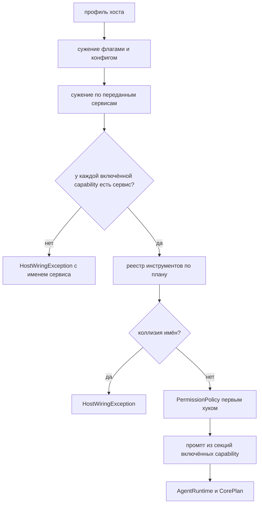

# 10. Сборка ядра и профили хостов

> Часть [архитектуры ядра агента CodeLab](../agent-core-architecture.md). Status: Accepted. Общие соглашения, термины и порядок чтения — в оглавлении.

← [9. Сжатие контекста](09-compaction.md) · [Оглавление ядра](../agent-core-architecture.md) · [11. Промпты](11-prompts.md) →

## 10.1. Назначение

Одна функция сборки `buildAgentCore` владеет всеми решениями «что подключать»: какие
инструменты видит модель, какие секции попадают в системный промпт, какой env-цепочкой идут
файлы и команды, кто спрашивает одобрение. Хосты (`apps/codelab_agent`, `codelab_embedded`,
тесты) различаются только **профилем** и набором переданных **сервисов**. Так возможности не
расходятся между `codelab-agent serve`, встроенным агентом codelab-app и codelab_cli.


## 10.2. Контракт: capability и профиль

Capability — крупная возможность хоста, которая влияет на поверхность модели. Их пятнадцать:
восемь MVP (семь базовых и `outputSpill` — §17.4, десятая, этап 3) и семь после MVP —
`network` (§17.1), `skills` (§17.2), `languageServers` (§17.8, одиннадцатая), `backgroundJobs` (§17.9, двенадцатая), `memory`
(§17.11.4, тринадцатая), `userQuestions` (§17.11.7, четырнадцатая) и `userHooks` (§17.14.2,
пятнадцатая):

| Capability | Что включает | Что видит модель, если включено |
|---|---|---|
| `shellExec` | инструмент `exec` | схема `exec`, секция промпта `tools/exec` |
| `fileListing` | инструменты `ls`, `search` (нужен `DirectoryListing`) | схемы `ls`, `search`, секция `tools/listing` |
| `mcp` | MCP-клиент, инструменты `mcp__<server>__<tool>` | схемы MCP-инструментов, секция `mcp` со списком серверов |
| `compaction` | автоматическое и ручное сжатие (§9), команда `/compact` | ничего (команда видна пользователю); после MVP при `compaction.engine: structured` или включённом `session_history` — схема `context_expand` (§17.13.4) |
| `sessionPersistence` | журнал на постоянном носителе, `session/load`, `session/list` | ничего |
| `interactiveApproval` | `PermissionGate`: вопрос человеку | ничего; при выключении «спросить» = отказ (PERM-5) |
| `projectContext` | чтение `AGENTS.md` проекта хостом и вставка в промпт | секция `project-context` |
| `network` (после MVP) | инструменты `web_fetch`, `web_search` (§17.1) | схемы `web_fetch`, `web_search`, секция `tools/web` |
| `skills` (после MVP) | каталог skills, инструмент `skill`, команды `/skill:<name>` и шаблоны (§17.2) | схема `skill`, секции `skills/catalog` и `skills/operative` (если каталог модели не пуст) |
| `outputSpill` (этап 3) | вынос огромного результата `exec`, `web_fetch`, MCP в файл сессии вместо усечения (§17.4) | ничего нового: ни схем, ни секций; только фрагменты результата с маркером и путём |
| `languageServers` (после MVP) | инструмент `lsp` поверх языковых серверов из конфигурации `lsp.servers` (§17.8) | схема `lsp`, секция `tools/lsp` |
| `backgroundJobs` (после MVP) | фоновые команды: параметр `run_in_background` у `exec`, инструменты `job_output`, `job_kill` (§17.9) | параметр в схеме `exec`, схемы `job_output`, `job_kill`, абзац `tools/exec_background` в секции `tools/exec` |
| `memory` (после MVP) | инструмент `memory`, вставка заметок, команда `/memory` (§17.11.4) | схема `memory`, секция `tools/memory`, записи `memory_recall` |
| `userQuestions` (после MVP) | инструмент `ask` через `QuestionGate` (§17.11.7) | схема `ask` |
| `userHooks` (после MVP) | запуск команд хуков `hooks.before_tool` и `hooks.after_tool` на машине агента (§17.14.2) | ничего; только тексты отказа и заметки хуков в результатах |

Базовые инструменты `read`, `write`, `edit`, `update_plan` есть всегда: они работают поверх
любого `ExecutionEnv`, включая `MemoryExecutionEnv`.

```dart
enum HostCapability { shellExec, fileListing, mcp, compaction, sessionPersistence, interactiveApproval, projectContext,
    network, skills, outputSpill, languageServers, backgroundJobs,
    memory, userQuestions, userHooks }  // outputSpill (§17.4) — этап 3; после MVP: network (§17.1), skills (§17.2), languageServers (§17.8), backgroundJobs (§17.9), memory, userQuestions (§17.11), userHooks (§17.14.2)

sealed class CapabilityState { const CapabilityState(); }
final class CapabilityOn extends CapabilityState { const CapabilityOn(); }
final class CapabilityOff extends CapabilityState { final String reason; const CapabilityOff(this.reason); }
final class CapabilityTransport extends CapabilityState {
  final Set<String> transports;   // например {'local'}, {'acp-terminal', 'local'}, {'stdio', 'http'}
  final String reason;            // почему именно такой набор
  const CapabilityTransport(this.transports, this.reason);
}

final class HostProfile {
  final String name;
  final Map<HostCapability, CapabilityState> states;   // запись для каждой capability (HOST-1)
  final ModeId defaultMode;                            // §10.5
  final OutputTrustPolicy outputTrust;                 // §10.6
  const HostProfile._(this.name, this.states, this.defaultMode, this.outputTrust);
  factory HostProfile.of(String name);                 // встроенные профили §10.4; ArgumentError для неизвестного
  HostProfile narrowed(Map<HostCapability, CapabilityState> overrides);   // только сужение (HOST-2)
}
```

**Сужение.** `narrowed` принимает только переходы `on → transport ⊂ … → off` и
`transport(A) → transport(B)` при `B ⊆ A`. Попытка включить выключенное или добавить транспорт —
`HostWiringException("capability mcp: нельзя расширить {http} до {http, stdio} в профиле mobile")`.
Сужение применяют хост (флаги запуска, `profile.<name>` в конфиге §15) и сама сборка (нет
сервиса — capability выключается).

## 10.3. Контракт: buildAgentCore

```dart
final class AgentCoreServices {                    // всё внешнее, что передаёт хост
  final ExecutionEnv baseEnv;                      // Local (в mobile — корень в документах приложения) | AcpClient | PersistentWebEnv | Memory (тесты)
  final http.Client http;
  final SessionStore sessions;
  final PermissionGate? gate;                      // null → interactiveApproval off
  final SecretStore? secrets;
  final McpConnector? mcp;                         // null → mcp off; McpClientConnector из codelab_agent_mcp (этап 8, ниже)
  final ProjectContextLoader? projectContext;      // читает AGENTS.md через env хоста
  final NetworkAddressResolver? resolver;          // после MVP (§17.1.2): null → проверка SSRF только по литералам
  final SpillStore? spills;                        // этап 3 (§17.4.2): null → outputSpill off
  final ConfigSource? config;                      // после MVP (§17.5.2): null → живая перезагрузка и /config недоступны
  final bool debugSecrets;                         // после MVP (§17.5.4): --debug-secrets или CODELAB_DEBUG_SECRETS=1
  final SessionLeaseStore? leases;                 // после MVP (§17.6.8): null → lease только внутри процесса
  final ProcessProbe? processProbe;                // после MVP (§17.6.8): host, bootId, pid, isAlive для lease
  final LanguageServerToolFactory? languageServers;  // после MVP (§17.8.2): null → languageServers off
  final OAuthLoginService? login;                  // после MVP (§17.10.6): null → authMethods пуст
  final LlmDiagnostics? llmDiagnostics;            // после MVP (§17.10.10): снимки зависаний; передаётся в CoreLlmServices.diagnostics (§2.10)
  final MemoryStore? memory;                       // после MVP (§17.11.4): null → memory off
  final QuestionGate? questions;                   // после MVP (§17.11.7): null → userQuestions off
  final ImagePreparer? images;                     // после MVP (§17.11.2.1): null → картинки не уменьшаются, лимиты как в MVP; desktop/CLI — IsolateImagePreparer из codelab_agent_images/io.dart, web — PureDartImagePreparer
  final ByteProcessLauncher? hookLauncher;         // после MVP (§17.14.2.2): null → userHooks off
  final List<CodelabPlugin> plugins;               // после MVP (§17.14.3.2): собранные в бинарь, по умолчанию const []
  final RemoteAgentConnector? remoteAgents;        // после MVP (§17.15.2): A2aRemoteAgentConnector; null → типов a2a:* в task нет
  final Logger logger; final Clock clock; final IdGenerator ids;
  final String platform;                           // для system/base (§11.5): ядро не читает dart:io; хост — Platform.operatingSystem
  final Random random;                             // PKG-6: случайность (джиттер повторов) даёт хост; в тестах Random(42)
}

/// Хранилище секретов по имени (ключи API провайдеров, MCP, поиска; `exec.secrets`).
abstract interface class SecretStore {
  Future<String?> read(String name);
  Future<void> write(String name, String value);
  Future<void> delete(String name);
  Future<List<String>> names();
}
```

**Порты MCP (этап 8).** Ядро не создаёт MCP-клиента: клиент живёт в пакете над ядром
(`codelab_agent_mcp`, §1.2), а ядру нужна одна точка, которая по списку серверов сессии отдаёт её
инструменты. Поэтому в `AgentCoreServices.mcp` лежит `McpConnector`, а не фабрика транспортов;
фабрика транспортов (`stdio` — `StdioMcpTransportFactory` из `codelab_agent_io`, `http` —
`StreamableHttpTransportFactory` на `services.http`) уходит внутрь `McpClientConnector`. Порты
(`lib/src/mcp/` ядра, без протокола MCP и JSON-RPC):

```dart
abstract interface class McpConnector {            // AgentCoreServices.mcp
  Set<String> get transports;                      // 'stdio', 'http' — для проверки HOST-3
  Future<McpSessionTools> connect(McpConnectRequest request);   // sessionId, cwd, servers, reservedNames, logger, cancel
}
abstract interface class McpSessionTools {         // объект MCP-части одной сессии
  List<AgentTool> get tools;                       // в порядке регистрации (§6.4)
  List<McpServerSummary> get servers;              // для секции mcp (§11.5)
  McpToolsUpdate? takeUpdate();                    // ожидающее tools/list_changed; ядро забирает на границе шага
  Future<void> replaceServers(List<McpServerConfig> servers);   // повторный session/load (§13.5): полный список после слияния и фильтра ядра
  Future<void> close();
}
abstract interface class McpTransport {            // транспорт уровня сообщений: одно сообщение — один JSON-текст
  String get kind;                                 // 'stdio' | 'http'
  Stream<String> get incoming;
  Future<void> send(String message, {Map<String, String> headers = const {}});
  Stream<McpRequestAbort> get abortedRequests;     // сбои отдельных запросов при живом транспорте (HTTP): id, reason, retryable
  Future<void> abandon(Object requestId);          // HTTP: закрыть поток ответа; stdio: ничего; в abortedRequests не эмитит
  Future<McpTransportClosed> get done;             // транспорт закрыт: причина и exitCode (stdio)
  Future<void> close();                            // идемпотентно
}
abstract interface class McpTransportFactory {     // реализует хост; stdio — в codelab_agent_io
  Set<String> get transports;
  Future<McpTransport> open(McpServerConfig server,
      {required String cwd, required CancelToken cancel, required Logger logger});   // logger сессии с session_id
}
```

Единственное исключение `open` и `send` — `McpTransportException` с текстом нашего кода (`spawn
failed: …`, `cancelled`, `invalid url` — схема URL не `http`/`https`, `HTTP redirect (<status>) is not
followed`, `connection failed: <runtimeType>`, `HTTP session expired`; в логе последние три — с префиксом `disconnected:`). Ошибка в потоках `incoming` или `abortedRequests` переводит клиент
сервера в «не подключён» (`mcp.server.failed` с причиной `disconnected: transport error`).
Локальные сбои HTTP-транспорта без JSON-RPC-тела (`HTTP <status>`, `response body too large`,
`invalid JSON in the response`, `unexpected response (HTTP <status>)`) не выдаются за JSON-RPC-ошибку:
транспорт сообщает их типизированным сбоем запроса (id, причина, признак повторяемости; обрыв
потока — повторяемый), точная форма — design.md change `add-agent-mcp-client`, D10.
`open` получает логгер сессии (`BoundLogger` с `session_id`): через него транспорт пишет
`mcp.server.stderr` и `mcp.server.closed` (§12.3).

`replaceServers(servers)` получает полный желаемый список после слияния и фильтра ядра (серверы
конфига, затем серверы клиента): серверы конфига не трогаются, совпавшие по `sameConnection`
остаются, исчезнувшие закрываются, новые подключаются и занимают имена инструментов последними
(коллизия отключает новый сервер), отключённый или не подключившийся сервер пробуется заново; сбой
сервера — `mcp.server.failed`, а не исключение.

Решения — `openspec/changes/archive/2026-10-29-add-agent-mcp-client/design.md` (D3, D6).

Реализации: связка ключей ОС в `codelab_agent_io` (Keychain, Secret Service, Credential Manager) и
хранилище в памяти для тестов. Значения секретов никогда не попадают в логи: каждое прочитанное
значение регистрируется в `Redactor` (§12.4).

После MVP (§17.5.2, §17.5.4): все хранилища реализуют расширение `DescribedSecretStore`
(`backend` — `SecretBackendInfo`: id бэкенда, запись, причина недоступности ОС-хранилища); к
связке ключей добавляются бэкенды `env` (только чтение, `CODELAB_SECRET_<…>`) и `file` (открытый
`$CODELAB_HOME/secrets.yaml`, только по явному `secrets.backend = "file"`). Ядро читает секреты
только через `SecretResolver` (кэш, переопределение из окружения, регистрация в `Redactor`).

Хост, который обслуживает сессии с разными `cwd`, держит один снимок `CoreConfig` на корень сессии
(глобальный слой общий): проектные слои у каждого `cwd` свои, и правка проектного файла касается
только сессий этого корня (§15.2, §17.5.6).

**До снимков по корням (change `add-agent-configuration`, D9; снимки на каждый корень приходят с
`ConfigSource` change 8.10).** `buildAgentCore` принимает один `CoreConfig` на процесс. Загрузчик
читает проектные слои 3–4 для корня запуска хоста и возвращает два снимка: полный в
`CoreConfig` и снимок без проектных слоёв в `CoreConfig.withoutProject`; `CoreConfig.projectRoot` —
канонический корень запуска. `AgentRuntimeImpl` для `createSession` и `loadSession` берёт ключи
сессии (`defaultModel`, `effort`, `permissions`, `budget`, `compaction`, `mcpServers`, `redact`) из
`withoutProject`, если канонический `cwd` сессии не равен `projectRoot` (равенство, не
вложенность), и пишет `config.session.outside_root` один раз на `cwd`. Ключи сборки (провайдеры и
каталог, capability, сужение профиля, журналы) берутся из полного снимка. Так MCP-серверы и
разрешения `allow` из `config.local.yaml` проекта `/A` не применяются к сессии в `/B`.

```dart
final class CoreConfig {                           // результат загрузки конфига (§15), уже провалидирован
  final ModelCatalog models;                       // — ModelCatalog, §2.12.2
  final ModelId defaultModel; final PermissionsConfig permissions;
  final TurnBudget budget; final CompactionOverrides compaction;
  final ToolsConfig tools;                         // в том числе switches: List<ToolSwitch> (§6.3.8)
  final PromptOverrides prompts; final List<McpServerConfig> mcpServers;
  final HooksConfig hooks; final PluginsConfig plugins;   // после MVP (§17.14)
  // с change add-agent-configuration (8.5): providers: List<CatalogProvider>,
  // providerProblems: Map<String, String> (id провайдера → причина недоступности ключа),
  // redact: RedactSettings, projectRoot: String?, withoutProject: CoreConfig? (см. выше)
}
final class CorePlan {                             // что включено и почему
  final HostProfile profile;                       // уже суженный
  final List<String> toolNames;                    // в порядке регистрации
  final List<String> promptSections;               // в порядке сборки
  final Map<HostCapability, String> offReasons;
  final Map<String, String> disabledTools;         // имя → source (§6.3.8)
  final List<PluginStatus> plugins; final List<PluginCommand> pluginCommands;   // после MVP (§17.14.3)
}
final class BuiltAgentCore {
  final CorePlan plan; final ExecutionEnv env; final ToolRegistry tools;
  final PermissionPolicyFactory permissions; final AgentRuntime runtime;
}
BuiltAgentCore buildAgentCore({
  required HostProfile profile,
  required AgentCoreServices services,
  required CoreConfig config,
  @visibleForTesting StreamFunction? streamFunction, // только тесты и conformance (§14.9): ScriptedStreamFunction вместо шага 8 §10.7; хосты не передают
});                                                // HostWiringException | ConfigException при ошибке
```

## 10.4. Профили

| Capability | `agent-serve` | `embedded-app-desktop` | `embedded-cli` | `mobile` | `web` |
|---|---|---|---|---|---|
| `shellExec` | transport `acp-terminal` (клиент объявил `terminal`) или `local` (флаг `--local-exec`) | transport `local` | transport `local` | off: «на платформе нет shell» | off: «на платформе нет shell» |
| `fileListing` | transport `local`: stdio-клиент всегда на той же машине; off для WebSocket-клиента: «в ACP нет листинга каталога» | transport `local` | transport `local` | transport `local`: `LocalExecutionEnv` с корнем в каталоге документов приложения | transport `memory` (`PersistentWebEnv`) |
| `mcp` | transport `stdio`, `http` | transport `stdio`, `http` | transport `stdio`, `http` | transport `http`: «нет процессов» | transport `http`: «нет процессов» |
| `compaction` | on | on | on | on | on |
| `sessionPersistence` | transport `jsonl-file`; после MVP lease `file` (§17.6.8) | transport `jsonl-file`; lease `file` | transport `jsonl-file`; lease `file` | transport `app-documents`; lease `process`: один процесс приложения, достаточно реестра процесса | transport `indexeddb`; lease не поддерживается (`LeaseUnsupported`): вторую вкладку ловит только сравнение ревизии |
| `interactiveApproval` | transport `acp` | transport `acp` | transport `acp` (`AcpPermissionGate`); в `codelab -p` без TTY вопрос тоже уходит по ACP, CLI отвечает по политике `--approve` (по умолчанию `reject`) | transport `acp` | transport `acp` |
| `projectContext` | on | on | on | off: «нет каталога проекта» | off: «нет каталога проекта» |
| `network` (после MVP, §17.1.5) | on | on | on | on | off: «браузер не даёт читать чужие домены (CORS) и не отдаёт управление редиректами» |
| `skills` (после MVP, §17.2) | on | on | on | off: «нет локальных каталогов skills» | off: «нет локальных каталогов skills» |
| `outputSpill` (этап 3, §17.4.6) | transport `local` | transport `local` | transport `local` | off: «нет shell — главного источника огромного вывода; результаты усекаются» | off: «нет локальной файловой системы агента; результаты усекаются» |
| `languageServers` (после MVP, §17.8.9) | transport `local` для stdio-клиента (та же машина, как `fileListing`); off для WebSocket-клиента: «корень сессии может быть не на файловой системе агента» | transport `local` | transport `local` | off: «нет процессов» | off: «нет процессов» |
| `backgroundJobs` (после MVP, §17.9.12) | transport `acp-terminal` или `local` (как `shellExec`) | transport `local` | transport `local` | off: «на платформе нет shell» | off: «на платформе нет shell» |
| `memory` (после MVP, §17.11.4) | transport `local-file` | transport `local-file` | transport `local-file` | transport `app-documents` | off: «нет постоянного хранилища заметок до этапа 10» |
| `userQuestions` (после MVP, §17.11.7) | transport `acp` при `_meta.codelab.ask` клиента | transport `acp` (встроенный `QuestionGate`) | transport `acp` (встроенный `QuestionGate`); off в `codelab -p` и `autopilot`: «нет человека» | transport `acp` | transport `acp` |
| `userHooks` (после MVP, §17.14.2) | transport `local` | transport `local` | transport `local` | off: «нет процессов» | off: «нет процессов» |

Как работает `fileListing` в `agent-serve`. Файлы читаются и пишутся через ACP `fs/*`, чтобы
агент видел несохранённые буферы редактора клиента. Листинга каталога в ACP нет. При stdio
клиент запускает агента дочерним процессом, значит, они на одной машине, и `ls`/`search`
работают через локальную файловую систему, ограниченную тем же `BoundedEnv` с корнем `cwd`
сессии. Для WebSocket машины могут быть разными — инструменты выключаются с причиной, модель
пользуется `exec` (`ls`, `grep` через `terminal/*`), если он включён. Тем же условием после MVP
ограничена `languageServers`: языковой сервер читает неоткрытые файлы с диска по `rootUri` (§17.8.9).

**Профиль `a2a-serve`** (после MVP, §17.15.4) — бинарь `codelab-agent serve --a2a`, ACP-клиента
нет: `shellExec`, `backgroundJobs`, `fileListing`, `languageServers`, `outputSpill`, `userHooks` —
transport `local`; `mcp` — `stdio`, `http` (только серверы конфига); `compaction`, `projectContext`,
`network`, `skills` — on; `sessionPersistence` — `jsonl-file`, lease `file`; `memory` —
`local-file`; `interactiveApproval` — transport `a2a` (`A2aPermissionGate`; задача без расширения
одобрений — вопрос = отказ, PERM-5); `userQuestions` — off: «в A2A нет вопроса с вариантами». Новых
capability профиль не вводит.

`sessions.lease.enabled: false` (§15.4) переводит lease `file` в `process` — для файловых систем
без атомарного `rename`; сравнение ревизии остаётся (§17.6.8).

## 10.5. Режим одобрения по умолчанию

Режимы сессии и их отображение на `PermissionMode` (§7) описаны в §13.6. Профиль задаёт режим
новой сессии по умолчанию; конфиг (`permissions.mode`) **заменяет** его и может как ослабить, так
и ужесточить (проектный слой — только сузить, §15.3); флаг запуска — изменить в любую сторону.
`autopilot` в конфиге запрещён (CFG-4): он включается только флагом запуска.

| Профиль | Режим по умолчанию | `PermissionMode` | Обоснование |
|---|---|---|---|
| `agent-serve` | `standard` | `write` | чтение без вопросов, правки и команды — с вопросом; как у Python-агента |
| `embedded-app-desktop` | `standard` | `write` | тот же UI одобрения, что и для внешнего агента |
| `embedded-cli` (REPL) | `standard` | `write` | вопрос `y / a / n` в терминале |
| `embedded-cli` (`-p`) | `standard` | `write` | агент спрашивает через `AcpPermissionGate`, CLI отвечает по `--approve` (по умолчанию `reject`, P-09); `--permission-mode bypass` или `autopilot` — явный выбор пользователя; критические команды отклоняются в любом случае (§7.7) |
| `mobile` | `standard` | `write` | shell нет; запись в память приложения всё равно спрашивается |
| `a2a-serve` (после MVP) | `standard` (`a2a.server.permission_mode`) | `write` | вопрос — `TASK_STATE_INPUT_REQUIRED` с расширением одобрений, без него — отказ; критические шаблоны и PERM-11 — всегда отказ; `autopilot` недоступен (§17.15.4) |
| `web` | `standard` | `write` | то же |

`autopilot` доступен только флагом `codelab -p --permission-mode autopilot` и `codelab-agent serve
--permission-mode autopilot`: в этом режиме критические шаблоны отклоняются без вопроса (PERM-9). Через
ACP (`session/set_mode`, `session/set_config_option`) `autopilot` недоступен.

## 10.6. Политика доверия вывода по профилю

`outputTrust` инструмента (§6.2) для `read`, `search` и `exec` уточняется профилем. MCP и
web-инструменты всегда `untrusted`, профиль это не меняет (TOOL-10).

| Источник | `agent-serve`, `a2a-serve`, `embedded-*` | `mobile`, `web` |
|---|---|---|
| `read` файла внутри `cwd` | `trusted` | `trusted` |
| `read` файла из каталогов `tools.untrusted_paths` (по умолчанию `node_modules`, `.dart_tool`, `vendor`) | `untrusted` | — |
| `search` | как `read` по пути каждого совпадения; если хоть одно совпадение `untrusted` — весь результат `untrusted` | `trusted` |
| `exec` с сетевой командой (список ниже) | `untrusted` | — |
| прочий `exec` | `trusted` | — |
| `update_plan` | `trusted` | `trusted` |
| `lsp` `diagnostics`, `symbols`, `rename` (после MVP, §17.8.7) | как `read`: `untrusted` для путей из `tools.untrusted_paths` | — |
| `lsp` `definition`, `references` (после MVP) | как `search`: хоть одна позиция вне `cwd` или в `tools.untrusted_paths` — весь результат `untrusted` | — |
| `lsp` `hover` (после MVP) | всегда `untrusted`: документация может прийти из чужого пакета | — |

**Сетевые команды `exec`** — единственный список; на него ссылается §6.3.6. Команда сетевая, если
любой её сегмент (части между `&&`, `||`, `;`, `|`, без ведущих присваиваний `VAR=x`) начинается с
одного из префиксов: `curl`, `wget`, `http`, `nc`, `ssh`, `scp`, `git clone`, `git fetch`,
`git pull`, `npm install`, `pnpm install`, `yarn install`, `pip install`, `dart pub get`,
`dart pub upgrade`. Префикс сравнивается по словам: `httpie` и `ncdu` не совпадают с `http` и `nc`.

```dart
abstract interface class OutputTrustPolicy {
  ContentTrust classify(AgentTool tool, Map<String, Object?> args, ToolExecutionResult result);
}
```

## 10.7. Алгоритм: buildAgentCore

```text
buildAgentCore(profile, services, config, streamFunction):
1. сужение по сервисам:
     services.gate == null        → interactiveApproval := off("PermissionGate не передан")
     services.mcp == null         → mcp := off("сервис MCP не передан")
     services.projectContext == null → projectContext := off("загрузчик контекста проекта не передан")
     baseEnv не реализует DirectoryListing → fileListing := off("env без листинга каталога")
     после MVP: tools.web.enabled = false → network := off("выключено конфигом") (§17.1.5);
       skills.enabled = false → skills := off("выключено конфигом") (§17.2.8);
       services.spills == null → outputSpill := off("хранилище выноса не передано");
       tools.spill.enabled = false → outputSpill := off("выключено конфигом") (§17.4.6);
       services.languageServers == null → languageServers := off("фабрика языковых серверов не передана");
       lsp.enabled = false → languageServers := off("выключено конфигом");
       нет ни одного включённого lsp.servers.<id> → languageServers := off("нет настроенных языковых серверов") (§17.8.9);
       jobs.enabled = false → backgroundJobs := off("выключено конфигом");
       shellExec выключена или baseEnv не реализует BackgroundShell → backgroundJobs := off (§17.9.12);
       services.memory == null или memory.enabled = false → memory := off (§17.11.4);
       services.questions == null или tools.ask.enabled = false → userQuestions := off (§17.11.7);
       services.hookLauncher == null → userHooks := off("запуск процессов не передан") (§17.14.2)
     shellExec включён, а baseEnv.exec — заглушка (MemoryExecutionEnv) → HostWiringException
2. проверка сервисов (HOST-3): для каждой включённой capability — таблица §10.8;
     нет сервиса → HostWiringException("capability <c> требует сервис <s>")
3. проверка конфига: defaultModel есть в каталоге; у модели есть contextWindow; MCP-серверы
     конфига используют только разрешённые транспорты (stdio в mobile → ConfigException)
3a. после MVP: плагины (§17.14.3.3)
4. env-цепочка (§4.3): env := BoundedEnv(EnvVarsEnv(services.baseEnv, allowlist, secrets), root: cwd)
     root задаётся при создании сессии; buildAgentCore создаёт фабрику env на сессию;
     readOnlyRoots := SpillService.dir сессии, если outputSpill включена (этап 3, §17.4.4),
     и после MVP корни skills (§17.2.3); readOnlyFs := локальная ФС агента (SpillStore.readFs); при включённой
     outputSpill фабрика создаёт SpillService на сессию и кладёт его в ToolServices.spill;
     при включённой backgroundJobs — JobManager на сессию в ToolServices.jobs (§17.9.2.2)
5. реестр инструментов:
     a. базовые: read, write, edit, update_plan
     b. shellExec → exec;  fileListing → ls, search
     c. mcp → McpConnector: инструменты серверов подключаются на сессию (session/new, §13) и кладутся
        в реестр сессии поверх базового (§6.4)
     d. после MVP: network и tools.web.enabled → web_fetch, web_search (после ls/search, до MCP, §17.1.2);
        skills → skill (на сессию, если SkillCatalog.modelVisible не пуст, §17.2.3);
        subagents.enabled → task (на сессию, enum типов из определений агентов, §17.3.2; при
          services.remoteAgents — и типы a2a:<имя> из a2a.agents, §17.15.3);
        subagents.background → ещё task_status, task_cancel (§17.3.8);
        subagents.follow_ups → ещё task_send, task_resume, task_observe (§17.3.8.1; run_in_background в их схемах — только при subagents.background);
        languageServers → lsp (на сессию: LanguageServerToolFactory.openSession, после web_fetch и
          web_search, до MCP; хук сессии afterToolCall ставится после хуков хоста, §17.8.2, §5.2);
        backgroundJobs → параметр run_in_background у exec, job_output, job_kill (вместе с exec, §17.9.2.3);
        после lsp и до MCP (§17.11): memory → memory; userQuestions → ask; inspect_image (задана
          роль vision, модель принимает картинки, env реализует BinaryFiles); tools.checkpoint.enabled →
          checkpoint; sessionPersistence и tools.history.enabled → session_history;
          tools.load: essential → discover_tools;
        compaction.engine: structured или session_history → context_expand (§17.13.4);
        плагины → инструменты active-плагинов после lsp, до MCP (§17.14.3.3)
     e. дубликат имени → HostWiringException (HOST-5); MCP-коллизия при подключении → сервер
        отключается с причиной, сессия продолжает работу
     f. выключенные инструменты (§6.3.8): удалить из реестра инструменты с toolEnabled == false;
        выключение task удаляет task_status, task_cancel, task_send, task_resume, task_observe; выключение exec — job_output, job_kill;
        on для отсутствующего встроенного → ConfigException; plan.disabledTools := имя → source
     g. после MVP: ToolLoadPlan сессии (tools.load, tools.mounted; §17.11.9) — какие схемы видимы
6. разрешения: PermissionPolicyFactory(mode: config.permissions.mode ?? profile.defaultMode (конфиг заменяет режим профиля, §10.5), gate,
     rules: PolicyRules(toolPolicies: config.permissions.tools, denyPatterns: config.permissions.deny)); политика ставится первым beforeToolCall-хуком (PERM-1);
     вторым — после MVP SessionHooks.before при включённой userHooks (§17.14.2.3);
     хуки хоста из SessionSpec.extraBeforeToolCall (например, ACP markInProgress, §13.7) — последними;
       у загруженной сессии — из SessionHostPorts.extraBeforeToolCall по тому же правилу
     afterToolCall: хуки хоста из SessionSpec.extraAfterToolCall — первыми, затем (после MVP) SessionHooks.after (§17.14.2.3), затем хук сессии языковых серверов (§17.8.5)
7. промпт: секции в фиксированном порядке (§11.5), только для включённых capability (HOST-4)
8. LLM: stream := streamFunction (если передан, только тесты) иначе createStreamFunction(ProviderConfig из config.models,
       CoreLlmServices(services.http, services.clock, services.random, services.logger,
         diagnostics: services.llmDiagnostics; §2.10));
     ModelCatalog стартует из кэша и конфига без сети, refresh() запускается в фоне (§2.12.2)
9. runtime := AgentRuntime(env factory, tools, permissions, prompts, stream, sessions,
                           compaction: включено ли, budget, logger, clock, ids)
     после MVP: AgentLoopConfig сессии получает imageRefs := ImageRefRegistry сессии при
       images.dedup: true (§17.11.2.2), иначе null
10. plan := CorePlan(profile, toolNames, promptSections, offReasons); лог host.plan с plan
11. вернуть BuiltAgentCore(plan, …)
```

## 10.8. Требования capability к сервисам

| Capability | Обязательные сервисы и свойства |
|---|---|
| `shellExec` | `baseEnv` с настоящим `Shell.exec` (`LocalExecutionEnv` или `AcpClientExecutionEnv` при `terminal: true`) |
| `fileListing` | `baseEnv is DirectoryListing` |
| `mcp` | `McpConnector`, у которого `transports` содержит каждый транспорт из набора capability (HOST-3) |
| `compaction` | `StreamFunction` (всегда есть); модель резюме из каталога |
| `sessionPersistence` | `SessionStore`, не являющийся `MemorySessionStore`, если transport не `memory`; после MVP для lease `file` — `SessionLeaseStore` (`FileSessionLeaseStore`) и `ProcessProbe` из `codelab_agent_io` (§17.6.8), без них lease — `process` |
| `interactiveApproval` | `PermissionGate` |
| `projectContext` | `ProjectContextLoader` |
| `network` | `http.Client` (есть всегда); `NetworkAddressResolver` необязателен (§17.1.5) |
| `skills` | `SkillCatalog` в `SessionSpec`, загруженный хостом (§17.2.1); пустой каталог — нет схемы и секций (SKL-5) |
| `outputSpill` | `SpillStore` с `readFs` (локальная ФС агента, §17.4.2) |
| `languageServers` | `LanguageServerToolFactory` (`codelab_agent_lsp`) поверх `ByteProcessLauncher` (`LocalProcessLauncher` из `codelab_agent_io`, §17.8.2); `shellExec` не требуется |
| `backgroundJobs` | `shellExec` включена и `baseEnv is BackgroundShell` (§17.9.2.1); журнал вывода — при `outputSpill` |
| `memory` | `MemoryStore` (`FileMemoryStore` из `codelab_agent_io`, §17.11.4) |
| `userQuestions` | `QuestionGate` (`AcpQuestionGate` ACP-адаптера или шлюз встроенного хоста, §17.11.7) |
| `userHooks` | `ByteProcessLauncher` (`hookLauncher`; `LocalProcessLauncher` из `codelab_agent_io`) |

## 10.9. Правило «выключено — невидимо»

Выключенная capability не оставляет на поверхности модели ни одного токена (HOST-4):

* схемы инструментов строятся из реестра, а в реестр попадают только инструменты включённых capability;
* секции промпта подключаются по тому же плану; в базовом промпте нет фраз вроде «если у тебя есть `exec`» — текст про `exec` живёт только в секции `tools/exec`;
* примеры в описаниях базовых инструментов не упоминают выключаемые инструменты;
* slash-команды выключенных capability (`/compact` без `compaction`) не попадают в `available_commands_update`;
* выключенный инструмент (T-26) невидим так же: нет схемы, секции и строки в `Available tools` (TOOL-12);
* после MVP: без `memory` нет схемы `memory`, секции `tools/memory` и вставки заметок; без `userQuestions` нет схемы `ask`; `userHooks` поверхности модели не добавляет и при выключении ничего не убирает (§17.11, §17.14.2).

Причины выключения видит человек, а не модель: `CorePlan.offReasons` уходит в лог `host.plan` и
в вывод `codelab-agent doctor`.



## 10.10. Инварианты

1. **HOST-1.** Каждая capability в профиле имеет явное состояние; `off` и `transport` — непустую причину.
2. **HOST-2.** Профиль и сужение при запуске могут только сужать возможности платформы; расширение — `HostWiringException` при создании профиля.
3. **HOST-3.** Включённая capability без своего сервиса — `HostWiringException` при сборке, а не сбой во время хода.
4. **HOST-4.** Выключенная capability не выводит на поверхности модели ни одного токена: ни схемы инструмента, ни секции промпта, ни slash-команды.
5. **HOST-5.** Коллизия имён встроенных инструментов — ошибка сборки; коллизия MCP-инструмента — отключение этого MCP-сервера с причиной.
6. **HOST-6.** Хосты не собирают ядро вручную: единственный путь — `buildAgentCore`.
7. **HOST-7.** Режим одобрения новой сессии по умолчанию задаёт профиль; `permissions.mode` из конфига заменяет его в любую сторону (проектный слой только сужает, §15.3); `autopilot` включается только флагом запуска.

## 10.11. Обоснование решения

* **Семь capability, а не флаги на каждый инструмент.** Capability описывают свойства платформы
  и транспорта, а не вкусы пользователя; их мало, и каждая проверяется тестом матрицы.
* **Сужение, а не включение.** Профиль — потолок платформы. Флаг или конфиг, который «включает»
  shell на iOS, — ошибка конфигурации, и лучше узнать о ней при старте.
* **Причина у каждого `off`.** Без причины выключенный инструмент выглядит как «модель
  разучилась»; с причиной это одна строка в `codelab-agent doctor`.
* **Листинг по stdio — локально.** Это единственный способ дать модели `ls`/`search` при работе
  через ACP без расширения протокола; условие «stdio — та же машина» проверяемо и честно.

## 10.12. Как проверить

* Тест матрицы: для каждого профиля список схем инструментов, секций промпта и slash-команд совпадает с golden-файлом `test/host/profiles/<profile>.golden.json` (HOST-1, HOST-4).
* Тест паритета профилей: один сценарий на scripted LLM («прочитай файл, измени, покажи план») даёт одинаковую последовательность `AgentEvent` в `agent-serve` (на fake ACP-клиенте), `embedded-app-desktop` и `embedded-cli` — различаются только env и gate.
* Тест «включено без сервиса» → исключение с именем сервиса (HOST-3); тест расширения `mcp` в `mobile` до `stdio` → исключение (HOST-2).
* Тест коллизии: два встроенных инструмента с одним именем → ошибка сборки; MCP-сервер с инструментом-дубликатом → сервер отключён, сессия создана (HOST-5).
* Тест-сторож: в `apps/codelab_agent` и `codelab_embedded` нет `ToolRegistry(`, `Agent(` и `AgentRuntime(` вне `buildAgentCore` (HOST-6).
* Тест режима по умолчанию: `codelab -p` без TTY и без флагов → агент спрашивает через `AcpPermissionGate`, CLI отвечает по `--approve reject` (по умолчанию): вызов `write` отклонён с причиной (`rejected`, в stderr `codelab: rejected … (policy reject)`), ход продолжается; с `--approve allow-all` или `--permission-mode bypass` — исполнен (HOST-7, P-09, §7.7).
* Тест `outputTrust`: `exec curl …` в `agent-serve` даёт результат в ограде, `exec dart test` — без неё.

---

← [9. Сжатие контекста](09-compaction.md) · [Оглавление ядра](../agent-core-architecture.md) · [11. Промпты](11-prompts.md) →
