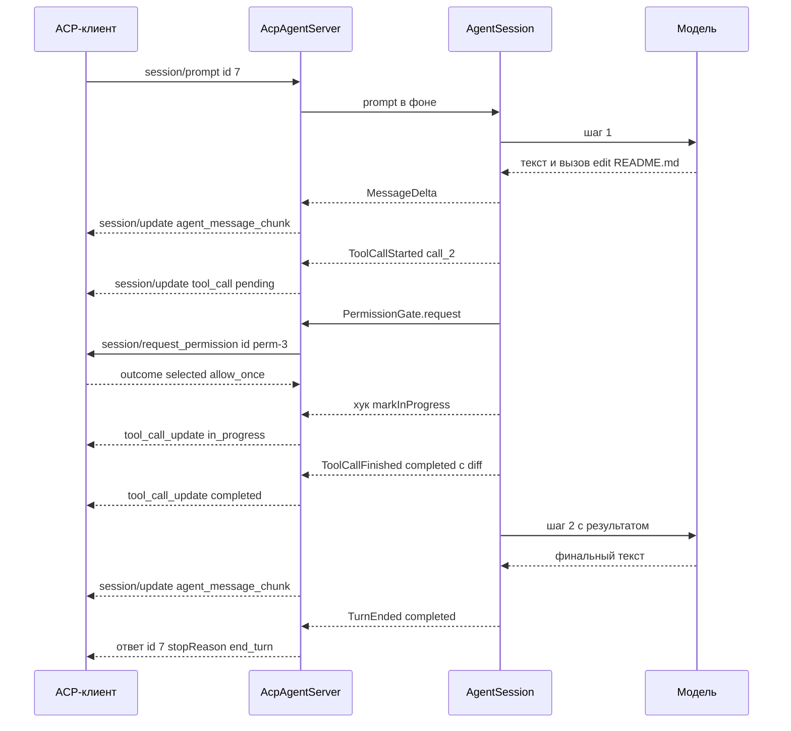
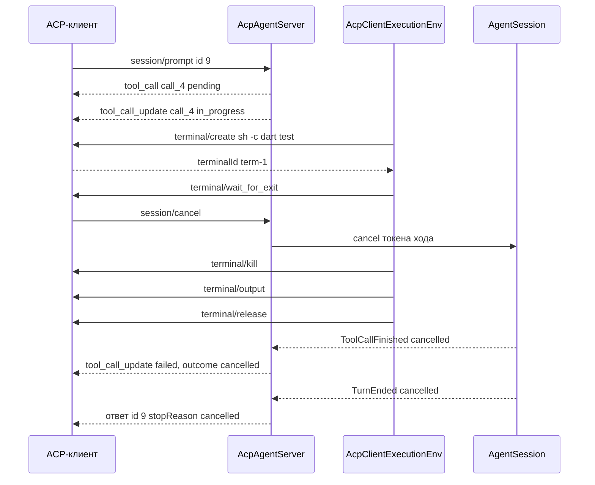
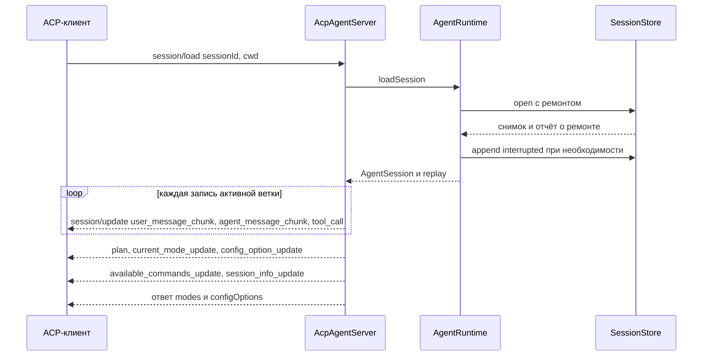

# 13. ACP-адаптер

> Часть [архитектуры ядра агента CodeLab](../agent-core-architecture.md). Status: Accepted. Общие соглашения, термины и порядок чтения — в оглавлении.

← [12. Наблюдаемость и модель ошибок](12-observability-and-errors.md) · [Оглавление ядра](../agent-core-architecture.md) · [14. Формат golden ACP-фикстур](14-golden-fixtures.md) →

## 13.1. Назначение

`codelab_agent_acp` — проекция `AgentRuntime` в ACP. Адаптер принимает JSON-RPC-кадры через
`AcpTransport`, декодирует их моделями `acp_protocol`, вызывает API ядра и проецирует
`AgentEvent` в `session/update`. Методы, поля и значения перечислений берутся только из
`acp_protocol` и `docs/acp/protocol/`. Всё сверх них — поля `_meta.codelab.*` или методы
`_codelab/*`; каждое расширение вводится OpenSpec change (`AGENTS.md` §3.4) и перечислено в
§13.12.

```dart
final class AcpAgentServer {
  AcpAgentServer({required AgentRuntime runtime, required AcpServerConfig config,
                  required Logger logger, required TraceSink trace, required Clock clock});
  /// Обслуживает одно соединение до его закрытия. Можно вызывать для нескольких транспортов.
  Future<void> serve(AcpTransport transport);
  /// Безопасное завершение: §13.10.
  Future<void> shutdown({Duration grace = const Duration(seconds: 5)});
}
final class AcpServerConfig {
  final Implementation agentInfo; final Duration detachGrace;   // 30 с
  final AcpTimeouts timeouts; final bool allowLocalExecFallback;
}
```

Внутри соединения есть три компонента:

| Компонент | Ответственность |
|---|---|
| `InboundRouter` | читает `transport.inbound`, валидирует кадр, маршрутизирует запросы к обработчикам, ответы — к `PendingRequests`; плохой кадр не прерывает чтение (ACP-4) |
| `OutboundQueue` | единая очередь исходящих кадров соединения: уведомления и ответы уходят строго в порядке постановки; ответ на `session/prompt` ставится после последнего `session/update` хода (ACP-3) |
| `PendingRequests` | исходящие запросы агента к клиенту (`fs/*`, `terminal/*`, `session/request_permission`): id, таймаут, `Completer`, `CancelToken` |

Обработчик `session/prompt` не блокирует чтение: ход идёт в фоне, а ответ ставится в
`OutboundQueue` по `TurnEnded`. Поэтому во время хода соединение принимает `session/cancel`,
ответы на запросы разрешений и запросы других сессий.

## 13.2. `initialize`

Запрос клиента (пример codelab-app):

```json
{"jsonrpc":"2.0","id":0,"method":"initialize","params":{"protocolVersion":1,"clientCapabilities":{"fs":{"readTextFile":true,"writeTextFile":true},"terminal":true},"clientInfo":{"name":"codelab-app","version":"0.4.0"}}}
```

Ответ агента — **ровно эти** поля и значения (исключение после MVP — поля `_meta` расширений, ниже):

```json
{"jsonrpc":"2.0","id":0,"result":{"protocolVersion":1,"agentCapabilities":{"loadSession":true,"promptCapabilities":{"image":true,"audio":false,"embeddedContext":true},"mcpCapabilities":{"http":true,"sse":false},"sessionCapabilities":{"list":{}}},"agentInfo":{"name":"codelab-agent","title":"CodeLab Agent","version":"0.1.0"},"authMethods":[]}}
```

| Поле | Значение | Почему |
|---|---|---|
| `protocolVersion` | `1` | единственная поддерживаемая версия; клиент прислал больше — отвечаем `1`, меньше `1` — тоже `1` (клиент решает, закрывать ли соединение) |
| `loadSession` | `true` | журнал и реплей (§8, §13.5); в профиле без `sessionPersistence` — `false` |
| `promptCapabilities.image` | `true` | картинки хранятся в транскрипте; для модели без `image` адаптер провайдера ставит плейсхолдер (§2.5) |
| `promptCapabilities.audio` | `false` | аудио ни один адаптер провайдера MVP не передаёт |
| `promptCapabilities.embeddedContext` | `true` | `resource` с `text` превращается в текстовый блок с путём (§13.4) |
| `mcpCapabilities.http` | `true` при capability `mcp` с транспортом `http` | |
| `mcpCapabilities.sse` | `false` | транспорт SSE устарел в MCP; клиент MVP умеет stdio и streamable HTTP |
| `sessionCapabilities.list` | `{}` | `session/list` (§13.5); без `sessionPersistence` — поле отсутствует |
| `authMethods` | `[]`; после MVP при `services.login != null` — по методу `codelab-login-<id>` на провайдер с входом по подписке (§17.10.6) | аутентификации на уровне ACP нет (§13.3) |

После MVP `agentCapabilities._meta.codelab` объявляет расширения, введённые через OpenSpec
(§13.12): `subagentBoard` (§17.3.7), `subagentWake: true` — агент поддерживает пробуждение
(§17.3.8), `sessionTree: {"version": 1}` — методы `_codelab/session/*`
(§17.6.10), `steering: {"maxBytes", "maxPending"}` — метод `_codelab/session/steer`, только при
`steering.enabled` (§17.7.2.2), `jobs: {"version": 1}` — методы `_codelab/jobs/*` (§17.9.11), `sessionSearch: {"version": 1, "maxLimit": 50, "scopes": ["cwd", "all"]}` — метод `_codelab/session/search`, только при `sessions.search.enabled` и `sessionPersistence`; `"all"` — только при `sessions.search.allow_all` (§17.6.17). Это единственное исключение из правила «ровно эти поля»:
стандартные поля и их значения не меняются, а клиент без поддержки `_meta` игнорирует.

Алгоритм:

1. Повторный `initialize` в том же соединении → `-32600` «already initialized».
2. Любой метод `session/*` до `initialize` → `-32600` «initialize required».
3. `clientCapabilities` сохраняются **на соединение**; сессии, созданные в нём, получают
   `AcpClientExecutionEnv` с возможностями из них (§13.9). Отсутствие поля логируется
   `acp.client_capabilities.absent` — иначе пропажа инструментов выглядит как поведение модели.
   Если хост передал серверу `localListing` (бинарь по stdio, §10.4), env сессии —
   `ListingOverlayEnv(AcpClientExecutionEnv, localListing(cwd))`: `listDir` — локальная ФС под тем
   же `BoundedEnv`, чтение, запись и `exec` — через клиента.
   После MVP вместе с ними на соединение сохраняется `clientCapabilities._meta.codelab.ask`
   (`{"version": 1}`): клиент показывает вопросы `ask`, capability `userQuestions` включается
   для сессий этого соединения (§17.11.7).

## 13.3. `authenticate`

`authMethods` пуст, поэтому клиент по спецификации не вызывает `authenticate`. Метода нет в
`acp_protocol`; вызов получает `-32601`. Защита соединения — на уровне транспорта: stdio — это
дочерний процесс пользователя; WebSocket слушает `127.0.0.1` и проверяет заголовок
`Authorization: Bearer <token>` при рукопожатии HTTP (ответ `401` до ACP). Код `-32000`
зарезервирован за будущим «Authentication required» и не используется ни для чего другого.

После MVP (§17.10.6): хост с `OAuthLoginService` объявляет методы `codelab-login-<id>` (тип
`agent`); `authenticate {methodId}` выполняет вход на машине агента и отвечает `{}`; неизвестный
`methodId` — `-32602`; невозможность открыть браузер и отказ входа — `-32000` с текстом
`Run: codelab login <id>`; `session/new` с моделью, требующей отсутствующего токена, — `-32000`.
Хост без `login` — поведение MVP (`-32601`).

## 13.4. `session/new`

```json
{"jsonrpc":"2.0","id":1,"method":"session/new","params":{"cwd":"/work/demo","mcpServers":[{"name":"github","type":"http","url":"https://api.githubcopilot.com/mcp","headers":[{"name":"Authorization","value":"Bearer gho_xxx"}]}]}}
```

Алгоритм:

1. `cwd` не абсолютный → `-32602` «cwd must be an absolute path». Каталог не существует
   (проверка через env) → `-32602`.
2. `mcpServers`: каждый декодируется моделью `McpServer` (`McpServerStdio`, `McpServerHttp`,
   `McpServerSse`). Транспорт, не разрешённый профилем (stdio в `mobile`, sse везде), не ошибка
   запроса: сервер пропускается, лог `mcp.server.skipped` с причиной. Серверы из конфига (§15)
   добавляются к серверам клиента; при совпадении `name` побеждает сервер клиента.
3. `runtime.createSession(SessionSpec(cwd, mode: config.permissions.mode ?? profile.defaultMode (§10.5), model: config.defaultModel,
   env: из clientCapabilities, gate: AcpPermissionGate(connection)))`. Сессия пишет заголовок и
   `model_change`.
4. MCP-серверы подключаются параллельно, не дольше `mcpConnectTimeout` (10 с) каждый; сбой
   сервера — лог `mcp.server.failed`, сессия создаётся без его инструментов. После MVP сбой не
   окончателен: сервер переходит в `failed` и переподключается с задержкой 1…30 с, пока жива
   сессия; инструменты появляются на границе шага после первого успешного подключения (§17.5.7).
5. Ответ `NewSessionResponse(sessionId, modes, configOptions)`.
6. **После** ответа — уведомление `available_commands_update` (до ответа клиент не знает
   `sessionId`, ранние уведомления он отбросил бы). На этапе 4 встроенных команд ещё нет и
   список пуст (`availableCommands: []`); встроенные команды и порядок ниже появляются на
   этапе 8 (dart-agent-and-clients §9.13), фикстуры этапов 0 и 4 сверяют список через `$any` (§14.2).

```json
{"jsonrpc":"2.0","id":1,"result":{"sessionId":"01JB8Q2W6R9T3M5K7N1P4X8Z0C","modes":{"currentModeId":"standard","availableModes":[{"id":"plan","name":"Plan","description":"Read and plan only, no changes"},{"id":"ask","name":"Ask","description":"Approve every call, including reads"},{"id":"standard","name":"Standard","description":"Reads without asking, edits and commands with approval"},{"id":"accept-edits","name":"Accept edits","description":"Reads and edits without asking, commands and network with approval"},{"id":"bypass","name":"Bypass","description":"No approval except for critical commands, agent config edits and network access"}]},"configOptions":[{"id":"mode","name":"Mode","category":"mode","type":"select","currentValue":"standard","options":[{"value":"plan","name":"Plan"},{"value":"ask","name":"Ask"},{"value":"standard","name":"Standard"},{"value":"accept-edits","name":"Accept edits"},{"value":"bypass","name":"Bypass"}]},{"id":"model","name":"Model","category":"model","type":"select","currentValue":"openai/gpt-4o","options":[{"value":"openai/gpt-4o","name":"GPT-4o"},{"value":"anthropic/claude-sonnet-4","name":"Claude Sonnet 4"}]}]}}
{"jsonrpc":"2.0","method":"session/update","params":{"sessionId":"01JB8Q2W6R9T3M5K7N1P4X8Z0C","update":{"sessionUpdate":"available_commands_update","availableCommands":[{"name":"compact","description":"Compact the session history","input":{"hint":"[focus]"}},{"name":"mode","description":"Switch the session mode","input":{"hint":"plan | ask | standard | accept-edits | bypass"}},{"name":"model","description":"Switch the model","input":{"hint":"provider/model"}},{"name":"status","description":"Show the model, mode, working directory and MCP servers"},{"name":"help","description":"List commands"}]}}}
```

После MVP список дополняется командами `usage` (при `sessionPersistence`, §12.6.1) и `redact`
(всегда, §12.4.3) — сразу после `status`, затем `config` (если `services.config != null`) и `mcp`
(при включённой capability `mcp`) — между ними и `help` (§17.5.6, §17.5.7), а затем командами
сессии `rename`, `branches`, `branch`, `rewind`, `fork`, `label` (при `sessionPersistence`,
§17.6.10), затем `approve` (§17.12.4), `timer` (§17.12.5), `memory` (при capability `memory`,
§17.11.4), затем `tasks` (при фоновых субагентах или фоновых командах, §17.3.8, §17.9.11).

**Правило порядка** (единственное место, где оно задано; остальные разделы ссылаются сюда):
встроенные команды — `compact`, `mode`, `model`, `status`, `usage`, `redact`, `config`, `mcp`,
команды сессии (`rename`, `branches`, `branch`, `rewind`, `fork`, `label`), `approve`, `timer`,
`memory`, `tasks`, `help`; затем команды плагинов в порядке `plugins.enabled` (§17.14.3.3);
затем шаблоны и skills (§17.2.9). Отсутствующая команда просто пропускается, порядок остальных не
меняется. `/model --role` — форма команды `model`, отдельного элемента у неё нет. Пример полного
списка — §17.2.9. Элементы новых команд:

```json
{"name":"model","description":"Switch the model","input":{"hint":"provider/model | --role <role> <provider/model>"}}
{"name":"usage","description":"Show token usage and cost of the session","input":{"hint":"[rebuild]"}}
{"name":"redact","description":"Show secret redaction statistics or layers","input":{"hint":"stats | layers"}}
{"name":"approve","description":"Approve the answer held for review","input":{"hint":"[note]"}}
{"name":"timer","description":"Set, show or clear the session deadline","input":{"hint":"<duration> | until <time> | off"}}
{"name":"memory","description":"List, search, add or delete memory notes","input":{"hint":"list | search <q> | add [--user] <text> | delete <id>"}}
{"name":"tasks","description":"List, cancel or show output of background subagents and jobs","input":{"hint":"[cancel <id> | output <id>]"}}
```

Элемент `model` с подсказкой `--role` — после MVP (§17.10.5); в MVP подсказка `provider/model`.

Контент промпта: `text` → `TextContent`; `image` → `ImageContent`; `resource` с `text` →
`TextContent` вида `<resource uri="file:///work/demo/a.dart">…</resource>`; `resource` с `blob`
→ текстовая пометка «бинарный ресурс <uri>, N байт, не передан»; `resource_link` → текст
«ссылка на ресурс <uri> (<name>)» — модель прочитает его `read`, если нужно; `audio` → `-32602`
(не объявлено).

## 13.5. `session/load` и `session/list`

```json
{"jsonrpc":"2.0","id":3,"method":"session/load","params":{"sessionId":"01JB8Q2W6R9T3M5K7N1P4X8Z0C","cwd":"/work/demo","mcpServers":[]}}
```

Алгоритм `session/load`:

1. Файла сессии нет → `-32002` «session not found».
2. `cwd` запроса не совпадает с `cwd` заголовка → используется `cwd` запроса (так требует
   спецификация: рабочая папка задаётся клиентом), в журнал пишется `custom` с
   `customType: "codelab.cwd_changed"`; граница `BoundedEnv` — по новому `cwd`.
3. Сессия уже открыта в этом процессе:
   a. ход не идёт → открыть заново не нужно, перейти к шагу 5 с текущим снимком;
   b. ход идёт, его соединение в состоянии detached (§13.10) → **переподключение**: сессия
      переходит к новому соединению, шаги 5–8, затем шаг 9;
   c. ход идёт в другом живом соединении → в MVP `-32602` с `data: {"codelab": {"reason":
      "sessionBusy"}}`. После MVP (§17.6.9) соединение подключается к сессии **вторым клиентом**:
      оно добавляется в множество подключённых, получает реплей (шаги 5–7), затем буфер событий
      текущего хода (§5.6) как живые уведомления; `session/prompt` второго соединения во время
      хода → `turnActive`. Так же (без буфера) подключается соединение в случае 3a.
4. `runtime.loadSession(id, mode)`. После MVP сначала lease (§17.6.8): режим — из
   `_meta.codelab.openMode` параметров (`"write"` по умолчанию, `"readOnlyIfLocked"`,
   `"readOnly"`); lease держит другой процесс и режим `write` → `-32602` с `data: {"codelab":
   {"reason": "sessionLocked", "owner": {profile, pid, host, since}}}` (SESM-13); при
   `readOnlyIfLocked` или `readOnly` сессия открывается только для чтения (`openReadOnly`, без
   ремонта на диске, `healInterruptedTurn`, `SpillService.attach` и MCP, SESM-12), ответ несёт
   `_meta.codelab.readOnly: {owner}`. Затем `open()` с ремонтом (§8.6), `healInterruptedTurn`
   (§8.8), `SpillService.attach` (§17.4.5), подключение MCP (как в `session/new`).
   После MVP большой или сегментированный журнал открывается `openWindowed` (§17.13.2).
5. Реплей `buildReplay(snapshot)` по активной ветке в порядке записей:
   * после MVP при `window.replayFromPathIndex > 0` — первым маркер `agent_message_chunk`
     `Earlier history of this session is not shown: <n> records before this point.` с
     `_meta.codelab.replayWindow`, затем реплей с границы хода (§17.13.2, SCL-6);
   * `user` → если `isUserWords(record)` (§8.2.5, SES-14) — `user_message_chunk` по одному на
     каждый блок контента; у `origin: "steer"` каждый блок получает
     `_meta.codelab.steer: {"id": steerId}` (§17.7.5, STEER-9); прочие user-записи (уведомления
     субагентов и задач, подсказки цикла, уведомления дедлайна, §8.2.3) пропускаются;
   * `assistant` → по блокам: `thinking` → `agent_thought_chunk`, `text` → `agent_message_chunk`,
     `toolCall` → `tool_call` с **итоговым** статусом, `title`, `kind`, `locations` (из `toolMeta`
     записи результата, §8.2.3), `rawInput` (аргументы вызова), `content` результата и по одному
     `diff` на каждый файл (из поля записи `diff` или `diffs`), `_meta.codelab.outcome` для
     `cancelled`/`rejected`/`interrupted` —
     одно уведомление на вызов, без промежуточных `tool_call_update`; для вынесенного результата
     (поле записи `spill`, с этапа 3) `content` — тот же фрагмент с маркером и путём, что видела
     модель и живой ход (§17.4.5, SPL-1); полный текст из файла в реплей не читается; сообщение с
     `origin: "loop_note"` (§5.4.1) отдаётся обычным `agent_message_chunk`; после MVP последний
     `agent_message_chunk` ответа, на который есть запись `response_hold`, получает
     `_meta.codelab.held: {"reason", "approved"}` (`approved` — есть ли `response_review`, §17.12.4);
   * `toolResult` отдельно не отправляется — он уже вошёл в `tool_call` своего вызова;
   * `compaction`, `hide`, `pin` не отправляются: пользователь видит исходную историю (§17.13.4);
   * после MVP не отправляются и служебные записи `memory_recall`, `tools_mount` (§17.11.4,
     §17.11.9), `deadline`, `response_hold`, `response_review` (§17.12.4, §17.12.5) — первая для
     модели, остальные состояние сессии; `response_hold` влияет только на `_meta.codelab.held`
     выше;
   * `branch` (после MVP, §17.6.10) → одно `agent_message_chunk` с фиксированным текстом
     `Continued from an earlier point of the conversation. Files were not restored.` (вторая фраза —
     только при эффектах); сводка покинутой ветки в реплей не выводится — она для модели;
     `branch` с `reason: "checkpoint"` (после MVP, §17.11.6) — вместо этого синтетический
     `tool_call` `toolCallId: "checkpoint_<recordId>"`, `kind: think`,
     `title: Rewound to checkpoint <label>`, `status: completed`, отчёт в `content`;
   * после MVP при объявленном `sessionTree` у `user_message_chunk` и `agent_message_chunk`
     реплея — `_meta.codelab.recordId` (id записи, для «перемотать сюда», §17.6.10); в режиме только
     чтения вызов без результата уходит со статусом `in_progress` (§17.6.8).
6. После истории: последняя запись `plan` → `plan`; затем `current_mode_update`,
   `config_option_update` (полный снимок), `available_commands_update`, `session_info_update`
   (`title`, `updatedAt`).
7. Ответ `LoadSessionResponse(modes, configOptions)` — после всех уведомлений реплея; после MVP в
   `_meta.codelab` — `readOnly` (шаг 4) и `forkedFrom` (§17.6.10).
8. Если сессия была переподключена (шаг 3b): каждому ожидающему `session/request_permission`
   отправляется **новый** запрос с новым JSON-RPC id и тем же `toolCallId`; ответ на старый id
   (если придёт) игнорируется (PERM-4).
9. По `TurnEnded` переподключённого хода ответ на исходный `session/prompt` отправить некуда
   (его соединение закрыто). Адаптер отправляет новому соединению `session_info_update` с
   `_meta.codelab.turnEnded: {"stopReason": "..."}` (расширение, §13.12); после MVP при непустом
   `TurnEnded.returnedSteers` — с полем `steerReturned: ["<steerId>", …]` (§17.7.2.2).

Пример реплея (фрагмент):

```json
{"jsonrpc":"2.0","method":"session/update","params":{"sessionId":"01JB8Q2W6R9T3M5K7N1P4X8Z0C","update":{"sessionUpdate":"user_message_chunk","content":{"type":"text","text":"Fix the failing test in test/a_test.dart"}}}}
{"jsonrpc":"2.0","method":"session/update","params":{"sessionId":"01JB8Q2W6R9T3M5K7N1P4X8Z0C","update":{"sessionUpdate":"agent_thought_chunk","content":{"type":"text","text":"Read the test first."}}}}
{"jsonrpc":"2.0","method":"session/update","params":{"sessionId":"01JB8Q2W6R9T3M5K7N1P4X8Z0C","update":{"sessionUpdate":"tool_call","toolCallId":"call_1","title":"Read test/a_test.dart","kind":"read","status":"completed","rawInput":{"path":"test/a_test.dart"},"locations":[{"path":"/work/demo/test/a_test.dart"}],"content":[{"type":"content","content":{"type":"text","text":"1| void main() {\n2|   expect(1, 2);\n3| }"}}]}}}
{"jsonrpc":"2.0","method":"session/update","params":{"sessionId":"01JB8Q2W6R9T3M5K7N1P4X8Z0C","update":{"sessionUpdate":"session_info_update","title":"Fix a_test","updatedAt":"2026-10-21T08:00:04.000Z"}}}
{"jsonrpc":"2.0","id":3,"result":{"modes":{"currentModeId":"standard","availableModes":["…"]},"configOptions":["…"]}}
```

`session/list`:

```json
{"jsonrpc":"2.0","id":4,"method":"session/list","params":{"cwd":"/work/demo"}}
{"jsonrpc":"2.0","id":4,"result":{"sessions":[{"sessionId":"01JB8Q2W6R9T3M5K7N1P4X8Z0C","cwd":"/work/demo","title":"Fix a_test","updatedAt":"2026-10-21T08:00:04.000Z"}],"nextCursor":"eyJ2IjoxLCJhZnRlciI6Ii4uLiJ9"}}
```

Сводки — `SessionStore.list` (§8.10), страница 50. `cwd` не абсолютный или неразбираемый
`cursor` → `-32602`. Нет совпадений — пустой `sessions`, без `nextCursor`. После MVP элементы
получают `_meta.codelab.lease: {profile, pid, since}` (сессия открыта на запись другим
процессом), `_meta.codelab.forkedFrom: {sessionId, recordId}` (§17.6.10) и
`_meta.codelab.titleSource`: `"user"` \| `"auto"` \| `"derived"` (§8.10.2).

## 13.6. Режимы и опции: `session/set_mode`, `session/set_config_option`

Режимы сессии (`ModeId`) и их смысл для разрешений (§7):

| `modeId` | `PermissionMode` | Дополнительно | Устаревшие синонимы (принимаются на входе) |
|---|---|---|---|
| `plan` | `write` + запрет tier `write` и `exec` с причиной «режим plan: изменения запрещены»; tier `network` (после MVP) не запрещён — спрашивается (§7.3, §17.1.5) | секция промпта `modes/plan` | `architect` |
| `ask` | `alwaysAsk` | — | — |
| `standard` | `write` | — | `debug` |
| `accept-edits` | `acceptEdits` | чтение и правки (tier `read`, `write`) без вопроса; `exec`, MCP-инструменты и `network` спрашиваются; критические шаблоны спрашиваются (§7.3.1, P-06) | `acceptEdits` |
| `bypass` | `yolo` | критические шаблоны, правки конфигурации агента в проекте (§7.6.1, PERM-11) и сетевой выход (tier `network`, после MVP, §7.3) всё равно спрашиваются | `code` |

`autopilot` в списке нет (§10.5). Синонимы нормализуются на входе, наружу всегда уходят
основные id. После MVP синоним `architect` выбирает только режим `plan`; промпт-профиль
`architect` выбирается опцией `agent` (§17.12.2, лог `acp.mode.legacy_alias`). Смена режима действует со следующего вызова инструмента, в том числе посреди хода
(спецификация разрешает смену «while generating»); идущий вызов не прерывается.

`session/set_config_option`:

```json
{"jsonrpc":"2.0","id":5,"method":"session/set_config_option","params":{"sessionId":"01JB8Q2W6R9T3M5K7N1P4X8Z0C","configId":"mode","value":"plan"}}
{"jsonrpc":"2.0","method":"session/update","params":{"sessionId":"01JB8Q2W6R9T3M5K7N1P4X8Z0C","update":{"sessionUpdate":"current_mode_update","currentModeId":"plan"}}}
{"jsonrpc":"2.0","id":5,"result":{"configOptions":[{"id":"mode","name":"Режим","category":"mode","type":"select","currentValue":"plan","options":["…"]},{"id":"model","name":"Модель","category":"model","type":"select","currentValue":"openai/gpt-4o","options":["…"]}]}}
```

1. Сессии нет → `-32002`. `configId` неизвестен или `value` не из `options` → `-32602`
   (проверка параметров до поиска сессии не делается: сначала сессия, затем значение).
2. `mode` → `AgentSession.setMode` (запись `mode_change`, событие `ModeChanged`) → уведомление
   `current_mode_update` для клиентов, которые используют `modes`.
3. `model` → запись `model_change`; действует со следующего шага.
4. Ответ — **полный** список опций. Уведомление `config_option_update` в ответ на запрос клиента
   не дублируется: полный снимок уже в ответе. Агент сам меняет опции (например, slash-команда
   `/mode`) — тогда уходит `config_option_update`.
5. `effort` → запись `config_change {optionId: "effort", value}`; действует со следующего шага
   (идущий запрос к модели не прерывается).

**Опции сессии** — в порядке массива `configOptions` (спецификация: важные — первыми):

| `id` | `category` | Значения | Когда есть в списке | Текущее значение |
|---|---|---|---|---|
| `mode` | `mode` | режимы таблицы выше | всегда | последний `mode_change` ветки или режим профиля |
| `model` | `model` | `ModelCatalog.models` (§2.12.2): `value` — `provider/model`, `name` — имя модели | всегда | последний `model_change` ветки или `agent.default_model` |
| `effort` | `thought_level` | `low`, `medium`, `high` (имена `Low`, `Medium`, `High`) | только если у текущей модели `supportsReasoning` (§2.12.3) | последний `config_change` с `optionId: "effort"` на ветке или `agent.effort` |

```json
{"id":"effort","name":"Reasoning effort","category":"thought_level","type":"select","currentValue":"medium","options":[{"value":"low","name":"Low"},{"value":"medium","name":"Medium"},{"value":"high","name":"High"}]}
```

Правила `effort`:

1. Смена модели на модель без рассуждения (через `model` или `/model`): значение сохраняется в
   сессии, опция исчезает из следующего снимка, параметр рассуждения в запросы не уходит; одна
   заметка по §2.12.3. Смена обратно на модель с рассуждением возвращает опцию с тем же значением.
   Когда смену делает клиент (`session/set_config_option` с `configId: "model"`), новый набор
   опций — в ответе на этот запрос; когда агент (`/model`) — в `config_option_update`.
2. `session/set_config_option` с `configId: "effort"`, когда опции нет в списке (модель без
   рассуждения), → `-32602` «unknown config option» — так же, как для любого неизвестного `configId`.
3. Каталог моделей изменился (фоновое обновление, §2.12.2, или живая перезагрузка конфига,
   §17.5.6, шаг 7c): для каждой открытой сессии пересчитываются опции `model` и `effort`; снимок
   отличается от последнего отправленного → `config_option_update` с полным списком опций. Во
   время хода уведомление уходит в той же очереди (§13.10), ход не прерывается.

`session/set_mode` есть в спецификации ACP (`12-Session Model.md`, схема
`SetSessionModeRequest {sessionId, modeId}`), но ещё не реализован в `acp_protocol`. Решение:
OpenSpec change этапа 4 добавляет `SetSessionModeRequest`/`SetSessionModeResponse` в
`acp_protocol`; обработчик — та же функция, что для `configId: "mode"`, ответ `{}`, затем
уведомление `current_mode_update`. До этого изменения метод отвечает `-32601`, а клиенты
используют `configOptions` (их спецификация называет предпочтительным способом).

Slash-команды приходят обычным `session/prompt` с текстом `/<имя> <аргументы>` (R-08). MVP:
`/compact [<указание>]` (§9.5; текст после имени команды — `SummaryRequest.focus`, §9.2; ответ — `agent_message_chunk` с итогом сжатия), `/mode <id>`, `/model <id>`,
`/status` (модель, режим, `cwd`, MCP-серверы), `/help`, а также MCP prompts как команды с именем
`<server>:<prompt>` (имя сервера из конфига, двоеточие отделяет пространство имён; встроенные
команды двоеточия не содержат). После MVP добавляются шаблоны `/<template>` и `/skill:<name>`
(§17.2.6), `/config reload|check` (§17.5.6) и `/mcp list|reload [<id>]|enable <id>|disable <id>`
(§17.5.7), команды сессии `/rename <title>`, `/branches`, `/branch <n> | <record id>`,
`/rewind [<n> | <record id>]`, `/fork [<n> | <record id>]`, `/label <text> | clear` (§17.6.10;
команды, меняющие ветку, в журнал команд не пишут и модели не отправляются), `/usage [rebuild]`
(журнал usage сессии, §12.6.1), `/redact stats | layers` (§12.4.3) и
`/tasks [cancel <id> | output <id>]` — фоновые субагенты и фоновые команды (§17.3.8, §17.9.11) —
все, как `/status`, отвечают
`agent_message_chunk` с фиксированным английским текстом и `stopReason: end_turn`, в журнал не
пишутся и модели не отправляются; `/status` получает строку `Config: ok` или
`Config: reload failed at <ISO-время> (<n> issues). Run /config check.` и, если есть отложенные
ключи, `Restart required: <ключи>` (§17.5.6). В MVP `/status` также показывает строку
`System prompt: custom (<source>)` или `System prompt: appended (<source>)`, если базовый промпт
заменён или дополнен (§11.6.1), и `Tools disabled: <names>`, если инструменты выключены (§6.3.8).

После 9 (§17.10–§17.14) — те же правила ответа:

* `/model --role <role> <provider/model> | reset` — форма `/model`: переопределение роли модели на
  сессию, запись `config_change {optionId: "model_role.<role>"}` (§17.10.5);
* `/memory list | search <q> | add [--user] <text> | delete <id>` — заметки долговременной
  памяти, при capability `memory` (§17.11.4);
* `/timer [<duration> | until <time> | off]` — дедлайн сессии, пишет запись `deadline`
  (§17.12.5); `/approve [note]` — одобрить удержанный ответ, пишет запись `response_review`
  (§17.12.4);
* команды плагинов `/<name>` (§17.14.3): `CommandReply` отвечает как `/status`, `CommandPrompt`
  уходит модели как шаблон;
* `/compact` при `compaction.engine: structured` отвечает текстами структурного движка
  (§17.13.4, «Конфигурация»).

`/status` после 9 получает строки `Roles: smol=<model> (<source>), …` (§17.10.5),
`Tools: essential (<visible> of <enabled> visible)` в режиме `tools.load: essential` (§17.11.9),
`Deadline: …` (§17.12.5), `Hooks: <n> before, <m> after` или `Hooks: unavailable (<reason>)`
(§17.14.2.4), `Plugins: <name> <version>, …` и `Plugins skipped: <name> (<reason>)` (§17.14.3.4).
Порядок команд в `available_commands_update` — §13.4.

Разбор:

1. Первый текстовый блок начинается с `/`, а слово после него (до первого пробельного символа)
   соответствует `^[A-Za-z0-9][A-Za-z0-9:_-]*$` — это команда. Иначе (например,
   `/usr/bin/foo is broken`) текст уходит модели как обычное сообщение.
2. Известная команда исполняется агентом; MCP prompt разворачивается в сообщение пользователя.
   После MVP порядок поиска имени: встроенная команда → команда плагина (§17.14.3) → шаблон →
   `skill:` → MCP prompt.
3. **Неизвестная команда** модели не отправляется: ответ — `agent_message_chunk` с текстом
   `Unknown command: /<name>. Run /help to list commands.` и `stopReason: end_turn`; в журнал
   ничего не пишется (R-08).

## 13.7. `session/prompt`, проекция событий и `session/cancel`

```json
{"jsonrpc":"2.0","id":7,"method":"session/prompt","params":{"sessionId":"01JB8Q2W6R9T3M5K7N1P4X8Z0C","prompt":[{"type":"text","text":"Замени в README.md слово foo на bar"}]}}
```

Алгоритм `session/prompt`:

1. Сессии нет → `-32002`. Пустой `prompt` или недопустимый блок (§13.4) → `-32602`.
2. У сессии уже идёт ход → `-32602` с `data: {"codelab": {"reason": "turnActive"}}`, лог
   `acp.prompt.rejected`. Ход не прерывается, очереди нет. Сообщение посреди хода после MVP
   передаётся методом расширения `_codelab/session/steer` (§17.7.3.1); семантика
   `session/prompt` не меняется (STEER-11). Сессия только для чтения (§17.6.8) → `-32602` с
   `reason: "readOnly"`.
3. Запомнить JSON-RPC id запроса в `turn.promptRequestId`; запустить `session.prompt(content)`
   **в фоне** и вернуться к чтению кадров.
4. Подписка на `session.events`: каждое событие → `project(event)` → кадры в `OutboundQueue`.
   После MVP (§17.6.9, SESM-15) кадры хода расходятся по `OutboundQueue` **всех** соединений,
   загрузивших сессию: `session/update` хода — всем; эхо промпта `user_message_chunk` (с
   `_meta.codelab.recordId`) — всем, кроме отправителя; `session/request_permission` — только
   отправителю промпта (остальные видят `tool_call` в `pending`); `session_info_update` — всем.
5. По `TurnEnded` ставится в ту же очередь ответ (`stopReason` по §13.8) — после всех
   уведомлений хода (ACP-3); ответ уходит только отправителю (после MVP — с
   `_meta.codelab.userMessageId`, §17.6.10).

Проекция `AgentEvent` → `session/update`:

| Событие ядра | `sessionUpdate` | Поля и примечания |
|---|---|---|
| `TurnStarted` | — | лог `turn.start` |
| `StepStarted`, `ModelRequested` | — | лог и trace |
| `MessageStarted`/`MessageEnded` (user) | — | клиент сам показал своё сообщение; при реплее — `user_message_chunk`; после MVP другим подключённым соединениям — эхо `user_message_chunk` (§17.6.9) |
| `MessageStarted` (user, `origin: SteerOrigin`, после MVP) | `user_message_chunk` | вживую, на каждый блок, с `_meta.codelab.steer: {"id": steerId}` всем подключённым соединениям; после ответа на `_codelab/session/steer` (STEER-4, §17.7.5) |
| `MessageStarted`/`MessageEnded` (user, `isUserWordsEvent` == false, §8.2.5) | — | служебное user-сообщение (подсказка цикла §5.4.1, уведомления субагента §17.3.8, задачи JOB-11, дедлайна §17.12.5): не отправляется ни вживую, ни эхом другим соединениям (§17.6.9), ни при реплее (§13.5) |
| `MessageStarted` (assistant, `LoopNoteOrigin(deadline)`, после MVP) | `agent_message_chunk` | как заметка цикла §5.4.1: остановка по дедлайну (§17.12.5) |
| `MessageDelta` | `agent_message_chunk` | `content: {"type":"text","text": delta}` |
| `ThoughtDelta` | `agent_thought_chunk` | `content: {"type":"text","text": delta}` |
| `MessageEnded` (assistant) | — | всё уже передано дельтами |
| `ToolCallStarted` | `tool_call` | `toolCallId`, `title`, `kind` (`tool.kindOf(args)`, §6.2), `status: "pending"`, `rawInput`, `locations` (абсолютные пути) |
| (хук `markInProgress`, см. ниже) | `tool_call_update` | `status: "in_progress"` — вызов прошёл проверку разрешений и все хуки и сейчас начнёт исполняться |
| `ToolCallProgress` | `tool_call_update` | `content` как есть; для `exec` через `AcpClientExecutionEnv` — `[{"type":"terminal","terminalId": …}]` из `ExecOptions.onTerminal` |
| `ToolCallHeartbeat` (после MVP) | `tool_call_update` | `status: "in_progress"`, `title: "<title> (running <elapsed>)"` (§17.12.3) |
| `ToolCallStuck` (после MVP) | `tool_call_update` | то же, с `, no output for <silent>` в `title` (§17.12.3) |
| `ToolCallFinished(completed)` | `tool_call_update` | `status: "completed"`, `content`; для правок — по одному `{"type":"diff","path","oldText","newText"}` на каждый элемент `diffs` (`write`/`edit` — один, `lsp rename` — по файлу, §17.8.9); после MVP, если были `ToolCallHeartbeat`/`ToolCallStuck`, добавляется исходный `title` (§17.12.3) |
| `ToolCallFinished(failed)` | `tool_call_update` | `status: "failed"`, текст ошибки в `content` |
| `ToolCallFinished(cancelled)` | `tool_call_update` | `status: "failed"`, `_meta: {"codelab": {"outcome": "cancelled"}}` |
| `ToolCallFinished(rejected)` | `tool_call_update` | `status: "failed"`, `_meta: {"codelab": {"outcome": "rejected"}}`, текст причины в `content` |
| результат `interrupted` (реплей, §8.8) | `tool_call` | `status: "failed"`, `_meta: {"codelab": {"outcome": "interrupted"}}` |
| `ToolCallFinished` со `spill` (с этапа 3, §17.4) | `tool_call_update` | статус по `outcome`, как в строках выше; `content` — фрагмент вынесенного результата (начало, маркер `[output spilled: …]` с абсолютным путём на машине агента, конец), побайтово равный тексту для модели; `locations` путь выноса не получает; `_meta.codelab.spill` — только после OpenSpec (§13.12) |
| `ToolPairingRepaired` | — | лог `tool.pairing_repaired` |
| `StepEnded` | — | лог |
| `PlanUpdated` | `plan` | `entries` целиком (`content`, `priority`, `status`) |
| `ModeChanged` | `current_mode_update` | `currentModeId`; плюс `config_option_update`, если изменение не было ответом на запрос клиента |
| `CommandsChanged` | `available_commands_update` | `availableCommands` |
| `ConfigOptionChanged` | `config_option_update` | полный снимок `configOptions` |
| `SessionTitleChanged` | `session_info_update` | `title`, `updatedAt`; после MVP — всем подключённым соединениям (§17.6.4) |
| `BranchChanged` (после MVP) | `session_info_update` | при объявленном `sessionTree` — `_meta.codelab.branchChanged: {leafId, fromLeafId, reason}`, всем подключённым; без расширения не передаётся (ответ команды предлагает перезагрузить сессию, §17.6.10) |
| `SessionAccessChanged` (после MVP) | `session_info_update` | при объявленном `sessionTree` — `_meta.codelab.readOnly: {owner}` или `null` (`leaseAvailable`); лог `session.lease.lost` при `leaseLost`/`foreignWrite` (§17.6.8) |
| `ContextCompacted` | — | лог; при `/compact` — `agent_message_chunk` с итогом `Compacted: 118400 → 21950 tokens.` |
| `SubagentStarted`, `SubagentFinished` (после MVP) | — | лог `subagent.start` / `subagent.end`; при согласованной доске — `_codelab/subagents/update` (§17.3.7); у прогона `run ≥ 2` — те же кадры; title вызова `task_send`/`task_resume` — `… (follow-up <run>)` / `… (resume <run>)` (§17.3.8.1) |
| `SubagentProgress` (после MVP) | — | только доска `_codelab/subagents/update`; строку прогресса уже несёт `ToolCallProgress(task)` (§17.3.7) |
| `ToolCallStarted(exec)` с `run_in_background` (после MVP, §17.9) | `tool_call` | `title: "Run in background: <command>"`, `kind: "execute"`; `ToolCallFinished` — сразу `completed` с текстом запуска (и терминалом во внешнем режиме) |
| `JobStarted`, `JobSettled` (после MVP) | — | лог `job.start`/`job.end`; при согласованном `jobBoard` — `_codelab/jobs/update` и поздний `tool_call_update` с `_meta.codelab.job` (§17.9.11) |
| `AgentError` | — | лог и trace; итог хода — через ответ (§13.8) |
| `TurnEnded` | ответ `session/prompt` | §13.8; после MVP непустой `returnedSteers` → `steerReturned` (§17.7.2.2) |

**Статусы вызова.** `ToolCallStarted` эмитится при входе вызова в единую точку исполнения, **до**
проверки разрешений (§6.3.1), поэтому `tool_call` уходит со `status: "pending"`; запрос
разрешения тоже несёт `status: "pending"`. Переход в `in_progress` отправляет хук
`markInProgress`, который ACP-адаптер передаёт в `SessionSpec.extraBeforeToolCall`: сборка
(§10.7) ставит его **последним** в цепочке `beforeToolCall`, после проверки разрешений и прочих
хуков. Хук ставит в `OutboundQueue` `tool_call_update {status: "in_progress"}` и возвращает
`null` (не блокирует). Если вызов отклонён, отменён до старта или не прошёл валидацию, хук не
срабатывает и статус идёт `pending → failed`. После MVP вызов `ask` (§17.11.7) остаётся в
`status: "pending"`, пока клиент не ответит на запрос `_codelab/ask`. Итоговые переходы:

| Путь вызова | Статусы на проводе |
|---|---|
| разрешён (режимом, правилом или пользователем) и исполнен | `pending` → `in_progress` → `completed` или `failed` |
| отклонён (`rejected`) | `pending` → `failed` + `_meta.codelab.outcome: "rejected"` |
| отменён до старта или во время исполнения | `pending` [→ `in_progress`] → `failed` + `_meta.codelab.outcome: "cancelled"` |
| инструмент не найден, аргументы не прошли валидацию | `pending` → `failed` |

Проверка ACP-6: тест перечисляет все подтипы `sealed class AgentEvent` и требует для каждого
строку этой таблицы (функция `project` написана исчерпывающим `switch` без `default`).

**`session/cancel`** — уведомление:

```json
{"jsonrpc":"2.0","method":"session/cancel","params":{"sessionId":"01JB8Q2W6R9T3M5K7N1P4X8Z0C"}}
```

```text
onCancel(sessionId):
1. сессии нет или ход не идёт → лог acp.cancel.no_turn, ничего не отправлять
2. turnSource.cancel(const UserCancel())                         // CAN-*: токен хода (§3)
3. PendingRequests этой сессии:
   a. session/request_permission → Completer завершается cancelled (решение = отказ, PERM-7);
      поздний ответ клиента на этот id игнорируется
   b. fs/* → Completer завершается ошибкой aborted; запрос клиенту не отзывается (в ACP нечем)
   c. terminal/wait_for_exit → AcpClientExecutionEnv отправляет terminal/kill, затем
      terminal/output (хвост вывода), затем terminal/release (ENV-7)
4. цикл видит отмену: модель не вызывается, новые инструменты не стартуют;
   каждый начатый вызов получает ToolCallFinished(cancelled) → tool_call_update failed + outcome
5. TurnEnded(cancelled) → после всех уведомлений ответ {"stopReason":"cancelled"} (ACP-5)
6. если cancel пришёл как request (с id) → дополнительно ответ {"result": null} (терпимость)
```

Ошибки, возникшие из-за отмены (оборванный HTTP, `aborted` у инструмента), не превращаются в
JSON-RPC ошибку: ответ всегда `cancelled`, как требует спецификация.

## 13.8. Отображение итога хода

| `TurnEnded` (`reason`, `budgetExceeded`, `held`) | Ответ на `session/prompt` |
|---|---|
| `completed` | `{"stopReason": "end_turn"}` |
| `completed` и `held != null` (хук `beforeFinalResponse` вернул `Hold`, после MVP) | `{"stopReason": "end_turn", "_meta": {"codelab": {"held": "<reason>"}}}` |
| `completed` и `budgetExceeded: steps` | `{"stopReason": "max_turn_requests", "_meta": {"codelab": {"budgetExceeded": "steps"}}}` |
| `completed` и `budgetExceeded: tokens / cost / duration` | `{"stopReason": "max_turn_requests", "_meta": {"codelab": {"budgetExceeded": "tokens"}}}` |
| `completed` и `budgetExceeded: deadline` (после MVP, §17.12.5) | `{"stopReason": "max_turn_requests", "_meta": {"codelab": {"budgetExceeded": "deadline"}}}` |
| `maxTokens` | `{"stopReason": "max_tokens"}` |
| `refused` (`terminalFinish`: `content_filter`, отказ модели) | `{"stopReason": "refusal"}` |
| `cancelled` | `{"stopReason": "cancelled"}` |
| `failed` | JSON-RPC ошибка `-32603`, `data: {"codelab": {"errorClass": "auth", "message": "…", "retryable": false}}`; `errorClass` — `LlmErrorClass` для сбоя провайдера, иначе `AgentErrorClass` (`hook`, `storage`, `compaction`); после MVP потеря lease — `errorClass: "storage"`, `reason: "leaseLost"` (§17.6.8); после MVP при `errorClass: "rateLimited"` — `message` — текст §17.10.4.1, `retryable: false` при `kind: quota`; структура `data.codelab.rateLimit` — только через OpenSpec `add-rate-limit-info` |
| любой итог с непустым `returnedSteers` (после MVP, §17.7.3.3) | к ответу добавляется `_meta.codelab.steerReturned: ["<steerId>", …]` в порядке приёма; при JSON-RPC ошибке — то же поле в `data.codelab` |

Решение по `failed`. В перечислении `StopReason` нет значения «ошибка», а `end_turn` означает
«модель закончила ответ» — отдать его при сбое значит скрыть сбой: клиент покажет ход как
успешный, а `codelab -p` вернёт код 0. JSON-RPC ошибка на запрос — штатный способ сообщить, что
операция не удалась; codelab-app превращает её в состояние «ход завершился ошибкой». Все
уведомления хода, ушедшие до сбоя, остаются у клиента. Класс и текст ошибки идут в `data`
(свободное поле JSON-RPC) после редакции (OBS-2).

```json
{"jsonrpc":"2.0","id":7,"error":{"code":-32603,"message":"Turn failed: provider authentication error","data":{"codelab":{"errorClass":"auth","message":"401 Unauthorized from openai: check api_key_env","retryable":false}}}}
```

## 13.9. Запросы агента к клиенту

`AcpClientExecutionEnv` (§4.3) и `AcpPermissionGate` (§7) отправляют запросы через
`PendingRequests` соединения, которому принадлежит сессия.

| Метод | Когда | Таймаут | При таймауте |
|---|---|---|---|
| `fs/read_text_file` | `readText` (`path` абсолютный, `line`, `limit`) | 30 с | `Err(FileError.timeout)` |
| `fs/write_text_file` | `writeText` | 30 с | `Err(FileError.timeout)`; модель предупреждается, что запись могла пройти |
| `terminal/create` | `exec`: `command: "/bin/sh"`, `args: ["-c", <команда>]`, `cwd`, `env` (`[{name, value}]`: `exec.env` и `exec.secrets`, §4.5), `outputByteLimit` = `ExecOptions.outputByteLimit` (1 МиБ) | 30 с | `Err(ExecError.spawnFailed)` |
| `terminal/wait_for_exit` | после `create` | нет собственного; ограничен таймаутом `exec` (по умолчанию 120 с) | `terminal/kill` → `terminal/output` → `terminal/release`, `Err(ExecError.timeout)` с хвостом |
| `terminal/output` | после выхода или kill | 30 с | результат без вывода с пометкой |
| `terminal/kill` | отмена или таймаут | 10 с | лог, переход к `release` |
| `terminal/release` | всегда в конце (ENV-7) | 10 с | лог `acp.terminal.release_failed` |
| `session/request_permission` | `PermissionGate.request` | нет (ждёт человека); `permissions.timeout` в конфиге включает его | отмена хода, ожидание переподключения или таймаут → `cancelled` → отказ |

Ошибка JSON-RPC от клиента на `fs/*` (например, `-32602` «path outside cwd») — `Err(FileError)`
с текстом ошибки клиента; ход продолжается.

Запрос разрешения (поля — `RequestPermissionRequest`, `ToolCallUpdate`, `PermissionOption`):

```json
{"jsonrpc":"2.0","id":"perm-3","method":"session/request_permission","params":{"sessionId":"01JB8Q2W6R9T3M5K7N1P4X8Z0C","toolCall":{"toolCallId":"call_2","title":"Edit README.md","kind":"edit","status":"pending","rawInput":{"path":"README.md","oldText":"foo","newText":"bar"},"locations":[{"path":"/work/demo/README.md","line":3}],"content":[{"type":"diff","path":"/work/demo/README.md","oldText":"# foo\n","newText":"# bar\n"}]},"options":[{"optionId":"allow_once","name":"Allow once","kind":"allow_once"},{"optionId":"allow_always","name":"Always allow README.md","kind":"allow_always"},{"optionId":"reject_once","name":"Reject","kind":"reject_once"},{"optionId":"reject_always","name":"Always reject README.md","kind":"reject_always"}]}}
{"jsonrpc":"2.0","id":"perm-3","result":{"outcome":{"outcome":"selected","optionId":"allow_once"}}}
```

`name` варианта «всегда» называет шаблон (`permissionPattern`, §7), чтобы пользователь видел
область действия решения. Для критической команды (§7.6) варианта `allow_always` нет
(`allowAlwaysOffered: false`), а `reason` идёт первым текстовым блоком `content`. Решения
`allow_always`/`reject_always` действуют до закрытия сессии и в журнал не пишутся: после
`session/load` агент спросит снова. `optionId` неизвестен → отказ с логом. Исход `cancelled` → отказ.
JSON-RPC id исходящих запросов — строки `perm-<n>`, `fs-<n>`, `term-<n>` с счётчиком на
соединение: они не пересекаются с числовыми id клиента.

## 13.10. Правила протокольного уровня

| Правило | Поведение |
|---|---|
| Плохой кадр не убивает соединение | неразбираемый JSON → ответ `-32700` с `id: null`; не JSON-RPC 2.0 → `-32600`; неизвестный метод запроса → `-32601`; неизвестное уведомление → лог и игнор; параметры не проходят декодер `acp_protocol` → `-32602`. Соединение и активные ходы живут (ACP-4) |
| Ответ на неизвестный id | лог `acp.frame.bad`, игнор |
| Исключение обработчика | `-32603`, стек в лог, соединение живёт |
| Порядок | все кадры соединения — через одну `OutboundQueue`; ответ на `session/prompt` — после последнего уведомления хода; ответ `session/load` — после реплея |
| Сбой отправки | исключение транспорта при записи → соединение `detached`; ход продолжает работу и пишет журнал; уведомления копятся только как события ядра (не кадры) |
| Отсоединение | EOF stdin или закрытие WebSocket → `detached` на `detachGrace` (30 с); после MVP — только когда отсоединились все соединения, подключённые к сессии (§17.6.9): отсоединение одного клиента ход не отменяет. Если за это время сессию загрузили новым соединением — переподключение (§13.5, шаг 3b). Иначе: активный ход отменяется (`cancelled`), ожидающие разрешения → `cancelled`. Для stdio отсоединение означает конец процесса агента, поэтому grace не ждётся. После MVP окончательное отсоединение (grace истёк) закрывает сессию `AgentSession.close`, что останавливает фоновые команды (§17.9.9). Сессия, открытая с `_meta.codelab.sealOnClose: true`, закрывается сразу при отсоединении открывшего её соединения, без `detachGrace`, с `seal: true` (§8.5.1), если других подключённых соединений нет |
| Повторная доставка разрешения | при переподключении неотвеченный `session/request_permission` отправляется заново с новым id и тем же `toolCallId`; решение принимается один раз (PERM-4) |
| Безопасное завершение | `shutdown()`: новые запросы → `-32603` «shutting down»; ожидающие разрешения → `cancelled`; активные ходы отменяются и дожидаются `TurnEnded` (не дольше `grace`); журналы дописываются; после MVP освобождаются lease сессий (§17.6.8); затем `transport.close()` |
| Нет тихих no-op | `session/cancel` без хода, `session/prompt` при активном ходе, ответ на устаревший запрос — каждое логируется отдельным событием |

**Коды ошибок:**

| Код | Когда |
|---|---|
| `-32700` Parse error | кадр не JSON |
| `-32600` Invalid request | не JSON-RPC 2.0; повторный `initialize`; `session/*` до `initialize` |
| `-32601` Method not found | метод не реализован (`authenticate`; `session/set_mode` до OpenSpec change; после MVP `_codelab/session/steer` при `steering.enabled = false`, §17.7.3.1) |
| `-32602` Invalid params | параметры не декодируются; `cwd` не абсолютный; неизвестный режим или значение опции; неверный `cursor`; ход уже идёт (`data.codelab.reason: "turnActive"`); сессия занята (`"sessionBusy"`: в MVP — `session/load` во время хода в другом соединении; после MVP — только `_codelab/session/steer` из другого соединения, §17.7.3.1); после MVP — `session/load` дочерней сессии субагента (`"subagentSession"`, §17.3.6); `session/load` сессии, открытой на запись другим процессом (`"sessionLocked"` с `owner`, §17.6.10); операция записи в сессии только для чтения (`"readOnly"`); методы `_codelab/session/*` — `"invalidTarget"`, `"invalidTitle"`, `"sessionNotLoaded"` (§17.6.10); `_codelab/session/steer` — `"noActiveTurn"`, `"steerLimit"`, `"steerTooLarge"`, `"steeringDisabled"` (§17.7.2.2) |
| `-32603` Internal error | исключение обработчика; ход завершился `failed` (§13.8), после MVP в том числе из-за потери lease (`data.codelab.reason: "leaseLost"`, §17.6.8); `shutdown` |
| `-32002` Resource not found | неизвестный `sessionId` |
| `-32000` Authentication required | зарезервирован; в MVP не используется |

Свои коды в диапазоне `-32000…-32099` не вводятся: причина уточняется полем
`data.codelab.reason`.

**Коды выхода `codelab -p`** вычисляются из ответа на `session/prompt` и событий, а не из текста
транскрипта:

| Итог | Код |
|---|---|
| `end_turn` и есть хотя бы один `agent_message_chunk` (в том числе заметка о пустом ответе, §5.4.1) | `0` |
| `end_turn` без текста ответа; `max_tokens`, `max_turn_requests`, `refusal`; JSON-RPC ошибка на `session/prompt`; обрыв соединения | `1` |
| после MVP: `end_turn` с `_meta.codelab.held` — ответ ожидает одобрения, а одобрить некому (§17.12.4) | `1` |
| неверные аргументы командной строки или конфиг | `64` |
| `cancelled` по SIGINT (Ctrl+C) или `--timeout` | `130` |
| после MVP: истёк срок `--deadline` у агента без `/timer` — CLI отправил `session/cancel` (§17.12.5) | `130` |
| SIGTERM: ход отменён, транспорт закрыт | `143` |

Таблица совпадает с целью H-02 и с dart-agent-and-clients §9.11 ([`09-11-stage-6-cli-mvp.md`](../dart-agent-and-clients/09-11-stage-6-cli-mvp.md));
причина остановки печатается в stderr (и в `stream-json` — `turn_end.stopReason`,
dart-agent-and-clients §12.5), поэтому отдельные коды для
`max_tokens` и `refusal` не нужны. Истёкший `--drain-timeout` заменяет `0` на `1` (§17.3.9).

## 13.11. InProcessAcpLink

Встроенный режим соединяет `AcpClientApplication` клиента и `AcpAgentServer` парой транспортов в
памяти: `InProcessAcpLink` с концами `client` и `agent` (`packages/dart/acp_transports/lib/src/in_process_acp_transport.dart`,
этап 7, dart-agent-and-clients §9.12). Оба конца — `InProcessAcpTransport`, реализация
существующего интерфейса `AcpTransport` (`packages/dart/acp_transports/lib/src/acp_transport.dart`):
сообщения передаются объектами `JsonRpcMessage` без кодирования в текст.

```dart
/// Пара соединённых транспортов: отправленное в один приходит в inbound другого.
/// `client` отдаётся AcpClientApplication, `agent` — AcpAgentServer.serve.
final class InProcessAcpLink {
  factory InProcessAcpLink({bool copyMessages = true}) {
    final client = InProcessAcpTransport._('client', copyMessages);
    final agent = InProcessAcpTransport._('agent', copyMessages);
    client._peer = agent;
    agent._peer = client;
    return InProcessAcpLink._(client, agent);
  }
  InProcessAcpLink._(this.client, this.agent);
  final InProcessAcpTransport client;
  final InProcessAcpTransport agent;
}

final class InProcessAcpTransport implements AcpTransport {
  InProcessAcpTransport._(this._side, this._copy);
  final String _side;
  final bool _copy;
  late final InProcessAcpTransport _peer;

  // Асинхронные контроллеры: доставка в следующей микрозадаче, порядок сохраняется,
  // отправитель не вызывает обработчики получателя реентерабельно.
  final _inbound = StreamController<JsonRpcMessage>.broadcast();
  final _events = StreamController<AcpTransportEvent>.broadcast();
  final _beforeStart = <JsonRpcMessage>[];  // агент может ответить раньше, чем клиент вызвал start()
  var _state = AcpTransportState.idle;

  @override Stream<JsonRpcMessage> get inbound => _inbound.stream;
  @override Stream<AcpTransportEvent> get events => _events.stream;
  @override AcpTransportState get state => _state;
  bool get _isDown => const {AcpTransportState.closing, AcpTransportState.closed, AcpTransportState.failed}.contains(_state);

  @override
  Future<void> start() async {
    if (_state == AcpTransportState.connected) return;
    if (_isDown) throw _error(AcpTransportErrorCode.closed, 'is closed');
    _setState(AcpTransportState.connecting);
    _setState(AcpTransportState.connected);
    _beforeStart..forEach(_inbound.add)..clear();
  }

  @override
  Future<void> send(JsonRpcMessage message) async {
    if (_state != AcpTransportState.connected) throw _error(AcpTransportErrorCode.sendFailed, 'is not connected');
    final JsonRpcMessage copy;
    try {
      copy = _copy ? _copyMessage(message) : message;
    } on ArgumentError catch (e) {             // как проводной транспорт с не-JSON значением
      throw _error(AcpTransportErrorCode.sendFailed, 'got a non-JSON value: ${e.message}');
    }
    _peer._deliver(copy);
  }

  void _deliver(JsonRpcMessage message) {
    if (_state == AcpTransportState.connected) {
      _inbound.add(message);
    } else if (!_isDown) {
      _beforeStart.add(message);
    } else {
      _events.add(const AcpTransportEvent.diagnostic(message: 'Dropped in-process message after close.',
          severity: AcpTransportDiagnosticSeverity.warning, source: 'in_process'));
    }
  }

  @override
  Future<void> close({Duration? timeout}) async {
    if (_state == AcpTransportState.closed || _state == AcpTransportState.closing) return;
    _setState(AcpTransportState.closing);
    _setState(AcpTransportState.closed);
    await _events.close();
    await _inbound.close();
    _peer._onPeerClosed();
  }

  void _onPeerClosed() {
    if (_isDown) return;
    _events.add(AcpTransportEvent.failure(_error(AcpTransportErrorCode.disconnected, 'peer closed the connection')));
    _setState(AcpTransportState.failed);
  }

  void _setState(AcpTransportState next) {
    _state = next;
    if (!_events.isClosed) _events.add(AcpTransportEvent.stateChanged(next));
  }

  AcpTransportException _error(AcpTransportErrorCode code, String text) =>
      AcpTransportException(code: code, message: 'In-process $_side transport $text.');
}

/// Глубокая копия JSON-дерева без строкового кодирования: стороны не делят изменяемые
/// Map/List, а не-JSON значения (DateTime, объекты домена) ловятся сразу, как на проводе.
JsonRpcMessage _copyMessage(JsonRpcMessage m) => switch (m) {
  JsonRpcRequest(:final id, :final method, :final params) =>
    JsonRpcMessage.request(id: id, method: method, params: _copyJson(params)),
  JsonRpcNotification(:final method, :final params) =>
    JsonRpcMessage.notification(method: method, params: _copyJson(params)),
  JsonRpcResponse(:final id, :final result, :final error) =>
    JsonRpcMessage.response(id: id, result: _copyJson(result), error: error),
};

Object? _copyJson(Object? v) => switch (v) {
  null || bool() || num() || String() => v,
  List() => List<Object?>.unmodifiable(v.map(_copyJson)),
  Map() => Map<String, Object?>.unmodifiable({
    for (final MapEntry(:key, :value) in v.entries)
      (key is String ? key : throw ArgumentError.value(key, 'key', 'must be a String')): _copyJson(value),
  }),
  _ => throw ArgumentError.value(v, 'value', 'not JSON-compatible'),
};
```

Правила:

* Доставка асинхронная, по одному сообщению, в порядке `send`: семантика та же, что у
  stdio-кадров, а обработчики не вызываются изнутри `send` другой стороны.
* `copyMessages: true` (по умолчанию, во всех сборках) делает глубокую копию JSON-дерева каждого
  сообщения: стороны не делят изменяемые `Map`/`List`, а не-JSON значение (`DateTime`, объект
  домена) даёт `AcpTransportException` с кодом `sendFailed`, как на проводе — встроенный режим не
  может разойтись с проводным форматом. `copyMessages: false` — только для замеров.
* `send` на конце не в состоянии `connected` (до `start()` или после `close()`) — `sendFailed`.
  Сообщение, пришедшее до `start()` получателя, буферизуется и доставляется при `start()`: агент
  может ответить раньше, чем клиент запустил свой конец.
* Закрытие одного конца переводит другой в `failed` с `disconnected` — как EOF у stdio; сервер
  отрабатывает отсоединение по §13.10. Сообщение, пришедшее после закрытия, отбрасывается с
  диагностикой `warning`.
* `codelab_embedded` создаёт `InProcessAcpLink()`, отдаёт `link.client` `AcpClientApplication`,
  а `link.agent` — `AcpAgentServer.serve`.

## 13.12. Расширения протокола (каждое — через OpenSpec change)

| Расширение | Где | Зачем |
|---|---|---|
| `_meta.codelab.outcome` = `cancelled` / `rejected` / `interrupted` | `tool_call`, `tool_call_update` со `status: failed` | доменный исход, которого нет в `ToolCallStatus` |
| `_meta.codelab.budgetExceeded` | ответ `session/prompt` с `max_turn_requests` | какой лимит бюджета сработал (`BudgetLimit`); значение `deadline` — после MVP (§17.12.5) |
| `_meta.codelab.held` | ответ `session/prompt` с `end_turn` и `agent_message_chunk` реплея с `{reason, approved}` (§17.12.4) | ответ ожидает одобрения (после MVP) |
| `data.codelab` (`errorClass`, `message`, `retryable`, `reason`) | JSON-RPC ошибки | машиночитаемая причина |
| `data.codelab.rateLimit` `{kind, provider, model, retryAfterMs, resetAt, window}` (после MVP, OpenSpec `add-rate-limit-info`) | JSON-RPC ошибка `-32603` на `session/prompt` с `errorClass: "rateLimited"` | клиент локализует сообщение о лимите и показывает время сброса (L-32, §17.10.4.1) |
| `_meta.codelab.turnEnded` | `session_info_update` после переподключения | итог хода, ответ на который отправить некуда |
| `SetSessionModeRequest` в `acp_protocol` | кодек | метод уже есть в спецификации, нет в модели |
| `_meta.codelab.subagent` (после MVP, §17.3.7) | `session/request_permission` от субагента; `tool_call_update` `task` со `status: failed` (`failure`) | связь запроса с вызовом `task` и типом ребёнка |
| capability `subagentBoard` (после MVP) | `clientCapabilities._meta.codelab`, `agentCapabilities._meta.codelab` в `initialize` | согласование доски субагентов (U-21) |
| `_codelab/subagents/update`, `/list`, `/cancel`, `/history` (после MVP) | уведомление и методы | доска субагентов: снимки, отмена ребёнка, реплей журнала ребёнка (§17.3.7); `pendingNotices` для фонового режима (§17.3.8); поля снимка `run`, `followUps` и `_meta.codelab.subagentRun` в `/history` (§17.3.8.1) |
| capability `subagentWake` и `_meta.codelab.wake: true` на `session/prompt` с `prompt: []` (после MVP) | `clientCapabilities._meta.codelab`, `agentCapabilities._meta.codelab` в `initialize`; `session/prompt` | пробуждение: клиент открывает ход только для доставки уведомлений фоновых субагентов; агент сам ход не начинает (§17.3.8, SUB-13) |
| `data.codelab.reason: "subagentSession"` (после MVP) | ошибка `-32602` на `session/load` дочерней сессии | история ребёнка открывается только через родителя (§17.3.6) |
| `_meta.codelab.spill: {"path", "bytes", "lines"}` (после 9, §17.4.5) | `tool_call_update` и `tool_call` реплея с вынесенным результатом | клиент показывает «полный вывод: <путь>» без разбора текста маркера; без расширения путь виден в `content` |
| capability `sessionTree: {"version": 1}` (после MVP, §17.6.10) | `agentCapabilities._meta.codelab` в `initialize` | агент принимает методы `_codelab/session/*` |
| `_codelab/session/rename`, `/branches`, `/leaf`, `/rewind`, `/fork`, `/label` (после MVP) | методы клиент → агент | переименование, список веток, переключение, перемотка, fork, метки со структурированным ответом (§17.6.10); без расширения — агентские slash-команды (SESM-14) |
| `_meta.codelab.openMode` (после MVP) | параметры `session/load` | режим открытия: `write`, `readOnlyIfLocked`, `readOnly` (§17.6.8) |
| `_meta.codelab.readOnly`, `_meta.codelab.branchChanged` (после MVP) | ответ `session/load`; `session_info_update` | режим только чтения и его владелец; смена ветки — клиент перезагружает сессию (§17.6.10) |
| `_meta.codelab.recordId`, `_meta.codelab.userMessageId` (после MVP) | `user_message_chunk`/`agent_message_chunk` реплея и эхо промпта; ответ `session/prompt` | id записей для «перемотать сюда» (§17.6.10) |
| `_meta.codelab.forkedFrom`, `_meta.codelab.lease` (после MVP) | элементы `session/list`; ответ `session/load` (`forkedFrom`) | ссылка на исходную сессию; сессия открыта на запись другим процессом (§17.6.10) |
| `data.codelab.reason`: `sessionLocked` (с `owner`), `readOnly`, `leaseLost`, `invalidTarget`, `invalidTitle`, `sessionNotLoaded` (после MVP) | ошибки `-32602` (`leaseLost` — `-32603`) | причины отказа операций §17.6 |
| capability `steering: {"maxBytes", "maxPending"}` (после MVP, §17.7.2.2) | `agentCapabilities._meta.codelab` в `initialize` | агент принимает `_codelab/session/steer`; нет поля — клиент не шлёт steering (STEER-11) |
| `_codelab/session/steer` (после MVP) | метод клиент → агент; ответ `{accepted, steerId, position, phase}` | сообщение пользователя посреди хода, доставляется на границе шага (§17.7.3) |
| `_meta.codelab.steer: {"id"}` (после MVP) | `user_message_chunk` вживую и при реплее | момент и место доставки steering (§17.7.5) |
| `_meta.codelab.steerReturned` (после MVP) | ответ `session/prompt` (`data.codelab` при ошибке); `_meta.codelab.turnEnded` | принятые, но не доставленные steering-сообщения (§17.7.3.3) |
| `data.codelab.reason`: `noActiveTurn`, `steerLimit`, `steerTooLarge`, `steeringDisabled`, `sessionBusy` (после MVP) | ошибка `-32602` на `_codelab/session/steer` | причина отказа steering (§17.7.2.2) |
| capability `jobs: {"version": 1}` и `jobBoard` (после MVP, §17.9.11) | `agentCapabilities._meta.codelab`, `clientCapabilities._meta.codelab` в `initialize` | согласование доски фоновых команд |
| `_codelab/jobs/update`, `/list`, `/output`, `/kill` (после MVP) | уведомление и методы | снимки задач, `pendingNotices` (сумма с субагентами), чтение вывода, остановка (`reason: "drain"` для headless) |
| `_meta.codelab.job: {id, state, exitCode}` (после MVP) | `tool_call_update` вызова `exec` после завершения задачи, в том числе вне хода | итог фоновой команды на исходном вызове |
| `_meta.codelab.sealOnClose: true` (после MVP, §8.5.1) | параметры `session/new`, `session/load` | headless-клиент: закрыть и запечатать сессию при отсоединении (S-15) |
| `_meta.codelab.titleSource` (после MVP, §8.10.2) | элементы `session/list` | откуда заголовок; клиент `--session` не сопоставляет заголовки `derived` |
| capability `sessionSearch: {"version": 1, "maxLimit", "scopes"}` (после MVP, §17.6.17) | `agentCapabilities._meta.codelab` в `initialize` | агент принимает `_codelab/session/search`; нет поля — клиент фильтрует только по заголовку и дате (D-17) |
| `_codelab/session/search` (после MVP) | метод клиент → агент; ответ `{results, nextCursor?, truncated, scanned}` | поиск по тексту сообщений `user`/`assistant` сессий папки или всех папок, сниппеты после `Redactor`, бюджет 200 журналов / 256 МиБ / 2 с (§17.6.17) |
| `data.codelab.reason`: `invalidQuery`, `searchScopeDenied`, `searchBusy` (после MVP) | ошибка `-32602` на `_codelab/session/search` | причина отказа поиска (§17.6.17) |
| capability `ask: {"version": 1}` (после MVP) | `clientCapabilities._meta.codelab` в `initialize` | клиент показывает вопросы `ask` (T-22) |
| `_codelab/ask` (после MVP) | запрос агент → клиент; ответ `{outcome, answers}` | структурные вопросы, правило ответа `cancelled` после `session/cancel` (§17.11.7) |
| `_meta.codelab.replayWindow: {"omittedRecords", "firstRecordId"}` (после 9, §17.13.2) | первое `agent_message_chunk` реплея окна | клиент показывает «загрузить раньше» без разбора текста; без расширения виден текст маркера |
| `_meta.codelab.usage` или `_codelab/usage` — форма выбирается OpenSpec `add-usage-extension`, после этапа 9 | ответ `session/prompt` или уведомление агент → клиент | usage и стоимость хода и сессии для статус-строки клиента (L-11, §12.6, §16.3) |

Вход по подписке (`authMethods` и `authenticate`, §13.3, §17.10.6) — стандартные поля ACP, не
расширение. Хуки и плагины (§17.14) новых расширений протокола не вводят.

## 13.13. Последовательности

Ход с инструментом и разрешением:



Отмена посреди инструмента:



Загрузка сессии:



## 13.14. Инварианты

1. **ACP-1.** Адаптер не отправляет значения перечислений, которых нет в `acp_protocol` (в том числе статус `cancelled` для tool call); каждый исходящий кадр проходит кодек `acp_protocol`.
2. **ACP-2.** Каждое расширение `_meta`, `data.codelab` или `_codelab/*` перечислено в §13.12 и имеет ссылку на OpenSpec change.
3. **ACP-3.** Ответ на `session/prompt` отправляется после последнего `session/update` этого хода; ответ на `session/load` — после последнего уведомления реплея.
4. **ACP-4.** Ошибка разбора или обработки одного кадра не закрывает соединение и не прерывает активные ходы.
5. **ACP-5.** После `session/cancel` ответ на `session/prompt` — `stopReason: cancelled`, даже если отмена вызвала ошибки в провайдере или инструментах.
6. **ACP-6.** Каждый подтип `AgentEvent` либо проецируется, либо явно помечен «не передаётся» в таблице §13.7, и это проверено тестом.
7. **ACP-7.** Сбой хода (`TurnEnded(failed)`) никогда не отображается в `end_turn`.
8. **ACP-8.** Уведомления сессии не отправляются до ответа на `session/new`, который сообщает её `sessionId`.
9. **ACP-9.** Каждый `terminal/create` завершается `terminal/release`, включая отмену, таймаут и отсоединение (ENV-7).
10. **ACP-10.** Опция `effort` присутствует в `configOptions` тогда и только тогда, когда у текущей модели сессии `supportsReasoning`; её значение переживает смену модели и `session/load`.
11. **ACP-11.** Изменение списка моделей каталога или набора опций отправляется клиенту одним `config_option_update` с полным снимком на сессию; ответ на `session/set_config_option` этот снимок не дублирует.
12. **ACP-12.** Команды `/usage` и `/redact` не создают записей в журнале и не вызывают модель.

## 13.15. Обоснование решения

* **Фоновый ход и одна исходящая очередь.** Только так соединение принимает `session/cancel` и
  ответы на разрешения во время хода, а порядок «уведомления → ответ» гарантирован
  конструкцией, а не дисциплиной.
* **`-32603` для сбоя хода.** Честнее, чем `end_turn`, и не требует нового значения
  `StopReason`; причина машиночитаема через `data`.
* **`configOptions` как основной канал режимов.** Спецификация называет их предпочтительными, а
  codelab-app уже использует их; `modes` отдаются для совместимости.
* **`/bin/sh -c` в `terminal/create`.** Модель пишет команду строкой с пайпами и `&&`;
  спецификация передаёт `command` и `args` без shell. Явный `/bin/sh -c` переносит интерпретацию
  на клиента предсказуемо и совпадает с тем, как тестовый агент codelab-app уже вызывает
  терминал.
* **`effort` — стандартная опция `thought_level`, и только когда она что-то значит.** Категория
  из спецификации даёт клиентам общий селектор без расширения протокола; опция, которая для
  текущей модели ничего не меняет, вводила бы пользователя в заблуждение.
* **Переподключение с grace.** WebSocket рвётся при сне ноутбука; отменять ход сразу — терять
  работу. Ограниченное окно 30 с не держит ресурсы бесконечно.

## 13.16. Как проверить

* Golden-фикстуры (§14) на каждый метод и каждый вид `session/update`: `acp/initialize-capabilities`, `acp/session-new-modes-config`, `acp/session-load-replay`, `acp/session-list-cwd-filter`, `acp/prompt-text-end-turn`, `acp/prompt-tool-permission-allow`, `acp/prompt-tool-permission-reject-continues`, `acp/prompt-cancel-mid-tool`, `acp/prompt-max-turn-requests`, `acp/prompt-failed-provider-auth`, `acp/set-config-option-model`, `acp/errors-bad-frame-survives` (ACP-1, ACP-3, ACP-5, ACP-7).
* После MVP: фикстуры управления сессиями `acp/session-rename`, `acp/session-fork`, `acp/session-rewind`, `acp/session-leaf-branch-changed`, `acp/session-commands-no-extension`, `acp/session-load-locked` (§17.6.16); steering — `acp/prompt-steer-during-tool`, `acp/steer-no-active-turn`, `acp/steer-returned-on-cancel`, `acp/initialize-steering-capability` (§17.7.11); LSP — `acp/tool-lsp-rename-permission`, `acp/tool-lsp-rename-permission-reject` (§17.8.14); провайдеры — `acp/authenticate-oauth`, `acp/slash-model-role` (§17.10.6, §17.10.5).
* Тест исчерпывающей проекции: список подтипов `AgentEvent` ↔ таблица §13.7 (ACP-6).
* Contract test: `AcpClientApplication` codelab-app через `InProcessAcpLink()` (копирование сообщений по умолчанию) против адаптера на scripted LLM.
* Fuzz-тест кадров: мусор, неполный JSON, массив вместо объекта, неизвестный метод, ответ на неизвестный id — соединение живо, ход продолжается (ACP-4).
* Тест порядка: медленный транспорт и 1 000 дельт — ответ `session/prompt` последний кадр хода (ACP-3).
* Тест `session/new`: уведомлений до ответа нет (ACP-8); stdio-MCP в профиле `mobile` пропущен с логом.
* Тест отсоединения: WebSocket закрыт во время ожидания разрешения → через 30 с ход `cancelled`, журнал содержит `rejected`; повтор с переподключением в пределах окна → новый `session/request_permission` с тем же `toolCallId`.
* Тест `terminal/*`: таймаут `exec`, отмена, ошибка `wait_for_exit` → `release` всегда (ACP-9).
* Тест кодов выхода `codelab -p` на каждую строку таблицы §13.10.
* `acp/config-model-options-from-endpoint` (golden, fake `/models`): `session/new` до ответа endpoint — опция `model` из конфига и кэша; после фонового обновления — один `config_option_update` с моделями endpoint в порядке §2.12.2; повторное обновление без изменений — уведомлений нет; модель текущей сессии, исчезнувшая из ответа, остаётся `currentValue` и в `options` (ACP-11, LLM-13).
* `acp/config-effort-option` (golden): модель с рассуждением — опция `effort` третьей, `category: "thought_level"`, `currentValue` из `agent.effort`; `set_config_option effort=high` → ответ с полным снимком, запись `config_change`, следующий запрос несёт параметр рассуждения; смена на модель без рассуждения → опции `effort` нет, первый `agent_message_chunk` следующего хода — заметка §2.12.3 ровно один раз, в запросе параметра нет; `set_config_option effort` в этом состоянии → `-32602`; смена обратно → опция с `high`; `session/load` восстанавливает значение (ACP-10).
* `acp/usage-and-redact-commands` (golden): `available_commands_update` содержит `usage` и `redact` сразу после `status`; `/usage` и `/redact layers` отвечают текстом §12.6.1 и §12.4.3 с `end_turn`; число записей журнала до и после не меняется, scripted LLM не вызвана (ACP-12).

---

← [12. Наблюдаемость и модель ошибок](12-observability-and-errors.md) · [Оглавление ядра](../agent-core-architecture.md) · [14. Формат golden ACP-фикстур](14-golden-fixtures.md) →
