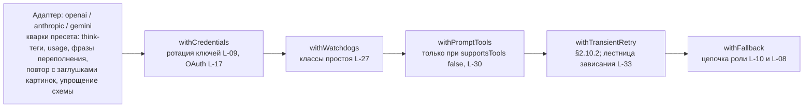
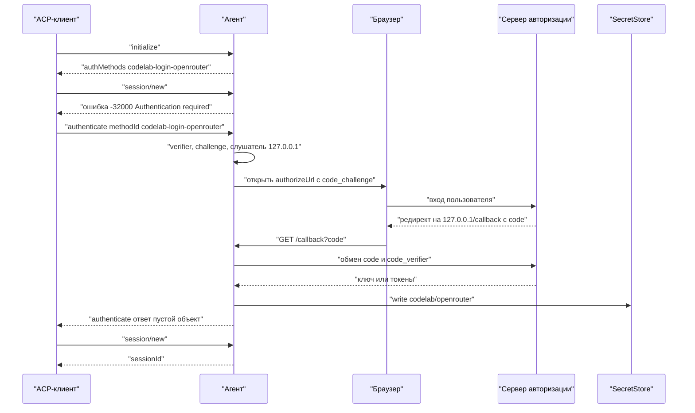

# 17.10. Провайдеры и устойчивость LLM

> Часть [архитектуры ядра агента CodeLab](../agent-core-architecture.md). Status: Accepted. Общие соглашения, термины и порядок чтения — в оглавлении.

← [17.9. Фоновые команды](17-9-background-commands.md) · [Оглавление ядра](../agent-core-architecture.md) · [17.11. Дополнительные инструменты](17-11-extra-tools.md) →

Цели: L-03 (Google Gemini), L-09 (ротация ключей), L-10 (роли моделей и переопределение), L-17
(вход по подписке), L-18 (пресет Kimi), L-19 (пресет MiniMax), L-20 (пресет Z.AI), L-27
(диагностика зависших соединений), L-30 (вызов инструментов через промпт), L-32 (понятное
сообщение о лимите 429), L-33 (ступенчатое восстановление зависшего стрима). Связанные цели: L-08
(цепочка резервных моделей, §2.10.3), L-14 (переполнение, §2.11), L-15 (каталог, §2.12.2), L-24
(мастер провайдера, dart-agent-and-clients §12.4.4). Затрагивает §2.2 (`ProviderApi.gemini`,
`ToolCall.signature`), §2.7 (кварки OpenAI-совместимого адаптера), §2.9, §2.10 (порядок
декораторов, тексты watchdog, бюджет зависаний L-33), §2.3 (`ErrorEvent.rateLimit`,
`stallClass`), §5.3 (`AgentError.rateLimit`), §2.11, §2.12.2 (`supportsTools`), §8.2.4 (`config_change` ролей),
§9.7, §10.3 (`AgentCoreServices.login`, `llmDiagnostics`), §11, §12.3, §13.2–§13.3
(`authMethods`, `authenticate`), §13.6 (`/model --role`, `/status`), §14, §15.3–§15.6,
§17.3.3, §17.5.4, §17.5.8, §17.6.5, а также
[мастер провайдера](../dart-agent-and-clients/12-4-first-run-and-settings.md) и
[CLI](../dart-agent-and-clients/09-11-stage-6-cli-mvp.md).

## 17.10.1. Назначение

MVP даёт два адаптера (§2.7, §2.8) и декораторы устойчивости (§2.10). Реальные провайдеры
отличаются в мелочах, и каждая мелочь в MVP превращается либо в ошибку хода, либо в мусор в
ответе: рассуждение в тегах `<think>` попадает в текст, переполнение с нестандартной
формулировкой повторяется как сбой сервера, модель только для текста отвечает 400 на картинку.
Раздел добавляет:

* **пресеты провайдеров как данные** (§17.10.2) — одна таблица для ядра, мастера и CLI: адрес,
  способ авторизации, флаги особенностей («кварки»);
* **третий адаптер** — Gemini (§17.10.3);
* **ключи и учётные данные** — ротация ключей (§17.10.4) и вход по подписке с обновлением
  токена (§17.10.6) в одном декораторе `withCredentials`;
* **роли моделей** — один алгоритм выбора модели для сжатия, субагентов и вспомогательных
  вызовов (§17.10.5);
* **кварки пресетов** Kimi, MiniMax, Z.AI (§17.10.7–§17.10.9);
* **диагностику зависаний** — класс простоя в тексте ошибки и снимок запроса (§17.10.10);
* **разбор 429 один раз** — структура лимита и короткое сообщение без тела ответа (§17.10.4.1);
* **лестницу зависания** — повтор, другой ключ, следующая модель (§17.10.10.1);
* **вызов инструментов через промпт** для моделей без tool calling (§17.10.11).

Итоговый порядок обёрток на одну модель (изнутри наружу) и место каждой цели:



`createStreamFunction` (§2.10) собирает цепочку из `ProviderConfig` и `ModelRef`; `withFallback`
получает цепочку моделей от `ModelRoleResolver` (§17.10.5). Повторы внутри адаптера и
`withCredentials` случаются только до `StartEvent` и поэтому не нарушают LLM-8.

## 17.10.2. Пресеты провайдеров

**Назначение.** Особенности провайдера описываются данными, а не ветками в коде адаптера. Одна
таблица `ProviderPresets.all` в ядре — источник для разрешения конфига (`providers.<id>.preset`),
для мастера провайдера клиентов и для `codelab provider add --preset`, `codelab login`.

**Контракт** (`codelab_agent_core/lib/src/llm/provider_presets.dart`, чистый Dart). Класс
`ProviderPreset` из dart-agent-and-clients §12.4.2 переносится в ядро и дополняется полями
`auth`, `oauth`, `quirks`, `reasoningFormat`, `wizard`; `codelab_setup` его реэкспортирует.

```dart
enum KeyRequirement { required, optional, none }         // как в §12.4.2 клиентов
enum ProviderAuth { apiKey, oauth, none }                 // providers.<id>.auth: api-key | oauth | none

final class ProviderQuirks {
  const ProviderQuirks({this.thinkTags = false, this.usageInChoice = false,
      this.overflowPhrases = const [], this.imageRejectRetry = false,
      this.schemaSimplifyRetry = false});
  final bool thinkTags;              // <think>…</think> в content → блок thinking (§17.10.7)
  final bool usageInChoice;          // usage из choices[0].usage, если на верхнем уровне нет (§17.10.7)
  final List<String> overflowPhrases;// доп. фразы переполнения при любом статусе ошибки (§17.10.8)
  final bool imageRejectRetry;       // 400 на картинку → один повтор с заглушками (§17.10.9)
  final bool schemaSimplifyRetry;    // 400 на схему инструмента → один повтор с упрощённой (§17.10.3)
  static const none = ProviderQuirks();
}

final class ProviderPreset {
  final String id;                   // openai | anthropic | gemini | openrouter | ollama | kimi | minimax | zai | custom-openai | custom-anthropic
  final String label;
  final String kind;                 // providers.<id>.kind: "openai-compatible" | "anthropic" | "gemini"
  final String? baseUrl;             // null — пользователь вводит сам
  final KeyRequirement key;
  final String? suggestedEnvVar;
  final ProviderAuth auth;           // способ по умолчанию; oauth-пресет допускает и apiKey
  final OAuthSpec? oauth;            // §17.10.6; null — входа по подписке нет
  final ProviderQuirks quirks;
  final ReasoningFormat? reasoningFormat;   // null — правило хоста §2.12.3
  final bool wizard;                 // показывать в мастере
}
abstract final class ProviderPresets {
  static List<ProviderPreset> get all;          // порядок — порядок показа
  static ProviderPreset? lookup(String id);
}
```

`ProviderConfig` (§2.7) получает поля `final ProviderQuirks quirks;` (по умолчанию
`ProviderQuirks.none`) и `final CredentialSource? credentials;` (§17.10.4; `null` — `apiKey` как в
MVP). `ProviderApi` получает значение `gemini`.

| `id` | `kind` | `base_url` | Ключ / env | `auth` | Кварки | Мастер |
|---|---|---|---|---|---|---|
| `openai` | openai-compatible | `https://api.openai.com/v1` | required / `OPENAI_API_KEY` | apiKey | — | да |
| `anthropic` | anthropic | `https://api.anthropic.com` | required / `ANTHROPIC_API_KEY` | apiKey | — | да |
| `gemini` | gemini | `https://generativelanguage.googleapis.com` | required / `GEMINI_API_KEY` | apiKey | `schemaSimplifyRetry`, `overflowPhrases: ["exceeds the maximum number of tokens"]` | да |
| `openrouter` | openai-compatible | `https://openrouter.ai/api/v1` | required / `OPENROUTER_API_KEY` | apiKey; `oauth` (PKCE, результат — ключ) | — | да |
| `ollama` | openai-compatible | `http://localhost:11434/v1` | none | none | — | да |
| `kimi` | openai-compatible | `https://api.moonshot.ai/v1` | required / `MOONSHOT_API_KEY` | apiKey | `thinkTags`, `usageInChoice` | да |
| `minimax` | openai-compatible | `https://api.minimax.io/v1` | required / `MINIMAX_API_KEY` | apiKey | `overflowPhrases: ["context window exceeds limit"]` | да |
| `zai` | openai-compatible | `https://api.z.ai/api/paas/v4` | required / `ZAI_API_KEY` | apiKey | `imageRejectRetry` | да |
| `custom-openai` | openai-compatible | — | optional | apiKey | — | да |
| `custom-anthropic` | anthropic | — | optional | apiKey | — | да |

Пресеты подписок ChatGPT и Copilot используют тот же механизм (`OAuthSpec` с `pkceLoopback` и
`deviceCode` соответственно), но каждый добавляется в таблицу отдельным OpenSpec change: условия
использования подписки в стороннем клиенте и `client_id` проверяются до включения. До этого
таблица их не содержит.

**Алгоритм разрешения** (шаг 8 загрузки §15.5, до проверки каталога):

1. `providers.<id>.preset` задан → `p := ProviderPresets.lookup`; неизвестный id —
   `ConfigException("providers.<id>.preset: unknown preset <x> (known: …)")`.
2. `kind` не задан → `p.kind`; задан и отличается от `p.kind` → `ConfigException`.
3. Каждый ключ провайдера, не заданный в конфиге, берётся из пресета: `base_url`,
   `reasoning_format`, `auth`. Явное значение в конфиге всегда сильнее.
4. Кварки: `quirks := p.quirks`, затем ключи `think_tags`, `usage_in_choice`,
   `image_reject_retry`, `schema_simplify_retry` из конфига заменяют флаги, а
   `overflow_phrases` **дописывается** к фразам пресета.
5. Без `preset` — `ProviderQuirks.none`, остальное как в MVP; при `kind: gemini` кварки берутся из
   пресета `gemini` неявно.

Пресет — только значения по умолчанию: удаление пресета из таблицы в будущей версии не ломает
конфиг, где все ключи заданы явно.

## 17.10.3. Google Gemini (L-03)

**Назначение.** Нативный потоковый адаптер Gemini API: рассуждение, вызовы инструментов,
кэш-токены и уровень рассуждения без шлюза. Ошибка 400 из-за конструкции JSON Schema, которую
Gemini не принимает, исправляется упрощением схемы и одним повтором.

**Контракт.** `kind: "gemini"` → `ProviderApi.gemini`; адаптер — `runProvider` (§2.5) с тем же
`ProviderStreamState`. `ToolCall` (§2.2) получает необязательное поле `final String? signature;`
(JSON `"signature"`, опускается при `null`): подпись рассуждения, привязанная к вызову; уходит
обратно только диалекту `AssistantMessage.model.api`, который её выдал (как правило §2.8).

```dart
/// Чистая функция: детерминирована, не зависит от времени (LLM-11).
Map<String, Object?> simplifyToolSchema(Map<String, Object?> schema);
```

**Запрос.** `POST {base_url}/v1beta/models/{ModelRef.id}:streamGenerateContent?alt=sse`,
заголовки `x-goog-api-key: <key>` (или `auth_header`), `Content-Type: application/json`,
`Accept: text/event-stream`, затем `headers`.

| Поле тела | Значение |
|---|---|
| `systemInstruction` | `{"parts":[{"text": systemPrompt}]}`; пустой промпт — поле не отправляется |
| `contents` | алгоритм ниже |
| `tools` | `[{"functionDeclarations":[{"name","description","parameters"}]}]`; без инструментов — поля нет |
| `toolConfig` | `{"functionCallingConfig":{"mode":"AUTO"}}`, только при `tools` |
| `generationConfig.maxOutputTokens` | `ModelRef.maxOutputTokens` |
| `generationConfig.thinkingConfig` | при `supportsReasoning` и `reasoningEffort != null`: `{"thinkingBudget": B, "includeThoughts": true}`, `B` = 1024 / 8192 / 24576 для `low` / `medium` / `high`, не больше `maxOutputTokens − 1024`; `B < 1024` — поля нет |

Преобразование сообщений: `UserMessage` → `{"role":"user","parts":[…]}` (`{"text"}`,
`{"inlineData":{"mimeType","data"}}`; без `supportsImages` — текстовая заглушка §2.7, шаг 2);
`AssistantMessage` → `{"role":"model","parts":[…]}` — тексты и
`{"functionCall":{"name","args"},"thoughtSignature"?}`; блоки рассуждения не отправляются;
`ToolResultMessage` → часть `{"functionResponse":{"name": toolName,"response":{"content": "<тексты через \n>"}}}`
(при `isError` — ключ `"error"` вместо `"content"`) в сообщении `user`, картинки результата —
частями `inlineData` после неё. Соседние сообщения одной роли сливаются в одно (API требует
чередования). Сообщение `error`/`aborted` без контента пропускается.

**Разбор потока.** Заголовки 200 и `text/event-stream` → `StartEvent`. Каждое событие SSE — JSON
`GenerateContentResponse`:

| Поле | Действие |
|---|---|
| `candidates[0].content.parts[i].text` при `thought: true` | текущий блок не thinking — закрыть его и открыть thinking; `append` |
| `…parts[i].text` без `thought` | то же для text |
| `…parts[i].functionCall` | закрыть текущий блок; открыть ToolCall (`id` — `functionCall.id` или синтетический по §2.7, шаг 4); один `append(jsonEncode(args))`; `thoughtSignature` части → `signature`; `closeBlock` |
| `candidates[0].finishReason` | запомнить `rawStopReason` |
| `usageMetadata` | последнее значение выигрывает: `cacheRead` = `cachedContentTokenCount`; `input` = `promptTokenCount − cacheRead` (не меньше 0); `output` = `candidatesTokenCount + thoughtsTokenCount`; `reasoning` = `thoughtsTokenCount` |
| `promptFeedback.blockReason` | `fail(terminalFinish, "Provider blocked the prompt: <reason>")` |
| `error` (объект или массив из одного объекта) | `fail` по `error.status`: `RESOURCE_EXHAUSTED` → `rateLimited`, `UNAVAILABLE`/`INTERNAL` → `server`, `UNAUTHENTICATED`/`PERMISSION_DENIED` → `auth`, `INVALID_ARGUMENT` → `badRequest` (с проверкой §2.11) |

Завершение по концу тела: `STOP` → `stop` (`toolUse`, если были вызовы); `MAX_TOKENS` → `length`;
`SAFETY`, `RECITATION`, `BLOCKLIST`, `PROHIBITED_CONTENT`, `SPII`, `IMAGE_SAFETY` →
`terminalFinish`; `MALFORMED_FUNCTION_CALL`, `OTHER` и неизвестное → `unknown` (повтор до видимого
вывода, §2.10.2); нет `finishReason` — правила §2.7 для конца тела. HTTP-статусы — таблица §2.9.

**Список моделей** (§2.12.2): `GET {base_url}/v1beta/models?pageSize=1000`, страницы по
`nextPageToken`, не больше 10; элементы без `generateContent` в `supportedGenerationMethods`
пропускаются; id — `name` без префикса `models/`; окно — `inputTokenLimit`; лимит ответа —
`outputTokenLimit`; рассуждение — `thinking == true`; имя — `displayName`.

**Алгоритм: упрощение схемы и один повтор.**

```text
geminiRequest(model, context):
1. key := (provider, model.id); simplified := stickySimplified.contains(key)
2. tools := simplified ? map(simplifyToolSchema) : исходные схемы
3. ответ := POST
4. ответ 400, quirks.schemaSimplifyRetry, context.tools не пуст, не simplified,
   текст ошибки (без регистра) содержит одно из: "function_declarations", "functiondeclarations",
   "parameters", "schema", "unknown name", "invalid json payload", "proto field"
   → stickySimplified.add(key); лог warning llm.schema.simplified {provider, model, tools: n};
     повторить шаги 2–3 ровно один раз (до StartEvent; бюджеты §2.10.2 не тратятся)
5. иначе — обычная классификация §2.9
```

`stickySimplified` живёт до конца процесса: последующие запросы сразу идут с упрощёнными схемами,
и префикс payload остаётся стабильным (LLM-11). `simplifyToolSchema` рекурсивно:

1. оставляет ключи `type`, `format`, `description`, `nullable`, `enum`, `items`, `properties`,
   `required`, `minItems`, `maxItems`, `minimum`, `maximum`, `anyOf`; прочие (`$schema`,
   `additionalProperties`, `patternProperties`, `default`, `examples`, `title`, `$id`) удаляются;
2. `type: [T, "null"]` → `type: T`, `nullable: true`; массив из нескольких непустых типов →
   `anyOf` по типам;
3. `const: v` → `enum: ["<v строкой>"]`; значения `enum` приводятся к строкам;
4. `oneOf` → `anyOf`; `allOf` из объектов — слияние `properties` и `required`, иначе первый элемент;
5. `$ref` на `#/$defs/<x>` или `#/definitions/<x>` — подстановка с глубиной не больше 3, глубже и
   неразрешимые ссылки → `{"type":"object"}`;
6. `required` фильтруется до имён из `properties`; объект без `properties` остаётся `{"type":"object"}`.

**Пример.**

```text
data: {"candidates":[{"content":{"role":"model","parts":[{"text":"Plan: read the test","thought":true}]}}]}
data: {"candidates":[{"content":{"role":"model","parts":[{"functionCall":{"name":"read","args":{"path":"test/a_test.dart"}},"thoughtSignature":"Cs4B…"}]},"finishReason":"STOP"}],"usageMetadata":{"promptTokenCount":1200,"candidatesTokenCount":20,"thoughtsTokenCount":64,"cachedContentTokenCount":1024}}

→ StartEvent · BlockStart(0, thinking) · BlockDelta(0, "Plan: read the test") · BlockEnd(0)
→ BlockStart(1, toolCall) · BlockDelta(1, "{\"path\":\"test/a_test.dart\"}") · BlockEnd(1, ToolCall(signature: "Cs4B…"))
→ DoneEvent(toolUse, usage: input 176, cacheRead 1024, output 84, reasoning 64)
```

**Как проверить.** Критерий матрицы: `core/llm-google-stream`.

* `core/llm-google-stream` (`gemini_adapter_grammar_test.dart`, fake `http.Client`, SSE-фикстуры
  §14): порядок событий и парность блоков (LLM-2, LLM-5), thinking из `thought: true`, вызов из
  `functionCall` с подписью, usage по таблице, маппинг каждого `finishReason`, `promptFeedback`,
  ошибка `RESOURCE_EXHAUSTED` → `rateLimited`; ACP-проекция — `agent_message_chunk` по порядку.
* `gemini_schema_simplify_test.dart`: 400 `Invalid JSON payload … additionalProperties` → ровно два
  HTTP-запроса, второй с упрощёнными схемами; третий запрос процесса — сразу упрощённый; 400 без
  признака схемы — один запрос, `badRequest`; каждое правило `simplifyToolSchema` (PRV-3).
* `gemini_payload_test.dart`: слияние соседних ролей, `functionResponse` с `error`, подпись вызова
  уходит только при `model.api == gemini`, `thinkingBudget` по уровню.

## 17.10.4. Ротация ключей (L-09)

**Назначение.** Несколько ключей одного провайдера складываются в пул; ключ, получивший 429,
выводится из ротации на время, и тот же запрос сразу уходит со следующим ключом.

**Контракт** (`codelab_agent_core/lib/src/llm/credentials.dart`).

```dart
/// Источник учётных данных провайдера; общий для всех сессий процесса (лимиты — на ключ).
sealed class CredentialSource { const CredentialSource(); }

final class KeyRef {
  final String label;      // "env:OPENAI_API_KEY_2" | "secret:codelab/openai_2"; значение в лог не попадает
  final String value;
}

final class KeyPool extends CredentialSource {
  KeyPool(List<KeyRef> keys, {required Duration cooldown, required Clock clock, required Logger logger});
  KeyRef? acquire();                                   // первый не охлаждённый от текущего; null — все в охлаждении/отклонены
  void cooldown(KeyRef k, Duration? retryAfter);       // 429
  void reject(KeyRef k);                               // 401/403: до перезагрузки конфига
  Duration? get nextAvailableIn;                       // минимум оставшегося охлаждения
}

StreamFunction withCredentials(CredentialSource? source,
    StreamFunction Function(String? credential) adapterFor, {required Logger logger});
```

**Обнаружение ключей** (при сборке `ProviderConfig`, через `SecretResolver` §17.5.4):

1. `api_key_env: NAME` → `NAME`, затем `NAME_2`, `NAME_3`, … до первой отсутствующей или пустой
   переменной, не больше 16 ключей.
2. `api_key_secret: <name>` → `<name>`, затем `<name>_2`, … (имена проходят `SecretNames.pattern`);
   список берётся одним вызовом `SecretStore.names()`, недоступен — последовательным `read` до
   первого отсутствующего; переопределения `CODELAB_SECRET_*` действуют для каждого имени.
3. Одинаковые значения сливаются (лог info `llm.key.duplicate {provider, label}`).
4. `providers.<id>.key_rotation: false` — используется только первый ключ.

**Алгоритм** `withCredentials` для `KeyPool` (в пуле больше одного ключа; иначе декоратор
прозрачен):

```text
call(model, context, cancel):
1. tried := {}
2. k := pool.acquire(); k == null → ErrorEvent(rateLimited, "all <n> API keys of <provider> are cooling down",
     retryAfter: pool.nextAvailableIn)                  // дальше решает withTransientRetry, затем withFallback
3. события adapterFor(k.value)(model, context, cancel):
     первое событие StartEvent → передавать всё насквозь; конец
     первое событие ErrorEvent(rateLimited) →
        pool.cooldown(k, retryAfter); лог info llm.key.cooldown {provider, key: k.label, until}
     первое событие ErrorEvent(auth) →
        pool.reject(k); лог warning llm.key.rejected {provider, key: k.label}
     иначе → передать ErrorEvent наружу; конец
4. tried.add(k); следующий k := pool.acquire(), не из tried →
     лог info llm.key.rotated {provider, from, to, cause}; перейти к 3 без задержки
   следующего нет → наружу последняя ошибка; для rateLimited retryAfter := pool.nextAvailableIn
```

Охлаждение: `until = now + min(max(retryAfter ?? 0, cooldown), 15 мин)`, `cooldown` —
`providers.<id>.key_cooldown` (`"60s"`). Текущий ключ «липкий»: пул переходит к следующему только
после 429 или отказа, поэтому без ошибок все запросы идут с первым ключом. Отклонённые ключи
возвращаются в пул при перезагрузке конфига (`SecretResolver.invalidate`, §17.5.6).

**Связь с L-08.** Ротация происходит внутри одной попытки `withTransientRetry`: смена ключа не
тратит ни `maxAttempts`, ни `rateLimitRetries`. Бюджет 429 расходуется, только когда наружу вышла
ошибка «все ключи в охлаждении»; при `retryAfter > maxRetryAfter` повтор не ждёт и `withFallback`
переходит к следующей модели цепочки (§2.10.3).

**Пример.** `OPENAI_API_KEY`, `OPENAI_API_KEY_2`. Запрос с первым ключом → 429 `retry-after: 20`
→ ключ 1 в охлаждении на 60 с, тот же запрос с ключом 2 → 200. Лог: `llm.key.cooldown
{key: "env:OPENAI_API_KEY"}`, `llm.key.rotated {from: "env:OPENAI_API_KEY", to:
"env:OPENAI_API_KEY_2", cause: "rateLimited"}`; `llm.retry` не пишется.

**Как проверить.** Критерий матрицы: `core/llm-key-rotation-on-429`.

* `core/llm-key-rotation-on-429` (`key_rotation_test.dart`, `FakeClock`): два ключа, 429 на первом
  → второй HTTP-запрос с ключом 2 без задержки, ответ модели, `rateLimitRetries` не изменился
  (PRV-4); следующий запрос в течение 60 с — сразу ключ 2; через 60 с ключ 1 снова доступен, но
  текущим остаётся ключ 2; оба в 429 → одна ошибка `rateLimited` с `retryAfter` = остаток
  охлаждения, дальше обычный retry; 401 на ключе 1 → ключ 2, ключ 1 не используется до
  `invalidate`.
* `key_discovery_test.dart`: `NAME`, `NAME_2`, пропуск `NAME_3` → `NAME_4` не читается; имена
  секретов `codelab/openai_2`; дубликаты сливаются; в логах нет значений ключей (PRV-5).

### 17.10.4.1. Понятное сообщение о лимите провайдера (L-32)

**Назначение.** Сейчас 429 превращается в `errorMessage` вида `<Provider> 429: <message из тела>`
(§2.9): до 2000 символов JSON провайдера в ошибке хода, в журнале и в логе info. Пользователю
нужна одна строка — какой лимит, когда сброс; ротации ключей (§17.10.4), повтору (§2.10.2) и
цепочке моделей (§2.10.3) — время ожидания. Ответ 429 разбирается **один раз**, в адаптере, в
структуру `RateLimitInfo`; все потребители читают её, а не текст.

**Контракт** (`codelab_agent_core/lib/src/llm/rate_limit.dart`, чистый Dart).

```dart
enum RateLimitKind { requests, tokens, subscription, quota, unknown }
// JSON: "requests" | "tokens" | "subscription" | "quota" | "unknown"

final class RateLimitInfo {
  final RateLimitKind kind;
  final String provider;          // id из providers.<id>
  final String model;             // ModelRef.id
  final Duration? retryAfter;     // сколько ждать; относительное значение сильнее абсолютного
  final DateTime? resetAt;        // UTC; now + retryAfter, если сервер дал только длительность
  final String? window;           // "minute" | "day" | "5h" | …: [a-z0-9]{1,16}, иначе null
  final RateLimitSource source;   // headers | body | none — откуда взяты kind и время
  Map<String, Object?> toJson();  // без тела ответа и без значений заголовков вне таблицы ниже
}
enum RateLimitSource { headers, body, none }

/// Единственная точка разбора; вызывается в classifyHttpError (§2.9) для 429 и для
/// эквивалентов в потоке (Anthropic rate_limit_error, Gemini RESOURCE_EXHAUSTED).
RateLimitInfo decodeRateLimit({required String provider, required String model,
    required Map<String, String> headers, required String body, required DateTime now});

/// Фиксированный английский текст для errorMessage (§12.2, правило 5).
String describeRateLimit(RateLimitInfo info);
```

`ErrorEvent` (§2.3) получает поле `RateLimitInfo? get rateLimit;` (только при `rateLimited`),
`retryAfter` события равен `rateLimit.retryAfter`. `AgentError` (§5.3) получает поле
`final RateLimitInfo? rateLimit;`. В `AssistantMessage` и в журнал структура не пишется: запись
ответа-ошибки несёт только короткий `errorMessage`.

**Алгоритм** `decodeRateLimit`:

1. **Время.** По первому найденному: `retry-after-ms`, `retry-after` (§2.10.4); заголовок сброса
   по виду лимита — OpenAI-совместимые `x-ratelimit-reset-requests` / `x-ratelimit-reset-tokens`
   (формат `"20ms"`, `"6m0s"`, `"1h30m"`), Anthropic `anthropic-ratelimit-requests-reset`,
   `anthropic-ratelimit-tokens-reset`, `anthropic-ratelimit-input-tokens-reset`,
   `anthropic-ratelimit-output-tokens-reset` (RFC 3339); тело — `error.retry_after` (секунды),
   `resets_in_seconds`, Gemini `error.details[]` с `@type` `…google.rpc.RetryInfo` →
   `retryDelay` (`"38s"`); `resets_at`/`reset_at` (unix-секунды) → `resetAt`. Отрицательное →
   0; больше 30 дней или неразбираемое → не учитывается.
2. **Вид** (первое совпадение; тексты — без учёта регистра, только `error.message`,
   `error.code`, `error.type`, `error.status` тела — до 4 КиБ):

   | Признак | `kind` |
   |---|---|
   | `code`/`type` = `insufficient_quota`, `billing_hard_limit_reached`; текст `exceeded your current quota`, `credit balance` | `quota` |
   | `code`/`type` = `usage_limit_reached`, `usage_limit_exceeded`; текст `usage limit`, `subscription`, `plan limit` | `subscription` |
   | заголовок `*-remaining-tokens`, `anthropic-ratelimit-(input-\|output-)?tokens-remaining` = `0`; текст `tokens per`, `TPM`, `TPD`, `input tokens`, `output tokens`; Gemini `QuotaFailure.violations[].quotaId` содержит `Token` | `tokens` |
   | заголовок `x-ratelimit-remaining-requests`, `anthropic-ratelimit-requests-remaining` = `0`; текст `requests per`, `RPM`, `RPD`; `quotaId` содержит `Request` | `requests` |
   | иначе | `unknown` |

3. **Окно.** `quotaId` с `PerMinute` / `PerDay` → `minute` / `day`; текст `per min` / `per day`;
   иначе `null`.
4. Тело ответа после разбора отбрасывается: оно не входит ни в `RateLimitInfo`, ни в
   `errorMessage`. Лог debug `llm.rate_limit.body {provider, model, status, body}` — тело после
   `Redactor` (§12.4), обрезанное до 2000 символов; лог info `llm.rate_limit {provider, model,
   kind, window, retry_after_ms, reset_at, source}`.

**Текст** `describeRateLimit` (`<d>` — длительность вверх до целого: меньше 90 с — `N s`,
меньше 90 мин — `N min`, меньше 48 ч — `N h`, иначе `N days`; без времени — хвост
`Try again later.`):

| `kind` | `errorMessage` |
|---|---|
| `requests` | `Rate limit reached for <provider>/<model>: too many requests. Resets in <d>.` |
| `tokens` | `Rate limit reached for <provider>/<model>: token limit per <window \| period>. Resets in <d>.` |
| `subscription` | `Subscription usage limit reached for <provider>. Resets in <d>.` |
| `quota` | `The <provider> account has no quota left. Check the provider billing settings.` |
| `unknown` | `Rate limit reached for <provider>/<model>. Resets in <d>.` |

**Кто читает структуру.** `withCredentials` — `cooldown(k, info.retryAfter)` (§17.10.4);
`withTransientRetry` — `retryAfter` для `_retryDelay` (§2.10.2), при `kind == quota` повтор не
делается (квота сама не вернётся); `withFallback` — причина заметки
`Model <from> hit a rate limit (<kind>); switched to <to>.` вместо текста ошибки. История
итоговой ошибки (§2.10.2) содержит короткие тексты попыток, а не тела. Если ротация, повтор или
резервная модель дали ответ, `AgentError(retrying: false)` нет — сообщения о лимите тоже нет
(заметка L-08 о смене модели остаётся).

**ACP / клиент.** Итог хода `failed` (§13.8): `error.message` — `Turn failed: rate limit`,
`data.codelab` — `{"errorClass": "rateLimited", "message": "<describeRateLimit>", "retryable":
true}` (форма MVP; `retryable: false` при `quota`). Структура для локализации —
`data.codelab.rateLimit: {"kind", "provider", "model", "retryAfterMs", "resetAt", "window"}` —
только **через OpenSpec** (`add-rate-limit-info`, после этапа 9); до него клиент показывает
`message`. codelab-app по `rateLimit` строит локализованную строку (`Лимит запросов исчерпан,
сброс через 3 ч`); CLI печатает `message`.

**Ошибки.** Тело не JSON или пусто → `kind` по заголовкам, иначе `unknown`; исключение внутри
разбора ловится, `RateLimitInfo(kind: unknown, source: none)` и лог warning
`llm.rate_limit.decode_failed {provider}` без тела. Разбор не бросает наружу никогда.

**Конфигурация.** Новых ключей нет: бюджеты и `maxRetryAfter` — §2.10.2 и §17.10.10.1,
охлаждение ключа — `providers.<id>.key_cooldown`. Тело в логе debug подчиняется `logging.level`.

**Инварианты:** PRV-15, PRV-16 (§17.10.13).

**Пример.** OpenAI 429, `x-ratelimit-remaining-requests: 0`, `x-ratelimit-reset-requests:
2h59m10s`, тело `{"error":{"message":"Rate limit reached for gpt-4.1 … requests per day (RPD)
…","type":"requests"}}`, ключ один, `retryAfter` больше `maxRetryAfter`, цепочки нет →
`errorMessage`: `Rate limit reached for openai/gpt-4.1: too many requests. Resets in 3 h.`; в
журнале — эта строка, в логе debug — тело.

**Как проверить.** Критерии матрицы: `core/rate-limit-decoded-once`,
`core/rate-limit-raw-body-not-in-journal`.

* `core/rate-limit-decoded-once` (`rate_limit_decode_test.dart`, шпион `decodeRateLimit`, fake
  `http.Client`, `FakeClock`): один 429 → ровно один вызов разбора; тот же экземпляр
  `RateLimitInfo` доходит до `withCredentials`, `withTransientRetry` и `AgentError`; таблица видов
  — по фикстуре на строку (OpenAI RPD, TPM, `insufficient_quota`, Anthropic tokens-reset, Gemini
  `RetryInfo` + `QuotaFailure`, подписка `usage_limit_reached` с `resets_in_seconds`); тексты
  `describeRateLimit` для `45 s`, `12 min`, `3 h`, `26 days`; второй ключ ответил 200 → нет
  `AgentError(retrying: false)` (PRV-15).
* `core/rate-limit-raw-body-not-in-journal` (`rate_limit_redaction_test.dart`): тело 429 с
  уникальной строкой `RL-MARKER-7f3a` → её нет в JSONL сессии, в payload следующего запроса к
  модели, в ACP-выводе (`session/prompt` ошибка, `session/update`) и в логе info; есть в логе
  debug; секрет из точного набора в теле в логе debug заменён `[REDACTED]` (PRV-16).

## 17.10.5. Роли моделей и их переопределение (L-10)

**Назначение.** Схема `llm.roles.*` (§15.4) и роли типов субагентов (§17.3.2) уже есть; здесь —
единый алгоритм: как роль превращается в цепочку моделей, какие подсистемы какую роль
запрашивают, как роль переопределяется на прогон и на сессию.

**Контракт** (`codelab_agent_core/lib/src/llm/model_roles.dart`).

```dart
enum ModelRole {
  defaultRole('default'), smol('smol'), slow('slow'), plan('plan'), subagent('subagent'),
  vision('vision');                        // разбор изображений, §17.11.5
  const ModelRole(this.wire);
  final String wire;                       // имя в конфиге, флаге, команде и журнале
  static ModelRole? parse(String s);
}

enum RoleSource { session, runFlag, config, defaultRole, sessionModel }

final class RoleChain {
  final ModelRole role;
  final List<ModelRef> chain;              // для withFallback; первая — основная
  final RoleSource source;
}

abstract interface class ModelRoleResolver {
  /// sessionModel — текущая модель сессии (опция model); overrides — /model --role этой сессии.
  Future<RoleChain> resolve(ModelRole role,
      {required ModelId sessionModel, required Map<ModelRole, ModelId> overrides});
}
```

**Алгоритм.**

```text
resolve(role, sessionModel, overrides):
1. role == defaultRole → chain := [sessionModel] + (llm.roles.default.models[1..] или agent.fallback),
     без дубликатов; source sessionModel; вернуть       // основную модель выбирает пользователь
2. candidates :=
     overrides[role] задан → [overrides[role]] + llm.roles.<role>.models   (source session)
     иначе llm.roles.<role>.models (флаг --role уже записал сюда слой 6; source runFlag | config)
3. available := candidates, у которых catalog.resolve(id, role) != null
     и есть учётные данные: auth none, или ключ найден (env/secret), или сохранён OAuth-токен
4. available не пусто → chain := available; вернуть
5. иначе → лог warning llm.role.unavailable {role, candidates} один раз на (процесс, роль);
     вернуть resolve(defaultRole, …) с role := исходная, source defaultRole
```

Цепочка роли — это цепочка `withFallback` (§2.10.3): «первая доступная, дальше — как L-08».
Модели одной цепочки МОГУТ быть разных провайдеров.

| Потребитель | Роль | Явная модель сильнее роли | Раздел |
|---|---|---|---|
| шаги сессии | `default` | опция `model` сессии | §5, §13.6 |
| суммаризатор сжатия | `smol` | `agent.summary_model` (§15.4) | §9.7 |
| сводка покинутой ветки | `smol` | `sessions.branch_summary.model` | §17.6.5 |
| заголовок сессии моделью (после 9, §16) | `smol` | — | §8.10 |
| субагент `explore` | `smol` → `subagent` | `type.model` | §17.3.3, шаг 7 |
| субагент `review` | `slow` → `subagent` | `type.model` | §17.3.3 |
| субагент `plan` | `plan` → `subagent` | `type.model` | §17.3.3 |
| субагент `general` и пользовательские типы | `subagent` | `type.model` | §17.3.3 |
| разбор изображения `inspect_image` | `vision` | — | §17.11.5 |

Модель суммаризатора сжатия (§9.7) выбирается так: переопределение роли `smol` на сессию
(`/model --role smol`) → `agent.summary_model` → `llm.roles.smol.models` → модель сессии; так же
выбирается сводка покинутой ветки при `sessions.branch_summary.model: null`. Роль `vision` к
`default` не откатывается: без доступной модели `inspect_image` не регистрируется (§17.11.5).

Цепочка «`smol` → `subagent`» значит: роль `smol` без доступной модели не падает сразу на модель
сессии, а пробует `subagent` (шаг 7 §17.3.3), и только затем — `default`.

**Переопределение на прогон.** `--role <role>=<provider/model>` (§15.6, можно повторять) —
слой 6: `llm.roles.<role>.models = ["<provider/model>"]`. Неизвестная роль или модель вне
каталога — ошибка использования, код 64. `--role default=<m>` равносилен `--model <m>`.

**Переопределение на сессию** — агентская команда `/model --role <role> <provider/model>` и
`/model --role <role> reset` (без модели, в журнал команд не пишется, ответ —
`agent_message_chunk` и `stopReason: end_turn`, как `/model`, §13.6). Выбор пишется записью
`config_change {optionId: "model_role.<role>", value: "<provider/model>" | null}` (§8.2.4) и
восстанавливается при `session/load` (последняя на ветке выигрывает). Действует со следующего
шага: идущий шаг доигрывает со старой цепочкой.

| Ввод | Ответ (фиксированный английский текст) |
|---|---|
| `/model --role smol openai/gpt-4.1-mini` | `Role smol set to openai/gpt-4.1-mini for this session (from the next step).` |
| `/model --role smol reset` | `Role smol reset to the configured models.` |
| `/model --role default <id>` | `Use /model <id> to change the session model.` |
| неизвестная роль | `Unknown role: <x>. Roles: default, smol, slow, plan, subagent, vision.` |
| модель вне каталога | `Unknown model: <id>. Run /model to list models.` |

`/status` получает строку `Roles: smol=<model> (<source>), slow=<model> (<source>), plan=default,
subagent=default`, где `<source>` — `session`, `flag` или `config`, а `default` — роль без
доступной модели. Отдельных `configOptions` для ролей нет (обоснование §17.10.14).

```yaml
llm:
  roles:
    smol:
      models: ["openai/gpt-4.1-mini", "ollama/qwen2.5-coder:7b"]
    slow:
      models: ["anthropic/claude-opus-4-1"]
```

**Как проверить.** Критерий матрицы: `core/compaction-uses-smol-role`.

* `core/compaction-uses-smol-role` (`model_roles_test.dart`, scripted `StreamFunction`): при
  `llm.roles.smol.models = ["fake/small"]` запрос суммаризатора уходит модели `fake/small`, шаги
  сессии — модели сессии; при заданном `agent.summary_model` — ей; `fake/small` без ключа →
  модель сессии и ровно одна запись `llm.role.unavailable` (PRV-6).
* `role_override_test.dart`: `/model --role smol m` → запись `config_change`, следующий вызов
  суммаризатора идёт `m`, идущий шаг не тронут; `session/load` восстанавливает; `reset` →
  конфиг; `--role smol=m` на прогон; субагент `explore` с недоступной `smol` → `subagent`.

## 17.10.6. Вход по подписке (L-17)

**Назначение.** Пользователь подписки входит через браузер вместо ввода ключа. Результат входа —
токен (с обновлением) или долгоживущий ключ, который ложится в хранилище секретов ОС. Во внешнем
агенте вход запускается стандартным ACP `authenticate`.

**Контракт** (`OAuthSpec`, `OAuthTokens` — ядро; `OAuthLoginService` — порт, реализация в
`codelab_agent_io`, так как нужен локальный HTTP-сервер).

```dart
enum OAuthFlow { pkceLoopback, deviceCode }
enum OAuthResultKind { apiKey, bearerToken }    // apiKey: обмен кода даёт ключ (OpenRouter)

final class OAuthSpec {
  final List<OAuthFlow> flows;                  // первый — по умолчанию
  final Uri authorizeUrl;
  final Uri? tokenUrl, deviceAuthorizationUrl, keyExchangeUrl;
  final String? clientId;
  final List<String> scopes;
  final int? redirectPort;                      // null — свободный порт 127.0.0.1
  final String redirectPath;                    // "/callback"
  final OAuthResultKind result;
  final Map<String, String> extraAuthorizeParams;
}

/// JSON без переводов строк в SecretStore под именем "codelab/oauth/<provider-id>".
final class OAuthTokens {
  final String accessToken; final String? refreshToken;
  final DateTime? expiresAt; final String tokenType;   // "Bearer"
}

final class OAuthTokenSource extends CredentialSource {   // для bearerToken; single-flight refresh
  OAuthTokenSource({required String providerId, required OAuthSpec spec,
      required SecretResolver secrets, required SecretStore store, required http.Client client, required Clock clock});
}

abstract interface class LoginUi {
  Future<bool> openBrowser(Uri url);            // false — браузера нет или запуск не удался
  void showUrl(Uri url);
  void showDeviceCode(String userCode, Uri verificationUri);
  Future<String?> askRedirectUrl();             // null — ввода нет (ACP)
}

sealed class LoginResult {}
final class LoginSucceeded extends LoginResult { final String secretName; }
final class LoginFailed extends LoginResult { final String reason; }   // английский, без значений

abstract interface class OAuthLoginService {
  Future<LoginResult> login(String providerId, {required LoginUi ui, OAuthFlow? flow,
      Duration timeout = const Duration(minutes: 5), CancelToken? cancel});
  Future<void> logout(String providerId);
}
```

`AgentCoreServices` (§10.3) получает необязательное поле `final OAuthLoginService? login;` —
`null` у мобильного и web-хоста: `authMethods` пуст, как в MVP.

**Алгоритм: PKCE с локальным колбэком.**

```text
loginPkce(spec, ui):
1. verifier := 64 случайных байта base64url (86 символов); challenge := base64url(sha256(verifier))
   state := 32 случайных байта base64url
2. server := HttpServer.bind(127.0.0.1, spec.redirectPort ?? 0); redirect := http://127.0.0.1:<port><path>
3. url := authorizeUrl + client_id?, redirect_uri (или callback_url у OpenRouter), response_type=code,
     code_challenge, code_challenge_method=S256, state, scope, extraAuthorizeParams
4. браузер: --no-browser, SSH_CONNECTION/SSH_TTY заданы, Linux без DISPLAY и WAYLAND_DISPLAY
     → без запуска; иначе ok := ui.openBrowser(url)
   не ok → ui.showUrl(url); параллельно с ожиданием колбэка — ui.askRedirectUrl()
     (браузер на другой машине не достучится до 127.0.0.1; пользователь вставляет адрес из строки браузера)
5. ждать первое из: запрос на <path>, вставленный адрес, timeout (5 мин), cancel
     запрос на другой путь → 404, ждать дальше; state есть и не совпал → 400, LoginFailed("state mismatch")
     error=<x> → LoginFailed("authorization denied: <x>")
     ответ браузеру — HTML "Signed in to CodeLab. You can close this tab." и закрытие сервера
6. обмен: apiKey → POST keyExchangeUrl {code, code_verifier, code_challenge_method: "S256"} → key
          bearerToken → POST tokenUrl grant_type=authorization_code, code, redirect_uri, code_verifier, client_id
7. сохранить (шаги «Запись» ниже); LoginSucceeded(secretName)
```

**Алгоритм: device flow** (RFC 8628): `POST deviceAuthorizationUrl` (`client_id`, `scope`) →
`device_code`, `user_code`, `verification_uri`, `interval` (по умолчанию 5 с), `expires_in`;
`ui.showDeviceCode`; опрос `tokenUrl` с `grant_type=urn:ietf:params:oauth:grant-type:device_code`
каждые `interval`: `authorization_pending` — ждать, `slow_down` — `interval += 5 с`,
`expired_token`, `access_denied` — `LoginFailed`; не дольше `min(expires_in, timeout)`.

**Запись.** `apiKey` → `SecretStore.write("codelab/<id>", key)`; если у провайдера нет
`api_key_secret`, `ConfigWriter.apply` (§17.5.5) пишет `SetValue("providers.<id>.api_key_secret",
"codelab/<id>")` в слой `user`. `bearerToken` → `SecretStore.write("codelab/oauth/<id>",
<OAuthTokens JSON>)` и при отсутствии — `SetValue("providers.<id>.auth", "oauth")`. Секрет
пишется до конфига (как в мастере, dart-agent-and-clients §12.4.4, шаг 8). Хранилище только для
чтения (`env`) → `LoginFailed("secret store <backend> is read-only")`. Значения токенов и ключей
регистрируются в `Redactor` (§12.4).

**Обновление токена** (`OAuthTokenSource` в `withCredentials`):

1. Перед запросом: `expiresAt − now < 60 с` → обновление.
2. Обновление — одно на провайдера одновременно (single-flight): `POST tokenUrl
   grant_type=refresh_token`; новый `refresh_token`, если пришёл, заменяет старый; запись в
   `SecretStore`, `SecretResolver.invalidate` для этого имени; лог info `auth.token.refreshed
   {provider}`.
3. Первое событие `ErrorEvent(auth)` → одно принудительное обновление и один повтор запроса (до
   `StartEvent`).
4. `invalid_grant` или повторный 401 → `AgentError(cls: provider, errorClass: auth)` с текстом
   `Sign-in for <label> has expired. Run: codelab login <id>`; лог warning
   `auth.token.refresh_failed {provider, error}`; сетевой сбой обновления — класс `network`.

**ACP `authenticate`** (стандарт, §13.3). Хост с `services.login != null` объявляет в
`initialize.authMethods` по методу на провайдер с `auth: oauth` или с `oauth` в пресете:
`{"id":"codelab-login-<id>","name":"Sign in to <label>","description":"Opens a browser on this machine. Without a browser, run codelab login <id> in a terminal."}`
(тип не указан — `agent`: аутентификацию выполняет агент). Порядок — порядок провайдеров в
конфиге.

1. `authenticate {methodId}` с неизвестным id → `-32602`.
2. Агент вызывает `login(id, ui: AcpLoginUi)`: `openBrowser` — системный запуск на машине агента;
   `askRedirectUrl` → `null`; `showUrl`, `showDeviceCode` — только лог info `auth.login.url`
   (без `state`). Ответ — после завершения входа (до 5 мин): `{}`.
3. `openBrowser` вернул `false` или пресет поддерживает только `deviceCode` → ошибка `-32000` с
   текстом `Cannot open a browser for <label>. Run: codelab login <id>` — показать адрес или код
   клиенту стандартный ACP не позволяет; расширение для этого — только через OpenSpec.
4. `LoginFailed(reason)` → `-32000` с текстом `Sign-in to <label> failed: <reason>`.
5. `session/new`, когда модель новой сессии требует OAuth, а токена нет, → `-32000`
   `Authentication required: sign in to <label> (method codelab-login-<id>).` (код зарезервирован в
   §13.3 именно для этого). Сессии с другими моделями создаются как обычно.



**CLI.** `codelab login <provider> [--device] [--no-browser] [--timeout <duration>]` и
`codelab logout <provider>` (удаляет секрет; `codelab/<id>` — только если его записал вход,
что отмечено в индексе имён секретов); те же подкоманды у `codelab-agent`. Строки вывода
(фиксированный английский текст):

* `Opening the browser to sign in to <label>…`
* без браузера: `Open this URL in a browser to sign in:` и адрес отдельной строкой, затем
  `If the browser cannot reach this machine, paste the address of the page you were redirected to and press Enter:`
* device flow: `Open <verification_uri> and enter the code <user_code>. Waiting…`
* успех: `Signed in to <label>. Credentials saved as secret <name>.`; провайдер без `oauth` —
  `Provider <id> does not support sign-in. Use codelab secret set codelab/<id>.`, код 64.

Коды выхода: 0 — успех, 1 — отказ входа, 64 — ошибка использования, 130 — прерывание. Встроенный
агент desktop-app вызывает тот же `OAuthLoginService` из мастера провайдера (вариант ключа
«Sign in»).

**Как проверить.** Критерий матрицы: `cli/login-openrouter-pkce`.

* `cli/login-openrouter-pkce` (E2E на fake-сервере авторизации, `--no-browser`): CLI печатает
  адрес с `code_challenge_method=S256` и `callback_url=http://127.0.0.1:<port>/callback`; запрос
  теста на колбэк с `code` → POST обмена с `code_verifier`, для которого
  `sha256 → base64url` равен challenge; секрет `codelab/openrouter` записан в файловое хранилище
  теста, конфиг получил `api_key_secret`; в stdout и логе нет ключа (PRV-8); вставленный адрес
  редиректа вместо запроса даёт тот же итог; таймаут — код 1.
* `oauth_refresh_test.dart`: истекающий токен обновляется один раз при двух параллельных
  запросах; 401 → одно обновление и повтор; `invalid_grant` → текст `Run: codelab login`.
* `acp/authenticate-oauth` (golden): `authMethods` при `auth: oauth`; `session/new` без токена →
  `-32000`; `authenticate` с fake-браузером → `{}`, затем `session/new` успешен; без браузера →
  `-32000` с `Run: codelab login`; хост без `login` → `authMethods: []`, `-32601` (MVP).

## 17.10.7. Пресет Kimi (L-18)

**Назначение.** Kimi доступен через OpenAI-совместимый адрес; пресет убирает две особенности:
рассуждение внутри `content` в тегах `<think>…</think>` и usage внутри `choices[0]`.

**Алгоритм: теги рассуждения** (`quirks.thinkTags`, в обработке `delta.content` §2.7). Состояние
на ответ: `mode ∈ {leading, think, text}` (начально `leading`), `pending` — удержанный хвост.

```text
onContent(delta):
1. s := pending + delta; pending := ""
2. пока s не пусто:
   leading: t := s без ведущих пробельных символов
            t пусто → pending := s; выйти                      // ждать, что будет дальше
            t начинается с "<think>" → s := t после тега; mode := think; продолжить
            t — собственный префикс "<think>" (например "<thi") → pending := s; выйти
            иначе → mode := text; продолжить с s
   think:   i := индекс "</think>" в s
            i ≥ 0 → append(thinking, s[0..i]); s := s после тега без ведущего "\n"; mode := text
            иначе h := длина самого длинного суффикса s, который — префикс "</think>" (≤ 7)
                  append(thinking, s без последних h); pending := последние h; выйти
   text:    append(text, s); s := ""                           // теги дальше — обычный текст
3. конец потока: pending в режиме think → в thinking; в leading/text → в text;
   ответ закончился внутри think → лог warning llm.think_tags.unclosed {provider, model}
```

Тег распознаётся только в начале ответа (до первого непробельного текста): модель, которая пишет
про тег `<think>` в коде, не теряет текст. Пустые дельты после удержания не порождают событий;
`append(thinking, …)` открывает блок thinking и закрывает текущий text-блок, как в §2.7.
Блок thinking из тегов наружу — `agent_thought_chunk`, в payload следующих шагов не отправляется
(правило §2.7, шаг 3).

**Usage в choice** (`quirks.usageInChoice`): чанк без `usage` верхнего уровня, но с объектом
`choices[0].usage` → `setUsage` по той же таблице §2.7.

**Пример.** Дельты `"<thi"`, `"nk>Check the import"`, `"</th"`, `"ink>\nThe import is wrong."` →
`BlockStart(0, thinking)`, `BlockDelta(0, "Check the import")`, `BlockEnd(0)`,
`BlockStart(1, text)`, `BlockDelta(1, "The import is wrong.")`.

**Как проверить.** Критерий матрицы: `core/llm-think-tags-extracted`.

* `core/llm-think-tags-extracted` (`think_tags_test.dart`): фикстура, нарезанная по одному символу
  и случайными кусками, даёт одинаковые блоки; текст ответа не содержит `<think>` и `</think>`;
  тег не в начале ответа остаётся текстом; незакрытый тег → thinking и одна запись
  `llm.think_tags.unclosed`; ACP — `agent_thought_chunk`, затем `agent_message_chunk`; usage из
  `choices[0].usage` (PRV-9).

## 17.10.8. Пресет MiniMax (L-19)

**Назначение.** MiniMax сообщает о переполнении фразой `context window exceeds limit` и не всегда
статусом 400/413/422. Без пресета такая ошибка получает класс `server` или `unknown`, повторяется
(`transient_retries`, по умолчанию 3 повтора) и не доходит до сжатия.

**Алгоритм** (дополнение правил §2.11; применяет адаптер при классификации, §2.9):

1. Фразы `quirks.overflowPhrases` проверяются без учёта регистра в тексте **любой** ошибки
   провайдера: тело ответа с любым статусом 4xx/5xx, JSON-ошибка в ответе 200 без SSE, объект
   `error` внутри потока.
2. Совпадение и отсутствие признаков rate limit (`rate limit`, `tokens per minute`, `per day`,
   `quota`, как в правиле 2 §2.11) → `errorClass: overflow`; цикл передаёт ошибку сжатию (§9).
3. Общий список фраз правила 2 §2.11 по-прежнему действует только для 400/413/422.

**Пример.** `HTTP 500 {"error":{"message":"invalid params, context window exceeds limit (2013)"}}`
→ `ErrorEvent(error, overflow)`, ни одного повтора, сжатие и повтор шага (§9).

**Как проверить.** Критерий матрицы: `core/overflow-minimax-wording`.

* `core/overflow-minimax-wording` (`overflow_minimax_test.dart`): фраза в ответе 500, в 200 с JSON
  и в объекте `error` потока → `overflow`, один HTTP-запрос (PRV-10); та же фраза без пресета при
  500 → `server`; фраза вместе с `rate limit` → не `overflow`.

## 17.10.9. Пресет Z.AI (L-20)

**Назначение.** Две особенности: «тихое» переполнение — ответ с `finish_reason: stop`, хотя вход
не поместился, — и модели только для текста, которые отвечают 400 на блок картинки, хотя каталог
считает их мультимодальными.

**Тихое переполнение.** Правило 3 §2.11 (`stopReason == stop` и `usage.input + usage.cacheRead >
contextWindow` → `overflow`) действует для всех провайдеров; пресет обеспечивает его входные
данные: `includeUsage: true` и окно модели из каталога (§2.12.2). Без usage правило не
срабатывает, поэтому ответ без usage у этого пресета — лог warning `llm.usage.missing {provider,
model}`.

**Алгоритм: повтор с заглушками картинок** (`quirks.imageRejectRetry`, OpenAI-совместимый и Gemini
адаптеры):

```text
1. key := (provider, model.id); stickyNoImages.contains(key) → картинки сразу заменяются заглушкой
     "[image omitted: the current model does not accept images]" (как при supportsImages false)
2. ответ 400 (не overflow), в payload была хотя бы одна картинка, не stickyNoImages,
   текст ошибки (без регистра) содержит "image", "vision", "multimodal" или "image_url"
   → stickyNoImages.add(key); лог warning llm.images.rejected {provider, model};
     ровно один повтор с заглушками (до StartEvent, бюджеты §2.10.2 не тратятся)
3. повтор тоже 400 → обычная ошибка badRequest
4. ответ после повтора несёт заметку (finish note, §2.5):
   "The model <provider/model> rejected image input; images were replaced with text placeholders."
```

Транскрипт не меняется: картинки остаются в журнале и вернутся, если пользователь сменит модель
(правило §2.8 «картинки хранятся всегда»).

**Как проверить.** Критерии матрицы: `core/overflow-silent-by-usage`,
`core/text-only-model-image-placeholder-retry`.

* `core/overflow-silent-by-usage` (`overflow_silent_test.dart`): `stop` с `prompt_tokens` больше
  окна → `ErrorEvent(overflow)` и сжатие; ровно окно → не переполнение; ответ без usage →
  `llm.usage.missing`.
* `core/text-only-model-image-placeholder-retry` (`image_reject_retry_test.dart`): 400 `model does
  not support image input` → второй запрос без `image_url` с текстом заглушки, ответ с заметкой;
  следующий запрос процесса сразу с заглушкой; 400 без картинок в payload — без повтора; журнал
  сессии содержит исходную картинку (PRV-11).

## 17.10.10. Диагностика зависших соединений (L-27)

**Назначение.** «Timeout» без подробностей не отличает недоступный прокси от модели, которая
приняла запрос и молчит. Класс простоя входит в текст ошибки; по флагу диагностики исходящий
запрос сохраняется в файл без секретов — для воспроизведения.

**Контракт.**

```dart
enum StallClass { connectStall, firstByteStall, midStreamIdle }   // в тексте: connect_stall | first_byte_stall | mid_stream_idle

final class RequestTrace {                 // заполняет адаптер; без значений авторизации
  final String provider, model; final Uri url;
  final Map<String, String> requestHeaders;  // уже по белому списку
  final String bodySha256; final int bodyBytes;
  final String? redactedBody;               // только в режиме body
  final int? status; final Map<String, String> responseHeaders;
  final Duration? toHeaders, toFirstEvent, sinceLastEvent; final int events;
}

abstract interface class LlmDiagnostics {  // CoreLlmServices.diagnostics; null — выключено
  void stalled(RequestTrace trace, StallClass cls);
}
```

**Классы и тексты** (заменяют тексты §2.10.1 и §2.10.5; класс ставит `withWatchdogs` по фазе
§2.10.5):

| Фаза при срабатывании | Класс | Текст ошибки (`errorClass: timeout`) |
|---|---|---|
| `connecting` | `connect_stall` | `connect_stall: no response headers within 30 s (connect watchdog)` |
| `awaitingContent` | `first_byte_stall` | `first_byte_stall: no stream events for 120 s after response headers (idle watchdog)`; у модели с `hiddenReasoning` — `first_byte_stall: no stream events for 600 s while waiting for hidden reasoning (idle watchdog)` |
| `streaming` | `mid_stream_idle` | `mid_stream_idle: no stream events for 120 s (idle watchdog)` |

Числа — фактические значения таймеров. «Событие» — событие потока ядра (LLM-16): keep-alive
`first_byte_stall` не отменяет. Класс попадает в историю итоговой ошибки §2.10.2 (`attempt 1
timeout (first_byte_stall: …)`) и в поле `stall_class` логов `llm.retry` и `llm.request.end`.

**Снимок запроса.** Режим — `logging.llm_snapshot` (`off` \| `headers` \| `body`, по умолчанию
`off`), флаг `--debug-llm-snapshot[=headers|body]` (без значения — `headers`), переменная
`CODELAB_DEBUG_LLM_SNAPSHOT`. При срабатывании watchdog:

1. Файл `$CODELAB_HOME/logs/llm-snapshots/<UTC yyyyMMddTHHmmssSSSZ>-<provider>-<class>.json`,
   права `0600`, запись атомарная; хранятся 50 последних файлов, старшие удаляются; больше 100
   снимков за процесс — запись прекращается с одной записью warning `llm.snapshot.limit`.
2. Заголовки запроса и ответа — по белому списку: запрос `content-type`, `accept`, `user-agent`,
   `anthropic-version`, `anthropic-beta`, `openai-beta`, `http-referer`, `x-title`; ответ
   `content-type`, `date`, `server`, `via`, `x-request-id`, `request-id`, `cf-ray`, `retry-after`,
   `openai-processing-ms`. Прочие заголовки сохраняются с именем и значением `<redacted>`.
3. URL: путь как есть; значения параметров запроса — `<redacted>`, кроме `alt`, `api-version`,
   `beta`.
4. Тело: `bodySha256` — SHA-256 точных отправленных байтов, `bodyBytes`. Тело в файле — только в
   режиме `body`, после `Redactor` (§12.4), с полем `"bodyRedacted": true`. В режиме `headers` тело
   восстанавливается из журнала сессии: payload детерминирован (LLM-11, SES-7), и совпадение хеша
   доказывает, что восстановлен именно отправленный запрос.
5. Лог info `llm.snapshot.written {path, class}` (путь без содержимого).

```json
{"version":1,"class":"first_byte_stall","provider":"gw","model":"qwen3-coder",
 "url":"https://llm.internal/v1/chat/completions",
 "requestHeaders":{"content-type":"application/json","accept":"text/event-stream","authorization":"<redacted>"},
 "bodySha256":"9f2c…","bodyBytes":48213,
 "status":200,"responseHeaders":{"content-type":"text/event-stream","x-request-id":"req_81f","set-cookie":"<redacted>"},
 "timingsMs":{"toHeaders":412,"toFirstEvent":null,"sinceLastEvent":120000},"events":1}
```

**Как проверить.** Критерии матрицы: `core/stall-class-in-error`,
`core/stall-snapshot-allowlist-headers`.

* `core/stall-class-in-error` (`watchdog_stall_class_test.dart`, `FakeClock`): нет заголовков →
  текст начинается с `connect_stall:`; заголовки и только `ping` → `first_byte_stall:`; события,
  затем тишина → `mid_stream_idle:`; история итоговой ошибки после трёх попыток содержит классы;
  пользовательская отмена — `aborted` без класса (PRV-12).
* `core/stall-snapshot-allowlist-headers` (`llm_snapshot_test.dart`): заголовки `Authorization`,
  `x-api-key`, `x-goog-api-key`, произвольный `X-Custom` → `<redacted>`; заголовки белого списка —
  как есть; `bodySha256` равен SHA-256 отправленных байтов; режим `headers` — поля `body` нет;
  режим `body` — секрет из точного набора редактора в теле заменён; без флага файлов нет; 51-й
  файл удаляет самый старый.

### 17.10.10.1. Ступенчатое восстановление зависшего стрима (L-33)

**Назначение.** В MVP `timeout` до видимого вывода повторяется из общего бюджета `maxAttempts`
(4 попытки): при `idle` 120 с модель, принявшая запрос и замолчавшая, держит ход до 8 минут, и
каждый повтор уходит в тот же зависший маршрут с тем же ключом. Зависание лечится сменой того,
что могло зависнуть: сначала один повтор с паузой (сбой мог быть случайным), затем другой ключ
того же провайдера (лимиты и маршрутизация шлюза часто привязаны к ключу), затем следующая модель
цепочки с заметкой. Ступень, которой нет в конфигурации, пропускается.

**Контракт.**

```dart
// RetryPolicy (§2.10) — новые поля; значения из конфига (ниже)
final class RetryPolicy {
  // … поля §2.10 …
  final int stallRetries;                // повторы с тем же ключом после зависания; по умолчанию 1
  final Duration stallBaseDelay;         // 5 с
  final Duration stallMaxDelay;          // 60 с
  final int stallKeyRotations;           // сколько раз сменить ключ за запрос; по умолчанию 2
}

/// Реализует KeyPool (§17.10.4); у OAuthTokenSource и без пула — null.
abstract interface class StallKeyRotation {
  /// Охладить текущий ключ после зависания и сделать текущим следующий доступный.
  /// Возвращает метки (from, to) или null — другого доступного ключа нет.
  ({String from, String to})? rotateAfterStall();
}

StreamFunction withTransientRetry(StreamFunction inner, RetryPolicy policy,
    {required Clock clock, required Random random, required Logger logger,
     StallKeyRotation? keys});              // новый параметр; createStreamFunction передаёт пул провайдера

// ErrorEvent (§2.3): новое поле StallClass? get stallClass; — ставит withWatchdogs (§17.10.10);
// у HTTP 408 — null. FallbackNotice (§2.10): новое поле StallClass? stallClass.
```

**Алгоритм** (заменяет ветку `timeout` правила 3 `_retryDelay` §2.10.2; остальные классы — как
прежде, `network`/`server`/`unknown` по-прежнему тратят `maxAttempts`):

```text
неудача до фиксации (committed == false), cls == timeout:
1. stalls := stalls + 1                                   // счётчик на вызов withTransientRetry
2. stalls ≤ stallRetries →
     delay := equal jitter (§2.10.2) с stallBaseDelay, stallMaxDelay, n = stalls
     лог info llm.retry {attempt, class: timeout, stall_class, stage: "retry", delay_ms}
     повтор тем же ключом
3. иначе rotations < stallKeyRotations и keys != null и r := keys.rotateAfterStall() != null →
     rotations++; delay := 0
     лог info llm.stall.key_rotated {provider, from: r.from, to: r.to, stall_class}
     повтор (withCredentials возьмёт новый текущий ключ: он «липкий», §17.10.4)
4. иначе → наружу итоговая ошибка с историей (§2.10.2); история попытки:
     "attempt N timeout (first_byte_stall, key env:OPENAI_API_KEY_2)"
5. withFallback (§2.10.3, правило 3: timeout уже в списке) → следующая модель цепочки,
     FallbackNotice(cause: timeout, stallClass) → заметка
     "Model <from> did not respond (<stall_class>); switched to <to>."
     нет следующей модели → TurnEnded(failed), текст §17.10.10
неудача после фиксации → как LLM-8: повторов нет (mid_stream_idle всегда после фиксации)
```

`rotateAfterStall` в `KeyPool`: текущий ключ охлаждается на `key_cooldown` (как после 429,
причина `stall` в логе), текущим становится первый не охлаждённый и не отклонённый ключ после
него; ключ, который в этом вызове уже зависал, не выбирается повторно. Пул общий для процесса
(§17.10.4): после смены ключа и другие сессии идут через новый ключ — зависший маршрут не
нужно открывать заново каждой сессии. Значения ключей в лог не попадают, только метки (PRV-5).

Худший случай при значениях по умолчанию, `idle` 120 с, двух ключах и цепочке из двух моделей:
120 с → пауза 2,5–5 с → 120 с → ключ 2 → 120 с → модель 2: около 6 минут вместо 8 и три разных
попытки вместо четырёх одинаковых. С `hidden_reasoning` окна длиннее (§2.10.5), ступени те же.

**Конфигурация.** Общие значения — новая секция `llm.retry` и `llm.timeouts`; провайдер
переопределяет их своими ключами, роль — таймауты (§15.4, порядок: роль → провайдер → `llm.*` →
встроенное значение). Существующие ключи провайдера (`transient_retries`, `rate_limit_retries`,
`connect_timeout`, `idle_timeout`, `idle_timeout_reasoning`) получают значение по умолчанию «из
`llm.*`».

```yaml
llm:
  retry:
    transient_retries: 3          # network, server, unknown; 0..10
    rate_limit_retries: 3         # 0..10
    base_delay: 1s                # 100ms..30s
    max_delay: 30s                # base_delay..10m
    max_retry_after: 120s         # 0s..1h
    stall_retries: 1              # timeout до вывода, тот же ключ; 0..5
    stall_base_delay: 5s          # 0s..60s
    stall_max_delay: 60s          # stall_base_delay..10m
    stall_key_rotations: 2        # 0..15; 0 — ступень ключа выключена
  timeouts:
    connect: 30s
    idle: 120s
    idle_reasoning: 600s          # не меньше idle
providers:
  gw:
    kind: openai-compatible
    base_url: https://llm.internal/v1
    api_key_env: GW_KEY           # плюс GW_KEY_2 — ступень смены ключа
    idle_timeout: 60s             # шлюз отдаёт заголовки сразу; молчание дольше минуты — зависание
    stall_retries: 0              # повтор в тот же маршрут бесполезен: сразу ключ, затем модель
```

Новые ключи провайдера: `retry_base_delay`, `retry_max_delay`, `max_retry_after`,
`stall_retries`, `stall_base_delay`, `stall_max_delay`, `stall_key_rotations` — те же типы и
границы. `stall_retries: 0`, один ключ (или `key_rotation: false`) и пустая цепочка выключают
соответствующую ступень без ошибки конфигурации.

**ACP / клиент.** Новых форм нет. Повторы и смена ключа не видны; смена модели — заметка
`FallbackNotice`, как в L-08 (`agent_message_chunk`; структура — `_meta` через OpenSpec, как в
L-08).

**Ошибки.** Пользовательская отмена во время паузы — `aborted`, без перехода по ступеням (§2.10.1,
правило 5). `auth` или `rateLimited` на новом ключе — обычная обработка `withCredentials`
(§17.10.4) внутри той же попытки. Неизвестный ключ `llm.retry.*` — `ConfigException`, как любой
неизвестный ключ (§15.5).

**Инварианты:** PRV-17, PRV-18 (§17.10.13).

**Как проверить.** Критерий матрицы: `core/stall-escalates-key-then-fallback`.

* `core/stall-escalates-key-then-fallback` (`stall_escalation_test.dart`, `FakeClock`, fake
  `http.Client`, ключи `K`, `K_2`, цепочка `[gw/a, gw/b]`): модель `a` отдаёт заголовки и молчит
  → запросы по порядку: `a`+`K`, пауза 2,5–5 с, `a`+`K`, `a`+`K_2` без паузы, `b`+`K_2`; ровно одна
  заметка `did not respond (first_byte_stall); switched to gw/b`; ответ `b` дошёл до цикла; лог
  `llm.stall.key_rotated {from: "env:K", to: "env:K_2"}` без значений; `maxAttempts` не изменился.
* `stall_ladder_config_test.dart`: `stall_retries: 0` → первая же смена ключа; один ключ → сразу
  модель цепочки; цепочка из одной модели → `TurnEnded(failed)` с историей трёх попыток и классами;
  провайдер с `idle_timeout: 60s` поверх `llm.timeouts.idle: 120s` → срабатывание через 60 с;
  поток с первой дельтой текста и тишиной → `mid_stream_idle`, ни одного повтора (PRV-17);
  отмена во время паузы → `aborted`.

## 17.10.11. Вызов инструментов через промпт (L-30)

**Назначение.** Модели без tool calling (часть локальных и старых моделей) получают определения
инструментов в системном промпте и вызывают их текстом строгого формата; декоратор превращает
такой текст в обычные события вызова. Цикл, разрешения и журнал не знают об этой подмене.

**Контракт.** `ModelInfo` и `ModelRef` (§2.2, §2.12.2) получают поле `supportsTools` (`bool?` в
`ModelInfo`, `bool` в `ModelRef`, по умолчанию `true`). Источники в порядке §2.12.2: override
`providers.<p>.models.<m>.tools`; endpoint — если в ответе есть `supported_parameters` и в нём нет
`"tools"` → `false`; удалённый и встроенный каталоги — поле `"tools"`; безопасное значение —
`true`.

```dart
StreamFunction withPromptTools(StreamFunction inner, {required Random random, required Logger logger});
```

`createStreamFunction` вставляет декоратор только для `ModelRef.supportsTools == false`; для
остальных моделей его нет в цепочке (PRV-13).

**Секция промпта** (дописывается в конец `systemPrompt`, `context.tools` в запросе — пустой
список; текст фиксирован, `prompts/tools/prompt_tools.md`, §11):

```text
## Tool calls

This model calls tools in text. To call a tool, write a block in exactly this form, each tag on its own line:

<tool_call>
{"name": "<tool name>", "arguments": {<JSON object that matches the tool parameters>}}
</tool_call>

Rules:
- The block contains one JSON object with exactly the keys "name" and "arguments".
- You may write several blocks in one reply. Stop after the last block and wait for the results.
- Results arrive in the next user message inside <tool_result> blocks. Never write <tool_result> yourself.

Available tools:
```

Затем для каждого инструмента в порядке `context.tools`: `### <name>`, строка описания и строка
`Parameters: <канонический JSON схемы>`.

**Алгоритм.**

```text
вход (перед inner):
1. AssistantMessage: каждый ToolCall → текст "<tool_call>\n{\"name\":…,\"arguments\":…}\n</tool_call>"
   (канонический JSON, §2.7 шаг 5) на его месте
2. серия ToolResultMessage → одно UserMessage: для каждого
   "<tool_result id=\"<id>\" name=\"<name>\" status=\"ok|error\">\n<текст>\n</tool_result>";
   "</tool_result>" внутри текста → "<\/tool_result>"; картинки результата — блоками после текста
выход (поверх событий inner):
3. текст разбирается тем же удержанием хвоста, что и §17.10.7 (теги "<tool_call>", "</tool_call>",
   "<tool_result"); вне тегов — text-блоки как есть
4. тело между <tool_call> и </tool_call> буферизуется; на закрывающем теге:
     JSON-объект с строкой name и объектом arguments → BlockStart(toolCall, id := "call_" + 12 символов
       base32 из random, name) · BlockDelta(jsonEncode(arguments)) · BlockEnd
     иначе → ToolCall(name: извлечённое имя или "", arguments: {}) и заметка errorMessage
       "prompt tool call is not valid JSON" (как LLM-6); лог warning llm.prompt_tools.parse_failed
5. "<tool_result" в выводе модели после хотя бы одного вызова → остаток ответа отбрасывается,
   внутренний запрос отменяется дочерним CancelToken, итог — DoneEvent(toolUse);
   лог info llm.prompt_tools.hallucinated_result
6. конец потока: открытый <tool_call> без закрытия → правило 4 для накопленного тела;
   есть вызовы → stopReason toolUse; usage — как у inner
```

Декоратор стоит снаружи `withWatchdogs`: буферизация тела вызова не останавливает таймер простоя,
который видит каждую дельту адаптера.

**Пример.** Ответ модели `I'll read it.\n<tool_call>\n{"name": "read", "arguments": {"path":
"lib/a.dart"}}\n</tool_call>` → `BlockStart(0, text)`, `BlockDelta(0, "I'll read it.\n")`,
`BlockEnd(0)`, `BlockStart(1, toolCall, name: read)`, `BlockDelta(1, "{\"path\":\"lib/a.dart\"}")`,
`BlockEnd(1)`, `DoneEvent(toolUse)`; цикл исполняет `read` как обычный вызов.

**Как проверить.** Критерий матрицы: `core/prompt-tools-parse-call`.

* `core/prompt-tools-parse-call` (`prompt_tools_test.dart`): разбор при нарезке по символу и
  случайными кусками; два блока — два вызова с уникальными id; неверный JSON → вызов с `{}` и
  заметкой; `<tool_result` после вызова → отмена внутреннего запроса и `toolUse`; payload
  следующего шага содержит `<tool_result … status="ok">` и не содержит поля `tools`; модель с
  `supportsTools: true` → декоратора нет, payload побайтово равен MVP (PRV-13).

## 17.10.12. Конфигурация

Новые ключи (дополнение §15.4). Все `providers.*` по-прежнему не принимаются из недоверенного
проектного конфига (§15.3); `logging.llm_snapshot` — как прочие `logging.*`, только слои 2 и 4.

| Ключ | Тип | По умолчанию | Смысл |
|---|---|---|---|
| `providers.<id>.preset` | enumeration id пресета | нет | значения по умолчанию из `ProviderPresets` (§17.10.2) |
| `providers.<id>.kind` | добавлено `"gemini"` | из пресета, иначе обязателен | адаптер §17.10.3 |
| `providers.<id>.auth` | `"api-key"` \| `"oauth"` \| `"none"` | из пресета; иначе `api-key` при `api_key_*`, `none` без них | `oauth` — токен `codelab/oauth/<id>` (§17.10.6); с `api_key_*` вместе — `ConfigException` |
| `providers.<id>.key_rotation` | bool | `true` | пул ключей `NAME_2…` (§17.10.4) |
| `providers.<id>.key_cooldown` | duration | `"60s"` | охлаждение ключа после 429; `1s..15m` |
| `providers.<id>.think_tags`, `.usage_in_choice`, `.image_reject_retry`, `.schema_simplify_retry` | bool | из пресета, иначе `false` | кварки §17.10.2 |
| `providers.<id>.overflow_phrases` | string[] | `[]` | дописываются к фразам пресета (§17.10.8) |
| `providers.<id>.models.<m>.tools` | bool | нет (§2.12.2) | `false` — вызов инструментов через промпт (§17.10.11) |
| `logging.llm_snapshot` | `"off"` \| `"headers"` \| `"body"` | `"off"` | снимок запроса при зависании (§17.10.10) |
| `llm.retry.transient_retries`, `.rate_limit_retries` | int | `3`, `3` | общие бюджеты §2.10.2; `0..10`; провайдер переопределяет одноимёнными ключами |
| `llm.retry.base_delay`, `.max_delay`, `.max_retry_after` | duration | `"1s"`, `"30s"`, `"120s"` | общие задержки §2.10.2; у провайдера — `retry_base_delay`, `retry_max_delay`, `max_retry_after` |
| `llm.retry.stall_retries` | int | `1` | повторы после `timeout` до вывода тем же ключом (§17.10.10.1); `0..5` |
| `llm.retry.stall_base_delay`, `.stall_max_delay` | duration | `"5s"`, `"60s"` | пауза перед повтором после зависания; `0s..60s`, не меньше base |
| `llm.retry.stall_key_rotations` | int | `2` | смены ключа за запрос после зависания; `0..15` |
| `llm.timeouts.connect`, `.idle`, `.idle_reasoning` | duration | `"30s"`, `"120s"`, `"600s"` | общие таймауты §2.10.1, §2.10.5; провайдер — `connect_timeout`, `idle_timeout`, `idle_timeout_reasoning`; роль — §15.4 |
| `providers.<id>.stall_retries`, `.stall_base_delay`, `.stall_max_delay`, `.stall_key_rotations`, `.retry_base_delay`, `.retry_max_delay`, `.max_retry_after` | как в `llm.retry` | из `llm.retry` | переопределение на провайдера (§17.10.10.1) |

Семантическая проверка (дополнение шага 8 §15.5): `preset` известен; `kind` согласован с
пресетом; `auth: oauth` без `oauth` в пресете — `ConfigException("providers.<id>.auth: preset
<p> has no sign-in")`; `auth: oauth` вместе с `api_key_env`/`api_key_secret` — `ConfigException`;
`key_cooldown` в диапазоне; `stall_max_delay < stall_base_delay`, `max_delay < base_delay`,
`idle_reasoning < idle` (после применения переопределений провайдера) — `ConfigException`.
Ключи `llm.retry.*`, `llm.timeouts.*` — как прочие `llm.*`: проектный конфиг без доверия может
только уменьшать бюджеты и таймауты (§15.3).

```yaml
# ~/.codelab/config.yaml
providers:
  gemini:
    preset: gemini
    api_key_env: GEMINI_API_KEY          # плюс GEMINI_API_KEY_2, GEMINI_API_KEY_3 — пул ключей
    key_cooldown: 90s
  kimi:
    preset: kimi
    api_key_secret: codelab/kimi         # плюс codelab/kimi_2
    models:
      kimi-k2-thinking:
        context_window: 262144
        reasoning: true
  zai:
    preset: zai
    api_key_env: ZAI_API_KEY
    models:
      glm-4.6:
        context_window: 200000
        image: true                      # если модель окажется текстовой — повтор с заглушками
  openrouter:
    preset: openrouter
    api_key_secret: codelab/openrouter   # записано командой codelab login openrouter
  local:
    kind: openai-compatible
    base_url: http://localhost:8080/v1
    think_tags: true
    models:
      old-coder-7b:
        context_window: 16384
        tools: false                     # вызов инструментов через промпт

agent:
  default_model: gemini/gemini-2.5-pro

llm:
  roles:
    smol:
      models: ["gemini/gemini-2.5-flash", "local/old-coder-7b"]
    slow:
      models: ["openrouter/anthropic/claude-opus-4.1"]

logging:
  llm_snapshot: "off"
```

## 17.10.13. Инварианты

1. **PRV-1.** Повторы внутри адаптера (упрощение схемы, заглушки картинок) и `withCredentials`
   (смена ключа, обновление токена) происходят только до `StartEvent` и каждый не больше
   оговорённого числа раз; после первого видимого вывода запрос не повторяется (LLM-8).
2. **PRV-2.** Пресет задаёт только значения по умолчанию: явный ключ конфига всегда сильнее, а
   `overflow_phrases` только дописывается.
3. **PRV-3.** Запрос Gemini с ошибкой схемы повторяется с упрощёнными схемами ровно один раз;
   после этого все запросы процесса к той же модели идут с упрощёнными схемами, и `tools` в
   payload побайтово стабилен.
4. **PRV-4.** Смена ключа после 429 не тратит бюджеты `maxAttempts` и `rateLimitRetries`; бюджет
   429 расходуется только ошибкой «все ключи в охлаждении».
5. **PRV-5.** Значения ключей и токенов не попадают в логи, снимки, сообщения об ошибках и argv;
   в логах — только метки `env:<VAR>` и `secret:<name>`; каждое значение зарегистрировано в
   `Redactor`.
6. **PRV-6.** Роль без доступной модели не останавливает работу: используется цепочка `default`,
   и предупреждение `llm.role.unavailable` пишется не больше одного раза на роль за процесс.
7. **PRV-7.** Переопределение роли на сессию действует со следующего шага, хранится в журнале
   (`config_change`) и восстанавливается при `session/load`; идущий шаг не меняет модель.
8. **PRV-8.** Вход по подписке использует PKCE S256 или device flow, слушает только
   `127.0.0.1`, сначала пишет секрет и только потом конфиг; ACP-методы входа объявляются только
   хостом с `OAuthLoginService` и не придумывают полей вне стандартных `authMethods` и
   `authenticate`.
9. **PRV-9.** Теги `<think>` распознаются только в начале ответа и независимо от нарезки потока;
   текст ответа не содержит тегов, а рассуждение уходит событиями thinking.
10. **PRV-10.** Фразы переполнения пресета дают класс `overflow` при любом статусе ошибки, кроме
    случаев с признаками rate limit; такая ошибка не повторяется (LLM-9).
11. **PRV-11.** Повтор с заглушками картинок меняет только payload; транскрипт и журнал сохраняют
    исходные картинки.
12. **PRV-12.** Каждая ошибка watchdog несёт ровно один класс простоя, определённый по фазе
    попытки; снимок запроса пишется только при включённом режиме и содержит заголовки вне белого
    списка только как `<redacted>`.
13. **PRV-13.** `withPromptTools` есть в цепочке только у модели с `supportsTools == false`; для
    остальных моделей payload совпадает с MVP побайтово.
14. **PRV-14.** Таблица `ProviderPresets.all` — единственный источник пресетов: мастер клиентов,
    `codelab provider add --preset` и `codelab login` читают её, а не свои копии.
15. **PRV-15.** Ответ 429 (и его эквиваленты в потоке) разбирается ровно один раз — в адаптере,
    функцией `decodeRateLimit`; декораторы и цикл читают `RateLimitInfo` и не разбирают текст
    ошибки; при успехе ротации, повтора или резервной модели итоговой ошибки о лимите нет.
16. **PRV-16.** Тело ответа 429 не попадает в `errorMessage`, транскрипт, журнал сессии, payload
    запросов к модели, ACP-вывод и логи уровня выше debug; в логе debug оно только после
    `Redactor` и не длиннее 2000 символов.
17. **PRV-17.** Лестница зависания работает только до фиксации ответа: после первого
    `BlockStartEvent` запрос не повторяется, ключ и модель не меняются (LLM-8); каждая ступень
    ограничена своим бюджетом (`stall_retries`, `stall_key_rotations`, длина цепочки), и общий
    бюджет `maxAttempts` на неё не тратится.
18. **PRV-18.** Смена ключа после зависания выбирает только ключ, который в этом вызове ещё не
    зависал, охлаждает зависший на `key_cooldown` и пишет в лог только метки ключей.

## 17.10.14. Обоснование решения

* **Пресеты — данные, кварки — флаги.** Kimi, MiniMax и Z.AI отличаются от OpenAI-совместимого
  поведения тремя-четырьмя мелочами. Отдельный адаптер на каждого — постоянная стоимость и три
  копии разбора SSE; флаг в `ProviderQuirks` проверяется одним тестом и включается для любого
  `base_url` (`think_tags: true` у локального сервера).
* **Gemini — нативный адаптер, а не только OpenAI-совместимый эндпоинт.** Совместимый слой
  теряет подписи рассуждения у вызовов и `cachedContentTokenCount`; без подписей модели с
  рассуждением отклоняют продолжение после вызова инструмента.
* **Упрощение схемы только после 400.** Упрощение всегда теряло бы ограничения (`const`,
  `additionalProperties`) у моделей, которые их понимают; липкий режим после первой ошибки
  сохраняет стабильный префикс и не платит 400 на каждом шаге.
* **Ротация внутри попытки.** 429 одного ключа — не недоступность провайдера: ждать или менять
  модель, пока есть свободный ключ, — потеря времени и качества. Поэтому ротация не трогает
  бюджеты retry и fallback, а «все ключи заняты» — обычный 429 для лестницы §2.10.
* **Липкий ключ, а не round-robin.** Равномерное распределение без ошибок ничего не даёт, но
  размывает диагностику («какой ключ упёрся в лимит») и маршрутизацию кэша промпта.
* **Роли без `configOptions`.** Пять селекторов моделей в каждом клиенте перегружают интерфейс
  ради редкой операции; `/model --role` — стандартная slash-команда (`available_commands_update`)
  и работает в любом ACP-клиенте без расширений.
* **`authenticate` без показа адреса.** Стандартный ACP не даёт агенту канала для показа адреса
  или кода во время `authenticate`; придумывать его запрещено (AGENTS.md §3.4). Агент на машине
  пользователя открывает браузер сам, а для удалённых и безбраузерных случаев текст ошибки
  называет `codelab login`, которая печатает адрес.
* **Результат OpenRouter — ключ, а не токен.** Обмен кода у OpenRouter выдаёт обычный API-ключ;
  хранить его как `api_key_secret` проще и совместимо с ротацией и предконфигурацией.
* **Подписки ChatGPT и Copilot — отдельными OpenSpec change.** Механизм общий, но условия
  использования и `client_id` — решение продукта, а не архитектуры.
* **Снимок без тела по умолчанию.** Тело содержит код пользователя; хеш вместе с
  детерминированным payload даёт воспроизводимость без копии кода в каталоге логов.
* **429 разбирается в адаптере, а не в клиенте.** Только адаптер видит заголовки и тело; клиент
  получает готовую структуру и не знает форм ответов провайдеров. Тело в журнал не пишется:
  оно бесполезно модели, раздувает журнал и может содержать идентификаторы аккаунта.
* **Отдельный бюджет зависаний.** Повтор в тот же зависший маршрут редко помогает, а каждый
  стоит полного окна `idle`; поэтому после одного повтора меняется ключ, затем модель. Другие
  транзиентные сбои (обрыв, 503) дешёвые и по-прежнему повторяются из `maxAttempts`.
* **Общие значения `llm.retry` и `llm.timeouts`.** Без них одинаковую настройку приходилось
  повторять у каждого провайдера; переопределение провайдера остаётся для шлюзов с особым
  поведением.
* **Вызов через промпт — снаружи watchdog.** Буферизация тела вызова иначе выглядела бы как
  простой потока и обрывала бы длинные вызовы `write`.

## 17.10.15. Изменения в других разделах (внесены)

**`agent-core/02-llm-contract.md`**

* §2.2: в `enum ProviderApi` добавить `gemini`: `enum ProviderApi { openaiChat, anthropicMessages, gemini }`.
  В `ToolCall` добавить поле `final String? signature;   // подпись рассуждения вызова; только своему api (§17.10.3)`
  и в таблицу JSON-форм: `ToolCall` — `…"arguments":{...},"signature":"..."`; пустые поля опускаются.
  В `ModelRef` добавить `this.supportsTools = true` и поле `final bool supportsTools;   // false — вызов инструментов через промпт (§17.10.11)`.
* §2.7: в `ProviderConfig` добавить поля `this.quirks = ProviderQuirks.none, this.credentials`
  (`final ProviderQuirks quirks; final CredentialSource? credentials;`, §17.10.2, §17.10.4). В
  таблицу разбора потока добавить строки: «`choices[0].usage` при `quirks.usageInChoice` и без
  `usage` верхнего уровня → `setUsage` (§17.10.7)»; «`delta.content` при `quirks.thinkTags` —
  алгоритм §17.10.7».
* §2.9: после таблицы добавить: «Фразы `quirks.overflowPhrases` проверяются в тексте ошибки при
  любом статусе (§17.10.8). Повторы адаптера после 400 — только §17.10.3 и §17.10.9.»
* §2.10: в список декораторов добавить
  `StreamFunction withCredentials(CredentialSource? source, StreamFunction Function(String? credential) adapterFor, {required Logger logger});`
  и `StreamFunction withPromptTools(StreamFunction inner, {required Random random, required Logger logger});`;
  абзац «Порядок обёрток» заменить на: «Порядок обёрток (изнутри наружу): адаптер провайдера →
  `withCredentials` (§17.10.4, §17.10.6) → `withWatchdogs` → `withPromptTools` (только при
  `supportsTools == false`, §17.10.11) → `withTransientRetry` → `withFallback`; цепочку
  `withFallback` даёт `ModelRoleResolver` (§17.10.5).»
* §2.10.1, шаг 4 и §2.10.5, правило 5: тексты срабатывания заменить текстами таблицы §17.10.10
  (`connect_stall: …`, `first_byte_stall: …`, `mid_stream_idle: …`).
* §2.11: после правила 2 добавить: «2а. фраза из `quirks.overflowPhrases` провайдера при любом
  статусе ошибки или в объекте `error` потока, без признаков rate limit (§17.10.8).»
* §2.12.2: в `ModelInfo` добавить `this.supportsTools` / `final bool? supportsTools;`; в
  `resolve` — поле `supportsTools` в списке полей; в таблицу endpoint `openai-compatible`
  добавить «инструменты — `supported_parameters` есть и не содержит `"tools"` → `false`»; добавить
  строку `gemini` из §17.10.3 («Список моделей»); в удалённый каталог — поле `"tools"`;
  безопасное значение — `supportsTools: true`.
* §2.13: после LLM-16 добавить ссылку: «После MVP: PRV-1 … PRV-14 (§17.10.13).»

**`agent-core/08-sessions.md`** §8.2.4, строка `config_change`: добавить «после MVP `optionId`
`model_role.<role>` со значением `provider/model` или `null` — переопределение роли на сессию
(§17.10.5)».

**`agent-core/09-compaction.md`** §9.7, первая фраза: «с моделью `compaction.summary_model` (по
умолчанию — модель сессии)» заменить на «с явной моделью суммаризатора, иначе цепочкой роли
`smol`, иначе моделью сессии (§17.10.5)».

**`agent-core/10-core-assembly-and-profiles.md`** §10.3, `AgentCoreServices`: добавить поля
`final OAuthLoginService? login;   // null → authMethods пуст (§17.10.6)` и в `CoreLlmServices`
`final LlmDiagnostics? diagnostics;   // снимки зависаний (§17.10.10)`. Новых capability нет.

**`agent-core/11-prompts.md`** §11.2, список файлов промптов: добавить
`prompts/tools/prompt_tools.md` — секция «Tool calls» §17.10.11 (только для `supportsTools == false`).

**`agent-core/12-observability-and-errors.md`** §12.3, события: `llm.schema.simplified`,
`llm.key.cooldown`, `llm.key.rotated`, `llm.key.rejected`, `llm.key.duplicate`,
`llm.role.unavailable`, `auth.login.url`, `auth.login.succeeded`, `auth.login.failed`,
`auth.token.refreshed`, `auth.token.refresh_failed`, `llm.think_tags.unclosed`,
`llm.images.rejected`, `llm.usage.missing`, `llm.snapshot.written`, `llm.snapshot.limit`,
`llm.prompt_tools.parse_failed`, `llm.prompt_tools.hallucinated_result`; поле `stall_class` в
`llm.retry` и `llm.request.end`. §12.4.2: точки применения — «значения ключей пула и OAuth-токены
(§17.10.4, §17.10.6); тело снимка запроса в режиме `body` (§17.10.10)».

**`agent-core/13-acp-adapter.md`**

* §13.2, строка `authMethods`: «`[]`; после MVP при `services.login != null` — по методу
  `codelab-login-<id>` на провайдер с входом по подписке (§17.10.6)».
* §13.3: дописать абзац: «После MVP (§17.10.6): хост с `OAuthLoginService` объявляет методы
  `codelab-login-<id>` (тип `agent`); `authenticate {methodId}` выполняет вход на машине агента и
  отвечает `{}`; неизвестный `methodId` — `-32602`; невозможность открыть браузер и отказ входа —
  `-32000` с текстом `Run: codelab login <id>`; `session/new` с моделью, требующей отсутствующего
  токена, — `-32000`. Хост без `login` — поведение MVP (`-32601`).»
* §13.6: в список команд — `/model --role <role> <provider/model> | reset` (§17.10.5); в
  описание `/status` — строка `Roles: …`; запись `model` в `available_commands_update` получает
  `"input":{"hint":"provider/model | --role <role> <provider/model>"}`.
* §13.16: тесты `acp/authenticate-oauth`, `acp/slash-model-role`.

**`agent-core/14-golden-fixtures.md`** §14.2: SSE-фикстуры `gemini/stream-text-thought.sse`,
`gemini/stream-function-call.sse`, `gemini/error-schema-400.json`, `kimi/think-tags.sse`,
`minimax/overflow-500.json`, `zai/overflow-silent.sse`, `zai/image-reject-400.json`,
`openai/prompt-tools.sse`; сценарии `acp/authenticate-oauth`, `cli/login-openrouter-pkce`.

**`agent-core/15-configuration.md`**

* §15.4, `providers.<id>`: строку `kind` заменить на `` `"openai-compatible"` \| `"anthropic"` \| `"gemini"` `` |
  `обязателен, если нет preset` | адаптер (§2.5, §17.10.3); для `base_url` — «для `gemini` —
  `https://generativelanguage.googleapis.com`»; добавить строки `preset`, `auth`, `key_rotation`,
  `key_cooldown`, `think_tags`, `usage_in_choice`, `image_reject_retry`, `schema_simplify_retry`,
  `overflow_phrases` из таблицы §17.10.12. `providers.<id>.models.<model>`: строка `tools`.
  `logging`: строка `llm_snapshot`.
* §15.4, `llm.roles.<role>`: дописать «Алгоритм выбора, потребители ролей и `/model --role` —
  §17.10.5».
* §15.5, шаг 8: дописать проверки §17.10.12 (пресет, `kind`, `auth`, `key_cooldown`).
* §15.6: строки `— | --debug-llm-snapshot[=headers|body] (после MVP, L-27) | logging.llm_snapshot`
  и `CODELAB_DEBUG_LLM_SNAPSHOT | — | logging.llm_snapshot`; переменные `NAME_2`… для
  `api_key_env` — не `CODELAB_*`, правила предупреждений не меняются.
* §15.3: правил доверия не добавляется (новые ключи — внутри `providers.*` и `logging.*`).

**`agent-core/17-0-post-mvp.md`**, таблица: строка
`| [17.10. Провайдеры и устойчивость LLM](17-10-providers.md#1710-провайдеры-и-устойчивость-llm) | L-03, L-09, L-10, L-17, L-18, L-19, L-20, L-27, L-30 | 9+ | `PRV-` | §2.2, §2.7, §2.9–§2.12, §8.2.4, §9.7, §10.3, §11.2, §12.3–§12.4, §13.2–§13.3, §13.6, §14, §15.4–§15.6, §17.3.3, §17.5.8 |`.
**`agent-core-architecture.md`**: строка оглавления `| 17.10 | [Провайдеры и устойчивость LLM](agent-core/17-10-providers.md) | `agent-core/17-10-providers.md` | <строк> |` и в строке этапа 9+ — `§17.10`.

**`agent-core/17-3-subagents.md`** §17.3.3, шаг 7: дописать «цепочка роли — по §17.10.5».

**`agent-core/17-5-agent-setup.md`**

* §17.5.4: дописать «Пул ключей: имена `<name>_2` … `<name>_16` и переменные `NAME_2` … (§17.10.4);
  токены входа — `codelab/oauth/<id>` (§17.10.6)».
* §17.5.6, таблица применения: `providers.*` (включая новые ключи §17.10.12) — «следующий шаг»;
  `logging.llm_snapshot` — «следующий запрос»; при перезагрузке отклонённые ключи пула
  возвращаются.
* §17.5.8, реестр: `providers.*.kind` — `enumValues` + `gemini`; строки
  `providers.*.preset` (enumeration id пресетов, shared, нет), `providers.*.auth` (enumeration
  `api-key, oauth, none`, shared, нет), `providers.*.key_rotation`, `.key_cooldown` (bool,
  duration, fileOnly, нет, «пул ключей; значения по умолчанию подходят почти всем»),
  `providers.*.think_tags`, `.usage_in_choice`, `.image_reject_retry`, `.schema_simplify_retry`,
  `.overflow_phrases` (bool ×4, stringList, fileOnly, нет, «совместимость конкретного сервера;
  пресет задаёт значения»), `providers.*.models.*.tools` (bool, shared, нет), `logging.llm_snapshot`
  (enumeration `off, headers, body`, fileOnly, нет, «диагностика; тело запроса — только
  сознательной правкой»).

**`dart-agent-and-clients/12-4-first-run-and-settings.md`** §12.4.2: определение `ProviderPreset`
заменить реэкспортом ядра (§17.10.2) — поля `auth`, `oauth`, `quirks`, `reasoningFormat`,
`wizard` добавлены, `ProviderPresets.all` — таблица ядра; в `KeyChoice` добавить
`final class SignIn extends KeyChoice {}   // OAuthLoginService.login; только при preset.oauth != null`.
§12.4.4, шаг 1: «Gemini-совместимый вид появится…» заменить на «Пресеты — `ProviderPresets.all`
ядра с `wizard: true`: OpenAI, Anthropic, Gemini, OpenRouter, Ollama, Kimi, MiniMax, Z.AI, Custom
OpenAI-compatible, Custom Anthropic-compatible»; шаг 3: вариант «Sign in» (`SignIn`) для пресетов с
`oauth`, результат пишет `OAuthLoginService` (§17.10.6), проверка шага 4 идёт с полученным ключом.

**`dart-agent-and-clients/09-11-stage-6-cli-mvp.md`**: подкоманды `codelab login <provider>
[--device] [--no-browser] [--timeout <duration>]`, `codelab logout <provider>` (§17.10.6); флаг
`--debug-llm-snapshot[=headers|body]` (§17.10.10); у `--role` — ссылка «алгоритм — §17.10.5».

**`agent-parity-goals.md`**, §3.1, ячейка «Критерий приёмки» — дописать в конец:

* L-03: `; спецификация — agent-core-architecture §17.10.3`
* L-09: `; спецификация — agent-core-architecture §17.10.4`
* L-10: `; спецификация — agent-core-architecture §17.10.5`
* L-17: `; спецификация — agent-core-architecture §17.10.6`
* L-18: `; спецификация — agent-core-architecture §17.10.7`
* L-19: `; спецификация — agent-core-architecture §17.10.8`
* L-20: `; спецификация — agent-core-architecture §17.10.9`
* L-27: `; спецификация — agent-core-architecture §17.10.10`
* L-30: `; спецификация — agent-core-architecture §17.10.11`

---

← [17.9. Фоновые команды](17-9-background-commands.md) · [Оглавление ядра](../agent-core-architecture.md) · [17.11. Дополнительные инструменты](17-11-extra-tools.md) →
