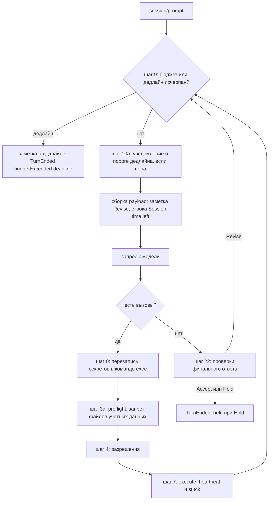

# 17.12. Цикл и безопасность

> Часть [архитектуры ядра агента CodeLab](../agent-core-architecture.md). Status: Accepted. Общие соглашения, термины и порядок чтения — в оглавлении.

← [17.11. Дополнительные инструменты](17-11-extra-tools.md) · [Оглавление ядра](../agent-core-architecture.md) · [17.13. Масштаб сессий](17-13-session-scale.md) →

Цели: C-04 (режимы-промпты `architect` и `review`), C-09 (супервизия зависшего инструмента),
C-14 (проверка ответа перед завершением хода), C-15 (дедлайн сессии), P-14 (секреты в тексте
команды), P-18 (запрет чтения файлов учётных данных). Затрагивает §5.2–§5.4 и §5.7 (хук
`beforeFinalResponse`, бюджет, супервизоры), §6.2 и §6.3.1 (единая точка исполнения), §6.4
(`read`, `search`, `exec`), §7.4, §7.6 (разбор команды), §8.2.3–§8.2.4 (записи журнала), §11.2,
§12.4 (слои редакции, `redact.block`), §13.6–§13.8, §13.12, §14, §15.3–§15.5, §15.8 (определения
агентов), §17.3 (субагенты), §17.5.6–§17.5.8, §17.7 (очередь steering), §17.9 (фоновые команды),
а также [CLI](../dart-agent-and-clients/09-11-stage-6-cli-mvp.md) и
[stream-json](../dart-agent-and-clients/12-5-stream-json.md).

## 17.12.1. Назначение и место в цикле

Шесть небольших механизмов закрывают оставшиеся пункты целей «Цикл агента» и «Разрешения и
безопасность». Новых capability раздел не вводит (перечень — §10.2), новых методов ACP нет:
всё видимое клиенту идёт стандартными кадрами (опция `agent`, `tool_call_update`, slash-команды
в `available_commands_update`, `stopReason`), а машиночитаемые подробности — в существующих
полях `_meta.codelab.*`, расширение которых согласуется через OpenSpec.

| Цель | Где подключается | Что видит клиент без расширений |
|---|---|---|
| C-04 | встроенные определения агентов §15.8, опция `agent` | вариант `architect` / `review` в опции `agent` |
| C-09 | шаг 7 единой точки исполнения §6.3.1 | `tool_call_update` `in_progress` с заголовком `… (running 30 s)` |
| C-14 | хук `beforeFinalResponse` §5.2, шаг 22 алгоритма хода | ничего; `_meta.codelab.held` и `/approve` |
| C-15 | шаги 9 и 10a алгоритма хода, payload §5.2 | `/timer`, `stopReason: max_turn_requests`, заметка об остановке |
| P-14 | новый шаг 0 единой точки исполнения | команда с `${CODELAB_REDACTED_1}` в `tool_call` и запросе разрешения |
| P-18 | `preflight` `read` и `exec` (шаг 3a), обход `search` | `tool_call_update` `failed` с причиной |



Новые ключи конфигурации (значения по умолчанию; подробности — в подразделах):

```yaml
loop:
  final_response:
    max_revisions: 2            # C-14, 0..5
    on_revise_limit: hold       # hold | accept
    require_approval: false     # встроенная проверка approval
tools:
  heartbeat:
    after: 10s                  # C-09, 1s..600s
    every: 10s
    stuck_after: 120s           # 0 — без ToolCallStuck
redact:
  command_rewrite: true         # P-14
  block: false                  # P-18 (ключ уже есть в §12.4.3)
```

## 17.12.2. Режимы-промпты `architect` и `review` (C-04)

**Назначение.** Пользователь переключает «манеру работы» агента — обсуждать и проектировать
(`architect`) или искать дефекты в изменениях (`review`) — не меняя того, что агенту разрешено.
Набор инструментов и решения о разрешениях задаёт только режим разрешений (`plan`, `ask`,
`standard`, `accept-edits`, `bypass`, P-05, §13.6).

**Решение.** Режимы-промпты — это **встроенные определения агентов** §15.8 со `scope: session`,
без полей `model`, `mode` и `tools`. Клиент выбирает их стандартной опцией конфигурации ACP
`agent` (`session/set_config_option`), а не `session/set_mode`: ось «режим» в ACP уже занята
режимами разрешений, и смешение двух осей в одном списке дало бы произведение вариантов
(`review` + `plan`, `review` + `bypass` …). Этим закрывается открытый вопрос матрицы целей
«Набор режимов Dart-агента» (§8 `agent-parity-goals.md`): режимы разрешений — `plan` / `ask` /
`standard` / `accept-edits` / `bypass` (+ `autopilot` только флагом headless), режимы-промпты —
определения агентов `architect` и `review`.

**Контракт.** Встроенный список определений сессии (`source: 'builtin:<name>'`, тело —
`prompts/agents/<name>.md`, §11.2):

| `name` | `description` (видит клиент) | `model` | `mode` | `tools` | `scope` |
|---|---|---|---|---|---|
| `architect` | `Discuss and design: options, trade-offs and a plan. Does not edit files unless asked.` | — | — | — | `session` |
| `review` | `Find defects in changes: bugs, risks and missing tests, ordered by severity.` | — | — | — | `session` |

```dart
// codelab_agent_core/lib/src/agents/builtin_profiles.dart
const builtinSessionProfiles = <AgentDefinition>[ /* architect, review — таблица выше */ ];
// Встроенные типы субагентов (§17.3.2) — отдельный список builtinSubagentTypes; имена не
// пересекаются по scope: session-профиль review и тип субагента review — разные определения.
```

Тело `prompts/agents/architect.md` (фиксировано):

```text
You are working as a software architect. In this session your job is to discuss and design, not to implement.

- Understand the problem first: read the relevant code, configuration and documentation before proposing anything.
- Offer at most three options with their trade-offs (complexity, risk, migration cost) and recommend one.
- Describe components, interfaces, data flow and failure handling. Use short lists and text diagrams when they help.
- State assumptions and open questions explicitly. Ask the user when a decision depends on information you do not have.
- Do not change files or run commands that change state unless the user explicitly asks. If the user asks for an implementation, propose a step-by-step plan first.
```

Тело `prompts/agents/review.md` (фиксировано):

```text
You are working as a code reviewer. In this session your job is to find defects in changes.

- Start from the changes: the working tree diff, the commits or the files the user names. If it is unclear what to review, ask.
- Look for correctness bugs, unhandled errors and edge cases, security problems, concurrency issues, missing or weak tests and breaking API changes. Comment on style only when it hides a defect.
- Verify each finding against the code before reporting it. Mark uncertain findings as questions, not defects.
- Report findings as a numbered list ordered by severity (critical, major, minor). For each finding give the file and line, what is wrong, why it matters and a suggested fix.
- Do not modify files unless the user asks you to fix a finding.
```

**Алгоритм.**

1. `loadAgentDefinitions` (§15.8) начинает со встроенных профилей, затем добавляет файлы
   пользователя и (при доверии) проекта. Пользовательское определение с тем же `name` и `scope`
   `session` или `both` заменяет встроенный профиль (лог `agent.profile_overridden` с путём
   файла); определение со `scope: subagent` встроенный профиль не трогает. Правило замены
   встроенных типов субагентов (§17.3.2) не меняется.
2. Опция `agent` присутствует в `configOptions` всегда, когда есть хотя бы одно определение со
   `scope` `session` или `both` — со встроенными профилями это любая сессия. Порядок вариантов:
   `default`, затем по `name`.
3. `selectAgent(session, "architect" | "review")` — §15.8 без изменений: шаг 2 добавляет секцию
   `## Agent profile: <name>` с телом; шаги 3–5 ничего не делают (полей нет), поэтому модель,
   режим и набор схем остаются прежними; шаг 6 рассылает снимок.
4. `session/set_mode` и `/mode` с устаревшим синонимом `architect` по-прежнему означают режим
   `plan` (§13.6) и **не** выбирают профиль: старые клиенты, отправляющие `architect`, ожидают
   запрета правок. Лог `acp.mode.legacy_alias` (info) с подсказкой `use config option agent=architect for the prompt profile`.
5. Профиль и режим независимы: `agent=review` + `plan` — ревью без правок и команд;
   `agent=review` + `standard` — ревью, где `git diff` спрашивает разрешение; `agent=architect`
   + `bypass` — промпт просит не править без просьбы, но разрешения этого не запрещают.
6. Выбор пишется записью `config_change {optionId: "agent"}` и восстанавливается при
   `session/load` (§15.8). Субагент профиль родителя не наследует (у ребёнка свой тип, §17.3.3).

**Пример.**

```json
{"jsonrpc":"2.0","id":9,"method":"session/set_config_option","params":{"sessionId":"01JB8Q2W6R9T3M5K7N1P4X8Z0C","configId":"agent","value":"review"}}
{"jsonrpc":"2.0","id":9,"result":{"configOptions":[{"id":"mode","category":"mode","type":"select","currentValue":"standard","options":["…"]},{"id":"model","category":"model","type":"select","currentValue":"openai/gpt-4o","options":["…"]},{"id":"agent","name":"Agent","category":"other","type":"select","currentValue":"review","options":[{"value":"default","name":"Default"},{"value":"architect","name":"architect","description":"Discuss and design: options, trade-offs and a plan. Does not edit files unless asked."},{"value":"review","name":"review","description":"Find defects in changes: bugs, risks and missing tests, ordered by severity."}]}]}}
```

**Как проверить.**

* `acp/set-mode-architect-prompt` — критерий матрицы: (а) `session/set_config_option`
  `agent=architect` → в ответе `mode` и `model` не изменились; следующий запрос scripted-модели
  содержит в системном промпте `## Agent profile: architect` и первую строку тела, список схем
  равен списку до выбора (`expect.systemPrompt`, `expect.tools`, §14.7); (б) `session/set_mode
  {modeId: "architect"}` → `current_mode_update` с `plan`, значение `agent` не изменилось; (в)
  `agent=review` и вызов `write` в `standard` → запрос разрешения, как без профиля (LS-1, LS-2).
* `builtin_profiles_test.dart`: оба профиля загружены без файлов; `~/.codelab/agents/review.md`
  со `scope: session` заменяет встроенный профиль, а со `scope: subagent` — нет; тип субагента
  `review` (§17.3.2) остаётся в `enum` инструмента `task`.
* `prompt_profile_texts_test.dart`: тела профилей не упоминают имён инструментов (сторож §11.10).

## 17.12.3. Супервизия зависшего инструмента (C-09)

**Назначение.** Долгий вызов (`dart test` на 3 минуты, MCP-инструмент, который ждёт сеть)
выглядит в клиенте как замерший. Ядро периодически сообщает, сколько вызов уже работает, и один
раз отмечает вызов, который долго молчит. Ничего не прерывается: остановить вызов может только
пользователь (`session/cancel`, §3) или таймаут самого инструмента.

**Контракт.** События §5.3 (зарезервированы в §5.7, здесь определяются):

```dart
/// Вызов исполняется (шаг 7 §6.3.1) дольше tools.heartbeat.after; повторяется каждые .every.
final class ToolCallHeartbeat extends AgentEvent {
  final String toolCallId;
  final Duration elapsed;        // с начала execute, без ожидания разрешения
  final Duration sinceOutput;    // с последнего ToolCallProgress этого вызова или с начала execute
}
/// Вызов молчит (нет ToolCallProgress) не меньше tools.heartbeat.stuck_after. Не больше одного на вызов.
final class ToolCallStuck extends AgentEvent {
  final String toolCallId; final Duration elapsed, sinceOutput;
}

// AgentTool (§6.2), после MVP:
bool get heartbeat => true;      // false — у task (у ребёнка свой прогресс, §17.3.7)

final class HeartbeatConfig {    // ToolExecutor получает при сборке сессии (§10.7)
  const HeartbeatConfig({this.after = const Duration(seconds: 10),
      this.every = const Duration(seconds: 10), this.stuckAfter = const Duration(seconds: 120)});
  final Duration after, every;
  final Duration? stuckAfter;    // null (конфиг 0) — без ToolCallStuck
}
```

**Алгоритм** (внутри шага 7 единой точки исполнения, для `tool.heartbeat == true`):

```text
superviseExecute(call, tool, ctx):
 1  t0 := clock.now(); lastOutput := t0; stuckSent := false
 2  onUpdate обёрнут: каждое частичное обновление → lastOutput := clock.now()
 3  ticker: await clock.delay(after); затем пока вызов не завершён:
 4      now := clock.now(); emit ToolCallHeartbeat(id, now − t0, now − lastOutput)
 5      if stuckAfter != null and not stuckSent and now − lastOutput ≥ stuckAfter:
          emit ToolCallStuck(id, now − t0, now − lastOutput); stuckSent := true
          log tool.stuck (warning: tool, toolCallId, elapsedMs, silentMs)
 6      await clock.delay(every, cancel: done)
 7  result := await tool.execute(args, ctx); done.cancel()   # тикер остановлен ДО шага 8
 8  дождаться emit, начатого тикером, затем перейти к шагу 8 §6.3.1
```

Правила:

1. Отсчёт начинается на шаге 7 — после проверки разрешений и всех хуков `beforeToolCall`:
   ожидание ответа человека «зависанием» инструмента не считается.
2. Heartbeat эмитится под общей очередью emit (LOOP-2) и **никогда** после `ToolCallFinished`
   своего вызова (LS-3). Параллельные вызовы пакета имеют независимые тикеры.
3. Heartbeat не меняет ни результат, ни транскрипт, ни журнал, ни payload модели (LS-4). Модель
   о нём не знает: она ждёт результат.
4. Фоновый `exec` (§17.9) возвращается сразу — тикер не успевает сработать; прогресс фоновой
   задачи — `/tasks`. Уступка долгого `exec` (§17.9.7) завершает вызов — тикер останавливается.
5. Дочерние сессии эмитят события в свой поток; проекция родителю не меняется (§17.3.7).

**Проекция ACP.** `content` в `tool_call_update` заменяет коллекцию целиком: текст heartbeat
затёр бы терминал `exec` или частичный вывод. Поэтому ACP-адаптер меняет только `title`:

| Событие | Кадр |
|---|---|
| `ToolCallHeartbeat` | `tool_call_update {toolCallId, status: "in_progress", title: "<title> (running <elapsed>)"}` |
| `ToolCallStuck` | `tool_call_update {toolCallId, status: "in_progress", title: "<title> (running <elapsed>, no output for <silent>)"}`; последующие heartbeat сохраняют хвост `, no output for …`, пока не придёт вывод |
| `ToolCallFinished` вызова, у которого менялся `title` | к обычному кадру §13.7 добавляется `title: "<исходный title>"` |

`<title>` — исходный заголовок из `ToolCallStarted`. Формат длительности `formatElapsed(d)`:
меньше 60 с — `<s> s`; иначе `<m> min` и, если остаток не ноль, ` <s> s` (`75 s` → `1 min 15 s`);
секунды округляются вниз. Расширение `_meta` не нужно. stream-json отдаёт кадр как обычный
`tool_update` с новым `title`; текстовый режим CLI ничего не печатает.

**Конфигурация.**

| Ключ | Тип | По умолчанию | Смысл |
|---|---|---|---|
| `tools.heartbeat.after` | duration | `10s` | когда отправить первый heartbeat; `1s..600s` |
| `tools.heartbeat.every` | duration | `10s` | период; `1s..600s` |
| `tools.heartbeat.stuck_after` | duration | `120s` | тишина до `ToolCallStuck`; `0` — выключено; иначе `≥ after`, `≤ 3600s` |

Доверие: проектный слой может задавать все три ключа (они не расширяют прав). Живая
перезагрузка — со следующего вызова инструмента.

**Пример.** `exec dart test` разрешён, печатает строку в 0 с и молчит: в 10, 20 … 110 с —
`title: "dart test (running 10 s)"` …; в 120 с — `title: "dart test (running 2 min, no output for 2 min)"`;
выход в 130 с → `tool_call_update {status: "completed", title: "dart test", content: […]}`.

**Как проверить.**

* `core/stuck-tool-heartbeat` — критерий матрицы (`tool_heartbeat_test.dart`, `FakeClock`): fake-
  инструмент работает 35 с → heartbeat с `elapsed` 10, 20, 30 с и ни одного после
  `ToolCallFinished`; ожидание разрешения 60 с перед исполнением не даёт heartbeat и не входит в
  `elapsed`; тишина 120 с → один `ToolCallStuck`, вывод на 125 с сбрасывает `sinceOutput`, второго
  `ToolCallStuck` нет; два параллельных вызова — независимые последовательности; `task` — без
  heartbeat; `stuck_after: 0` — без `ToolCallStuck` (LS-3, LS-4, LS-5).
* `acp/tool-heartbeat-title`: кадры `in_progress` с `title` `… (running 10 s)`, финальный кадр
  восстанавливает исходный `title`; у внешнего `exec` `content` с терминалом не перезаписан.
* `config_heartbeat_test.dart`: границы ключей, `stuck_after < after` → `ConfigException`.

## 17.12.4. Проверка ответа перед завершением хода (C-14)

**Назначение.** Хост или пользователь хотят проверить финальный ответ, прежде чем ход
закончится: тон, утечка данных, «объявил успех без проверки». Хук `beforeFinalResponse` уже есть
в цикле (§5.2, §5.4 шаг 22, LOOP-13); здесь определяется, кто его заполняет, что происходит при
исчерпании ревизий и как «ожидает одобрения» видят клиент и журнал.

**Контракт.**

```dart
/// Сведения о ходе для проверки (в §5.2 тип назван без полей; определяется здесь).
final class TurnInfo {
  final TurnId turnId; final int stepIndex;       // шаг, давший кандидат
  final int revisions;                            // сколько Revise уже было в этом ходе
  final ModelRef model; final Usage usage;        // usage хода на момент проверки
  final List<Message> turnMessages;               // сообщения хода, включая кандидат
}

/// Одна проверка. Регистрирует хост (SessionSpec.finalResponseChecks) или конфиг (встроенные).
abstract interface class FinalResponseCheck {
  String get id;                                  // ^[a-z][a-z0-9_-]{0,31}$, уникален в сессии
  Future<ResponseVerdict> check(AssistantMessage message, TurnInfo turn);   // Accept | Revise | Hold (§5.2)
}

// SessionSpec (§5.6), после MVP:
final List<FinalResponseCheck> finalResponseChecks;   // по умолчанию []

enum ReviseLimitPolicy { accept, hold }               // loop.final_response.on_revise_limit
```

`AgentSession` строит из списка один хук `BeforeFinalResponseHook` (`composeFinalChecks`) и
ставит его в `AgentLoopConfig.beforeFinalResponse`; `maxResponseRevisions` =
`loop.final_response.max_revisions`. Список пуст и `require_approval: false` → хук `null`
(поведение MVP, LOOP-13).

**Встроенная проверка `approval`.** `loop.final_response.require_approval: true` добавляет в
конец списка проверку с `id: "approval"`, которая всегда возвращает
`Hold('final answer requires approval')`: каждый ответ сессии отправляется человеку.

**Алгоритм.**

```text
composeFinalChecks(checks, policy)(message, turn):
 1  notes := []; hold := null
 2  для c из checks по порядку регистрации:
 3    try v := await c.check(message, turn)                     # таймаут 30 с на проверку
      on TimeoutException|Exception e:
        log loop.final_check.error (warning: id, error); continue   # проверка не валит ход
 4    if v is Hold and hold == null: hold := "<c.id>: <v.reason>"
 5    if v is Revise: notes.add("[<c.id>] <v.note>")
 6  if hold != null: return Hold(hold)                          # Hold сильнее Revise
 7  if notes пуст: return Accept()
 8  if turn.revisions < maxResponseRevisions:
        return Revise(reviseText(notes))
 9  # ревизии исчерпаны
    log loop.final_check.revise_limit (info: revisions, ids)
    return policy == hold ? Hold("revision limit reached: " + notes.join("; ")) : Accept()
```

Текст заметки `Revise` (уходит в payload следующего шага последним `user`-сообщением, §5.2 шаг 3;
в транскрипт не пишется, LOOP-7):

```text
[Final answer check] Your answer was not accepted:
<note 1>
<note 2>
Revise the answer. If you need to verify something, use the tools first.
```

Правила:

1. Шаг 22 §5.4 меняется: вердикт уже учитывает лимит ревизий, поэтому `Revise` от
   составного хука всегда даёт ещё один шаг. Без составного хука (хост поставил
   `beforeFinalResponse` напрямую) поведение §5.4 прежнее.
2. Пустой ответ (§5.4.1) и заметка цикла проверке не передаются. Ход, остановленный бюджетом или
   дедлайном (§17.12.5), проверку не вызывает: финального ответа-кандидата нет.
3. Заметка `Revise` и steering одной границы идут в один шаг (§17.7.3.2). Шаг ревизии — обычный
   шаг: входит в `TurnBudget` и проверяется дедлайном.
4. Субагенты проверки родителя не наследуют (у отчёта ребёнка свой ремонт по схеме, §17.3).
5. `Hold(reason)` → `TurnEnded(completed, held: reason)`; `AgentSession` пишет запись
   `response_hold {targetId: <id записи ответа>, reason}` до `TurnEnded` (LS-7).

**Одобрение человеком.** Агентская команда `/approve [note]` (§13.6): если последний ход сессии
закончился `Hold` и ответ ещё не одобрен — пишет `response_review {targetId, decision:
"approved", note?}` и отвечает `Approved the held answer.`; иначе — `There is no held answer to approve.`
Модель не вызывается, команда в журнал команд не пишется (как `/status`), но запись
`response_review` пишется. Любой следующий `session/prompt` означает реакцию человека словами:
отдельная запись не нужна, отметка «ожидает одобрения» на старом ответе остаётся, пока нет
`response_review`.

**ACP.** Ответ `session/prompt` — `{"stopReason": "end_turn", "_meta": {"codelab": {"held":
"<reason>"}}}` (§13.8, уже перечислено в §13.12). При реплее (§13.5) последний
`agent_message_chunk` удержанного ответа получает `_meta.codelab.held: {"reason", "approved"}`
(через OpenSpec, тот же change, что `held`). Без расширения клиент видит обычный `end_turn`
(«иначе не видно» в матрице). Headless CLI: `turn_end.held` в stream-json (уже есть), строка
`Response held for approval: <reason>` в stderr и код выхода `1` — некому одобрить.

**Конфигурация.**

| Ключ | Тип | По умолчанию | Смысл |
|---|---|---|---|
| `loop.final_response.max_revisions` | int | `2` | `AgentLoopConfig.maxResponseRevisions`; `0..5` |
| `loop.final_response.on_revise_limit` | enumeration `hold`, `accept` | `hold` | что делать, если после лимита проверка снова просит доработку |
| `loop.final_response.require_approval` | bool | `false` | встроенная проверка `approval` |

Доверие: проект может включить `require_approval` и выбрать `hold`; `require_approval: false`
поверх глобального `true` и `on_revise_limit: accept` из проекта без `trusted_projects`
игнорируются с `config.project.untrusted_key`. Перезагрузка — со следующего хода.

**Пример.** Хост регистрирует проверку `no-unverified-success`, которая возвращает
`Revise('You said the tests pass but did not run them in this turn.')`, если в ответе есть
`tests pass`, а в `turn.turnMessages` нет результата `exec` с `test`. Шаг 3: ответ «All tests
pass.» → `Revise`, шаг 4: модель вызывает `exec dart test`, шаг 5: ответ с выводом → `Accept`.
Если модель трижды отвечает без запуска (`max_revisions: 2`), третий вердикт → `Hold("revision
limit reached: [no-unverified-success] You said …")`, ответ `end_turn` с `_meta.codelab.held`.

**Как проверить.**

* `core/final-response-hook-revise-limit` — критерий матрицы (`final_checks_test.dart`): (а) две
  проверки, обе `Revise` → одна заметка с двумя строками в payload следующего шага, не в
  транскрипте; (б) `max_revisions: 2`, проверка всегда `Revise` → ровно 2 дополнительных шага,
  затем `TurnEnded.held` с префиксом `revision limit reached:`; с `on_revise_limit: accept` —
  `TurnEnded` без `held`; (в) `Revise` и `Hold` в одном вызове → `Hold` без ещё одного шага; (г)
  исключение и таймаут проверки → `Accept` и лог, ход не `failed`; (д) пустой ответ и остановка
  бюджетом проверку не вызывают (LOOP-13, LS-6).
* `response_hold_journal_test.dart`: `Hold` → запись `response_hold` до `TurnEnded`; `/approve` →
  `response_review`; повторный `/approve` → `There is no held answer to approve.`; после
  `session/load` реплей несёт `held.approved: true`.
* `acp/prompt-response-held` (`"extensions": ["held"]`): `require_approval:
  true` → ответ `end_turn` с `_meta.codelab.held`.
* `cli/headless-response-held`: код выхода `1`, строка в stderr, `turn_end.held` не `null`.

## 17.12.5. Дедлайн сессии (C-15)

**Назначение.** Прогоны с ограничением по времени (CI, бенчмарк, «у меня 40 минут») задают один
абсолютный срок на всю сессию. В отличие от `budget.max_duration` (C-13, на ход) срок не
сбрасывается между ходами, не продлевается сам и переживает перезапуск агента.

**Контракт.**

```dart
// codelab_agent_core/lib/src/session/deadline.dart
enum DeadlineThreshold { half, tenth, lastMinute }    // журнал: 50, 10, 1

final class DeadlineState {
  final String deadlineId;                            // id записи deadline (§8.2.4)
  final DateTime at, setAt;                           // UTC
  final Set<DeadlineThreshold> fired;                 // уже отправленные (или пройденные при установке)
}

final class DeadlineNotice {
  final String deadlineId; final List<DeadlineThreshold> thresholds; final String? text;  // null — молча пометить
}

/// Вид для цикла (AgentLoopConfig.deadline). Один экземпляр на сессию; субагенты получают тот же.
abstract interface class SessionDeadline {
  DeadlineState? get current;
  bool isPassed(DateTime now);                        // current != null && now ≥ at
  String? timeLeftLine(DateTime now);                 // строка payload или null
  DeadlineNotice? takeDueNotice(DateTime now);        // помечает пороги в памяти; запись — через MessageEnded
}

// AgentSession (§5.6), после MVP:
Future<DeadlineState?> setDeadline(DateTime? at);     // null — снять; пишет запись deadline

final class DeadlineNoticeOrigin extends MessageOrigin {      // §17.7.2.1
  const DeadlineNoticeOrigin(this.deadlineId, this.thresholds);
  final String deadlineId; final List<DeadlineThreshold> thresholds; }

enum BudgetLimit { steps, tokens, cost, duration, deadline }  // + deadline (§5.2)
enum LoopNudgeReason { emptyResponse, deadline }              // + deadline (§5.3): заметка об остановке
```

**Установка.** Агентская команда (§13.6), только между ходами (во время хода `session/prompt`
отклоняется `turnActive`, а steering командой не разбирается, §17.7.3.4):

| Ввод | Действие | Ответ (`agent_message_chunk`, `end_turn`) |
|---|---|---|
| `/timer <duration>` | `at = now + d` | `Session deadline set: <at ISO UTC> (<d> from now).` |
| `/timer until <ISO-8601>` | `at` = время с зоной (`Z` или `±hh:mm`) | то же |
| `/timer off` | снять срок | `Session deadline cleared.` |
| `/timer` | показать | `Session deadline: <at>, <left> left.` / `Session deadline passed at <at>.` / `No session deadline. Usage: /timer <duration> \| until <time> \| off` |

`<duration>` — `^(?:(\d+)h)?(?:(\d+)m)?(?:(\d+)s)?$`, непустое; итоговый срок от `now` — от
1 мин до 7 сут. Иначе — `Invalid deadline "<arg>". Use 90s, 45m, 1h30m or until <ISO time>, from 1 min to 7 days ahead.`
Новый `/timer` заменяет срок целиком (новый `deadlineId`, пороги считаются заново).

**Пороги.** `total = at − setAt`. Порог пройден, когда `remaining = at − now` не больше
`trigger(t)`: `half` — `total / 2`, `tenth` — `total / 10`, `lastMinute` — 60 с. Пороги, пройденные
уже в момент установки (например, `lastMinute` при `/timer 1m`), сразу попадают в `fired`.

```text
takeDueNotice(now):
 1  s := current; s == null or isPassed(now) → null
 2  due := {t ∉ s.fired : at − now ≤ trigger(t)}; due пуст → null
 3  s.fired ∪= due
 4  worst := t ∈ due с наименьшим trigger(t)
 5  если среди прежних s.fired есть порог с trigger < trigger(worst) → DeadlineNotice(due, text: null)
 6  иначе → DeadlineNotice(due, text: noticeText(worst, now))
```

Тексты (фиксированы; `<left>` — `formatLeft`, `<at>` — ISO UTC):

```text
[Session deadline: half of the session time is used, <left> left (deadline <at>). Prioritize the essential remaining work.]
[Session deadline: <left> left (deadline <at>). Wrap up: finish the current change, verify it and summarize the result.]
[Session deadline: less than 1 min left (deadline <at>). Do not start new work; give the user a final summary now.]
```

`formatLeft(r)`: `r ≥ 60 с` → `<ceil(r / 60 с)> min`; иначе `under 1 min`. Строка в каждом
запросе (`timeLeftLine`):

```text
[Session time left: <left> (deadline <at>).]
```

**Алгоритм в цикле** (изменения §5.4 и §5.2):

1. **Шаг 9.** `deadline?.isPassed(clock.now())` проверяется **первым** из лимитов: `reason =
   completed; budgetExceeded = deadline`. Перед `TurnEnded` цикл добавляет заметку
   `LoopNoteOrigin(deadline)` (как §5.4.1: синтетический `AssistantMessage`, не шаг):
   `[Stopped: the session deadline passed at <at>. Run /timer <duration> to set a new deadline or /timer off to remove it.]`
   Ход после истечения срока не делает ни одного запроса к модели: промпт пишется в журнал, затем
   заметка и `TurnEnded` (LS-9).
2. **Шаг 10a** (новый, после шага 9 и проверки отмены, до `StepStarted`): `n :=
   deadline?.takeDueNotice(now)`; `n != null && n.text != null` → в транскрипт добавляется
   `UserMessage([TextContent(n.text)])` с `DeadlineNoticeOrigin(n.deadlineId, n.thresholds)`,
   `MessageStarted`/`MessageEnded`. `n.text == null` → сообщения нет, пороги сохраняются по
   правилу 5. Уведомление **не** идёт через
   очередь steering: оно не открывает шагов, не тратит `maxSteeringSteps` и доставляется только
   перед запросом, который начнётся и так (LS-10).
3. **Payload, шаг 3a** (после заметки `Revise`): `line := deadline?.timeLeftLine(now)`; не `null` →
   `UserMessage([TextContent(line)])` последним сообщением payload. Только payload (LOOP-7):
   строка меняется каждый запрос и в транскрипт не входит; кэш провайдера не страдает, потому
   что строка — последнее сообщение.
4. Срок абсолютный: ожидание разрешения, исполнение инструментов и паузы между ходами в него
   входят. Исполняемый инструмент и ожидание ответа человека не прерываются (как LOOP-12);
   `exec` с таймаутом 3600 с может закончиться после срока, тогда ход остановится на ближайшей
   границе шага.
5. **Журнал.** `setDeadline` пишет `deadline {deadlineAt, setAt, fired}` (`deadlineAt: null` —
   снят). Доставленное уведомление — запись `message` user с `origin: "deadline_notice"`,
   `deadlineId`, `thresholds` (`[50, 10]`). Молча помеченные пороги (`text: null`) дописываются в
   поле `thresholds` ближайшей записи `deadline_notice` или, если её нет до конца хода, —
   записью `deadline` с тем же `deadlineAt`, `setAt` и расширенным `fired` перед `TurnEnded`.
6. **Восстановление** (`open`/`session/load`): действует последняя по порядку файла запись
   `deadline` **по всем веткам** (как `job`, §8.2.4): переключение ветки и перемотка срок не
   отменяют и не продлевают (LS-8). `fired` = `fired` записи ∪ `thresholds` всех `deadline_notice`
   с её `deadlineId`. Fork (§17.6.7) пишет в новую сессию запись `deadline` с теми же `deadlineAt`,
   `setAt` и `fired`.
7. **Субагенты** получают тот же `SessionDeadline` (только чтение): строка времени — в их payload,
   истечение останавливает ход ребёнка (`budgetExceeded: deadline` в отчёте, §17.3.5); уведомления
   порогов получает только родитель.
8. Логи: `deadline.set` (info: `at`, `totalMs`), `deadline.cleared`, `deadline.notice` (info:
   `thresholds`), `deadline.stop` (info: `at`).

**ACP.** `/timer` объявляется в `available_commands_update`:
`{"name":"timer","description":"Set, show or clear the session deadline","input":{"hint":"<duration> | until <time> | off"}}`.
Остановка: `{"stopReason": "max_turn_requests", "_meta": {"codelab": {"budgetExceeded": "deadline"}}}` —
новое значение существующего поля (§13.8, §13.12), вводится тем же OpenSpec change, что
`budgetExceeded` C-13. Заметка об остановке приходит обычным `agent_message_chunk`, поэтому
причина видна и без расширения. Уведомление порога в ленту не отправляется ни вживую, ни при
реплее (как `JobNoticeOrigin`). `/status` получает строку `Deadline: <at> (<left> left)` или
`Deadline: passed at <at>`.

**CLI.** `--deadline <длительность|время>`: длительность — та же грамматика; время — ISO-8601 или
`HH:MM` (локальное время клиента; прошедшее сегодня → завтра). CLI переводит значение в
абсолютное UTC в момент разбора флагов и после `session/new`/`session/load` отправляет
`session/prompt` с `/timer until <ISO>` до первого промпта пользователя (ответ печатается только
при `--verbose`). Агент без команды `timer` в `available_commands_update` → предупреждение
`--deadline: the agent does not support /timer; the turn will be cancelled at the deadline.` в
stderr (`notice` `deadline_unsupported` в stream-json) и `session/cancel` по таймеру клиента (код
`130`). Остановка дедлайном у агента — `max_turn_requests` → код `1` (таблица кодов не меняется).

**Пример.**

```text
codelab -p "Fix the failing tests" --deadline 30m
→ session/prompt "/timer until 2026-10-22T10:30:00Z" → "Session deadline set: 2026-10-22T10:30:00Z (30 min from now)."
→ session/prompt "Fix the failing tests": каждый запрос оканчивается строкой
  "[Session time left: 30 min (deadline 2026-10-22T10:30:00Z).]"
→ 10:15:02 перед шагом 6: уведомление half; 10:27:01: уведомление tenth; 10:29:05: lastMinute
→ 10:30:40 граница шага: заметка "[Stopped: the session deadline passed at 2026-10-22T10:30:00Z. …]",
  ответ {"stopReason":"max_turn_requests","_meta":{"codelab":{"budgetExceeded":"deadline"}}}, код 1
```

**Как проверить.**

* `core/session-deadline-stops-at-step` — критерий матрицы (`session_deadline_test.dart`,
  `FakeClock`): (а) срок истекает во время `exec` на 40 с → вызов доходит до конца, следующий
  запрос к модели не делается, `TurnEnded(reason: completed, budgetExceeded: deadline)`, заметка с точным текстом;
  (б) `prompt()` после истечения → ни одного `ModelRequested`; (в) каждый payload оканчивается
  строкой `Session time left`, транскрипт её не содержит; (г) уведомления half, tenth, lastMinute —
  по одному, в журнале `deadline_notice`; переход сразу через два порога → один текст, оба в
  `thresholds`; (д) `close` + `loadSession` после half → half не повторяется, tenth приходит;
  (е) `rewind` к записи до `/timer` не снимает срок; (ж) ожидание разрешения входит в срок
  (LS-8, LS-9, LS-10, LS-11).
* `timer_command_test.dart`: грамматика, границы 1 мин и 7 сут, `until` в прошлом → текст ошибки,
  `/timer off`, `/timer` без срока; команда во время хода → `turnActive`.
* `acp/prompt-session-deadline` (с `"extensions"`): `/timer 1m`, промпт, scripted-шаг с
  `delayMs` больше минуты → `max_turn_requests` и `_meta.codelab.budgetExceeded: "deadline"`.
* `cli/headless-deadline-flag`: `--deadline 1m` → первым `session/prompt` уходит `/timer until …`;
  агент без `timer` → предупреждение и `session/cancel`, код `130`.

## 17.12.6. Перезапись секретов в тексте команды (P-14)

**Назначение.** Модель иногда вписывает секрет прямо в команду: `curl -H "Authorization: Bearer
ghp_…"`, `psql postgres://app:s3cr3t@db/app`, `API_KEY=sk-… npm run deploy`. Такая строка уходит
в заголовок `tool_call`, в запрос разрешения, в шаблон «разрешить всегда», в журнал задачи и в
аргументы процесса (`ps`). Ядро заменяет распознанный секрет ссылкой на переменную окружения,
передаёт значение процессу через окружение, а модели дописывает заметку.

**Контракт.**

```dart
// §12.4.1, Redactor: те же шаги 1–4 алгоритма redact, без замены — выбранные участки.
List<SecretSpan> findSecrets(String text, [RedactionContext? ctx]);
final class SecretSpan {
  final int start, end;                // участок секрета (без префикса группы: без "Bearer ")
  final RedactionLayer layer; final String tag;   // tag: known-secret, github, sk, aws, jwt, bearer,
}                                                 // private-key, connection-string, key-value, entropy
enum RedactionPoint { userInput, toolResult, providerRequest, backgroundJob, log, journal, spill, command }

// §6.2, AgentTool, после MVP: перезапись сырых аргументов до ToolCallStarted. По умолчанию — нет.
ArgsRewrite? rewriteArgs(Map<String, Object?> rawArgs) => null;   // переопределяет только exec
final class ArgsRewrite {
  final Map<String, Object?> args;     // аргументы с перезаписанной командой
  final Map<String, String> env;       // CODELAB_REDACTED_<n> → значение; только в ExecOptions.env
  final String? note;                  // заметка для модели
}
// ToolContext (§6.2): final ArgsRewrite? rewrite;

// codelab_agent_core/lib/src/tools/command_secrets.dart
final class CommandSecretRewriter {
  CommandSecretRewriter(this.redactor, this.lexer, {required this.posixShell, required this.knownEnv});
  final bool posixShell;                         // basename exec.shell ∈ {sh, bash, zsh, dash, ksh}
  final Map<String, String> Function() knownEnv; // exec.env + exec.secrets (EnvVarsEnv), значения
  ArgsRewrite? rewrite(Map<String, Object?> rawArgs);
}
```

**Алгоритм.**

```text
rewrite(rawArgs):                                   # шаг 0 §6.3.1, до ToolCallStarted
 1  redact.command_rewrite == false или command не строка → null
 2  spans := redactor.findSecrets(command, RedactionContext(point: command))
    # слои: exact и включённые formats, pem, connection_strings, key_values, entropy;
    # credential_files не применяется; allowlist — как в §12.4.1
 3  spans пуст → null
 4  не posixShell → skipped все (unsupportedShell); перейти к 9
 5  tokens := lexer.scan(command)                   # §7.6, шаги 1–8; ошибка или unparsable → skipped все (unparsable)
 6  для span справа налево:
      ctx := контекст ВНЕШНЕГО уровня, в котором лежит span (вложенные $(…), `…`, sh -c "…"
             наследуют окружение процесса, поэтому решает внешний уровень)
      span пересекает границу кавычек или слова → skipped (crossesQuoting); continue
      value := command[start:end]
      var := имя из knownEnv с тем же значением ?? имя CODELAB_REDACTED_<n>
             (одно значение — одно имя; n с 1, после наибольшего CODELAB_REDACTED_<k> в тексте)
      ref := по ctx:
        вне кавычек                  → "${var}"            (в двойных кавычках: без разбиения на слова)
        в двойных кавычках           → ${var}
        в одинарных кавычках         → '"${var}"'          (закрыть, подставить, открыть)
        в $'…'                       → '"${var}"$'
        here-document без кавычек    → ${var}
        here-document <<'W', <<"W", <<\W → skipped (quotedHeredoc); continue
        комментарий                  → [REDACTED:<tag>]    (на исполнение не влияет, env не нужен)
      command := command[0:start] + ref + command[end:]
      var новый → env[var] := value; redactor.addExactSecret(value)
 7  rewritten пуст и skipped пуст → null
 8  args' := rawArgs с command = результат
 9  note := noteText(rewritten, skipped); лог exec.secret_rewrite (info: tags, vars, skipped reasons; без значений)
10  вернуть ArgsRewrite(args', env, note)
```

Тексты заметки (дописываются отдельной строкой в конец результата `exec`, после строки кода
выхода; `<tags>` и `<vars>` через `, `):

```text
[Note: <n> secret value(s) in the command (<tags>) were replaced with environment variable references (<vars>); the process received the values through its environment. Do not put secret values into commands: reference environment variables instead.]
[Note: <n> secret value(s) in the command (<tags>) could not be replaced (<reasons>) and were passed as written.]
```

`<reasons>` — `unsupported shell`, `unparsable command`, `crosses quoting`, `quoted here-document`.

**Место в единой точке исполнения (§6.3.1).** Новый шаг 0 — до шага 1: найти инструмент (нет →
без перезаписи, шаг 2 вернёт ошибку); `rewrite := tool.rewriteArgs(call.arguments)` (исключение →
`null` и лог `exec.secret_rewrite.error`); при `rewrite != null` все дальнейшие шаги используют
`rewrite.args`: `ToolCallStarted.input` и `title`, ключ предохранителя (1a), валидация,
`preflight` (в том числе запрет P-18), `PermissionRequest.rawInput`, шаблон «разрешить всегда»
(§7.5), критические шаблоны (§7.6), запись `job.command` (§17.9), `toolMeta.command` журнала.
`ctx.rewrite = rewrite`; `exec` (и фоновый `spawn`) кладёт `rewrite.env` поверх окружения
вызова (`ExecOptions.env`, §4.5) и дописывает `rewrite.note`. Вывод процесса, напечатавший
значение, ловит слой `exact` на шаге 8b (значение добавлено `addExactSecret`).

Что не меняется: аргументы `toolCall` в ответе модели остаются её текстом (транскрипт не
переписывается; журнал хранит их через `redactJson`, §12.4.2); перезапись действует на один вызов
— переменная `CODELAB_REDACTED_<n>` следующей команде не передаётся, поэтому заметка советует
переменные из `exec.secrets`.

**Конфигурация.** `redact.command_rewrite` (bool, `true`): при `redact.enabled: false` работает
только слой `exact`. Доверие: проект может включить; `false` из проекта без `trusted_projects`
игнорируется. Перезагрузка — со следующего вызова `exec`.

**Пример.** Команда модели `curl -s -H 'Authorization: Bearer ghp_aBcD…36 символов…' https://api.github.com/user`:

```text
tool_call.title / rawInput.command:
  curl -s -H 'Authorization: Bearer '"${CODELAB_REDACTED_1}"'' https://api.github.com/user
ExecOptions.env: {CODELAB_REDACTED_1: <значение>}
результат для модели:
  {"login": "me", …}
  [Note: 1 secret value(s) in the command (github) were replaced with environment variable references (CODELAB_REDACTED_1); the process received the values through its environment. Do not put secret values into commands: reference environment variables instead.]
```

Запись `exec.secrets` `{env: GITHUB_TOKEN, …}` с тем же значением → ссылка `"${GITHUB_TOKEN}"`,
новой переменной нет.

**Как проверить.**

* `core/bash-shape-redaction-notice` — критерий матрицы (`command_secret_rewrite_test.dart`):
  `Bearer ghp_…` в одинарных кавычках, `sk-…` без кавычек, пароль в `postgres://u:p@h` в двойных
  кавычках, `API_KEY=…` перед командой → перезапись по таблице контекстов, fake-shell получает
  исходную строку после подстановки (побайтово равную команде модели), `ExecOptions.env` содержит
  значения, `ToolCallStarted.input`, `PermissionRequest.rawInput`, журнал и кадры ACP значений не
  содержат, результат оканчивается заметкой с точным текстом (LS-12).
* `command_secret_rewrite_skip_test.dart`: `cmd.exe` → без перезаписи, заметка `unsupported
  shell`; `<<'EOF'` → `quoted here-document`; незакрытая кавычка → `unparsable command`; секрет в
  комментарии → `[REDACTED:<tag>]`; значение из `exec.secrets` → ссылка на его имя; git SHA из
  `allowlist` не трогается; `redact.command_rewrite: false` → команда как есть (LS-13).
* `exec_background_rewrite_test.dart`: фоновый запуск — `job.command` с ссылкой, окружение задачи
  со значением.

## 17.12.7. Запрет чтения файлов учётных данных (P-18)

**Назначение.** По умолчанию (`redact.block: false`, §12.4.3) `read` файла учётных данных
возвращает ключи без значений (слой 2 §12.4.1), а `cat .env` маскируется слоями 1 и 3–7. Режим
`redact.block: true` — для тех, кому не нужна даже маска: такие чтения отклоняются **до
исполнения и до вопроса человеку** с понятной причиной.

**Контракт.**

```dart
// codelab_agent_core/lib/src/redact/credential_files.dart
/// Список §12.4.1 (слой credential_files) — один для маскирования и для запрета.
final class CredentialFileMatcher {
  bool matchesPath(String path);          // по имени или хвосту пути после normalize (§4.4)
  bool mayMatchGlob(String word);         // слово с * ? [ ] против образцов списка
}
final class CredentialBlock {
  CredentialBlock(this.matcher, this.enabled);  // enabled — читает redact.block при каждом вызове
  String? checkRead(String path);               // текст отказа или null
  String? checkCommand(String command, String cwd, ShellLexer lexer);
}
```

`read`, `exec` и `search` получают `CredentialBlock` при создании (§10.7); `preflight` (§6.2)
возвращает его текст.

**Алгоритм.**

1. **`read`, шаг 3a.** `p := normalize(cwd, args.path)`; `matchesPath(p)` → отказ. На шаге 7
   `read` повторяет проверку для разрешённого пути `real` (§4.4, шаг 2): ссылка `notes.txt →
   .env` даёт тот же отказ результатом-ошибкой (LS-14).
2. **`exec`, шаг 3a** (и `run_in_background`; после перезаписи P-14):
   ```text
   checkCommand(command, cwd):
    1  segments := lexer.segments(command)  # §7.6: рекурсивно, лаунчеры и присваивания сняты
       unparsable → null                    # не песочница: сомнение не блокирует
    2  для seg из segments: name := basename(seg.command)
         name ∉ READERS → continue
         words := аргументы seg, кроме флагов (слова с "-" до "--"; после "--" — все), + цели "<"
         для w из words:
           w содержит $ или ` → continue    # значение неизвестно
           w := w с "~/" и "$HOME/" → "<home>/"
           glob(w) ? mayMatchGlob(w) : matchesPath(normalize(cwd, w)) → вернуть отказ(w)
    3  null
   ```
   `READERS`: `cat`, `less`, `more`, `head`, `tail`, `bat`, `nl`, `tac`, `strings`, `xxd`, `od`,
   `hexdump`, `base64`, `grep`, `egrep`, `fgrep`, `rg`. `source .env` и `. .env` не запрещаются:
   значения уходят в окружение команды, а не в вывод.
3. **`search`.** При обходе (§6.4, шаг 2) файлы, для которых `matchesPath`, пропускаются; если
   пропущен хотя бы один, к выводу дописывается `[Note: <n> credential file(s) were skipped because redact.block is on.]`.
   `ls` не меняется: имена файлов секретом не являются.
4. Отказ шага 3a — результат-ошибка с outcome `failed`: вопрос человеку не задаётся (§6.3.1),
   `tool_call_update` уходит `failed` с текстом в `content`; повтор того же вызова считает
   предохранитель (§6.3.7). Лог `redact.block.denied` (info: `tool`, `path`). `/redact stats`
   получает строку `Blocked credential reads: <n>`, `/redact layers` — `Block mode: on|off`.
5. MCP-инструменты и `web_fetch` запрет не проверяет (их пути не из рабочей папки или неизвестны);
   их результаты по-прежнему редактируются. Обходы вида `cp .env x && cat x`, `python -c …` запрет
   не ловит: это защита от случайного вывода, а не песочница (P-13 — Won't).

Тексты отказа (фиксированы):

```text
Reading credential file "<path>" is blocked because redact.block is on. Ask the user for the specific values you need, or reference them as environment variables.
The command reads credential file "<word>", which is blocked because redact.block is on. Ask the user for the specific values you need, or reference them as environment variables.
```

Исключения списка (`.env.example`, `.env.sample`, `.env.template`, `.env.dist`, `*.pub`) не
блокируются. При `block: false` поведение не меняется (LS-15).

**Конфигурация.** `redact.block` (bool, `false`) — ключ уже есть в §12.4.3; здесь он получает
поведение. Доверие: проект может включить (`true` — ужесточение); `false` поверх глобального
`true` из проекта без `trusted_projects` игнорируется. Перезагрузка — со следующего вызова.

**Пример.**

```json
{"jsonrpc":"2.0","method":"session/update","params":{"sessionId":"01JB8Q2W6R9T3M5K7N1P4X8Z0C","update":{"sessionUpdate":"tool_call_update","toolCallId":"call_2","status":"failed","content":[{"type":"content","content":{"type":"text","text":"Reading credential file \"/work/demo/.env\" is blocked because redact.block is on. Ask the user for the specific values you need, or reference them as environment variables."}}]}}}
```

**Как проверить.**

* `core/redact-block-mode-denies-dotenv` — критерий матрицы (`credential_block_test.dart`):
  `block: true` → `read .env`, `read config/.env.production`, `exec cat .env`, `exec sudo head -5
  ~/.aws/credentials`, `exec cd x && tail id_rsa`, `exec cat *.pem` отклонены до `PermissionGate`
  (fake gate не вызван), outcome `failed`, точный текст; `read .env.example`, `exec cat
  id_rsa.pub`, `exec source .env && npm test`, `exec cat "$F"` — разрешены как обычно; symlink на
  `.env` → отказ на шаге 7; `search` пропускает `.env` с заметкой; `block: false` → `read .env`
  возвращает ключи с `[REDACTED:credential-file]` (LS-14, LS-15).
* `acp/permission-redact-block-read`: `tool_call` `pending` → `tool_call_update` `failed` без
  `session/request_permission`.
* `config_redact_block_trust_test.dart`: проект включает `block`; проект без доверия не выключает
  глобальный `true`.

## 17.12.8. Инварианты

1. **LS-1.** Выбор профиля `architect` или `review` меняет только системный промпт: набор схем,
   режим, модель и каждое решение `PermissionPolicy` совпадают с профилем `default`.
2. **LS-2.** `session/set_mode` с синонимом `architect` выбирает режим `plan` и не меняет опцию
   `agent`; опция `agent` не меняет режим, если в определении нет поля `mode`.
3. **LS-3.** `ToolCallHeartbeat` и `ToolCallStuck` вызова эмитятся только между началом шага 7 и
   его `ToolCallFinished`; время ожидания разрешения в `elapsed` не входит.
4. **LS-4.** Супервизия не меняет результат, транскрипт, журнал и payload модели; в ACP меняется
   только `title`, и финальный кадр возвращает исходный.
5. **LS-5.** `ToolCallStuck` эмитится не больше одного раза на вызов.
6. **LS-6.** Число шагов `Revise` за ход не превышает `loop.final_response.max_revisions`;
   исключение или таймаут проверки не завершает ход `failed`.
7. **LS-7.** `Hold` всегда даёт `TurnEnded.held`, запись `response_hold` до `TurnEnded` и
   `_meta.codelab.held` в ответе `session/prompt`; без расширения ответ — обычный `end_turn`.
8. **LS-8.** Дедлайн сессии — одно абсолютное время; он меняется только командой пользователя
   (`/timer`, `--deadline`); загрузка, переключение ветки, перемотка и fork его не снимают и не
   сдвигают.
9. **LS-9.** Ход останавливается по дедлайну только на границе шага; после истечения срока ход не
   делает ни одного запроса к модели.
10. **LS-10.** Каждый порог дедлайна (`half`, `tenth`, `lastMinute`) уведомляет не больше одного раза
    на `deadlineId`, в том числе после `session/load`; уведомление никогда не открывает шаг.
11. **LS-11.** Строка `Session time left` есть в каждом payload сессии со сроком и никогда не
    попадает в транскрипт и журнал.
12. **LS-12.** Значение перезаписанного секрета есть только в `ExecOptions.env` процесса: его нет в
    `ToolCallStarted`, `PermissionRequest`, шаблоне «разрешить всегда», журнале, записи `job` и
    кадрах ACP.
13. **LS-13.** Перезапись не меняет смысла команды: после подстановки shell получает побайтово ту же
    строку, что написала модель; участок, для которого это не гарантировано, не перезаписывается.
14. **LS-14.** В режиме `redact.block: true` чтение файла учётных данных через `read` или
    команду-читатель `exec` отклоняется до запроса разрешения и до исполнения; для `read`
    проверяется и путь после разрешения ссылок.
15. **LS-15.** При `redact.block: false` ни один вызов не отклоняется из-за файла учётных данных.

## 17.12.9. Обоснование решения

* **Режимы-промпты — определения агентов, а не режимы ACP.** Режим в ACP у нас означает
  разрешения (P-05); добавить туда `architect` и `review` значит либо смешать оси (режим-промпт
  без правил разрешений непонятен клиенту), либо умножить список. Механизм определений (§15.8)
  уже умеет «только промпт» и уже показывается стандартной опцией, а пользователь может
  переопределить профиль своим файлом. Устаревший синоним `architect` → `plan` сохранён:
  молча сменить его смысл на «правки разрешены» опасно для старых клиентов. Имя критерия
  `acp/set-mode-architect-prompt` историческое; фикстура проверяет обе оси.
* **Heartbeat через `title`, а не `content`.** `content` в `tool_call_update` заменяет коллекцию:
  heartbeat стирал бы терминал и частичный вывод. Изменение заголовка видит любой клиент без
  расширения. Модель heartbeat не получает: она не может ничего сделать, пока ждёт результат, а
  лишние сообщения ломали бы парность.
* **Автоматической остановки зависшего вызова нет.** Порог «завис» эвристичен (сборка может
  молчать минуты); убить процесс по эвристике хуже, чем показать человеку признак и дать
  отменить. Таймауты инструментов остаются их делом.
* **Проверки ответа — список с композицией, `Hold` сильнее `Revise`.** Несколько независимых
  проверок (тон, утечка, «объявил успех без проверки») не должны знать друг о друге; одно
  «стоп» человека важнее, чем ещё одна попытка модели. Ошибка проверки не роняет ход: проверка —
  надстройка, а не часть работы. По умолчанию после лимита — `Hold`: если проверка так и не
  удовлетворена, человек должен это увидеть, а не получить молчаливое «принято».
* **Дедлайн проверяется на тех же границах шага, что бюджет.** Прерывать инструмент ради срока —
  тот же риск полузаписанного файла (§5.8). Уведомления порогов не идут через очередь steering:
  там каждое сообщение может открыть шаг, а агент не должен работать дольше из-за напоминания о
  времени. Строка времени — только в payload: она меняется каждый запрос, и запись её в журнал
  дала бы сотни одинаковых строк.
* **Дедлайн по всем веткам, а не по ветке.** Иначе перемотка к сообщению до `/timer` молча снимала
  бы срок — нарушение «никогда не продлевается сам».
* **`--deadline` через `/timer`, а не `_meta` в `session/new`.** Команда работает у любого
  ACP-клиента без расширения и одна и та же для CLI и REPL; агенту без `/timer` CLI честно
  предупреждает и отменяет ход сам.
* **Перезапись секрета вместо отказа.** Отказ ломает законную команду, которую модель всё равно
  повторит; перезапись сохраняет работу, убирает значение из всего, что видят человек и журнал, и
  объясняет модели правило. Решение по контексту кавычек и отказ от сомнительных случаев
  (here-document в кавычках, `cmd.exe`) гарантируют, что команда исполняется так же, как без
  перезаписи. Внешний уровень решает потому, что переменная окружения наследуется всеми
  вложенными shell.
* **Запрет P-18 — `preflight`, а не политика разрешений.** Спрашивать человека «разрешить чтение
  `.env`?» в режиме, который сам пользователь включил как запрет, бессмысленно; `preflight`
  отклоняет до вопроса и уже учитывается предохранителем. Список файлов общий со слоем 2, чтобы
  маскирование и запрет не расходились.

## 17.12.10. Изменения в других разделах (внесены)

**`agent-core/05-agent-loop.md`**

1. §5.2, `AgentLoopConfig`: добавить параметр `this.deadline` и поле
   `final SessionDeadline? deadline;   // после MVP: дедлайн сессии (§17.12.5); null — нет срока`.
   После `typedef BeforeFinalResponseHook` добавить: `// TurnInfo — §17.12.4; после MVP хук собирает AgentSession из SessionSpec.finalResponseChecks (composeFinalChecks)`.
2. §5.2, `enum BudgetLimit { steps, tokens, cost, duration }` → `enum BudgetLimit { steps, tokens, cost, duration, deadline }   // deadline — §17.12.5`.
3. §5.2, таблица хуков, строка `beforeFinalResponse`: заменить «В MVP — только интерфейс, хук не регистрируется» на «В MVP — только интерфейс, хук не регистрируется; после MVP — составной хук проверок `FinalResponseCheck` с лимитом ревизий и политикой `loop.final_response.on_revise_limit` (§17.12.4)».
4. §5.2, «Сборка payload»: после пункта 3 добавить «3a. После MVP: если у сессии есть дедлайн (§17.12.5) — `UserMessage([TextContent(deadline.timeLeftLine(now))])` последним сообщением payload; в транскрипт не входит.»
5. §5.3: добавить события `ToolCallHeartbeat`, `ToolCallStuck` (контракт §17.12.3) после `ToolCallProgress`; `enum LoopNudgeReason { emptyResponse }` → `{ emptyResponse, deadline }`; в комментарий к `MessageOrigin` добавить вариант `DeadlineNoticeOrigin` (§17.12.5). В таблицу событий: строка `ToolCallHeartbeat`, `ToolCallStuck` | «после MVP: вызов исполняется дольше порога / молчит дольше порога (§17.12.3)» | `toolCallId`, `elapsed`, `sinceOutput`.
6. §5.4, алгоритм хода: строка 9 → `if deadlineReached() or budgetExceeded(step, usage, elapsed): reason = completed; budgetExceeded = limit; break   # дедлайн — первым, затем заметка LoopNoteOrigin(deadline), §17.12.5`; после строки 10 добавить `10a  notice = deadline?.takeDueNotice(now); если есть текст — addDeadlineNotice(notice)   # §17.12.5, не шаг`; строку 22 дополнить комментарием `# составной хук §17.12.4 уже учёл лимит ревизий`.
7. §5.7, таблица супервизоров: строка «зависший инструмент» — колонку «Точка подключения» заменить на «**специфицирован (C-09):** тикер в шаге 7 единой точки исполнения, события `ToolCallHeartbeat`, `ToolCallStuck` (§17.12.3)»; строка «финальный гейт» — на «**специфицирован (C-14):** составной хук `beforeFinalResponse` из `FinalResponseCheck` (§17.12.4)».
8. §5.9: добавить пункты `core/stuck-tool-heartbeat`, `core/final-response-hook-revise-limit`, `core/session-deadline-stops-at-step` со ссылкой на §17.12.

**`agent-core/06-tools.md`**

1. §6.2, `AgentTool`: добавить `ArgsRewrite? rewriteArgs(Map<String, Object?> rawArgs) => null;   // после MVP, P-14 (§17.12.6): только exec` и `bool get heartbeat => true;   // после MVP, C-09 (§17.12.3): false у task`; после `ToolPrepareFailed` — класс `ArgsRewrite` (§17.12.6); в `ToolContext` — поле `final ArgsRewrite? rewrite;   // после MVP (§17.12.6)`.
2. §6.3.1: перед шагом 1 добавить «0. После MVP (§17.12.6): найти инструмент; `rewrite := tool.rewriteArgs(call.arguments)`; не `null` → шаги 1–10 используют `rewrite.args`, `ctx.rewrite = rewrite`; исключение → без перезаписи, лог `exec.secret_rewrite.error`.» Шаг 1a: «по **сырым** аргументам» → «по сырым аргументам (после MVP — после перезаписи шага 0)». Шаг 3a: дописать «`read` и `exec` проверяют в нём запрет `redact.block` (§17.12.7)». Шаг 7: дописать «После MVP — тикер heartbeat и stuck (§17.12.3), останавливается до шага 8.» В диаграмму — узел шага 0 перед `MB`.
3. §6.4 `read`: дописать пункт «После MVP при `redact.block: true` — отказ для файла учётных данных в `preflight` и для разрешённого пути на шаге 7 (§17.12.7)». `search`: пункт 2 дописать «при `redact.block: true` файлы учётных данных пропускаются с заметкой (§17.12.7)». `exec`: пункт 7 дописать «Перезапись секретов в команде и заметка — §17.12.6; запрет команд-читателей файлов учётных данных — §17.12.7».

**`agent-core/07-permissions.md`** — §7.4 после алгоритма: «После MVP `args` — аргументы после перезаписи секретов (§17.12.6): ключ, `rawInput` и критические шаблоны считаются по команде со ссылками на переменные. Запрет `redact.block` (§17.12.7) срабатывает раньше, в `preflight`, и до политики не доходит.»

**`agent-core/08-sessions.md`**

1. §8.2.3, поле `origin`: добавить «`"deadline_notice"` (после MVP, только у `user`) — уведомление о пороге дедлайна (§17.12.5); вместе с ним `deadlineId` и `thresholds` (`[50, 10, 1]`-подмножество). Реплей его пропускает.» и у `"loop_note"`: «`nudge`: `"empty_response"` или (после MVP) `"deadline"`». В перечень полей записи — `deadlineId`, `thresholds`.
2. §8.2.4, таблица: строки
   `deadline` | `deadlineAt` (ISO UTC или `null` — снят), `setAt`, `fired` (`[50, 10, 1]`-подмножество) | нет | после MVP: дедлайн сессии (§17.12.5); действует последняя запись по порядку файла **по всем веткам**;
   `response_hold` | `targetId`, `reason` | нет | после MVP: ответ ожидает одобрения (§17.12.4);
   `response_review` | `targetId`, `decision` (`"approved"`), `note?` | нет | после MVP: `/approve` (§17.12.4).
3. §8.3, таблица писателя: `setDeadline` → `deadline` (`durable`: да); доставленное уведомление дедлайна → `message` user с `origin: "deadline_notice"` (нет); `TurnEnded` с `held` → `response_hold` до сброса (да); `/approve` → `response_review` (да).

**`agent-core/11-prompts.md`** — §11.2, раскладка: `prompts/agents/architect.md`, `prompts/agents/review.md` — «тела встроенных профилей сессии (§17.12.2)».

**`agent-core/12-observability-and-errors.md`**

1. §12.4.1: в `Redactor` добавить `List<SecretSpan> findSecrets(String text, [RedactionContext? ctx]);` и класс `SecretSpan` (§17.12.6); `RedactionPoint` + `command`.
2. §12.4.3, таблица: строку `redact.block` заменить на «`redact.block` | bool | `false` | P-18: `read`, команды-читатели `exec` и `search` не читают файлы учётных данных; отказ до разрешений (§17.12.7)»; добавить «`redact.command_rewrite` | bool | `true` | P-14: секрет в команде `exec` заменяется ссылкой на переменную окружения (§17.12.6)». Абзац доверия: `redact.block = true`, `redact.command_rewrite = true` — да; `redact.block = false`, `redact.command_rewrite = false` — только при доверии. Вывод `/redact stats` — строка `Blocked credential reads: <n>`; `/redact layers` — строки `Block mode: on|off`, `Command rewrite: on|off`.
3. §12.3, события лога: `tool.stuck` (warning), `loop.final_check.error` (warning), `loop.final_check.revise_limit` (info), `deadline.set`, `deadline.cleared`, `deadline.notice`, `deadline.stop` (info), `exec.secret_rewrite` (info), `exec.secret_rewrite.error` (warning), `redact.block.denied` (info), `agent.profile_overridden` (info), `acp.mode.legacy_alias` (info).

**`agent-core/13-acp-adapter.md`**

1. §13.6, slash-команды после MVP: `/timer [<duration> | until <time> | off]` (§17.12.5) и `/approve [note]` (§17.12.4) — как `/status`; `/status` получает строку `Deadline: …` (§17.12.5). Правило: синоним `architect` выбирает только режим `plan`, профиль — опция `agent` (§17.12.2).
2. §13.7, таблица проекции: `ToolCallHeartbeat` | `tool_call_update` | `status: "in_progress"`, `title: "<title> (running <elapsed>)"` (§17.12.3); `ToolCallStuck` | `tool_call_update` | то же с `, no output for <silent>`; строка `ToolCallFinished` — «после heartbeat добавляется исходный `title`»; `MessageStarted` (user, `origin: DeadlineNoticeOrigin`) | — | не отправляется ни вживую, ни при реплее (§17.12.5); `MessageStarted` (assistant, `LoopNoteOrigin(deadline)`) — как заметка §5.4.1.
3. §13.8: строка «`completed` и `budgetExceeded: deadline` (после MVP, §17.12.5)» → `{"stopReason": "max_turn_requests", "_meta": {"codelab": {"budgetExceeded": "deadline"}}}`.
4. §13.5, реплей: последний `agent_message_chunk` ответа с записью `response_hold` — `_meta.codelab.held: {"reason", "approved"}`.
5. §13.12: строку `_meta.codelab.budgetExceeded` дополнить «значение `deadline` — после MVP (§17.12.5)»; строку `_meta.codelab.held` — «и `agent_message_chunk` реплея с `{reason, approved}` (§17.12.4)».

**`agent-core/14-golden-fixtures.md`** — §14.2, список после MVP: `acp/set-mode-architect-prompt`, `acp/tool-heartbeat-title`, `acp/permission-redact-block-read`; с `"extensions"`: `acp/prompt-response-held`, `acp/prompt-session-deadline` (§17.12). §14.7, таблица `expect`: добавить `systemPrompt: {"$textContains": "…"}`.

**`agent-core/15-configuration.md`**

1. §15.3: строки «`loop.final_response.require_approval = true`, `loop.final_response.on_revise_limit = hold`, `loop.final_response.max_revisions`; `tools.heartbeat.*`; `redact.block = true`; `redact.command_rewrite = true` (после MVP, §17.12) | да | да | —» и «`loop.final_response.require_approval = false` поверх глобального `true`, `loop.final_response.on_revise_limit = accept`; `redact.block = false`, `redact.command_rewrite = false` (после MVP) | нет | да | проект в `trusted_projects`». Строку `loop.*` (C-07, C-08) уточнить: «кроме ключей `loop.final_response.*` из строк §17.12».
2. §15.4, `loop`: строки `final_response.max_revisions` (int, `2`, `0..5`), `final_response.on_revise_limit` (`hold` \| `accept`, `hold`), `final_response.require_approval` (bool, `false`) — §17.12.4. `tools`: строки `heartbeat.after` (duration, `10s`), `heartbeat.every` (duration, `10s`), `heartbeat.stuck_after` (duration, `120s`, `0` — выкл.) — §17.12.3. `redact` — ссылка на `command_rewrite`.
3. §15.5, проверки: `tools.heartbeat.after`, `.every` ∈ `1s..600s`; `stuck_after` = 0 или `after ≤ stuck_after ≤ 3600s`; `loop.final_response.max_revisions ∈ 0..5`.
4. §15.8: после «Расположение и приоритет» — «Встроенные профили сессии `architect` и `review` (§17.12.2) загружаются первыми; файл с тем же `name` и `scope` `session` или `both` заменяет профиль». Фразу «Опция присутствует, только если загружено хотя бы одно определение» дополнить «(со встроенными профилями — всегда)».

**`agent-core/17-3-subagents.md`** — §17.3.2 после таблицы встроенных типов: «Встроенные профили сессии `architect`, `review` (§17.12.2) — отдельный список со `scope: session`; тип субагента `review` они не заменяют». §17.3.3: «Ребёнок получает `SessionDeadline` родителя (только чтение, §17.12.5); проверки финального ответа (§17.12.4) не наследуются».

**`agent-core/17-5-agent-setup.md`**

1. §17.5.6, таблица перезагрузки: `tools.heartbeat.*` — следующий вызов инструмента; `loop.final_response.*` покрыт `loop.*` (следующий ход); `redact.block`, `redact.command_rewrite` покрыты `redact.*`.
2. §17.5.8, реестр: строка `loop.empty_response_retries, loop.misuse` → добавить `loop.final_response` (map, fileOnly, нет, «поведение цикла: ревизии и одобрение ответа»); новая строка `tools.heartbeat` | map | shared | нет | — (§17.12.3). `redact` (fileOnly) уже покрывает `redact.block`, `redact.command_rewrite`.

**`agent-core/17-7-steering.md`** — §17.7.2.1: `final class DeadlineNoticeOrigin extends MessageOrigin` (§17.12.5) с комментарием «не элемент очереди steering: вставляется циклом на шаге 10a и шагов не открывает».

**`dart-agent-and-clients/09-11-stage-6-cli-mvp.md`** — таблица флагов: `--deadline <длительность|время>` | | после MVP (C-15): дедлайн сессии; `90s`, `45m`, `1h30m`, ISO-8601 или `HH:MM`; CLI отправляет `/timer until <ISO>` до первого промпта; агент без `/timer` — предупреждение и `session/cancel` в срок (agent-core-architecture §17.12.5) | без срока. Коды выхода, строка `1`: добавить «ответ с `_meta.codelab.held` (agent-core-architecture §17.12.4)»; строка `130`: «или срок `--deadline` у агента без `/timer`».

**`dart-agent-and-clients/12-5-stream-json.md`** — `turn_end.budgetExceeded` может быть `"deadline"`; код `notice` `deadline_unsupported` (warning) в список кодов (открытый: потребитель ДОЛЖЕН принимать неизвестные).

**`agent-parity-goals.md`**

1. Критерии приёмки (дописать в ячейку): C-04 — «; спецификация — agent-core-architecture §17.12.2»; C-09 — «; спецификация — agent-core-architecture §17.12.3»; C-14 — «; спецификация — agent-core-architecture §17.12.4»; C-15 — «; спецификация — agent-core-architecture §17.12.5»; P-14 — «; спецификация — agent-core-architecture §17.12.6»; P-18 — «; спецификация — agent-core-architecture §17.12.7».
2. §8, строка «Набор режимов Dart-агента», колонка «Варианты»: заменить на «Решено: режимы разрешений `plan` / `ask` / `standard` / `accept-edits` / `bypass` (+ `autopilot` только флагом headless); режимы-промпты `architect` / `review` — встроенные определения агентов в опции `agent` (agent-core-architecture §17.12.2)»; колонка «Когда решить» — «решено, после этапа 9».

---

← [17.11. Дополнительные инструменты](17-11-extra-tools.md) · [Оглавление ядра](../agent-core-architecture.md) · [17.13. Масштаб сессий](17-13-session-scale.md) →
