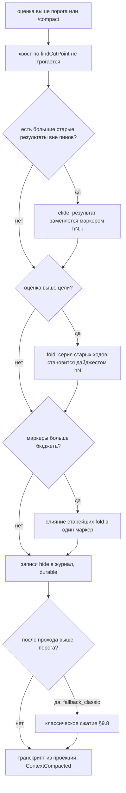

# 17.13. Масштаб сессий

> Часть [архитектуры ядра агента CodeLab](../agent-core-architecture.md). Status: Accepted. Общие соглашения, термины и порядок чтения — в оглавлении.

← [17.12. Цикл и безопасность](17-12-loop-and-security.md) · [Оглавление ядра](../agent-core-architecture.md) · [17.14. Расширения](17-14-extensions.md) →

Цели: S-10 (большие сессии), S-11 (экспорт траектории), K-05 (структурное сжатие без потерь).
Связанные цели: T-24 (поиск по сессии и раскрытие сжатого, §17.11 — использует инструмент
`context_expand` этого раздела), K-06 (закреплённые строки, §17.2.7), S-09 (lease, §17.6.8).
Затрагивает §6.2 (`ToolServices.journal`), §8.2–§8.10 (сегменты, индекс, записи `hide` и `pin`,
оконное открытие), §9.2, §9.5, §9.8 (движок сжатия), §10.2 (capability `compaction`), §11.2,
§12.3, §12.4.2 (точка редакции `export`), §12.6.1, §13.5 (окно реплея), §13.6 (`/compact`),
§13.12, §15.4 (`compaction.engine`, `compaction.structured.*`, `sessions.window.*`,
`sessions.segments.*`), §17.2.7, §17.4.5, §17.5.6, §17.5.8, §17.6.3, §17.6.7, §17.6.8 и
[CLI](../dart-agent-and-clients/09-11-stage-6-cli-mvp.md).

## 17.13.1. Назначение

MVP-журнал (§8) рассчитан на сессии в десятки мегабайт: `open()` читает файл целиком, строит
`byId` по всем записям, а реплей `session/load` отдаёт всю активную ветку. Долгая автономная
работа (сутки `autopilot`, сотни субагентов, тысячи вызовов `exec`) даёт журнал в миллионы записей
и гигабайты — такой файл не помещается в память мобильного профиля и открывается минутами. Раздел
решает три связанные задачи, не меняя главного решения §8: журнал остаётся единственным
append-only источником истории, а всё остальное — его проекции.

* **S-10.** Журнал делится на сегменты; производный индекс смещений записей позволяет открыть
  сессию, прочитав только хвост активной ветки (окно); ремонт затрагивает только хвост
  последнего сегмента; реплей отдаёт окно и маркер «раньше есть ещё N записей».
* **S-11.** `codelab trajectory export` выгружает ветку сессии в JSON-документ формата траекторий
  агента (ATIF): шаги, вызовы и результаты инструментов, usage, время; с редакцией секретов.
* **K-05.** Второй движок сжатия `structured`: вместо пересказа моделью старые записи
  **скрываются** из контекста и заменяются короткими маркерами с идентификаторами; модель
  раскрывает любую скрытую часть инструментом `context_expand`. Журнал не теряет ни байта, а
  проекция детерминирована и не требует вызова модели.

Принципы:

* **Производное можно удалить.** Индекс, как `usage.json` (§12.6.1) и `index.json` (§8.10),
  пересчитывается из журнала и никогда не служит источником истины.
* **Окно эквивалентно целому.** Контекст модели из оконного снимка побайтово равен контексту из
  полного снимка (SCL-2): окно — оптимизация чтения, а не другая семантика.
* **Малые сессии не меняются.** Ниже порога `sessions.window.threshold_bytes` работает открытие
  §8.6 как есть; классический движок сжатия остаётся по умолчанию.

## 17.13.2. Большие сессии (S-10)

### Назначение

Открыть сессию в 1 000 000 записей за время и память, не зависящие от числа записей: прочитать
индекс, хвост активной ветки и несколько служебных записей, а не весь файл. Сегменты ограничивают
размер файла, который может понадобиться дочитать или отремонтировать.

### Контракт

**Раскладка** (дополнение §8.9). Первый сегмент — прежний файл `<stem>.jsonl` с заголовком
сессии: поиск по `sessionId`, `session/list` и шаблон `sessions/*/*.jsonl` не меняются. Следующие
сегменты и индекс лежат в каталоге сессии:

```text
sessions/<cwd-slug>/
  <stem>.jsonl                      сегмент 0: заголовок §8.2.1 и записи
  <stem>/segments/000001.jsonl      сегмент 1: строка segment, затем записи
  <stem>/segments/000002.jsonl      последний (активный) сегмент — сюда идёт append
  <stem>/index/records.idx          индекс смещений, производный, можно удалить
  <stem>/index/segments.json        таблица проиндексированных сегментов, производная
```

Первая строка сегмента `k ≥ 1` — строка `segment`. Как заголовок, она не входит в дерево (нет
`id`, `parentId`) и в проекциях не участвует:

```json
{"type":"segment","version":1,"sessionId":"01JB8Q2W6R9T3M5K7N1P4X8Z0C","seq":1,"created":"2026-10-22T03:10:00.000Z","prev":{"seq":0,"bytes":268434117,"lastRecordId":"x9c8v7b6"}}
```

**Индекс** `records.idx` — 64-байтный заголовок (магия `CLIDX001`, версия `1`, размер записи
`48`, `sessionId` ASCII с дополнением нулями до 32 байт) и записи по 48 байт в порядке файла:

| Поле | Байты | Смысл |
|---|---|---|
| `id` | 12 | `RecordId` ASCII, дополнен `0x00` |
| `parentId` | 12 | то же; все нули — `null` |
| `seq` | 4 | номер сегмента, little-endian |
| `offset` | 8 | смещение начала строки в сегменте |
| `length` | 4 | длина строки без `\n` |
| `type` | 1 | код типа: 1 `message`, 2 `model_change`, 3 `mode_change`, 4 `config_change`, 5 `plan`, 6 `compaction`, 7 `label`, 8 `leaf`, 9 `branch`, 10 `session_info`, 11 `custom`, 12 `subagent`, 13 `job`, 14 `hide`, 15 `pin`, 0 — неизвестный |
| `flags` | 1 | биты 0–1 — роль (`1` user, `2` assistant, `3` toolResult); бит 2 — есть `origin`; бит 3 — строка в карантине; бит 4 — активация skill (§17.2.7); бит 5 — есть поле `spill` |
| — | 6 | резерв, нули |

`segments.json` — `{"v":1,"sessionId":"…","segments":[{"seq":0,"indexedBytes":N,"headHash":"9c3e51a7","records":M}, …]}`;
`headHash` — FNV-1a 32 первых 4096 байт сегмента (§8.9, §8.10.1).

```dart
/// Порт хоста (codelab_agent_io; web и mobile — свои реализации): чтение сегментов по частям.
abstract interface class JournalReader {
  Future<JournalLayout> layout(SessionId id);
  /// Строки сегмента от offset до end потоком чанков по chunkBytes (§17.13.2, «Сканер»).
  Stream<JournalLine> lines(SessionId id, {required int seq, int offset = 0, int? end});
  /// Строки нескольких мест одним проходом; соседние диапазоны склеиваются в одно чтение.
  Future<List<String>> readAt(SessionId id, List<RecordLocation> at);
}
final class JournalLayout { final List<SegmentInfo> segments; int get totalBytes; }
final class SegmentInfo { final int seq; final String path; final int bytes; final String headHash; }
final class RecordLocation { final int seq, offset, length; }
sealed class JournalLine { final int seq, offset; }
final class TextLine extends JournalLine { final String text; }
final class LongLine extends JournalLine { final int length; }   // длиннее max_line_bytes, не буферизуется
final class TornTail extends JournalLine { final int length; }   // хвост без '\n' в конце сегмента

final class RecordIndexEntry {
  final String id; final String? parentId; final RecordLocation at; final int type, flags;
}
/// Производный индекс; хранилище — <stem>/index/ (codelab_agent_io), в web — объектное хранилище.
abstract interface class RecordIndexStore {
  Future<RecordIndex?> load(SessionId id, JournalLayout layout);   // null — нет или недействителен
  Future<void> append(SessionId id, List<RecordIndexEntry> entries, List<SegmentMark> marks);
  Future<void> replace(SessionId id, Stream<RecordIndexEntry> entries, List<SegmentMark> marks);
}
abstract interface class RecordIndex {
  int get length;
  RecordIndexEntry operator [](int i);          // чтение по позиции, страницами по 64 КиБ
  Iterable<RecordIndexEntry> get reversed;      // обратный проход чанками
  bool mayContainId(String id);                 // отсортированные 64-битные FNV-1a хеши id
}

abstract interface class SessionStore {
  // ... §8.3
  /// Оконное открытие (ниже); ниже порога — то же, что open().
  Future<SessionSnapshot> openWindowed(SessionId id, WindowRequest request);
  JournalReader get reader;
}
final class WindowRequest {
  final String? leafId;                 // null — лист по §8.4; иначе окно другой ветки (§17.6.5)
  final bool readOnly;                  // как openReadOnly: без ремонта на диске
  final int replayMaxRecords;           // sessions.window.replay_max_records
}
final class SessionSnapshot {
  // ... §8.3
  final JournalWindow? window;          // null — полный снимок §8.6
}
final class JournalWindow {
  final int totalRecords, pathLength;
  final int floorPathIndex;             // первая загруженная запись пути (пол окна)
  final int replayFromPathIndex;        // начало окна реплея
  final RecordIndex index;
  final List<SessionRecord> statePrefix; // служебные записи пути ниже пола, в порядке пути
}
/// Чистая функция ядра: полный путь потоком (fork, экспорт, раскрытие ниже пола).
Stream<SessionRecord> readPath(SessionSnapshot s, JournalReader r, {String? leafId});
```

`RepairReport` (§8.3) получает поля `windowed` (bool), `indexRebuilt` (bool) и `truncatedBytes`
(int). `pathToLeaf` (§8.4) у оконного снимка возвращает `window.statePrefix` и затем записи от
пола окна до листа; на отсутствующем ниже пола родителе он останавливается без лога
`session.broken_link`.

### Алгоритм

**Сканер строк.** `lines()` читает сегмент чанками по `chunk_bytes` (1 МиБ), режет по `\n`,
переносит незавершённую строку в следующий чанк. Строка длиннее `max_line_bytes` (64 МиБ) не
накапливается: сканер пропускает байты до следующего `\n` и отдаёт `LongLine` (такая строка
уходит в карантин с причиной `line too long`). Байты после последнего `\n` сегмента — `TornTail`.
В памяти одновременно не больше `chunk_bytes + max_line_bytes` байт (SCL-4).

**Быстрый разбор префикса.** `toJson` записей пишет ключи `type`, `id`, `parentId`,
`timestamp` первыми и в этом порядке (дополнение §8.2.2). Индексатор берёт их из префикса строки
без `jsonDecode`; если префикс не совпал с шаблоном, строка разбирается целиком. Флаги битов 4 и 5
ставятся по подстрокам `"source":"skill"`, `"toolName":"skill"` и `"spill":{`; ложное совпадение
(вложенный объект в `custom.data`) лишь заставит прочитать запись, которая ничего не даст (как
§8.10.1, шаг 4c).

**Ротация** (дополнение `append` §8.5, шаг 3, в очереди записи):

```text
1. active := последний сегмент; line := закодированная запись (шаг 1 §8.5)
2. max := sessions.segments.max_bytes; max == 0 → ротации нет
3. если active.bytes > длина первой строки сегмента и active.bytes + |line| + 1 > max:
   a. flush() и закрыть дескриптор active
   b. k := active.seq + 1; записать <stem>/segments/<k:06>.jsonl.tmp: строка segment
      {seq: k, prev: {seq, bytes, lastRecordId}}, flush, rename в <k:06>.jsonl
   c. дескриптор := open(новый сегмент, append); лог info session.segment.rotated {seq, prevBytes}
4. записать line в активный сегмент (запись никогда не пересекает границу сегмента)
5. индекс: добавить RecordIndexEntry в буфер; буфер сбрасывается в records.idx и segments.json
   на каждом durable-append и раз в 1000 записей (без fsync: файл производный)
```

Запись длиннее `max` попадает в новый пустой сегмент одна. Сбой между шагами 3b и 4 оставляет
сегмент из одной строки `segment` — он корректен. Сравнение ревизии lease (§17.6.8) сравнивает
пару `(seq, bytes)` активного сегмента: чужая ротация тоже обнаруживается как чужая запись.

**Оконное открытие:**

```text
openWindowed(id, req):
1  layout := reader.layout(id)
   layout.segments.length == 1 и layout.totalBytes < sessions.window.threshold_bytes
     → open(id) / openReadOnly(id) (§8.6, §17.6.2); window := null; вернуть
2  header := первая строка сегмента 0 (§8.6, шаг 3); для k ≥ 1 первая строка сегмента k —
   segment с seq == k и sessionId == header.id; номера идут подряд с 0;
   иначе SessionOpenException(segmentMismatch, seq) — ни один файл не меняется
3  index := indexStore.load(id, layout); действителен, если совпадают магия, версия, sessionId,
   у каждого сегмента headHash, у всех, кроме последнего, indexedBytes == bytes, у последнего
   indexedBytes ≤ bytes; число записей records.idx == Σ records (лишний хвост records.idx
   после сбоя отрезается)
   a. недействителен или нет → rebuild: для каждого сегмента lines() потоком; каждая строка —
      быстрый разбор префикса; ошибка разбора, LongLine, дубликат id (по mayContainId и
      проверке чтением) → карантин: строка в <stem>.jsonl.corrupt (§8.6, шаг 5a) и запись
      индекса с флагом 3; сегмент НЕ переписывается (SCL-1); replace(...);
      лог info session.index.rebuild {reason: missing|invalid, records, bytes, duration_ms}
   b. действителен → дочитать последний сегмент от indexedBytes тем же сканером, append(...)
4  хвост: TornTail последнего сегмента →
     req.readOnly → только в памяти;
     иначе → строка в .corrupt и усечение последнего сегмента до конца последней целой строки
     (единственная правка файла при оконном открытии, только владелец lease, §17.6.8);
     truncatedBytes := длина хвоста
5  leafId := req.leafId ?? лист по правилу §8.4, применённому к последней записи индекса
   (leaf → readAt → targetId); лист не найден в индексе → как §8.6, шаг 7: последняя
   уцелевшая запись, которая не leaf
6  путь: wanted := leafId; для e в index.reversed: e.id == wanted → path.add(e);
   wanted := e.parentId; wanted == null → стоп. Родитель всегда стоит в файле раньше ребёнка
   (§8.4, правило 1), поэтому одного обратного прохода достаточно; wanted не найден до начала
   индекса → brokenLinks := 1, путь обрывается. В памяти — только записи индекса пути
7  пол окна f := floorOf(path) (ниже); replayFrom := turnStart(max(0, |path| − replayMaxRecords))
   — первое user-сообщение пути с позицией ≥ этого числа (нет такого → начало хода, в который
   оно попадает); lastTurn := позиция последнего user-сообщения пути
   loadFrom := min(f, replayFrom, lastTurn)
8  загрузить readAt: записи path[loadFrom..]; служебные записи пути ниже loadFrom по коду типа:
   последние model_change и mode_change, последняя config_change на каждый optionId (все
   config_change читаются, их мало), последние plan и session_info с title, последняя
   compaction, все hide и pin, все label; записи пути с флагом 4 (activatedSkills, §17.2.7);
   по всему индексу (все ветки) — записи с флагом 5 и типами job, subagent (SpillService.attach,
   §17.4.5; восстановление задач §17.9.10; доска субагентов §17.3.6)
   строка, чей id/parentId не совпал с индексом → индекс недействителен, к шагу 3a (SCL-3)
9  healInterruptedTurn (§8.8) работает по окну: последний ход всегда загружен (шаг 7)
10 вернуть SessionSnapshot(header, records: загруженные в порядке файла, byId: загруженные,
   leafId, repair, window: JournalWindow(...)); лог info session.window.open {records,
   pathLength, loaded, bytesRead, indexRebuilt, duration_ms}
```

**Пол окна** — первая запись пути, которая нужна `buildLlmContext` (§8.7) как сообщение:

```text
floorOf(path):
1  ci := позиция последней compaction на пути; base := ci есть ? позиция firstKeptId : 0
   (firstKeptId ищется в записях индекса пути; не найден → base := ci, как lost_anchor §8.7)
2  folds := диапазоны hide с mode fold (§17.13.4) на пути, обрезанные снизу по base
3  f := первая позиция ≥ base, где запись — message и не покрыта ни одним диапазоном folds
4  вернуть f (нет такой → позиция листа)
```

Записи ниже пола в проекцию попадают только маркерами fold и служебными значениями, которые
восстановлены из `statePrefix`; поэтому проекция окна совпадает с полной (SCL-2). Без сжатия и
скрытия пол — начало пути: сессия, ни разу не сжатая, загружается целиком (её контекст и так
должен целиком уйти модели).

**Уникальность id.** Шаг 2 генерации `RecordId` (§8.4) у оконного снимка проверяет
`byId` и `index.mayContainId`: положительный ответ (в том числе ложный) — повтор генерации.

**Реплей окна** (дополнение §13.5, шаг 5): если `replayFromPathIndex > 0`, первым уходит
`agent_message_chunk` с фиксированным текстом
`Earlier history of this session is not shown: <n> records before this point.` и
`_meta.codelab.replayWindow: {"omittedRecords": <n>, "firstRecordId": "<id>"}` (расширение через
OpenSpec, §13.12; клиент без него видит текст). Затем — обычный реплей записей пути начиная с
`replayFromPathIndex`; окно начинается с user-сообщения, поэтому ни один `tool_call` не остаётся
без результата (SCL-6).

**Операции за пределами окна:**

| Операция | Как работает оконный снимок |
|---|---|
| `switchBranch`, `rewind` к записи ниже пола (§17.6.5–§17.6.6) | запись `branch` пишется как обычно; затем `openWindowed(leafId: новый лист)` — новый снимок |
| `tree()`, `/branches` (§17.6.3) | листья — записи индекса, чей id не встречается как `parentId` (множество хешей `parentId`, 8 байт на запись); заголовки веток читаются `readAt` |
| fork (§17.6.7) | `createFrom` получает `readPath(...)` потоком и пишет новый журнал одним сегментом через `.tmp`; ротация — со следующего `append` |
| `context_expand`, `session_history` (§17.13.4, §17.11) | записи ниже пола читаются `readAt` по индексу |
| `usage.json` (§12.6.1), экспорт (§17.13.3) | читают все сегменты сканером, не загружая журнал целиком |
| `probeSummary` (§8.10.1) | голова — сегмент 0, хвост — последний сегмент; ключ кеша `index.json` — размер и mtime сегмента 0 плюс `seq`, размер и mtime последнего |

### Конфигурация

**`sessions.window`** и **`sessions.segments`** (дополнение §15.4; ключи `sessions.*` в проектном
конфиге не принимаются, §15.3):

| Ключ | Тип | По умолчанию | Смысл |
|---|---|---|---|
| `window.enabled` | bool | `true` | `false` — всегда полное открытие §8.6 |
| `window.threshold_bytes` | int | `67108864` | 64 МиБ: журнал из одного сегмента меньше порога открывается полностью; `1048576..17179869184` |
| `window.replay_max_records` | int | `2000` | записей пути в реплее; `100..1000000` |
| `window.chunk_bytes` | int | `1048576` | чанк сканера; `65536..16777216` |
| `window.max_line_bytes` | int | `67108864` | длиннее — карантин `line too long`; `1048576..268435456` |
| `segments.max_bytes` | int | `268435456` | 256 МиБ, порог ротации; `0` — без ротации; иначе `16777216..4294967296` |

```yaml
sessions:
  window:
    threshold_bytes: 33554432
    replay_max_records: 500
  segments:
    max_bytes: 134217728
```

### Пример

Сессия суточного прогона: 1 048 576 записей, 1,1 ГБ в пяти сегментах, три сжатия. `session/load`:
индекс действителен (50 МБ читаются обратным проходом без разбора JSON), путь — 812 000 записей,
`firstKeptId` последнего сжатия — на позиции пути 811 400, это и есть пол окна; загружено 600
записей хвоста и 41 служебная. Реплей: маркер
`Earlier history of this session is not shown: 810000 records before this point.`, затем 2 000
записей от начала хода. Последний сегмент оборван посреди строки: усечено 3 412 байт, строка
в `.corrupt`, первые четыре сегмента не тронуты.

### Как проверить

* `session_windowed_load_test.dart` — критерий **`core/session-windowed-load-1m-records`**:
  генератор пишет 1 000 000 записей (ходы user → assistant с вызовом → toolResult, три записи
  `compaction`, две ветки) при `segments.max_bytes = 64 МиБ`; `openWindowed` с действительным
  индексом читает не больше `индекс + 2 × байты окна + 1 МиБ` (счётчик байтов fake-ФС), разбирает
  JSON не больше чем у `загружено + 64` строк; `buildLlmContext` окна побайтово равен проекции,
  построенной эталонным потоковым проходом по всему журналу; реплей — маркер и
  `≤ replay_max_records + длина хода` записей, первое сообщение окна — user (SCL-2, SCL-4, SCL-6).
  Вариант с тегом `perf`: открытие ≤ 2 с, рост RSS ≤ 256 МиБ.
* `session_index_rebuild_test.dart`: удалённый индекс → пересборка потоком; пиковый буфер сканера
  `≤ chunk_bytes + max_line_bytes`; результат побайтово равен индексу, который вёлся при записи;
  испорченная строка в середине сегмента 2 → `.corrupt`, флаг карантина, сегмент не изменён
  (SCL-1, SCL-3).
* `session_segment_rotation_test.dart`: запись через границу `max_bytes` → новый сегмент с
  `prev`; запись больше `max_bytes` — одна в сегменте; сбой после rename сегмента до первой
  записи → сессия открывается; пропуск номера сегмента → `SessionOpenException(segmentMismatch)`
  без изменений файлов (SCL-5).
* `session_window_tail_repair_test.dart`: оборванная строка в последнем сегменте → усечён только
  он, mtime прочих сегментов не изменился; в `readOnly` файлы не меняются.
* `session_window_index_mismatch_test.dart`: индекс со смещением, указывающим на чужую строку →
  обнаружение при чтении, пересборка, правильный снимок (SCL-3).
* `acp/session-load-replay-window` (§14.2): журнал больше порога, `replay_max_records = 100` →
  первое уведомление — маркер, затем реплей с границы хода; ответ `session/load` после реплея.

## 17.13.3. Экспорт траектории (S-11)

### Назначение

Отдать сессию инструментам анализа и бенчмаркам в формате траекторий агента ATIF (Agent
Trajectory Interchange Format, RFC 0001 проекта Harbor:
<https://github.com/harbor-framework/harbor/blob/main/rfcs/0001-trajectory-format.md>), версия
**ATIF-v1.7**: линейная
последовательность шагов с сообщениями, рассуждениями, вызовами инструментов и их результатами,
usage и временем. Экспорт — только CLI (`codelab trajectory export`), без расширений ACP; он
читает журнал встроенного агента и ничего в каталоге сессии не меняет.

### Контракт

**Документ.** JSON-объект; схема фиксируется файлом
`codelab_agent_core/lib/src/session/trajectory.schema.json` (JSON Schema 2020-12) и golden-тестом.
Документ — валидная траектория ATIF-v1.7: используются только поля RFC 0001 этой версии; всё
специфичное для CodeLab лежит в `extra` (корень, `agent`, шаг, вызов, результат, метрики —
`extra` разрешён на всех этих уровнях с v1.7). `trajectory.schema.json` повторяет схему RFC
0001 v1.7 и сужает её (обязательные у нас поля, закрытый набор ключей `extra.codelab`).

| Поле | Тип | Смысл |
|---|---|---|
| `schema_version` | string | константа `"ATIF-v1.7"` (формат RFC — `ATIF-v<major>.<minor>`) |
| `trajectory_id` | string | `<sessionId>:<leafId>` — идентификатор документа (v1.7); у вложенной траектории субагента — `<childSessionId>:<childLeafId>` |
| `session_id` | string | `SessionId`; в v1.7 поле относится к прогону, поэтому у траекторий субагентов — тот же `session_id` родителя |
| `agent` | object | `{name, version, model_name}`; `model_name` — модель первого шага `provider/id`; `tool_definitions` не выгружается: журнал не хранит схемы инструментов |
| `steps[]` | array | шаги в порядке пути, `step_id` с 1 |
| `steps[].source` | `"user"` \| `"agent"` \| `"system"` | кто автор |
| `steps[].timestamp` | string | `timestamp` записи, ISO-8601 UTC |
| `steps[].message` | string \| `ContentPart[]` | текстовые блоки через `\n\n`; при `--images files` и картинках в сообщении — массив `ContentPart`: `{"type":"text","text"}` и `{"type":"image","source":{"media_type","path"}}` |
| `steps[].reasoning_content` | string? | блоки `thinking` (не `redacted`) через `\n\n`; подписи не выгружаются |
| `steps[].model_name` | string? | только у `agent` |
| `steps[].reasoning_effort` | string? | только у `agent`: значение опции `effort` на момент шага (§2.12.3), если модель рассуждает |
| `steps[].llm_call_count` | int? | только у `agent`: `1` — запись assistant журнала соответствует одному вызову модели (повторы попыток §2.10 в журнал не пишутся); `0` — синтетическая заметка цикла (`origin: "loop_note"`, §5.4.1) |
| `steps[].is_copied_context` | bool? | `true` у шагов, унаследованных при fork до точки ответвления (`header.forkedFrom`, §17.6.7) |
| `steps[].tool_calls[]` | array? | `{tool_call_id, function_name, arguments}` |
| `steps[].observation.results[]` | array? | `{source_call_id, content, subagent_trajectory_ref?, extra: {is_error, outcome, elapsed_ms, spill?}}` — флага ошибки в RFC нет, поэтому `is_error` лежит в `extra` |
| `steps[].metrics` | object? | `{prompt_tokens, completion_tokens, cached_tokens, cost_usd, extra: {cache_write_tokens, reasoning_tokens?}}` |
| `steps[].extra` | object | `{record_id, stop_reason?, duration_ms?, origin?, context_management?, images?}`; `context_management: {type, boundary}` — соглашение RFC для шагов `system`, меняющих окно контекста |
| `final_metrics` | object | `{total_prompt_tokens, total_completion_tokens, total_cached_tokens, total_cost_usd, total_steps, extra: {wall_ms, tool_calls, subagent_usage?}}` |
| `subagent_trajectories[]` | array? | при `--subagents nest`: полные валидные траектории ATIF-v1.7 детей (свои `schema_version`, `trajectory_id`, `agent`, `step_id` с 1); вызов `task` ссылается на них `subagent_trajectory_ref` |
| `extra.codelab` | object | `{title, cwd?, leaf_id, events[], redaction}` |

`prompt_tokens = input + cacheRead + cacheWrite`, `cached_tokens = cacheRead`,
`completion_tokens = output` (форма `usage` §8.2.3); `cost_usd` — сумма полей `cost`, округление
до 10⁻⁶. Время: `duration_ms` шага `agent` — разность `timestamp` ответа и предыдущей записи
пути (журнал не хранит начало запроса, поэтому сюда входит и ожидание очереди); `elapsed_ms`
результата — разность `timestamp` результата и ответа с вызовом; `wall_ms` — от первой до
последней записи пути.

```dart
final class TrajectoryOptions {
  final String? leafId;                 // null — активный лист
  final bool thinking;                  // --thinking include|omit
  final ImageExport images;             // omit | files
  final bool nestSubagents;             // --subagents nest
  final ExportRedaction redaction;      // standard | strict
  final bool pretty;
}
enum ImageExport { omit, files }
enum ExportRedaction { standard, strict }
/// Чистая функция ядра: JSON по частям; память — O(одного хода), не O(сессии).
Stream<String> exportTrajectory(SessionHeader header, Stream<SessionRecord> path,
    TrajectoryOptions o, {required Redactor redactor, required SubagentJournals children});
```

Новая точка редакции `RedactionPoint.export` (дополнение §12.4.2): `redactJson` по каждой строке
документа **без освобождений** — результаты `write`/`edit`, аргументы вызовов и `thinking` тоже
редактируются: экспорт не уходит провайдеру и не служит исходным текстом правки.

### Алгоритм

```text
export(sessionRef, flags):
1  sessions.dir из конфига (§15.4); найти журнал: полный sessionId — по суффиксу имени файла;
   префикс ≥ 8 символов — единственное совпадение в sessions/*/; --last — самая новая сессия
   --cwd по SessionStore.list (§8.10); 0 совпадений или больше одного → код 1
   журнал субагента (header.parent) → код 1 "Session <id> is a subagent session; export its parent with --subagents nest."
2  снимок без lease и без записи на диск: openWindowed(readOnly: true) (§17.13.2); длины
   сегментов фиксируются на этот момент, позднейшие строки и оборванный хвост не читаются
3  path := readPath(snapshot, leafId) — поток по всем сегментам
4  для записей пути по порядку (буфер — текущий шаг agent и ждущие результата вызовы):
   message user с isUserWords (§8.2.5) → шаг user (у steer — extra.origin: "steer"; в журнале
     субагента у parent_message — extra.origin: "parent_message")
   прочие message user → шаг system, extra.origin
   message assistant → шаг agent; text → message, thinking → reasoning_content (если thinking),
     toolCall → tool_calls; usage → metrics; stopReason → extra.stop_reason;
     origin loop_note → extra.origin, llm_call_count: 0 (синтетический ответ цикла, вызова модели не было)
   message toolResult → observation.results шага с вызовом toolCallId, в порядке вызовов;
     content — текст блоков (вынесенный результат — фрагмент с путём, extra.spill: {path, bytes, lines})
   compaction → шаг system, message := summary, extra.context_management:
     {type: "compaction", boundary: "replace"}, tokens_before/after
   branch со сводкой → шаг system, extra.context_management: {type: "injection",
     boundary: "append"}; hide → шаг system с маркерами, extra.context_management:
     {type: "pruning", boundary: "replace"} (§17.13.4)
   записи до точки fork (header.forkedFrom) → шаги с is_copied_context: true
   model_change, mode_change, config_change, plan, label, session_info, pin, job, custom →
     extra.codelab.events[]: {after_step, type, record_id, …поля записи}
   subagent → при nestSubagents: subagent_trajectories[] += export(журнал ребёнка, те же
     флаги), а результат вызова task получает subagent_trajectory_ref: [{trajectory_id,
     session_id, extra: {subagent_id, agent}}]; иначе только event
5  картинки: omit → extra.images[] = {mime_type, bytes, sha256}, message — строка;
   files (только с --out) → файлы <каталог out>/images/<sha256>.<ext> (запись tmp + rename,
   одинаковые картинки — один файл), message — массив ContentPart с path "images/<sha256>.<ext>"
   относительно файла траектории (RFC v1.6+); base64 внутрь документа не кладётся
6  каждый шаг перед выдачей — Redactor(export); strict дополнительно: префикс домашнего каталога
   → "~", header.cwd → "<cwd>", extra.codelab.cwd не пишется, images всегда omit, thinking omit
7  final_metrics — суммы по шагам agent этой траектории; usage детей — в их собственных
   final_metrics и сводно в extra.subagent_usage
8  ключи в порядке таблицы, null не пишется; --pretty — отступ 2 пробела; иначе без пробелов;
   в конце — '\n'; времени экспорта и других значений вне журнала в документе нет (SCL-7)
9  --out <файл> → <файл>.tmp, rename; без --out → stdout
```

### CLI

```text
codelab trajectory export [<sessionId>|--last] [--cwd <dir>] [--out <file>] [--leaf <recordId>]
    [--thinking include|omit] [--images omit|files] [--subagents omit|nest]
    [--redact standard|strict] [--pretty]
```

| Флаг | Значение | По умолчанию |
|---|---|---|
| `<sessionId>` | полный id или префикс ≥ 8 символов | — (без него и без `--last` → код 64 `Pass a session id or --last.`) |
| `--last` | последняя сессия папки `--cwd` | выключено |
| `--cwd <dir>` | папка для `--last` | текущая |
| `--out <file>` | файл вместо stdout | stdout |
| `--leaf <recordId>` | экспорт ветки до этой записи | активный лист |
| `--thinking` | рассуждения модели | `include` |
| `--images` | `omit` — только описание в `extra`; `files` — файлы `images/` рядом с `--out` и `ContentPart` в шаге (без `--out` → код 64) | `omit` |
| `--subagents` | вложить траектории субагентов | `omit` |
| `--redact` | `standard` — слои `redact.*`; `strict` — плюс пути, картинки, рассуждения | `standard` |
| `--pretty` | отступы | выключено |

Коды выхода: `0` — успех; `1` — сессия не найдена, не единственна или является журналом
субагента; `2` — ошибка чтения или записи (текст ОС в stderr); `64` — неверные флаги. Подкоманда
работает без запуска агента, как `codelab config` (dart-agent-and-clients §9.11); для внешнего
агента (`--agent`) не применяется: его журналы CodeLab не читает.

### Пример

```bash
codelab trajectory export --last --out run.json --redact strict
```

Фрагмент документа для сессии из §8.2.3 (`--pretty` опущен):

```json
{"schema_version":"ATIF-v1.7","trajectory_id":"01JB8Q2W6R9T3M5K7N1P4X8Z0C:t5y6u7i8","session_id":"01JB8Q2W6R9T3M5K7N1P4X8Z0C","agent":{"name":"codelab-agent","version":"0.1.0","model_name":"openai/gpt-4o"},"steps":[{"step_id":1,"source":"user","timestamp":"2026-10-21T08:00:01.000Z","message":"Fix the failing test in test/a_test.dart","extra":{"record_id":"p7d2e8b4"}},{"step_id":2,"source":"agent","timestamp":"2026-10-21T08:00:03.000Z","model_name":"openai/gpt-4o","llm_call_count":1,"message":"","tool_calls":[{"tool_call_id":"call_1","function_name":"read","arguments":{"path":"test/a_test.dart"}}],"observation":{"results":[{"source_call_id":"call_1","content":"1| void main() {\n2|   expect(1, 2);\n3| }","extra":{"is_error":false,"outcome":"completed","elapsed_ms":200}}]},"metrics":{"prompt_tokens":1830,"completion_tokens":41,"cached_tokens":0,"cost_usd":0.005,"extra":{"cache_write_tokens":0}},"extra":{"record_id":"q1w2e3r4","stop_reason":"toolUse","duration_ms":2000}}],"final_metrics":{"total_prompt_tokens":1830,"total_completion_tokens":41,"total_cached_tokens":0,"total_cost_usd":0.005,"total_steps":2,"extra":{"wall_ms":2200,"tool_calls":1}},"extra":{"codelab":{"title":"Fix a_test","leaf_id":"t5y6u7i8","events":[{"after_step":0,"type":"model_change","record_id":"k3f9a1c2","provider":"openai","modelId":"gpt-4o"}],"redaction":"strict"}}}
```

### Как проверить

* `trajectory_export_test.dart` (`codelab_cli`, scripted-сессия) — критерий
  **`cli/trajectory-export-atif`**: сессия с user, assistant с `thinking`, пакетом из двух
  вызовов (`read`, `exec` с выносом), steering, сжатием, переключением ветки и субагентом;
  `codelab trajectory export <id>` → документ проходит `trajectory.schema.json` и совпадает с
  golden; `schema_version == "ATIF-v1.7"`; в документе нет полей вне RFC 0001 v1.7 (проверка
  по списку полей версии, специфичное — только в `extra`); `--images files` пишет файлы в
  `images/` и ссылки `ContentPart`; при `--subagents nest` у результата `task` есть
  `subagent_trajectory_ref`, указывающий на `trajectory_id` элемента `subagent_trajectories`;
  fork-сессия помечает унаследованные шаги `is_copied_context`; каждый `toolResult` пути — ровно в одном `observation.results` своего вызова; суммы
  `final_metrics` равны суммам шагов; секрет в результате `exec` и в аргументе `write` заменён
  маркером редакции; `--redact strict` — нет домашнего пути и `reasoning_content`; два экспорта
  побайтово равны; `--leaf` неактивной ветки даёт её путь; каталог сессии и lease не изменились (SCL-7…SCL-9).
* `trajectory_export_large_test.dart`: журнал §17.13.2 на 1 000 000 записей → экспорт потоком,
  пиковая память ≤ буфер сканера + один ход (счётчик буферов).
* Ошибки CLI: без id и `--last` → 64; неоднозначный префикс → 1 со списком; журнал субагента → 1.

## 17.13.4. Структурное сжатие без потерь (K-05)

### Назначение

Классический компактор (§9) теряет детали: резюме пересказывает старую часть, исходные записи
остаются только в файле. Структурный движок не пересказывает, а **скрывает**: большие старые
результаты инструментов заменяются однострочными маркерами (elide), старые ходы целиком —
дайджестом по строке на ход (fold). Каждый маркер несёт идентификатор; инструмент
`context_expand` возвращает исходные записи. Движок не вызывает модель, детерминирован и
дешевле: сжатие — запись `hide` в журнале, проекция — чистая функция журнала.

### Контракт

```dart
enum CompactionEngineKind { classic, structured }   // compaction.engine
abstract interface class CompactionEngine {
  Future<CompactionOutcome> compact(SessionSnapshot s, CompactionTrigger trigger,
      {required CompactionSettings settings, required CancelToken cancel, String? focus});   // focus — только при trigger == manual
}
// ClassicCompactionEngine — compact() §9.8; StructuredCompactionEngine — ниже.
// Compacted.record (§9.2) расширяется до SessionRecord: CompactionRecord | HideRecord.

final class StructuredSettings {             // compaction.structured.*, уже провалидировано
  final double targetFraction;               // 0.5
  final int elideMinTokens;                  // 256
  final int previewChars;                    // 60
  final double markerBudgetFraction;         // 0.125
  final int expandMaxTokens;                 // 8000
  final int maxExpandsPerTurn;               // 8
  final double pinBudgetFraction;            // 0.25
  final bool fallbackClassic;                // true
}

final class HideRecord extends SessionRecord {     // type: "hide"
  final int n;                                     // номер скрытия в сессии, с 1, не переиспользуется
  final HideMode mode;                             // elide | fold
  final List<ElideItem> items;                     // только elide
  final String? from, to;                          // только fold: первая и последняя запись диапазона пути
  final int records, tokens;                       // fold: число записей и их оценка (§9.3)
  final List<FoldTurn> turns;                      // fold: по строке дайджеста на ход
  final List<int> merges;                          // fold, объединение маркеров: номера поглощённых скрытий
  final int tokensBefore, tokensAfter;
}
enum HideMode { elide, fold }
final class ElideItem { final String targetId, tool; final int tokens; final bool isError;
    final String? preview; final String? spillPath; }     // preview null — недоверенный результат
final class FoldTurn { final String userId, user; final Map<String, int> tools; final int failed;
    final List<String> files; final String? answer; }
final class PinRecord extends SessionRecord {      // type: "pin"
  final List<String> targetIds; final String by;   // "model"
  final String? toolCallId;                        // вызов context_expand, чей результат тоже закреплён
}
final class ToolServices { /* ... §6.2 */ final SessionJournalView? journal; }   // для context_expand
abstract interface class SessionJournalView {
  HideRecord? hide(int n);                         // по всем веткам
  Future<List<SessionRecord>> range(String fromId, String toId);   // по пути hide-записи
  Future<SessionRecord?> record(String id);        // byId или readAt по индексу (§17.13.2)
  bool onActivePath(String id);
}
```

Записи журнала (дополнение §8.2.4; модель их не видит, реплей их не отправляет):

```json
{"type":"hide","id":"v3b4n5m6","parentId":"e3d4f5g6","timestamp":"2026-10-22T09:00:00.000Z","n":3,"mode":"elide","items":[{"targetId":"t5y6u7i8","tool":"read","tokens":4210,"isError":false,"preview":"1| import 'package:flutter/material.dart';"}],"tokensBefore":118400,"tokensAfter":60210}
{"type":"hide","id":"c7x8z9a0","parentId":"v3b4n5m6","timestamp":"2026-10-22T09:00:00.010Z","n":4,"mode":"fold","from":"p7d2e8b4","to":"e3d4f5g6","records":57,"tokens":18400,"turns":[{"userId":"p7d2e8b4","user":"Fix the failing test in test/a_test.dart","tools":{"edit":1,"exec":1,"read":2},"failed":1,"files":["lib/a.dart","test/a_test.dart"],"answer":"Fixed the expectation; dart test passes."}],"tokensBefore":60210,"tokensAfter":43900}
{"type":"pin","id":"q9w8e7r6","parentId":"r5t4y3u2","timestamp":"2026-10-22T09:05:00.000Z","targetIds":["q1w2e3r4","t5y6u7i8"],"by":"model","toolCallId":"call_41"}
```

**Маркеры** — фиксированный английский текст из ресурсов `compaction/hidden_elide.md`,
`compaction/hidden_fold.md` и `compaction/hidden_wrapper.md` (§11.2). Подстановки — только поля
записи `hide`, поэтому текст маркера не зависит от того, когда и какой версией он построен.
Числа токенов — `<k>.<d>k` при ≥ 1000, иначе целое. Elide (содержимое `toolResult` вместо
исходного):

```text
[hidden h3.1: read result, ~4.2k tokens. Starts: "1| import 'package:flutter/material.dart';". Call context_expand with ref "h3.1" to read it.]
```

Варианты: `, error` после числа токенов при `isError`; `Preview withheld: untrusted content.`
вместо `Starts: …` при `preview == null`; ` Full output: <spillPath>.` перед `Call …` у
вынесенного результата (§17.4). Fold — одно user-сообщение на месте первой записи диапазона:

```text
Part of the conversation before this point is hidden to save context. Nothing was deleted:
each hidden part has an id, and context_expand returns its original records. Treat hidden
parts as facts from the past; files may have changed since, so re-read a file before editing it.

[hidden h4: 1 earlier turn, 57 records, ~18.4k tokens. Call context_expand with ref "h4" or "h4.<turn>" to read them.]
- h4.1 user: "Fix the failing test in test/a_test.dart" | tools: edit 1, exec 1, read 2 (1 failed) | files: lib/a.dart, test/a_test.dart | answer: "Fixed the expectation; dart test passes."
```

Объединённый маркер (`merges` не пуст) — без строк ходов:
`[hidden h9: 112 earlier turns (merged h3, h4, h7), 4113 records, ~240.0k tokens. Call context_expand with ref "h9" to page through them.]`.

**Инструмент `context_expand`** — tier `read`, kind `read`, `executionMode: parallel`,
`outputTrust` — `trusted` (возвращает содержимое журнала, уже огороженное при первой выдаче,
§6.3.6). Схема:

```json
{"type":"object","additionalProperties":false,"required":["ref"],"properties":{
  "ref":{"type":"string","pattern":"^(h[0-9]{1,9}(\\.[0-9]{1,6})?|[0-9a-z]{8,12})$","description":"Id from a [hidden …] marker (h3 or h3.2) or a record id from session_history."},
  "offset":{"type":"integer","minimum":0,"default":0,"description":"Skip this many records of a long range."},
  "limit":{"type":"integer","minimum":1,"maximum":100,"default":40,"description":"Maximum records to return."},
  "pin":{"type":"boolean","default":false,"description":"Keep these records visible in future context reductions."}}}
```

Описание (`tool_descriptions/context_expand.md`):

```text
Show original records of this session that are hidden from your context. Hidden parts appear
as markers like [hidden h3.2: …]. Pass the id from a marker (h3 or h3.2) or a record id from a
session_history result (the part before the colon). Long ranges are paged: continue with offset. Set pin to true to keep the
records visible when the context is reduced again. Use it when you need exact earlier output,
not to re-read files: read the file again instead.
```

Регистрация: встроенный инструмент capability `compaction` (§10.2), регистрируется, если
`compaction.engine == structured` или зарегистрирован `session_history` (T-24, §17.11). При
классическом движке `ref` вида `h<N>` не встречается, и инструмент раскрывает записи по id —
в том числе сжатые классическим резюме. Выключение через `tools.disabled` при движке
`structured` переводит сессию на `classic` с предупреждением `compaction.structured.unavailable`:
маркеры, которые нельзя раскрыть, не строятся.

### Алгоритм: проекция

Дополнение `buildLlmContext` (§8.7) между шагами 4 и 6:

```text
5a. hides := записи hide в kept; fold-диапазон D = позиции пути от from до to,
    обрезанные снизу по началу kept; диапазон, целиком поглощённый другим (merges), не
    рисуется отдельно — рисуется внешний
    elided := targetId → (n, номер item) по всем hide с mode elide
5b. обнуление usage: assistant-сообщения kept, стоящие в пути до последней записи hide,
    получают Usage.zero (как шаг 5 — иначе якорь §9.3 вернул бы оценку до скрытия)
6'. при сборке messages:
    запись внутри D: первая запись D, вошедшая в kept → UserMessage(hidden_wrapper + маркеры
      подряд идущих fold-диапазонов); прочие записи D → ничего
    message toolResult с id ∈ elided → копия с content := [TextContent(маркер elide)],
      isError, toolCallId и toolName сохраняются; картинки результата не передаются
    hide, pin → ничего
```

Fold покрывает только целые ходы, elide меняет только содержимое результата, поэтому пары вызов ↔
результат остаются целыми (CMP-1, SCL-11). Классическое сжатие поверх скрытия: `kept` считается
по §8.7, шаг 4, затем применяются скрытия внутри `kept`; суммаризатор (§9.7) получает регион в
виде проекции — с маркерами, а не с исходным текстом. Ссылки `h<N>` в резюме остаются
действительными: `context_expand` читает журнал, а не проекцию.

### Алгоритм: проход сжатия

```text
structuredCompact(snapshot, trigger, settings, st, cancel):
1  trigger ∈ {afterTurn, manual} и идёт ход → дождаться конца хода (§9.8, шаг 1)
2  w := effectiveContextWindow; P := buildLlmContext(snapshot); before := estimateContextTokens(P)
   target := floor(w × st.targetFraction); threshold := compactionThreshold(w, settings)
   trigger != manual и before ≤ threshold → NothingToCompact
   before ≤ target → NothingToCompact("already below target")
3  visible := записи пути, видимые в P; cut := findCutPoint(visible, settings) (§9.6);
   null → NothingToCompact; old := visible[..cut.firstKeptIndex)
4  protected := записи из targetIds всех pin на пути ∪ toolResult вызовов pin.toolCallId ∪
   первое user-сообщение пути (постановка задачи) ∪ для каждой защищённой записи toolResult —
   её assistant-сообщение с вызовом и все его результаты
5  фаза A, elide: est := before
   для r в old по порядку пути (старые первыми), r — toolResult, не скрыт, ∉ protected,
   estimate(r) ≥ st.elideMinTokens, пока est > target:
     item := ElideItem(r.id, r.toolName, estimate(r), r.isError,
       preview: trust(r) == untrusted ? null : первая непустая строка текста, пробелы
       схлопнуты, обрезана до st.previewChars с '…', spillPath: r.spill?.path)
     est -= estimate(r) − estimate(маркер item)
   items не пуст → hideA := HideRecord(elide, n := maxN + 1, items)
6  фаза B, fold: пока est > target:
     run := самая длинная непрерывная серия ходов old (ход — от user-сообщения до следующего
       user-сообщения), начиная с самого старого нескрытого хода, где ни одна запись ∉ protected
       и ни одна не покрыта fold; серия пуста → прервать
     turns := дайджест каждого хода: user — первый text-блок, пробелы схлопнуты, ≤ 200 символов;
       tools — число вызовов по имени, ключи по алфавиту; failed — результаты с isError;
       files — пути из аргументов read/write/edit (до 8, по алфавиту, относительно cwd);
       answer — первая строка последнего text-блока assistant хода, ≤ 120 символов
     hideB := HideRecord(fold, from: первая запись серии, to: последняя, turns, records, tokens)
     est -= tokens(серии с учётом A) − estimate(маркер)
7  фаза C, слияние маркеров: оценка всех fold-маркеров проекции > w × st.markerBudgetFraction →
   hideC := fold от from самого старого до to самого нового из k старейших fold, где k —
   наименьшее число, после которого бюджет соблюдён; merges := их номера; turns := []
8  ничего не выбрано → NothingToCompact
9  recs := [hideA?, hideB…, hideC?] с n подряд; projected := buildLlmContext(snapshot + recs);
   after := estimateContextTokens(projected); у каждой записи tokensBefore/tokensAfter —
   оценки до и после неё
10 cancel.throwIfCancelled(); append каждой записи (durable) — только теперь скрытие существует
11 транскрипт := projected.messages; emit ContextCompacted(before, after); лог info
   compaction.structured.pass {trigger, elided, folded, merged, before, after}
12 after > threshold: st.fallbackClassic → классический compact() §9.8 на новом снимке
   (лог compaction.structured.fallback); иначе AgentError(cls: compaction, "Context is still over
   the limit after hiding old records.") и правило CMP-5 о трёх проходах
```

`preflight` и `overflow` (§9.5) вызывают тот же проход; правило «аварийная помощь один раз»
(CMP-8) общее для обоих движков. Шаги 5–7 — чистые функции снимка и настроек: одинаковый снимок
даёт одинаковые записи с точностью до `id` и `timestamp` (SCL-12). Защита первого
user-сообщения и пинов гарантирует, что постановка задачи и закреплённое остаются дословно.



### Алгоритм: `context_expand`

```text
execute({ref, offset = 0, limit = 40, pin = false}):
1  счётчик вызовов хода > st.maxExpandsPerTurn → ошибка
   "Expansion limit reached for this turn (<max> calls). Continue with what you have or ask the user."
2  ref = h<N>[.<k>]:
     hide := journal.hide(N); нет → "Unknown reference \"<ref>\". Use an id from a [hidden …] marker or a session_history result."
     elide: k обязателен для нескольких items (без k — все items по порядку); k вне 1..|items| →
       "Reference \"<ref>\" is out of range: h<N> has <m> items."; recs := записи targetId
     fold: recs := journal.range(from, to); с k — только записи хода k (вне 1..|turns| — та же
       ошибка с "turns"); merges → диапазон внешнего, страницы по ходам
   ref = recordId: rec := journal.record(id); нет → "Unknown reference …" (тот же текст);
     recs := [rec]; ¬onActivePath(id) → первой строкой "Note: this record is on another branch of the session."
3  страница: recs[offset .. offset + limit)
4  текст — сериализация §9.7, шаг 1, без обрезки 4 000 символов: перед каждой записью строка
   "[record <id> · user]", "[record <id> · assistant]", "[record <id> · tool call <name>]",
   "[record <id> · tool result <name>, error]"; toolResult — исходный content записи журнала
   (огороженный и отредактированный при первой выдаче), картинки — "[image <mime> omitted]";
   строка записи, которую не удалось прочитать → "Record <id> is no longer readable: the journal line is damaged."
5  пока страница длиннее одной записи и estimate(текст) > min(st.expandMaxTokens, w ~/ 4):
     убрать последнюю запись страницы; одна запись больше лимита → усечение головы §6.3.5
6  остались записи → строка "[… <rest> more records: call context_expand with ref \"<ref>\" and offset <next> …]"
7  pin: pinned := Σ estimate записей всех pin пути; pinned + estimate(страницы) ≤ w × st.pinBudgetFraction →
     append PinRecord(targetIds: id записей страницы, toolCallId: этот вызов) и строка
     "Pinned: these records stay visible in future context reductions."; иначе строка
     "Not pinned: pinned records would exceed <pct>% of the context window."
8  результат — один TextContent; лог debug context.expand {ref, records, tokens, pinned}
```

Пин действует на **следующие** проходы: уже показанная проекция не перерисовывается, а
нужный текст модель получила результатом этого вызова — он и закреплён через `toolCallId`.
Раскрытие не меняет проекцию прошлых сообщений: результат дописывается в хвост, как любой
результат инструмента, поэтому кеш промпта до него сохраняется.

### Кеш промпта и бюджет

* Проход меняет проекцию начиная с позиции первой вновь скрытой записи; всё, что до неё, —
  побайтово то же (SCL-13). Маркеры прошлых проходов не перерисовываются, кроме слияния
  (фаза C).
* Гистерезис: проход запускается выше порога (§9.4), а скрывает до `target_fraction` окна —
  по умолчанию до половины. Поэтому промах кеша случается раз в много ходов, как при
  классическом сжатии, но без вызова суммаризатора.
* Маркеры занимают не больше `marker_budget_fraction` окна; пины — не больше
  `pin_budget_fraction`; раскрытие — не больше `expand_max_tokens` и `w/4` за вызов.
* Закреплённые строки K-06 (§17.2.7) — другой механизм: директивы в системном промпте, а не
  записи журнала. Пины K-05 защищают записи от скрытия; оба механизма работают вместе.

### Конфигурация

**`compaction`** (дополнение §15.4; проектный слой разрешён, как для `compaction.*`, §15.3):

| Ключ | Тип | По умолчанию | Смысл |
|---|---|---|---|
| `engine` | `"classic"` \| `"structured"` | `"classic"` | движок сжатия; новые и загружаемые сессии |
| `structured.target_fraction` | float | `0.5` | до какой доли окна скрывать; `0.2..0.8` |
| `structured.elide_min_tokens` | int | `256` | меньшие результаты не скрываются по одному; `32..65536` |
| `structured.preview_chars` | int | `60` | длина начала результата в маркере; `0..200` |
| `structured.marker_budget_fraction` | float | `0.125` | бюджет маркеров fold; `0.02..0.25` |
| `structured.expand_max_tokens` | int | `8000` | предел результата `context_expand`; `512..65536`, итог `min(·, w/4)` |
| `structured.max_expands_per_turn` | int | `8` | `1..64` |
| `structured.pin_budget_fraction` | float | `0.25` | бюджет пинов; `0..0.5`, `0` — пины выключены |
| `structured.fallback_classic` | bool | `true` | классическое сжатие, если скрытия не хватило |

```yaml
compaction:
  engine: structured
  structured:
    target_fraction: 0.4
    max_expands_per_turn: 4
```

`/compact` (§13.6) при `structured` выполняет проход с `trigger: manual`; ответ —
`Hid <records> records in <ranges> ranges: <before> → <after> tokens.` или
`Nothing to hide: the context is already below the target.`; указание фокуса
(`/compact <указание>`) этим движком не используется — к ответу добавляется строка
`The structured engine ignores the focus text.`

### Пример

Окно 128 000, порог 111 616, цель 64 000. После хода оценка 118 400. Фаза A скрывает 14 старых
результатов `read` и `exec` (≈ 58 000 токенов) → 60 210, ниже цели: одна запись `hide n=3`.
Через 40 ходов оценка снова выше порога; фаза A не находит больших результатов, фаза B
сворачивает первые 9 ходов в маркер `h4` → 43 900. Модель, которой нужен точный текст ошибки
из третьего хода, вызывает `context_expand {"ref": "h4.3"}` и получает исходные записи хода;
с `pin: true` они не будут скрыты в следующих проходах.

### Как проверить

* `structured_compaction_test.dart` — критерий **`core/structured-compaction-lossless`**:
  scripted-сессия на 300 ходов с окном 8 192 и `engine: structured`; после каждого прохода:
  каждый запрос к модели парный (CMP-1); для каждой скрытой записи `context_expand` по её
  маркеру возвращает исходный `content` побайтово (с учётом страниц); журнал отличается от
  прогона без сжатия только дописанными `hide` и `pin`; два прогона с детерминированными
  `Clock`/`IdGenerator` дают одинаковые файлы; префикс запроса до первой вновь скрытой записи
  побайтово равен предыдущему запросу; закреплённые записи и первое user-сообщение не скрыты
  никогда; после прохода сжатие не запускается снова на следующем шаге (обнуление usage);
  суммаризатор не вызывался (SCL-10…SCL-15).
* `structured_projection_golden_test.dart`: golden маркеров elide (ошибка, недоверенный,
  вынесенный результат), fold и объединённого маркера; недоверенный результат не даёт
  `preview` (SCL-16).
* `context_expand_test.dart`: неизвестный `ref`, `h3.9` вне диапазона, страница с `offset`,
  лимит вызовов хода, запись другой ветки с заметкой, повреждённая строка, отказ пина по бюджету.
* `structured_fallback_test.dart`: огромный свежий хвост → проход скрывает всё возможное и
  вызывает классическое сжатие; `tools.disabled: [context_expand]` → движок `classic` с
  предупреждением `compaction.structured.unavailable`.
* `structured_windowed_load_test.dart`: сессия со скрытиями больше порога окна → пол окна после
  последнего fold, проекция окна равна полной (SCL-2).

## 17.13.5. Инварианты

1. **SCL-1.** Сегмент, после которого есть следующий, не меняется ни одним байтом; при оконном открытии файл меняется только усечением оборванного хвоста последнего сегмента владельцем lease; строки в карантине из середины сегмента остаются в нём и копируются в `.corrupt`.
2. **SCL-2.** `buildLlmContext` оконного снимка побайтово равен `buildLlmContext` полного снимка того же журнала и листа; реплей окна равен суффиксу полного реплея, перед которым стоит один маркер пропуска.
3. **SCL-3.** Индекс и `segments.json` — производные: удаление даёт пересборку, побайтово равную индексу, который вёлся при записи; запись, прочитанная по индексу, чей `id` или `parentId` не совпал с индексом, делает индекс недействительным и приводит к пересборке.
4. **SCL-4.** Сканер держит в памяти не больше `chunk_bytes + max_line_bytes` байт; оконное открытие разбирает JSON только у записей окна, служебных записей пути и записей с флагами индекса; объём чтения не зависит от числа записей ниже пола, кроме прохода по индексу.
5. **SCL-5.** Запись никогда не пересекает границу сегмента; номера сегментов идут подряд с 0, у сегмента `k ≥ 1` первая строка — `segment` с тем же `seq` и `sessionId`; нарушение — `SessionOpenException(segmentMismatch)` без изменения файлов.
6. **SCL-6.** Окно реплея начинается с user-сообщения: ни один `tool_call` реплея не теряет результата; маркер пропуска отправляется тогда и только тогда, когда пропущена хотя бы одна запись пути.
7. **SCL-7.** Экспорт траектории детерминирован: одинаковые журнал и флаги дают побайтово одинаковый документ; в нём нет значений вне журнала и конфигурации редакции.
8. **SCL-8.** Каждая строка документа экспорта проходит `Redactor` в точке `export` без освобождений; экспорт не берёт lease и не меняет ни одного файла каталога сессий.
9. **SCL-9.** Каждое сообщение пути экспортируется ровно один раз: user/служебное — шагом, assistant — шагом `agent`, toolResult — элементом `observation.results` шага своего вызова; `final_metrics` равны суммам метрик шагов.
10. **SCL-10.** Структурное сжатие только дописывает записи `hide` и `pin`; содержимое любой скрытой записи возвращается `context_expand` побайтово (кроме страниц и явного усечения с пометкой).
11. **SCL-11.** Fold покрывает только целые ходы, elide заменяет только `content` результата: пара вызов ↔ результат не разрывается (CMP-1 выполняется и для структурного движка).
12. **SCL-12.** Проход структурного сжатия не вызывает модель и является функцией снимка и настроек; маркеры рисуются только из полей записи `hide` по фиксированным шаблонам.
13. **SCL-13.** Проход меняет проекцию только начиная с первой вновь скрытой записи; маркеры прошлых проходов перерисовываются только фазой слияния.
14. **SCL-14.** Записи из `pin`, результат закрепившего вызова `context_expand`, пары их вызовов и первое user-сообщение пути не скрываются последующими проходами; сумма закреплённого не превышает `pin_budget_fraction` окна.
15. **SCL-15.** После записи `hide` usage assistant-сообщений до неё обнуляется в проекции; после прохода оценка ниже порога, иначе — классическое сжатие (`fallback_classic`) или ошибка по CMP-5.
16. **SCL-16.** Маркеры не содержат текста недоверенных результатов: `preview` пуст у `untrusted`, дайджест fold состоит из текста пользователя, имён инструментов, путей из аргументов и текста модели.

## 17.13.6. Обоснование решения

* **Первый сегмент — прежний файл.** Перенос журнала при ротации (rename основного файла в
  каталог сегментов) потребовал бы окна, когда у сессии нет файла `<stem>.jsonl`, и восстановления
  после сбоя в этом окне. Оставив сегмент 0 на месте, мы не трогаем поиск по id, `session/list`
  и lease. Цена — бинарь без S-10 откроет сегментированную сессию не полностью; понижение
  версии агента для таких сессий не поддерживается, а маленькие сессии (одна ротация — 256 МиБ)
  этого не касаются.
* **Индекс фиксированных записей, а не база.** 48 байт на запись (48 МБ на миллион) читаются
  обратным проходом без разбора JSON; путь находится одним проходом, потому что родитель всегда
  раньше ребёнка. Хеш-таблица всех id в памяти стоила бы сотни мегабайт; отсортированные
  64-битные хеши — 8 МБ, а ложное срабатывание стоит лишь повтора генерации id. SQLite и
  подобные недоступны на web и противоречат решению §8.12 «байты в хранилище».
* **Ремонт без полной загрузки.** Оборвать строку может только сбой посреди `write`, а пишется
  только последний сегмент: ремонт хвоста — единственный нужный при открытии. Мусор в середине
  (внешняя порча) находится при пересборке индекса и уходит в карантин без переписывания
  гигабайтного сегмента.
* **Окно реплея по числу записей с границей хода.** Клиенту не нужна суточная история при
  каждом подключении; граница хода не разрывает вызов и результат, а маркер — обычный текст
  агента, видимый клиенту без расширения.
* **Экспорт — CLI и чистая функция ядра.** Траектория нужна анализу и бенчмаркам, а не
  протоколу: метод ACP не нужен. Функция в ядре позволяет позже добавить экспорт в app без
  второй реализации. Свой файл схемы и константа `schema_version` делают формат проверяемым
  golden-тестом. Версия **ATIF-v1.7** — минимальная, в которой есть всё, что выгружается:
  `extra` у вызовов и результатов, `subagent_trajectories` и `trajectory_id` (v1.7), картинки
  `ContentPart` (v1.6). Последняя версия RFC — v1.8 — добавляет только аудио, которого CodeLab
  не выгружает; часть потребителей формата пока читает версии не выше v1.7. Переход на новую
  версию — смена константы, схемы и golden после сверки с RFC.
* **Редакция без освобождений в экспорте.** Освобождения §12.4.2 нужны, чтобы модель правила
  настоящий код и чтобы подписи рассуждений оставались действительными; экспорт не уходит ни
  модели, ни провайдеру, поэтому строгая редакция ничего не ломает и защищает при передаче файла.
* **Скрытие вместо пересказа — отдельный движок.** Классический компактор остаётся по умолчанию:
  резюме компактнее, и его поведение уже проверено (K-01…K-04). Структурный движок выгоден в
  долгих сессиях с большими результатами инструментов: детали не теряются, суммаризатор не
  вызывается, проекция детерминирована. Совмещение в одном журнале работает, потому что оба
  движка только дописывают записи.
* **Раскрытие результатом инструмента, а не возвратом в проекцию.** Если бы раскрытие
  восстанавливало запись на её прежнем месте, проекция менялась бы в начале и кеш промпта
  сбрасывался бы при каждом раскрытии. Результат в хвосте стоит токенов один раз и сохраняет
  кеш.
* **Один инструмент раскрытия для K-05 и T-24.** Поиск (§17.11) возвращает указатели на записи,
  раскрытие по указателю — тот же `context_expand` с `ref` вида id записи; модель учит один
  инструмент, а сжатые классическим резюме записи тоже раскрываются.
* **Предпросмотр недоверенного не попадает в маркер.** Маркер fold — user-сообщение; текст из
  внешнего источника в нём выглядел бы словами пользователя и обходил бы ограду §6.3.6.

## 17.13.7. Изменения в других разделах (внесены)

Интегратор вносит правки дословно; номера инвариантов и критериев — из этого раздела.

1. **08-sessions.md**
   * §8.2.2, после абзаца о полях подкласса: «После MVP (§17.13.2): `toJson` пишет ключи
     `type`, `id`, `parentId`, `timestamp` первыми и в этом порядке — на этом стоит быстрый
     разбор индексатора.»
   * §8.2.1, после таблицы заголовка: «После MVP (S-10, §17.13.2) у сегментов `k ≥ 1` первая
     строка — `segment` (`version`, `sessionId`, `seq`, `created`, `prev`); как заголовок, она не
     входит в дерево.»
   * §8.2.4, в таблицу служебных записей — две строки:
     `| hide | n, mode ("elide" \| "fold"), items? ([{targetId, tool, tokens, isError, preview?, spillPath?}]), from?, to?, records?, tokens?, turns?, merges?, tokensBefore, tokensAfter | маркеры вместо скрытых записей (§17.13.4) | после MVP: структурное сжатие (K-05) |`
     `| pin | targetIds, by ("model"), toolCallId? | нет | после MVP: записи, которые структурное сжатие не скрывает (§17.13.4) |`
   * §8.3: в `SessionStore` — `openWindowed(SessionId, WindowRequest)` и `JournalReader get reader`;
     в `SessionSnapshot` — `final JournalWindow? window;`; в `RepairReport` — `windowed`,
     `indexRebuilt`, `truncatedBytes`; ссылка «(после MVP, §17.13.2)».
   * §8.4, после алгоритма `pathToLeaf`: «У оконного снимка (§17.13.2) путь — `window.statePrefix`
     и записи от пола окна; на родителе ниже пола обход останавливается без `session.broken_link`.
     Проверка уникальности id (шаг 2) дополнительно спрашивает `index.mayContainId`.»
   * §8.5, правило «Строка целиком»: добавить «После MVP запись идёт в активный сегмент; ротация
     — §17.13.2; сравнение ревизии lease — по паре `(seq, bytes)` активного сегмента.»
   * §8.6, после «Почему так»: «После MVP журнал больше `sessions.window.threshold_bytes` или из
     нескольких сегментов открывается `openWindowed` (§17.13.2): ремонт только хвоста последнего
     сегмента, карантин середины без переписывания (SCL-1).»
   * §8.7, между шагами 4 и 6 — шаги 5a, 5b и 6' из §17.13.4 («Алгоритм: проекция») со ссылкой
     «после MVP, K-05».
   * §8.9, в дерево раскладки после строки `usage.json`:
     `<stem>/segments/<seq:06>.jsonl   сегменты журнала после первого (после MVP, §17.13.2)` и
     `<stem>/index/records.idx, segments.json   индекс смещений, производный, можно удалить (после MVP, §17.13.2)`.
   * §8.10.1, шаг 2: «после MVP при нескольких сегментах `tail` — из последнего сегмента; ключ
     кеша дополняется `seq`, размером и mtime последнего сегмента (§17.13.2)».
2. **09-compaction.md**
   * §9.2: после `compact(...)` — `CompactionEngine`, `CompactionEngineKind` из §17.13.4;
     «`Compacted.record` — `CompactionRecord` или (после MVP) `HideRecord`».
   * §9.5, после правила «аварийная помощь один раз»: «Движок выбирается `compaction.engine`
     (после MVP, §17.13.4); триггеры и правило CMP-8 общие.»
   * §9.10, пункт «Классический компактор в MVP» дополнить: «После 9 — структурный движок
     (§17.13.4, K-05) вторым вариантом, классический остаётся по умолчанию.»
3. **10-core-assembly-and-profiles.md** §10.2, строка `compaction`, колонка «Что видит модель»:
   «ничего (команда видна пользователю); после MVP при `compaction.engine: structured` или
   включённом `session_history` — схема `context_expand` (§17.13.4)».
4. **11-prompts.md** §11.2, в раскладку:
   `compaction/hidden_elide.md, hidden_fold.md, hidden_wrapper.md   маркеры структурного сжатия (§17.13.4)` и
   `tool_descriptions/context_expand.md   description инструмента context_expand (§17.13.4)`.
5. **12-observability-and-errors.md**
   * §12.3, таблица событий — область `session`: `session.window.open`, `session.index.rebuild`,
     `session.segment.rotated`; область `compaction`: `compaction.structured.pass`,
     `compaction.structured.fallback`, `compaction.structured.unavailable`; область `context`:
     `context.expand` (после MVP, §17.13).
   * §12.4.2, в таблицу точек: `| export | весь документ экспорта траектории (§17.13.3), без освобождений: результаты write/edit, аргументы вызовов и thinking тоже | при codelab trajectory export, до вывода |`.
   * §12.6.1, шаг 1 `rebuild`: «после MVP журнал из нескольких сегментов читается сканером
     §17.13.2 сегмент за сегментом; записи `hide` и `pin` usage не несут».
6. **13-acp-adapter.md**
   * §13.5, шаг 4: «после MVP — `openWindowed` (§17.13.2)»; шаг 5, первым пунктом: «после MVP
     при `window.replayFromPathIndex > 0` — маркер `agent_message_chunk`
     `Earlier history of this session is not shown: <n> records before this point.` с
     `_meta.codelab.replayWindow`, затем реплей с границы хода (SCL-6)»; пункт `compaction` —
     «`compaction`, `hide`, `pin` не отправляются».
   * §13.6, команда `/compact`: ответ структурного движка — тексты из §17.13.4 («Конфигурация»).
   * §13.12, строка: `| _meta.codelab.replayWindow: {"omittedRecords", "firstRecordId"} (после 9, §17.13.2) | первое agent_message_chunk реплея окна | клиент показывает «загрузить раньше» без разбора текста; без расширения виден текст маркера |`.
7. **14-golden-fixtures.md** §14.2, в перечень после MVP: «масштаб сессий —
   `acp/session-load-replay-window` (§17.13.2)».
8. **15-configuration.md** §15.4
   * таблица `compaction` — строки `engine` и `structured.*` из §17.13.4 с пометкой «после MVP»;
   * таблица `sessions` — строки `window.*` и `segments.max_bytes` из §17.13.2 с пометкой
     «после MVP». §15.3 не меняется: ключи покрыты строками `compaction.*` (проект — да) и
     `sessions.*` (проект — нет).
9. **16-non-mvp-and-open-questions.md**, строка «Структурное сжатие»: в последнюю колонку
   «после 9; спецификация — §17.13.4».
10. **17-0-post-mvp.md**: в заголовок — «, масштаб сессий»; в таблицу строка
    `| [17.13. Масштаб сессий](17-13-session-scale.md#1713-масштаб-сессий) | S-10, S-11, K-05 | 9+ | SCL- | §6.2 (ToolServices.journal), §8.2–§8.10, §9.2, §9.5, §10.2, §11.2, §12.3, §12.4.2, §12.6.1, §13.5–§13.6, §13.12, §15.4, §17.2.7, §17.4.5, §17.6.3, §17.6.7–§17.6.8 |`.
11. **agent-core-architecture.md**: в оглавление строка
    `| 17.13 | [Масштаб сессий](agent-core/17-13-session-scale.md) | agent-core/17-13-session-scale.md | <число строк> |`;
    в строку этапа 9+ — «масштаб сессий и экспорт траектории» и «§17.13».
12. **17-2-skills-and-templates.md** §17.2.7, после `activatedSkills`: «У оконного снимка
    (§17.13.2) записи пути ниже пола с флагом индекса «активация skill» загружаются при открытии,
    поэтому результат тот же.»
13. **17-4-output-spill.md** §17.4.5, «Открытие», шаг 1: «у оконного снимка (§17.13.2) — по
    записям индекса с флагом `spill` и типом `job` по всем веткам».
14. **17-5-agent-setup.md**
    * §17.5.6, таблица «Когда действует»: `| compaction.engine | новые и загружаемые сессии: набор инструментов фиксируется при создании (§17.13.4) |`;
      ключи `sessions.window.*`, `sessions.segments.*` — после перезапуска (как `sessions`).
    * §17.5.8, реестр: `| compaction.engine | enumeration classic, structured | shared | нет | после MVP (§17.13.4) |` и
      `| compaction.structured | map | fileOnly | нет | бюджеты маркеров, пинов и раскрытия; доли окна §17.13.4 |`;
      в заметку строки `sessions` добавить «`window.*`, `segments.*` (§17.13.2): окно открытия и ротация сегментов».
15. **17-6-session-management.md** §17.6.3 и §17.6.7: «У оконного снимка дерево строится по
    индексу, а fork получает путь потоком `readPath` (§17.13.2)»; §17.6.8, «Проверка перед
    записью», п. 3: «после ротации — пара `(seq, bytes)` активного сегмента (§17.13.2)».
16. **Файл §17.11** (T-24, `session_history`), раздел о раскрытии указателя: «раскрытие указателя — `context_expand` с `ref` = id
    записи (§17.13.4); инструмент регистрируется вместе с `session_history` при любом движке
    сжатия».
17. **dart-agent-and-clients/09-11-stage-6-cli-mvp.md**, «Спецификация CLI»: в блок команд строка
    `codelab trajectory export [<id>|--last] [флаги]   траектория сессии встроенного агента в JSON (ATIF, agent-core §17.13.3)`;
    после абзаца о подкомандах — таблица флагов и коды выхода из §17.13.3 («CLI»).
18. **agent-parity-goals.md**, колонка критерия:
    * S-10: `core/session-windowed-load-1m-records; спецификация — agent-core-architecture §17.13.2`;
    * S-11: `cli/trajectory-export-atif; спецификация — agent-core-architecture §17.13.3`;
    * K-05: `core/structured-compaction-lossless; спецификация — agent-core-architecture §17.13.4`.

---

← [17.12. Цикл и безопасность](17-12-loop-and-security.md) · [Оглавление ядра](../agent-core-architecture.md) · [17.14. Расширения](17-14-extensions.md) →
