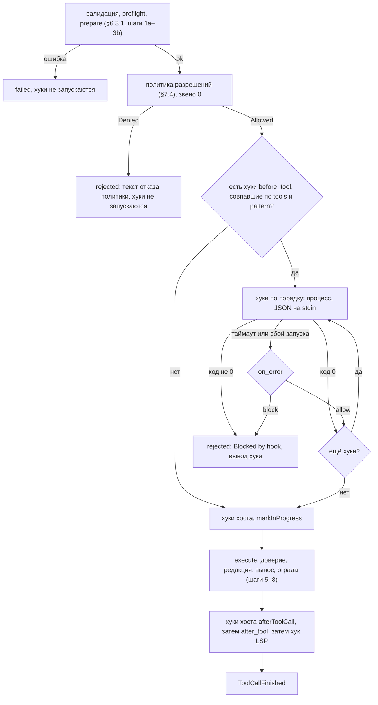
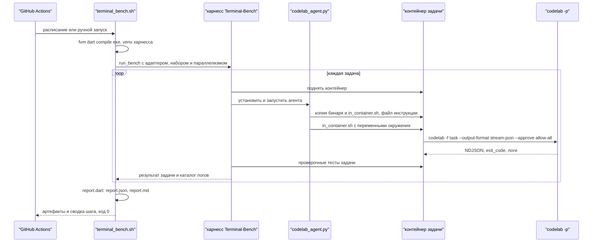

# 17.14. Расширения

> Часть [архитектуры ядра агента CodeLab](../agent-core-architecture.md). Status: Accepted. Общие соглашения, термины и порядок чтения — в оглавлении.

← [17.13. Масштаб сессий](17-13-session-scale.md) · [Оглавление ядра](../agent-core-architecture.md) · [17.15. A2A: удалённые агенты и агент как A2A-сервер](17-15-a2a.md) →

Цели: E-09 (пользовательские хуки), E-10 (плагины на Dart), E-14 (экспорт и импорт конфигурации
провайдеров), H-06 (прогон Terminal-Bench через `codelab -p`). Все четыре — уровень **Could**,
этап 9+. Затрагивает §5.2 (цепочки `beforeToolCall` и `afterToolCall`), §5.3 (`SlashCommandSource`),
§6.3.1 (шаги 4 и 9), §7.4 (порядок «разрешение первым»), §8.2.3 (поле записи `command`), §10.2–§10.8
(capability `userHooks`, сервисы `hookLauncher` и `plugins`, `CorePlan.plugins`), §12.3 (области
`hook`, `plugin`), §13.4 и §13.6 (команды плагинов, строки `/status`), §15.2–§15.4 (разделы `hooks`,
`plugins`), §17.2.3 (`CommandExpansion`), §17.5.5 (подкоманды CLI), §17.5.6, §17.5.8, а также
[CLI](../dart-agent-and-clients/09-11-stage-6-cli-mvp.md) и
[stream-json](../dart-agent-and-clients/12-5-stream-json.md).

## 17.14.1. Назначение

Четыре способа подстроить агента без форка ядра. Общие принципы:

* **Одна точка исполнения остаётся одной** (P-01, TOOL-1). Хук — звено цепочки `beforeToolCall`
  после политики разрешений; инструмент плагина — обычный `AgentTool` в реестре. Ни хук, ни плагин
  не получают пути к исполнению в обход `ToolExecutor` (§6.3.1).
* **Разрешение первым** (PERM-1, C-12). Хук «до» видит только вызовы, которые политика уже
  разрешила (с вопросом человеку или без). Отклонённый человеком или конфигом вызов хук не
  запускает.
* **Доверие проекта** (§15.3). Хуки и плагины проектного слоя действуют только для проектов из
  `trusted_projects`: склонированный репозиторий не может ни запустить свою команду на каждом
  вызове, ни включить плагин, ни отключить хук пользователя.
* **Без особых режимов.** Бенчмарк гоняет обычный headless-режим; у `codelab` нет флагов «для
  бенчмарка» (матрица целей, §5, строка «Отдельный режим бенчмарка…»).

## 17.14.2. Пользовательские хуки (E-09)

### 17.14.2.1. Назначение

Цель E-09: «команды из конфигурации до и после инструмента; ненулевой код хука «до» отклоняет
вызов с его выводом». Типичные хуки: запрет `git push --force` в ветку `main` скриптом команды,
запуск форматтера после `write`/`edit`, аудит вызовов MCP в журнал команды. Хук невидим модели,
пока не сработает: модель видит только текст отказа или заметку после результата.

### 17.14.2.2. Контракт

Конфигурация и исполнение хуков — ядро (`codelab_agent_core/lib/src/hooks/`); запуск процесса —
порт `ByteProcessLauncher` (§17.8.2), реализация `LocalProcessLauncher` из `codelab_agent_io`.

```dart
enum HookPhase { beforeTool, afterTool }           // YAML: before_tool, after_tool
enum HookErrorPolicy { block, allow }               // поведение «до» при таймауте и сбое запуска

final class UserHookConfig {
  final String name;                // ^[a-z0-9][a-z0-9_-]{0,63}$, уникально в фазе
  final HookPhase phase;
  final String command;             // строка shell: <exec.shell> -c <command>
  final List<String> tools;         // глобы имён инструментов; по умолчанию ["*"]
  final String? pattern;            // глоб по AgentTool.permissionPattern(args) (§7.5); null — любой
  final Duration timeout;           // по умолчанию hooks.default_timeout; 1s..120s
  final HookErrorPolicy onError;    // только beforeTool; по умолчанию block
  final Map<String, String> env;    // ${ENV} и ${secret:<name>} (§17.5.4)
  final bool enabled;
  final String source;              // путь файла слоя, для логов и /status
}
final class HooksConfig {           // часть CoreConfig (§10.3)
  final bool enabled;               // hooks.enabled
  final Duration defaultTimeout;    // hooks.default_timeout
  final int maxOutputBytes;         // hooks.max_output_bytes
  final List<UserHookConfig> beforeTool, afterTool;   // порядок — порядок исполнения
  static const none = HooksConfig._empty();
}

final class HookInvocation {
  final UserHookConfig hook;
  final String shell;               // exec.shell (§15.4)
  final String cwd;                 // корень сессии
  final Map<String, String> env;    // итоговое окружение (алгоритм, шаг 4)
  final String stdinJson;           // вход хука (§17.14.2.3)
  final int maxOutputBytes;
}
final class HookRunResult {
  final int? exitCode;              // null — таймаут или сбой запуска
  final String output;              // stdout и stderr в порядке поступления, не больше maxOutputBytes
  final int outputBytes;            // сколько байт выдал процесс всего
  final bool timedOut, spawnFailed;
  final Duration duration;
}
abstract interface class HookRunner {
  /// Отмена cancel завершает дерево процессов и бросает CancelledException.
  Future<HookRunResult> run(HookInvocation invocation, CancelToken cancel);
}
/// Реализация ядра поверх ByteProcessLauncher; создаётся buildAgentCore.
final class ProcessHookRunner implements HookRunner {
  ProcessHookRunner(ByteProcessLauncher launcher, {required Clock clock});
}

/// Хуки одной сессии. Создаётся при createSession и createChildSession (§5.6).
final class SessionHooks {
  SessionHooks({required HooksConfig Function() config,   // снимок на шаг (§17.5.6)
      required HookRunner runner, required Redactor redactor, required Logger logger,
      required SecretResolver secrets, required SessionId sessionId, SessionId? parentSessionId,
      required String cwd, required String shell, required Map<String, String> baseEnv,
      required ModeId Function() modeOf, required AgentTool? Function(String name) lookup});
  BeforeToolCallHook get before;    // звено [1] цепочки beforeToolCall, сразу после политики
  AfterToolCallHook get after;      // после хуков хоста, до хука языковых серверов
  HooksSummary summary();           // для /status
}
final class HooksSummary { final int before, after; final String? unavailableReason; }
```

`AgentCoreServices` (§10.3) получает поле `final ByteProcessLauncher? hookLauncher; // null →
userHooks off`. Хосты `apps/codelab_agent` и `codelab_embedded` передают тот же
`LocalProcessLauncher`, что и фабрике языковых серверов.

Capability **`userHooks`** (новая, §10.2): «запуск команд хуков из конфига на машине агента»; что
видит модель — ничего, кроме текстов отказа и заметок хуков. Профили: `agent-serve`,
`embedded-app-desktop`, `embedded-cli` — transport `local`; `mobile`, `web` — off: «нет процессов».
Хук всегда исполняется **на машине агента**, даже когда `exec` идёт через ACP `terminal/*`: хук —
политика агента, а не команда модели, и конфиг с хуками лежит на той же машине.

### 17.14.2.3. Алгоритм

**Место в цепочке.** `buildAgentCore` (§10.7, шаг 6) собирает цепочки сессии:

```text
beforeToolCall := [permissionPolicy, sessionHooks.before, ...SessionSpec.extraBeforeToolCall]
afterToolCall  := [...SessionSpec.extraAfterToolCall, sessionHooks.after, languageServerSession.after]
```

`sessionHooks.*` ставятся, только если `userHooks` включена. ACP-хук `markInProgress` остаётся
последним в `beforeToolCall`: `tool_call_update` со `status: in_progress` уходит после того, как
хуки пропустили вызов (§13.7). Хук «после» стоит до хука языковых серверов, чтобы диагностика
(§17.8.5) видела файл после форматтера.



**Хук «до»** (`sessionHooks.before(call, args, ctx)`):

```text
1. cfg := config(); cfg.enabled == false → вернуть null
   tool := lookup(call.name) (уже найден шагом 2 §6.3.1); pattern := tool.permissionPattern(args)
2. hooks := [h ∈ cfg.beforeTool | h.enabled ∧ globAny(h.tools, call.name) ∧
             (h.pattern == null ∨ glob(h.pattern, pattern))]
   пусто → вернуть null (процессы не запускаются)
3. input := JSON (ключи snake_case, порядок фиксирован):
     {"version":1,"event":"before_tool","session_id","parent_session_id" (null у корневой),
      "cwd","mode" (ModeId сессии),"tool":{"name","call_id","tier" (tool.tierOf(args)),
      "kind" (tool.kindOf(args)),"pattern"},"args","truncated_fields"}
   args — приведённые аргументы шага 3 §6.3.1; строковое поле длиннее 65536 символов
   обрезается до 65536, его путь ("content", "edits[0].new_text") — в truncated_fields
4. для каждого h по порядку:
   a. env := baseEnv (§4.5: PATH, HOME, USER, LANG, LC_ALL, TMPDIR, SHELL, TERM=dumb, PAGER=cat,
        GIT_PAGER=cat, GIT_TERMINAL_PROMPT=0) ∪ exec.env ∪ разрешённые h.env
        ∪ {CODELAB_HOOK_NAME: h.name, CODELAB_HOOK_EVENT: "before_tool",
           CODELAB_TOOL_NAME: call.name, CODELAB_SESSION_ID, CODELAB_PROJECT_DIR: cwd}
      exec.secrets командам хуков не передаются; окружение процесса хоста не наследуется (ENV-6);
      ${secret:<name>} разрешается через SecretResolver (purpose "hooks.before_tool[<name>].env.<K>"),
      отсутствующий секрет → как сбой запуска (шаг d) с причиной secret <name> is not set
   b. r := await runner.run(HookInvocation(h, shell, cwd, env, input, cfg.maxOutputBytes), ctx.cancel)
        процесс: <shell> -c <h.command>, cwd — корень сессии; stdin — input и закрытие;
        stdout и stderr читаются в один буфер в порядке поступления, сверх maxOutputBytes —
        вычитываются и отбрасываются; по h.timeout — terminate(grace 2 s), timedOut
      CancelledException → пробросить: исполнитель даёт outcome cancelled (§6.3.1, шаг 5)
   c. text := redactor.redact(r.output.trimRight(), RedactionContext(point: toolResult,
        toolName: call.name)); r.outputBytes > maxOutputBytes → дописать
        "\n[hook output truncated: showing <maxOutputBytes> of <outputBytes> bytes]"
   d. лог info hook.run {hook, phase, tool, tool_call_id, exit_code, duration_ms, outcome}
      r.exitCode == 0 → к следующему h
      r.exitCode != 0 → вернуть Block(blockText(h, r.exitCode, text))
      r.timedOut → лог warning hook.timeout; onError == block →
           Block('Blocked by hook "<name>": the hook timed out after <n>s.'); иначе к следующему h
      r.spawnFailed → лог warning hook.spawn_failed; onError == block →
           Block('Blocked by hook "<name>": the hook could not be started.'); иначе к следующему h
5. вернуть null
```

Тексты для модели (фиксированы):

* код не 0, вывод не пуст: `Blocked by hook "<name>" (exit <code>):\n<text>`;
* код не 0, вывод пуст: `Blocked by hook "<name>" (exit <code>).`;
* таймаут и сбой запуска — строки шага 4d.

`Block` имеет outcome `rejected` (§5.2): ACP получает `tool_call_update` со `status: failed` и
`_meta.codelab.outcome: rejected` (§13.12), журнал — обычную запись `toolResult` с
`outcome: "rejected"`. Модель не отличает отказ хука от отказа человека по статусу, только по
тексту — это и нужно: вывод хука объясняет, что сделать иначе. Предохранитель неверных вызовов
(§6.3.7) отказы хуков не считает (как и отказы разрешений, шаг 9a).

**Хук «после»** (`sessionHooks.after(call, result, isError)`):

```text
1. вызывается только для вызовов, дошедших до execute (§6.3.1, шаг 7): после Block, отмены,
   отказа разрешения, ошибок шагов 1a–3b цепочка afterToolCall не вызывается (§6.3.1, шаг 9)
2. hooks := [h ∈ cfg.afterTool | h.enabled ∧ совпадение по tools и pattern, как в «до»];
   pattern — permissionPattern(call.arguments) после приведения (§6.3.2)
3. input := как в «до» с "event":"after_tool" и полем
     "result":{"is_error","text","text_bytes","truncated"}
   text — текст результата после шагов 8a–8d (то, что увидит модель), не длиннее 65536 символов
4. для каждого h по порядку (все, без остановки): r := run(…, CancelToken.none) — отмена хода
   хук «после» не прерывает, его ограничивает только timeout
   r.exitCode == 0 → ничего (вывод отбрасывается)
   r.exitCode != 0 → notes.add('[hook "<name>" exit <code>]\n<text>')
   r.timedOut → notes.add('[hook "<name>" timed out after <n>s]')
   r.spawnFailed → notes.add('[hook "<name>" could not be started]')
5. notes пусто → null; иначе ResultOverride(content: результат + TextContent(notes.join("\n\n"))),
   isError не меняется
```

Вызовы одного пакета (§5.5) идут параллельно; хуки каждого вызова — последовательно внутри
своего вызова. Время хуков входит в `budget.max_duration` (в отличие от ожидания одобрения).
Хуки работают и в дочерних сессиях субагентов (§17.3): `parent_session_id` указывает на
родителя.

**Глоб** (`glob`, `globAny`): совпадение всей строки; `*` — любая последовательность символов
(включая `_`, `/`, пробел), `?` — один символ, остальные символы буквальные, регистр важен.
`tools: ["mcp__github__*"]` совпадает со всеми инструментами сервера `github`;
`pattern: "git push*"` — с командами `exec`, начинающимися с `git push`.

### 17.14.2.4. Конфигурация и доверие

| Ключ | Тип | По умолчанию | Смысл |
|---|---|---|---|
| `hooks.enabled` | bool | `true` | `false` — ни один хук не запускается; capability не меняется |
| `hooks.default_timeout` | duration | `"10s"` | таймаут хука без своего `timeout`; `1s..120s` |
| `hooks.max_output_bytes` | int | `8192` | сколько вывода хука видит модель; `1024..65536` |
| `hooks.before_tool`, `hooks.after_tool` | список отображений | `[]` | хуки фазы, по одному на элемент |
| `….name` | string | обязателен | `^[a-z0-9][a-z0-9_-]{0,63}$`; повтор в одной фазе одного слоя — `ConfigException` |
| `….command` | string | обязателен | строка shell; относительный путь скрипта — от корня сессии |
| `….tools` | string[] | `["*"]` | глобы имён инструментов; пустой список — `ConfigException` |
| `….pattern` | string | нет | глоб по шаблону «разрешить всегда» (§7.5) |
| `….timeout` | duration | `hooks.default_timeout` | `1s..120s` |
| `….on_error` | `"block"` \| `"allow"` | `"block"` | только `before_tool`; в `after_tool` — `ConfigException` |
| `….env` | map string→string | `{}` | `${ENV}`, `${secret:<name>}`; литеральный секрет — CFG-9 |
| `….enabled` | bool | `true` | выключение без удаления |

Слияние слоёв (дополнение §15.2): списки `hooks.before_tool` и `hooks.after_tool` сливаются **по
`name`**, как `mcp.servers`: элемент с тем же `name` в более приоритетном слое заменяет элемент,
новый добавляется в конец, `enabled: false` выключает хук нижнего слоя. Порядок исполнения —
порядок после слияния: сначала хуки глобального слоя в порядке файла, затем новые хуки проектных
слоёв.

Доверие (дополнение §15.3):

| Ключи | Слой 3 (проект) | Слой 4 (локальный) | Условие снятия ограничения |
|---|---|---|---|
| `hooks.*` (включая `enabled: false`, выключение хука по `name`, уменьшение таймаутов) | нет (игнорируется с предупреждением `config.project.untrusted_key`) | да | проект в `trusted_projects` |
| `${secret:<name>}` в `hooks.*.env` | нет | да | проект в `trusted_projects` |

Даже «ужесточение» хуков из недоверенного проекта не принимается: выключение или замена хука по
`name` ослабляет политику пользователя, а новый хук — это запуск чужой команды на каждом вызове.

Живая перезагрузка (§17.5.6): `hooks.*` — следующий вызов инструмента (снимок шага). Перезапуск
не нужен: capability `userHooks` задаётся профилем и сервисом, а не ключом.

Capability выключена, а хуки в конфиге есть → один warning `hooks.unavailable {reason, count}`
при создании сессии, хуки не запускаются; `/status` показывает строку
`Hooks: unavailable (<reason>)`. При включённой — `Hooks: <n> before, <m> after` (только при
`n + m > 0`).

### 17.14.2.5. Пример

```yaml
# ~/.codelab/config.yaml
hooks:
  default_timeout: 10s
  before_tool:
    - name: no-force-push-main
      command: "$HOME/.codelab/hooks/no_force_push.sh"
      tools: [exec]
      pattern: "git push*"
      timeout: 5s
  after_tool:
    - name: dart-format
      command: "jq -r '.args.path' | grep -E '\\.dart$' | xargs -r dart format"
      tools: [write, edit]
```

Скрипт `no_force_push.sh` читает `.args.command` со stdin и выходит с кодом 1, если команда
содержит `--force` и цель `main`, печатая `Force push to main is forbidden by team policy. Push to
a feature branch and open a pull request.` Модель вызывает `exec` с `git push --force origin
main`, человек (режим `standard`) разрешает, хук отклоняет — результат вызова:

```text
Blocked by hook "no-force-push-main" (exit 1):
Force push to main is forbidden by team policy. Push to a feature branch and open a pull request.
```

### 17.14.2.6. Как проверить

* `core/user-hook-blocks-tool` (`user_hooks_test.dart`, fake `HookRunner`) — критерий матрицы:
  «команды из конфигурации до и после инструмента; ненулевой код хука «до» отклоняет вызов с его
  выводом». Хук «до» с кодом 1 и выводом `nope` → инструмент не исполнен (fake-инструмент не
  вызван), `ToolCallFinished(outcome: rejected)`, текст `Blocked by hook "h" (exit 1):\nnope`;
  код 0 → исполнен; хук «после» с кодом 2 → заметка `[hook "a" exit 2]` в конце результата,
  `isError` прежний (EXT-2).
* `user_hooks_order_test.dart`: политика отклонила вызов → `HookRunner.run` не вызван ни разу; при
  `ask` хук запускается после ответа `allow_once`; `markInProgress` вызван после хуков; ошибка
  `preflight` и блокировка предохранителем хук не запускают (EXT-1).
* `user_hooks_failure_test.dart`: таймаут и сбой запуска при `on_error: block` → текст шага 4d;
  при `allow` → вызов исполнен; отмена хода во время хука «до» → `cancelled`, процесс завершён;
  вывод 100 КиБ → видны 8192 байта и строка `[hook output truncated: …]` (EXT-3).
* `user_hooks_input_test.dart`: stdin — JSON шага 3 с `tier`, `kind`, `pattern`; `content` длиной
  70000 символов обрезан и перечислен в `truncated_fields`; окружение — базовый набор плюс
  `CODELAB_HOOK_*`, без `exec.secrets` и без переменных процесса хоста (EXT-5).
* `user_hooks_redaction_test.dart`: хук печатает значение секрета из `exec.secrets` → в тексте
  результата, логе и журнале — маска §12.4 (EXT-6).
* `config_hooks_test.dart`: слияние по `name`, `enabled: false` в слое 4; `hooks.*` в проектном
  слое без доверия → предупреждение `config.project.untrusted_key`, хук не действует; с доверием
  — действует; `on_error` в `after_tool` → `ConfigException`; границы таймаутов (EXT-4).
* `process_hook_runner_test.dart` (`codelab_agent_io`, настоящий процесс): `sh -c 'echo a; echo b
  >&2; exit 3'` → вывод `a\nb\n`, код 3; `sleep 30` при таймауте 1 s → `timedOut`, дерево
  процессов завершено.
* Тест матрицы профилей (§10.12): `userHooks` — `local` в настольных профилях, off с причиной в
  `mobile` и `web`; golden-файлы схем не меняются (HOST-4).

## 17.14.3. Плагины на Dart (E-10)

### 17.14.3.1. Назначение

Цель E-10: «пакет регистрирует инструменты и slash-команды через публичный API ядра; собирается в
бинарь хоста». Плагин — Dart-пакет команды (интеграция с трекером задач, внутренний поиск по
документации, генератор отчётов), который не нужно оформлять MCP-сервером. Загрузки кода во время
работы нет: плагины компилируются в бинарь `codelab-agent`, `codelab` или приложение, а конфиг
только включает собранные. Модель безопасности остаётся прежней: код плагина — код, который
собрал и запустил сам пользователь или его команда.

### 17.14.3.2. Контракт

Публичная библиотека ядра `package:codelab_agent_core/plugin.dart` (чистый Dart) экспортирует
`AgentTool` и всё, что нужно инструменту (§6.2), и типы ниже
(`codelab_agent_core/lib/src/plugins/`):

```dart
abstract base class CodelabPlugin {
  String get name;                                  // ^[a-z][a-z0-9_]{0,31}$, не "enabled"
  String get version;                               // для /status и host.plan
  Set<HostCapability> get requires => const {};     // все должны быть включены, иначе плагин пропущен
  List<PluginSetting> get settings => const [];     // схема plugins.<name>.*
  /// Синхронная регистрация в buildAgentCore. Исключение → HostWiringException.
  void register(PluginRegistrar registrar);
}

final class PluginSetting {
  final String key;                                 // ^[a-z][a-z0-9_]{0,63}$, без точек
  final SettingType type;                           // §17.5.2: string, int, float, bool, duration,
                                                    // path, enumeration, stringList, secretName, envVarName
  final Object? defaultValue;
  final bool required;
  final List<String>? enumValues; final num? min, max;
  final String description;                         // английский, для codelab config check
}

abstract interface class PluginRegistrar {
  PluginConfig get config;                          // plugins.<name>.* после проверки и умолчаний
  Logger get logger;                                // каждая запись с полем plugin: <name>
  /// name фиксируется здесь: проверка коллизий и CorePlan.toolNames — при сборке.
  void addTool(String name, PluginToolFactory factory, {Set<HostCapability> requires = const {}});
  void addCommand(PluginCommand command, {Set<HostCapability> requires = const {}});
}
typedef PluginToolFactory = AgentTool Function(PluginSessionContext session);

final class PluginConfig {
  final String plugin;
  final Map<String, Object?> values;                // ключи settings, значения уже приведены к type
  T? get<T>(String key);                            // ArgumentError для ключа вне settings
}
final class PluginSessionContext {                  // одна на сессию, создаётся при createSession
  final SessionId sessionId; final SessionId? parentSessionId;
  final String cwd;
  final PluginConfig config;                        // снимок на момент создания сессии
  final http.Client http; final Clock clock; final Logger logger;
  /// Значение секрета по ключу settings с type secretName; через SecretResolver (§17.5.4),
  /// purpose "plugins.<name>.<key>"; значение регистрируется в Redactor.
  Future<String?> secret(String settingKey);
}

abstract base class PluginCommand {
  String get name;                                  // ^[a-z][a-z0-9-]{0,31}$, без двоеточия
  String get description;                           // английский, в available_commands_update
  String? get inputHint => null;
  Future<PluginCommandResult> run(String args, PluginCommandContext ctx);
}
final class PluginCommandContext {
  final SessionId sessionId; final String cwd;
  final ModeId mode; final ModelRef model;
  final PluginConfig config;
  final PluginFiles files;                          // только чтение внутри корня сессии
  final CancelToken cancel;                         // session/cancel
  final Future<String?> Function(String settingKey) secret;
}
abstract interface class PluginFiles {              // поверх BoundedEnv сессии (ENV-2)
  Future<String?> readText(String path, {int maxBytes = 262144});   // null — нет файла
  Future<bool> exists(String path);
}
sealed class PluginCommandResult { const PluginCommandResult(); }
/// Ответ без модели, как /status: agent_message_chunk + end_turn, в журнал не пишется.
final class CommandReply extends PluginCommandResult { const CommandReply(this.text); final String text; }
/// Развёрнутый текст уходит модели сообщением пользователя, как шаблон (§17.2.6).
final class CommandPrompt extends PluginCommandResult { const CommandPrompt(this.text); final String text; }

final class PluginStatus {                          // в CorePlan.plugins, host.plan, /status
  final String name, version;
  final PluginState state;                          // active, disabled, skipped
  final String? reason;                             // для skipped: "requires shellExec (off: …)"
  final List<String> tools, commands;
}
enum PluginState { active, disabled, skipped }
```

Расширения существующих типов:

* `AgentCoreServices` (§10.3): `final List<CodelabPlugin> plugins; // по умолчанию const []` —
  плагины, собранные в бинарь.
* `CoreConfig` (§10.3): `final PluginsConfig plugins;` — `enabled` и сырые отображения
  `plugins.<name>`; `final HooksConfig hooks;` (§17.14.2.2).
* `CorePlan` (§10.3): `final List<PluginStatus> plugins;` и
  `final List<PluginCommand> pluginCommands;` (в порядке регистрации).
* `SlashCommandSource` (§5.3): значение `plugin`.
* `CommandExpansion` (§17.2.3): вариант
  `final class PluginInvocation extends CommandExpansion { final PluginCommand command; final String args; }`.
* Поле записи `command` (§8.2.3): `source` принимает `"plugin"`.

**Сборка своего бинаря.** Хосты экспортируют точки входа с параметром плагинов:
`runCodelabAgent(List<String> args, {List<CodelabPlugin> plugins = const []})` в
`apps/codelab_agent/lib/main.dart`, `runCodelabCli(args, {plugins})` в
`apps/codelab_cli/lib/main.dart`, `buildEmbeddedAgent(…, plugins: …)` в `codelab_embedded`.
Команда пишет свой `bin/main.dart`:

```dart
import 'package:codelab_agent/main.dart';
import 'package:acme_tracker_plugin/acme_tracker_plugin.dart';

Future<void> main(List<String> args) => runCodelabAgent(args, plugins: [AcmeTrackerPlugin()]);
```

### 17.14.3.3. Алгоритм

**Сборка** — новый шаг `buildAgentCore` (§10.7) между проверкой конфига (шаг 3) и реестром (шаг 5):

```text
3a. плагины:
  1. имена services.plugins уникальны и соответствуют правилу name; иначе HostWiringException
     ("plugin name <n>: duplicate" | "plugin name <n>: invalid")
  2. для n ∈ config.plugins.enabled, которого нет среди services.plugins:
       лог warning plugin.unknown {plugin: n, compiled: [...]}; не ошибка — config.yaml общий
       для CLI и app, а наборы собранных плагинов у них могут различаться
     для plugins.<n> без плагина n — так же: ключи не проверяются, warning plugin.unknown
  3. для p ∈ services.plugins в порядке config.plugins.enabled (не включённые → state disabled):
     a. c ∈ p.requires выключена → state skipped, reason "requires <c> (off: <причина>)",
        лог info plugin.skipped; перейти к следующему
     b. cfg := проверка plugins.<p.name> по p.settings (§15.5: типы, диапазоны, enumValues,
        required, неизвестный ключ — с подсказкой ближайшего); ошибки → ConfigException с путями
        plugins.<p.name>.<key>; значения-секреты — правило CFG-9 (только имена)
     c. registrar := PluginRegistrar(cfg, logger.child(plugin: p.name));
        p.register(registrar); исключение → HostWiringException("plugin <p>: register failed: <msg>")
     d. элемент с requires, содержащим выключенную capability, — пропущен (лог info plugin.skipped
        с именем элемента); остальные — в план
  4. проверка имён:
     инструмент: ^[a-z][a-z0-9_]{0,63}$, не начинается с "mcp__"; совпадает со встроенным
       инструментом плана (включая task, task_status, task_cancel, job_output, job_kill, lsp,
       web_fetch, web_search, skill) или инструментом другого плагина →
       HostWiringException("plugin <p>: tool <t> collides with <builtin | plugin q>")
     команда: правило name; совпадает с любой встроенной командой плана §13.4 (compact, mode, model,
       status, usage, redact, config, mcp, команды сессии rename, branches, branch, rewind, fork,
       label, approve, timer, memory, tasks, help) или
       командой другого плагина → HostWiringException("plugin <p>: command /<c> collides with …")
  5. plan.plugins := статусы; plan.pluginCommands := команды active-плагинов; лог host.plan их содержит
5. реестр (дополнение): после lsp и до MCP (5c) — инструменты active-плагинов в порядке
   plugins.enabled, внутри плагина — в порядке addTool; фабрика вызывается при createSession
   с PluginSessionContext; tool.name != объявленного → StateError (ошибка программиста)
   выключение tools.disabled (§6.3.8, шаг 5f) и permissions.tools.<name> действуют на них, как
   на встроенные
```

Инструмент плагина — обычный `AgentTool`: уровень по умолчанию `exec` (TOOL-5), доверие вывода по
умолчанию `untrusted` (ограда §6.3.6), редакция результата (шаг 8b) включена, исполнение — только
через `ToolExecutor`. Секций системного промпта у плагинов нет: правила инструмента живут в его
`description` (как у MCP-инструментов). Схемы плагинов стабильны в пределах процесса, поэтому кеш
промпта не страдает.

**Команды.** `availableCommands` (§17.2.3) вставляет команды плагинов сразу после `help`, до
шаблонов, `skill:<name>` и MCP prompts; источник `SlashCommandSource.plugin`. Имена плагинов
входят в `reservedCommands` загрузчика шаблонов (§17.2.4, шаг 7c): шаблон с тем же именем
пропускается с диагностикой `reserved_name`. Разбор промпта (§13.6, шаг 2) — порядок:
встроенная команда → команда плагина → шаблон → `skill:` → MCP prompt.

```text
runPluginCommand(command, args):        // AgentSession.prompt при PluginInvocation
1. ctx := PluginCommandContext(…, files: ReadOnlyPluginFiles(BoundedEnv сессии), cancel: токен хода)
2. r := await command.run(args, ctx)
     исключение → r := CommandReply('Command /<name> failed: <message>'), message без
       служебных префиксов Dart (как §6.3.1, шаг 7); лог warning plugin.command.failed
     CancelledException → stopReason cancelled, ничего не пишется
3. CommandReply(text) → agent_message_chunk(redactor.redact(text)), stopReason end_turn;
     журнал не меняется, модель не вызывается (как /status, §13.6)
4. CommandPrompt(text) → обычный ход: UserMessage([TextContent(text)]), запись message с полем
     command = {"source":"plugin","name","args"}; реплей показывает исходный "/<name> <args>"
```

`PluginFiles` только читает: команда — действие человека в обход модели, и у неё нет права
писать файлы или запускать процессы мимо разрешений. Если команде нужен побочный эффект, она
возвращает `CommandPrompt`, и модель выполняет его инструментами — с вопросами по §7.

### 17.14.3.4. Конфигурация и доверие

| Ключ | Тип | По умолчанию | Смысл |
|---|---|---|---|
| `plugins.enabled` | string[] | `[]` | имена собранных плагинов, которые включаются; порядок — порядок регистрации |
| `plugins.<name>.<key>` | по `PluginSetting.type` | `PluginSetting.defaultValue` | настройки плагина; схема — `CodelabPlugin.settings` |

`plugins` — исключение из правила «неизвестный ключ — ошибка» (§15.5) того же рода, что
`providers.<id>`: имена `<name>` и ключи внутри проверяет плагин на шаге 3a.3b, а для несобранного
плагина — только предупреждение. `plugins.enabled` — список, слои заменяют его целиком (§15.2).

Доверие (дополнение §15.3):

| Ключи | Слой 3 (проект) | Слой 4 (локальный) | Условие снятия ограничения |
|---|---|---|---|
| `plugins.*` | нет (игнорируется с предупреждением `config.project.untrusted_key`) | да | проект в `trusted_projects` |

Живая перезагрузка (§17.5.6): `plugins.enabled` — только после перезапуска (набор инструментов
собирается один раз, §10.7); `plugins.<name>.*` — новые сессии (снимок `PluginSessionContext`).

`/status` (§13.6) получает строку `Plugins: <name> <version>, …` (только `active`) и, если есть,
`Plugins skipped: <name> (<reason>)`.

### 17.14.3.5. Пример

```dart
final class AcmeTrackerPlugin extends CodelabPlugin {
  @override String get name => 'acme_tracker';
  @override String get version => '1.2.0';
  @override List<PluginSetting> get settings => const [
    PluginSetting(key: 'base_url', type: SettingType.string, required: true,
        description: 'Tracker API base URL'),
    PluginSetting(key: 'token_secret', type: SettingType.secretName, required: true,
        description: 'Secret name of the API token'),
  ];
  @override
  void register(PluginRegistrar r) {
    r.addTool('tracker_issue', (s) => TrackerIssueTool(s));      // tier network, kind fetch
    r.addCommand(TrackerStandupCommand());                         // /standup → CommandPrompt
  }
}
```

```yaml
# ~/.codelab/config.yaml
plugins:
  enabled: [acme_tracker]
  acme_tracker:
    base_url: https://tracker.acme.internal/api
    token_secret: codelab/acme-tracker
```

`available_commands_update` после `session/new` содержит после `help` элемент
`{"name":"standup","description":"Draft a standup note from my tracker issues"}`; модель видит
схему `tracker_issue`; вызов спрашивается по уровню `network` (§7.3).

### 17.14.3.6. Как проверить

* `core/plugin-registers-tool` (`plugin_registration_test.dart`) — критерий матрицы: «пакет
  регистрирует инструменты и slash-команды через публичный API ядра; собирается в бинарь хоста».
  Тестовый плагин, импортирующий только `package:codelab_agent_core/plugin.dart`, регистрирует
  инструмент `echo_plugin` и команду `/hello`; `plugins.enabled: [test_plugin]` →
  `CorePlan.toolNames` содержит `echo_plugin` до MCP-инструментов, `CommandsChanged` — `hello`
  после `help`; вызов `echo_plugin` проходит политику разрешений (fake gate получил запрос уровня
  `exec`) и исполнителя (события `ToolCallStarted`/`ToolCallFinished`) (EXT-7).
* Тест-сторож `plugin_api_guard_test.dart`: `plugin.dart` не экспортирует `ToolExecutor`,
  `ToolRegistry`, `PermissionPolicy`, `BeforeToolCallHook`, `AfterToolCallHook` (EXT-7).
* `plugin_collision_test.dart`: инструмент `read`, команда `/status`, два плагина с инструментом
  `x` → `HostWiringException` с обоими именами; инструмент `mcp__x` → `HostWiringException`;
  шаблон `hello.md` при команде плагина `hello` → диагностика `reserved_name` (EXT-8).
* `plugin_capability_test.dart`: плагин с `requires: {shellExec}` в профиле `mobile` → `skipped`
  с причиной, схем и команд нет; инструмент с `requires: {network}` при `tools.web.enabled: false`
  пропущен, остальное зарегистрировано (EXT-9, HOST-4).
* `plugin_config_test.dart`: отсутствующий `required` ключ, неверный тип, неизвестный ключ →
  `ConfigException` с путём `plugins.acme_tracker.<key>`; `plugins.enabled: [missing]` →
  warning `plugin.unknown`, сборка успешна; `plugins.*` в проекте без доверия игнорируется (EXT-4,
  EXT-11).
* `plugin_command_test.dart`: `CommandReply` → `agent_message_chunk`, `end_turn`, журнал не
  изменился, модель не вызвана; `CommandPrompt` → модель получила текст, запись с
  `command.source: "plugin"`; исключение в `run` → `Command /hello failed: boom`; `PluginFiles`
  вне корня → `null` (EXT-10).
* Golden-фикстура `acp/plugin-command-listed`: `available_commands_update` с командой плагина
  после `help`; `/hello world` → `agent_message_chunk` с ответом плагина и `end_turn`.
* **Тестовая обвязка** `package:codelab_agent_core/plugin_testing.dart` для авторов плагинов:
  `PluginTestBed(plugins: [...], config: {...}, profile: 'embedded-cli')` собирает ядро через
  `buildAgentCore` на `MemoryExecutionEnv`, `MemorySessionStore`, fake `PermissionGate`
  (решение по умолчанию `allowOnce`) и scripted `StreamFunction` из списка ответов
  (`ScriptedReply.text`, `ScriptedReply.toolCall(name, args)`); методы `plan`,
  `callTool(name, args) → ToolResultMessage` (через `ToolExecutor`, с разрешениями),
  `runCommand('/hello world') → PluginCommandResult`, `prompt(text) → List<AgentEvent>`,
  `permissionRequests`. Обвязка сама покрыта тестом `plugin_test_bed_test.dart`.

## 17.14.4. Экспорт и импорт конфигурации провайдеров (E-14)

### 17.14.4.1. Назначение

Цель E-14: «`codelab config export-providers` выгружает провайдеров, модели и роли без значений
секретов (только имена); `codelab config import-providers <file>` добавляет их, не перезаписывая
существующие без `--force`». Сценарии: новый сотрудник получает файл провайдеров команды; человек
переносит настройки на вторую машину; файл провайдеров кладётся в репозиторий инфраструктуры.
Ключи API переносятся отдельно — командой `codelab secret set` по именам из файла.

### 17.14.4.2. Контракт

Реализация — общая для `codelab` и `codelab-agent` (`codelab_agent_io/lib/src/cli/providers_io.dart`),
поверх `ConfigWriter` (§17.5.5) и `SettingsRegistry` (§17.5.8):

```dart
final class ProvidersDocument {                      // разобранный файл обмена
  static const format = 'codelab-providers/1';
  final Map<String, Map<String, Object?>> providers; // providers.<id> целиком
  final Map<String, Object?> agent;                  // только default_model, fallback, summary_model
  final Map<String, Map<String, Object?>> roles;     // llm.roles.<role>
  final List<String> requiredSecrets, requiredEnv;   // справочно; пересчитываются при импорте
}
enum ExportLayer { user, project, local, merged }    // merged — слияние слоёв 2–4, без env и флагов
final class ProvidersExporter {
  ProvidersExporter({required ConfigWriter writer, required ConfigLoader loader});
  /// Не обращается к SecretStore. ExportSecretFoundException — значение похоже на секрет.
  Future<String> export({required ExportLayer layer, required String cwd, List<String>? providerIds});
}
final class ExportSecretFoundException implements Exception { final String key; final String suggestedSecretName; }

enum ImportItemStatus { added, unchanged, merged, replaced, conflict }
final class ImportItem {
  final String key;                                  // "providers.openrouter", "agent.default_model"
  final ImportItemStatus status;
  final String? detail;                              // "base_url differs", "+models.\"qwen3-coder\""
}
final class ImportPlan { final List<ConfigEdit> edits; final List<ImportItem> items; }
final class ProvidersImporter {
  ProvidersImporter({required ConfigWriter writer, required SecretStore secrets});
  ProvidersDocument parse(String text);              // FormatException, ConfigInlineSecretException
  ImportPlan plan(ProvidersDocument doc, ConfigSnapshot base,
      {bool force = false, bool skipAgent = false, Map<String, String> secretMap = const {}});
  Future<ConfigWriteResult> apply(ConfigSnapshot base, ImportPlan plan);   // одна ConfigWriter.apply
}
```

### 17.14.4.3. Алгоритм: экспорт

```text
codelab config export-providers [--layer user|project|local|merged] [--output <file>]
                                [--provider <id>]...
1. layer по умолчанию user; values := writer.read(target).values или, для merged, слияние
   файловых слоёв 2–4 по §15.2 (без defaults, CODELAB_PROVIDER_*, флагов); провайдер из
   предконфигурации окружения не выгружается: stderr note: provider <id> from
   CODELAB_PROVIDER_CONFIG is not exported
2. доступно: providers.<id> (все ключи, включая models.*), agent.default_model, agent.fallback,
   agent.summary_model, llm.roles.*; --provider сужает providers и выбрасывает ссылки agent.* и
   llm.roles.*.models на другие провайдеры (ссылки, оставшиеся без моделей, не выгружаются)
3. requiredSecrets := значения api_key_secret и имена из ${secret:<name>} в headers;
   requiredEnv := значения api_key_env и имена ${VAR} в headers и base_url; оба — отсортированы
4. проверка: каждое листовое значение и итоговый текст проходят правила CFG-9 (§17.5.4) и
   шаблоны §12.4; совпадение → ExportSecretFoundException, ничего не выводится, код 1:
   export aborted: <key> looks like a secret value; store it with "codelab secret set <name>"
5. документ строится YamlEditor с пустого (блочный стиль, отступ 2, ключи в порядке файла-источника):
   format, exported_from, providers, agent, llm.roles, required_secrets, required_env;
   времени экспорта в файле нет — повторный экспорт без изменений даёт те же байты
6. --output → запись tmp + fsync + rename, права 0644; иначе stdout; код 0
```

SecretStore экспорт не открывает вовсе: в файл попадают только имена, а значения недоступны коду
экспорта даже по ошибке.

### 17.14.4.4. Алгоритм: импорт

```text
codelab config import-providers <file|-> [--force] [--dry-run] [--skip-agent]
                                [--map-secret <old>=<new>]... [--project|--local]
1. text := файл или stdin; разбор по профилю §15.5; format != "codelab-providers/1" →
   код 1: unsupported providers file format: <format>; ключи вне формата → код 1 со списком
2. правила CFG-9 по документу (api_key, литеральные секреты в headers) → код 1 с текстом
   ConfigInlineSecretException; ничего не пишется
3. secretMap применяется к api_key_secret и ${secret:<old>} в headers; имя вне SecretNames → код 64
4. base := writer.read(target) — target: user | --project | --local (как config set)
5. для каждого провайдера id в порядке файла: cur := base.get("providers.<id>")
     cur == null → SetValue каждого листа → added
     cur.kind != new.kind ∨ cur.base_url != new.base_url →
         force ? RemoveTable("providers.<id>") + SetValue листьев → replaced
               : conflict ("kind differs" | "base_url differs"), провайдер пропущен целиком
     иначе для каждого листа (включая models.<m>.*): нет в cur → SetValue; равен → ничего;
         отличается → force ? SetValue : conflict-лист
       итог: unchanged (ничего не добавлено) | merged (detail: добавленные и, при force,
       заменённые листья) | conflict (detail: ключи различий; совпавшие и новые листья добавлены)
6. skipAgent == false: agent.default_model, agent.fallback, agent.summary_model — то же правило
   листа (список fallback сравнивается целиком); llm.roles.<role> — то же правило листа
7. edits пусто → печать "Nothing to import." и код 0
8. печать плана (строка на элемент, ниже); --dry-run → код 0 без записи
9. writer.apply(base, edits) — одна атомарная запись; ConfigConflictException → код 1:
   config changed during import; run the command again; ConfigException(issues) (например,
   agent.default_model ссылается на модель, которой нет) → код 1 со списком, ничего не записано
10. секреты: для каждого имени из ссылок итогового документа — есть ли оно в
    SecretStore.names() (значения не читаются): "secret <name>: found" |
    "secret <name>: missing — run: codelab secret set <name>"; переменные — "env <VAR>: set" |
    "env <VAR>: not set"
11. код 0; при конфликтах последняя строка "<n> conflicts skipped; use --force to overwrite"
```

Формат строк плана (фиксирован, английский):

```text
+ providers.openrouter      added (2 models)
= providers.anthropic       unchanged
~ providers.local           merged: +models."qwen3-coder:30b"
! providers.gw              conflict: base_url differs (use --force)
! agent.default_model       conflict: anthropic/claude-sonnet-4 -> openrouter/qwen3-coder (use --force)
```

Правила доверия действуют как у `config set`: импорт в `--project` недоверенного проекта
отклоняется шагом 2 `ConfigWriter.apply` (§17.5.5) — `providers.*` в слое 3 требует доверия.

### 17.14.4.5. Пример файла

```yaml
format: codelab-providers/1
exported_from: user
providers:
  openrouter:
    kind: openai-compatible
    base_url: https://openrouter.ai/api/v1
    api_key_secret: codelab/openrouter
    models:
      qwen/qwen3-coder:
        context_window: 262144
  local:
    kind: openai-compatible
    base_url: http://127.0.0.1:11434/v1
    models:
      "qwen3-coder:30b":
        context_window: 65536
agent:
  default_model: openrouter/qwen/qwen3-coder
  fallback: [local/qwen3-coder:30b]
llm:
  roles:
    smol:
      models: [local/qwen3-coder:30b]
required_secrets: [codelab/openrouter]
required_env: []
```

### 17.14.4.6. Как проверить

* `cli/config-export-no-secrets` (`providers_export_test.dart`) — критерий матрицы:
  «`codelab config export-providers` выгружает провайдеров, модели и роли без значений секретов
  (только имена); `codelab config import-providers <file>` добавляет их, не перезаписывая
  существующие без `--force`». Конфиг с `api_key_secret`, `api_key_env` и
  `headers: {X-Key: "${secret:codelab/x}"}`, в `MemorySecretStore` — значения; вывод содержит
  имена, `required_secrets` и `required_env`, ни одного значения из хранилища; хранилище не
  получило ни одного `read` (счётчик fake); повторный экспорт побайтово равен первому (EXT-12).
* `providers_export_guard_test.dart`: литеральный ключ `sk-…` в `headers` файла, обошедший
  загрузчик (подложенный снимок) → код 1 `export aborted: …`, stdout пуст (EXT-12).
* `providers_import_merge_test.dart`: новый провайдер → `added`; тот же провайдер → `unchanged`,
  файл не тронут (fingerprint прежний); другой `base_url` → `conflict`, файл не изменён в этом
  провайдере; новый `models.<m>` у совпавшего провайдера → `merged`; `--force` → `replaced`,
  комментарии остального файла сохранены (§17.5.5); `--dry-run` → план без записи (EXT-13).
* `providers_import_secrets_test.dart`: `--map-secret codelab/openrouter=team/openrouter` → в
  конфиге новое имя, строка `secret team/openrouter: missing — run: …`; файл с `api_key: sk-…` →
  `ConfigInlineSecretException`, код 1, конфиг не изменён (EXT-13).
* `providers_import_trust_test.dart`: `--project` в недоверенном проекте → код 1 с подсказкой
  `--local`.
* `providers_roundtrip_test.dart`: экспорт с машины A, импорт в пустой конфиг B → итоговый
  `CoreConfig` B совпадает с A по `ModelCatalog`, `agent.*` и `llm.roles.*`.

## 17.14.5. Прогон Terminal-Bench через `codelab -p` (H-06)

### 17.14.5.1. Назначение

Цель H-06: «скрипт прогона по расписанию через обычный headless-режим». Terminal-Bench — внешний
набор задач в терминале: каждая задача — контейнер, инструкция и проверочные тесты, которые харнесс
запускает после агента. Прогон даёт тренд качества на независимых задачах. Целевого балла нет
(матрица, §8, открытый вопрос H-06): CI-джоб не падает от низкой доли решённых задач, порог
вводится отдельным решением после стабилизации. Особого режима бенчмарка у `codelab` нет (матрица,
§5): тот же бинарь, те же флаги, тот же набор инструментов, что у пользователя.

### 17.14.5.2. Контракт: файлы и роли

| Файл | Где исполняется | Что делает |
|---|---|---|
| `tool/bench/terminal_bench.sh` | раннер CI (или машина разработчика) | собирает `codelab` (`fvm dart compile exe apps/codelab_cli/bin/codelab.dart`, linux-x64), ставит харнесс закреплённой версии в отдельный venv, запускает прогон набора, вызывает `report.dart` |
| `tool/bench/codelab_agent.py` | процесс харнесса | адаптер: реализует интерфейс «устанавливаемого агента» харнесса закреплённой версии — копирует бинарь и `in_container.sh` в `/opt/codelab/` контейнера задачи и запускает `in_container.sh` с инструкцией задачи |
| `tool/bench/in_container.sh` | внутри контейнера задачи | проверка песочницы, вызов `codelab -p`, сбор логов |
| `tool/bench/report.dart` | раннер CI | `report.json` и `report.md` из результатов харнесса и строк `result` stream-json |
| `tool/bench/pubspec.yaml`, `tool/bench/test/` | CI проекта | тесты скриптов (§17.14.5.5); пакет `codelab_bench_tools`, `publish_to: none`, входит в melos |
| `.github/workflows/terminal-bench.yml` | GitHub Actions | расписание и ручной запуск |

Версии закреплены переменными в начале `terminal_bench.sh`: `TB_RUNNER_VERSION`, `TB_DATASET`,
`TB_DATASET_VERSION`; точные флаги харнесса этой версии — там же, одной функцией
`run_bench`. Обновление версии — отдельный коммит, в отчёте видно, на какой версии посчитан
результат.

**Контракт адаптера** (что адаптер обязан передать в контейнер):

| Что | Как |
|---|---|
| инструкция задачи | файл `/tmp/codelab-task.md` (UTF-8), запись адаптером; в командную строку не подставляется — нет проблем с кавычками |
| бинарь | `/opt/codelab/codelab` (права 0755), `/opt/codelab/in_container.sh` |
| модель и провайдер | `CODELAB_PROVIDER_TYPE`, `CODELAB_PROVIDER_CONFIG` (предконфигурация §17.5.3; JSON содержит `api_key_env`, а не ключ), `CODELAB_MODEL` |
| ключ API | переменная, имя которой указано в `api_key_env` (в CI — `BENCH_API_KEY`) |
| время | `CODELAB_BENCH_TURN_TIMEOUT` = таймаут агента задачи минус 30 s: `codelab` успевает отменить ход и напечатать строку `result` до того, как харнесс убьёт процесс |
| признак песочницы | `CODELAB_BENCH_SANDBOX=1` |
| каталог логов | `CODELAB_BENCH_LOG_DIR` — каталог логов агента, который харнесс забирает из контейнера |

### 17.14.5.3. Алгоритм: в контейнере

```bash
#!/usr/bin/env bash
# tool/bench/in_container.sh — исполняется только внутри контейнера задачи
set -uo pipefail
if [[ "${CODELAB_BENCH_SANDBOX:-}" != "1" ]] || { [[ ! -f /.dockerenv ]] && [[ ! -f /run/.containerenv ]]; }; then
  echo "in_container.sh: refusing to run outside the benchmark sandbox (--approve allow-all)" >&2
  exit 2
fi
log_dir="${CODELAB_BENCH_LOG_DIR:?}"
mkdir -p "$log_dir"
export CODELAB_HOME=/tmp/codelab-home
/opt/codelab/codelab \
  --cwd "$PWD" \
  -f /tmp/codelab-task.md \
  --output-format stream-json \
  --approve allow-all \
  --timeout "${CODELAB_BENCH_TURN_TIMEOUT:?}" \
  --drain-timeout 30s \
  --log-file "$log_dir/codelab-agent.log" \
  > "$log_dir/codelab.ndjson" 2> "$log_dir/codelab.stderr"
code=$?
echo "$code" > "$log_dir/exit_code"
cp -r "$CODELAB_HOME/sessions" "$log_dir/sessions" 2>/dev/null || true
exit 0
```

Решения:

1. **Обычный `codelab -p`**: агент `embedded` (по умолчанию), режим `standard`, на вопросы отвечает
   политика `--approve allow-all` (dart-agent-and-clients §9.11): разрешает `once` всё, кроме
   запросов с `_meta.codelab.critical: true` — критические команды отклоняются так же, как у
   человека с этой политикой (§7.7).
2. **`--approve allow-all` только в песочнице.** Флаг стоит только в `in_container.sh`, а скрипт
   отказывается работать (код 2) без `CODELAB_BENCH_SANDBOX=1` и признака контейнера. `codelab` о
   бенчмарке не знает: проверка — в скрипте, а не в бинаре.
3. **Код выхода скрипта всегда 0**: исход задачи определяют проверочные тесты харнесса, а код
   `codelab` сохраняется в `exit_code` и попадает в отчёт.
4. **Логи** — NDJSON (§12.5, последняя строка — `result`), лог агента с редакцией (§12.3.1),
   stderr и журнал сессии; ключ API в них не попадает (редакция §12.4: значение `api_key_env`
   зарегистрировано в `Redactor` при чтении).
5. Контейнер без glibc (Alpine) — `codelab` не запускается; `exit_code` = 127, отчёт помечает
   задачу `install_failed`.



### 17.14.5.4. Алгоритм: прогон и отчёт

```text
terminal_bench.sh [--tasks <id,…>] [--concurrency <n>] [--previous <report.json>]
1. обязательные переменные: CODELAB_PROVIDER_TYPE, CODELAB_PROVIDER_CONFIG, CODELAB_MODEL и
   переменная ключа; нет → код 2 с именем переменной (значения не печатаются)
2. сборка: fvm dart compile exe → build/bench/codelab; сбой → код 1
3. venv build/bench/venv; установка раннера TB_RUNNER_VERSION; сбой → код 1
4. run_id := <UTC yyyyMMdd-HHmm>-<git short sha>; out := build/bench/<run_id>
   run_bench(dataset, version, adapter, concurrency (по умолчанию 4), tasks, out)
   харнесс завершился ошибкой и не оставил ни одного результата задачи → код 1
5. fvm dart run tool/bench/report.dart --results <out> --previous <файл?> → out/report.json, out/report.md
   ноль задач с результатом → код 1
6. код 0 при любой доле решённых задач
```

Классификация задачи в отчёте (`failure`): решена → `null`; `exit_code` 0, тесты не прошли →
`unresolved`; 130 → `agent_timeout`; 1 → `agent_error` (с `stopReason` строки `result`); 127 или
нет бинаря → `install_failed`; нет строки `result` → `agent_crashed`; ошибка харнесса по задаче →
`runner_error`.

`report.json` (версия 1, ключи фиксированы):

```json
{"version":1,"runId":"20261026-0300-3f9c2ab","gitSha":"3f9c2ab…","codelabVersion":"0.9.0",
 "runner":{"version":"<TB_RUNNER_VERSION>","dataset":"<TB_DATASET>","datasetVersion":"<TB_DATASET_VERSION>"},
 "model":"openrouter/qwen/qwen3-coder","startedAt":"2026-10-26T03:00:12Z","finishedAt":"2026-10-26T05:41:40Z",
 "tasksTotal":80,"tasksResolved":31,"accuracy":0.3875,
 "failures":{"unresolved":38,"agent_timeout":6,"agent_error":3,"agent_crashed":0,"install_failed":2,"runner_error":0},
 "previous":{"runId":"20261019-0300-a1b2c3d","accuracy":0.3625,"delta":0.025},
 "tasks":[{"id":"hello-world","resolved":true,"failure":null,"exitCode":0,"stopReason":"end_turn",
   "turns":1,"durationMs":48210,"toolCalls":{"total":7,"failed":1,"rejected":0},"usage":null}]}
```

Поля задачи `stopReason`, `turns`, `durationMs`, `toolCalls`, `usage` берутся из строки `result`
stream-json (dart-agent-and-clients §12.5) без пересчёта. `report.md` — таблица итогов, разница с
прошлым прогоном и список нерешённых задач с `failure`; он же пишется в `$GITHUB_STEP_SUMMARY`.

**Расписание** — `.github/workflows/terminal-bench.yml`:

```yaml
name: terminal-bench
on:
  schedule:
    - cron: "0 3 * * 1"
  workflow_dispatch:
    inputs:
      tasks: {description: "Comma-separated task ids, empty = full dataset", default: ""}
      concurrency: {description: "Parallel tasks", default: "4"}
permissions: {contents: read, actions: read}
concurrency: {group: terminal-bench, cancel-in-progress: false}
jobs:
  run:
    runs-on: ubuntu-latest
    timeout-minutes: 360
    env:
      CODELAB_PROVIDER_TYPE: ${{ vars.BENCH_PROVIDER_TYPE }}
      CODELAB_PROVIDER_CONFIG: ${{ vars.BENCH_PROVIDER_CONFIG }}
      CODELAB_MODEL: ${{ vars.BENCH_MODEL }}
      BENCH_API_KEY: ${{ secrets.BENCH_API_KEY }}
      GH_TOKEN: ${{ github.token }}
    steps:
      - uses: actions/checkout@v4
      - uses: ./.github/actions/prepare        # FVM, SDK и pub get, как в ci.yml
      - name: Previous report
        run: >-
          gh run download --name terminal-bench-report --dir build/bench/previous
          "$(gh run list --workflow terminal-bench.yml --status success --limit 1
          --json databaseId -q '.[0].databaseId')" || true
      - name: Run Terminal-Bench
        run: >-
          tool/bench/terminal_bench.sh --concurrency "${{ inputs.concurrency || '4' }}"
          --tasks "${{ inputs.tasks }}" --previous build/bench/previous/report.json
      - uses: actions/upload-artifact@v4
        if: always()
        with: {name: terminal-bench-report, path: "build/bench/*/report.*", retention-days: 90}
      - uses: actions/upload-artifact@v4
        if: always()
        with: {name: terminal-bench-logs, path: "build/bench/*/", retention-days: 14}
```

`BENCH_PROVIDER_CONFIG` хранится переменной репозитория, а не секретом: он содержит только имя
переменной ключа (`"api_key_env":"BENCH_API_KEY"`); сам ключ — секрет `BENCH_API_KEY`. Пустой
`--tasks` — весь набор. Отчёт прошлого успешного прогона скачивается `gh run download`; его нет
(первый прогон, срок хранения истёк) — отчёт без раздела `previous`. Шаг `prepare` — общий
с `ci.yml` (dart-agent-and-clients §9.5, артефакт CI).

### 17.14.5.5. Как проверить

* Критерий матрицы: «скрипт прогона в CI по расписанию» — workflow `terminal-bench.yml` с
  `schedule` и `workflow_dispatch` существует, ручной запуск на `--tasks hello-world` даёт
  артефакт `terminal-bench-report` с `report.json`, проходящим схему версии 1.
* `tool/bench/test/in_container_test.dart`: `in_container.sh` с заглушкой `codelab` в
  `/opt/codelab` (временный корень через переменную теста) — без `CODELAB_BENCH_SANDBOX` → код 2 и
  заглушка не вызвана; с признаками песочницы → заглушка получила ровно аргументы
  `--cwd <dir> -f /tmp/codelab-task.md --output-format stream-json --approve allow-all --timeout
  <t> --drain-timeout 30s --log-file …`, `exit_code` записан, код скрипта 0 (EXT-14).
* `tool/bench/test/report_test.dart`: фикстура результатов харнесса и NDJSON трёх задач (решена,
  таймаут 130, без строки `result`) → `failure` `null`, `agent_timeout`, `agent_crashed`;
  `accuracy`, `delta` с `--previous`; ноль задач → код 1; низкая доля решённых → код 0.
* `tool/bench/test/no_bench_mode_test.dart` (тест-сторож): в `apps/codelab_cli` и пакетах ядра
  нет строк `bench`, `CODELAB_BENCH_` и флагов, которых нет в спецификации CLI (EXT-14).

## 17.14.6. Инварианты

1. **EXT-1.** Хук «до» запускается только для вызова, который политика разрешений уже разрешила;
   вызовы, отклонённые политикой, человеком, `preflight`, `prepare`, валидацией или
   предохранителем, ни одного процесса хука не порождают; хуки «после» — только для исполненных
   вызовов.
2. **EXT-2.** Ненулевой код хука «до» отклоняет вызов: инструмент не исполняется, outcome
   `rejected`, модель получает фиксированный текст с выводом хука; следующие хуки фазы не
   запускаются. Хук «после» результат не отменяет и `isError` не меняет — только дописывает заметку.
3. **EXT-3.** Таймаут и сбой запуска хука «до» по умолчанию отклоняют вызов (`on_error: block`);
   пропуск — только явным `on_error: allow`. Вывод хука, который видит модель, не длиннее
   `hooks.max_output_bytes` с пометкой об усечении.
4. **EXT-4.** `hooks.*` и `plugins.*` проектного слоя действуют только для проекта из
   `trusted_projects`; без доверия они игнорируются с `config.project.untrusted_key` целиком,
   включая выключение и замену хуков пользователя.
5. **EXT-5.** Хук исполняется на машине агента через `ByteProcessLauncher` с корнем сессии как
   `cwd` и окружением «базовый набор §4.5 + `exec.env` + `env` хука + `CODELAB_HOOK_*`»;
   `exec.secrets` и окружение процесса хоста хуку не передаются.
6. **EXT-6.** Вывод хука проходит `Redactor` до того, как попадает модели, в журнал или лог.
7. **EXT-7.** Плагин регистрирует только инструменты и команды через `PluginRegistrar`; инструмент
   плагина исполняется только через `ToolExecutor` с политикой разрешений первым звеном; публичный
   API плагинов не даёт доступа к реестру, исполнителю и цепочкам хуков.
8. **EXT-8.** Коллизия имени инструмента или команды плагина со встроенным или другим плагином —
   `HostWiringException` с обоими именами при сборке; плагин не может затенить встроенную команду,
   шаблон не может затенить команду плагина.
9. **EXT-9.** Плагин или его элемент, требующий выключенной capability, не оставляет на
   поверхности модели ни одного токена (HOST-4) и виден человеку как `skipped` с причиной.
10. **EXT-10.** Команда плагина не пишет файлы и не запускает процессы: у неё только чтение внутри
    корня сессии; побочные эффекты — через `CommandPrompt` и инструменты модели с разрешениями.
11. **EXT-11.** Имя в `plugins.enabled` или раздел `plugins.<name>` без собранного плагина —
    предупреждение `plugin.unknown`, а не ошибка: конфиг общий для клиентов с разными сборками.
12. **EXT-12.** Экспорт провайдеров не читает значения секретов и выводит только имена; значение,
    похожее на секрет, прерывает экспорт без вывода.
13. **EXT-13.** Импорт провайдеров без `--force` не меняет ни одного существующего значения
    целевого слоя; все правки импорта — одна атомарная `ConfigWriter.apply`; встроенный секрет в
    файле импорта — отказ без записи.
14. **EXT-14.** Бенчмарк запускает обычный `codelab -p` без флагов и режимов, существующих только
    ради бенчмарка; `--approve allow-all` используется только за проверкой песочницы; доля решённых
    задач не влияет на код выхода джоба.

## 17.14.7. Обоснование решения

* **Разрешение до хука, а не наоборот.** Хук может иметь побочные эффекты (аудит, уведомление),
  и запускать его на вызове, который человек отклонит, — шум и утечка намерений модели в чужие
  системы. Порядок C-12 уже зафиксирован: проверка разрешений — первый `beforeToolCall`. Цена —
  человек может одобрить вызов, который затем отклонит хук; текст отказа объясняет причину.
* **Fail-closed по умолчанию.** Хук «до» чаще всего — политика; молча пропущенная политика хуже
  остановленного вызова. Кому важнее непрерывность (аудит), пишет `on_error: allow`.
* **Хук «после» не меняет исход.** Переопределение `isError` и текста результата превращает хук в
  второй исполнитель с непредсказуемым для модели поведением; заметка в конце результата даёт
  форматтеру и линтеру сказать своё, не ломая парность и outcome.
* **Хуки на машине агента и без `exec.secrets`.** Хук — конфигурация пользователя, а не команда
  модели; ACP `terminal/*` показал бы его в UI клиента как вызов модели. Секреты команд модели
  хуку не нужны; свои секреты хук получает явно через `${secret:…}`.
* **Отдельная capability `userHooks`.** На мобильных и в web процессов нет; причина выключения
  должна быть видна в `host.plan` и `/status`, а не проявляться молчаливым пропуском.
* **Плагины компилируются, а не загружаются.** Загрузка Dart-кода во время работы потребовала бы
  изолятов, `dart:mirrors` или JIT и собственной модели доверия; для внешних инструментов вне
  процесса уже есть MCP (E-02, E-11 — Won't). Сборка своего бинаря — одна строка `main.dart`.
* **Без префикса имён инструментов плагинов.** Короткие имена дешевле и понятнее модели;
  коллизии ловятся при сборке, а сборка своя — сюрпризов у пользователя нет. Неизвестный плагин в
  конфиге — предупреждение, потому что `config.yaml` общий для бинарей с разными наборами.
* **Команды плагинов только читают.** Команда — действие человека мимо модели и разрешений;
  разрешить ей писать значило бы открыть второй путь к исполнению (P-01).
* **Формат обмена провайдеров — свой YAML с версией.** Не фрагмент `config.yaml`: в нём есть
  `required_secrets` и `required_env`, а при импорте нужен явный формат, чтобы не принять за файл
  провайдеров произвольный конфиг. Импорт идёт через `ConfigWriter`, поэтому сохраняет
  комментарии, проверяет доверие и валидность и пишет атомарно.
* **Слияние по провайдеру, конфликт по адресу.** Провайдер с тем же id и другим `base_url` — это
  другой провайдер; добавлять ему модели чужого эндпоинта опаснее, чем пропустить.
* **Бенчмарк — скрипт вокруг обычного CLI.** Отдельный режим мерил бы не того агента, которым
  пользуются люди (матрица, §5). Целевого балла нет, пока результаты не стабильны: падающий от
  шума джоб приучает игнорировать CI.

## 17.14.8. Изменения в других разделах (внесены)

Интегратор вносит правки ниже. Номер capability `userHooks` дан в предположении, что других новых
capability нет; если параллельные разделы §17.10–§17.13 добавили свои, номер сдвигается. При
интеграции §17.11 добавил `memory` и `userQuestions`, поэтому `userHooks` — пятнадцатая, а
§10.2 говорит «Их пятнадцать».

**agent-core/05-agent-loop.md**

* §5.2, комментарий к `beforeToolCall`: заменить `// [0] — всегда проверка разрешений (PERM-1)` на
  `// [0] — всегда проверка разрешений (PERM-1); [1] — после MVP пользовательские хуки (§17.14.2)`.
* §5.2, комментарий к `afterToolCall`: заменить на
  `// цепочка: хуки хоста, затем пользовательские хуки after_tool (§17.14.2), затем хук языковых серверов (§17.8.5)`.
* §5.2, таблица хуков, строка `beforeToolCall`, в конец ячейки «Семантика»: «После MVP вторым
  звеном идут пользовательские хуки `before_tool` (§17.14.2), хуки хоста — последними».
* §5.3: `enum SlashCommandSource { builtin, template, skill, mcpPrompt, plugin }` и после абзаца
  «В MVP источник команд…» добавить: «`plugin` добавляет §17.14.3».

**agent-core/06-tools.md**

* §6.3.1, шаг 4, в конец: «После MVP вторым звеном цепочки идут пользовательские хуки
  `before_tool` (§17.14.2.3): ненулевой код → `Block` с текстом `Blocked by hook "<name>" …`».
* §6.3.1, шаг 9, в начало: «Только для вызовов, дошедших до шага 7; после `Block`, отмены и ошибок
  шагов 1a–3b цепочка не вызывается.» и в конец: «Порядок: хуки хоста, пользовательские хуки
  `after_tool` (§17.14.2.3), хук языковых серверов».

**agent-core/07-permissions.md**

* §7.9 после PERM-1 или §7.4 после алгоритма: «Пользовательские хуки (§17.14.2) срабатывают
  только после `Allowed`; отказ политики хуки не запускает (EXT-1)».

**agent-core/08-sessions.md**

* §8.2.3, строка поля `command`: `{"source": "skill" \| "template" \| "plugin", "name", "args"}` и
  в конец ячейки: «`plugin` — результат `CommandPrompt` команды плагина (§17.14.3.3)».

**agent-core/10-core-assembly-and-profiles.md**

* §10.2: «Их двенадцать» → «Их пятнадцать: восемь MVP … и семь после MVP — … `backgroundJobs` (§17.9,
  двенадцатая), `memory` (§17.11.4, тринадцатая), `userQuestions` (§17.11.7, четырнадцатая) и
  `userHooks` (§17.14.2, пятнадцатая)»; строка таблицы:
  `| userHooks (после MVP) | запуск команд хуков hooks.before_tool и hooks.after_tool на машине агента (§17.14.2) | ничего; только тексты отказа и заметки хуков в результатах |`;
  в `enum HostCapability` добавить `userHooks` с комментарием `// после MVP (§17.14.2)`.
* §10.3, `AgentCoreServices`: поля
  `final ByteProcessLauncher? hookLauncher;   // после MVP (§17.14.2.2): null → userHooks off` и
  `final List<CodelabPlugin> plugins;          // после MVP (§17.14.3.2): собранные в бинарь, по умолчанию const []`.
  `CoreConfig`: `final HooksConfig hooks; final PluginsConfig plugins;   // после MVP (§17.14)`.
  `CorePlan`: `final List<PluginStatus> plugins; final List<PluginCommand> pluginCommands;   // после MVP (§17.14.3)`.
* §10.4, строка таблицы:
  `| userHooks (после MVP, §17.14.2) | transport local | transport local | transport local | off: «нет процессов» | off: «нет процессов» |`.
* §10.7, шаг 1, добавить: `services.hookLauncher == null → userHooks := off("запуск процессов не передан") (§17.14.2)`;
  после шага 3 — шаг `3a. плагины (§17.14.3.3)`; шаг 5d, в конец: `плагины → инструменты active-плагинов после lsp, до MCP (§17.14.3.3)`;
  шаг 6: `политика ставится первым beforeToolCall-хуком (PERM-1); вторым — SessionHooks.before при включённой userHooks (§17.14.2.3)`
  и `afterToolCall: хуки хоста из SessionSpec.extraAfterToolCall — первыми, затем SessionHooks.after (§17.14.2.3), затем хук языковых серверов`.
* §10.8, строка: `| userHooks | ByteProcessLauncher (hookLauncher; LocalProcessLauncher из codelab_agent_io) |`.
* §15.4 (`profile.<name>`, абзац в 15-configuration.md): добавить `user_hooks = "off"` (§17.14.2).

**agent-core/11-prompts.md**

* §11.5, после шага 9: «Инструменты плагинов (§17.14.3) секций не добавляют: их правила — в
  `description`». Изменений в файлах промптов нет.

**agent-core/12-observability-and-errors.md**

* §12.3, таблица областей после MVP, строки:
  `| hook | hook.run, hook.timeout, hook.spawn_failed, hooks.unavailable (§17.14.2) |` и
  `| plugin | plugin.unknown, plugin.skipped, plugin.command.failed (§17.14.3) |`.

**agent-core/13-acp-adapter.md**

* §13.4, абзац о порядке команд: после «`tasks`, `help`» добавить «затем команды плагинов в порядке
  `plugins.enabled` (§17.14.3.3)».
* §13.6, перечень команд после MVP: «команды плагинов `/<name>` (§17.14.3): `CommandReply` отвечает
  как `/status`, `CommandPrompt` уходит модели как шаблон»; строки `/status`: `Hooks: <n> before,
  <m> after` или `Hooks: unavailable (<reason>)` (§17.14.2.4), `Plugins: <name> <version>, …` и
  `Plugins skipped: <name> (<reason>)` (§17.14.3.4). Разбор, шаг 2: порядок «встроенная команда →
  команда плагина → шаблон → `skill:` → MCP prompt».
* §13.12: новых расширений протокола нет.

**agent-core/14-golden-fixtures.md**

* §14.2, перечень после MVP: «плагины — `acp/plugin-command-listed` (§17.14.3.6)».

**agent-core/15-configuration.md**

* §15.2, абзац «Слияние»: «списки `hooks.before_tool` и `hooks.after_tool` сливаются по `name`, как
  `mcp.servers` (§17.14.2.4)».
* §15.3, строки таблицы:
  `| hooks.* (после MVP, §17.14.2.4), включая enabled: false и выключение хука по name | нет (игнорируется с предупреждением config.project.untrusted_key) | да | проект в trusted_projects |`,
  `| ${secret:<name>} в hooks.*.env (после MVP) | нет | да | проект в trusted_projects |`,
  `| plugins.* (после MVP, §17.14.3.4) | нет (игнорируется с предупреждением config.project.untrusted_key) | да | проект в trusted_projects |`.
* §15.4, после `jobs`: абзацы «**`hooks`** (после MVP, §17.14.2.4) — `enabled` (`true`),
  `default_timeout` (`"10s"`, `1s..120s`), `max_output_bytes` (`8192`, `1024..65536`), списки
  `before_tool` и `after_tool`: `name`, `command`, `tools` (`["*"]`), `pattern`, `timeout`,
  `on_error` (`"block"`, только `before_tool`), `env`, `enabled`. Подробно — §17.14.2.4.» и
  «**`plugins`** (после MVP, §17.14.3.4) — `enabled` (string[], `[]`) и `plugins.<name>.*` по схеме
  плагина; неизвестные ключи проверяет плагин, раздел несобранного плагина — предупреждение
  `plugin.unknown`».
* §15.5: в шаг проверки неизвестных ключей — исключение «`plugins.<name>.*` проверяет
  `buildAgentCore` по `CodelabPlugin.settings` (§17.14.3.3)».

**agent-core/17-0-post-mvp.md**

* Таблица: строка
  `| [17.14. Расширения](17-14-extensions.md#1714-расширения) | E-09, E-10, E-14, H-06 | 9+ | EXT- | §5.2–§5.3, §6.3.1, §7.4, §8.2.3, §10.2–§10.8 (userHooks, hookLauncher, plugins), §11.5, §12.3, §13.4, §13.6, §14.2, §15.2–§15.5 (hooks, plugins), §17.2.3–§17.2.4, §17.5.5, §17.5.6, §17.5.8 |`;
  заголовок раздела дополнить «…, расширения».

**agent-core-architecture.md**

* Таблица содержания: строка `| 17.14 | [Расширения: хуки, плагины, обмен провайдерами, Terminal-Bench](agent-core/17-14-extensions.md) | agent-core/17-14-extensions.md | <строк> |`;
  таблица этапов, строка 9+: добавить «хуки, плагины, экспорт и импорт провайдеров, прогон Terminal-Bench (§17.14)».

**agent-core/17-2-skills-and-templates.md**

* §17.2.3: в `sealed class CommandExpansion` — вариант
  `final class PluginInvocation extends CommandExpansion { final PluginCommand command; final String args; }   // после MVP, §17.14.3`;
  `availableCommands` берёт команды плагинов из `plan.pluginCommands`.
* §17.2.4, шаг 7c: `reservedCommands` включает команды плагинов из `CorePlan.pluginCommands`.

**agent-core/17-5-agent-setup.md**

* §17.5.5, таблица подкоманд, строки:
  `| config export-providers [--layer user\|project\|local\|merged] [--output F] [--provider ID]… | файл обмена провайдеров без значений секретов (§17.14.4.3) |` и
  `| config import-providers <file\|-> [--force] [--dry-run] [--skip-agent] [--map-secret OLD=NEW]… [--project\|--local] | слияние провайдеров, моделей и ролей одной apply; существующее не меняется без --force (§17.14.4.4) |`.
* §17.5.6, таблица применения: строки `| hooks.* (после MVP, §17.14.2.4) | следующий вызов инструмента |`
  и `| plugins.<name>.* (после MVP, §17.14.3.4) | новые сессии |`; в строку «только после
  перезапуска» добавить `plugins.enabled`.
* §17.5.8, таблица реестра, строки:
  `| hooks | mapList (before_tool, after_tool), map | fileOnly | нет | команды, исполняемые на машине агента на каждом вызове, — граница безопасности; правятся в файле |`,
  `| plugins.enabled | stringList | shared | да | имена плагинов, собранных в бинарь (§17.14.3) |`,
  `| plugins.* (прочие) | map | fileOnly | нет | схему ключей задаёт плагин в бинаре; клиентам она неизвестна |`;
  к `SettingsRegistry.lookup`: «более конкретный дескриптор побеждает `*` (`plugins.enabled` против `plugins.*`)».
* §17.5.9, перечень подкоманд: `codelab config get|set|unset|path|check|export-providers|import-providers`.

**dart-agent-and-clients/09-11-stage-6-cli-mvp.md**

* Блок «Спецификация CLI»: строка
  `codelab config export-providers|import-providers ...   обмен провайдерами без секретов (agent-core §17.14.4)`.
* После абзаца о подкомандах `config`: «Скрипт прогона Terminal-Bench (`tool/bench/`, H-06) вызывает
  обычный `codelab -f … --output-format stream-json --approve allow-all` только внутри контейнера
  задачи (agent-core-architecture §17.14.5); флагов для бенчмарка у CLI нет».
* «Как проверить»: `cli/config-export-no-secrets`, `cli/config-import-providers-merge`.

**dart-agent-and-clients/12-5-stream-json.md**

* §12.5.6 или правила стабильности: «Отчёт Terminal-Bench (agent-core-architecture §17.14.5.4)
  читает поля строки `result` (`exitCode`, `stopReason`, `turns`, `durationMs`, `toolCalls`,
  `usage`); их переименование в v1 запрещено».

**agent-parity-goals.md** — дописать в ячейку «Критерий приёмки»:

* E-09: `; спецификация — agent-core-architecture §17.14.2`;
* E-10: `; спецификация — agent-core-architecture §17.14.3`;
* E-14: `; спецификация — agent-core-architecture §17.14.4`;
* H-06: `; спецификация — agent-core-architecture §17.14.5`.

---

← [17.13. Масштаб сессий](17-13-session-scale.md) · [Оглавление ядра](../agent-core-architecture.md) · [17.15. A2A: удалённые агенты и агент как A2A-сервер](17-15-a2a.md) →
