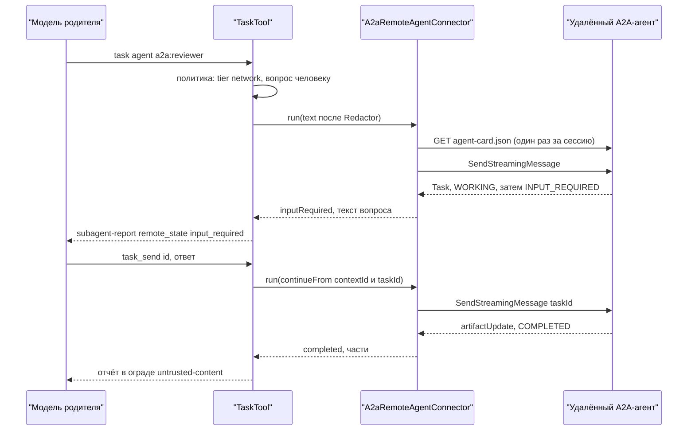

# 17.15. A2A: удалённые агенты и агент как A2A-сервер

> Часть [архитектуры ядра агента CodeLab](../agent-core-architecture.md). Status: Accepted. Общие соглашения, термины и порядок чтения — в оглавлении.

← [17.14. Расширения](17-14-extensions.md) · [Оглавление ядра](../agent-core-architecture.md)

Цели: E-22 (A2A-клиент: удалённые агенты как субагенты, **Should**), E-23 (A2A-сервер
`codelab-agent serve --a2a`, **Could**); обе — этап 9+, после C-06 и C-17. Затрагивает §1.2–§1.3
(пакет `codelab_agent_a2a`, экспорт `SseDecoder`), §6.2 и §7.3 (уровень `network` у `task` с
удалённым агентом), §7.2 (`PermissionRequest.criticalLabel`), §8.2.4 (поле `remote` записи
`subagent`), §10.3–§10.7 (сервис `remoteAgents`, профиль `a2a-serve`), §12.3 (области
`a2a.client`, `a2a.server`), §15.3–§15.5 (раздел `a2a`), §16, §17.3.1–§17.3.2, §17.5.6, §17.5.8.

## 17.15.1. Назначение и охват

[A2A](https://a2a-protocol.org/latest/specification/) (Agent2Agent) — открытый протокол связи
**агента с агентом** под управлением Linux Foundation. Раздел вводит две независимые роли:

| Роль | Цель | Что получает пользователь | Что раздел не делает |
|---|---|---|---|
| **Клиент** | E-22, Should | модель родителя поручает задачу удалённому A2A-агенту тем же инструментом `task`, что и локальному субагенту (§17.3): отчёт, продолжение `task_send`, отмена | не даёт удалённому агенту доступа к файлам, командам и журналу сессии; не проводит интерактивную авторизацию |
| **Сервер** | E-23, Could | `codelab-agent serve --a2a` отдаёт CodeLab другим агентам и оркестраторам как A2A-агента с одним рабочим каталогом | не открывает агента в сеть по умолчанию; не выдаёт «разрешить всегда» по A2A |

**Граница с ACP.** ACP остаётся **единственным** протоколом между клиентом (codelab-app,
codelab_cli, сторонние ACP-клиенты) и агентом; клиенты A2A не используют и ничего о нём не знают.
A2A — связь агента с другими агентами, после MVP. Удалённый субагент виден ACP-клиенту ровно как
локальный (§17.15.3, «ACP»).

**Имена.** ACP в CodeLab — Agent Client Protocol (`docs/protocols/acp/protocol/`). Одноимённый Agent
Communication Protocol (IBM) — другой протокол, он влился в A2A; к ACP CodeLab отношения не имеет.

**Версия и привязка.** Поддерживается A2A **1.0**: каждый запрос клиента несёт заголовок
`A2A-Version: 1.0`; сервер принимает только мажорную версию 1 (пустой заголовок означает 0.3 и
отклоняется `VersionNotSupportedError`, `-32009`). Модель данных — `spec/a2a.proto` в записи
ProtoJSON (значения перечислений — `TASK_STATE_WORKING`, `ROLE_USER`). Единственная привязка —
**JSON-RPC 2.0 поверх HTTP(S)**, потоки — SSE (`Content-Type: text/event-stream`).

| Возможность A2A | Клиент | Сервер | Почему |
|---|---|---|---|
| JSON-RPC: `SendMessage`, `SendStreamingMessage`, `GetTask`, `CancelTask`, `SubscribeToTask` | да | да | минимальный набор для задачи с потоком, опросом, отменой и переподключением |
| `ListTasks` | нет | да | клиенту достаточно своих `taskId` из журнала; серверу — для оркестратора |
| gRPC, HTTP+JSON/REST | нет | нет | gRPC требует protobuf и HTTP/2 (новые зависимости, нет web-сборки); REST повторяет семантику JSON-RPC другими путями. Одна привязка — один корпус golden-кадров |
| push-уведомления (`*TaskPushNotificationConfig`) | нет | нет: `PushNotificationNotSupportedError` (`-32003`), в карточке `pushNotifications: false` | клиенту пришлось бы принимать входящие webhook, серверу — ходить по адресам из запроса (SSRF); поток и опрос покрывают задачи минут, а не дней |
| `GetExtendedAgentCard` | нет | `ExtendedAgentCardNotConfiguredError` (`-32007`), `extendedAgentCard: false` | публичной карточки достаточно |

Имена полей сверены с `spec/a2a.proto` (ProtoJSON, lowerCamelCase): `AgentInterface` —
`url`, `protocolBinding`, `protocolVersion`, `tenant`; `AgentCard` — `supportedInterfaces`,
`securitySchemes`, `securityRequirements`, `capabilities` (`streaming`, `pushNotifications`,
`extensions`, `extendedAgentCard`); схема HTTP — `httpAuthSecurityScheme` (`scheme`,
`bearerFormat`); `SendMessageRequest` — `message`, `configuration`, `metadata`; в
`SendMessageConfiguration` — `acceptedOutputModes`, `historyLength`, `returnImmediately`
(по умолчанию `false`: запрос ждёт итога); `GetTask` — `id`, `historyLength`; `CancelTask` и
`SubscribeToTask` — `id`. Остальное (например, запись ошибки для неизвестного `contextId`)
уточняется по `spec/a2a.proto` при реализации и фиксируется golden-кадрами §17.15.9.

## 17.15.2. Пакеты и границы

| Пакет | Что в нём | Зависит от | Запрещено |
|---|---|---|---|
| `packages/dart/codelab_agent_a2a` (новый, после MVP) | модели ProtoJSON (подмножество: `AgentCard`, `Message`, `Part`, `Task`, `TaskStatus`, `Artifact`, события потока, ошибки), `A2aClient`, кэш карточек, `A2aRemoteAgentConnector`, транспортно-независимый `A2aRequestHandler`, `A2aPermissionGate`, `A2aTaskStore` и `MemoryA2aTaskStore` | ядро; HTTP — внедрённый `http.Client`, как у `codelab_agent_mcp` | `dart:io`, Flutter, ACP |
| `apps/codelab_agent` | HTTP-привязка сервера: `dart:io` `HttpServer` (`serve --a2a`), TLS, лимиты соединений, `FileA2aTaskStore` | + `codelab_agent_a2a` | Flutter, клиентские пакеты |
| `codelab_embedded` | клиентская часть (`A2aRemoteAgentConnector`) — после MVP, в профилях desktop и CLI | + `codelab_agent_a2a` | серверная часть не подключается |

Allowlist `dependencies` пакета (§1.2): `codelab_agent_core`, `http`, `meta`, `async`. SSE пакет
не декодирует сам: `SseDecoder` и `ServerSentEvent` (§2.6) экспортируются публичным барелем ядра;
кодирование потока сервера (`data: <json>\n\n`) — одна функция пакета.

Ядро не знает об A2A: удалённого агента оно видит через порт.

```dart
// codelab_agent_core/lib/src/subagents/remote_agent.dart (после MVP)
abstract interface class RemoteAgentConnector {
  List<RemoteAgentInfo> get agents;            // из конфига, без сети; name = 'a2a:<имя>'
  Future<RemoteRunResult> run(RemoteRunRequest request, CancelToken cancel,
      void Function(RemoteRunUpdate update) onUpdate);   // никогда не бросает: сбой — RemoteRunResult
  Future<RemoteObservation> observe(String agent, RemoteTaskRef ref, {required int last});
  Future<RemoteCancelOutcome> cancel(String agent, RemoteTaskRef ref);
}
final class RemoteAgentInfo { final String name, description; final Duration timeout; }
final class RemoteTaskRef { final String? contextId, taskId; }
final class RemoteRunRequest {
  final String agent; final String text;       // текст после Redactor (§17.15.3, шаг 4)
  final RemoteTaskRef? continueFrom;           // task_send: тот же contextId (и taskId при INPUT_REQUIRED)
  final bool reattach;                         // task_resume: только переподключение, без сообщения
}
enum RemoteRunState { completed, inputRequired, authRequired, failed, rejected, canceled, lost }
final class RemoteRunResult {
  final RemoteTaskRef ref; final RemoteRunState state;
  final List<ContentBlock> content;                 // уже приведённые части (§17.15.3, «Части»)
  final String? failureText; final int? errorCode;   // код JSON-RPC или HTTP
}
final class RemoteRunUpdate { final String state; final String? statusText; }   // для строки прогресса
final class RemoteObservation { final List<String> lines; final bool local; }   // local — из журнала ребёнка
enum RemoteCancelOutcome { canceled, notCancelable, unknownTask, failed }

// codelab_agent_a2a: сервер без привязки к HTTP-стеку
final class A2aRequestHandler {
  A2aRequestHandler({required AgentRuntime runtime, required A2aServerConfig config,
      required A2aTaskStore tasks, required Logger logger, required Clock clock, required IdGenerator ids});
  Future<A2aHttpResponse> handle(A2aHttpRequest request);   // тело JSON-RPC → JSON или SSE
  Future<void> shutdown(Object reason);                     // отменяет задачи, закрывает потоки
}
final class A2aHttpRequest { final String method, path; final Map<String, String> headers;
  final List<int> body; final String? principal; }          // principal — после проверки токена
sealed class A2aHttpResponse { const A2aHttpResponse(); }
final class A2aJsonResponse extends A2aHttpResponse { final int status; final Object? json; final Map<String, String> headers; }
final class A2aSseResponse extends A2aHttpResponse { final Stream<String> events; }
```

Раскладка: `lib/src/model/` (ProtoJSON), `lib/src/client/` (`a2a_client.dart`, `card_cache.dart`,
`auth.dart`, `remote_connector.dart`, `parts_in.dart`), `lib/src/server/` (`request_handler.dart`,
`task_store.dart`, `permission_gate.dart`, `sse_out.dart`), `lib/testing.dart` (`FakeA2aServer`,
`MemoryA2aTaskStore`); привязка сервера — `apps/codelab_agent/lib/src/a2a/`. Тест-сторож §1.4
получает правило пакета, allowlist-тест — его строку.

## 17.15.3. Клиент: удалённый агент как субагент (E-22)

**Адресация.** Каждый `a2a.agents.<имя>` (§17.15.5) становится **типом субагента** —
`AgentDefinition` (§17.3.2, R-15) с `name: "a2a:<имя>"`, `source: "a2a:<имя>"`, `scope: subagent`,
`description` из конфига и новым полем `remote: RemoteAgentInfo`. Отдельного инструмента нет:
модель пишет `task` с `agent: "a2a:reviewer"`. Двоеточие в именах Markdown-определений
недопустимо (§15.8), поэтому коллизий нет. Описание берётся из **конфига**, а не из карточки:
`enum` и описание `task` строятся при создании сессии без сети (схемы стабильны для кэша
промпта, §17.3.2), а текст карточки — недоверенный ввод чужого сервера и в системный промпт не
попадает. Типы `a2a:*` появляются, только если хост передал `AgentCoreServices.remoteAgents`
(§10.3) и `subagents.enabled`.

**Доверие и секреты.** `a2a.agents` из проектного слоя действует только для проекта из
`trusted_projects` (§15.3): иначе склонированный репозиторий направил бы код пользователя и его
секрет (имя секрета в `auth.secret`) на свой адрес. Секрет — только **имя** в `SecretStore`
(§17.5.4); литеральное значение — `ConfigInlineSecretException` (CFG-9). Значение читается через
`SecretResolver` при первом запросе и регистрируется в `Redactor`.

**Карточка.** Загружается лениво — при первом прогоне типа в сессии — с `card_url` (по умолчанию
`<url>/.well-known/agent-card.json`) и кэшируется на сессию. Проверки (ошибка — прогон `failed`,
текст §17.15.7, лог `a2a.client.card.invalid`):

1. есть обязательные поля `name`, `description`, `supportedInterfaces`, `version`, `capabilities`,
   `defaultInputModes` (с `text/plain`), `defaultOutputModes`, `skills`;
2. среди `supportedInterfaces` есть привязка JSON-RPC с версией протокола мажора 1; адрес
   интерфейса — `https`, либо `http` только для loopback; схема, хост и порт совпадают с `url`
   конфига (карточка не может перенаправить токен на чужой хост);
3. `securitySchemes` содержит схему, соответствующую `auth.scheme`: `bearer` — `HTTPAuth` со
   схемой Bearer; `apiKey` — `APIKey` в заголовке (имя заголовка — из карточки); `oauth2_client_credentials` —
   `OAuth2` с потоком `ClientCredentials`, чей `tokenUrl` равен `auth.token_url` конфига
   (секрет клиента не уходит по адресу из карточки). Подпись `AgentCardSignature` в v1 не
   проверяется — открытый вопрос §16.3.

**Прогон.** Каждый вызов `task`, `task_send`, `task_resume` с удалённым типом — прогон §17.3.8.1
поверх `RemoteAgentConnector.run` вместо дочерней `AgentSession`:

```text
remoteRun(type, args, ctx):
1  единая точка исполнения: tierOf = network, ключ PermissionKey("task", "a2a:<имя>") (ниже)
2  карточка (кэш или загрузка) → проверки выше
3  ref := нет у task; у task_send — {contextId, taskId?} из последней записи subagent ребёнка
4  text := args.prompt | args.message (+ output_schema.md, как §17.3.3, шаг 8) → Redactor (§12.4)
     уходят только эти слова родителя: ни журнал, ни контекст, ни файлы сессии не передаются
5  capabilities.streaming && allow_streaming → SendStreamingMessage:
     первый кадр — Task (contextId, taskId → запись subagent{status: running, remote}, durable);
     statusUpdate → onUpdate(строка прогресса); artifactUpdate → накопить части;
     обрыв до итога → SubscribeToTask(taskId), до a2a.client.reconnect_attempts раз с задержкой
       1 с × 2^n; затем — опрос GetTask; лог a2a.client.stream.reconnect
   иначе → SendMessage с `configuration.returnImmediately: true`, затем
     GetTask раз в poll_interval с ростом ×2 до poll_max_interval
   ответ Message вместо Task → это итог прогона (completed)
6  итог: терминальное состояние, TASK_STATE_INPUT_REQUIRED или TASK_STATE_AUTH_REQUIRED
     (поток клиент закрывает сам); timeout типа истёк → CancelTask, failed
7  отчёт := части артефактов (при их отсутствии — части status.message) → buildReport §17.3.5
     (усечение report_max_bytes, проверка output_schema с одним ремонтом через task_send)
```

**Состояния.** Отображение `TaskState` на итог прогона (§17.3.2, §17.3.8.1):

| A2A | Прогон | Что видит модель родителя | Продолжение |
|---|---|---|---|
| `TASK_STATE_COMPLETED` | `completed` | отчёт из артефактов | `task_send` — новая задача в том же `contextId` |
| `TASK_STATE_INPUT_REQUIRED` | `completed`, ребёнок **ожидает** | текст `status.message` с атрибутом `remote_state="input_required"` | `task_send` — сообщение с тем же `contextId` и `taskId` |
| `TASK_STATE_FAILED` | `failed` (`error`) | `Subagent failed: <status.message>` | `task_send` — нет; `task_resume` — нет (задача терминальна) |
| `TASK_STATE_CANCELED` | `cancelled` | стандартный текст отмены | новый `task` |
| `TASK_STATE_REJECTED` | `failed` (`refused`) | `Remote agent <имя> rejected the task: …` | `task_send` (новая задача в контексте) |
| `TASK_STATE_AUTH_REQUIRED` | `failed` (`error`) | текст §17.15.7 о внешней авторизации | `task_resume` — после авторизации вне CodeLab |
| `TASK_STATE_UNSPECIFIED`, неизвестное | `failed` (`error`) | `InvalidAgentResponseError` | — |
| поток и опрос исчерпаны | `failed` (`interrupted`) | `Remote agent <имя> failed: connection lost.` | `task_resume` |

**Контекст и задачи.** Один ребёнок — один A2A-контекст: `contextId` первого ответа сохраняется
и переиспользуется всеми прогонами ребёнка; `taskId` — на прогон. Оба пишутся в поле `remote`
записи `subagent` родителя (`{"agent", "contextId", "taskId", "state"}`, §8.2.4) — по ним
продолжение работает и после перезапуска. Журнал ребёнка (§17.3.6) создаётся как обычно, с
заголовком `parent` и полем `remote: {agent, url, contextId}`; в нём — `message` с отправленным
текстом и `message` с полученным отчётом на прогон. Модели в нём нет: это запись обмена для доски
и `_codelab/subagents/history`.

**Инструменты продолжения.**

| Инструмент | Удалённый ребёнок |
|---|---|
| `task_send` | разрешён ожидающему (`completed`, `INPUT_REQUIRED`, `REJECTED`); tier `network`, тот же ключ разрешения |
| `task_observe` | `GetTask(taskId)` → строки из `history` в формате §17.3.8.1 с лимитами `observe_*`; сеть недоступна → строки из журнала ребёнка с пометкой `(local record)`; tier `read`: уходят только идентификаторы |
| `task_cancel`, `/tasks cancel` | `CancelTask(taskId)`; `TaskNotCancelableError` (`-32002`) → прогон всё равно `cancelled` локально, текст §17.15.7, лог `a2a.client.cancel_refused` |
| `task_resume` | только **переподключение** к той же задаче: последний прогон `failed` с `interrupted` или `AUTH_REQUIRED`, а `GetTask` показывает нетерминальное состояние → поток `SubscribeToTask` или опрос, сообщение не отправляется; иначе ошибка §17.15.7 |

Отмена хода родителя отменяет блокирующий удалённый прогон (`CancelTask`, ожидание ответа не
дольше `cancel_grace`, SUB-6); фоновый режим (`run_in_background`, §17.3.8) работает так же, как
у локального ребёнка. Бюджет ребёнка — только `timeout` типа (по умолчанию
`subagents.max_duration`): шагов и токенов удалённого агента CodeLab не видит; usage удалённого
прогона — нулевой и в `TurnUsage.subagentUsage` не входит.

**Части.** Что приходит от удалённого агента (`parts_in.dart`):

| `Part` | Как становится `ContentBlock` |
|---|---|
| `text` | `TextContent` как есть |
| `data` | `TextContent` с fenced-блоком `json` (каноническая запись JSON с ключами по алфавиту, не больше `a2a.client.max_part_bytes`, иначе усечение с пометкой) |
| `url` | строка `[file: <filename или url> (<mediaType>) <url>]`; файл не скачивается: загрузка — отдельный `web_fetch` модели со своим разрешением |
| `raw` с `mediaType` `image/*` | `ImageContent` через `ImagePreparer` (T-29, §17.11.2.1), если модель родителя принимает картинки и размер ≤ `max_part_bytes`; иначе строка-пометка |
| прочий `raw` | строка `[file omitted: <filename> (<mediaType>, <N> bytes)]`; в рабочий каталог и каталог выноса не пишется |

Файлы не сохраняются: запись чужих байтов в рабочий каталог — правка без одобрения, в каталог
выноса (§17.4) — неограниченный канал диска; нужный файл модель берёт инструментом с разрешением.

**Доверие вывода.** Отчёт — всегда `untrusted` (`source="a2a:<имя>"`, ограда §6.3.6); обёртка
§17.3.5 получает атрибуты `remote="true"` и, при `INPUT_REQUIRED`, `remote_state="input_required"`.

**Разрешения.** У `task` и `task_send` с типом `a2a:*` `tierOf` — `network` (у `task_observe`,
`task_cancel` — `read`): прогон отправляет данные на внешний адрес. Ключ —
`PermissionKey("task", "a2a:<имя>")`: «разрешить всегда» на одного удалённого агента не разрешает
другого и локальные типы. По §7.3 (колонка `network`) — вопрос во всех режимах с человеком; в
`autopilot` — отказ (`network access needs approval and autopilot has no approver`), если нет
явного `permissions.tools.task = "allow"`. Одобрения,
которые запрашивает **удалённый** агент у себя, — его дело: CodeLab их не проксирует, а видит как
`INPUT_REQUIRED` и показывает модели родителя.

**Ошибки протокола** (поле `errorCode`, текст — §17.15.7, лог `a2a.client.error` с `code`):

| Источник | Прогон |
|---|---|
| HTTP 401, 403 | `failed` (`error`), «rejected the credentials» |
| HTTP 408, 429, 5xx, обрыв соединения | до итога — переподключение по шагу 5; исчерпано — `failed` (`interrupted`) |
| `-32001` `TaskNotFoundError` | `failed` (`error`); у `task_send` и `task_resume` — «remote task is gone» |
| `-32004` `UnsupportedOperationError`, `-32005` `ContentTypeNotSupportedError`, `-32008` `ExtensionSupportRequiredError` (клиент расширений A2A не объявляет) | `failed` (`refused`) |
| `-32006` `InvalidAgentResponseError`, неразбираемый ответ; `-32009` `VersionNotSupportedError` (карточка удаляется из кэша) | `failed` (`error`) |

`-32002` разобран в таблице продолжений; `-32003` и `-32007` не возникают: эти методы клиент не вызывает.

**ACP.** Удалённый ребёнок проецируется как локальный (§17.3.7): `tool_call` с `kind: "think"`,
title `Subagent a2a:<имя>: <description>`, строки прогресса из `RemoteRunUpdate`, итог — тело
отчёта; доска (U-21) показывает тип `a2a:<имя>` и историю из журнала ребёнка. Новых расширений ACP
нет; поле `remote` в снимке доски, если понадобится, вводится вместе с доской **через OpenSpec**.



## 17.15.4. Сервер: CodeLab как A2A-агент (E-23)

**Запуск.**

```text
codelab-agent serve --a2a [--host 127.0.0.1] [--port 8340] [--cwd <dir>] [--token-secret <имя>]
                          [--allow-remote --tls-cert <file> --tls-key <file>] [--permission-mode <режим>]
```

* `--a2a` несовместим с `--stdio` и `--ws` (ошибка использования, код 64); профиль хоста —
  `a2a-serve` (ниже), `--profile` может только сузить его.
* **Только loopback по умолчанию.** `--host` вне `127.0.0.0/8` и `::1` требует `--allow-remote` и
  TLS (`--tls-cert`, `--tls-key`, `HttpServer.bindSecure`); без них — отказ старта
  `refusing to listen on <host> without --allow-remote and TLS`. Обратный прокси подключается к
  loopback-адресу и сам держит TLS — отдельного режима «за прокси» нет.
* **Аутентификация обязательна.** Токены — `a2a.server.tokens` (имя принципала + имя секрета) или
  один `--token-secret <имя>` (принципал `default`); без токенов — отказ старта
  `A2A server requires at least one token`. Схема — HTTP Bearer (`APIKey` в `X-CodeLab-Key` — по
  `a2a.server.auth.api_key: true`), сравнение за постоянное время. Без токена или с неверным —
  HTTP 401 с `WWW-Authenticate: Bearer`, без тела и без различия случаев (`a2a.server.auth.failed`). Ротация: новый токен добавляется, старый удаляется из конфига, живая перезагрузка
  (§17.5.6) применяет список без перезапуска; открытые потоки отозванного токена закрываются.
* Карточка — `GET /.well-known/agent-card.json` без аутентификации (секретов в ней нет);
  JSON-RPC — `POST /a2a`. Прочие пути — 404.

**Карточка агента.** Строится из конфига при старте и перезагрузке:

```json
{"name":"CodeLab agent","description":"Coding agent for the workspace demo. Reads and edits files and runs commands with approvals.","version":"0.1.0",
 "supportedInterfaces":[{"url":"http://127.0.0.1:8340/a2a","protocolBinding":"JSONRPC","protocolVersion":"1.0"}],
 "capabilities":{"streaming":true,"pushNotifications":false,"extendedAgentCard":false,
   "extensions":[{"uri":"https://codelab.dev/a2a/ext/approval/v1","description":"Tool approvals as input-required tasks.","required":false}]},
 "defaultInputModes":["text/plain","application/json"],"defaultOutputModes":["text/plain","application/json"],
 "skills":[{"id":"general","name":"general","description":"General coding work in the workspace.","tags":["code"]},
           {"id":"reviewer","name":"reviewer","description":"Reviews the current changes and reports defects","tags":["review"]}],
 "securitySchemes":{"codelab-token":{"httpAuthSecurityScheme":{"scheme":"Bearer"}}}}
```

`skills` — определения агентов (R-15, §15.8) из allowlist `a2a.server.skills` (`general` — сессия
без определения): `id` и `name` — имя, `description` — описание определения. Требование схемы — поле `securityRequirements` карточки со ссылкой на `codelab-token`; его точная ProtoJSON-запись в примере опущена и фиксируется golden-кадром §17.15.9. URI расширения `https://codelab.dev/a2a/ext/approval/v1` —
**заглушка**: окончательный URI и форма вводятся через OpenSpec вместе с реализацией.

**Профиль хоста `a2a-serve`** (дополнение §10.4). ACP-клиента нет, поэтому файлы и команды —
локальные, а вопрос человеку уходит в `A2aPermissionGate`:

| Capability | `a2a-serve` |
|---|---|
| `shellExec`, `backgroundJobs`, `fileListing`, `languageServers`, `outputSpill`, `userHooks` | transport `local` |
| `mcp` | transport `stdio`, `http` — только серверы из конфига (в A2A нет `mcpServers`) |
| `compaction`, `projectContext`, `network`, `skills` | on |
| `sessionPersistence`, `memory` | transport `jsonl-file`, lease `file`; transport `local-file` |
| `interactiveApproval` | transport `a2a`: `A2aPermissionGate`, если создавший задачу запрос объявил расширение одобрений; иначе вопрос = отказ (PERM-5) |
| `userQuestions` | off: «в A2A нет вопроса с вариантами; уточнение — ответом модели в `TASK_STATE_COMPLETED`» |

Режим новой сессии — `a2a.server.permission_mode` (по умолчанию `standard`, §10.5); `autopilot`
недоступен ни конфигом, ни флагом `--permission-mode` в `serve --a2a` (CFG-4).

**Сессии и контексты.** Один процесс — один `cwd` (`--cwd`, `a2a.server.cwd`, иначе каталог запуска), **никогда** из запроса.

```text
SendMessage | SendStreamingMessage(message, principal):
1  A2A-Version мажора 1, иначе -32009; тело ≤ max_request_bytes, иначе HTTP 413
2  части: text и data (data → fenced-блок json в тексте промпта); raw и url → -32005
3  message.taskId задан:
     задача чужого принципала или неизвестна → -32001
     state INPUT_REQUIRED → ответ на одобрение (ниже); иначе (идёт, терминальна) → -32004
4  message.contextId задан: известен этому принципалу → его сессия; неизвестен → -32602
     (запись ошибки — по spec/a2a.proto); не задан → новая сессия:
     runtime.createSession(cwd, agent: metadata["codelab.skill"] ?? "general"), skill вне
     allowlist → -32602; contextId := "ctx_" + IdGenerator; запись context в A2aTaskStore
5  в сессии уже есть незавершённая задача → -32004 (один ход на сессию, как turnActive в ACP)
6  активных задач процесса ≥ max_concurrent_tasks или превышен rate_limit токена → HTTP 429 с Retry-After
7  task := {id: "task_" + IdGenerator, contextId, status: TASK_STATE_SUBMITTED}; запись в store
8  session.prompt(content) в фоне; события → состояние задачи (таблица ниже)
9  SendStreamingMessage → поток: Task, затем statusUpdate и artifactUpdate до терминального
     состояния; SendMessage → ждёт терминального или INPUT_REQUIRED (returnImmediately — сразу Task)
```

| Событие ядра | Состояние задачи и кадр |
|---|---|
| `TurnStarted` | `TASK_STATE_WORKING` |
| `ToolCallStarted`, `StepEnded` (не чаще `progress_interval`) | `statusUpdate` `WORKING` с текстом `Working: <title вызова>` |
| запрос `A2aPermissionGate`; ответ на него или таймаут | `TASK_STATE_INPUT_REQUIRED` с запросом одобрения (ниже); затем снова `WORKING` |
| `TurnEnded(completed \| maxTokens)` | артефакт `answer` (текст ответа) и, если были правки, артефакт `changes` (data-часть `{"codelab.changes":[{"path","added","removed"}]}`); затем `TASK_STATE_COMPLETED` |
| `TurnEnded` с `budgetExceeded` | артефакт `answer` (частичный), `TASK_STATE_FAILED` с `Turn budget exhausted: <limit>.` |
| `TurnEnded(refused)`, `(failed)`, `(cancelled)` | `TASK_STATE_REJECTED` с текстом отказа модели; `TASK_STATE_FAILED` с сообщением `AgentError` после `Redactor`; `TASK_STATE_CANCELED` |

Артефакт не длиннее `artifact_max_bytes` (усечение с пометкой; полный ответ — в журнале).
`GetTask` и `ListTasks` читают `A2aTaskStore`; `ListTasks` видит **только** задачи своего
принципала, страница — 50 (максимум 100), сортировка по времени статуса, новые первыми, пустой
`nextPageToken` — последняя страница. `CancelTask` → `session.cancel()`; задача уже терминальна →
`-32002`. `SubscribeToTask` → новый поток с текущим `Task` первым кадром; закрытие потока
клиентом задачу не отменяет; потоков на задачу может быть несколько.

**Хранилище.** `FileA2aTaskStore` — append-only `$CODELAB_HOME/sessions/<cwd-slug>/a2a-server.jsonl`
рядом с журналами: записи `context` `{contextId, sessionId, principal, created}` и `task`
`{taskId, contextId, state, statusText?, timestamp, artifacts?}` (последняя запись `taskId`
выигрывает). Журналы A2A-сессий — обычные журналы §8: та же редакция (§12.4), тот же формат; в
`session/list` ACP-клиентов того же `cwd` они видны, а на запись, пока работает `serve --a2a`,
не открываются (lease, §17.6.8). При старте задачи без терминальной записи получают
`TASK_STATE_FAILED` с `The server restarted.` (ход сессии лечится по §8.8).

**Одобрения: `A2aPermissionGate`.** Клиент объявляет поддержку заголовком
`A2A-Extensions: https://codelab.dev/a2a/ext/approval/v1` в запросе, создающем задачу.

```text
A2aPermissionGate.request(req, cancel):
1  req.criticalLabel != null (критический шаблон §7.6 или конфигурация агента §7.6.1, PERM-11)
     → rejectOnce без вопроса; текст модели: This action needs a local human and cannot be
       approved over A2A: <label>.
2  задача создана без расширения или a2a.server.approvals = reject → rejectOnce
     (политика даёт «no approval interface is available», как PERM-5)
3  в очереди задачи уже есть вопрос → ждать (вопросы сессии — по одному, как SUB-3)
4  статус TASK_STATE_INPUT_REQUIRED, status.message: text-часть
     "Approval needed: <title>" и data-часть codelab.approvalRequest (ниже); rawInput — после
     Redactor, каноническая запись не длиннее 2000 символов; diffs — только счётчики строк
5  ждать сообщения с тем же taskId и data-частью codelab.approval не дольше approval_timeout
     (по умолчанию 5m): allow_once → allowOnce; reject_once → rejectOnce; таймаут → rejectOnce,
     лог a2a.server.approval.timeout; отмена задачи → cancelled
6  неверный toolCallId, иное decision, сообщение без codelab.approval → -32602, вопрос остаётся
```

```json
{"jsonrpc":"2.0","id":7,"method":"SendMessage","params":{"message":{"messageId":"msg_2","contextId":"ctx_01JB9A","taskId":"task_01JB9B","role":"ROLE_USER",
 "extensions":["https://codelab.dev/a2a/ext/approval/v1"],
 "parts":[{"data":{"codelab.approval":{"toolCallId":"call_4","decision":"allow_once"}}}]}}}
```

Запрос одобрения в `status.message` задачи:

```json
{"messageId":"msg_srv_9","role":"ROLE_AGENT","parts":[{"text":"Approval needed: Run dart test"},
 {"data":{"codelab.approvalRequest":{"toolCallId":"call_4","tool":"exec","kind":"execute","tier":"exec",
   "title":"Run dart test","rawInput":"{\"command\":\"dart test\"}","options":["allow_once","reject_once"],
   "expiresAt":"2026-10-22T10:05:00.000Z"}}}]}
```

`allow_always` и `reject_always` по A2A **не предлагаются**: у принципала нет UI отзыва, а «навсегда» от автоматического клиента расширило бы права на всю сессию.

**Остановка.** SIGINT/SIGTERM → `shutdown`: новые запросы — HTTP 503, идущие задачи —
`session.cancel()`, потоки получают `TASK_STATE_CANCELED` и закрываются (ожидание до 10 с).

**Модель угроз.** Сервер — агент с `exec` на машине пользователя, доступный по сети.

| Угроза | Защита |
|---|---|
| сосед по сети или страница в браузере вызывает агента | loopback по умолчанию; не-loopback — только `--allow-remote` с TLS; обязательный токен; без CORS-заголовков, тело только `application/json` |
| украденный токен | токен — секрет в `SecretStore`, не в конфиге и не в argv; ротация без перезапуска; аудит `a2a.server.*` с принципалом |
| клиент сам одобряет опасное | без расширения вопрос — отказ; критические шаблоны и правка конфигурации агента — отказ всегда; `allow_always` нет; `autopilot` недоступен |
| запрос выбирает каталог, MCP-сервер или режим | `cwd`, MCP и режим — только из конфига и флагов сервера |
| чужие задачи | `GetTask`, `ListTasks`, `CancelTask`, контексты — только своего принципала; чужое — как несуществующее (`-32001`) |
| истощение ресурсов; утечка секретов в ответ | лимиты задач, размера и частоты, бюджет хода (§5.2); ответы, статусы и артефакты проходят `Redactor` (§12.4) |

## 17.15.5. Конфигурация

```yaml
# ~/.codelab/config.yaml
a2a:
  agents:
    reviewer:
      url: https://agents.example.com/reviewer
      description: Reviews pull requests against the team style guide.
      auth:
        scheme: bearer                 # bearer | apiKey | oauth2_client_credentials
        secret: codelab/a2a/reviewer   # имя в SecretStore, не значение
      timeout: 15m
      allow_streaming: true
  server:
    host: 127.0.0.1
    port: 8340
    cwd: /Users/me/work/demo
    tokens:
      - name: ci
        secret: codelab/a2a/server-ci
    skills: [general, reviewer]
```

| Ключ | Тип | По умолчанию | Смысл |
|---|---|---|---|
| `a2a.agents.<имя>` | map | — | имя — `^[a-z][a-z0-9-]{0,47}$`; тип субагента `a2a:<имя>` |
| `.url`, `.card_url` | string | обязателен, `<url>/.well-known/agent-card.json` | `https` (`http` — только loopback); у карточки та же схема, хост и порт |
| `.description` | string | обязателен | 1–200 символов; описание типа для модели |
| `.auth.scheme`, `.auth.secret` | enum, secretName | обязательны | `bearer`, `apiKey`, `oauth2_client_credentials`; секрет — токен, ключ или секрет клиента OAuth2 |
| `.auth.client_id`, `.auth.token_url`, `.auth.scopes` | string, string, string[] | — | только `oauth2_client_credentials`; `token_url` — `https`; токен кэшируется до истечения |
| `.timeout` | duration | `subagents.max_duration` | предел прогона; `1m..24h` |
| `.allow_streaming`, `.enabled` | bool | `true`, `true` | `false` — только `SendMessage` и опрос; `false` — тип не регистрируется |
| `a2a.client.poll_interval`, `.poll_max_interval` | duration | `1s`, `10s` | опрос `GetTask`; `1s..60s`, первый ≤ второго |
| `a2a.client.reconnect_attempts`, `.max_part_bytes` | int | `3`, `1048576` | `0..10`; предел одной части `1024..16777216` |
| `a2a.server.host`, `.port` | string, int | `127.0.0.1`, `8340` | адрес; не-loopback — только с `--allow-remote` и TLS |
| `a2a.server.cwd` | path | каталог запуска | единственный рабочий каталог |
| `a2a.server.tokens` | list `{name, secret}` | `[]` | принципалы; `name` — `^[a-z][a-z0-9-]{0,47}$`, уникально |
| `a2a.server.auth.api_key` | bool | `false` | принимать токен и в `X-CodeLab-Key` |
| `a2a.server.skills` | string[] | `["general"]` | определения, видимые в карточке; неизвестное имя — `ConfigException` |
| `a2a.server.permission_mode` | enum | `standard` | `plan`, `ask`, `standard`, `accept-edits`, `bypass` |
| `a2a.server.approvals`, `.approval_timeout` | enum, duration | `ask`, `5m` | `reject` — не спрашивать по A2A вовсе; таймаут `10s..1h` |
| `a2a.server.max_concurrent_tasks`, `.max_request_bytes`, `.rate_limit`, `.artifact_max_bytes` | int | `2`, `1048576`, `60`, `65536` | лимиты §17.15.4 |
| `a2a.server.progress_interval` | duration | `2s` | частота `statusUpdate` `WORKING` |

Флаги `serve --a2a` сильнее `a2a.server.*`. Доверие (§15.3): `a2a.agents` проектного слоя — только
для проекта из `trusted_projects` (иначе `config.project.untrusted_key`); `enabled: false` и уменьшение `a2a.client.*` — в любом слое;
`a2a.server.*` — только глобальный конфиг и флаги. Реестр настроек (§17.5.8): `a2a.agents`,
`a2a.client`, `a2a.server` — `fileOnly` («адреса, куда уходят задачи с кодом, и сетевой сервер
агента — граница безопасности»); `a2a.server` кроме `tokens` — после перезапуска (§17.5.6).

## 17.15.6. Наблюдаемость

| Событие | Уровень | Поля |
|---|---|---|
| `a2a.client.card.fetched` (info), `a2a.client.card.invalid` (warning) | — | `agent`, `url`, `version`, `streaming` / `reason` |
| `a2a.client.unavailable` | warning | `reason` (хост не передал `remoteAgents`; типы `a2a:*` не регистрируются) |
| `a2a.client.request` | debug | `agent`, `method`, `task_id`, `http_status`, `duration_ms` |
| `a2a.client.task.state`, `a2a.client.stream.reconnect` | info | `agent`, `subagent_id`, `context_id`, `task_id`, `state` / `attempt` |
| `a2a.client.cancel_refused`, `a2a.client.error` | warning | `agent`, `task_id` / `code`, `http_status` |
| `a2a.server.start`, `a2a.server.stop` (info); `a2a.server.auth.failed` (warning) | — | `host`, `port`, `tls`, `principals` (число) / `reason`; `remote_address` |
| `a2a.server.request` | debug | `principal`, `method`, `request_id`, `duration_ms` |
| `a2a.server.task.state` | info (аудит) | `principal`, `task_id`, `context_id`, `session_id`, `state` |
| `a2a.server.approval.request`, `.decision`, `.timeout` | info (аудит) | `principal`, `task_id`, `tool_call_id`, `tool`, `decision` |
| `a2a.server.rejected` | info | `principal`, `reason` (`rate_limit`, `busy`, `too_large`, `version`) |

Тексты сообщений, части и аргументы в лог уровня `info` не пишутся; значения токенов — никогда.

## 17.15.7. Ошибки

Тексты для модели родителя (тело `<subagent-report reason="…">`, §17.3.5):

| Случай | Текст |
|---|---|
| карточка не загружена | `Remote agent <name> is unavailable: cannot fetch its agent card (<reason>).` |
| карточка не прошла проверку | `Remote agent <name> has an invalid agent card: <reason>.` |
| схема безопасности не совпала | `Remote agent <name> does not accept the configured authentication (<scheme>).` |
| `-32009` или мажор ≠ 1 | `Remote agent <name> does not support A2A 1.0.` |
| HTTP 401, 403 | `Remote agent <name> rejected the credentials (HTTP <code>).` |
| секрет не задан | `Secret <secret> for remote agent <name> is not set. Run: codelab secret set <secret>` |
| `TASK_STATE_AUTH_REQUIRED` | `Remote agent <name> requires authorization out-of-band; CodeLab does not perform interactive authorization. Remote status: <text>` |
| `TASK_STATE_REJECTED` | `Remote agent <name> rejected the task: <text>` |
| таймаут; соединение потеряно; задача удалена | `Remote agent <name> did not finish within <timeout>.`; `Remote agent <name> failed: connection lost.`; `Remote agent <name> failed: remote task <taskId> is gone.` |
| `task_resume` недоступен | `Remote subagent <id> cannot be resumed: remote task <taskId> is <state>. Use task_send or start a new task.` |
| `task_cancel` при `-32002` | `Cancelled subagent <id>. The remote agent reported that its task cannot be canceled; it may still be running remotely.` |

Ответы сервера: JSON-RPC `-32700`, `-32600`, `-32601`, `-32602` — по JSON-RPC 2.0;
`-32001` `remote task not found`; `-32002` `task is already <state>`; `-32003` `push
notifications are not supported`; `-32004` `a task is already running in this context` или
`task is not waiting for input`; `-32005` `only text and data parts are accepted`; `-32007`
`extended agent card is not configured`; `-32009` `A2A version <v> is not supported; use 1.0`.
HTTP: 401 (без тела), 404, 413, 429 с `Retry-After`, 503 при остановке.

## 17.15.8. Инварианты

1. **A2A-1.** ACP остаётся единственным протоколом клиент ↔ агент: ни один клиентский пакет и
   ни один ACP-кадр не зависят от A2A; удалённый субагент проецируется в ACP как локальный.
2. **A2A-2.** Удалённому агенту уходит только текст, который модель родителя передала в `task` или
   `task_send`, после `Redactor`; журнал, контекст, файлы и секреты сессии не передаются.
3. **A2A-3.** Отчёт и любые части удалённого агента — `untrusted`; описание типа — только из
   конфига; текст карточки в системный промпт не попадает.
4. **A2A-4.** Каждый прогон с удалённым типом проходит политику с уровнем `network` и ключом
   `("task", "a2a:<имя>")`; в `autopilot` без явного правила — отказ.
5. **A2A-5.** Удалённые агенты из проектного слоя действуют только для проекта из
   `trusted_projects`; секреты — только по имени через `SecretResolver`; токен уходит только на
   хост `url` конфига, секрет OAuth2 — только на `token_url` конфига.
6. **A2A-6.** Один удалённый ребёнок — один `contextId` на все прогоны; `contextId` и `taskId`
   записаны в запись `subagent` до первого статуса прогона (`durable`).
7. **A2A-7.** Байты частей `raw` и `url` не записываются ни в рабочий каталог, ни в каталог
   выноса; `url` не загружается без отдельного инструмента с разрешением.
8. **A2A-8.** Сервер без `--allow-remote` и TLS слушает только loopback; без хотя бы одного токена
   не стартует; любой запрос, кроме карточки, без верного токена — 401.
9. **A2A-9.** `cwd`, MCP-серверы и режим сессии сервера задаются только конфигом и флагами
   сервера, никогда запросом; `autopilot` в `serve --a2a` недоступен.
10. **A2A-10.** Вопрос одобрения по A2A — только `TASK_STATE_INPUT_REQUIRED` в задаче, созданной с
    расширением одобрений; без расширения и по таймауту — отказ; `allow_always` не предлагается;
    критические шаблоны и правка конфигурации агента (PERM-11) по A2A всегда отклоняются.
11. **A2A-11.** Задачи, контексты и их списки видны только принципалу, который их создал; чужая
    задача неотличима от несуществующей.
12. **A2A-12.** У сессии сервера не больше одной незавершённой задачи; терминальное состояние
    задачи пишется в `A2aTaskStore` до закрытия её потоков.

## 17.15.9. Как проверить

Фальшивый удалённый агент — `FakeA2aServer` (`package:codelab_agent_a2a/testing.dart`) поверх
`MockClient` (`package:http/testing.dart`): сценарий кадров и запись запросов. Golden-кадры — `packages/dart/codelab_agent_a2a/test/golden/*.json` (запрос и
ответ каждого метода в ProtoJSON).

* `core/a2a-remote-subagent` (`a2a_remote_subagent_test.dart`, scripted LLM родителя): `task` с
  `agent: "a2a:reviewer"` → вопрос с tier `network`; `SendStreamingMessage` с заголовком
  `A2A-Version: 1.0` и Bearer из `SecretStore`; отчёт в `<subagent-report … remote="true">` внутри
  `untrusted-content source="a2a:reviewer"`; запись `subagent` с `remote.contextId`; второй прогон
  в сессии карточку не загружает (A2A-2, A2A-3, A2A-6, E-22).
* `core/a2a-input-required-roundtrip` (`a2a_input_required_test.dart`): удалённый агент отвечает
  `TASK_STATE_INPUT_REQUIRED` → модель получает вопрос с `remote_state="input_required"` →
  `task_send` → запрос с тем же `contextId` и `taskId` → `TASK_STATE_COMPLETED`; после
  перезапуска процесса между прогонами `task_send` берёт идентификаторы из журнала (A2A-6, E-22).
* `a2a_card_validation_test.dart`, `a2a_trust_project_test.dart`: нет обязательного поля, интерфейс
  на чужом хосте, `tokenUrl` не равен конфигу → тексты §17.15.7, задача не отправлена; `a2a.agents`
  недоверенного проекта — нет типа в `enum`; литеральный токен — `ConfigInlineSecretException` (A2A-5).
* `a2a_client_states_test.dart`: таблица состояний §17.15.3 целиком; обрыв SSE → `SubscribeToTask`
  и затем опрос; `streaming: false` → `SendMessage` с `returnImmediately` и опрос с ростом
  интервала по `FakeClock`; `-32002` при отмене; `-32009` (A2A-4).
* `a2a_parts_in_test.dart`: `data` → fenced `json`; `url` не загружается; `raw` PNG → `ImageContent`; прочий `raw` → пометка, ФС не тронута (A2A-7).
* `core/a2a-server-auth-required` (`a2a_server_auth_test.dart`, `A2aRequestHandler` и
  `http_binding_test.dart` в `apps/codelab_agent`): без токена, с неверным — 401 без тела;
  карточка — без токена; `--host 0.0.0.0` без `--allow-remote` и TLS — отказ старта; нет токенов —
  отказ старта; задача другого принципала — `-32001` (A2A-8, A2A-11, E-23).
* `core/a2a-server-approval-input-required` (`a2a_server_approval_test.dart`, scripted LLM):
  модель вызывает `exec dart test` в `standard` → поток даёт `TASK_STATE_INPUT_REQUIRED` с
  `codelab.approvalRequest`; ответ `allow_once` → `WORKING`, команда исполнена, `COMPLETED` с
  артефактом `answer`; без заголовка расширения → отказ без вопроса; `rm -rf /` с расширением →
  отказ без вопроса; таймаут → отказ (A2A-10, E-23).
* `a2a_server_tasks_test.dart`: второй `SendMessage` в контекст с идущей задачей → `-32004`;
  `ListTasks` — только свои, страница 50, порядок; `CancelTask` → `CANCELED`, повторно — `-32002`;
  `SubscribeToTask` после обрыва — текущий `Task` первым кадром; перезапуск → незавершённая
  задача `FAILED` (A2A-11, A2A-12).
* `a2a_server_limits_test.dart`: 413, 429 с `Retry-After`, `raw`-часть → `-32005`, push-методы →
  `-32003`, остановка → `CANCELED` в потоках и 503; сторож импортов — правило `codelab_agent_a2a`.

## 17.15.10. Обоснование решения

* **Только JSON-RPC.** Покрывает все нужные методы и поток SSE поверх того же `http.Client`, что
  MCP и провайдеры; gRPC требует HTTP/2 и protobuf, REST дублирует семантику; один golden-корпус.
* **Без push.** Push заставляет клиента принимать входящие соединения, а сервер — ходить по
  адресам из запроса; для задач кода, которые длятся минуты, поток с переподключением и опрос
  проще и безопаснее. Отказ объявлен в карточке, а не обнаруживается ошибкой.
* **Удалённый агент — тип `task`, а не новый инструмент.** Модель уже умеет поручать задачи и
  продолжать их (`task_send`, C-17); у пользователя одна доска и одна команда `/tasks`. Отличия
  (уровень `network`, ключ разрешения, отсутствие журнала шагов) сосредоточены в одном прогоне.
* **Одобрения через `TASK_STATE_INPUT_REQUIRED`.** Штатное прерывание задачи A2A: любой клиент
  видит, что задача ждёт, клиент с расширением отвечает; без расширения — отказ, как без gate (PERM-5).
* **Loopback и обязательный токен.** Сервер — агент с shell: наружу — только сознательно (`--allow-remote`) и с TLS.
* **Удалённый вывод — `untrusted`.** Чужой сервер полностью управляет текстом отчёта и карточки;
  его инструкции родитель не исполняет (TOOL-10 по смыслу), карточка в промпт не попадает.
* **Профиль `a2a-serve`, а не `agent-serve`.** Без ACP-клиента нет `fs/*` и `terminal/*`, нет
  `QuestionGate`, а gate — другой: это другой набор состояний capability, и он должен быть виден в
  `host.plan`, а не прятаться в условиях внутри `agent-serve`.

---

← [17.14. Расширения](17-14-extensions.md) · [Оглавление ядра](../agent-core-architecture.md)
