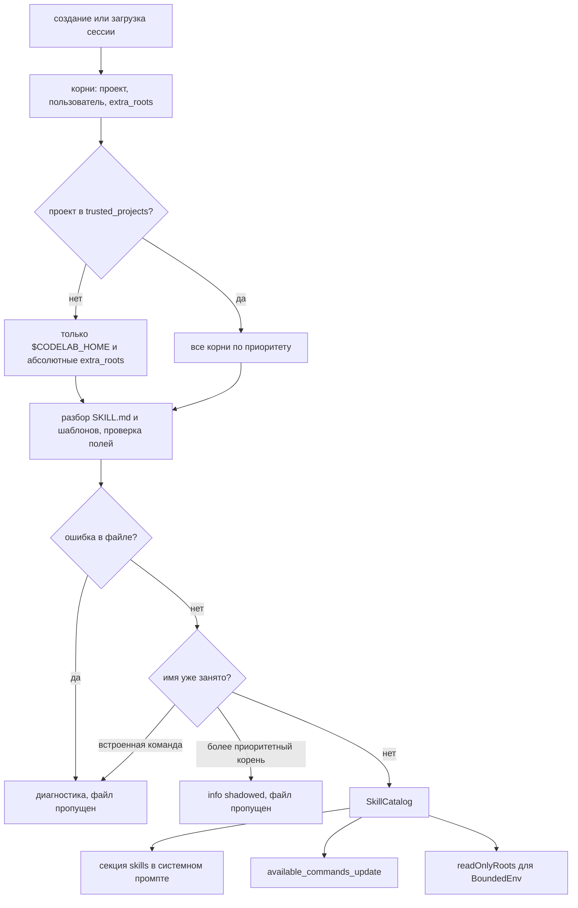
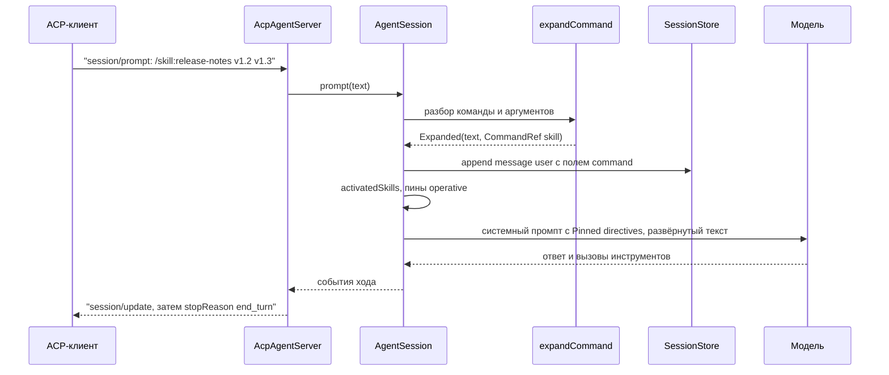

# 17.2. Skills и шаблоны промптов

> Часть [архитектуры ядра агента CodeLab](../agent-core-architecture.md). Status: Accepted. Общие соглашения, термины и порядок чтения — в оглавлении.

← [17.1. Web-инструменты: `web_fetch` и `web_search`](17-1-web-tools.md) · [Оглавление ядра](../agent-core-architecture.md) · [17.3. Субагенты: инструмент `task`](17-3-subagents.md) →

Цели E-06, E-07, K-06. Раздел добавляет capability `skills` (§10.2), инструмент `skill`,
секции системного промпта `skills/catalog` и `skills/operative`, команды `/skill:<name>` и
`/<template>`. Всё, что видит модель, подчиняется правилу «выключено — невидимо» (§10.9, HOST-4).

## 17.2.1. Назначение

* **Skill** — каталог с файлом `SKILL.md`: короткое описание для модели во frontmatter и
  подробная инструкция в теле, плюс сопутствующие файлы (шаблоны, примеры, скрипты). Модель
  видит только каталог «имя + описание»; тело попадает в контекст, когда задача подходит
  (инструмент `skill`) или когда пользователь вызвал `/skill:<name>`. Так десятки инструкций
  стоят модели несколько сотен токенов, а не десятки тысяч.
* **Шаблон промпта** — Markdown-файл, который становится командой `/<name> <аргументы>`:
  агент подставляет аргументы и отправляет результат модели как сообщение пользователя.
  Модель шаблоны не видит, это удобство человека.
* **Закреплённые строки** (`operative`) — короткие правила из frontmatter skill или из
  конфига пользователя, которые должны действовать всю сессию. Они пересобираются при каждом
  запросе к модели из каталога и журнала, поэтому сжатие (§9) их не теряет и не перефразирует.

Ядро файлы не читает (CFG-5): каталог загружает хост (`codelab_agent_io`) при создании и
загрузке сессии и передаёт ядру в `SessionSpec` готовый `SkillCatalog`. Изменения файлов
действуют со следующей сессии — так же, как для `AGENTS.md` (§11.5) и определений агентов (§15.8).

## 17.2.2. Раскладка и формат

**Корни skills** (от высшего приоритета к низшему):

| # | Корень | Область | Когда читается |
|---|---|---|---|
| 1 | `<cwd>/.codelab/skills/<name>/SKILL.md` | `project` | только если проект в `trusted_projects` (§15.3): тело skill — промпт |
| 2 | `$CODELAB_HOME/skills/<name>/SKILL.md` | `user` | всегда |
| 3 | каждый путь из `skills.extra_roots`, в порядке массива | `extra` | только если путь записан в глобальном или локальном конфиге (слои 2 и 4); относительный путь (`.claude/skills`) разрешается от `cwd` и дополнительно требует доверия к проекту |

Каталоги других агентов (`.claude/skills`, `.agents/skills`, `~/.codex/skills` …) агент сам не
обходит. Согласие — это строка в `extra_roots`, записанная пользователем; проектный конфиг
(слой 3) не может добавить корень даже для доверенного проекта: репозиторий не даёт согласие за
пользователя. `codelab-agent doctor` перечисляет найденные, но не разрешённые каталоги других
агентов — человеку, не модели.

Внутри корня skill — подкаталог первого уровня с файлом `SKILL.md`. Каталоги, начинающиеся с
`.`, и файл `SKILL.md` прямо в корне пропускаются. Всё остальное в каталоге skill —
сопутствующие файлы.

**Формат `SKILL.md`.** YAML-frontmatter между строками `---`, затем тело. Разбор — тот же
загрузчик, что для определений агентов (§15.8): полноценный YAML из пакета `yaml` в
`codelab_agent_io` в том же профиле, что конфиг (§15.5, «Профиль YAML», пункты 1–6), ошибки с
путём, строкой и столбцом.

| Поле | Тип | Обязательно | Правило |
|---|---|---|---|
| `name` | string | да | `^[a-z0-9][a-z0-9-]{0,63}$`; совпадает с именем каталога |
| `description` | string | да | 1–1024 символа после схлопывания пробелов; что делает skill и когда его применять |
| `argument-hint` | string | нет | 1–80 символов; подсказка ввода для `/skill:<name>` |
| `user-invocable` | bool | нет | по умолчанию `true`; `false` — нет команды `/skill:<name>` |
| `disable-model-invocation` | bool | нет | по умолчанию `false`; `true` — skill не попадает в каталог модели и инструмент `skill` его не отдаёт |
| `operative` | string[] | нет | не больше 16 строк; каждая — одна строка без `\n`, 1–512 символов (§17.2.7) |
| `license`, `compatibility`, `metadata`, `allowed-tools` | любой | нет | распознаются и игнорируются (диагностика `info`); `allowed-tools` не расширяет права — каждый вызов проходит §7 |
| тело | text | да | непустое после обрезки пробелов; не больше 32 КиБ в UTF-8 |

Неизвестное поле: в корнях 1 и 2 — ошибка определения, skill пропускается (как CFG-1 и §15.8);
в корнях `extra` — диагностика `warning`, skill загружается: формат общий с другими агентами, и
их собственные ключи не должны ломать загрузку. `SKILL.md` больше 64 КиБ целиком не читается —
ошибка `too_large`.

Сопутствующие файлы перечисляются загрузчиком: обычные файлы на глубине до 3 уровней,
не больше 50 путей в байтовом порядке, без каталогов на `.` и без самого `SKILL.md`. Читает их
модель инструментом `read` по абсолютному пути (§17.2.3).

**Шаблоны промптов** — `*.md` без рекурсии:

| # | Каталог | Область | Когда читается |
|---|---|---|---|
| 1 | `<cwd>/.codelab/prompts/*.md` | `project` | только для доверенного проекта (`prompts.*`, §15.3) |
| 2 | `$CODELAB_HOME/prompts/*.md` | `user` | всегда |
| 3 | каждый путь из `prompts.templates_dirs` | `extra` | как `extra_roots` у skills |

Имя команды — имя файла без `.md`, по тому же правилу, что `name` skill. Файл с другим именем
(`Review.md`, `my_cmd.md`) — диагностика `warning`, файл пропущен. Файл, на который ссылается
переопределение из §11.6 (`prompts.system`, `modes.*`, `compaction.*`), шаблоном не считается
(диагностика `info`).

Frontmatter шаблона необязателен; если есть — только ключи:

| Поле | Тип | Правило |
|---|---|---|
| `description` | string | 1–200 символов; без поля — первая непустая строка тела, обрезанная до 200 символов |
| `argument-hint` | string | 1–80 символов |

Тело шаблона — непустое, не больше 32 КиБ.

## 17.2.3. Контракт

Типы ядра (`codelab_agent_core/lib/src/skills/`):

```dart
enum ExtensionScope { project, user, extra }
enum DiagnosticLevel { error, warning, info }

final class ExtensionDiagnostic {
  final String path; final int? line;          // файл и строка frontmatter, если известна
  final DiagnosticLevel level;
  final String code;                            // invalid_name, name_mismatch, unknown_key, empty_body,
                                                // too_large, duplicate, shadowed, reserved_name,
                                                // untrusted_project, limit_exceeded, ignored_key
  final String message;                         // для человека
}

final class SkillDefinition {
  final String name, description, body;        // description уже схлопнут, body без frontmatter
  final String dir;                             // абсолютный нормализованный путь каталога skill
  final String source;                          // путь SKILL.md
  final ExtensionScope scope;
  final String? argumentHint;
  final bool userInvocable, modelInvocable;
  final List<String> operative;                 // в порядке frontmatter
  final List<String> files;                     // относительные пути сопутствующих файлов, байтовый порядок
}

final class CommandTemplate {                   // не путать с PromptTemplate из §11.4
  final String name, description, body, source;
  final ExtensionScope scope;
  final String? argumentHint;
  bool get usesArguments;                       // в теле есть $ARGUMENTS или $1..$9
}

final class SkillCatalog {
  const SkillCatalog({this.skills = const [], this.templates = const [], this.diagnostics = const []});
  static const empty = SkillCatalog();
  final List<SkillDefinition> skills;           // отсортированы по name
  final List<CommandTemplate> templates;        // отсортированы по name
  final List<ExtensionDiagnostic> diagnostics;
  SkillDefinition? skill(String name);
  CommandTemplate? template(String name);
  List<SkillDefinition> get modelVisible;       // modelInvocable, порядок по name
  List<String> get readOnlyRoots;               // dir каждого загруженного skill
}
```

Загрузчик (`codelab_agent_io/lib/src/skills/skill_loader.dart`):

```dart
final class SkillLoadRequest {
  final String home, cwd;                       // абсолютные, ~ раскрыт
  final bool projectTrusted;                    // cwd в trusted_projects
  final SkillsConfig skills;                    // skills, §17.2.8
  final PromptsConfig prompts;                  // prompts: templates_dirs, пути переопределений
  final Set<String> reservedCommands;           // имена встроенных команд профиля; после MVP — и команды плагинов (CorePlan.pluginCommands, §17.14.3)
}
Future<SkillCatalog> loadSkillCatalog(SkillLoadRequest request, FileSystem localFs);
```

`localFs` — файловая система процесса агента (`LocalExecutionEnv`), а не env сессии: в ACP-режиме
файлы рабочей папки читает клиент (§4.7), но `$CODELAB_HOME` лежит на машине агента.
Загрузчик не бросает исключений для ошибок файлов: всё уходит в `diagnostics`, лог
`skills.load` (по записи на диагностику) и вывод `codelab-agent doctor`. Модель диагностики не
видит.

**Тело по запросу — инструмент `skill`.** Решение: отдельный инструмент, а не `read` по пути из
каталога и не только `/skill:<name>`.

| Свойство | Значение |
|---|---|
| имя | `skill` |
| tier / kind | `read` / `read`; режим исполнения `parallel` |
| `outputTrust` | `trusted`: источник — доверенные корни (SKL-1, SKL-2); ограда недоверенного вывода сделала бы инструкцию инертной |
| `present` | title `Load skill <name>`, locations `[<dir>/SKILL.md]` |
| `permissionPattern` | `<name>` |
| регистрируется | только если capability `skills` включена и `catalog.modelVisible` не пуст |

Описание в схеме (`prompts/tool_descriptions/skill.md`): `Load the full instructions of a skill
listed in the Skills section of the system prompt. Call it before starting a task that matches the
skill description.`

```json
{"type":"object","properties":{
  "name":{"type":"string","description":"Skill name exactly as listed in the Skills section."}},
 "required":["name"],"additionalProperties":false}
```

Результат при успехе (текст фиксирован, `<files>` — только если `files` не пуст):

```text
<skill name="{{name}}" dir="{{dir}}">
{{body}}
</skill>
Supporting files of this skill (read them with the read tool when the instructions need them):
- {{dir}}/{{file1}}
- {{dir}}/{{file2}}
```

Ошибки (`isError: true`): нет такого имени или `modelInvocable == false` —
`Unknown skill: <name>. Available skills: <a>, <b>, <c>.` (список — `modelVisible` по имени).

**Сопутствующие файлы — через `read`, `ls`, `search` с границей только для чтения.** Каталог
skill лежит вне `cwd`, поэтому `BoundedEnv` (§4.4) получает два новых параметра:

```dart
BoundedEnv(ExecutionEnv inner, {required String root,
    List<String> readOnlyRoots = const [],      // = SkillCatalog.readOnlyRoots + каталог выноса сессии (§17.4.4)
    FileSystem? readOnlyFs});                   // = localFs загрузчика (та же ФС, что SpillStore.readFs); null → readOnlyRoots игнорируются
```

1. Корни `readOnlyRoots` нормализуются и разрешаются (`realpath` через `readOnlyFs`) один раз при
   создании, как `root`.
2. Операции чтения (`readText`, `readBytes`, `stat`, `listDir`, поиск) принимают путь, если
   `real` лежит в `root` **или** в одном из `readOnlyRoots` по правилу сегментов (§4.4, шаг 4).
3. Путь в `readOnlyRoots` уходит в `readOnlyFs`, а не во внутренний env: клиент ACP может не
   видеть каталог агента.
4. Запись, правка, удаление и `ExecOptions.cwd` принимаются только в `root`. Путь в
   `readOnlyRoots` для них — `FileError(outsideWorkspace)`: текст для модели прежний
   (`Path is outside the workspace: <path>`, §6.4).
5. Корень пользовательского каталога (`$CODELAB_HOME/skills`) целиком в `readOnlyRoots` не
   входит — только каталоги загруженных skills: `$CODELAB_HOME/config.yaml` и сессии остаются
   недоступны. Единственный каталог из `sessions/` в `readOnlyRoots` — каталог выноса текущей
   сессии `<файл журнала без .jsonl>/spills/` (§17.4.4); журналы и выносы других сессий
   недоступны.
6. Пути вне `cwd` в выводе инструментов показываются абсолютными (правило §6.4 «относительно
   `cwd`» к ним неприменимо).

Чтение сопутствующих файлов — обычный вызов `read` с обычным разрешением (tier `read`) и обычной
политикой доверия вывода (§10.6): тело `SKILL.md` — инструкция, а содержимое файла рядом — данные.

**Команды и разворачивание** (`codelab_agent_core/lib/src/commands/`). Типы `SlashCommand` и
`SlashCommandSource` определены в §5.3 (событие `CommandsChanged`):

```dart
List<SlashCommand> availableCommands(CorePlan plan, SkillCatalog catalog, List<SlashCommand> mcpPrompts);

final class CommandRef { final SlashCommandSource source; final String name, args; }   // args — как введены
sealed class CommandExpansion {}
final class NotACommand extends CommandExpansion {}
final class BuiltinCommand extends CommandExpansion { final String name, args; }
final class Expanded extends CommandExpansion { final String text; final CommandRef ref; }
final class CommandFailed extends CommandExpansion { final String message; }   // текст человеку
final class PluginInvocation extends CommandExpansion { final PluginCommand command; final String args; }   // после MVP, §17.14.3
CommandExpansion expandCommand(String promptText, SkillCatalog catalog, CorePlan plan);
List<String> splitArguments(String raw);       // FormatException при незакрытой кавычке
String substituteArguments(String body, String raw, List<String> args);
```

После MVP `availableCommands` берёт команды плагинов из `plan.pluginCommands` (§17.14.3).

Запись `message` (§8.2.3) пользовательского сообщения, полученного разворачиванием, получает
поле записи `command` = `{"source":"skill","name":"release-notes","args":"v1.2 v1.3"}`. Модель
его не видит (как `toolMeta`); по нему реплей (§13.5) показывает клиенту исходный текст
`/skill:release-notes v1.2 v1.3`, а пины (§17.2.7) узнают об активации skill.

**Закреплённые строки:**

```dart
final class OperativeLine { final String text; final String origin; }   // "user" | "skill:<name>"
final class OperativeState {
  final List<OperativeLine> kept; final int omitted; final int budgetTokens;
  static const none = OperativeState._([], 0, 0);
}
List<String> activatedSkills(SessionSnapshot snapshot);   // порядок первой активации на активной ветке
OperativeState pinOperativeLines({required List<String> userLines, required List<String> activated,
    required SkillCatalog catalog, required int window, required int maxTokens});
```

## 17.2.4. Алгоритм: загрузка и разрешение конфликтов

```text
loadSkillCatalog(req, fs):
1. если req.skills.enabled == false → skills := [], перейти к 7
2. roots := []
   если req.projectTrusted → roots.add((cwd/.codelab/skills, project))
   иначе если каталог cwd/.codelab/skills существует → диагностика info untrusted_project
   roots.add((home/skills, user))
   для p в req.skills.extraRoots: abs := относительный ? cwd/p : p
     относительный и не projectTrusted → диагностика warning untrusted_project, пропустить
     roots.add((abs, extra))
3. для каждого корня по порядку, подкаталоги в байтовом порядке имён:
   a. нет SKILL.md или имя на "." → пропустить молча
   b. разобрать frontmatter и тело, проверить поля (§17.2.2); ошибка → диагностика error, пропустить
   c. name ∈ req.skills.disabled → диагностика info, пропустить
   d. name уже загружен из более приоритетного корня → диагностика info shadowed (оба пути), пропустить
   e. добавить SkillDefinition; files := перечисление (§17.2.2)
4. два каталога одного корня не могут дать одно имя (имя = имя каталога); на файловых системах
   без учёта регистра это гарантирует правило name
5. skills больше req.skills.maxSkills → лишние по порядку загрузки отброшены, диагностика warning limit_exceeded
6. отсортировать skills по name (байтово)
7. шаблоны: если req.prompts.templates == false → templates := []
   иначе каталоги (project при доверии, user, templates_dirs) по тем же правилам доверия;
   файлы *.md в байтовом порядке:
   a. разобрать; ошибка → диагностика error, пропустить
   b. файл — переопределение §11.6 → диагностика info, пропустить
   c. name ∈ req.reservedCommands (после MVP — включая команды плагинов из CorePlan.pluginCommands,
      §17.14.3) или name == "skill" → диагностика warning reserved_name, пропустить
   d. name уже загружен → диагностика info shadowed, пропустить
8. вернуть SkillCatalog(skills, templates отсортированные по name, diagnostics)
```

Пространства имён команд не пересекаются: skills вызываются как `skill:<name>` (двоеточие
запрещено в именах шаблонов), MCP prompts — как `<server>:<prompt>` (R-08; имя содержит двоеточие), встроенные
команды — без двоеточия и имеют высший приоритет; порядок поиска имени — §13.6 (встроенная
команда → команда плагина → шаблон → `skill:` → MCP prompt). Шаблон с именем любой встроенной
команды плана (список и порядок — §13.4) или, после MVP, команды плагина не загружается:
встроенная команда не должна молча меняться от файла в репозитории.



## 17.2.5. Алгоритм: каталог в системном промпте

`composeSystemPrompt` (§11.5) получает в `PromptInputs` поля `skills` (`List<SkillDefinition>`)
и `operative` (`OperativeState`). Новые шаги:

```text
9a. если skills в плане и in.skills не пуст → sections.add(Prompts.skillsCatalog.render(entries: renderEntries(in.skills)))
    (после секции mcp, до project context)
10a. если skills в плане и in.operative.kept не пуст → секция пинов (§17.2.7), последней
```

Ресурс `prompts/skills/catalog.md` (`vars: [entries]`, `tools: [skill]`), текст фиксирован:

```text
## Skills

Skills are folders with instructions for specific kinds of tasks. When the current task matches
a skill description, call the skill tool with that name before you start, then follow the loaded
instructions. Do not load skills that do not match the task. Paths inside a skill are relative
to its directory, which the skill tool reports.

<available_skills>
{{entries}}
</available_skills>
```

```text
renderEntries(skills):
1. для каждого skill по name (байтово): строка "- <name>: <description>"
   description длиннее 250 символов → первые 249 + "…"
2. budget := skills.catalog_max_chars (по умолчанию 8000 символов)
3. пока сумма длин строк + переводов > budget:
     заменить последнюю строку с описанием на "- <name>" (без описания)
     все строки уже без описаний → удалить последнюю строку, omitted += 1
4. omitted > 0 → последняя строка "[<omitted> more skills not listed]"; лог skills.catalog.truncated
5. вернуть строки через "\n"
```

Стабильность байтов: в каталоге нет путей, дат и счётчиков — только имена и описания из
снимка, загруженного один раз на сессию; описания уже схлопнуты (`\r` удалён, пробельные
последовательности → один пробел). Поэтому секция одинакова на каждом шаге и на разных
машинах с одинаковыми файлами (PR-3), а golden-тесты не зависят от `$CODELAB_HOME`. Абсолютный
путь каталога модель получает только в результате `skill`.

## 17.2.6. Алгоритм: вызов `/skill:<name>` и `/<template> args`

```text
expandCommand(text, catalog, plan):
1. разбирается только первый текстовый блок промпта; он начинается с "/" → иначе NotACommand
   cmd := до первого пробельного символа без "/", raw := остаток после него без ведущих пробелов
   (хвостовые пробелы и переводы строк raw сохраняются как есть, кроме завершающего "\n")
   cmd не соответствует ^[A-Za-z0-9][A-Za-z0-9:_-]*$ → NotACommand (§13.6, шаг 1)
2. cmd — встроенная команда плана → BuiltinCommand(cmd, raw)          // §13.6, R-08
3. после MVP: cmd — команда плагина из plan.pluginCommands → PluginInvocation(command, raw)   // §17.14.3
4. t := catalog.template(cmd):
   args := splitArguments(raw)      // FormatException → CommandFailed("Unterminated quote in arguments.")
   body := substituteArguments(t.body, raw, args)
   вернуть Expanded(body, CommandRef(template, t.name, raw))
5. cmd начинается с "skill:" и skills в плане:
   s := catalog.skill(cmd без "skill:"); нет или !s.userInvocable →
        CommandFailed("Unknown skill: <name>. Run /help to list commands.")
   args, body — как в шаге 4 для s.body
   text := Prompts.skillsInvoked.render(name, dir: s.dir, body)
   вернуть Expanded(text, CommandRef(skill, s.name, raw))
6. cmd — имя MCP prompt (`<server>:<prompt>`) → NotACommand: его разворачивает `AgentSession`
   через MCP-клиент (§13.6)
7. иначе — CommandFailed("Unknown command: /<cmd>. Run /help to list commands.") (§13.6, R-08):
   модель не вызывается
```

`prompts/skills/invoked.md` (`vars: [name, dir, body]`):

```text
The user invoked the skill "{{name}}". Follow its instructions for this request.

<skill name="{{name}}" dir="{{dir}}">
{{body}}
</skill>
```

Шаблон разворачивается без обёртки: текст тела становится сообщением пользователя, будто он
набрал его сам. Остальные блоки промпта (картинки, ресурсы) идут после развёрнутого текста в
исходном порядке. `CommandFailed` — ответ `agent_message_chunk` с текстом и `end_turn`, модель
не вызывается, в журнал ничего не пишется (R-08).

**Аргументы.** `splitArguments(raw)`: разделитель — пробельные символы; `"…"` и `'…'`
группируют слово (кавычки снимаются); внутри `"…"` экранируются `\"` и `\\`, внутри `'…'`
экранирования нет; вне кавычек `\` перед любым символом даёт этот символ.

`substituteArguments(body, raw, args)` — один проход слева направо:

| В теле | Результат |
|---|---|
| `$ARGUMENTS` | `raw` без обрезки внутренних пробелов (как введено) |
| `$1` … `$9` | `args[n-1]`; аргумента нет → пустая строка |
| `$$` | литерал `$` |
| `$10` | `$1`, затем литерал `0` (номер — одна цифра) |
| `$` перед любым другим символом | литерал `$` |

Подставленное значение не сканируется повторно: `$1` со значением `$ARGUMENTS` остаётся текстом
`$ARGUMENTS`. Если в теле нет ни `$ARGUMENTS`, ни `$1`…`$9`, а `raw` не пуст, к телу
дописывается `"\n\nARGUMENTS: " + raw`. Лишние аргументы не ошибка: они видны в `$ARGUMENTS`.
Синтаксис `{{…}}` шаблонов §11.4 в теле не обрабатывается.

**Публикация команд.** `availableCommands` строит список в фиксированном порядке: встроенные
команды плана (§13.6), после MVP — команды плагинов в порядке `plugins.enabled` (§17.14.3.3), шаблоны по имени, skills с `userInvocable` по имени (`skill:<name>`), MCP
prompts. Подсказка ввода: `argument-hint`, если задан; иначе для шаблона с `usesArguments` и для
любого skill — `"arguments"`; иначе поля `input` нет. Список уходит в `available_commands_update`
после ответа на `session/new` и `session/load` (§13.4, §13.5) и при каждом изменении набора
(`CommandsChanged`). В нём только команды: ни инструмент `skill`, ни другие инструменты модели
туда не попадают (R-07). `/help` выводит тот же список с источником в скобках (`template`, `skill`).
Стандартного ACP достаточно: расширений протокола раздел не требует.



## 17.2.7. Алгоритм: закреплённые строки operative (K-06)

Пины — производное состояние: в журнал не пишутся ни их текст, ни факт закрепления. Они
вычисляются при сборке **каждого** запроса к модели из трёх источников: `skills.operative.lines`
конфига, снимка каталога и журнала активной ветки.

```text
activatedSkills(snapshot):
1. path := pathToLeaf(snapshot)                 // весь путь, а не проекция buildLlmContext:
                                                // записи до firstKeptId сжатия тоже учитываются
2. для rec в path по порядку:
   message user с command.source == skill → добавить command.name
   message toolResult, toolName == "skill", isError == false → добавить arguments.name
     парного toolCall из предыдущего assistant-сообщения
3. вернуть имена без повторов в порядке первого появления

pinOperativeLines(userLines, activated, catalog, window, maxTokens):
1. budget := min(window ~/ 8, maxTokens)        // window — effectiveContextWindow (CMP-6)
2. lines := [OperativeLine(l, "user") для l в userLines]
   для n в activated: s := catalog.skill(n)
     s == null → лог skills.operative.dropped {name} (skill исчез после перезагрузки), пропустить
     для l в s.operative: lines.add(OperativeLine(l, "skill:" + n))
3. убрать повторы по точному тексту (первая встреча остаётся)
4. пока lines не пуст и estimate(render(lines, omitted)) > budget:
     удалить последнюю строку; omitted += 1   // усечение с конца: последний активированный skill первым
5. omitted > 0 → лог warn skills.operative.truncated {kept, omitted, budget}
   (один раз на каждое новое значение omitted в сессии)
6. вернуть OperativeState(lines, omitted, budget)
```

У оконного снимка (§17.13.2) записи пути ниже пола с флагом индекса «активация skill»
загружаются при открытии, поэтому результат `activatedSkills` тот же.

`estimate` — эвристика §9.3 (4 символа ≈ 1 токен) по тексту секции целиком. Нижняя граница
задаётся конфигом: `max_tokens` не меньше 256 (иначе `ConfigException`); на окне меньше 2048
токенов бюджет — `window ~/ 8`, и пины могут не поместиться вовсе — тогда секция содержит только
строку об опущенных пинах.

Секция — последняя в системном промпте (шаг 10a §17.2.5). Ресурс `prompts/skills/operative.md`
(`vars: [lines]`):

```text
## Pinned directives

These directives come from the user and from skills used in this session. They stay in force for
the whole session, including after the conversation history is compacted.

{{lines}}
```

`lines` — строки `- [user] <text>` и `- [skill <name>] <text>` через `\n`; при `omitted > 0` —
последней строкой `[<omitted> pinned directives omitted: budget exceeded]`.

Почему системный промпт, а не сообщение: сжатие (§9.8) меняет только сообщения, а системный
промпт пересобирается из входов, поэтому пины после сжатия побайтово те же. Секция меняется лишь
при активации нового skill или смене модели (другое окно), а не на каждом шаге; один промах
кеша на активацию дешевле, чем сообщение, которое смещается каждый ход. Секция стоит последней,
чтобы её изменение не сбрасывало кеш предыдущих секций сильнее необходимого. Суммаризатору пины
не передаются: резюме не обязано их пересказывать, они вернутся сами.

## 17.2.8. Конфигурация

**`skills`**

| Ключ | Тип | По умолчанию | Смысл |
|---|---|---|---|
| `enabled` | bool | `true` | `false` — capability `skills` выключена (сужение, §10.2) |
| `extra_roots` | path[] | `[]` | каталоги skills других агентов; согласие пользователя; только слои 2 и 4 |
| `disabled` | string[] | `[]` | имена skills, которые не загружаются |
| `max_skills` | int | `200` | 1–1000 |
| `catalog_max_chars` | int | `8000` | бюджет секции каталога, 1000–64000 |

**`skills.operative`**

| Ключ | Тип | По умолчанию | Смысл |
|---|---|---|---|
| `enabled` | bool | `true` | `false` — секция пинов не строится |
| `max_tokens` | int | `2048` | верхняя граница бюджета; итог — `min(window/8, max_tokens)`; 256–32768 |
| `lines` | string[] | `[]` | пины пользователя; каждая строка 1–512 символов, без `\n`, не больше 16 |

**`prompts`** (дополнение к §11.6)

| Ключ | Тип | По умолчанию | Смысл |
|---|---|---|---|
| `templates` | bool | `true` | шаблоны промптов как команды |
| `templates_dirs` | path[] | `[]` | дополнительные каталоги шаблонов, ниже по приоритету, чем `.codelab/prompts` и `$CODELAB_HOME/prompts` |

Доверие (дополнение к таблице §15.3):

| Ключи | Слой 3 (проект) | Слой 4 (локальный) | Условие снятия ограничения |
|---|---|---|---|
| `skills.enabled = false`, `skills.disabled`, `skills.max_skills`, `skills.catalog_max_chars` (только уменьшение), `skills.operative.enabled = false` | да | да | — |
| `skills.extra_roots`, `prompts.templates_dirs` | нет | да | — (согласие даёт только пользователь) |
| `skills.operative.lines`, `skills.operative.max_tokens` | нет | да | проект в `trusted_projects` |
| каталоги `.codelab/skills`, `.codelab/prompts` | нет | — | проект в `trusted_projects` |

## 17.2.9. Примеры

`$CODELAB_HOME/skills/release-notes/SKILL.md` (рядом лежит `template.md`):

```markdown
---
name: release-notes
description: Draft release notes for a version range from the git history. Use when the user asks for a changelog or release notes.
argument-hint: "<from-tag> <to-tag>"
operative:
  - "Never invent pull request numbers; cite only those present in git log."
  - "Release notes are written in English."
---
Collect the changes between $1 and $2 with `git log --oneline $1..$2`.
Group them into Features, Fixes and Internal. Use template.md from this skill directory as the layout.
Write the result to CHANGELOG.md above the previous release.
```

`<cwd>/.codelab/prompts/review.md` (проект доверенный):

```markdown
---
description: Review the changes in a file or directory
argument-hint: "<path> [focus]"
---
Review the uncommitted changes in $1. Focus on: $2.
Report defects as a numbered list with file and line. Do not modify files.
```

`/review lib/parser "error handling"` даёт сообщение пользователя:

```text
Review the uncommitted changes in lib/parser. Focus on: error handling.
Report defects as a numbered list with file and line. Do not modify files.
```

Секция каталога в системном промпте (два skill):

```text
## Skills

Skills are folders with instructions for specific kinds of tasks. When the current task matches
a skill description, call the skill tool with that name before you start, then follow the loaded
instructions. Do not load skills that do not match the task. Paths inside a skill are relative
to its directory, which the skill tool reports.

<available_skills>
- flutter-golden: Update and verify Flutter golden images. Use when a widget test fails on a golden mismatch.
- release-notes: Draft release notes for a version range from the git history. Use when the user asks for a changelog or release notes.
</available_skills>
```

После `/skill:release-notes v1.2 v1.3` и пина пользователя `Run dart format before finishing.`
последняя секция системного промпта:

```text
## Pinned directives

These directives come from the user and from skills used in this session. They stay in force for
the whole session, including after the conversation history is compacted.

- [user] Run dart format before finishing.
- [skill release-notes] Never invent pull request numbers; cite only those present in git log.
- [skill release-notes] Release notes are written in English.
```

`available_commands_update` после `session/new` (хост `codelab-agent` с `ConfigSource` и capability
`mcp`, поэтому в списке есть `config` и `mcp`, §17.5; журнал на диске — поэтому есть `usage` и
команды сессии, §12.6.1, §17.6.10; фоновые субагенты и фоновые команды — поэтому есть `tasks`,
§17.3.8, §17.9.11; после MVP есть `approve` и `timer`, §17.12.4, §17.12.5; capability `memory` в
примере выключена, поэтому `memory` нет; порядок §13.4: `compact`, `mode`, `model`, `status`,
`usage`, `redact`, `config`, `mcp`, команды сессии, `approve`, `timer`, `memory`, `tasks`, `help`,
затем команды плагинов, шаблоны и skills):

```json
{"jsonrpc":"2.0","method":"session/update","params":{"sessionId":"01JB8Q2W6R9T3M5K7N1P4X8Z0C","update":{"sessionUpdate":"available_commands_update","availableCommands":[{"name":"compact","description":"Compact the session history","input":{"hint":"[focus]"}},{"name":"mode","description":"Switch the session mode","input":{"hint":"plan | ask | standard | accept-edits | bypass"}},{"name":"model","description":"Switch the model","input":{"hint":"provider/model | --role <role> <provider/model>"}},{"name":"status","description":"Show the model, mode, working directory and MCP servers"},{"name":"usage","description":"Show token usage and cost of the session","input":{"hint":"[rebuild]"}},{"name":"redact","description":"Show secret redaction statistics or layers","input":{"hint":"stats | layers"}},{"name":"config","description":"Reload or check the agent config","input":{"hint":"reload | check"}},{"name":"mcp","description":"List, reload, enable or disable MCP servers","input":{"hint":"list | reload [<id>] | enable <id> | disable <id>"}},{"name":"rename","description":"Rename the session","input":{"hint":"<title>"}},{"name":"branches","description":"List branches and messages of the current branch"},{"name":"branch","description":"Continue from another branch or record","input":{"hint":"<n> | <record id>"}},{"name":"rewind","description":"Rewind to before a user message (files are not restored)","input":{"hint":"[<n> | <record id>]"}},{"name":"fork","description":"Copy the session into a new session","input":{"hint":"[<n> | <record id>]"}},{"name":"label","description":"Label the current point of the session","input":{"hint":"<text> | clear"}},{"name":"approve","description":"Approve the answer held for review","input":{"hint":"[note]"}},{"name":"timer","description":"Set, show or clear the session deadline","input":{"hint":"<duration> | until <time> | off"}},{"name":"tasks","description":"List, cancel or show output of background subagents and jobs","input":{"hint":"[cancel <id> | output <id>]"}},{"name":"help","description":"List commands"},{"name":"review","description":"Review the changes in a file or directory","input":{"hint":"<path> [focus]"}},{"name":"skill:flutter-golden","description":"Update and verify Flutter golden images. Use when a widget test fails on a golden mismatch.","input":{"hint":"arguments"}},{"name":"skill:release-notes","description":"Draft release notes for a version range from the git history. Use when the user asks for a changelog or release notes.","input":{"hint":"<from-tag> <to-tag>"}}]}}}
```

Запись журнала для `/skill:release-notes v1.2 v1.3` (текст сокращён):

```json
{"type":"message","id":"b3n4m5q6","parentId":"a9s8d7f6","timestamp":"2026-10-21T10:00:00.000Z","command":{"source":"skill","name":"release-notes","args":"v1.2 v1.3"},"message":{"role":"user","timestamp":"2026-10-21T10:00:00.000Z","content":[{"type":"text","text":"The user invoked the skill \"release-notes\". Follow its instructions for this request.\n\n<skill name=\"release-notes\" dir=\"/home/u/.codelab/skills/release-notes\">\nCollect the changes between v1.2 and v1.3 ...\n</skill>"}]}}
```

## 17.2.10. Инварианты

1. **SKL-1.** Skills и шаблоны из `<cwd>/.codelab/` и из относительных `extra_roots`/`templates_dirs` загружаются только для проекта из `trusted_projects`.
2. **SKL-2.** Каталоги других агентов читаются только если путь записан пользователем в `skills.extra_roots` (или `prompts.templates_dirs`) глобального или локального конфига; проектный конфиг согласие дать не может.
3. **SKL-3.** Тело skill попадает в контекст модели только через результат `skill` или сообщение от `/skill:<name>`; каталог содержит лишь имя и описание.
4. **SKL-4.** Секция каталога детерминирована: порядок по имени, без путей и времени; одинаковый снимок даёт побайтово одинаковую секцию (PR-3).
5. **SKL-5.** При выключенной capability `skills` или пустом `modelVisible` нет ни схемы `skill`, ни секций `skills/*`; команды `skill:*` не публикуются (HOST-4).
6. **SKL-6.** `available_commands_update` содержит только команды: встроенные, шаблоны, `skill:<name>` для `userInvocable`, MCP prompts; инструментов модели в нём нет (R-07).
7. **SKL-7.** Встроенная команда не перекрывается шаблоном или skill; при совпадении имён побеждает более приоритетный корень (проект > пользователь > `extra`), остальные отбрасываются с диагностикой; ошибки файлов не прерывают создание сессии.
8. **SKL-8.** Подстановка аргументов — один проход; подставленные значения не разворачиваются повторно; разбор не зависит от shell и ничего не исполняет.
9. **SKL-9.** `readOnlyRoots` дают только чтение и только каталоги загруженных skills; запись, правка и `cwd` команды в них отклоняются до обращения к env (ENV-3).
10. **SKL-10.** Пины не пишутся в журнал и пересобираются при каждом запросе из конфига, снимка каталога и всей активной ветки; до и после сжатия секция пинов побайтово одинакова.
11. **SKL-11.** Оценка секции пинов не превышает `min(window/8, max_tokens)`; превышение — усечение с конца со строкой об опущенных пинах и предупреждением в логе, никогда не молча.

## 17.2.11. Обоснование решения

* **Отдельный инструмент `skill` вместо `read` по пути.** Имя стабильнее пути: каталог не
  содержит путей домашнего каталога, поэтому он одинаков на разных машинах и в golden-тестах;
  тело отдаётся из проверенного снимка (без frontmatter, с лимитом размера), а не перечитывается;
  результат помечен доверенным, тогда как `read` по умолчанию оборачивает вывод в ограду.
  Только `/skill:<name>` недостаточно: E-06 требует, чтобы модель сама подгружала подходящий skill.
* **Сопутствующие файлы через `read` с `readOnlyRoots`.** Новый инструмент «прочитать файл
  skill» дублировал бы `read`, `ls` и `search`. Граница только для чтения и только для
  каталогов загруженных skills сохраняет ENV-3: агент не получает доступа к `$CODELAB_HOME`
  целиком и не может писать туда.
* **Каталог загружается целиком при старте сессии.** Тела маленькие (≤ 32 КиБ, ≤ 200 skills);
  чтение по требованию усложнило бы web-профили и сделало бы результат зависимым от момента
  вызова. «По запросу» относится к контексту модели, а не к диску.
* **Строгость по корням.** Свои корни проверяются так же строго, как определения агентов
  (§15.8), — опечатка видна сразу. Корни других агентов допускают их собственные ключи: иначе
  согласие на чтение `.claude/skills` давало бы почти сплошные ошибки.
* **Согласие — запись в конфиге, а не вопрос при запуске.** Вопрос не работает в headless-режиме
  и при подключении через ACP; строка в конфиге видна, переносима и проверяется тестом.
* **Пины в системном промпте.** Это единственная часть payload, которую сжатие не трогает по
  построению; источник пинов — доверенные корни и конфиг пользователя, поэтому им можно дать
  силу инструкции. Активация вычисляется из записей, которые и так есть в журнале, — новая
  служебная запись не нужна.
* **Своя подстановка `$…` вместо `{{…}}`.** Синтаксис `$ARGUMENTS`/`$1` привычен авторам
  шаблонов других агентов и не конфликтует с `{{…}}` внутренних промптов (§11.4), которые
  пользователь может цитировать в шаблоне.

## 17.2.12. Как проверить

* `test/skills/skill_parse_test.dart`: frontmatter с многострочным `operative`, неверное `name`, `name` ≠ имя каталога, пустое тело, тело 33 КиБ, неизвестный ключ в корне `user` (ошибка) и в корне `extra` (warning) — диагностики с путём и строкой.
* `test/skills/skill_catalog_load_test.dart`: проект без доверия — skills проекта нет, есть `info untrusted_project` (SKL-1); `extra_roots` из проектного конфига игнорируется (SKL-2); одно имя в проекте и у пользователя — победил проект, `shadowed` у пользователя; шаблон `help.md` — `reserved_name` (SKL-7).
* `test/skills/catalog_section_golden_test.dart`: `test/prompts/golden/skills-catalog.txt`; секция переполнена — описания убраны с конца, затем строка `[N more skills not listed]`; две загрузки одного набора дают одинаковые байты (SKL-4).
* `test/skills/skill_tool_test.dart` (`core/skill-tool-load-body`): `skill` возвращает тело в обёртке и список файлов; `disable-model-invocation` — `Unknown skill`; без model-visible skills схемы `skill` и секции нет (SKL-3, SKL-5).
* `test/env/bounded_env_read_only_roots_test.dart`: `read` файла skill вне `cwd` принят и идёт в `readOnlyFs`; `write` туда — `outsideWorkspace`; `exec` с `cwd` в каталоге skill отклонён; `$CODELAB_HOME/config.yaml` — `outsideWorkspace`; ссылка из каталога skill наружу отклонена (SKL-9).
* `test/commands/arguments_test.dart`: кавычки, `\"`, `$10`, `$$`, отсутствующий `$3`, значение `$ARGUMENTS` в `$1` не разворачивается, без плейсхолдеров — `ARGUMENTS:`, незакрытая кавычка — `CommandFailed` без вызова модели (SKL-8).
* Golden-фикстура `acp/skill-command-listed`: при двух skills (один `user-invocable: false`) `available_commands_update` после `session/new` содержит `skill:<name>` только для вызываемого, с `input.hint` из `argument-hint`; имени `skill` и других инструментов нет (SKL-6).
* Golden-фикстура `acp/prompt-template-command`: шаблон `review.md`; `session/prompt` с `/review lib/parser "error handling"` → scripted-модель получает развёрнутый текст из §17.2.9; `/review` присутствует в `available_commands_update`; после `session/load` реплей показывает `user_message_chunk` с исходным `/review …`.
* Golden-фикстура `acp/skill-invoke`: `/skill:release-notes v1.2 v1.3` → сообщение модели с обёрткой `invoked.md`, в журнале поле `command`; `/skill:nope` → `agent_message_chunk` `Unknown skill: nope. Run /help to list commands.` и `end_turn` без запроса к модели.
* `test/skills/operative_pins_test.dart` (`core/operative-lines-survive-compaction`): skill с двумя строками `operative` активирован через `skill`, затем `/compact` (активирующий вызов ушёл в резюме) → системный промпт следующего запроса содержит ту же секцию `Pinned directives` побайтово; в журнале нет записи с текстом пинов; бюджет на окне 8 000 токенов = 1 000, лишние строки усечены с конца, есть строка `omitted` и лог `skills.operative.truncated` (SKL-10, SKL-11).
* Тест матрицы профилей (§10.12): у профиля с `skills: off` нет схемы `skill`, секций `skills/*` и команд `skill:*` (HOST-4).

---

← [17.1. Web-инструменты: `web_fetch` и `web_search`](17-1-web-tools.md) · [Оглавление ядра](../agent-core-architecture.md) · [17.3. Субагенты: инструмент `task`](17-3-subagents.md) →
