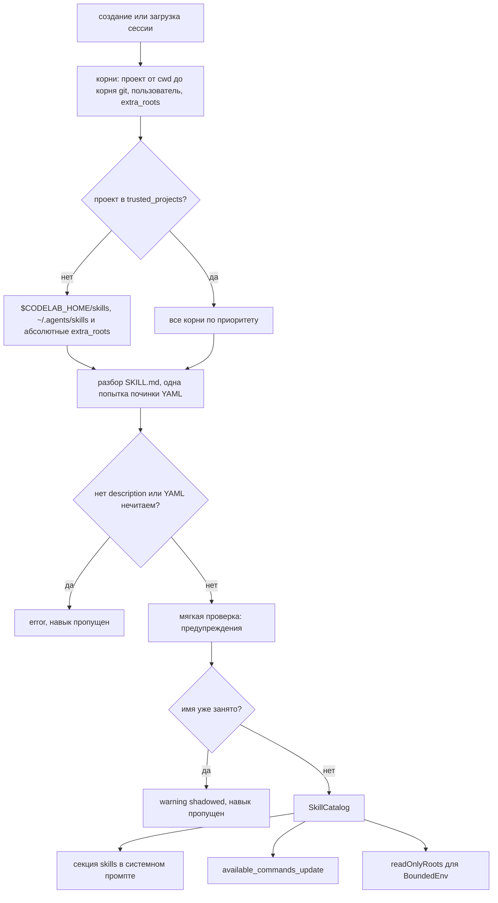

# 17.2. Skills и шаблоны промптов

> Часть [архитектуры ядра агента CodeLab](../agent-core-architecture.md). Status: Accepted. Общие соглашения, термины и порядок чтения — в оглавлении.

← [17.1. Web-инструменты: `web_fetch` и `web_search`](17-1-web-tools.md) · [Оглавление ядра](../agent-core-architecture.md) · [17.3. Субагенты: инструмент `agent`](17-3-subagents.md) →

Цели E-06, E-07, K-06 (точки расширения E-18, E-19 — §17.2.13). Раздел добавляет capability
`skills` (§10.2), инструмент `skill`, секции системного промпта `skills/catalog` и (после 1.0)
`skills/operative`, команды `/skill:<name>` и `/<template>`, приложение навыков после сжатия. Шаблоны
(E-07) реализованы change `add-agent-project-files`; навыки (E-06) — change `add-agent-skills`. Всё, что видит модель, подчиняется правилу «выключено — невидимо» (§10.9, HOST-4).

## 17.2.1. Назначение

* **Skill** (навык) — каталог с файлом `SKILL.md`: короткое описание для модели во frontmatter и
  подробная инструкция в теле, плюс сопутствующие файлы (шаблоны, примеры, скрипты). Модель
  видит только каталог «имя + описание»; тело попадает в контекст, когда задача подходит
  (инструмент `skill`) или когда пользователь вызвал `/skill:<name>`. Так десятки инструкций
  стоят модели несколько сотен токенов, а не десятки тысяч. Формат — открытая спецификация
  Agent Skills (`docs/protocols/agent-skills/specification.md`); порядок обнаружения, проверки и
  активации следует руководству для клиентов (`docs/protocols/agent-skills/client-implementation/
  01-adding-skills-support.md`, далее «руководство») с отступлениями, названными ниже.
* **Шаблон промпта** — Markdown-файл, который становится командой `/<name> <аргументы>`:
  агент подставляет аргументы и отправляет результат модели как сообщение пользователя.
  Модель шаблоны не видит, это удобство человека.
* **Закреплённые строки** (`operative`, K-06, после 1.0) — короткие правила из `metadata.codelab-operative` skill
  или из конфига пользователя, которые должны действовать всю сессию. Они пересобираются при
  каждом запросе к модели из каталога и журнала, поэтому сжатие (§9) их не теряет.

Ядро файлы не читает (CFG-5): файлы навыков читает хост (`codelab_agent_io`, класс
`ProjectFilesLoader`) через порт ядра `SkillFilesSource` (поле `AgentCoreServices.skillFiles`)
отдельной фазой открытия сессии, параллельно с файлами проекта и со своим таймаутом; ядро
проверяет их чистой функцией и строит неизменяемый снимок `SkillCatalog` сессии (design.md change
`add-agent-skills`, D1, D2). Изменения файлов действуют со следующей сессии — так же, как для
`AGENTS.md` (§11.5) и определений агентов (§15.8); перечитывание без перезапуска — E-19 (§17.2.13).

## 17.2.2. Раскладка и формат

**Корни skills** (от высшего приоритета к низшему; design.md change `add-agent-skills`, D3):

| # | Корень | Область | Когда читается |
|---|---|---|---|
| 1 | на каждом уровне каталогов от `cwd` вверх до корня git-репозитория (без репозитория — только `cwd`), ближний первым: `<уровень>/.codelab/skills/<name>/SKILL.md`, затем `<уровень>/.agents/skills/<name>/SKILL.md` | `project` | только если проект в `trusted_projects` (§15.3): тело skill — промпт |
| 2 | `$CODELAB_HOME/skills/<name>/SKILL.md`, затем `~/.agents/skills/<name>/SKILL.md` (домашний каталог процесса) | `user` | всегда, кроме `--llm-script` |
| 3 | каждый путь из `skills.extra_roots`, в порядке массива | `extra` | только если путь записан пользователем (глобальный конфиг, хранилище приложения, `--config`, `config.local.yaml` доверенного проекта); относительный путь (`.claude/skills`) разрешается от `cwd` и дополнительно требует доверия к проекту |

`.agents/skills` — общий для разных клиентов каталог, который руководство советует сканировать
наравне с собственным; он читается без отдельного согласия (решение пользователя Q13). Каталоги
конкретных агентов (`.claude/skills`, `~/.codex/skills` …) агент сам не обходит: согласие — строка
в `extra_roots`, записанная пользователем; проектный `config.yaml` не может добавить корень даже
для доверенного проекта. Подъём к корню git — как у `AGENTS.md` (§11.5, не больше 64 уровней; Q22):
навык ближнего уровня перекрывает навык дальнего.

Внутри корня skill — подкаталог первого уровня с файлом `SKILL.md`. Каталоги на `.`, файл
`SKILL.md` прямо в корне и записи, не являющиеся каталогами (место для указателей E-18),
пропускаются молча. Не больше 1000 подкаталогов на корень (`limit_exceeded`). Всё остальное в
каталоге skill — сопутствующие файлы. Сканируется только первый уровень — сознательно: результат
детерминирован, открытие сессии не обходит глубокие деревья, раскладка совпадает с Claude Code.
Вложенная раскладка по группам (`skills/<группа>/<навык>/SKILL.md`) не поддерживается — для
неё нужен отдельный корень в `extra_roots`.

**Формат `SKILL.md`.** YAML-frontmatter между строками `---`, затем тело. Разбор — тот же
разборщик, что для определений агентов (§15.8), в профиле YAML конфига (§15.5, пункты 1–6), но с
одной попыткой починки: если разбор не удался, строки верхнего уровня `ключ: значение` со
значением без кавычек, содержащим `: `, берутся в одинарные кавычки YAML с удвоением `'` внутри
(одинарные кавычки не обрабатывают `\`, поэтому `C:\temp` и `"` сохраняются), и разбор повторяется
(`warning` `yaml_repaired`; руководство, «Handling malformed YAML»).

Проверка **мягкая во всех корнях** (руководство, «Lenient validation»; решения пользователя Q11,
Q14, Q19, Q20): навык загружается, если это возможно, а нарушения дают предупреждения.

| Поле | Тип | Правило | Нарушение |
|---|---|---|---|
| `name` | string | спецификация: 1–64 строчных буквенно-цифровых символа Unicode и дефис, без дефиса по краям и двух подряд, совпадает с именем каталога; CodeLab сужает до ASCII `^[a-z0-9]+(-[a-z0-9]+)*$` (имя — слово команды) | `warning` (`invalid_name`, `name_mismatch`), загружается под именем из `name`; нет поля — `warning` `missing_name`, имя каталога; имя, негодное для команды (`^[A-Za-z0-9][A-Za-z0-9_-]*$`, ≤ 128; нелатинские буквы сюда не входят), — `error`, пропуск |
| `description` | string | 1–1024 символа после схлопывания пробелов | нет или пусто — `error`, пропуск; длиннее — `warning`, в каталоге обрезается до 1024 с `…` |
| `argument-hint` | string | 1–80 символов; подсказка ввода для `/skill:<name>` | `warning`, без подсказки |
| `user-invocable` | bool | по умолчанию `true`; `false` — нет команды `/skill:<name>` | `warning`, по умолчанию |
| `disable-model-invocation` | bool | по умолчанию `false`; `true` — skill не попадает в каталог модели и в `enum` инструмента `skill` | `warning`, по умолчанию |
| `compatibility` | string | ≤ 500; передаётся модели атрибутом блока навыка | `warning`, обрезка |
| `metadata.codelab-operative` | string | закреплённые строки (§17.2.7): каждая непустая строка после обрезки — одно правило, не больше 16 правил по 1–512 символов; в `metadata`, а не на верхнем уровне (решение Q32: спецификация отводит `metadata` под поля клиента, значения — строки; строгие валидаторы навык не бракуют); до K-06 проверяется и хранится, `info` `not_applied` | `warning`, правил нет |
| `license`, `metadata`, `allowed-tools` | любой | известные поля спецификации, без диагностики и без применения (из `metadata` читается только `codelab-operative`; поле верхнего уровня `operative` — `unknown_key`); `allowed-tools` (экспериментальное в спецификации) не расширяет права — каждый вызов проходит §7 | — |
| другой ключ | — | — | `warning` `unknown_key` |
| тело | text | не больше 64 КиБ в UTF-8 (навык из ~500 строк помещается) | пустое — `warning` `empty_body`; больше — `error` `too_large`, пропуск |

`SKILL.md` больше 128 КиБ целиком не читается — `too_large`; не UTF-8 — `not_utf8`. Шаблоны промптов
сохраняют свои пределы (тело 32 КиБ, файл 64 КиБ).

Сопутствующие файлы перечисляются загрузчиком: обычные файлы на глубине до 3 уровней,
не больше 50 путей в байтовом порядке (больше — признак неполного списка), без каталогов на `.` и
каталога `evals/` (тестовые запросы автора навыка по `skill-creation/04-evaluating-skills.md` — не
инструкции; доверие Q30 на них не распространяется),
без самого `SKILL.md` и без ссылок, чей `realpath` вне каталога skill. Читает их модель
инструментом `read` по абсолютному пути (§17.2.3); скрипты запускает `exec` (§17.2.3).

**Шаблоны промптов** — `*.md` без рекурсии. Корни 1 и 2 — этап 8, задача 8.7 (change
`add-agent-project-files`, D7): их читает общий загрузчик файлов проекта `ProjectFilesLoader`
вместе с `AGENTS.md` и определениями агентов, а не загрузчик skills; корень 3 — после MVP.

| # | Каталог | Область | Когда читается |
|---|---|---|---|
| 1 | `<cwd>/.codelab/prompts/*.md` | `project` | только если канонический `cwd` сессии в `trusted_projects` (`CoreConfig.trustedProjects`, §15.3); иначе — одна диагностика `info` `untrusted_project` |
| 2 | `$CODELAB_HOME/prompts/*.md` | `user` | всегда |
| 3 | каждый путь из `prompts.templates_dirs` | `extra` | после MVP; как `extra_roots` у skills |

Чтение — с локальной файловой системы агента, граница двухступенчатая (change
`add-agent-project-files`, D2): каталог (`<cwd>/.codelab/prompts`, `$CODELAB_HOME/prompts`; так же
`agents/` для определений агентов) раскрывается `realpath` и проверяется по корню своей области
(`cwd` или `$CODELAB_HOME`), а файлы читаются через `BoundedEnv` с корнем в реальном пути каталога.
Поэтому файл-symlink за пределы каталога пропускается с `outside_root`, даже если цель лежит внутри
`$CODELAB_HOME` или `cwd`: шаблоном считается только `*.md` самого каталога. Остаточный TOCTOU тот
же, что у `AGENTS.md` (D2): подмену файла на FIFO после `stat` прерывает таймаут фазы 5 с (`timeout`). Не больше 100 файлов на
каталог (`limit_exceeded`), файл больше 64 КиБ не читается (`too_large`).

Имя команды — имя файла без `.md`, по тому же правилу, что `name` skill. Файл с другим именем
(`Review.md`, `my_cmd.md`) — диагностика `warning`, файл пропущен. Имена всех встроенных команд
§13.4 и `skill` зарезервированы с этапа 8, ещё до появления самих команд: шаблон `status.md` не
должен работать сегодня и молча пропасть, когда появится `/status` (`reserved_name`, SKL-7). Файл, на который ссылается
переопределение из §11.6 (`prompts.system`, `modes.*`, `compaction.*`), шаблоном не считается
(диагностика `info`) — после MVP: на этапе 8.7 загрузчик шаблонов переопределений не знает, и
такой файл в `prompts/` загружается как обычный шаблон (change `add-agent-project-files` этого
правила не вводит).

Frontmatter шаблона необязателен; если есть — только ключи:

| Поле | Тип | Правило |
|---|---|---|
| `description` | string | 1–200 символов; без поля — первая непустая строка тела, обрезанная до 200 символов |
| `argument-hint` | string | 1–80 символов |

Тело шаблона — непустое, не больше 32 КиБ.

## 17.2.3. Контракт

Типы ядра (`codelab_agent_core/lib/src/project/project_files.dart` — общие с файлами проекта;
`lib/src/skills/` — навыки):

```dart
enum ExtensionScope { project, user, extra }   // E-18 добавит builtin; switch исчерпывающий
enum DiagnosticLevel { error, warning, info }

final class ExtensionDiagnostic {
  final String path; final int? line, column;   // файл и позиция frontmatter, если известны
  final DiagnosticLevel level;
  final String code;                            // invalid_name, name_mismatch, missing_name,
                                                // missing_description, unknown_key, empty_body,
                                                // too_large, not_utf8, yaml_repaired, shadowed,
                                                // untrusted_project, limit_exceeded, outside_root,
                                                // not_applied, timeout, unexpected …
  final String message;                         // фиксированный текст для человека
}

final class SkillDefinition {
  final String name, description, body;        // description схлопнут (полная длина), body — обрезанная форма
  final String dir;                             // канонический каталог skill; для модели — непрозрачная строка
  String get path;                              // <dir>/SKILL.md
  final ExtensionScope scope;
  final String? argumentHint, compatibility;
  final bool userInvocable, disableModelInvocation;
  final List<String> operative;                 // правила metadata.codelab-operative; до K-06 не применяются
  final List<String> companions;                // относительные пути, байтовый порядок
  final bool companionsTruncated;               // список неполон
  String get fingerprint;                       // SHA-256 тела (§17.2.7а)
}

final class SkillCatalog {                      // неизменяемый снимок сессии: AgentSession.skills
  final List<SkillDefinition> skills;           // отсортированы по name
  final List<SkillDefinition> modelVisible;     // !disableModelInvocation и не запрещённые правилами skill / skill:<name>
  final List<ExtensionDiagnostic> diagnostics;
  static final SkillCatalog empty;
  SkillDefinition? skill(String name);
  List<SkillDefinition> get commands;           // userInvocable
  List<String> readOnlyRoots(String sessionRoot);                // dir загруженных skills вне корня сессии
}
final class SkillsConfig {                      // CoreConfig.skills, §17.2.8
  final bool enabled; final List<String> extraRoots, disabled;
  final int maxSkills, catalogMaxChars, reattachPerSkillTokens, reattachTotalTokens;
}
SkillCatalog parseSkills(SkillFiles files, SkillsConfig settings, {PolicyRules rules = const PolicyRules()});
```

Шаблоны команд живут отдельно: `CommandTemplate {name, description, argumentHint, body, scope, path,
usesArguments}` и `parseCommandTemplates` (`lib/src/commands/`, change `add-agent-project-files`).

Порт (поле `AgentCoreServices.skillFiles`; реализация — `ProjectFilesLoader` в `codelab_agent_io`,
тот же объект, что `projectFiles`):

```dart
final class SkillFilesQuery {
  final String cwd;                             // канонический корень сессии
  final bool projectTrusted;                    // fail-closed, как у файлов проекта
  final List<String> extraRoots;                // skills.extra_roots в порядке конфига
  final CancelToken cancel;
}
final class SkillFile {                         // данные одного SKILL.md, прочитанные хостом
  final String dir; String get path;            // dir — realpath каталога; path — <dir>/SKILL.md
  final ExtensionScope scope;
  final int rootIndex;                          // позиция корня в списке шага 1 §17.2.4; важен только порядок
  final ConfigTree? frontmatter;                // разобранный, с позициями; null — нет или не разобран
  final List<ExtensionDiagnostic> parseErrors;  // ошибки разбора с позициями файла; непуст ⇒ frontmatter == null
  final bool repaired;                          // разбор удался после починки; yaml_repaired даёт ядро
  final String body; final int bodyLine;        // тело как в файле; обрезку делает ядро
  final List<String> companions; final bool companionsTruncated;
}
final class SkillFiles { final List<SkillFile> skills; final List<ExtensionDiagnostic> diagnostics; }
abstract interface class SkillFilesSource { Future<SkillFiles> loadSkills(SkillFilesQuery query); }
```

Реализация: `ProjectFilesLoader({required String? home, String? userHome, required LocalExecutionEnv local})`
— `home` даёт `$CODELAB_HOME/skills`, `userHome` (`HOME`/`USERPROFILE` процесса, `userHomeOf`) —
`~/.agents/skills`; `null` выключает корень (`--llm-script`). Frontmatter навыка разбирается
`readMarkdownFile(…, repairYaml: true)` с признаком `MarkdownRead.repaired`; шаблоны и определения
агентов — строго. Точные типы, тексты диагностик и порядок шагов — design.md change
`add-agent-skills`, D16.

Чтение идёт с файловой системы процесса агента, а не через env сессии: в ACP-режиме файлы
рабочей папки читает клиент (§4.7), но `$CODELAB_HOME` лежит на машине агента. Порт не бросает
исключений для ошибок файлов: всё уходит в `diagnostics`, лог `project_files.diagnostic` и вывод
`config check`. Модель диагностики не видит. Рантайм вызывает порт отдельной фазой (таймаут 5 с,
общая отмена с открытием сессии); таймаут даёт сессию без навыков, но с инструкциями проекта.

**Блок навыка** — общая форма тела для результата `skill`, сообщения `/skill:<name>` и приложения
после сжатия (§17.2.7а):

```text
<skill name="{{name}}" dir="{{dir}}"[ compatibility="{{compatibility}}"]>
{{body}}
</skill>
This skill's own files (scripts, references, assets and files named in its instructions) are relative to its directory; task data is relative to the project. In tool calls, refer to the skill's files by absolute path, and run its scripts with the project as the working directory.
- {{dir}}/{{file1}}
- {{dir}}/{{file2}}
[more files not listed]
```

Строка о путях после `</skill>` есть **всегда** и одна для любого режима исполнения (решение Q26
change `add-agent-skills`; аналог `${CLAUDE_SKILL_DIR}` в Claude Code): команды навыка обычно
относятся к проекту (`git log`, `eslint .`, `CHANGELOG.md`), поэтому скрипты запускаются по
абсолютному пути с рабочей папкой проекта — и локально, и через клиента ACP (Q23). Строки файлов —
только если `files` не пуст; `[more files not listed]` — только при `filesTruncated`. Тело — текст
после закрывающего `---` без краевых пробельных символов, `\r\n` → `\n`; от этой формы считаются
`empty_body`, отпечаток и сравнение при повторе.
Экранирование: в теле любой открывающий или закрывающий тег `skill` (`<`, пробелы, `/`, пробелы,
`skill`, без учёта регистра ASCII) получает `\` после `<`; в атрибутах `"`, `<`, `>`, `\r`, `\n` → `_`
(как у `project-instructions`, §11.5).

**Тело по запросу — инструмент `skill`.** Решение: отдельный инструмент, а не `read` по пути из
каталога и не только `/skill:<name>`.

| Свойство | Значение |
|---|---|
| имя | `skill` |
| tier / kind | `read` / `read`; режим исполнения `parallel` |
| `outputTrust` | `trusted`: источник — корни после гейтов доверия (SKL-1, SKL-2); ограда недоверенного вывода сделала бы инструкцию инертной |
| `present` | title `Load skill <name>`, locations `[<dir>/SKILL.md]` |
| `permissionPattern` | `<name>` |
| регистрируется | только если capability `skills` включена и `modelVisible` не пуст |

```json
{"type":"object","properties":{
  "name":{"type":"string","enum":["<имена modelVisible в байтовом порядке>"],
          "description":"Skill name exactly as listed in the Skills section."}},
 "required":["name"]}
```

`enum` ограничивает модель существующими именами (руководство, «Model-driven activation»;
решение Q12). Цена: с E-19 смена набора имён меняет определение инструмента и один раз
сбрасывает кэш промпта провайдера (L-13).

Результат при успехе — блок навыка из снимка (файл не перечитывается). Повтор активного навыка
(§17.2.7а) — строка `Skill "<name>" is already loaded in this conversation; follow the instructions
above.` без тела (руководство, «Deduplicate activations»; решение Q10). Имя вне `enum` отклоняет
проверка аргументов исполнителя (§6.3.2): `Invalid arguments for tool "skill"` с перечнем допустимых
имён. Сам инструмент на имя вне `modelVisible` отвечает (`isError: true`) `Unknown skill: <name>.
Available skills: <a>, <b>, <c>.` — защита в глубину для вызова мимо проверки схемы. `additionalProperties`
в схеме нет. Точные сигнатуры итерации 2 (`SkillTool`, `renderSkillBlock`, `ReadTool`/`ExecTool`
сессии, `BoundedEnv.wrap`, `AgentConfigPaths.skillDirs`) — design.md change `add-agent-skills`, D17.

**Сопутствующие файлы и скрипты — через `read`, `ls` и `exec` с границей только для чтения.**
Каталог пользовательского skill лежит вне `cwd`, поэтому `BoundedEnv` (§4.4) получает параметры:

```dart
BoundedEnv.wrap(ExecutionEnv inner, String root, {
    List<String> readOnlyRoots = const [],      // = SkillCatalog.readOnlyRoots(root) + каталог выноса сессии (§17.4.4)
    ExecutionEnv? readOnlyFs,                   // = AgentCoreServices.hostFiles; null → readOnlyRoots игнорируются
    bool execInReadOnlyRoots = false});         // env сессии исполняет команды на машине агента
```

1. Корни `readOnlyRoots` нормализуются и разрешаются (`realpath` через `readOnlyFs`) один раз при
   создании, как `root`. В них входят только каталоги загруженных skills вне корня сессии и не
   содержащие его: каталог внутри `cwd` — обычная часть `root`, его правку решает PERM-11 (§7.6.1);
   сессия, открытая внутри каталога skill, правит его как рабочую папку. Путь, лексически лежащий в
   корне только для чтения, внутренний env не видит — ни `stat`, ни `realpath` (D17 change
   `add-agent-skills`).
2. Операции чтения (`readText`, `readBytes`, `stat`, `listDir`) принимают путь, если `real` лежит в
   `root` **или** в одном из `readOnlyRoots` по правилу сегментов (§4.4, шаг 4); путь в
   `readOnlyRoots` уходит в `readOnlyFs`: клиент ACP может не видеть каталог агента.
3. Запись, правка и удаление принимаются только в `root`; путь в `readOnlyRoots` для них —
   `FileError(outsideWorkspace)` (текст для модели прежний, §6.4).
4. `ExecOptions.cwd` в `readOnlyRoots` принимается, только если `execInReadOnlyRoots`: это разрешено
   (`skill-creation/05-using-scripts.md`; решение Q17), но не советуется — блок навыка просит
   запускать скрипты по абсолютному пути с рабочей папкой проекта (Q26). Рантайм
   ставит признак для локального env (встроенный агент, `localEnv`); у env клиента ACP — нет: клиент
   ограничивает `cwd` `terminal/create` рабочей папкой (`AGENTS.md` §10), и агент отклоняет такой
   вызов сам, до запроса клиенту, ошибкой инструмента с подсказкой запустить скрипт по абсолютному
   пути из блока навыка с `cwd` рабочей папки (решение Q23 (а) change `add-agent-skills`; аналог
   `${CLAUDE_SKILL_DIR}` в Claude Code). Containment клиента не меняется.
5. Корень пользовательского каталога (`$CODELAB_HOME/skills`) целиком в `readOnlyRoots` не
   входит — только каталоги загруженных skills: `$CODELAB_HOME/config.yaml` и сессии остаются
   недоступны. Единственный каталог из `sessions/` в `readOnlyRoots` — каталог выноса текущей
   сессии (§17.4.4).
6. Пути вне `cwd` в выводе инструментов показываются абсолютными.

Чтение сопутствующих файлов — обычный вызов `read` с обычным разрешением (tier `read`). Вывод `read`
файла внутри каталога загруженного навыка — того же доверия, что тело `SKILL.md` (решение Q30 change
`add-agent-skills`; `references/` — третий уровень раскрытия инструкций по `specification.md`):
он не огораживается, даже если путь содержит `node_modules`, `.dart_tool` или `vendor`, а теги
`skill` в нём экранируются, как в теле. Правило «не отменяет безопасность и не даёт прав»
действует; доверие вывода других путей (§10.6) не меняется.
Запуск скрипта — обычный `exec` (tier `exec`); запись командой в каталог skill — критический шаблон
PERM-11 с тремя узкими исключениями для одной простой команды (по каноническому пути, `SKILL.md` —
без учёта регистра; точный текст — §7.6.1): E1 — исполняемый файл — обычный файл под `<dir>/scripts/`
(без `.`-сегментов, `node_modules`, `site-packages`, `vendor`), первым словом с `/` или аргументом
интерпретатора, узнанного по голому имени, без единой опции интерпретатора (кроме `pwsh -File`) и
без переменных окружения (Q25, Q34, Q36, Q37); E2 — рабочий каталог навыка не критичен только для
скрипта по E1 или команды белого списка чтения (Q24, Q33); E3 — существующий файл под `<dir>/assets/`
того же навыка, не `.md`, аргументом его скрипта, кроме значений опций вывода и слов с масками
(Q29, Q35, Q38). Пишущие команды и перенаправления в каталог навыка критичны всегда.

**Команды и разворачивание** (`codelab_agent_core/lib/src/commands/`; фактические сигнатуры):

```dart
enum SlashCommandSource { template, builtin, skill }   // wire: "template" | "builtin" | "skill"
List<SlashCommand> availableCommands(List<CommandTemplate> templates);   // + встроенные (BuiltinCommands.declare) и skill:<name>
CommandLine? parseCommandLine(String text);            // слово и raw; одна функция для всех команд
CommandExpansion expandCommand(String text, List<CommandTemplate> templates);   // шаблоны; skill: — ветка навыков
List<String> splitArguments(String raw);               // незакрытая кавычка закрывается концом ввода
String substituteArguments(String body, String raw, List<String> args);   // общая для шаблонов и skills
```

Неизвестную команду отвечает `BuiltinCommands.match` (change `add-agent-builtin-slash-commands`, D3,
D4); `CommandFailed` как отдельного типа нет. После MVP `availableCommands` берёт команды плагинов
(§17.14.3) — эта часть остаётся направлением.

Запись `message` (§8.2.3) пользовательского сообщения, полученного разворачиванием, получает
поле записи `command` = `{"source":"skill","name":"release-notes","args":"v1.2 v1.3"}`. Модель
его не видит (как `toolMeta`); по нему реплей (§13.5) показывает клиенту исходный текст
`/skill:release-notes v1.2 v1.3`, а функция активных навыков (§17.2.7а) узнаёт об активации.

**Закреплённые строки** (K-06, после 1.0; контракт — направление):

```dart
final class OperativeLine { final String text; final String origin; }   // "user" | "skill:<name>"
final class OperativeState { final List<OperativeLine> kept; final int omitted; final int budgetTokens; }
final class ActiveSkill { final String name; final bool full; final String content; }   // content — SHA-256 содержимого активации
List<ActiveSkill> activeSkills(SessionSnapshot snapshot, SkillCatalog catalog, SkillsConfig settings);   // §17.2.7а
OperativeState pinOperativeLines({required List<String> userLines, required List<String> active,
    required SkillCatalog catalog, required int window, required int maxTokens});
```

## 17.2.4. Алгоритм: загрузка и разрешение конфликтов

```text
loadSkills(q) [хост]:
1. roots := []
   если q.projectTrusted:
     для уровня от cwd вверх до корня git (≤ 64; без репозитория — только cwd):
       roots.add((уровень/.codelab/skills, project)); roots.add((уровень/.agents/skills, project))
   иначе для каждого существующего такого корня → info untrusted_project
   если не --llm-script: roots.add(($CODELAB_HOME/skills, user)); roots.add((~/.agents/skills, user))
   для p в q.extraRoots: ~ или ~/… → от userHome (нет userHome → warning unresolved_root, пропустить);
     относительный и не projectTrusted → warning untrusted_project, пропустить
     roots.add((абсолютный p, extra))          // ~user/… отвергнут проверкой конфига (value), Q41
2. для корня по порядку: realpath корня; корень проекта вне своего уровня или $CODELAB_HOME/skills вне
   $CODELAB_HOME → warning outside_root, корень пропущен (Q42); подкаталоги в байтовом порядке (≤ 1000):
   a. имя на "." или нет SKILL.md → пропустить молча; не каталог → пропустить молча
   b. realpath каталога вне корня → outside_root; realpath уже найден другим корнем или записью → пропустить молча
   c. прочитать SKILL.md через BoundedEnv каталога (≤ 128 КиБ, UTF-8), отделить frontmatter
   d. разобрать; ошибка → одна попытка починки двоеточий → repaired или parseErrors (позиции файла)
   e. перечислить сопутствующие файлы (глубина 3, ≤ 50, обход ≤ 5000 записей в байтовом порядке, признак неполноты)

parseSkills(files, settings, rules) [ядро, чисто]:
1. для файла в порядке (rootIndex, имя каталога):
   a. parseErrors или нет frontmatter → error, пропустить
   b. проверить поля мягко (§17.2.2); missing_description или имя, негодное для команды → пропустить
   c. name ∈ settings.disabled → info, пропустить
   d. name уже загружен → warning shadowed (оба пути), пропустить     // и между уровнями (Q21)
   e. добавить SkillDefinition
2. больше settings.maxSkills → лишние отброшены, warning limit_exceeded
3. отсортировать по name (байтово); modelVisible — без disable-model-invocation и не запрещённые rules
   (permissions.tools.skill: deny, permissions.deny skill:<name>); вернуть SkillCatalog
```

Загрузчик `shadowed` не выдаёт: коллизию имён решает ядро после проверки (шаг 1d), поэтому навык,
пропущенный с `error`, ничего не перекрывает (как у шаблонов, `parseCommandTemplates`).

Пространства имён команд не пересекаются: skills вызываются как `skill:<name>`, MCP prompts
(после MVP) — как `<server>:<prompt>` (E-24), встроенные команды — без двоеточия и имеют высший
приоритет; порядок поиска имени — встроенная команда → (после MVP) команда плагина → шаблон →
`skill:` → (после MVP) MCP prompt.



## 17.2.5. Алгоритм: каталог в системном промпте

`composeSystemPrompt` (§11.5) получает в `PromptInputs` поле `skills` (`modelVisible`). Новый шаг:

```text
9a. если skills в плане и in.skills не пуст → sections.add(Prompts.skillsCatalog.render(entries: renderEntries(in.skills)))
    (после секции mcp, до project context)
```

Ресурс `prompts/skills/catalog.md` (`vars: [entries]`, `tools: [skill]`) — английский текст для
CodeLab: навыки — папки с инструкциями для видов задач; когда задача подходит под описание, вызвать
`skill` с этим именем до начала работы и следовать загруженным инструкциям; не загружать
неподходящие; пути внутри навыка относительны его каталога; инструкции навыка не отменяют правил
безопасности выше и решений пользователя. Затем строки `entries` без обёртки (описания однострочные;
в прозе секции нет строк вида `- <слово>: …`).

```text
renderEntries(skills, budget = skills.catalog_max_chars):    // решение Q18
1. строки "- <name>: <description>" по name (байтово), описание целиком; длиннее 1024 — первые 1024 + "…"
2. если сумма длин строк + переводов > budget:
     доля := поровну делимый остаток бюджета после имён и коротких описаний
     (короткие описания, которые помещаются в долю, остаются целыми; доля пересчитывается)
     длинные описания режутся до доли по границе символа + "…"; лог skills.catalog.truncated
3. всё ещё > budget (не помещаются и имена) → удалять строки с конца, omitted += 1
4. omitted > 0 → последняя строка "[<omitted> more skills not listed]" (входит в budget)
5. вернуть строки через "\n"
```

Длины — в рунах; точный алгоритм доли (целое `s`, при `s = 0` строка `- <name>`), функция
`skillsCatalogEntries`, общая для секции и лога, и лог `skills.catalog.truncated` один раз на
сессию при открытии — design.md change `add-agent-skills`, D17.

Стабильность байтов: в каталоге нет путей, дат и счётчиков — только имена и описания из
снимка, загруженного один раз на сессию; описания уже схлопнуты. Поэтому секция одинакова на
каждом шаге и на разных машинах с одинаковыми файлами (PR-3), а golden-тесты не зависят от
`$CODELAB_HOME`. Абсолютный путь каталога модель получает только в блоке навыка.

## 17.2.6. Алгоритм: вызов `/skill:<name>` и `/<template> args`

```text
expandCommand(text, templates) + ветка skill: (обозначения алгоритма; фактическая сигнатура — §17.2.3;
                                   шаблоны — List<CommandTemplate>, навыки — снимок SkillCatalog сессии):
1. разбирается только первый текстовый блок промпта; он начинается с "/" → иначе NotACommand
   cmd := до первого пробельного символа без "/", raw := остаток после него без ведущих пробелов
   (хвостовые пробелы и переводы строк raw сохраняются как есть, кроме завершающего "\r?\n":
   CRLF присылают клиенты на Windows; change `add-agent-project-files`, D8)
   cmd не соответствует ^[A-Za-z0-9][A-Za-z0-9:_-]*$ → NotACommand (§13.6, шаг 1)
2. cmd — встроенная команда плана → BuiltinCommand(cmd, raw)          // §13.6, R-08
3. после MVP: cmd — команда плагина из plan.pluginCommands → PluginInvocation(command, raw)   // §17.14.3
4. t := шаблон с именем cmd из List<CommandTemplate> сессии:
   args := splitArguments(raw)      // незакрытая кавычка закрывается концом ввода (ниже; Q7 (а)
                                    // change `add-agent-builtin-slash-commands`), ошибки разбора нет
   body := substituteArguments(t.body, raw, args)
   вернуть Expanded(body, CommandRef(template, t.name, raw))
5. cmd начинается с "skill:" и skills в плане (change `add-agent-skills`, D8):
   s := catalog.skill(cmd без "skill:"); нет или !s.userInvocable →
        ответ без модели "Unknown skill: <name>. Run /help to list commands."
   args, body := как в шаге 4 для s.body (та же substituteArguments)
   s активен и тело совпадает с активным (§17.2.7а) → короткая строка повтора [+ "ARGUMENTS: <raw>"]
   иначе text := Prompts.skillsInvoked.render(name, block: блок навыка (§17.2.3) с этим телом)
   вернуть Expanded(text, CommandRef(skill, s.name, raw))
6. после MVP (E-24): cmd — имя MCP prompt (`<server>:<prompt>`) → NotACommand: его разворачивает
   `AgentSession` через MCP-клиент (§13.6)
7. иначе — CommandFailed("Unknown command: /<cmd>. Run /help to list commands.") (§13.6, R-08):
   модель не вызывается
```

`prompts/skills/invoked.md` (`vars: [name, block]`) — английская строка «пользователь вызвал навык
`<name>`, следуй его инструкциям в этом запросе», затем блок навыка (§17.2.3).

Шаблон разворачивается без обёртки: текст тела становится сообщением пользователя, будто он
набрал его сам. Остальные блоки промпта (картинки, ресурсы) идут после развёрнутого текста в
исходном порядке. `CommandFailed` здесь — обозначение алгоритма, в коде этот ответ даёт `BuiltinCommands.match`: ответ `agent_message_chunk` с текстом и `end_turn`, модель
не вызывается, в журнал ничего не пишется (R-08).

**Этап 8.7 (только шаблоны).** Механизма «ответ агента без модели» до change встроенных команд не
было (решение пользователя 2026-10-30, OQ1 design.md change `add-agent-project-files`), поэтому
этап ввёл два отступления (D8): незакрытая кавычка закрывается концом ввода, а шаги 5–7 не
выполнялись — `/x` без шаблона `x` уходил модели как обычный текст (поведение этапа 4).
С change `add-agent-builtin-slash-commands` (D3, D4) шаг 7 действует: `/x` без встроенной команды
и шаблона — `CommandFailed` с ответом «Unknown command», модель не вызывается (изменение
поведения). Шаг 5 (`skill:`) действует с change `add-agent-skills`; шаг 6 (MCP prompt, E-24) — после MVP, до
него `/<server>:<prompt>` доходит до шага 7. При выключенной capability `skills` `/skill:x` тоже
доходит до шага 7 (`Unknown command`). Незакрытая кавычка по-прежнему закрывается концом ввода
(`/review "error handling` → `$1 = error handling`; Q7 (а) того change): `CommandFailed` для неё
нет — ни одна строка Must этого не требует, а ошибка изменила бы поведение работающих шаблонов.

**Аргументы.** `splitArguments(raw)`: разделитель — пробельные символы; `"…"` и `'…'`
группируют слово (кавычки снимаются); внутри `"…"` экранируются `\"` и `\\`, внутри `'…'`
экранирования нет; вне кавычек `\` перед любым символом даёт этот символ; незакрытая кавычка
закрывается концом ввода (D8 change `add-agent-project-files`).

`substituteArguments(body, raw, args)` — один проход слева направо:

| В теле | Результат |
|---|---|
| `$ARGUMENTS` | `raw` без обрезки внутренних пробелов (как введено) |
| `$1` … `$9` | `args[n-1]`; аргумента нет → пустая строка |
| `$$` | литерал `$` |
| `\$` | литерал `$` (change `add-agent-skills`, Q7, Q15 (а): оба способа — `\$` и `$$` — в шаблонах и навыках); `\$1` — литерал `$1` |
| `$10` | `$1`, затем литерал `0` (номер — одна цифра) |
| `$` перед любым другим символом | литерал `$` |

Подставленное значение не сканируется повторно: `$1` со значением `$ARGUMENTS` остаётся текстом
`$ARGUMENTS`. Если в теле нет ни `$ARGUMENTS`, ни `$1`…`$9`, а `raw` не пуст, к телу
дописывается `"\n\nARGUMENTS: " + raw`. Лишние аргументы не ошибка: они видны в `$ARGUMENTS`.
Синтаксис `{{…}}` шаблонов §11.4 в теле не обрабатывается. Та же функция разворачивает тела skills
(шаг 5): правило подстановки задаёт смысл уже написанных навыков, и менять его потом дорого.

**Публикация команд.** `availableCommands` строит список в фиксированном порядке: встроенные
команды плана (§13.6), после MVP — команды плагинов в порядке `plugins.enabled` (§17.14.3.3), шаблоны по имени, skills с `userInvocable` по имени (`skill:<name>`), MCP
prompts. Подсказка ввода: `argument-hint`, если задан; иначе для шаблона с `usesArguments` и для
любого skill — `"arguments"`; иначе поля `input` нет. Список уходит в `available_commands_update`
после ответа на `session/new` и `session/load` (§13.4, §13.5) и при каждом изменении набора
(`CommandsChanged`). В нём только команды: ни инструмент `skill`, ни другие инструменты модели
туда не попадают (R-07). `/help` выводит тот же список с источником в скобках (`template`, `skill`).
Список строится при открытии сессии и до E-19 не меняется.
Стандартного ACP достаточно: расширений протокола раздел не требует.

```mermaid
sequenceDiagram
    participant C as ACP-клиент
    participant A as AcpAgentServer
    participant S as AgentSession
    participant X as expandCommand
    participant J as SessionStore
    participant M as Модель
    C->>A: "session/prompt: /skill:release-notes v1.2 v1.3"
    A->>S: prompt(text)
    S->>X: разбор команды и аргументов
    X-->>S: Expanded(text, CommandRef skill)
    S->>J: append message user с полем command
    S->>S: активные навыки (§17.2.7а); после 1.0 — пины operative
    S->>M: системный промпт с Pinned directives, развёрнутый текст
    M-->>S: ответ и вызовы инструментов
    S-->>A: события хода
    A-->>C: "session/update, затем stopReason end_turn"
```

## 17.2.7. Алгоритм: закреплённые строки operative (K-06)

Пины — производное состояние: в журнал не пишутся ни их текст, ни факт закрепления. Они
вычисляются при сборке **каждого** запроса к модели из трёх источников: `skills.operative.lines`
конфига, снимка каталога и журнала активной ветки.

```text
activated := [a.name для a в activeSkills(snapshot, catalog, settings)]   // сигнатура — §17.2.3   // §17.2.7а: одна функция;
             // K-06 берёт все элементы — и приложенные целиком, и усечённые

pinOperativeLines(userLines, activated, catalog, window, maxTokens):
1. budget := min(window ~/ 8, maxTokens)        // window — effectiveContextWindow (CMP-6)
2. lines := [OperativeLine(l, "user") для l в userLines]
   для n в activated: s := catalog.skill(n)
     s == null → лог skills.operative.dropped {name} (skill исчез после перезагрузки), пропустить
     для l в s.operative: lines.add(OperativeLine(l, "skill:" + n))
3. убрать повторы по точному тексту (первая встреча остаётся)
4. пока lines не пуст и estimate(render(lines, omitted)) > budget:
     удалить последнюю строку; omitted += 1   // усечение с конца: последний активированный skill первым
5. omitted > 0 → лог warn skills.operative.truncated {kept, omitted, budget}
   (один раз на каждое новое значение omitted в сессии)
6. вернуть OperativeState(lines, omitted, budget)
```

У оконного снимка (§17.13.2) записи пути ниже пола с флагом индекса «активация skill»
загружаются при открытии, поэтому результат функции активных навыков тот же.

`estimate` — эвристика §9.3 (4 символа ≈ 1 токен) по тексту секции целиком. Нижняя граница
задаётся конфигом: `max_tokens` не меньше 256 (иначе `ConfigException`); на окне меньше 2048
токенов бюджет — `window ~/ 8`, и пины могут не поместиться вовсе — тогда секция содержит только
строку об опущенных пинах.

Секция — последняя в системном промпте (шаг 10a §17.2.5). Ресурс `prompts/skills/operative.md`
(`vars: [lines]`):

```text
## Pinned directives

These directives come from the user and from skills used in this session. They stay in force for
the whole session, including after the conversation history is compacted.

{{lines}}
```

`lines` — строки `- [user] <text>` и `- [skill <name>] <text>` через `\n`; при `omitted > 0` —
последней строкой `[<omitted> pinned directives omitted: budget exceeded]`.

Почему системный промпт, а не сообщение: сжатие (§9.8) меняет только сообщения, а системный
промпт пересобирается из входов, поэтому пины после сжатия побайтово те же. Секция меняется лишь
при активации нового skill или смене модели (другое окно), а не на каждом шаге; один промах
кеша на активацию дешевле, чем сообщение, которое смещается каждый ход. Секция стоит последней,
чтобы её изменение не сбрасывало кеш предыдущих секций сильнее необходимого. Суммаризатору пины
не передаются: резюме не обязано их пересказывать, они вернутся сами.

## 17.2.7а. Активные навыки, повторная активация и сжатие

Источник: руководство, «Deduplicate activations» и «Protect skill content from context compaction»;
лимиты и порядок выпадения выбраны по образцу Claude Code (решения пользователя Q6, Q10; design.md
change `add-agent-skills`, D15).

**Активация** — сообщение пользователя с `command.source == "skill"` или успешный результат `skill`
с блоком навыка (не строка повтора) на активной ветке. Чтение `SKILL.md` инструментом `read`
активацией не считается (осознанное решение: сырой файл — данные).

```text
List<ActiveSkill> activeSkills(SessionSnapshot snapshot, SkillCatalog catalog, SkillsConfig settings)   // от новой к старой
1. last := последняя compaction на пути к листу (или нет)
2. out := [ ActiveSkill(e.name, full, sha256(тело из снимка)) для e в reattach(last, catalog, settings).attached ]
          // приложенные целиком (full = true) или усечённые (false); выпавшие и отсутствующие — нет
3. для активации навыка n в хвосте после last.firstKeptId (или во всём пути) по порядку:
     content := sha256(тело)                      — активация инструментом skill
                sha256(тело после подстановки command.args, без хвоста ARGUMENTS:) — команда /skill:
     убрать n из out; вставить ActiveSkill(n, true, content) в начало
4. вернуть out
```

Шаг 2 зависит только от `last`, каталога и бюджетов — определение не замкнуто. **Активный навык**
для повтора — элемент с `full = true`; усечённый не активен, его повторная активация вставляет
полное тело.

**Повтор.** Инструмент `skill` для активного навыка возвращает строку повтора. Команда
`/skill:<name> <args>`: если навык активен и SHA-256 тела после подстановки этих аргументов (без
хвоста `ARGUMENTS:`) равен `ActiveSkill.content` — сообщение `The user invoked the skill "<name>"
again; its instructions are already loaded above.` и, при непустом вводе, `ARGUMENTS: <ввод>`;
иначе — полный блок. Навык, загруженный моделью или приложенный после сжатия целиком, имеет
`content` необработанного тела: `/skill:<name>` для тела без плейсхолдеров даёт строку повтора, для
тела с плейсхолдерами — полный блок.

**Сжатие.** Запись `compaction` (§9.8) получает необязательное поле `skills: [{name, fingerprint}]`
— элементы `activeSkills` по снимку до новой записи в их порядке, кроме навыков, чья последняя
активация остаётся в хвосте после нового `firstKeptId`. Поэтому приложенный прошлым сжатием навык
(целиком или усечённым) переносится и прикладывается снова; выпавший по общему бюджету не
переносится — вернуть его может только новая активация. `fingerprint` — SHA-256 обрезанного тела.
Тел и аргументов в записи нет.

```text
reattach(lastCompaction, catalog, perSkill = skills.reattach.per_skill_tokens,
         total = skills.reattach.total_tokens):         // часть buildLlmContext, после резюме
1. perSkill == 0 или total == 0 или skills пуст → ничего
2. для e в lastCompaction.skills по порядку:
     s := catalog.skill(e.name); нет → выпал, лог
     s.fingerprint != e.fingerprint → лог warning skills.reattach.changed, взять текущее тело
     body := s.body; estimate(body) > perSkill → усечь по границе строки + пометка: «загрузить снова инструментом skill», если навык в modelVisible; «/skill:<name>», если только команда; иначе без совета
     used + estimate(блок) > total → этот и все дальше (более давние) выпали
3. одно сообщение user по prompts/skills/reattached.md с блоками; в журнал не пишется
4. лог skills.reattached {names, dropped, truncated}
```

`tokensAfter` записи и CMP-5 учитывают приложенное сообщение; одинаковые входы дают одинаковое
сообщение (SES-7), поэтому кэш промпта после сжатия стабилен. Аргументы прежней команды не
восстанавливаются: они относились к запросу, который ушёл в резюме. K-06 берёт ту же функцию
активных навыков, но закреплённые строки кладёт в последнюю секцию системного промпта (§17.2.7),
а не сюда.

## 17.2.8. Конфигурация

**`skills`**

| Ключ | Тип | По умолчанию | Смысл |
|---|---|---|---|
| `enabled` | bool | `true` | ключ сессии: `false` — у сессий этой папки (корня запуска или другой) пустой снимок навыков, порт не вызывается; capability `skills` не сужает — её сужает только `profile.<name>.skills: off` (§10.2; change `add-agent-skills`, Q44, Q45) |
| `extra_roots` | path[] | `[]` | каталоги skills конкретных агентов (`.claude/skills` …); согласие пользователя; схема `<scheme>://` — проблема конфига (зарезервировано для E-18); `~` и `~/…` — от домашнего каталога процесса, `~user/…` — проблема конфига (Q41) |
| `disabled` | string[] | `[]` | имена skills, которые не загружаются |
| `max_skills` | int | `200` | 1–1000 |
| `catalog_max_chars` | int | `8000` | бюджет секции каталога, 1000–64000 |
| `reattach.per_skill_tokens` | int | `5000` | бюджет тела навыка при приложении после сжатия, 0–16384 (§17.2.7а) |
| `reattach.total_tokens` | int | `25000` | общий бюджет приложения, 0–200000; `0` в любом ключе выключает приложение |

**`skills.operative`** (K-06, после 1.0; до него каждый заданный лист — `config.key.not_applied`)

| Ключ | Тип | По умолчанию | Смысл |
|---|---|---|---|
| `enabled` | bool | `true` | `false` — секция пинов не строится |
| `max_tokens` | int | `2048` | верхняя граница бюджета; итог — `min(window/8, max_tokens)`; 256–32768 |
| `lines` | string[] | `[]` | пины пользователя; каждая строка 1–512 символов, без `\n`, не больше 16 |

**`prompts`** (дополнение к §11.6)

| Ключ | Тип | По умолчанию | Смысл |
|---|---|---|---|
| `templates` | bool | `true` | шаблоны промптов как команды |
| `templates_dirs` | path[] | `[]` | дополнительные каталоги шаблонов, ниже по приоритету, чем `.codelab/prompts` и `$CODELAB_HOME/prompts` (E-20, после MVP) |

Доверие (дополнение к таблице §15.3):

| Ключи | Слой 3 (проект) | Слой 4 (локальный) | Условие снятия ограничения |
|---|---|---|---|
| `skills.enabled = false`, `skills.disabled`, уменьшение `skills.max_skills`, `skills.catalog_max_chars`, `skills.reattach.*`; `skills.operative.enabled = false` | да | да | — |
| увеличение `skills.max_skills`, `skills.catalog_max_chars`, `skills.reattach.*` | да — только уменьшение | да | увеличение — проект в `trusted_projects` (решение Q40 change `add-agent-skills`) |
| `skills.enabled = true` поверх `false` нижних слоёв; `skills.disabled` | `enabled = true` отбрасывается, `disabled` объединяется с нижними слоями | так же | проект в `trusted_projects` (решение Q43, CFG-3) |
| `skills.extra_roots`, `prompts.templates_dirs` | нет | да, только для доверенного проекта (недоверенный слой 4 — как слой 3) | согласие даёт только пользователь |
| `skills.operative.lines`, `skills.operative.max_tokens` | нет | да | проект в `trusted_projects` |
| корни `.codelab/skills`, `.agents/skills`, каталог `.codelab/prompts` | нет | — | проект в `trusted_projects` |

В реестре настроек (§17.5.8) ключи `skills.*` — `fileOnly`. Ключи `skills.*` — ключи сессии (§10.2, «Снимок на корень запуска и конфигурация сессии другой папки»): сессия другой папки берёт их из своего `CoreConfig`, корни навыков проекта и доверие — по своему `cwd`, правила доверия таблицы выше — к слоям своей папки; в `config.session.process_keys_ignored` они не попадают (change `add-agent-skills`, Q44).


## 17.2.9. Примеры

`$CODELAB_HOME/skills/release-notes/SKILL.md` (рядом лежит `template.md`):

```markdown
---
name: release-notes
description: Draft release notes for a version range from the git history. Use when the user asks for a changelog or release notes.
argument-hint: "<from-tag> <to-tag>"
metadata:
  codelab-operative: |
    Never invent pull request numbers; cite only those present in git log.
    Release notes are written in English.
---
Collect the changes between $1 and $2 with `git log --oneline $1..$2`.
Group them into Features, Fixes and Internal. Use template.md from this skill directory as the layout.
Write the result to CHANGELOG.md above the previous release.
```

`<cwd>/.codelab/prompts/review.md` (проект доверенный):

```markdown
---
description: Review the changes in a file or directory
argument-hint: "<path> [focus]"
---
Review the uncommitted changes in $1. Focus on: $2.
Report defects as a numbered list with file and line. Do not modify files.
```

`/review lib/parser "error handling"` даёт сообщение пользователя:

```text
Review the uncommitted changes in lib/parser. Focus on: error handling.
Report defects as a numbered list with file and line. Do not modify files.
```

Секция каталога в системном промпте (два skill; текст вводной части — иллюстрация, точный текст —
ресурс `prompts/skills/catalog.md`):

```text
## Skills

Skills are folders with instructions for specific kinds of tasks. When the current task matches
a skill description, call the skill tool with that name before you start, then follow the loaded
instructions. Do not load skills that do not match the task. Paths inside a skill are relative
to its directory, which the skill tool reports.

<available_skills>
- flutter-golden: Update and verify Flutter golden images. Use when a widget test fails on a golden mismatch.
- release-notes: Draft release notes for a version range from the git history. Use when the user asks for a changelog or release notes.
</available_skills>
```

После `/skill:release-notes v1.2 v1.3` и пина пользователя `Run dart format before finishing.`
последняя секция системного промпта:

```text
## Pinned directives

These directives come from the user and from skills used in this session. They stay in force for
the whole session, including after the conversation history is compacted.

- [user] Run dart format before finishing.
- [skill release-notes] Never invent pull request numbers; cite only those present in git log.
- [skill release-notes] Release notes are written in English.
```

`available_commands_update` после `session/new` (хост `codelab-agent` с `ConfigSource` и capability
`mcp`, поэтому в списке есть `config` и `mcp`, §17.5; журнал на диске — поэтому есть `usage` и
команды сессии, §12.6.1, §17.6.10; фоновые субагенты и фоновые команды — поэтому есть `tasks`,
§17.3.8, §17.9.11; после MVP есть `approve` и `timer`, §17.12.4, §17.12.5; capability `memory` в
примере выключена, поэтому `memory` нет; порядок §13.4: `compact`, `mode`, `model`, `status`,
`usage`, `redact`, `config`, `mcp`, команды сессии, `approve`, `timer`, `memory`, `tasks`, `help`,
затем команды плагинов, шаблоны и skills):

```json
{"jsonrpc":"2.0","method":"session/update","params":{"sessionId":"01JB8Q2W6R9T3M5K7N1P4X8Z0C","update":{"sessionUpdate":"available_commands_update","availableCommands":[{"name":"compact","description":"Compact the session history","input":{"hint":"[focus]"}},{"name":"mode","description":"Switch the session mode","input":{"hint":"plan | ask | standard | accept-edits | bypass"}},{"name":"model","description":"Switch the model","input":{"hint":"provider/model | --role <role> <provider/model>"}},{"name":"status","description":"Show the model, mode, working directory and MCP servers"},{"name":"usage","description":"Show token usage and cost of the session","input":{"hint":"[rebuild]"}},{"name":"redact","description":"Show secret redaction statistics or layers","input":{"hint":"stats | layers"}},{"name":"config","description":"Reload or check the agent config","input":{"hint":"reload | check"}},{"name":"mcp","description":"List, reload, enable or disable MCP servers","input":{"hint":"list | reload [<id>] | enable <id> | disable <id>"}},{"name":"rename","description":"Rename the session","input":{"hint":"<title>"}},{"name":"branches","description":"List branches and messages of the current branch"},{"name":"branch","description":"Continue from another branch or record","input":{"hint":"<n> | <record id>"}},{"name":"rewind","description":"Rewind to before a user message (files are not restored)","input":{"hint":"[<n> | <record id>]"}},{"name":"fork","description":"Copy the session into a new session","input":{"hint":"[<n> | <record id>]"}},{"name":"label","description":"Label the current point of the session","input":{"hint":"<text> | clear"}},{"name":"approve","description":"Approve the answer held for review","input":{"hint":"[note]"}},{"name":"timer","description":"Set, show or clear the session deadline","input":{"hint":"<duration> | until <time> | off"}},{"name":"tasks","description":"List, cancel or show output of background subagents and jobs","input":{"hint":"[cancel <id> | output <id>]"}},{"name":"help","description":"List commands"},{"name":"review","description":"Review the changes in a file or directory","input":{"hint":"<path> [focus]"}},{"name":"skill:flutter-golden","description":"Update and verify Flutter golden images. Use when a widget test fails on a golden mismatch.","input":{"hint":"arguments"}},{"name":"skill:release-notes","description":"Draft release notes for a version range from the git history. Use when the user asks for a changelog or release notes.","input":{"hint":"<from-tag> <to-tag>"}}]}}}
```

Запись журнала для `/skill:release-notes v1.2 v1.3` (текст сокращён):

```json
{"type":"message","id":"b3n4m5q6","parentId":"a9s8d7f6","timestamp":"2026-10-21T10:00:00.000Z","command":{"source":"skill","name":"release-notes","args":"v1.2 v1.3"},"message":{"role":"user","timestamp":"2026-10-21T10:00:00.000Z","content":[{"type":"text","text":"The user invoked the skill \"release-notes\". Follow its instructions for this request.\n\n<skill name=\"release-notes\" dir=\"/home/u/.codelab/skills/release-notes\">\nCollect the changes between v1.2 and v1.3 ...\n</skill>\nThis skill's own files (scripts, references, assets and files named in its instructions) are relative to its directory; task data is relative to the project. In tool calls, refer to the skill's files by absolute path, and run its scripts with the project as the working directory.\n- /home/u/.codelab/skills/release-notes/template.md"}]}}
```

## 17.2.10. Инварианты

1. **SKL-1.** Skills из корней проекта (`.codelab/skills`, `.agents/skills` от `cwd` до корня git), шаблоны из `<cwd>/.codelab/prompts` и относительные `extra_roots`/`templates_dirs` загружаются только для проекта из `trusted_projects`.
2. **SKL-2.** Каталоги конкретных других агентов (`.claude/skills` …) читаются только если путь записан пользователем в `skills.extra_roots` (или `prompts.templates_dirs`); проектный `config.yaml` согласие дать не может. Общий `.agents/skills` — не каталог конкретного агента (Q13).
3. **SKL-3.** Тело skill попадает в контекст модели только блоком навыка: результат `skill`, сообщение от `/skill:<name>` или приложение после сжатия; каталог содержит лишь имя и описание.
4. **SKL-4.** Секция каталога детерминирована: порядок по имени, без путей и времени; одинаковый снимок даёт побайтово одинаковую секцию (PR-3).
5. **SKL-5.** При выключенной capability `skills` нет ни схемы `skill`, ни секций `skills/*`, и команды `skill:*` не публикуются (HOST-4). При включённой capability и пустом `modelVisible` нет схемы `skill` и секции каталога, а команды `skill:<name>` навыков с `userInvocable` публикуются (навык только для команды).
6. **SKL-6.** `available_commands_update` содержит только команды: встроенные, шаблоны, `skill:<name>` для `userInvocable`, MCP prompts; инструментов модели в нём нет (R-07).
7. **SKL-7.** Встроенная команда не перекрывается шаблоном или skill; при совпадении имён skills побеждает более приоритетный корень (ближний уровень проекта > дальний > пользователь > `extra`), остальные отбрасываются с `warning` `shadowed`; ошибки файлов не прерывают создание сессии.
8. **SKL-8.** Подстановка аргументов — один проход одной функцией для шаблонов и skills; подставленные значения не разворачиваются повторно; разбор не зависит от shell и ничего не исполняет.
9. **SKL-9.** `readOnlyRoots` дают только чтение и только каталоги загруженных skills вне корня сессии; все корни навыков, включая зависящие от `cwd` сессии, — пути конфигурации агента (PERM-11, Q27); запись и правка в них отклоняются до обращения к env (ENV-3); `cwd` команды в них — только при исполнении на машине агента.
10. **SKL-10.** Пины не пишутся в журнал и пересобираются при каждом запросе из конфига, снимка каталога и всей активной ветки; до и после сжатия секция пинов побайтово одинакова.
11. **SKL-11.** Оценка секции пинов не превышает `min(window/8, max_tokens)`; превышение — усечение с конца со строкой об опущенных пинах и предупреждением в логе, никогда не молча.
12. **SKL-12.** Повторная активация активного навыка не вставляет его тело второй раз; навык, выпавший или усечённый при сжатии, активным не считается.
13. **SKL-13.** Запись `compaction` хранит только имена и отпечатки активных навыков; тело приложения берётся из снимка каталога и в журнал не пишется; одинаковые входы дают одинаковое приложение.
14. **SKL-14.** Проверка `SKILL.md` мягкая во всех корнях: пропуск только без `description`, при YAML, нечитаемом и после одной попытки починки, при имени, негодном для команды, и по пределам ресурсов (`too_large` — тело больше 64 КиБ или файл больше 128 КиБ, `not_utf8`); остальное, включая пустое тело, — предупреждения.

## 17.2.11. Обоснование решения

* **Отдельный инструмент `skill` вместо `read` по пути.** Имя стабильнее пути: каталог не
  содержит путей домашнего каталога, поэтому он одинаков на разных машинах и в golden-тестах;
  тело отдаётся из проверенного снимка (без frontmatter, с лимитом размера), а не перечитывается;
  результат помечен доверенным (вывод `read` огораживается только для путей под `node_modules`,
  `.dart_tool`, `vendor`; файлы каталогов навыков — доверенные всегда, Q30).
  Только `/skill:<name>` недостаточно: E-06 требует, чтобы модель сама подгружала подходящий skill.
* **Сопутствующие файлы через `read` с `readOnlyRoots`, скрипты через `exec`.** Новый инструмент «прочитать файл
  skill» дублировал бы `read`, `ls` и `search`. Граница только для чтения и только для
  каталогов загруженных skills сохраняет ENV-3: агент не получает доступа к `$CODELAB_HOME`
  целиком и не может писать туда.
* **Каталог загружается целиком при старте сессии.** Тела маленькие (≤ 64 КиБ, ≤ 200 skills);
  чтение по требованию усложнило бы web-профили и сделало бы результат зависимым от момента
  вызова. «По запросу» относится к контексту модели, а не к диску.
* **Мягкая проверка везде.** Формат общий с другими агентами, и их ключи и привычки (длинные
  имена, двоеточия без кавычек) не должны ломать загрузку; руководство советует предупреждать и
  загружать. Прежняя строгость своих корней отменена решением Q11: опечатка видна в
  `config check` и логе. Шаблоны и определения агентов остаются строгими — это формат CodeLab.
* **`enum` в схеме `skill`.** Модель не выдумывает имена; цена — сброс кэша при смене набора (E-19).
* **Приложение после сжатия вместо защиты от сжатия.** Исключение сообщений навыков из сжатия
  раздувало бы хвост и ломало CMP-5; запись тел в журнал дублировала бы файлы. Имя и отпечаток в
  записи и тело из снимка дают то же для модели, а бюджеты держат окно.
* **Согласие — запись в конфиге, а не вопрос при запуске.** Вопрос не работает в headless-режиме
  и при подключении через ACP; строка в конфиге видна, переносима и проверяется тестом.
* **Пины в системном промпте.** Это единственная часть payload, которую сжатие не трогает по
  построению; источник пинов — доверенные корни и конфиг пользователя, поэтому им можно дать
  силу инструкции. Активация вычисляется из записей, которые и так есть в журнале, — новая
  служебная запись не нужна.
* **Своя подстановка `$…` вместо `{{…}}`.** Синтаксис `$ARGUMENTS`/`$1` привычен авторам
  шаблонов других агентов и не конфликтует с `{{…}}` внутренних промптов (§11.4), которые
  пользователь может цитировать в шаблоне.

## 17.2.12. Как проверить

* `test/skills/skill_parse_test.dart`: мягкая проверка во всех корнях (`unknown_key`, `invalid_name`, `name_mismatch`, `missing_name`, `empty_body` — предупреждения), пропуск без `description` и с именем, негодным для команды (нелатинские буквы), тело 50 КиБ загружается, 70 КиБ — `too_large`, `compatibility`, `operative` — `not_applied`; известные поля без диагностики (SKL-14).
* `codelab_agent_io/test/project/frontmatter_repair_test.dart`: двоеточие без кавычек — `yaml_repaired`; нечитаемый YAML — `error` с позицией.
* `codelab_agent_io/test/project/skill_files_load_test.dart`: проект без доверия — skills проекта нет, `untrusted_project` (SKL-1); `.agents/skills` проекта и `~/.agents/skills` без `extra_roots` читаются, `.claude/skills` — нет (SKL-2); подъём к корню git, ближний уровень получает меньший `rootIndex`, и после `parseSkills` побеждает он, а у проигравшего — `warning` `shadowed` (SKL-7; сама коллизия — `test/skills/skill_catalog_test.dart`); `extra_roots` из проектного конфига игнорируется; шаблон `help.md` — `reserved_name`.
* `test/skills/catalog_section_golden_test.dart`: `test/prompts/golden/agent-serve-standard-skills.txt`; описания целиком; переполнение — описания укорочены поровну, затем строка `[N more skills not listed]`; две загрузки одного набора дают одинаковые байты (SKL-4).
* `test/skills/skill_tool_test.dart` (`core/skill-tool-load-body`): `enum` имён; блок навыка с атрибутом `compatibility`, списком файлов и `[more files not listed]`; экранирование тегов; повтор — строка повтора (SKL-12); `disable-model-invocation` и запрет `skill:<name>` — вне `enum`; без model-visible skills схемы и секции нет (SKL-3, SKL-5).
* `test/env/bounded_env_read_only_roots_test.dart`: `read` файла skill вне `cwd` принят и идёт в `readOnlyFs`; `write` туда — `outsideWorkspace`; `exec` с `cwd` в каталоге skill — принят при `execInReadOnlyRoots`, иначе отклонён; `$CODELAB_HOME/config.yaml` — `outsideWorkspace`; ссылка наружу отклонена (SKL-9).
* `test/commands/arguments_test.dart`: кавычки, `\"`, `$10`, `$$`, `\$`, отсутствующий `$3`, значение `$ARGUMENTS` в `$1` не разворачивается, без плейсхолдеров — `ARGUMENTS:`, незакрытая кавычка закрывается концом ввода (SKL-8).
* `test/compaction/skills_reattach_test.dart` (`core/skill-reattached-after-compaction`): после сжатия активный навык приложен после резюме, в записи — имя и отпечаток; бюджеты, выпадение давних, отпечаток не совпал — `skills.reattach.changed` (SKL-13).
* Golden-фикстура `acp/skill-command-listed`: при двух skills (один `user-invocable: false`) `available_commands_update` после `session/new` содержит `skill:<name>` только для вызываемого, с `input.hint` из `argument-hint`; имени `skill` и других инструментов нет (SKL-6).
* Golden-фикстура `acp/prompt-template-command`: шаблон `review.md`; `/review lib/parser "error handling"` → scripted-модель получает развёрнутый текст; после `session/load` реплей показывает исходный `/review …`.
* Golden-фикстура `acp/skill-invoke`: `/skill:release-notes v1.2 v1.3` → сообщение модели с блоком навыка, в журнале поле `command`; `/skill:nope` → `Unknown skill: nope. Run /help to list commands.` и `end_turn` без запроса к модели.
* Golden-фикстура `acp/skill-tool-load`: `tool_call` вида `read` с заголовком `Load skill …`; второй вызов — строка повтора.
* Golden-фикстура `acp/skill-script-exec`, два шага: `exec` скрипта навыка проекта с `cwd` в его каталоге и рекомендованный запуск по абсолютному пути с `cwd` проекта — оба обычный вопрос `exec` с `allow_always` и `terminal/create` с соответствующим `cwd` (§7.6.1, исключение для скрипта навыка; Q25, Q26).
* `test/skills/operative_pins_test.dart` (`core/operative-lines-survive-compaction`, K-06, после 1.0): секция `Pinned directives` побайтово та же до и после `/compact` (SKL-10, SKL-11).
* Тест матрицы профилей (§10.12): у профиля с `skills: off` нет схемы `skill`, секций `skills/*` и команд `skill:*` (HOST-4).

## 17.2.13. Точки расширения: E-18, E-19, K-06

* **E-18 — встроенные навыки и указатели.** Приоритет корней — номер в списке загрузчика, а не
  значение `enum`, поэтому корень `builtin` встаёт последним без перестановок; `dir` в блоке —
  непрозрачная строка; записи-не-каталоги в корне пропускаются молча (будущий файл-указатель не
  ломает старое ядро); схема `<scheme>://` в `extra_roots` уже сейчас — проблема конфига;
  `readOnlyFs` внедряется и может стать составным. `ExtensionScope.builtin` добавит E-18.
* **E-19 — новые навыки без перезапуска.** Навыки читает отдельный порт `SkillFilesSource`;
  `SkillCatalog` — неизменяемый снимок в одном поле сессии; секция промпта пересобирается на
  границе шага, как `mcp`; приложение после сжатия находит тело по имени и сверяет отпечаток.
  E-19 добавит метод отпечатка порта, `CommandsChanged` и повторный `available_commands_update`
  (ACP допускает его в любой момент, `14-Slash Commands.md`) и изменит правило «список команд не
  меняется до закрытия». Цена `enum` (Q12): смена набора имён сбрасывает кэш инструментов (L-13).
* **K-06 — закреплённые строки.** Правила `metadata.codelab-operative` уже проверяются и хранятся (Q32); активации
  выводятся из журнала функцией §17.2.7а; место у них разное: приложение — после резюме в `buildLlmContext`, пины — последняя секция системного промпта; общая только функция активных навыков.

---

← [17.1. Web-инструменты: `web_fetch` и `web_search`](17-1-web-tools.md) · [Оглавление ядра](../agent-core-architecture.md) · [17.3. Субагенты: инструмент `agent`](17-3-subagents.md) →
