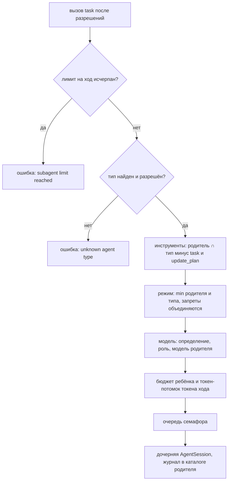
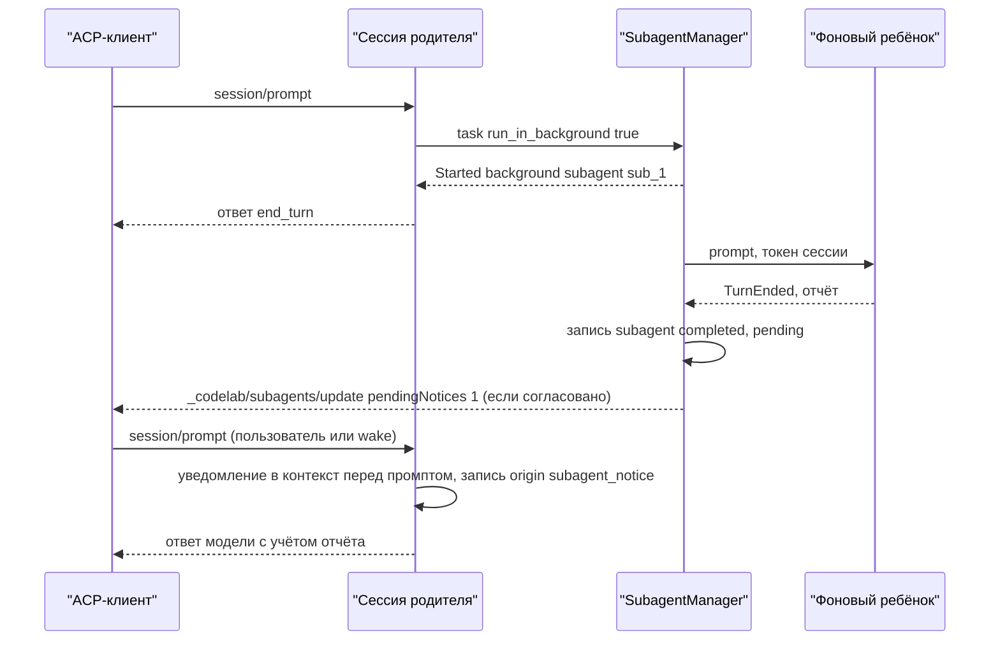
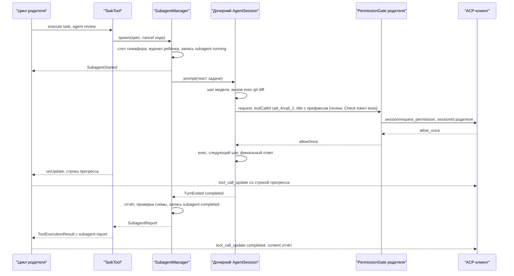
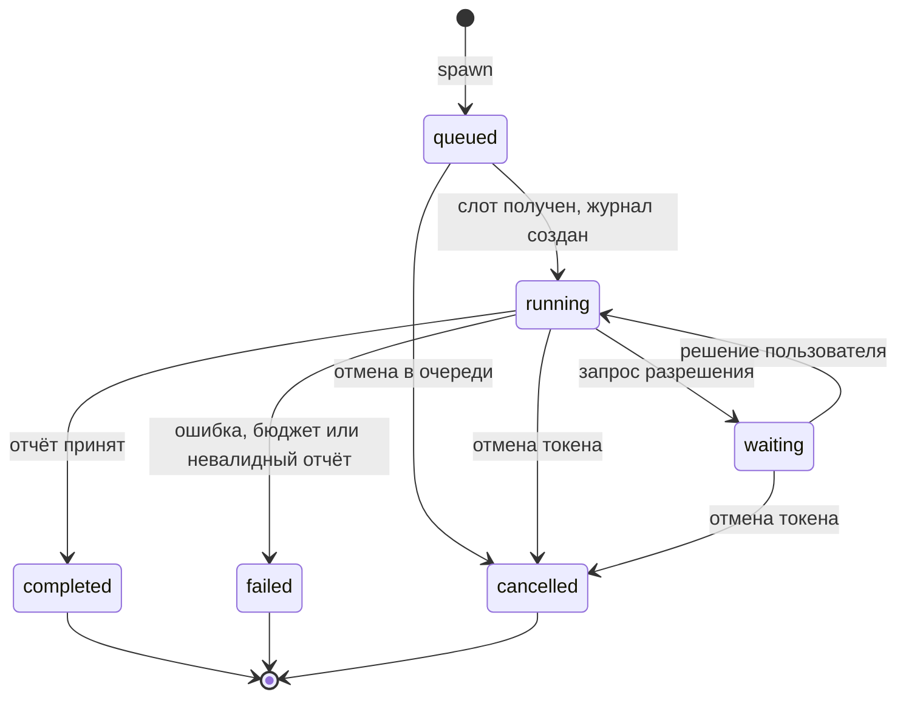

# 17.3. Субагенты: инструмент `task`

> Часть [архитектуры ядра агента CodeLab](../agent-core-architecture.md). Status: Accepted. Общие соглашения, термины и порядок чтения — в оглавлении.

← [17.2. Skills и шаблоны промптов](17-2-skills-and-templates.md) · [Оглавление ядра](../agent-core-architecture.md) · [17.4. Вынос огромного результата инструмента в файл (T-28)](17-4-output-spill.md) →

Цели: C-06 (основная), C-17, H-05, U-21, L-10, R-15, S-09, S-13; удалённые A2A-агенты как типы
`task` (E-22) — §17.15.3.

## 17.3.1. Назначение

Инструмент `task` запускает **дочернего агента** (субагента) с отдельным контекстом: свой
системный промпт, своя история, свой набор инструментов и свой бюджет. Родитель передаёт ему
задачу текстом и получает обратно **только итоговый отчёт** — промежуточные шаги ребёнка в
контекст родителя не попадают. Так родитель может поручить исследование большого кода,
ревью изменений или черновик плана, не расходуя на это собственное окно контекста, и запустить
несколько таких задач параллельно.

| Что делает раздел | Чего раздел не делает |
|---|---|
| описывает инструмент `task`, типы субагентов, параллельный запуск с лимитом, итоговый отчёт (в том числе по JSON-схеме), журнал ребёнка, разрешения, отмену, проекцию в ACP, ожидание в headless | фоновый режим (`run_in_background`, §17.3.8) вводит без хода, начатого агентом: отчёт доставляется через steering или с ближайшим `session/prompt`; не вводит вложенных субагентов (глубина — 1); не вводит обмен сообщениями между родителем и работающим ребёнком (сообщение ребёнку, сдавшему отчёт, и повторный запуск упавшего — §17.3.8.1); удалённых агентов не исполняет сам — их типы `a2a:<имя>` и прогон поверх A2A описаны в §17.15.3 |

Субагент — это обычная `AgentSession` ядра (§5.6) с особой сборкой: ни цикл (§5), ни единая
точка исполнения (§6.3.1), ни политика разрешений (§7) не получают специальных веток для детей.
Всё особенное сосредоточено в трёх местах: `TaskTool`, `SubagentManager` и обёртка
`PermissionGate` родителя.

## 17.3.2. Контракт

**Типы субагентов — это определения агентов.** Отдельного класса «тип субагента» нет: тип — тот
же `AgentDefinition` из §15.8, расширенный двумя полями.

```dart
enum AgentScope { session, subagent, both }

final class AgentDefinition {                // §15.8, где поля scope и role уже внесены
  final String name, description, prompt;
  final ModelRef? model;
  final ModeId? mode;
  final List<String>? tools;                 // null — все инструменты профиля; для субагента — все инструменты родителя
  final String source;                       // путь файла или 'builtin:<name>'
  final AgentScope scope;                    // новое: где определение доступно; по умолчанию both
  final ModelRole? role;                     // новое: роль модели (L-10), если model не задана
}
```

Во frontmatter Markdown-определения добавляется необязательное поле `scope`
(`session` | `subagent` | `both`, по умолчанию `both`). Поле `role` во frontmatter не
допускается: оно есть только у встроенных типов. `session` — определение видно только в опции
`agent` сессии (§15.8); `subagent` — только как тип в `task`; `both` — в обоих местах.

Встроенные типы (`source: 'builtin:<name>'`, тело — файл `prompts/subagent/types/<name>.md`, §11.2):

| `name` | `description` (видит модель) | `tools` | `mode` | `role` |
|---|---|---|---|---|
| `general` | `General-purpose agent for multi-step tasks that may read, edit files and run commands.` | `null` | `null` (режим родителя) | `subagent` |
| `explore` | `Read-only search of the codebase. Returns findings with file paths and line numbers.` | `read`, `ls`, `search` | `plan` | `smol` |
| `review` | `Reviews changes for defects. Reads files and may run read-only commands such as git diff.` | `read`, `ls`, `search`, `exec` | `standard` | `slow` |
| `plan` | `Investigates the code and returns an implementation plan without changing files.` | `read`, `ls`, `search` | `plan` | `plan` |

Пользовательское определение с тем же `name` и `scope` `subagent` или `both` заменяет встроенный
тип (лог `subagent.type_overridden` с путём файла). Определения из недоверенного проекта не
загружаются (CFG-6), поэтому подменить `explore` из чужого репозитория нельзя.

Встроенные профили сессии `architect`, `review` (§17.12.2) — отдельный список со `scope: session`;
тип субагента `review` они не заменяют.

**Удалённые типы (после MVP, §17.15.3).** Каждый `a2a.agents.<имя>` конфига даёт определение с
`name: "a2a:<имя>"`, `scope: subagent`, описанием из конфига и полем `remote` (`RemoteAgentInfo`).
Такой тип входит в `enum` наравне с локальными, но исполняется не дочерней `AgentSession`, а
прогоном A2A через порт `RemoteAgentConnector`: `tierOf` у `task` — `network`, ключ разрешения —
`("task", "a2a:<имя>")`, отчёт — `untrusted` с `source="a2a:<имя>"`.

**Инструмент.**

```dart
final class TaskTool extends AgentTool {
  TaskTool(this.manager, this.types);         // types — снимок на момент создания сессии
  final SubagentManager manager;
  final List<AgentDefinition> types;          // scope subagent | both, отсортированы по name
  @override String get name => 'task';
  @override ToolTier get tier => ToolTier.read;         // сам запуск ничего не меняет (§17.3.3, шаг 1)
  @override ToolKind get kind => ToolKind.think;
  @override ContentTrust outputTrust(Map<String, Object?> args) => ContentTrust.untrusted;
  @override String permissionPattern(Map<String, Object?> args) => args['agent'] as String;
  @override ToolPresentation present(Map<String, Object?> args);   // title: 'Subagent <agent>: <description>'
  @override Future<ToolExecutionResult> execute(Map<String, Object?> args, ToolContext ctx);
}
```

Схема параметров (поле `enum` строится из `types` при создании сессии и дальше не меняется —
схемы стабильны для prompt cache):

```json
{"type":"object","required":["description","prompt"],"properties":{
  "description":{"type":"string","description":"Short title of the task, 3-60 characters. Shown to the user."},
  "prompt":{"type":"string","description":"Complete instructions for the subagent: the goal, relevant paths, constraints and the expected shape of the report. The subagent does not see this conversation."},
  "agent":{"type":"string","enum":["explore","general","plan","review"],"default":"general","description":"Agent type. See the tool description for the list."},
  "output_schema":{"type":["object","null"],"description":"Optional JSON Schema for the final report. When set, the report is a JSON value that matches it."}}}
```

Проверки сверх подмножества §6.3.2 делает `execute` (результат-ошибка, outcome `failed`, ребёнок
не создаётся): `description` — 3–60 символов после обрезки пробелов; `prompt` — 1–32768
символов; `output_schema` — объект, у которого есть `type` (иначе
`output_schema must be a JSON Schema object with a "type" key.`). Тексты ошибок:
`Invalid task: description must be 3-60 characters.` и `Invalid task: prompt must be 1-32768 characters.`

Описание инструмента (`prompts/tool_descriptions/task.md`, переменные `maxConcurrent`, `agentList`):

```text
Launch a subagent: a separate agent with its own context that does one self-contained task and returns a single final report.
Use it to explore a large codebase, review changes or draft a plan without filling your own context.
The subagent does not see this conversation: put everything it needs into `prompt`.
Several task calls in one response run in parallel, at most {{maxConcurrent}} at a time.
You receive only the final report, not the subagent's intermediate steps.
Set run_in_background to keep working while the subagent runs: its report arrives later as a notice.
Subagents cannot ask the user questions and cannot start other subagents.

Agent types:
{{agentList}}
```

`agentList` — строки `- <name>: <description>` в порядке `name`.

**Менеджер и хэндл.**

```dart
typedef SubagentId = String;                  // 'sub_' + 8 символов [0-9a-z] от IdGenerator

enum SubagentState { queued, running, waiting, completed, failed, cancelled }
enum SubagentFailure { error, budgetExceeded, invalidOutput, interrupted, refused }

final class SubagentSpec {
  final SessionId parentSessionId; final String parentToolCallId;
  final AgentDefinition type; final String description, prompt;
  final Map<String, Object?>? outputSchema;
}

final class SubagentReport {
  final SubagentId id; final String agent;
  final SubagentState status;                 // completed | failed | cancelled
  final SubagentFailure? failure;             // только при failed
  final BudgetLimit? budgetExceeded;          // при failure == budgetExceeded
  final String text;                          // финальный текст ребёнка (после усечения)
  final Object? json;                         // разобранный отчёт, если задана output_schema и он валиден
  final bool truncated;
  final int steps, toolCalls; final Usage usage; final Duration duration;
}

abstract interface class SubagentHandle {
  SubagentId get id;
  SessionId? get childSessionId;              // null, пока в очереди
  SubagentSpec get spec;
  SubagentState get state;
  Stream<SubagentState> get states;           // широковещательный, без повторов значения
  SubagentSnapshot get snapshot;              // для прогресса и доски
  Future<SubagentReport> get report;          // завершается ровно один раз, никогда ошибкой
}

final class SubagentSnapshot {
  final SubagentId id; final String parentToolCallId, agent, description;
  final SubagentState state; final int steps, toolCalls; final Usage usage;
  final DateTime startedAt; final DateTime? endedAt;
  final String? lastActivity;                 // title последнего ToolCallStarted ребёнка
}

abstract interface class SubagentManager {     // один на родительскую AgentSession
  /// Ставит задачу в очередь и сразу возвращает хэндл (state = queued).
  /// SubagentLimitException, если исчерпан max_per_turn.
  SubagentHandle spawn(SubagentSpec spec, CancelToken cancel);
  Future<SubagentReport> join(SubagentId id);            // то же, что handle.report
  Future<void> cancel(SubagentId id, [Object? reason]);  // идемпотентно; для доски (§17.3.7)
  List<SubagentSnapshot> list();                         // все дети сессии, в порядке spawn
  Future<void> closeAll(Object reason);                  // при закрытии родительской сессии
}
```

**События.** `SubagentManager` эмитит три события уровня `AgentSession` — так же, как
`ConfigOptionChanged` и `SessionTitleChanged` (§8.3): их эмитит не цикл, а сессия родителя, и
`sessionId` у них — родительский. Они дополняют иерархию §5.3:

```dart
final class SubagentStarted extends AgentEvent {
  final SubagentId subagentId; final String parentToolCallId, agent, description;
  final SessionId childSessionId; final String journalPath; }        // путь относительно sessions/
final class SubagentProgress extends AgentEvent { final SubagentSnapshot snapshot; }
final class SubagentFinished extends AgentEvent {
  final SubagentId subagentId; final String parentToolCallId;
  final SubagentState status; final SubagentFailure? failure;
  final Usage usage; final Duration duration; final String reportPreview; }   // первые 200 символов
```

| Событие | Когда | Кто пишет в журнал родителя |
|---|---|---|
| `SubagentStarted` | ребёнок получил слот, его журнал создан, до первого запроса к модели | `SessionWriter`: запись `subagent` со `status: "running"` (`durable`) |
| `SubagentProgress` | смена состояния, `StepEnded` ребёнка, `ToolCallStarted` ребёнка — не чаще раза в `progress_interval`; смена состояния — всегда | ничего |
| `SubagentFinished` | отчёт готов (после проверки схемы), до возврата из `TaskTool.execute` | запись `subagent` с итоговым `status` и `report` (`durable`) |

Порядок в потоке родителя для одного вызова:
`ToolCallStarted(task)` → `SubagentStarted` → `SubagentProgress`×N (вперемешку с
`ToolCallProgress(task)`) → `SubagentFinished` → `ToolCallFinished(task)`. Ребёнок, отменённый в
очереди, не даёт `SubagentStarted`: только `SubagentFinished(cancelled)`.

## 17.3.3. Алгоритм: запуск дочернего агента



```text
TaskTool.execute(args, ctx):
 1  вызов task уже прошёл единую точку исполнения: валидацию, разрешения (tier read, шаблон
    allow_always — имя типа: «разрешить всегда» на explore не разрешает general), хуки
 2  проверки §17.3.2 → при ошибке результат-ошибка
 3  type := types.byName(args.agent); нет → `Unknown agent type "<x>". Available: <имена через ", ">.`
 4  handle := manager.spawn(SubagentSpec(...), ctx.cancel)
      SubagentLimitException → `Subagent limit reached: at most <N> subagents per turn. Combine the
      remaining work into fewer tasks or do it yourself.` (outcome failed)
 5  подписка на handle.snapshot → ctx.onUpdate(progressLine(snapshot)) (§17.3.4)
 6  report := await handle.report
 7  вернуть wrapReport(report) (§17.3.5); status cancelled → бросить CancelledException
    (единая точка даёт outcome cancelled, CAN-5); failed → isError: true
```

`SubagentManager.spawn` строит ребёнка из **текущего** состояния родителя:

1. **Счётчик.** `turnCount` — число `spawn` в текущем ходе родителя (сбрасывается в
   `AgentSession.prompt()`). `turnCount >= max_per_turn` → `SubagentLimitException`.
2. **Глубина.** Ребёнок всегда глубины 1: инструмента `task` в его наборе нет (шаг 3), поэтому
   вложенный запуск невозможен по построению, а не проверкой во время исполнения.
3. **Инструменты.** `base` := инструменты схем текущего шага родителя (уже суженные профилем хоста
   и выбранным определением агента родителя, §15.8 шаг 5; `base` уже без выключенных
   инструментов, §6.3.8). `tools` := `type.tools == null ? base :
   base ∩ type.tools` (шаблоны `*` — по префиксу, как в §15.8), затем минус `task` и
   `update_plan`. План принадлежит сессии родителя и её UI; ребёнок, рисующий свой план, сбил бы
   клиента. Инструмент типа, которого нет у родителя, молча не добавляется (CFG-7 сохраняется:
   список только сужает). MCP-инструменты ребёнок использует через **те же** подключения
   родителя; блокировки путей (§6.3.4) — общие для процесса, поэтому параллельные дети, пишущие
   один файл, сериализуются. После MVP `memory`, `ask`, `checkpoint`, `discover_tools` в набор
   ребёнка не входят (XT-12); видимые схемы родителя в режиме `essential` — текущий
   `ToolLoadPlan` (§17.11.9).
4. **Режим разрешений.** Эффективный режим ребёнка вычисляется **при каждом решении**, а не один
   раз при запуске (`PermissionPolicy.modeOf`, §7.2): `effective = narrow(parentMode(), type.mode)`, где `narrow` берёт
   `PermissionMode` с меньшим номером в порядке §7.3.1 `alwaysAsk(0) < write(1) < acceptEdits(2) <
   yolo(3) < autopilot(4)` и объединяет запреты уровней (`plan` запрещает tier `write` и `exec`,
   §13.6). Примеры: родитель `standard` + тип `plan` → `write` с запретом `write`/`exec`; родитель
   `ask` + тип `plan` → `alwaysAsk` с тем же запретом; родитель `plan` + тип `general` → запрет
   `write`/`exec`; родитель `bypass` + тип `review` (`standard`) → `write`; родитель
   `accept-edits` + тип `standard` → `write`. Если родитель сменил
   режим посреди хода, следующий вызов ребёнка проверяется уже по новому режиму.
5. **Правила.** `PolicyRules` (deny из конфига, per-tool policy) — те же, что у родителя.
   Множества `allowAlways`/`rejectAlways` (`PermissionDecisionStore`, §7.2) ребёнок **не копирует, а разделяет** с родительской
   сессией: решение «разрешить всегда», принятое в запросе ребёнка, сохраняется в сессии
   родителя (пользователь видел запрос в сессии родителя) и действует для родителя и всех его
   детей до закрытия сессии. Grants на ход (`grantForTurn`) ребёнок читает из текущего хода
   родителя, но не может их менять.
6. **Gate.** `gate := SubagentPermissionGate(parentGate, handle)` (ниже). Если у родителя gate
   нет, у ребёнка его тоже нет (PERM-5).
7. **Модель.** Первое доступное: `type.model`; модель роли `type.role` (L-10); модель роли
   `subagent`; текущая модель родителя. Недоступная модель определения — ошибка определения ещё
   при загрузке (§15.8), до `task` она не доходит. Цепочка роли — по §17.10.5.
8. **Промпт.** `composeSystemPrompt` (§11.5) для набора инструментов ребёнка с режимом `effective`,
   затем секции `prompts/subagent/system.md` (ниже), `## Agent profile: <name>` с телом
   определения (как в §15.8, шаг 2) и, если задана `output_schema`, секция
   `prompts/subagent/output_schema.md` с канонической JSON-записью схемы. Контекст проекта
   (`AGENTS.md`) входит как у родителя.
9. **Бюджет.** `TurnBudget(maxSteps: subagents.max_steps, maxTokens: subagents.max_tokens,
   maxCost: subagents.max_cost, maxDuration: subagents.max_duration)`. Время ожидания одобрения
   не входит в `maxDuration` (как §5.2). После MVP ребёнок получает `SessionDeadline` родителя
   (только чтение, §17.12.5); проверки финального ответа (§17.12.4) не наследуются.
10. **Отмена.** `childSource := CancelTokenSource(parent: cancel)`, где `cancel` — токен хода
   родителя из `ToolContext` (CAN-3: отмена хода отменяет всех детей; отмена ребёнка через
   `manager.cancel` не трогает родителя). Steering родителя детям не доставляется.
11. **Очередь.** Хэндл в состоянии `queued` встаёт в FIFO семафора (§17.3.4).

При получении слота: создать дочернюю сессию через `AgentRuntime.createChildSession` (§5.6,
`ChildSessionSpec`; журнал по §17.3.6), эмитить `SubagentStarted`, вызвать `child.prompt([TextContent(prompt)], cancel:
childSource.token)`. По `TurnEnded` ребёнка — построить отчёт (§17.3.5), эмитить
`SubagentFinished`, освободить слот, `childSource.dispose()`, закрыть дочернюю сессию (при
`subagents.follow_ups` — по истечении `idle_keep`, если за это время не начат новый прогон, §17.3.8.1).

`prompts/subagent/system.md` (`id: subagent.system`, без переменных):

```text
You are a subagent. Another agent started you to complete one task and will read only your final message.
- Work autonomously. You cannot ask the user or the other agent questions. If something is ambiguous, choose the most reasonable interpretation and state it in your report.
- Stay within the task. Do not start unrelated work.
- Your final message is the report. Make it self-contained: findings, file paths with line numbers, what you changed (if anything) and what remains uncertain. Do not narrate your intermediate steps.
```

`prompts/subagent/output_schema.md` (`id: subagent.output_schema`, переменная `schema`):

```text
Your final message must be only a JSON value that matches this JSON Schema. Do not wrap it in code fences and do not add any other text:
{{schema}}
```

**Разрешения ребёнка через gate родителя.** `SubagentPermissionGate` оборачивает
`PermissionRequest` ребёнка и передаёт его в gate **родителя**:

| Поле запроса | Значение |
|---|---|
| `toolCallId` | `<parentToolCallId>/<childToolCallId>`, например `call_3/call_1`: уникален в сессии родителя (PERM-4) и связывает запрос с вызовом `task` |
| `title` | `[<agent>: <description>] <title ребёнка>`, например `[review: Check the diff] Run git diff --stat` |
| `rawInput`, `locations`, `diffs`, `reason`, `allowAlwaysOffered`, `kind`, `tier` | как у ребёнка, без изменений (PERM-6) |
| `sessionId` (на проводе) | родительский: `AcpPermissionGate` родителя знает только его |

Запросы детей одной родительской сессии **сериализуются**: у `SubagentPermissionGate` общая FIFO,
в каждый момент к пользователю уходит не больше одного запроса от детей; запрос самого родителя
очередь не ждёт (родитель во время `task` новых вызовов не делает, кроме параллельных в том же
пакете). Пока запрос ребёнка ждёт ответа или своей очереди, хэндл в состоянии `waiting`. Отмена
токена ребёнка снимает его запрос из очереди и даёт `cancelled` (PERM-7).

## 17.3.4. Алгоритм: параллелизм и ожидание

1. **Параллельность задаёт пакет.** `task` не объявляет `executionMode`, поэтому несколько вызовов
   `task` в одном ответе модели исполняются параллельно (§5.5). Если в пакете есть
   `sequential`-инструмент, весь пакет, включая `task`, идёт последовательно (LOOP-4).
2. **Семафор.** У `SubagentManager` семафор на `max_concurrent` слотов (по умолчанию 3) на
   родительскую сессию. `spawn` сверх лимита ставит хэндл в FIFO в порядке вызовов `spawn` —
   для параллельного пакета это порядок `ToolCallStarted`, то есть порядок вызовов в ответе.
3. **Отмена в очереди.** Хэндл, отменённый в состоянии `queued`, удаляется из FIFO, слот не
   занимает, журнал не создаётся, `report` завершается `cancelled` без единого запроса к модели.
4. **Прогресс.** Пока ребёнок работает, вызов `task` родителя остаётся в `in_progress` (хук
   `markInProgress`, §13.7). `TaskTool` вызывает `ctx.onUpdate` с одной строкой прогресса при
   каждом `SubagentProgress` и, если событий не было, раз в `heartbeat_interval` (по умолчанию
   15 с) — чтобы клиент видел, что вызов жив. Строка (для человека, формат фиксирован ради golden):
   `<agent> · <state> · <steps> steps · <toolCalls> tool calls · <tokens> tokens[ · <lastActivity>]`,
   где `tokens` — `input + output` с суффиксом `k` от 1000 с одним знаком (`12.3k`), а
   `lastActivity` — title последнего вызова ребёнка, обрезанный до 60 символов.
5. **Ожидание.** Родительский шаг ждёт все вызовы пакета (`Future.wait`, §5.5): ход родителя не
   продолжается, пока не завершены все дети этого пакета. Ни один блокирующий ребёнок не
   переживает вызов `task`, который его запустил, а значит, и ход родителя (SUB-4); фоновые дети
   (§17.3.8) в пакет не входят: их вызов `task` завершается сразу.
6. **Порядок результатов.** `ToolCallFinished(task)` приходят в порядке завершения детей,
   сообщения-результаты в транскрипте родителя — в порядке вызовов (LOOP-3). Порядок записей
   `subagent` в журнале родителя — порядок событий.
7. **Учёт usage.** `Usage` ребёнка добавляется к usage хода родителя отдельной строкой
   `subagentUsage` в `TurnUsage` (§12.6) и учитывается в `maxTokens`/`maxCost` бюджета хода
   родителя на ближайшей границе шага родителя (LOOP-12). Так родитель не может обойти бюджет,
   раздав работу детям.
8. **Отмена хода родителя.** Токен хода отменён → токены всех детей отменены (CAN-3). `TaskTool`
   ждёт `TurnEnded` каждого ребёнка не дольше `cancel_grace` (по умолчанию 10 с), затем
   возвращает `cancelled`. По истечении `cancel_grace` хэндл помечается `cancelled`, лог
   `subagent.cancel_grace_exceeded`; дочерняя сессия закрывается в фоне. `TurnEnded(cancelled)`
   родителя приходит после `ToolCallFinished` всех `task` (CAN-5).

## 17.3.5. Алгоритм: итоговый отчёт

```text
buildReport(child, turnEnded, spec):
1  last := последнее assistant-сообщение ребёнка; text := склейка его text-блоков через "\n\n"
   (thinking и toolCall не входят)
2  turnEnded.reason:
     cancelled → status cancelled
     failed    → status failed, failure error (text из AgentError, если text пуст)
     refused   → status failed, failure refused
     completed с budgetExceeded → status failed, failure budgetExceeded; text — последний ответ
       (может быть пустым: тогда text := "")
     completed или maxTokens → шаг 3
3  spec.outputSchema == null → status completed
   иначе json := extractJson(text); errors := validate(json, schema) (подмножество §6.3.2)
     ok → status completed, json
     ошибка и ремонта ещё не было → child.prompt([TextContent(schemaFix(errors))]) в той же
       дочерней сессии с остатком бюджета, затем повторить с шага 1 (ровно один раз)
     ошибка после ремонта → status failed, failure invalidOutput, text как есть
4  усечение: text длиннее report_max_bytes (UTF-8) → оставить начало по границе строки,
   дописать "\n[report truncated: <N> of <M> bytes shown; the full report is in the subagent journal]",
   truncated := true
```

`extractJson(text)`: (а) `text.trim()` целиком разбирается как JSON → он; (б) иначе последний
fenced-блок с языком `json` или без языка; (в) иначе подстрока от первого `{` или `[` до
последней парной `}` или `]`; (г) иначе — ошибка `no JSON value found`.

Текст ремонта (`prompts/subagent/schema_fix.md`, переменная `errors`):

```text
Your final message does not match the required JSON Schema:
{{errors}}
Reply with only a JSON value that matches the schema. Do not add any other text.
```

`errors` — перечень нарушений в формате ошибок валидации §6.3.2, по строке на нарушение.

**Что видит модель родителя.** `wrapReport` строит один `TextContent`; атрибуты в фиксированном
порядке, значения экранируются как атрибуты XML (`&`, `<`, `"`):

```text
<subagent-report id="sub_k3f9a1c2" agent="explore" status="completed" steps="6" tool_calls="9">
<текст отчёта; при output_schema — JSON в канонической записи (ключи по алфавиту, без пробелов)>
</subagent-report>
```

| Исход | Атрибуты сверх базовых | Тело | `isError` |
|---|---|---|---|
| `completed` | `truncated="true"`, если усечено | отчёт | `false` |
| `failed`, `budgetExceeded` | `reason="budget_exceeded:<steps|tokens|cost|duration>"` | последний текст или `Subagent stopped: its budget was exhausted before it finished.` | `true` |
| `failed`, `invalidOutput` | `reason="invalid_output"` | `Subagent report does not match output_schema: <errors>` + `\n\nRaw report:\n` + текст | `true` |
| `failed`, `error` / `refused` | `reason="error"` / `reason="refused"` | `Subagent failed: <сообщение>` | `true` |
| `cancelled` | — | `Tool call was cancelled` (стандартный текст §6.3.1) | `true` |

Вхождения `</subagent-report` в тексте отчёта экранируются заменой `<` на `&lt;` (как §6.3.6,
шаг 1). Затем результат проходит обычное усечение (§6.3.5) и ограду: `task` всегда `untrusted`
(`source="task"`). Отчёт — пересказ того, что ребёнок прочёл в файлах, выводе команд и
MCP-ответах, то есть транзитивно содержит недоверенные данные; инструкции внутри отчёта родитель
исполнять не должен (TOOL-10 по смыслу).

`task` не `spillable`: отчёт уже ограничен `report_max_bytes`. Выносы ребёнка (§17.4) лежат в
его собственном каталоге выноса (§17.3.6); пути к ним в тексте отчёта родителю бесполезны —
`BoundedEnv` родителя этот каталог не содержит, и `read` по такому пути даёт `outsideWorkspace`.

## 17.3.6. Журнал субагента

**Раскладка.** Журнал ребёнка — полноценный JSONL-файл формата §8.2 в подкаталоге журнала
родителя:

```text
$CODELAB_HOME/sessions/<cwd-slug>/
  2026-10-21T08-00-00-000Z_01JB8Q2W6R9T3M5K7N1P4X8Z0C.jsonl           родитель
  2026-10-21T08-00-00-000Z_01JB8Q2W6R9T3M5K7N1P4X8Z0C/
    subagents/
      2026-10-21T08-00-05-120Z_01JB8Q3A1D2E3F4G5H6J7K8M9N.jsonl     ребёнок sub_k3f9a1c2
      2026-10-21T08-00-05-120Z_01JB8Q3A1D2E3F4G5H6J7K8M9N/spills/   выносы ребёнка (§17.4)
    spills/                                                         выносы родителя (§17.4)
```

У ребёнка свой `SpillService` и свой каталог выноса `<журнал ребёнка без .jsonl>/spills/` в
`readOnlyRoots` его `BoundedEnv`; каталог выноса родителя ребёнку недоступен, и наоборот
(SPL-5).

Имя каталога — имя файла родителя без `.jsonl`; имя файла ребёнка — по правилу §8.9. `list`
(§8.10, шаг 1) перебирает только `sessions/*/*.jsonl`, поэтому дочерние журналы в `session/list`
**не попадают** и сводку родителя не меняют: ребёнок — деталь вызова инструмента, а не сессия
пользователя. `index.json` дочерние журналы не содержит.

**Заголовок ребёнка** — обычный заголовок §8.2.1 с новым необязательным полем `parent`:

```json
{"type":"session","version":1,"id":"01JB8Q3A1D2E3F4G5H6J7K8M9N","cwd":"/work/demo","created":"2026-10-21T08:00:05.120Z","agent":{"name":"codelab-agent","version":"0.1.0"},"parent":{"sessionId":"01JB8Q2W6R9T3M5K7N1P4X8Z0C","toolCallId":"call_3","subagentId":"sub_k3f9a1c2","agent":"explore","depth":1}}
```

Первая запись дерева ребёнка — `model_change` с моделью ребёнка, затем `mode_change` с
эффективным режимом на момент запуска, затем `message` с промптом задачи. Остальные записи — как
у любой сессии (`SessionWriter` ребёнка подписан на его `Agent`).

**Запись связи в журнале родителя** — новая служебная запись `subagent` (в контекст модели не
входит; последняя запись с данным `subagentId` выигрывает):

| Поле | Тип | Смысл |
|---|---|---|
| `subagentId` | string | `sub_…` |
| `toolCallId` | string | вызов `task`, запустивший ребёнка |
| `agent`, `description` | string | тип и заголовок |
| `childSessionId` | string? | `null`, если ребёнок отменён в очереди |
| `journal` | string? | путь журнала ребёнка относительно `sessions/` |
| `status` | string | `running`, `completed`, `failed`, `cancelled` |
| `failure` | string? | `budget_exceeded:<limit>`, `invalid_output`, `error`, `refused`, `interrupted` |
| `report` | string? | у итоговой записи: тело `<subagent-report>` после усечения (без обёртки) |
| `usage` | object? | у итоговой записи: usage ребёнка (формат §8.2.3) |
| `background` | bool? | `true` у фонового ребёнка (§17.3.8); отсутствует — блокирующий |

```json
{"type":"subagent","id":"b7n2m4k1","parentId":"q1w2e3r4","timestamp":"2026-10-21T08:00:05.130Z","subagentId":"sub_k3f9a1c2","toolCallId":"call_3","agent":"explore","description":"Find auth code","childSessionId":"01JB8Q3A1D2E3F4G5H6J7K8M9N","journal":"work-demo-9c3e51a7/2026-10-21T08-00-00-000Z_01JB8Q2W6R9T3M5K7N1P4X8Z0C/subagents/2026-10-21T08-00-05-120Z_01JB8Q3A1D2E3F4G5H6J7K8M9N.jsonl","status":"running"}
{"type":"subagent","id":"c8x1z2v3","parentId":"b7n2m4k1","timestamp":"2026-10-21T08:00:41.900Z","subagentId":"sub_k3f9a1c2","toolCallId":"call_3","agent":"explore","description":"Find auth code","childSessionId":"01JB8Q3A1D2E3F4G5H6J7K8M9N","journal":"…","status":"completed","report":"Auth is in lib/auth/session.dart:12-80 …","usage":{"input":21400,"output":930,"cacheRead":0,"cacheWrite":0}}
```

Записи `subagent` ставятся в дерево родителя после assistant-сообщения с вызовом `task` и до
его результата; цепочка `parentId` остаётся линейной (параллельные дети пишут по очереди через
общую очередь записи, SES-4). Итоговая запись пишется **до** `ToolCallFinished(task)` и с
`durable` — это точка восстановления отчёта.

**Lease (S-09, §17.6.8).** Lease родительской сессии покрывает все её дочерние журналы:
отдельный lease на ребёнка не берётся, писатель дочерних журналов — только процесс-владелец lease
родителя; проверка lease перед записью общая, сравнение ревизии ведётся для каждого файла
отдельно. Fork родителя копирует журналы детей на скопированном пути под новыми `SessionId`
ребёнка с `parent.sessionId` новой сессии (§17.6.7).
`session/load` с id дочерней сессии → `-32602` с `data: {"codelab": {"reason":
"subagentSession", "parentSessionId": "<id>"}}`: история ребёнка открывается только через
родителя (просмотр — расширение доски, §17.3.7).

**Прерывание (S-13).** Субагент после сбоя **не перезапускается**. `healInterruptedTurn`
родителя (§8.8) получает правило для `task`:

```text
для каждого missing-вызова с toolName == "task":
  s := последняя запись subagent с toolCallId == вызов.id
  s.status == completed | failed (итог записан, результат — нет: сбой между записью и результатом)
      → результат из s.report и s.status с обёрткой §17.3.5; outcome записи = completed | failed
        (вызов не повторяется, отчёт не теряется)
  иначе (s нет, или status running)
      → стандартный синтетический результат interrupted (§8.8)
      → дописать subagent{status: "failed", failure: "interrupted"} для s.subagentId
      → открыть журнал ребёнка, выполнить его healInterruptedTurn и записать результат в его файл
```

Так параллельный пакет из двух `task`, где первый ребёнок успел закончить, а второй — нет,
после перезапуска даёт модели отчёт первого и `interrupted` для второго; ни один ребёнок не
запускается снова. Реплей (§13.5) показывает первый вызов `completed`, второй — `failed` с
`_meta.codelab.outcome: "interrupted"`.

## 17.3.7. Проекция в ACP

**Стандартная проекция.** Вызов `task` — обычный вызов инструмента (§13.7):

| Что | Кадр | Поля |
|---|---|---|
| `ToolCallStarted(task)` | `tool_call` | `kind: "think"`, `title: "Subagent explore: Find auth code"`, `status: "pending"`, `rawInput` (все аргументы, включая `prompt`) |
| `markInProgress` | `tool_call_update` | `status: "in_progress"` |
| `ToolCallProgress(task)` | `tool_call_update` | `content: [{"type":"content","content":{"type":"text","text":"<строка прогресса>"}}]` — заменяет предыдущую строку (в ACP `content` обновления заменяет коллекцию) |
| `ToolCallFinished(task)` | `tool_call_update` | `status: "completed"` или `"failed"`; `content` — один текстовый блок с **телом** отчёта (без обёртки `<subagent-report>` и ограды: клиент показывает человеку текст); для `failed` — `_meta.codelab.subagent.failure` |
| `SubagentStarted`, `SubagentFinished` | — | лог `subagent.start` / `subagent.end`; доска (ниже) |
| `SubagentProgress` | — | только доска (ниже); строку прогресса уже несёт `ToolCallProgress` |
| запрос разрешения ребёнка | `session/request_permission` | `sessionId` родителя, `toolCall.toolCallId: "call_3/call_1"`, `title` с префиксом, `_meta: {"codelab": {"subagent": {"id": "sub_…", "parentToolCallId": "call_3", "agent": "review"}}}` |

**Вызовы инструментов ребёнка не проецируются** как `tool_call` верхнего уровня. Причины:
(1) в ACP нет вложенности вызовов — три параллельных ребёнка по десять вызовов превратили бы
ленту сессии в 30 перемешанных строк без связи с задачами; (2) суть субагента — родитель и
пользователь видят итог, а не шаги; (3) детали доступны отдельно — в журнале ребёнка и на
доске. Запрос разрешения — единственное, что от ребёнка уходит клиенту напрямую: без него
пользователь не может одобрить действие. Его `toolCallId` клиенту заранее не объявлен;
клиент ДОЛЖЕН показать такой запрос самостоятельно, используя `title`, `rawInput` и `content`
запроса (golden `acp/prompt-subagent-permission`). `_meta.codelab.subagent` — расширение через
OpenSpec.

**Доска субагентов (U-21) — предложение, вводится через OpenSpec.** Расширение `_codelab/subagents`
включается, только если клиент объявил `clientCapabilities._meta.codelab.subagentBoard: true`, а
агент — `agentCapabilities._meta.codelab.subagentBoard: true` в `initialize`. Предлагаемая форма:

| Метод | Направление | Параметры → результат |
|---|---|---|
| `_codelab/subagents/update` (уведомление) | агент → клиент | `{sessionId, subagents: [SubagentSnapshotJson], pendingNotices}` — полный снимок детей текущего хода и активных фоновых детей (`"background": true` в снимке); `pendingNotices` — число недоставленных уведомлений (§17.3.8); на каждый `SubagentStarted`/`Progress`/`Finished` и изменение очереди уведомлений, не чаще `progress_interval`; для фоновых детей отправляется и вне хода |
| `_codelab/subagents/list` | клиент → агент | `{sessionId}` → `{subagents: [...]}`: все дети сессии, включая завершённые (по записям `subagent` журнала) |
| `_codelab/subagents/cancel` | клиент → агент | `{sessionId, subagentId}` → `{}`; `SubagentManager.cancel`; вызов `task` получает `cancelled`, ход родителя продолжается |
| `_codelab/subagents/history` | клиент → агент | `{sessionId, subagentId}` → `{updates: [SessionUpdate]}` — реплей журнала ребёнка (§13.5) без отправки в ленту сессии |

```json
{"id":"sub_k3f9a1c2","parentToolCallId":"call_3","agent":"explore","description":"Find auth code",
 "state":"running","startedAt":"2026-10-21T08:00:05.130Z","endedAt":null,
 "steps":4,"toolCalls":7,"tokens":{"input":15200,"output":610},"cost":0.041,
 "lastActivity":"Search \"login\" in lib"}
```

Без расширения клиент видит всё нужное через стандартный `tool_call`: заголовок, строку
прогресса и итоговый отчёт.

## 17.3.8. Фоновый режим

**Назначение.** Блокирующий `task` держит ход родителя, пока ребёнок не закончит. Для долгой
независимой работы (исследовать соседний пакет, пока родитель правит текущий) модель запускает
ребёнка **в фоне**: вызов `task` сразу возвращает идентификатор, родитель продолжает работу, а
отчёт приходит позже **уведомлением**.

**Ограничение ACP, которое определяет устройство.** Ход начинается только по `session/prompt`
от клиента; агент не открывает ход сам и не возвращает `stopReason` без запроса. Поэтому у
уведомления есть ровно два пути доставки, и оба не требуют, чтобы агент начинал ход:

| Состояние родителя в момент завершения ребёнка | Доставка | Нужно ли расширение ACP |
|---|---|---|
| ход идёт | `Agent.steer` (§5.6): уведомление входит в контекст на ближайшей границе шага (CAN-6), модель реагирует в этом же ходе | нет |
| ход не идёт | уведомление ждёт в очереди сессии и входит в контекст **перед** сообщением пользователя следующего `session/prompt` (поведение `steer` без хода, §5.6) | нет |
| ход не идёт, клиент поддерживает пробуждение | агент сообщает клиенту `_codelab/subagents/update` с `pendingNotices > 0`; клиент по своей политике отправляет `session/prompt` с `_meta.codelab.wake: true` — ход начинает **клиент** | да, через OpenSpec |

**Контракт.** Схема параметров `task` (§17.3.2) получает поле:

```json
"run_in_background":{"type":"boolean","default":false,"description":"Run the subagent in the background. The call returns at once with the subagent id; the report arrives later as a separate notice. Use it for long independent work while you continue. Background subagents cannot ask the user for approval while you are idle."}
```

```dart
final class SubagentSpec {                    // §17.3.2, дополнение
  // ...
  final bool background;                      // run_in_background
}

abstract interface class SubagentManager {     // §17.3.2, дополнение
  // ...
  List<SubagentNotice> takePendingNotices();   // забрать недоставленные уведомления (FIFO)
  int get pendingNoticeCount;
  Stream<void> get noticesChanged;             // для доски и пробуждения
}

final class SubagentNotice {
  final SubagentId id; final String agent, description, parentToolCallId;
  final SubagentReport report;
}
```

Два новых инструмента регистрируются вместе с `task` (§10.7), только если
`subagents.background = true` (по умолчанию `true`):

| Инструмент | Параметры | tier / kind | Результат (видит модель) |
|---|---|---|---|
| `task_status` | `id` (необязательный); `wait_seconds` (0–120, по умолчанию 0) | `read` / `think` | без `id` — строки `<id> <agent> <state> <steps> steps "<description>"` по всем фоновым детям сессии; с `id` — то же для одного; при `wait_seconds > 0` ждёт, пока ребёнок (или любой, если `id` нет) не станет терминальным, но не дольше `wait_seconds`; завершённый за время ожидания ребёнок сразу получает уведомление в этом же результате |
| `task_cancel` | `id` (обязательный) | `read` / `think` | `Cancelled subagent <id>.` или `Subagent <id> is not running (state: <state>).`; отмена только уменьшает работу, поэтому разрешение не спрашивается в `standard` |

Описания инструментов — `prompts/tool_descriptions/task_status.md` и `task_cancel.md` (§11.2).

**Алгоритм: запуск в фоне.** `TaskTool.execute` (§17.3.3) при `run_in_background: true`:

```text
1-3  как в §17.3.3 (проверки, тип)
4    лимит: фоновых детей сессии в состоянии queued | running | waiting < max_background
     (по умолчанию 4), иначе `Background subagent limit reached: at most <N> run at once.
     Wait for a notice or cancel one with task_cancel.` (outcome failed); max_per_turn — общий
5    handle := manager.spawn(spec{background: true}, sessionToken)
       токен — потомок токена СЕССИИ, а не хода: session/cancel хода фоновых детей не трогает;
       closeAll (закрытие сессии, выход процесса) — отменяет
6    вернуть сразу (без ожидания) TextContent:
       `Started background subagent <id> (<agent>): "<description>". You will receive its report
        as a notice when it finishes. Use task_status to check progress and task_cancel to stop it.`
     outcome completed; ToolCallFinished(task) — сразу
```

Ребёнок занимает тот же семафор `max_concurrent`, что и блокирующие (§17.3.4); очередь общая,
FIFO. Бюджет ребёнка — свой `TurnBudget` (§17.3.3, шаг 9). Usage фонового ребёнка входит в usage
сессии и в `TurnUsage.subagentUsage` того хода родителя, в котором **доставлено** уведомление;
в бюджет хода родителя, давно завершившегося, он не входит (SUB-11 уточняется: для фонового
ребёнка — ход доставки).

**Алгоритм: разрешения фонового ребёнка.** Запрос ребёнка идёт через `SubagentPermissionGate`
(§17.3.3) только если у родителя **идёт ход**: клиент ACP ждёт `session/request_permission`
лишь внутри хода. Если хода нет:

```text
1  решение без вопроса по политике (режим, allowAlways/rejectAlways, PolicyRules) → применить
2  вопрос нужен → не спрашивать; отказ с результатом-ошибкой ребёнку:
     `Approval is not available: the session is idle. Do only actions that need no approval, or
      report what needs approval.`
   лог subagent.approval_unavailable; ребёнок продолжает и может включить это в отчёт
3  начался ход родителя → новые запросы ребёнка снова идут через gate (очередь SUB-3)
```

Поэтому фоновый режим естественно подходит типам `explore` и `plan`, у которых нет `write` и
`exec`; `general` в фоне работает в пределах уже выданных «разрешить всегда».

**Алгоритм: доставка уведомления.** По `SubagentFinished` фонового ребёнка:

```text
1  итоговая запись subagent{status, report, usage, background: true} — durable (как SUB-10)
2  notice := SubagentNotice(report); добавить в FIFO pending сессии; noticesChanged
3  текст уведомления (user-сообщение, origin "subagent_notice"):
     <subagent-notice id="<id>" agent="<agent>" status="<status>" description="<description>">
     The background subagent finished. Its report follows. Continue your work with it.
     </subagent-notice>
     + wrapReport(report) (§17.3.5) внутри ограды untrusted-content source="task"
4  ход идёт → agent.steer(message, origin: SubagentNoticeOrigin(id)) (§5.6); иначе — ждать следующего prompt()
5  доставка = запись в журнал message{role: user, origin: "subagent_notice", subagentId} и
   MessageStarted; из pending уведомление удаляется только после этой записи
6  AgentSession.prompt(content) при непустом pending (уведомления субагентов и фоновых команд
   §17.9.6, в порядке завершения): сначала все уведомления (по одному user-сообщению), затем
   content пользователя; всё — в одном ходе
```

Уведомление — не слова пользователя: в ленту ACP как `user_message_chunk` оно не отправляется ни
вживую, ни при реплее (`session/load` пропускает сообщения с `origin: "subagent_notice"`, кроме
строки в доске). Клиент без расширения узнаёт о завершении из ответа модели и из команды
`/tasks`.

**Общая очередь со steering (§17.7.3.2).** Уведомления лежат в той же FIFO-очереди `steering`,
что и пользовательские steering-сообщения, в порядке поступления: один опрос забирает все
элементы и добавляет один шаг (STEER-6). В `TurnEnded.returnedSteers` уведомления не попадают
никогда: недоставленное уведомление остаётся в pending до следующего хода. Уведомления фоновых
команд (§17.9.6) лежат в той же очереди; `pendingNotices` — сумма недоставленных уведомлений
субагентов и задач; пробуждение доставляет все.

**Команда агента `/tasks`** (стандартный `available_commands_update`, R-07; место в списке — перед `help`, §13.4): `/tasks` — список
фоновой работы сессии: фоновых детей и фоновых команд (§17.9.11) со статусом; `/tasks cancel <id>` —
отмена ребёнка (`sub_…`) или остановка задачи (`job_…`); `/tasks output <id>` — последние 40 строк
вывода задачи. Обрабатывается агентом без модели, как `/status` (§13.6), и даёт человеку
управление без расширения протокола.

**Пробуждение (через OpenSpec).** Агент, поддерживающий пробуждение, объявляет
`agentCapabilities._meta.codelab.subagentWake: true` в ответе `initialize`. Если и клиент объявил
`clientCapabilities._meta.codelab.subagentWake: true`, агент при `pendingNoticeCount > 0` и
отсутствии хода шлёт `_codelab/subagents/update` с полем `pendingNotices`. Клиент МОЖЕТ ответить
`session/prompt` с `prompt: []` (пустой список блоков) и `_meta: {"codelab": {"wake": true}}`; агент
выполняет ход только из уведомлений. Без согласованной capability агент такой `session/prompt` с
пустым `prompt` отклоняет `-32602`. Политика клиента: CLI REPL и app будят автоматически, если
пользователь не печатает (`subagents.auto_wake = true`); `codelab -p` — по §17.3.9.

**Журнал и сбой.** Запись `subagent` получает поле `background: true`. После перезапуска
(`open`, §8.6):

```text
1  для каждой фоновой записи subagent без итогового status → дописать
   subagent{status: failed, failure: interrupted}; журнал ребёнка лечится как в §17.3.6
   (ребёнок не перезапускается)
2  pending := итоговые фоновые записи, для которых нет message с origin "subagent_notice" и тем же
   subagentId (порядок — порядок итоговых записей)
3  pending доставляется по шагу 6 доставки при следующем prompt()
```

Так уведомление доставляется **ровно один раз**: не теряется при сбое между завершением ребёнка
и доставкой и не дублируется после доставки.



### 17.3.8.1. Продолжение работы с субагентом (C-17)

**Назначение.** Отчёт ребёнка часто требует уточнения («а где вызывается `verifyToken`?»), а
ребёнок, упавший на сбое провайдера или прерванный, уже проделал половину работы. Новый `task`
начал бы с нуля и потратил бы окно ребёнка на повторное чтение тех же файлов. Три инструмента
продолжают работу с **уже запущенным** ребёнком по его `SubagentId`: `task_send` — новое сообщение
ребёнку, сдавшему отчёт; `task_resume` — повторный запуск ребёнка, не закончившего работу;
`task_observe` — последние сообщения ребёнка без загрузки его контекста в контекст родителя.
Обмена сообщениями с **работающим** ребёнком раздел не вводит: steering родителя детям по-прежнему
не доставляется (§17.3.3, шаг 10).

**Прогон.** Каждый запуск ребёнка — **прогон** с номером `run` (первый — `task`, `run = 1`; каждый
`task_send` и `task_resume` — следующий номер). Прогон — один ход дочерней `AgentSession` в **том же**
журнале ребёнка (§17.3.6): история прежних прогонов сохраняется, ребёнок видит её как обычную
историю своей сессии (и сжимает её по §9, как любая сессия). Состояния хэндла (§17.3.11) относятся
к прогону: `completed`, `failed`, `cancelled` терминальны для прогона, продолжение — новый прогон с
новым `report`, а не переход назад.

**Кого можно продолжить.** Ребёнок **известен** сессии, если на активной ветке родителя есть запись
`subagent` с его `subagentId` (после перемотки до вызова `task` ребёнок неизвестен). Его состояние —
итоговая запись последнего прогона:

| Состояние последнего прогона | `task_send` | `task_resume` |
|---|---|---|
| `queued`, `running`, `waiting` | ошибка «still running» | ошибка «still running» |
| `completed`; `failed` с `budgetExceeded`, `invalidOutput`, `refused` (ход ребёнка закончился штатно — **ожидает**) | новый прогон с сообщением родителя | ошибка «use task_send» |
| `failed` с `error`, `interrupted`; `cancelled` (ход не закончен) | ошибка «use task_resume» | новый прогон с текстом продолжения |

**Контракт.**

```dart
abstract interface class SubagentManager {     // §17.3.2, §17.3.8, дополнение
  // ...
  /// Новый прогон известного ребёнка. SubagentFollowUpException — правила таблицы выше и лимиты.
  SubagentHandle followUp(SubagentId id, SubagentFollowUp request, CancelToken cancel);
  /// Последние сообщения активной ветки журнала ребёнка; работает в любом состоянии.
  Future<SubagentObservation> observe(SubagentId id, {int last = 10, bool tools = false});
}

sealed class SubagentFollowUp { const SubagentFollowUp(); }
final class SendFollowUp extends SubagentFollowUp { final String message; final String toolCallId; final bool background; }
final class ResumeFollowUp extends SubagentFollowUp { final String? note; final String toolCallId; final bool background; }

final class SubagentObservation {
  final SubagentId id; final String agent; final SubagentState state; final int run;
  final List<String> lines; final int omitted; }   // omitted — сообщений до окна

// Дополнение §17.7.2.1: поля записи origin в журнале РЕБЁНКА (§8.2.3, §8.2.5).
final class ParentMessageOrigin extends MessageOrigin { final int run; final String toolCallId; }   // "parent_message"
final class SubagentResumeOrigin extends MessageOrigin { final int run; final String failure; }   // "subagent_resume"
```

| Инструмент | Параметры | tier / kind | `outputTrust` | `permissionPattern` |
|---|---|---|---|---|
| `task_send` | `id` (обязательный), `message` (1–32768 символов), `run_in_background` (по умолчанию `false`) | `read` / `think` | `untrusted` | тип ребёнка (`agent`), ключ решения — `PermissionKey("task", <agent>)` |
| `task_resume` | `id` (обязательный), `note` (необязательный, до 4000 символов), `run_in_background` (по умолчанию `false`) | `read` / `think` | `untrusted` | то же |
| `task_observe` | `id` (обязательный), `last` (1–`observe_max`, по умолчанию `observe_default`), `include_tools` (по умолчанию `false`) | `read` / `think` | `untrusted` (`source="task"`) | `id` |

`task_send` и `task_resume` проходят ту же политику, что `task`: решение «разрешить всегда» и
правила `PolicyRules`, заданные для `task` с типом `<agent>`, действуют и на них (новый геттер
`AgentTool.permissionKeyName => 'task'`, §7.3). Инструменты регистрируются вместе с `task` (§10.7),
если `subagents.follow_ups = true`; `run_in_background` в их схеме есть, только если
`subagents.background = true`. Описания — `prompts/tool_descriptions/task_send.md`,
`task_resume.md`, `task_observe.md` (§11.2), по строке:

```text
task_send: Send a new instruction to a subagent that already returned its report. It continues in its own context and returns a new report.
task_resume: Restart a subagent whose last run failed or was cancelled. It continues from its own history; finished tool calls are not repeated.
task_observe: Show the last messages of a subagent (running or finished) without its full history. Use it to check progress or to quote its work.
```

**Алгоритм: `task_send` и `task_resume`.**

```text
1  единая точка исполнения (§6.3.1): валидация, разрешения по ключу ("task", agent ребёнка), хуки
2  s := последняя запись subagent с id на активной ветке родителя; нет → `Unknown subagent <id>.
   Known: <id через ", ">.` (список пуст → `No subagents in this session.`)
3  проверка таблицы «Кого можно продолжить»; ребёнок уже в прогоне, запущенном этим же пакетом
   (два task_send одному id в одном ответе) → второй получает «still running»
4  лимиты: прогонов ребёнка сверх первого ≥ max_follow_ups, или task_resume при числе
   продолжений через resume ≥ max_resumes → ошибка лимита; turnCount ≥ max_per_turn (общий с task,
   §17.3.3, шаг 1); фоновый прогон — и max_background (§17.3.8)
5  handle := manager.followUp(id, request, cancel); run := s.run + 1
     токен — потомок токена хода (блокирующий) или сессии (фоновый), как §17.3.3 шаг 10 и §17.3.8 шаг 5
     инструменты := tools_прогона_1 ∩ базовый набор текущего шага родителя (SUB-1; разрешения
       ребёнка не расширяются, даже если родитель получил новые инструменты)
     режим, правила, gate, модель, бюджет (свежий TurnBudget на прогон) — заново по §17.3.3, шаги 4–9
     слот семафора max_concurrent — как у task (§17.3.4)
6  при получении слота: дочерняя сессия открыта (держится idle_keep после отчёта) или
   открывается заново из журнала ребёнка (AgentRuntime.openChildSession, §5.6; heal §8.8 уже
   выполнен при open родителя); запись subagent{status: running, run, followUp: send | resume,
   toolCallId} в журнал родителя (durable); SubagentStarted с run
7  сообщение прогона (user-сообщение ребёнка, durable):
     send   → message с origin "parent_message" и текстом args.message
     resume → message с origin "subagent_resume"; текст prompts/subagent/resume.md:
       Your previous run stopped before it finished ({{reason}}). Continue the same task from
       where you stopped. Tool calls that already have results are done: do not repeat them
       unless their result shows they must be repeated.{{note}}
       reason := "error: <сообщение AgentError, до 200 символов>" | "the process stopped" | "it was cancelled"
       note := "\n\nNote from the agent that started you:\n" + args.note, если задан
     resume прогона, чьё сообщение parent_message в журнал ребёнка не попало (сбой между шагами
       6 и 7) → вместо текста продолжения повторяется message из аргументов исходного task_send
8  child.prompt([сообщение]); отчёт — buildReport (§17.3.5) по последнему ответу этого прогона,
   ремонт по output_schema исходного task — ровно один раз на прогон
9  блокирующий: прогресс и ожидание как §17.3.3, шаги 5–7; результат — wrapReport с атрибутом
   run="<run>"; фоновый: сразу `Started run <run> of background subagent <id> (<agent>).`,
   отчёт — уведомлением §17.3.8 с атрибутом run="<run>"
```

**Алгоритм: `task_observe`.** Снимок активной ветки журнала ребёнка: для работающего — из памяти
его `AgentSession`, иначе `openReadOnly` (§8.3) без lease ребёнка (его покрывает lease родителя) и
без записи. Берутся последние `last` записей `message` (без `toolResult`, если не `include_tools`);
строка — `[<run>] <role|origin> <HH:mm>: <текст>`, где роль — `parent` для слов принципала (первое
сообщение и `parent_message`, §8.2.5), `notice` для прочих user-записей, `assistant`, `tool <name>`;
у ответа — только text-блоки, вызовы — `call <name> <canonicalJson(args), до 200 символов>`; текст
сообщения обрезается до `observe_message_max_chars` с пометкой `…`. Первая строка —
`Subagent <id> (<agent>), state <state>, run <run>; showing <n> of <total> messages.`; итог
ограничен `observe_max_bytes` (старые строки отбрасываются первыми). Ребёнок, отменённый в
очереди (журнала нет) → `Subagent <id> has no history: it was cancelled before it started.`

**Журнал и сбой.** Запись `subagent` (§17.3.6) получает поля `run` (int, отсутствует — `1`) и
`followUp` (`"send"` | `"resume"`); `toolCallId` — вызов, запустивший **этот** прогон. Правило
лечения `task` (§17.3.6, «Прерывание») применяется и к `task_send`/`task_resume`: поиск по
`toolCallId`; итог записан → результат из записи, иначе `interrupted` для прогона, ребёнок сам не
перезапускается — его можно продолжить `task_resume`. Отмена хода родителя отменяет блокирующий
прогон (`cancelled`, SUB-6); `task_cancel` и `/tasks cancel` отменяют текущий прогон ребёнка.
Fork родителя (§17.6.7) копирует журналы детей: в новой сессии те же `subagentId` продолжаются в
копиях. Сессия только для чтения (SESM-12) ходов не выполняет, поэтому инструменты в ней не
вызываются.

**Конфигурация** (`subagents`, §17.3.10): `follow_ups` (`true`), `max_follow_ups` (`5`),
`max_resumes` (`2`), `idle_keep` (`"2m"`), `observe_default` (`10`), `observe_max` (`50`),
`observe_message_max_chars` (`2000`), `observe_max_bytes` (`16384`).

**ACP и клиент.** Стандартная проекция §13.7: `tool_call` с `kind: "think"`; title —
`Subagent <agent>: <description> (follow-up <run>)`, `… (resume <run>)`, `Observe subagent <id>`;
у `task_send`/`task_resume` строки прогресса и итог — как у `task` (§17.3.7). Снимок доски
(`_codelab/subagents/update`, `/list`) получает поля `run` и `followUps` — расширение через
OpenSpec вместе с доской; `_codelab/subagents/history` отдаёт `parent_message` как
`user_message_chunk` с `_meta.codelab.subagentRun: <run>`, `subagent_resume` пропускает.
Клиентская доска показывает номер прогона «run 2» при `run ≥ 2`, а в истории ребёнка сообщения
`parent_message` — как реплики «parent»; новых действий пользователя доска не получает:
продолжение — инструмент модели.

**Ошибки** (результат-ошибка, outcome `failed`, прогон не создаётся):

| Случай | Текст |
|---|---|
| ребёнок работает | `Subagent <id> is still running (state: <state>). Wait for its report with task_status or cancel it with task_cancel.` |
| `task_send` к незаконченному | `Subagent <id> did not finish its last run (<failure>). Use task_resume to continue it.` |
| `task_resume` к ожидающему | `Subagent <id> finished its last run (<status>). Use task_send to give it a new instruction.` |
| лимит продолжений | `Follow-up limit reached for subagent <id>: at most <N> follow-ups. Start a new task instead.` |
| лимит resume | `Resume limit reached for subagent <id>: at most <N> resumes.` |
| журнал ребёнка не открывается | `Subagent <id> cannot be continued: its journal is unavailable (<reason>).` |
| пустое `message` | `Invalid task_send: message must be 1-32768 characters.` |

**Инварианты** (дополняют §17.3.12):

* **SUB-17.** Продолжение не создаёт нового ребёнка: прогон `run ≥ 2` идёт в той же дочерней сессии и
  том же журнале; история прежних прогонов в журнале не меняется (SES-1).
* **SUB-18.** Набор инструментов прогона — подмножество набора первого прогона и текущего набора
  родителя; режим и правила вычисляются как при `task` (SUB-1, SUB-2); `task_send`/`task_resume`
  решаются по ключу разрешения `task` того же типа.
* **SUB-19.** У ребёнка не больше одного активного прогона; `task_send` принимается только ожидающим
  ребёнком, `task_resume` — только незаконченным.
* **SUB-20.** `task_resume` не повторяет вызовы, у которых в журнале ребёнка есть результат
  (SES-9, SES-10); сообщение прогона, не попавшее в журнал ребёнка, при resume доставляется один раз.
* **SUB-21.** Прогонов сверх первого у ребёнка не больше `max_follow_ups`, из них resume — не больше
  `max_resumes`; каждый прогон учитывается в `max_per_turn`, `max_concurrent`, бюджете хода
  родителя (SUB-11) и, если фоновый, в `max_background`.
* **SUB-22.** `task_observe` ничего не пишет ни в журнал ребёнка, ни в журнал родителя и не меняет
  состояние ребёнка; его результат всегда `untrusted`.

**Как проверить.**

* `core/task-send-to-idle-child` (`subagent_follow_up_test.dart`, scripted LLM): `task` → отчёт;
  `task_send` тому же id → ребёнок получает второе user-сообщение с `origin: "parent_message"` в
  том же файле, запрос к модели ребёнка содержит историю прогона 1; результат `<subagent-report …
  run="2">`; `task_send` работающему ребёнку и ребёнку с `failed(error)` — тексты таблицы ошибок;
  шестой `task_send` при `max_follow_ups = 5` — ошибка лимита (SUB-17, SUB-19, SUB-21).
* `core/task-resume-failed-child` (`subagent_resume_follow_up_test.dart`): ребёнок падает на
  `ErrorEvent` после двух выполненных `exec` → `task_resume` → fake-инструмент вызван ровно два
  раза, сообщение `subagent_resume` с текстом шаблона; процесс убит во время прогона 2 → после
  `open` прогон `interrupted`, повторный `task_resume` работает (SUB-20).
* `subagent_follow_up_tools_test.dart`: родитель потерял `exec` после прогона 1 → прогон 2 без
  `exec`; «разрешить всегда» на `task` `general` действует на `task_send` к `general`;
  `rejectAlways` — тоже (SUB-18).
* `subagent_observe_test.dart`: `last: 3` у работающего ребёнка — три последние строки, журналы
  побайтово не изменены; `include_tools`; обрезка `observe_max_bytes`; отменённый в очереди —
  текст «no history» (SUB-22).
* `acp/prompt-subagent-follow-up`: `tool_call` `task_send` с `kind: "think"` и title
  `… (follow-up 2)`, строки прогресса, `completed` с телом отчёта.

## 17.3.9. Headless: ожидание перед выходом (H-05)

Блокирующие дети (SUB-4) к ответу на `session/prompt` уже завершены, а при отмене (`SIGINT`,
`--timeout`) остановлены в пределах `cancel_grace`. Ход переживают **фоновые** дети (§17.3.8) и
фоновые команды (§17.9): без ожидания `codelab -p` вышел бы раньше, чем
их результат попадёт в ответ. Цель H-05 — только клиентская: CLI работает с агентом через ACP и
узнаёт о фоновой работе только через расширения (`_codelab/subagents` и аналогичные).

```text
codelab -p, после ответа на session/prompt (любого stopReason, кроме cancelled):
1  если агент не объявил ни одного расширения списков фоновой работы → выход сразу,
   лог debug cli.drain.unsupported
2  wakes := 0
3  pending := объединение list-ответов всех объявленных расширений (_codelab/subagents/list,
   _codelab/jobs/list, §17.9.11) по sessionId, элементы в состоянии queued | running | waiting
4  pending пуст и pendingNotices == 0 → выход
5  stderr (один раз): "codelab: waiting for <N> background item(s) (up to <T>s)…"
6  ждать, пока pending не опустеет или не появится pendingNotices > 0: по уведомлениям */update,
   без них — опрос list раз в 500 мс; общий предел на все шаги — --drain-timeout
   (по умолчанию subagents.drain_timeout = 60s; 0 — не ждать)
7  pendingNotices > 0, агент объявил agentCapabilities._meta.codelab.subagentWake и wakes < --max-wakes (по умолчанию 3):
     session/prompt с prompt [] и _meta.codelab.wake: true; ответ модели печатается в stdout
     после пустой строки (в stream-json — ход с `turn_start{trigger: "wake"}`, без пустой строки;
     dart-agent-and-clients §12.5.4); wakes += 1; перейти к шагу 3
   pendingNotices > 0 без agentCapabilities._meta.codelab.subagentWake → stderr "codelab: <N> background report(s) were not
     delivered: the agent does not support wake-up"; выход
8  предел истёк → _codelab/subagents/cancel для детей и _codelab/jobs/kill с reason: "drain"
   для задач, затем ещё до 5 с ожидания;
   stderr: "codelab: background work did not finish within <T>s; cancelled <N> item(s)"
9  код выхода — по stopReason последнего хода (H-02); если сработал шаг 8 и код был 0 → 1
10 повторный SIGINT во время ожидания → шаг 8 без ожидания, код 130
```

После ответа `cancelled` ожидание не выполняется: отмена хода фоновых детей не останавливает
(§17.3.8, шаг 5; SUB-4), поэтому CLI сразу отменяет их через `*/cancel` и выходит с кодом 130. Время ожидания не
входит в `--timeout` хода; ход пробуждения ограничен тем же `--timeout`.

После drain и итоговой строки CLI закрывает соединение; сессия, открытая с
`_meta.codelab.sealOnClose`, запечатывается (§8.5.1, S-15).

## 17.3.10. Конфигурация

**`subagents`**

| Ключ | Тип | По умолчанию | Смысл |
|---|---|---|---|
| `enabled` | bool | `true` | `false` — инструмент `task` не регистрируется (правило «выключено — невидимо», §10.9) |
| `max_concurrent` | int | `3` | слотов семафора на родительскую сессию; 1–8, иначе `ConfigException` |
| `max_per_turn` | int | `10` | запусков `task` за ход родителя; 1–50 |
| `max_steps` | int | `30` | `TurnBudget.maxSteps` ребёнка |
| `max_tokens` | int | нет | `TurnBudget.maxTokens` ребёнка |
| `max_cost` | float | нет | `TurnBudget.maxCost` ребёнка, USD |
| `max_duration` | duration | `"10m"` | `TurnBudget.maxDuration` ребёнка, без ожидания одобрения |
| `report_max_bytes` | int | `16384` | предел отчёта до усечения (§17.3.5) |
| `progress_interval` | duration | `"2s"` | минимальный интервал `SubagentProgress` и строк прогресса |
| `heartbeat_interval` | duration | `"15s"` | строка прогресса при отсутствии событий |
| `cancel_grace` | duration | `"10s"` | ожидание остановки детей после отмены хода |
| `drain_timeout` | duration | `"60s"` | значение `--drain-timeout` по умолчанию для `codelab -p` (§17.3.9) |
| `background` | bool | `true` | фоновый режим (§17.3.8): параметр `run_in_background` и инструменты `task_status`, `task_cancel`; `false` — параметра и инструментов нет в схемах |
| `max_background` | int | `4` | одновременно активных фоновых детей сессии; 0–8 |
| `auto_wake` | bool | `true` | клиентская политика REPL и app: будить агента (`_meta.codelab.wake`), когда есть недоставленные уведомления и пользователь не печатает; без согласованного `subagentWake` не действует |
| `max_wakes` | int | `3` | значение `--max-wakes` по умолчанию для `codelab -p` (§17.3.9) |
| `follow_ups` | bool | `true` | инструменты `task_send`, `task_resume`, `task_observe` (§17.3.8.1); `false` — их нет в схемах |
| `max_follow_ups` | int | `5` | прогонов ребёнка сверх первого; 0–20 |
| `max_resumes` | int | `2` | из них через `task_resume`; 0–`max_follow_ups` |
| `idle_keep` | duration | `"2m"` | сколько дочерняя сессия остаётся открытой после отчёта; потом закрывается и для продолжения открывается из журнала |
| `observe_default` | int | `10` | `last` у `task_observe` по умолчанию |
| `observe_max` | int | `50` | максимум `last`; 1–200 |
| `observe_message_max_chars` | int | `2000` | обрезка одного сообщения в `task_observe` |
| `observe_max_bytes` | int | `16384` | предел результата `task_observe` |

Модель субагента по умолчанию — роль `subagent` (`llm.roles.subagent.models = [...]`, L-10);
`explore`, `review`, `plan` сначала пробуют роли `smol`, `slow`, `plan`. Проектный конфиг может
только ужесточать `subagents` (меньшие лимиты, `enabled = false`), как `permissions` (§15.3).

Флаги `codelab -p --drain-timeout <длительность>` и `--max-wakes <n>` переопределяют `drain_timeout` и `max_wakes`. Проектный конфиг может выключить `background` и уменьшить `max_background`, но не включить их.

## 17.3.11. Примеры

Пользователь: «Найди, где проверяется токен, и посмотри, покрыто ли это тестами». Режим
`standard`, ACP-сессия `01JB8Q2W6R9T3M5K7N1P4X8Z0C`. Модель родителя отвечает двумя вызовами:

```json
[{"type":"toolCall","id":"call_3","name":"task","arguments":{"description":"Find token validation","agent":"explore","prompt":"Find where access tokens are validated in this repository. Report file paths with line ranges and a one-line summary of each check."}},
 {"type":"toolCall","id":"call_4","name":"task","arguments":{"description":"Check token tests","agent":"review","prompt":"List tests under test/ that cover access token validation. Run `git diff --stat` to see if validation code changed. Report covered and uncovered cases.","output_schema":{"type":"object","required":["covered","uncovered"],"properties":{"covered":{"type":"array","items":{"type":"string"}},"uncovered":{"type":"array","items":{"type":"string"}}}}}}]
```

Оба вызова — tier `read` в режиме `standard` → разрешены без вопроса. Ребёнок `explore` получает
режим `write` с запретом `write`/`exec` и инструменты `read`, `ls`, `search`; ребёнок `review` —
режим `write` и инструменты `read`, `ls`, `search`, `exec`. Его `exec git diff --stat` требует
вопроса. Кадры на проводе (уведомления сокращены до `update`):

```json
{"jsonrpc":"2.0","method":"session/update","params":{"sessionId":"01JB8Q2W6R9T3M5K7N1P4X8Z0C","update":{"sessionUpdate":"tool_call","toolCallId":"call_3","title":"Subagent explore: Find token validation","kind":"think","status":"pending","rawInput":{"description":"Find token validation","agent":"explore","prompt":"Find where access tokens are validated …"}}}}
{"jsonrpc":"2.0","method":"session/update","params":{"sessionId":"01JB8Q2W6R9T3M5K7N1P4X8Z0C","update":{"sessionUpdate":"tool_call","toolCallId":"call_4","title":"Subagent review: Check token tests","kind":"think","status":"pending","rawInput":{"…":"…"}}}}
{"jsonrpc":"2.0","method":"session/update","params":{"sessionId":"01JB8Q2W6R9T3M5K7N1P4X8Z0C","update":{"sessionUpdate":"tool_call_update","toolCallId":"call_3","status":"in_progress"}}}
{"jsonrpc":"2.0","method":"session/update","params":{"sessionId":"01JB8Q2W6R9T3M5K7N1P4X8Z0C","update":{"sessionUpdate":"tool_call_update","toolCallId":"call_4","status":"in_progress"}}}
{"jsonrpc":"2.0","method":"session/update","params":{"sessionId":"01JB8Q2W6R9T3M5K7N1P4X8Z0C","update":{"sessionUpdate":"tool_call_update","toolCallId":"call_3","content":[{"type":"content","content":{"type":"text","text":"explore · running · 2 steps · 3 tool calls · 8.4k tokens · Search \"verifyToken\" in lib"}}]}}}
{"jsonrpc":"2.0","id":31,"method":"session/request_permission","params":{"sessionId":"01JB8Q2W6R9T3M5K7N1P4X8Z0C","toolCall":{"toolCallId":"call_4/call_2","title":"[review: Check token tests] Run git diff --stat","kind":"execute","status":"pending","rawInput":{"command":"git diff --stat"},"_meta":{"codelab":{"subagent":{"id":"sub_p2r7t9w1","parentToolCallId":"call_4","agent":"review"}}}},"options":[{"optionId":"allow_once","name":"Allow once","kind":"allow_once"},{"optionId":"allow_always","name":"Always allow this command","kind":"allow_always"},{"optionId":"reject_once","name":"Reject","kind":"reject_once"},{"optionId":"reject_always","name":"Always reject","kind":"reject_always"}]}}
{"jsonrpc":"2.0","id":31,"result":{"outcome":{"outcome":"selected","optionId":"allow_once"}}}
{"jsonrpc":"2.0","method":"session/update","params":{"sessionId":"01JB8Q2W6R9T3M5K7N1P4X8Z0C","update":{"sessionUpdate":"tool_call_update","toolCallId":"call_3","status":"completed","content":[{"type":"content","content":{"type":"text","text":"Token validation:\n- lib/auth/token.dart:14-52 verifyToken: signature and expiry\n- lib/http/middleware.dart:30-41 rejects missing Authorization header"}}]}}}
{"jsonrpc":"2.0","method":"session/update","params":{"sessionId":"01JB8Q2W6R9T3M5K7N1P4X8Z0C","update":{"sessionUpdate":"tool_call_update","toolCallId":"call_4","status":"completed","content":[{"type":"content","content":{"type":"text","text":"{\"covered\":[\"bad signature\",\"expired token\"],\"uncovered\":[\"missing header\"]}"}}]}}}
```

Что видит модель родителя в результатах (после ограды §6.3.6):

```text
<untrusted-content source="task">
<subagent-report id="sub_k3f9a1c2" agent="explore" status="completed" steps="4" tool_calls="7">
Token validation:
- lib/auth/token.dart:14-52 verifyToken: signature and expiry
- lib/http/middleware.dart:30-41 rejects missing Authorization header
</subagent-report>
</untrusted-content>
```

```text
<untrusted-content source="task">
<subagent-report id="sub_p2r7t9w1" agent="review" status="completed" steps="3" tool_calls="4">
{"covered":["bad signature","expired token"],"uncovered":["missing header"]}
</subagent-report>
</untrusted-content>
```

Ребёнок `explore` видит системный промпт (база, ограда, `modes/plan`, правила своих инструментов,
`subagent.system`, `## Agent profile: explore`) и одно user-сообщение с текстом `prompt`. Истории
родителя он не видит. Ребёнок `review` дополнительно видит секцию `subagent.output_schema`.



Состояния хэндла:



Состояния `completed`, `failed`, `cancelled` — терминальные для прогона; обратного перехода нет: продолжение (`task_send`, `task_resume`) — новый прогон с новым `report` (§17.3.8.1). Ремонт
отчёта по схеме (§17.3.5, шаг 3) идёт в состоянии `running`.

## 17.3.12. Инварианты

1. **SUB-1.** Набор инструментов ребёнка — подмножество набора схем текущего шага родителя; `task` и `update_plan` в нём отсутствуют всегда.
2. **SUB-2.** Эффективный режим ребёнка не мягче режима родителя ни в один момент: он вычисляется при каждом решении как `narrow(parentMode(), type.mode)`; запреты уровней объединяются. `PolicyRules` у ребёнка те же, что у родителя.
3. **SUB-3.** Каждый запрос разрешения ребёнка проходит через gate родителя с `sessionId` родителя, `toolCallId` вида `<parentToolCallId>/<childToolCallId>` и title с префиксом `[<agent>: <description>] `; запросы детей одной сессии уходят пользователю по одному.
4. **SUB-4.** Блокирующий ребёнок не переживает вызов `task`, который его запустил: `ToolCallFinished(task)` эмитится только после терминального состояния хэндла (или истечения `cancel_grace`). Фоновый ребёнок (§17.3.8) не переживает родительскую сессию: его токен — потомок токена сессии, `closeAll` его отменяет, а `session/cancel` хода — нет.
5. **SUB-5.** Одновременно в состоянии `running` или `waiting` не больше `max_concurrent` детей одной сессии; запусков за ход — не больше `max_per_turn`; ребёнок, отменённый в очереди, не делает ни одного запроса к модели и не создаёт журнал.
6. **SUB-6.** Отмена токена хода родителя отменяет всех его блокирующих детей (фоновых — нет: их токен — потомок токена сессии, §17.3.8); отмена ребёнка не отменяет родителя и других детей.
7. **SUB-7.** В контекст модели родителя от ребёнка попадает только результат `task`: обёртка `<subagent-report>` внутри ограды `untrusted-content`; сообщения ребёнка в транскрипт и журнал родителя не попадают.
8. **SUB-8.** При заданной `output_schema` отчёт `completed` всегда валиден по схеме; ремонт выполняется не более одного раза; иначе — `failed` с `invalid_output`.
9. **SUB-9.** История ребёнка — в отдельном журнале в каталоге `<файл родителя без .jsonl>/subagents/`; заголовок содержит `parent.sessionId` и `parent.toolCallId`; журнал родителя содержит записи `subagent` со ссылкой на журнал; дочерние журналы не входят в `session/list`.
10. **SUB-10.** Итоговая запись `subagent` с отчётом пишется (`durable`) до `ToolCallFinished(task)`. После сбоя ребёнок не перезапускается: вызов `task` получает результат из итоговой записи, если она есть, иначе — `interrupted`.
11. **SUB-11.** Usage блокирующих детей входит в usage хода родителя и в проверку его `maxTokens`/`maxCost`; usage фонового ребёнка — в usage сессии и хода, в котором доставлено его уведомление.
12. **SUB-12.** Вызовы инструментов ребёнка не отправляются клиенту как `tool_call`; от ребёнка на провод уходят только запросы разрешения (и, при согласованном расширении, снимки доски).
13. **SUB-13.** Агент никогда не начинает ход сам: уведомление фонового ребёнка входит в контекст только внутри хода — через `steer` идущего хода или в начале хода, открытого `session/prompt` клиента (в том числе пробуждением `_meta.codelab.wake`).
14. **SUB-14.** Каждое уведомление фонового ребёнка доставляется в контекст родителя ровно один раз: недоставленные восстанавливаются после сбоя по итоговым записям `subagent` без `message` с `origin: "subagent_notice"`; доставленные не повторяются.
15. **SUB-15.** Фоновый ребёнок не отправляет `session/request_permission`, пока у родителя нет хода: вызов, требующий вопроса, получает отказ `Approval is not available: the session is idle…`; решения без вопроса применяются как обычно.
16. **SUB-16.** Одновременно активных фоновых детей сессии не больше `max_background`; фоновые и блокирующие дети делят один семафор `max_concurrent` и общий счётчик `max_per_turn`.
17. **SUB-17 – SUB-22.** Продолжение работы с ребёнком (`task_send`, `task_resume`, `task_observe`) — §17.3.8.1, «Инварианты».

## 17.3.13. Обоснование решения

* **Тип субагента = `AgentDefinition`.** Один формат (§15.8) для «агента сессии» и «типа задачи»:
  пользователь пишет `reviewer.md` один раз и получает и опцию `agent`, и тип `task`. Поле
  `scope` нужно, чтобы определение-задача (например, генератор JSON-отчёта) не засоряло список
  агентов сессии.
* **Глубина 1, без настройки.** Вложенные дети умножают стоимость геометрически, а общий семафор
  при глубине 2 даёт взаимоблокировку: все слоты заняты детьми, которые ждут слотов для внуков.
  Отсутствие `task` в наборе ребёнка исключает это по построению.
* **Режим вычисляется при каждом решении.** Снимок режима на старте позволил бы ребёнку
  продолжать править файлы после того, как пользователь переключил родителя в `plan`.
* **Разрешения через gate родителя, `allowAlways` общий.** У ребёнка нет своего клиента: ACP
  знает только сессию родителя. Общие множества решений дают пользователю ожидаемое поведение:
  «всегда разрешить `dart test`» действует для всей задачи, а «всегда отклонять» нельзя обойти,
  поручив то же действие ребёнку.
* **Сериализация запросов детей.** Три одновременных диалога одобрения клиенты показывают плохо,
  а пользователь не успевает понять, кто что просит. Очередь стоит секунд, но не ошибок.
* **Вызовы детей не проецируются.** См. §17.3.7: ACP без вложенности, лента превращается в шум;
  детали — в журнале и на доске.
* **Отчёт всегда `untrusted`.** Ребёнок читает файлы, вывод команд и MCP; его текст — пересказ
  недоверенных данных. Отметить отчёт `trusted` значило бы открыть обход ограды через ребёнка.
* **Отчёт в итоговой записи `subagent`.** Результаты параллельного пакета пишутся в транскрипт
  только после всего пакета (§5.5). Без записи с отчётом сбой после окончания первого ребёнка
  терял бы его работу; с ней — S-13 выполняется и для детей.
* **Фоновый режим без хода, начатого агентом.** В ACP ход начинает только клиент, поэтому
  агент не «будит» сам себя по завершении ребёнка. Доставка разделена по состоянию родителя:
  steering идущего хода (внутреннее дело ядра, без расширений), очередь до следующего
  `session/prompt` (стандартный ACP) и необязательное пробуждение, при котором `session/prompt`
  шлёт клиент (расширение через OpenSpec). Альтернатива «держать фоновых детей только внутри
  хода» лишила бы режим смысла, а «агент шлёт обновления вне хода и сам вызывает модель» нарушила
  бы ACP: у такого хода нет запроса, на который можно ответить `stopReason`.
* **Без вопросов в простое.** `session/request_permission` вне хода клиенты не ждут и могут не
  показать; зависший запрос остановил бы ребёнка навсегда. Отказ с понятной причиной оставляет
  ребёнку возможность закончить и описать в отчёте, что нужно одобрить.
* **Отмена хода не трогает фоновых детей.** Пользователь, прервавший текущий ответ, не обязательно
  хочет потерять долгую фоновую работу; для неё есть `/tasks cancel` и `task_cancel`.
* **Лимит 3 по умолчанию.** Больше параллельных детей упираются в rate limit провайдера и в
  очередь одобрений; 3 дают выигрыш на типичной задаче «исследовать два-три места кода».

## 17.3.14. Как проверить

* `task_tool_schema_test.dart`: `enum` поля `agent` — встроенные типы и определения со `scope`
  `subagent`/`both`, по алфавиту; определение со `scope: session` отсутствует; описание
  инструмента рендерится с `maxConcurrent` и `agentList`; неверные `description`/`prompt` —
  ошибки с текстами §17.3.2, ребёнок не создан.
* `subagent_tools_intersection_test.dart`: родитель с профилем без `exec` + тип `review` →
  набор `read`, `ls`, `search`; `task` и `update_plan` отсутствуют всегда (SUB-1).
* `subagent_mode_narrow_test.dart`: таблица `parentMode × type.mode` из §17.3.3, шаг 4; родитель
  переключён в `plan` посреди работы ребёнка → следующий `write` ребёнка отклонён (SUB-2).
* `subagent_permission_prefix_test.dart`: запрос ребёнка приходит в fake gate родителя с
  `toolCallId` `call_3/call_1`, title с префиксом; два ребёнка просят одновременно → второй
  запрос уходит только после ответа на первый; `allow_always` в ребёнке действует для родителя;
  `reject_always` родителя действует для ребёнка (SUB-3).
* `core/task-two-children-parallel` (`task_parallel_test.dart`, scripted LLM для родителя и
  детей): два `task` в одном ответе — оба ребёнка стартуют до завершения любого; `max_concurrent
  = 1` — второй стартует после первого; порядок результатов в транскрипте — порядок вызовов,
  `ToolCallFinished` — порядок завершения; четыре `task` при `max_concurrent = 3` — один в
  `queued`; одиннадцатый вызов при `max_per_turn = 10` — ошибка лимита (SUB-5, LOOP-3).
* `subagent_cancel_test.dart`: отмена хода родителя → оба ребёнка `cancelled`, `TurnEnded`
  родителя после двух `ToolCallFinished(cancelled)`; ребёнок в очереди не вызывает модель и не
  создаёт файл; `manager.cancel` одного ребёнка не трогает второго и родителя (SUB-4, SUB-6).
* `subagent_report_schema_test.dart`: валидный JSON с первого раза; невалидный → ровно один
  ремонт с текстом `schema_fix`, затем `completed`; два невалидных → `failed` с `invalid_output`;
  JSON внутри fenced-блока извлекается; отчёт длиннее `report_max_bytes` усечён с пометкой
  (SUB-8).
* `subagent_report_wrapper_test.dart`: обёртка и атрибуты для каждого исхода таблицы §17.3.5;
  `</subagent-report` в тексте экранирован; результат внутри `untrusted-content source="task"`
  (SUB-7).
* `subagent_budget_test.dart`: `max_steps = 2` у ребёнка → `failed` с
  `budget_exceeded:steps`; usage ребёнка входит в `TurnEnded.usage` родителя и останавливает
  родителя по `maxTokens` на ближайшей границе шага (SUB-11).
* `subagent_journal_test.dart`: файл ребёнка в `<родитель>/subagents/`, заголовок с `parent`;
  две записи `subagent` в журнале родителя (`running`, итог с `report`); `session/list` не
  содержит ребёнка; `session/load` id ребёнка → `-32602` с `reason: subagentSession` (SUB-9).
* `subagent_resume_test.dart` (`core/subagent-interrupted-not-restarted`): процесс убит, когда
  ребёнок A завершён (итоговая запись есть), а B работает → после `open` вызов A получает отчёт
  из записи, B — `interrupted`, в журнал B дописан синтетический результат, ни один ребёнок не
  запущен снова (SUB-10, SES-10).
* `acp/prompt-subagent-tool-call`: `tool_call` с `kind: "think"` и title `Subagent explore: …`,
  `in_progress`, хотя бы одна строка прогресса, `completed` с телом отчёта в `content`; ни одного
  `tool_call` с id вызова ребёнка (SUB-12).
* `acp/prompt-subagent-permission`: ребёнок `review` просит `exec`; кадр
  `session/request_permission` с `sessionId` родителя, `toolCallId` `call_4/call_2`, префиксом
  title и `_meta.codelab.subagent`; `reject_once` → ребёнок продолжает и сдаёт отчёт (PERM-7).
* `acp/session-load-subagent-interrupted`: реплей после сбоя показывает завершённый `task` как
  `completed`, прерванный — `failed` с `_meta.codelab.outcome: "interrupted"`.
* `cli/headless-drains-background-job`: scripted-агент объявляет расширение списка фоновой
  работы и после ответа на `session/prompt` сообщает один элемент `running`, через 2 с —
  `completed` → CLI печатает строку ожидания в stderr и выходит с кодом 0 после завершения
  элемента; вариант с `--drain-timeout 1s` → `*/cancel` для элемента, строка о прерывании, код 1;
  агент без расширения → выход сразу (§17.3.9); вариант с фоновыми командами — §17.9.16.
* `cli/headless-subagent-cancel-timeout`: `codelab -p --timeout 2s`, ребёнок работает дольше →
  ответ `cancelled` приходит после остановки ребёнка, код выхода 130, журнал ребёнка
  завершён записью результата `cancelled`.
* `acp_projection_exhaustive_test.dart` (ACP-6): строки таблицы §17.3.7 есть для
  `SubagentStarted`, `SubagentProgress`, `SubagentFinished`.
* `subagent_background_test.dart` (`core/task-background-notice-steered`): `task` с
  `run_in_background: true` возвращается сразу с текстом `Started background subagent …`, ход
  родителя продолжается; ребёнок завершается во время хода → уведомление доставлено `steer` на
  ближайшей границе шага; ребёнок завершается после хода → уведомление входит в контекст перед
  сообщением пользователя следующего `prompt()`; `session/cancel` хода фонового ребёнка не
  отменяет, `closeAll` — отменяет (SUB-4, SUB-13).
* `subagent_background_approval_test.dart`: фоновый ребёнок просит `exec` во время хода родителя →
  запрос через gate с префиксом; после хода → отказ `Approval is not available: the session is
  idle…` без кадра `session/request_permission`; вызов из `allowAlways` исполняется без вопроса
  (SUB-15).
* `subagent_background_resume_test.dart` (`core/task-background-notice-once`): процесс убит после
  итоговой записи фонового ребёнка, но до доставки → после `open` уведомление доставлено при
  следующем `prompt()` ровно один раз; убит до итоговой записи → `interrupted`, ребёнок не
  перезапущен; повторный `open` после доставки уведомления не повторяет (SUB-14).
* `subagent_background_limits_test.dart`: пятый фоновый при `max_background = 4` → ошибка
  лимита; фоновые и блокирующие делят `max_concurrent` (SUB-16); `task_status` с
  `wait_seconds: 5` возвращает уведомление ребёнка, завершившегося за время ожидания; `task_cancel`
  неизвестного id — текст `Subagent <id> is not running…`.
* `acp/prompt-subagent-background`: `tool_call` `task` сразу `completed` с текстом запуска; ответ
  `end_turn`; следующий `session/prompt` — модель получает уведомление перед сообщением
  пользователя; при реплее (`session/load`) уведомление не отправляется как `user_message_chunk`.
* `acp/slash-tasks`: `/tasks` перечисляет фоновых детей, `/tasks cancel <id>` отменяет; модель не
  вызывается.
* `cli/headless-background-wake` (после OpenSpec `subagentWake`): `codelab -p`, модель запускает
  фонового ребёнка и отвечает; CLI ждёт, получает `pendingNotices: 1`, шлёт `session/prompt` с
  `_meta.codelab.wake`, печатает второй ответ, код 0; `--max-wakes 0` → строка о недоставленном
  отчёте в stderr; `--drain-timeout 1s` при долгом ребёнке → `*/cancel`, код 1.

---

← [17.2. Skills и шаблоны промптов](17-2-skills-and-templates.md) · [Оглавление ядра](../agent-core-architecture.md) · [17.4. Вынос огромного результата инструмента в файл (T-28)](17-4-output-spill.md) →
