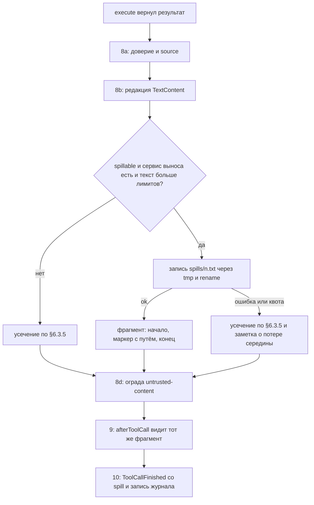

# 17.4. Вынос огромного результата инструмента в файл (T-28)

> Часть [архитектуры ядра агента CodeLab](../agent-core-architecture.md). Status: Accepted. Общие соглашения, термины и порядок чтения — в оглавлении.

← [17.3. Субагенты: инструмент `task`](17-3-subagents.md) · [Оглавление ядра](../agent-core-architecture.md) · [17.5. Настройка агента: провайдеры, секреты, реестр настроек, живая перезагрузка](17-5-agent-setup.md) →

Цель: T-28 (вынос огромного результата). Связанные цели: T-01, T-08 (усечение вывода), P-16
(ограда обязательна), S-13 (продолжение после сбоя). Затрагивает §4.4 (корень только для чтения
`spills/`), §5.3 (`ToolCallFinished.spill`), §6.2–§6.4 (`spillable`, шаг 8 единой точки
исполнения), §8.2.3 (поле записи `spill`), §8.9 (раскладка), §10.2–§10.8 (capability
`outputSpill`), §12.4, §13.7, §13.12, §15.3–§15.4 (таблица `tools.spill`).

## 17.4.1. Назначение

Усечение (§6.3.5) теряет середину вывода безвозвратно: лог сборки на 3 МБ превращается в
последние 2000 строк, и ошибка компиляции из начала исчезает. Повторить команду ради другой
части вывода дорого, а иногда нельзя: `dart test` с побочными эффектами, ответ MCP-сервера, страница,
которая уже изменилась.

Вынос сохраняет полный текст результата в файл сессии на машине агента, а модели и журналу
отдаёт **один и тот же** ограниченный фрагмент: начало, конец, размер и абсолютный путь к файлу.
Остальное модель читает обычным `read` с `offset` и `limit`. Журнал не раздувается, контекст
модели не растёт, середина вывода не теряется.

Вынос не меняет доверия: недоверенный результат остаётся недоверенным и при повторном чтении
файла (та же ограда с тем же `source`, WEB-1, TOOL-10). Файл не даёт модели нового способа
писать на диск: каталог выноса подключается к `BoundedEnv` только для чтения.

## 17.4.2. Контракт

Порт хоста (`codelab_agent_core/lib/src/spill/spill_store.dart`), реализация `LocalSpillStore`
— в `codelab_agent_io/lib/src/spill/local_spill_store.dart` (`dart:io`):

```dart
abstract interface class SpillStore {
  /// Абсолютный каталог выноса сессии: <файл журнала без .jsonl>/spills (§8.9).
  /// Каталог может ещё не существовать: он создаётся первой записью.
  String dirOf(SessionId session);
  /// Атомарная запись: <path>.tmp, flush, rename в <path>. Создаёт каталог.
  Future<Result<void, FileError>> write(String path, String text);
  /// Имена файлов каталога (без путей); нет каталога → пустой список.
  Future<List<String>> list(String dir);
  Future<void> delete(String path);
  /// Файловая система для BoundedEnv.readOnlyFs (§4.4, шаг 9): та же локальная ФС агента.
  FileSystem get readFs;
}
```

Сервис ядра на сессию (`spill/spill_service.dart`); `AgentSession` создаёт его, если
capability `outputSpill` включена, и передаёт инструментам через `ToolContext.services.spill`:

```dart
final class SpillConfig {                  // из tools.spill (§17.4.8), уже провалидирован
  final int headLines, headBytes, tailLines, tailBytes;     // 80, 8192, 80, 8192
  final int maxFileBytes, maxSessionBytes;                   // 16 МиБ, 256 МиБ
}

final class SpillRef {
  final int n;                              // номер выноса в сессии, с 1
  final String path;                        // относительно sessions/ (как journal у subagent, §17.3.6)
  final String absPath;                     // абсолютный путь на машине агента; в журнал не пишется
  final int bytes, lines;                   // размер полного текста (UTF-8 байты, строки)
  final ContentTrust trust;                 // доверие исходного результата
  final String source;                      // source ограды исходного результата (имя инструмента)
}

sealed class SpillOutcome { const SpillOutcome(); }
final class Spilled extends SpillOutcome { final SpillRef ref; final String preview; }
final class SpillFailed extends SpillOutcome { final String reason; }   // 'write failed' | 'session spill limit reached'

final class SpillService {
  SpillService({required SpillStore store, required SessionId session,
      required SpillConfig config, required Logger logger});
  String get dir;                           // = store.dirOf(session); корень только для чтения
  /// Вызывается единой точкой исполнения (§17.4.3). Текст уже отредактирован (§12.4).
  Future<SpillOutcome> spill(String text, {required String toolCallId, required String toolName,
      required ContentTrust trust, required String source, required SpillDirection direction});
  /// Вынос по абсолютному нормализованному пути или null (§17.4.4); после §17.9 находит и
  /// журнал вывода задачи job_<id>.log по полю log записей job.
  SpillRef? lookup(String absPath);
  /// После open: индекс из журнала, нумерация, удаление сирот (§17.4.5).
  Future<void> attach(SessionSnapshot snapshot);
}
enum SpillDirection { head, tail }          // какую часть хранить, если текст больше maxFileBytes
```

Расширения контрактов MVP:

```dart
abstract base class AgentTool {
  // ... §6.2
  /// Результат больше лимитов усечения выносится в файл, а не усекается (§17.4).
  bool get spillable => false;
  SpillDirection get spillDirection => SpillDirection.head;
}
final class ToolCallFinished extends AgentEvent {
  // ... §5.3
  final SpillRef? spill; }                  // есть, если результат вынесен
final class ToolExecutionOutcome { /* ... §6.2 */ final SpillRef? spill; }
```

`spillable == true` только у трёх источников, чей вывод нельзя дёшево получить снова:

| Инструмент | `spillable` | `spillDirection` | Почему |
|---|---|---|---|
| `exec` | да | `tail` | повтор команды дорог или неидемпотентен; ошибки — в конце |
| `web_fetch` | да | `head` | страница могла измениться; тело до 2 МиБ (§17.1.3) |
| MCP-инструменты | да | `head` | повторный вызов внешнего сервера может иметь побочные эффекты |
| `read`, `ls`, `search`, `write`, `edit`, `update_plan`, `web_search`, `skill`, `task` | нет | — | вывод воспроизводим (`offset`, узкий шаблон) или уже ограничен самим инструментом (`report_max_bytes`) |

**Место в конвейере.** Шаг 8 единой точки исполнения (§6.3.1) раскрывается в четыре подшага
в фиксированном порядке:

1. **8a. Доверие.** `trust, source := spillReadTrust(tool, args) ?? (OutputTrustPolicy.classify(...), tool.name)` — для `read`/`search` вынесенного файла доверие и `source` берутся из `SpillRef` (§17.4.4), иначе как в §6.3.6 и §10.6.
2. **8b. Редакция.** Каждый `TextContent` проходит `Redactor.redact` (§12.4).
3. **8c. Вынос или усечение.** Если `tool.spillable`, `services.spill != null` и текст превышает `tools.output.max_bytes` или `output.max_lines` — вынос (§17.4.3); иначе усечение §6.3.5.
4. **8d. Ограда** `untrusted` с `source` из 8a (§6.3.6).

Затем, как прежде, шаг 9 `afterToolCall` и шаг 10 `ToolCallFinished`. Хук `afterToolCall`
получает уже вынесенный и огороженный фрагмент — тот же, что увидят модель и журнал.
Переопределённое хуком содержимое повторно не выносится: если оно больше лимитов, к нему
применяется усечение головы §6.3.5; `SpillRef` остаётся у результата.

Почему так: редакция до выноса — файл не содержит секретов; вынос до ограды — файл хранит
чистые данные без разметки, а ограда ставится и на фрагмент, и на каждое повторное чтение;
доверие до редакции — классификация смотрит на аргументы и исходный результат.



## 17.4.3. Алгоритм: вынос

```text
spill(text, toolCallId, toolName, trust, source, direction):
 1  full := text (все TextContent результата, склеенные '\n'; ImageContent не выносится и
    остаётся в результате на своих местах, фрагмент заменяет первый TextContent, прочие удаляются)
 2  bytes := utf8.encode(full).length; lines := число строк full по '\n'
    (завершающий '\n' новой строки не даёт)
 3  если bytes > maxFileBytes:
       direction == tail → full := последние maxFileBytes байт по границе символа и строки,
         первая строка файла '[Note: the start of the output was dropped; the file keeps the last <maxFileBytes> bytes.]'
       direction == head → full := первые maxFileBytes байт по тем же правилам,
         последняя строка файла '[Note: the end of the output was dropped; the file keeps the first <maxFileBytes> bytes.]'
       bytes, lines пересчитываются по файлу
 4  если used + bytes > maxSessionBytes → SpillFailed('session spill limit reached')
 5  n := next++                                        // синхронно, до первого await: параллельные
                                                       // вызовы пакета не получат один номер
 6  absPath := dir + '/' + n + '.txt'
 7  r := await store.write(absPath, full)              // <n>.txt.tmp → flush → rename
    Err → лог spill.failed, вернуть SpillFailed('write failed')   // номер n не переиспользуется
 8  used += bytes; ref := SpillRef(n, relative(absPath), absPath, bytes, lines, trust, source)
    index[absPath] := ref; лог spill.write {toolCallId, n, bytes}
 9  вернуть Spilled(ref, preview(full, ref))
```

**Фрагмент** `preview(full, ref)`:

1. Голова: строки с начала, пока не превышен ни `headLines`, ни `headBytes`; первая строка длиннее `headBytes` обрезается по границе символа с суффиксом ` [line truncated]`.
2. Хвост: строки с конца по тем же правилам с `tailLines`, `tailBytes`; строка длиннее `tailBytes` сохраняет конец с префиксом `[line truncated] `. Хвост не пересекается с головой.
3. Результат — голова, маркер отдельной строкой, хвост. Маркер (английский, фиксирован):

```text
[output spilled: <bytes> bytes, <lines> lines. Showing lines 1-<h> and <t>-<lines>. Full output: <absPath>. Use read with offset and limit to see other lines.]
```

Для текста из одной строки: `[output spilled: <bytes> bytes in 1 line. Showing its start and end. Full output: <absPath>.]`.
Числа — без разделителей разрядов; `<absPath>` — абсолютный путь на машине агента (правило
§6.4 для путей из `readOnlyRoots`). При настройках по умолчанию фрагмент не больше 16 КиБ плюс
маркер — заведомо меньше `output.max_bytes` (TOOL-9 выполняется).

**Отказ выноса** (`SpillFailed`) — не ошибка вызова: результат усекается по §6.3.5 с обычным
уведомлением инструмента, и за ним отдельной строкой дописывается
`[Note: the full output could not be saved (<reason>); the omitted part is lost.]`. Ход
продолжается; `ToolCallFinished.spill == null`.

**`exec` при включённом выносе** передаёт `ExecOptions.outputByteLimit = maxFileBytes`
(иначе 1 МиБ, §4.2): кольцевой буфер `LocalExecutionEnv` и `terminal/create` ACP-клиента хранят
хвост такого размера. Если буфер отбросил начало (`ExecResult.truncated`), шаг 3 добавляет ту же
первую строку-заметку, что и при `bytes > maxFileBytes`.

## 17.4.4. Чтение вынесенного файла

**Граница.** `BoundedEnv` сессии получает каталог выноса в `readOnlyRoots` (§4.4, шаг 9) и
`readOnlyFs = spillStore.readFs`; корни skills (§17.2.3) остаются там же. Корень регистрируется
до создания каталога: несуществующий хвост разрешается правилом §4.4, шаг 2. Правила:

1. `read`, `stat`, `listDir` (`ls`) в каталоге выноса своей сессии принимаются и идут в `readFs` — локальную файловую систему агента, а не во внутренний env.
2. Запись, правка, удаление и `ExecOptions.cwd` в каталоге выноса отклоняются `FileError(outsideWorkspace)` (`Path is outside the workspace: <path>`) — **даже если** `$CODELAB_HOME` лежит внутри `cwd`: проверка каталога выноса идёт до проверки `root`.
3. Каталоги выноса других сессий и журналы (`*.jsonl`) не входят в корни: `outsideWorkspace`.
4. `search` принимает путь к **одному** вынесенному файлу. `path`, указывающий на сам каталог выноса, — ошибка `Search a single spilled file, not the spills directory: <path>.` Обход из `cwd` каталога выноса не достигает (он вне `cwd`).

**Доверие** (подшаг 8a). `spillReadTrust(tool, args)` для `read` и `search`:

```text
1  abs := normalize(cwd, args.path); не в dir → null (обычные правила §6.3.6, §10.6)
2  ref := spill.lookup(abs)                       // в том числе job_<id>.log (§17.9.4)
3  ref != null → (ref.trust, ref.source)
4  ref == null (файл в каталоге выноса, которого нет в индексе) → (untrusted, tool.name)
```

Так текст `web_fetch`, прочитанный из `spills/4.txt`, попадает к модели в ограде
`source="web_fetch"` (WEB-1); вывод MCP — в ограде `mcp__<server>__<tool>`; вывод доверенного
`exec` (`dart test`) — без ограды, как и исходный фрагмент. Ни профиль, ни `untrusted_paths`
доверие вынесенного файла не повышают; неизвестный файл в каталоге всегда `untrusted`.

**Чтение отсутствующего файла.** `ref != null`, а `readFs` вернул `notFound` → результат-ошибка
`Spilled output is no longer available: <path>.` (вместо `File not found`), лог `spill.missing`.

Индекс доверия хранится не рядом с файлами, а в журнале (поле записи `spill`, §17.4.5): журнал
— единственный долговечный источник истории (§8.1), и файл-манифест рядом с выносом можно было бы
подменить или потерять отдельно от него.

## 17.4.5. Журнал, реплей, сжатие

**Запись.** Поле **записи** `spill` у `toolResult` (рядом с `outcome`, `diff`/`diffs`, `toolMeta`;
модель его не видит):

| Поле | Тип | Смысл |
|---|---|---|
| `n` | int | номер выноса |
| `path` | string | путь файла относительно `sessions/` |
| `bytes`, `lines` | int | размер полного текста в файле |
| `trust` | `"trusted"` \| `"untrusted"` | доверие исходного результата |
| `source` | string | `source` ограды исходного результата |

`SessionWriter` берёт `spill` из `ToolCallFinished` так же, как `diffs`. `message.content` —
огороженный фрагмент, побайтово равный тексту в запросе к модели (SPL-1). Файл записан и
переименован до `ToolCallFinished`, а запись журнала — после, поэтому журнал не ссылается на
недописанный файл (SPL-3).

**Открытие** (`SpillService.attach(snapshot)`, вызывает `AgentSession` после `open` и
`healInterruptedTurn`, §8.6, §8.8):

1. Индекс: для каждой записи `toolResult` со `spill` по всем веткам дерева — `index[abs(path)] := SpillRef`; после §17.9 — также поле `log` записей `job` (журналы вывода фоновых команд, §17.9.4); у оконного снимка (§17.13.2) — по записям индекса с флагом `spill` и типом `job` по всем веткам.
2. `files := store.list(dir)`; `next := max(n из индекса ∪ номеров из имён <n>.txt) + 1`; номер никогда не переиспользуется (SPL-8).
3. Сироты — файлы `<n>.txt` и `job_<id>.log` без записи в журнале (сбой между записью файла и записью результата; вызов получил `interrupted` по §8.8) и любые `*.tmp` — удаляются, лог `spill.orphan_deleted`.
4. Запись с `spill`, файла которой нет, журнал не меняет (SES-1): лог `spill.missing`, чтение даёт текст §17.4.4.
5. `used := Σ bytes` существующих файлов из индекса, включая журналы вывода задач.

**Реплей** (§13.5) и живая проекция (§13.7) показывают `content` записи — тот же фрагмент с
маркером и путём. Расширение `_meta.codelab.spill: {"path": "<absPath>", "bytes": N, "lines": L}`
на `tool_call_update` (и на `tool_call` реплея) — только через OpenSpec change (§13.12); клиент
без него видит путь в тексте. `locations` путь выноса не получает: клиент мог бы открыть его
через свой `fs/*`, а файл лежит на машине агента.

**Сжатие** (§9). Оценка токенов (§9.3) и генератор резюме видят только фрагмент: в транскрипте
нет ничего, кроме него. Сжатие файлы выноса не удаляет (CMP-2); путь, сохранившийся в резюме,
остаётся читаемым.

**Субагенты.** У ребёнка свой каталог выноса `<журнал ребёнка без .jsonl>/spills/` в его
`BoundedEnv`; родителю его выносы недоступны, а отчёт ребёнка ограничен `report_max_bytes`
(§17.3.5).

## 17.4.6. Внешний режим и профили

Файлы выноса всегда лежат на машине **агента** (`$CODELAB_HOME`), а не клиента. В `agent-serve`
файлы проекта читаются через ACP `fs/read_text_file` (`AcpClientExecutionEnv`), но чтение
выноса идёт в `readOnlyFs` — локальную ФС агента, и `fs/read_text_file` для него **не**
вызывается: у клиента этого файла может не быть (WebSocket, другая машина) или он может видеть
другую его версию. Поэтому вынос в `agent-serve` работает при любом транспорте.

Новая capability `outputSpill` (этап 3) — десятая в §10.2. Поверхности модели она не
добавляет: ни схем, ни секций промпта; видны только фрагменты с маркером.

| Capability | `agent-serve` | `embedded-app-desktop` | `embedded-cli` | `mobile` | `web` |
|---|---|---|---|---|---|
| `outputSpill` | transport `local` | transport `local` | transport `local` | off: «нет shell — главного источника огромного вывода; результаты усекаются» | off: «нет локальной файловой системы агента; результаты усекаются» |

Сужение в `buildAgentCore` (§10.7, шаг 1): `services.spills == null` → off («хранилище выноса
не передано»); `tools.spill.enabled = false` → off («выключено конфигом»). Требование §10.8:
`SpillStore` с `readFs`. При выключенной capability `ToolServices.spill == null`, `exec` берёт
`outputByteLimit = 1 МиБ`, и поведение побайтово совпадает с §6.3.5 (SPL-10). В профилях
`mobile` и `web` хост не передаёт хранилище выноса (`services.spills == null`):
MCP и `web_fetch` там усекаются по §6.3.5, как без выноса.

## 17.4.7. Удаление и квоты

1. Каталог выноса — часть каталога сессии `<файл журнала без .jsonl>/` (§8.9, §17.3.6). Файлы живут, пока живёт журнал: сжатие, `session/load`, смена листа и квота их не удаляют.
2. Удаление сессии (любой операцией хоста: команда очистки, будущий `session/delete`) ДОЛЖНО удалять каталог `<файл журнала без .jsonl>/` целиком — с `spills/` и `subagents/` — вместе с `.jsonl`, `.corrupt` и `.lease` (§17.6.8). Удаление файла журнала без каталога оставляет сироты; `list` (§8.10) такие каталоги не показывает, хост МОЖЕТ удалять каталоги без журнала при запуске.
3. Ядро удаляет файлы выноса только в одном случае — сироты при `attach` (§17.4.5, шаг 3).
4. Квота сессии `max_session_bytes` (256 МиБ): при превышении новые выносы получают `SpillFailed('session spill limit reached')` и усечение. Старые файлы не вытесняются: на них ссылаются журнал и, возможно, резюме.
5. Квота файла `max_file_bytes` (16 МиБ): §17.4.3, шаг 3.
6. Fork (§17.6.7) копирует файлы выноса скопированного пути (и журналы вывода задач `job_<id>.log`, §17.9.10) в `spills/` новой сессии и переписывает `spill.path` копий в её каталог; файл появляется до журнала fork (SESM-7). Копия учитывается в квоте новой сессии, но fork её не проверяет: превышение запрещает только новые выносы.
7. Сессия, открытая только для чтения (§17.6.8), `attach` не выполняет: сироты не удаляются, каталог выноса не меняется (SESM-12); чтение вынесенных файлов (`readOnlyRoots`) работает как обычно.

## 17.4.8. Конфигурация

**`tools.spill`** (порог выноса — существующие `tools.output.max_bytes` и `output.max_lines`:
результат выносится ровно тогда, когда без выноса был бы усечён)

| Ключ | Тип | По умолчанию | Смысл |
|---|---|---|---|
| `enabled` | bool | `true` | `false` → capability `outputSpill` off |
| `head_lines`, `tail_lines` | int | `80`, `80` | строки начала и конца во фрагменте; `1..500` |
| `head_bytes`, `tail_bytes` | int | `8192`, `8192` | байты начала и конца; `256..65536`; `head_bytes + tail_bytes ≤ output.max_bytes / 2`, иначе `ConfigException` |
| `max_file_bytes` | int | `16777216` | 16 МиБ, лимит одного файла и `outputByteLimit` для `exec`; `1048576..268435456` |
| `max_session_bytes` | int | `268435456` | 256 МиБ, сумма файлов сессии; не меньше `max_file_bytes` |

Доверие (дополнение таблицы §15.3): `enabled = false` и уменьшение любых ключей разрешены в слое
3; увеличение — только слой 4, глобальный конфиг или проект из `trusted_projects` (чужой
репозиторий не должен заставлять агента писать гигабайты в `$CODELAB_HOME`).

```yaml
tools:
  spill:
    head_lines: 120
    tail_lines: 120
    max_session_bytes: 134217728
```

## 17.4.9. Примеры

`exec` с командой `dart test --reporter expanded` (доверенная, не сетевая) вывел 3 145 728 байт в
41 210 строках и завершился с кодом 1. Модель получает (строки 3–80 и 41 131–41 207
здесь заменены многоточием):

```text
00:00 +0: loading test/a_test.dart
00:01 +1: test/a_test.dart: parses empty input
...
[output spilled: 3145728 bytes, 41210 lines. Showing lines 1-80 and 41131-41210. Full output: /Users/me/.codelab/sessions/work-demo-9c3e51a7/2026-10-21T08-00-00-000Z_01JB8Q2W6R9T3M5K7N1P4X8Z0C/spills/1.txt. Use read with offset and limit to see other lines.]
00:41 +1210 -3: Some tests failed.

[Command exited with code 1]
```

Запись журнала (`content` сокращён многоточием; в файле — точно тот же текст, что выше):

```json
{"type":"message","id":"v4b5n6m7","parentId":"q1w2e3r4","timestamp":"2026-10-21T08:02:10.000Z","outcome":"failed","toolMeta":{"title":"Run dart test --reporter expanded","kind":"execute","locations":[]},"spill":{"n":1,"path":"work-demo-9c3e51a7/2026-10-21T08-00-00-000Z_01JB8Q2W6R9T3M5K7N1P4X8Z0C/spills/1.txt","bytes":3145728,"lines":41210,"trust":"trusted","source":"exec"},"message":{"role":"toolResult","timestamp":"2026-10-21T08:02:10.000Z","toolCallId":"call_5","toolName":"exec","isError":true,"content":[{"type":"text","text":"00:00 +0: loading test/a_test.dart\n...\n[output spilled: 3145728 bytes, 41210 lines. Showing lines 1-80 and 41131-41210. Full output: /Users/me/.codelab/sessions/work-demo-9c3e51a7/2026-10-21T08-00-00-000Z_01JB8Q2W6R9T3M5K7N1P4X8Z0C/spills/1.txt. Use read with offset and limit to see other lines.]\n...\n[Command exited with code 1]"}]}}
```

Кадр ACP (`_meta.codelab.spill` — только после OpenSpec change):

```json
{"jsonrpc":"2.0","method":"session/update","params":{"sessionId":"01JB8Q2W6R9T3M5K7N1P4X8Z0C","update":{"sessionUpdate":"tool_call_update","toolCallId":"call_5","status":"failed","content":[{"type":"content","content":{"type":"text","text":"00:00 +0: loading test/a_test.dart\n...\n[output spilled: 3145728 bytes, 41210 lines. ...]\n...\n[Command exited with code 1]"}}],"_meta":{"codelab":{"spill":{"path":"/Users/me/.codelab/sessions/work-demo-9c3e51a7/2026-10-21T08-00-00-000Z_01JB8Q2W6R9T3M5K7N1P4X8Z0C/spills/1.txt","bytes":3145728,"lines":41210}}}}}}
```

Следующий вызов модели `read {"path": "/Users/me/.codelab/sessions/.../spills/1.txt", "offset": 1900, "limit": 200}`
проходит через `readOnlyFs` и возвращает строки `1900| …` – `2099| …` с уведомлением
`[Showing lines 1900-2099 of 41210. Use offset=2100 to continue.]`, без ограды (`trust:
trusted`). Для выноса `web_fetch` (`trust: untrusted`, `source: web_fetch`) тот же `read`
вернул бы текст внутри `<untrusted-content source="web_fetch">`. `write` в этот путь →
`Path is outside the workspace: /Users/me/.codelab/sessions/.../spills/1.txt`.

## 17.4.10. Инварианты

1. **SPL-1.** Модель, журнал (`message.content`), хук `afterToolCall` и ACP-проекция получают один и тот же фрагмент вынесенного результата побайтово; полный текст в контекст и журнал не попадает.
2. **SPL-2.** Фрагмент ограничен `head_*` + `tail_*` + маркер, не превышает лимитов усечения (TOOL-9) и всегда содержит размер в байтах и строках и абсолютный путь к файлу.
3. **SPL-3.** Файл выноса содержит полный отредактированный (§12.4) текст результата без ограды, кроме явно помеченного отбрасывания по `max_file_bytes`; сырые значения секретов на диск не попадают. Файл записывается атомарно и до записи журнала, которая на него ссылается.
4. **SPL-4.** Повторное чтение вынесенного файла (`read`, `search`) получает доверие и `source` исходного результата: недоверенный текст — в той же ограде с тем же `source` (WEB-1, TOOL-10); файл каталога выноса без записи в журнале — `untrusted`. Ни профиль, ни конфиг доверие не повышают.
5. **SPL-5.** Каталог выноса доступен инструментам только для чтения и только своей сессии: запись, правка, удаление и `cwd` команды в нём отклоняются, даже если он внутри `cwd`; выносы других сессий и журналы — `outsideWorkspace` (ENV-3).
6. **SPL-6.** Выносятся только результаты инструментов со `spillable == true` (`exec`, `web_fetch`, MCP); картинки не выносятся никогда.
7. **SPL-7.** Сбой записи или исчерпание квоты не делает вызов ошибкой и не завершает ход: результат усекается по §6.3.5 с заметкой о потерянной части.
8. **SPL-8.** Номера выносов в сессии монотонны и не переиспользуются, в том числе после перезапуска и после удаления сирот.
9. **SPL-9.** Ядро удаляет только файлы-сироты (без ссылки в журнале) при `attach`; файлы, на которые ссылается журнал, живут до удаления сессии и удаляются вместе с её каталогом.
10. **SPL-10.** При выключенной capability `outputSpill` вывод побайтово совпадает с поведением §6.3.5: ни маркеров, ни путей, `outputByteLimit` `exec` — 1 МиБ.
11. **SPL-11.** Файлы выноса читаются через локальную ФС агента (`readOnlyFs`); в `agent-serve` для них никогда не вызывается `fs/read_text_file`.

## 17.4.11. Обоснование решения

* **Порог = лимит усечения, без отдельного ключа.** Вынос — замена усечения, а не новый режим:
  результат выносится ровно тогда, когда иначе потерял бы часть. Второй порог дал бы зону, где
  вывод уже усечён, но ещё не вынесен.
* **Голова и хвост, а не только хвост.** У `exec` ошибка обычно в конце, а команда и первая
  ошибка компиляции — в начале; у страницы и ответа MCP главное — в начале. Обе части по 8 КиБ
  стоят около 4000 токенов — меньше, чем текущее усечение до 50 КиБ.
* **Один фрагмент для модели и журнала.** Если бы журнал хранил полный текст, а модель видела
  фрагмент, после `session/load` контекст отличался бы от исходного (SES-7), журнал раздувался бы
  мегабайтами, а сжатие считало бы токены, которых модель не видела.
* **Редакция до записи файла.** Файл лежит в `$CODELAB_HOME` рядом с журналом и читается моделью;
  сырой секрет на диске нельзя «отозвать» (как в журнале, §12.8), а модели исходный секрет не
  нужен. Цена — файл не побайтово равен выводу команды; для чтения моделью это не важно.
* **Доверие в журнале, а не в файле-манифесте.** Журнал уже долговечен, восстанавливается при
  открытии и подчиняется append-only; манифест был бы вторым источником истины, который может
  разойтись с журналом при сбое. Путь без записи в журнале считается недоверенным — безопасная
  сторона.
* **`readOnlyRoots`, а не копия в `cwd`.** Вынос в `.codelab/` проекта засорял бы рабочее дерево
  и git, а в `agent-serve` требовал бы записи через `fs/write_text_file` клиента. Корень только
  для чтения уже есть для skills (§17.2.3) и даёт ту же границу: модель читает, но не пишет.
* **Только `exec`, `web_fetch`, MCP.** Вынос `read` бессмыслен: файл и так читается по
  `offset`. Вынос `search` и `ls` поощрял бы широкие запросы вместо узких.
* **Квота без вытеснения.** Вытеснение старых файлов сломало бы пути в журнале и резюме; отказ с
  заметкой честен, а 256 МиБ на сессию хватает на десятки огромных логов.
* **Выключено в `mobile` и `web`.** Без shell огромный вывод редок; второе хранилище в
  IndexedDB или документах приложения ради MCP и `web_fetch` не окупается. Порт `SpillStore`
  позволит включить вынос там позже без изменения ядра.
* **Известное ограничение.** Одна строка длиннее 2000 символов (минифицированный JSON) и в файле
  читается через `read` усечённой (§6.4); такие данные модель обрабатывает командой (`jq`, `head -c`).

## 17.4.12. Как проверить

Тесты ядра — в `packages/dart/codelab_agent_core/test/spill/`; хранилище — fake `SpillStore`
поверх `MemoryExecutionEnv` с внедряемыми сбоями; `LocalSpillStore` — в
`packages/dart/codelab_agent_io/test/spill/`.

* `spill_preview_test.dart` — критерий матрицы **`core/spill-same-preview-model-and-journal`**: fake `exec` выдаёт 3 МиБ в 41 210 строках; текст результата в запросе к scripted-модели побайтово равен `message.content` записи журнала, `content` события `ToolCallFinished` и входу `afterToolCall`; маркер совпадает с шаблоном §17.4.3; файл `spills/1.txt` равен полному тексту; запись содержит поле `spill` с `n`, `bytes`, `lines`, `trust`, `source` (SPL-1, SPL-2).
* `spill_threshold_test.dart`: 51 200 байт — не выносится; 51 201 — выносится; 2001 короткая строка — выносится; `read` файла на 3 МиБ не выносится никогда; результат с `ImageContent` — картинка на месте, вынесен только текст; одна строка на 1 МиБ — маркер варианта «1 line» (SPL-6).
* `spill_redaction_test.dart`: значение из `SecretStore` и `ghp_…` в середине вывода → в файле и во фрагменте `[REDACTED]`, сырых значений нет ни в одном байте каталога сессии (SPL-3).
* `spill_trust_reread_test.dart`: вынос `web_fetch` → `read` файла даёт ограду `source="web_fetch"`, поддельный маркер экранирован (WEB-1); вынос MCP — `source="mcp__docs__fetch"`; вынос доверенного `exec` → без ограды; посторонний файл `spills/99.txt` без записи в журнале → `untrusted`; `search` по одному файлу наследует доверие; `search` по каталогу → текст ошибки §17.4.4 (SPL-4).
* `test/env/bounded_env_spill_root_test.dart`: `read`, `ls` каталога выноса приняты и идут в `readOnlyFs`; `write`, `edit`, `exec` с `cwd` в нём → `outsideWorkspace`, в том числе при `$CODELAB_HOME` внутри `cwd`; каталог выноса другой сессии и файл `*.jsonl` → `outsideWorkspace`; ссылка из каталога выноса наружу отклонена (SPL-5, ENV-3).
* `spill_fallback_test.dart`: `write` хранилища → `Err` → усечение §6.3.5 и заметка `could not be saved (write failed)`, ход продолжается; `max_session_bytes` исчерпан → заметка `session spill limit reached`; номер неудачного выноса не переиспользуется (SPL-7, SPL-8).
* `spill_attach_test.dart`: сирота `3.txt` и `4.txt.tmp` удалены при `attach`, следующий вынос получает `n = 5`; запись с отсутствующим файлом → `read` даёт `Spilled output is no longer available: …`, журнал побайтово не изменён (SPL-8, SPL-9, SES-1).
* `spill_crash_test.dart` (`core/spill-crash-before-journal`): процесс убит после записи файла и до записи результата → после `open` вызов получил `interrupted` (SES-10), файл удалён как сирота.
* `spill_parallel_test.dart`: два `exec` одного пакета выносятся в `1.txt` и `2.txt` без коллизий; повтор прогона с детерминированными fake даёт одинаковые файлы (PKG-6).
* `exec_spill_buffer_test.dart`: при включённом выносе `ExecOptions.outputByteLimit == max_file_bytes`, при выключенном — `1 << 20`; `ExecResult.truncated` → первая строка файла — заметка шага 3.
* `spill_disabled_golden_test.dart`: `tools.spill.enabled = false` → результат побайтово равен golden-фикстуре усечения §6.3.5 (SPL-10).
* `test/host/profiles/<profile>.golden.json` (§10.12): `mobile` и `web` — `outputSpill` off с причиной, `ToolServices.spill == null`; остальные — transport `local`.
* `acp/agent-serve-spill-local-read` (conformance): `AcpClientExecutionEnv` и fake-клиент; `read` вынесенного файла не порождает кадра `fs/read_text_file` (SPL-11).
* Golden ACP-фикстура **`acp/tool-exec-spill`** (цель T-28): `tool_call_update` с фрагментом и путём в `content`; `session/load` той же сессии реплеит тот же `content` побайтово.
* `config_spill_test.dart`: `head_bytes + tail_bytes > output.max_bytes / 2` → `ConfigException`; увеличение `max_session_bytes` в проектном конфиге без `trusted_projects` → отклонено с диагностикой, уменьшение — принято (§15.3).

---

← [17.3. Субагенты: инструмент `task`](17-3-subagents.md) · [Оглавление ядра](../agent-core-architecture.md) · [17.5. Настройка агента: провайдеры, секреты, реестр настроек, живая перезагрузка](17-5-agent-setup.md) →
