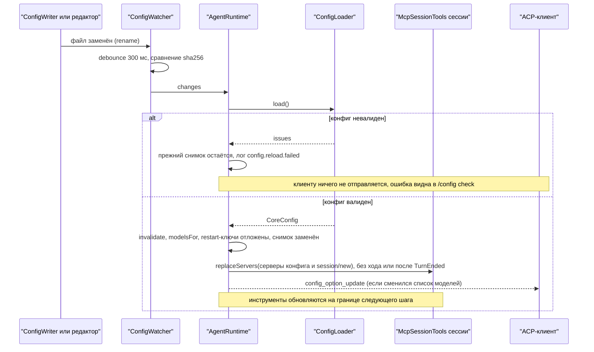
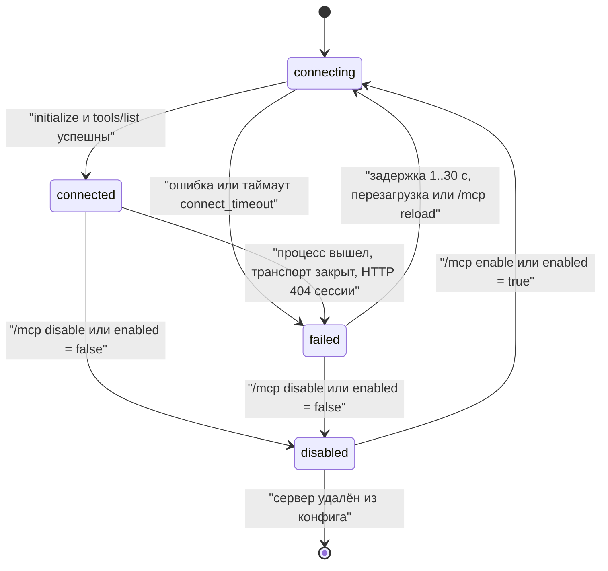

# 17.5. Настройка агента: провайдеры, секреты, реестр настроек, живая перезагрузка

> Часть [архитектуры ядра агента CodeLab](../agent-core-architecture.md). Status: Accepted. Общие соглашения, термины и порядок чтения — в оглавлении.

← [17.4. Вынос огромного результата инструмента в файл (T-28)](17-4-output-spill.md) · [Оглавление ядра](../agent-core-architecture.md) · [17.6. Управление сессиями: переименование, ветки, перемотка, lease](17-6-session-management.md) →

Цели: L-25 (предконфигурация провайдера из окружения), P-12 (секреты по имени в хранилище ОС),
E-15 (реестр общих настроек CLI и app), E-04 (переподключение MCP и перечитывание конфига),
E-13 со стороны агента (команды `/mcp list`, `/mcp reload`), P-17 (`--debug-secrets`, Could).
Мастер провайдера, страницы настроек провайдеров и MCP-серверов в клиентах и пакет
`codelab_setup` описаны в документе клиентов
([`dart-agent-and-clients.md`](../dart-agent-and-clients.md) §12.4); здесь — контракт агента, на
который они опираются. Затрагивает §6.4 (MCP-инструменты), §10.3 (`SecretStore`,
`AgentCoreServices`), §11.5 (перечитывание project context — в 8.10 не выполняется: файлы проекта
читаются только новыми сессиями, D9 design.md change `add-config-writer-and-reload`), §12.3 (события `config.*`,
`secrets.*`, `mcp.*`), §12.4 (источники точных секретов), §13.4 (подключение MCP), §13.6
(команды `/mcp`, `/config`, строки `/status`), §15.2–§15.6 (слой окружения, ключи `secrets` и
`config`, подстановка `${secret:…}`), §17.2.9 (пример `available_commands_update`).

## 17.5.1. Назначение

В MVP конфиг читается один раз при старте, ключи провайдеров приходят из переменных окружения
или связки ключей, а настройки правятся только руками в YAML. Этого мало для четырёх сценариев:

1. **Контейнер и CI.** Файла конфига нет, есть только окружение. Агент должен получить провайдера
   и модель из двух переменных (L-25).
2. **Ключ без файла.** Пользователь вводит ключ один раз — в CLI или в настройках app; ключ
   уходит в хранилище секретов ОС, а конфиг хранит только его имя (P-12). В 1.0 — в явно
   выбранный `secrets.yaml` или в переменную `CODELAB_SECRET_<…>`; хранилище ОС — после 1.0
   (change `add-agent-secret-store`, D13). Ключ, вписанный в
   конфиг значением, — ошибка с подсказкой, как сделать правильно.
3. **Одни настройки в двух клиентах.** CLI и app редактируют один и тот же конфиг через один
   писатель и показывают одни и те же ключи из одного реестра (E-15). Тест полноты не даёт
   добавить ключ в схему и забыть про него в настройках.
4. **Без перезапуска.** Правка конфига (руками или из настроек) применяется к работающему агенту;
   упавший MCP-сервер переподключается сам; сервер, сменивший список инструментов, обновляет
   реестр (E-04). Человек видит состояние серверов и может переподключить их командой (E-13).

Раздел не меняет схему §15.4 и правила доверия §15.3: он добавляет к ним второй источник (окружение),
путь записи (`ConfigWriter`), путь перечитывания (`ConfigSource`) и описание каждого ключа для UI
(`SettingsRegistry`).

## 17.5.2. Контракт

**Секреты** (этап 8.9; уточнено design.md change `add-agent-secret-store`, D2, D3). `SecretStore` из
§10.3 не меняется. Расширение — необязательный интерфейс описания бэкенда и резолвер ядра, через
который проходит каждое чтение секрета (`codelab_agent_core/lib/src/secrets/`, чистый Dart):

```dart
/// Расширение §10.3: реализация сообщает, куда пишет и читает. Хранилища codelab_agent_io
/// реализуют его все; MemorySecretStore тестов — тоже (id "memory").
abstract interface class DescribedSecretStore implements SecretStore {
  SecretBackendInfo get backend;
}
final class SecretBackendInfo {
  final String id;                 // env | file | memory; после 1.0 — keychain-macos | secret-service | wincred
  final bool writable;             // env — только чтение
  final String? unavailableReason; // почему auto не выбрал хранилище ОС, иначе null
}
/// Хранилище недоступно (права secrets.yaml, после 1.0 — утилита ОС не ответила за 10 с).
/// reason — наш текст, без значения секрета и без stderr утилит.
final class SecretStoreUnavailableException implements Exception {
  final String backend; final String reason;
}

/// Правило имени секрета. problem — значение, а не ArgumentError: ошибка имени в конфиге —
/// проблема загрузки (ConfigIssue), а не исключение (D2).
abstract final class SecretNames {
  static final RegExp pattern = RegExp(r'^[a-z0-9][a-z0-9._/-]{0,127}$');  // без "..", без "/" в конце
  static const int maxLength = 128;
  /// null — имя годится; иначе английская причина без самого имени:
  /// "expected a secret name: lowercase letters, digits and . _ / -, up to 128 characters".
  static String? problem(String name);
  /// Префикс CODELAB_SECRET_, имя в верхнем регистре, символы вне [A-Z0-9] → "_". Отображение
  /// необратимо, поэтому secret set отклоняет имя, чья переменная совпала с чужой (D8).
  static String envOverride(String name);   // "codelab/anthropic" → "CODELAB_SECRET_CODELAB_ANTHROPIC"
  /// "providers.openai.api_key" → "codelab/openai"; "tools.web.search.backends.brave.api_key" →
  /// "codelab/search-brave"; прочий путь → "codelab/<нормализованный путь>". Результат всегда
  /// проходит problem: части обрезаются, пустая часть — "x".
  static String suggestFor(String configPath);
  /// "github", "Authorization" → "codelab/mcp/github/authorization": обе части в нижнем регистре,
  /// символы вне [a-z0-9._-] → "-"; так же suggestFor("mcp.servers[github].headers.Authorization").
  static String forMcp(String server, String key);
}

/// Результат обращения: «не задан» и «хранилище недоступно» требуют от человека разных действий.
sealed class SecretLookup { const SecretLookup(); }
final class SecretFound extends SecretLookup { final String value; final String source; }  // cache | env | <backend.id>; toString без значения
final class SecretMissing extends SecretLookup { final String backend; }
final class SecretUnavailable extends SecretLookup { final String backend; final String reason; }

/// Единственная дорога к значению секрета в ядре (§17.5.4). Создаёт хост, один на процесс;
/// найденные значения кэшируются до конца процесса, ненайденные — нет.
final class SecretResolver {
  SecretResolver({required DescribedSecretStore store, required Map<String, String> environment,
      required Logger logger, bool debug = false});
  /// api_key_secret, ${secret:<name>}. purpose — путь ключа конфига.
  Future<SecretLookup> secret(String name, {required String purpose});
  /// api_key_env: синхронное чтение окружения, переданного резолверу (окружение процесса хоста),
  /// под debug — secrets.lookup.
  SecretLookup env(String variable, {required String purpose});
}
```

Там же лежат `SecretTemplate` (значение ключа конфига с `${secret:…}` — список частей
`SecretLiteral` и `SecretReference`, §15.5, п. 7; D4) и `MemorySecretStore` (id `memory`, для
тестов и хостов без постоянного хранилища); всё перечисленное экспортирует барель ядра.

**Отступления 8.9 от прежнего контракта** (design.md change `add-agent-secret-store`, D3):
- `SecretLookup` вместо `String?`: со `String?` ошибка хода «хранилище недоступно» и «секрет не
  задан» была бы одинаковой и в первом случае вводила бы в заблуждение (приоритет наблюдаемости
  выше простоты);
- параметра `redactor` нет: `Redactor` появится в 8.11 вместе со своим параметром конструктора
  (D10; §12.4, абзац «До 8.11»);
- `invalidate()` нет: перезагрузки конфига в 8.9 нет, сброс кэша добавит 8.10 вместе с ней
  (§17.5.6);
- таймаута в резолвере нет: ядро не создаёт таймеры (PKG-6), предел ожидания соблюдают бэкенды
  `codelab_agent_io` (в 1.0 — `env` и `file`, ожидания нет), мобильные и web-хосты — свои
  реализации;
- `exec.secrets` в 8.9 потребителя не имеет (`config.key.not_applied`).

`AgentCoreServices` (§10.3) получает два необязательных поля:

```dart
  final SecretResolver? secrets;   // 8.9 (D3, D4): null → ключ провайдера не читается («the host has no secret resolver»), MCP — «no secret store»
  final ConfigSource? config;      // 8.10: null → живая перезагрузка и команда /config недоступны
```

Поля `debugSecrets` нет: режим отладки (`--debug-secrets`, `CODELAB_DEBUG_SECRETS=1`, P-17) — параметр
`debug` резолвера. В сервисах лежит резолвер, а не `SecretStore`: функцию модели хост строит раньше
ядра (`createRoutedStreamFunction(…, secrets:)` вызывается до `buildAgentCore`), а переменные
переопределения требуют окружения процесса, которого у ядра нет (D3, D11, D15).

**Источник конфига и перезагрузка** (`codelab_agent_core/lib/src/config/`). `ConfigSource` — порт
хоста: `apps/codelab_agent` и `codelab_embedded` реализуют его поверх `ConfigLoader` и
`ConfigWatcher` из `codelab_agent_io`; мобильный и web-хосты — поверх хранилища приложения.

```dart
enum ConfigIssueKind { syntax, profile, unknownKey, type, value, inlineSecret, semantic }
final class ConfigIssue {          // одна проблема валидации (§15.5)
  final ConfigIssueKind kind;      // класс проблемы: тестам и ConfigInlineSecretException не нужен разбор текста
  final String key;                // путь ключа: "mcp.servers[github].url"; "" — файл целиком (синтаксис)
  final String source;             // путь файла, "env", "flags", "app-storage" или "env:CODELAB_PROVIDER_CONFIG"
  final int? line, column;         // из ConfigTree.positions (§15.1); null — у слоя без позиций
  final String message;            // для человека; никогда не содержит значения секрета
  final String? event;             // только у предупреждений: имя события лога (§12.2)
  final Map<String, Object?> fields; // поля события без значений ключей
  final LogLevel level;            // уровень записи предупреждения; по умолчанию warning
}
final class ConfigLoadResult {
  final CoreConfig? config;        // null ⇔ issues не пусто
  final HostSettings? host;        // ключи хоста: sessions.*, logging.*, profile.* (§15.1)
  final List<ConfigIssue> issues, warnings;
  final List<String> sources;      // слои по порядку: "defaults", пути файлов, "env:…", "flags"
  final Map<String, Object?> values; // 8.10 (D8): плоская карта листьев итогового дерева, основа diff перезагрузки
  CoreConfig orThrow();            // config или ConfigException / ConfigInlineSecretException
}
// codelab.toml не читается (§15.7, решение пользователя 2026-10-29): поля legacy нет, найденный
// файл — предупреждение config.legacy_found в warnings.
// ConfigInlineSecretException с 8.9 (change add-agent-secret-store, D2) несёт key первой проблемы
// inlineSecret и suggestedSecretName = SecretNames.suggestFor(key); в 8.5 было только key.

/// Источник конфигурации работающего агента: те же слои, окружение и флаги, что при старте хоста.
/// Один на хост, для корня запуска (8.10, D7, D8).
abstract interface class ConfigSource {
  /// Результат стартовой загрузки, с которым хост собрал ядро: исходные values для первого diff.
  ConfigLoadResult get initial;
  /// Загрузка для корня запуска хоста; ConfigLoadResult — как при старте (полный снимок и withoutProject).
  /// Доверие проектам закреплено на initial до перезапуска: загрузчик передаёт список в
  /// CoreConfig.fromLayers(..., pinnedTrustedProjects:), доверие вычисляет ядро (D8).
  Future<ConfigLoadResult> load();
  /// Сигнал «прочитанные файлы изменились» — уже после debounce 300 мс и сравнения sha256.
  Stream<void> get changes;
}

enum ConfigReloadOutcome { applied, unchanged, failed }
final class ConfigApplyReport {
  final ConfigReloadOutcome outcome;
  final List<ConfigIssue> issues;                       // только failed
  final List<String> changedKeys, restartRequiredKeys;  // листовые пути; mcp.servers — "mcp.servers[<name>]"
}
// AgentRuntime (§10.3) получает:
//   Future<ConfigApplyReport> reloadConfig();   // ConfigSource.changes, /config reload, /mcp reload
//   Future<ConfigLoadResult> checkConfig();     // /config check: загрузка без применения
//   ConfigStatus configStatus();
final class ConfigStatus {
  final DateTime loadedAt; final List<String> sources;
  final DateTime? lastFailureAt; final List<ConfigIssue> lastIssues;   // пусто, если последняя попытка удалась
  final List<String> pendingRestartKeys;
}

// buildAgentCore (§10.3) получает параметр modelsFor — функцию хоста, которая строит функцию
// модели и каталог по CoreConfig; ядро вызывает её на каждом применённом снимке (D8):
typedef ConfiguredModels = ({StreamFunction stream, ModelCatalog catalog});
//   buildAgentCore(..., ConfiguredModels Function(CoreConfig config)? modelsFor)
//   services.config != null и modelsFor == null → HostWiringException
//   streamFunction (required) — функция начального снимка; modelsFor вызывается только после
//   перезагрузки; хост с источником передаёт streamFunction: modelsFor(config).stream
// SecretResolver (выше) получает void invalidate() — сброс кэша найденных значений (D8).
// AgentCoreServices получает AgentConfigPaths? agentConfigPaths {paths, expansions, caseInsensitive} —
// канонические пути PERM-11, значения HOME/CODELAB_HOME и регистр ФС от хоста (D8, §7.6.1);
// buildAgentCore — bool configCommand = true: false у serve --ws, /config не объявляется (D12, R0-3).
// Начальный каталог — AgentCoreServices.models; хост с источником берёт его и streamFunction из
// одного вызова modelsFor(config).
```

**Отступления 8.10 от прежнего контракта** (design.md change `add-config-writer-and-reload`, D7,
D8, D10, D11):
- **Один корень на хост.** У `ConfigSource` нет параметра `cwd`, а вместо `changedRoots` — сигнал
  `changes`. Единица перезагрузки — корень запуска хоста: пара «полный `CoreConfig` +
  `withoutProject`» (D9 change `add-agent-configuration`) заменяется целиком. Снимок на каждый
  `cwd` сессии не вводится: чтение проектного конфига чужого `cwd` — новое поведение с вопросами
  доверия, его место — отдельный change (D8).
- **`modelsFor` вместо пересборки в ядре.** Функцию модели и каталог строит хост: `http.Client` и
  сервисы LLM — его (PKG-6), `--llm-script` подставляет сценарий. `modelsFor` — замыкание хоста над
  `createConfiguredStreamFunction(config, llm, secrets:)` и `StaticModelCatalog(config.providers)`
  (D8).
- **`ConfigApplyReport` без полей MCP, с `outcome`.** Поля `mcpConnected`, `mcpDisconnected`,
  `mcpReconnected` убраны: серверы конфига применяются после хода (D10), и отчёт их ещё не знает;
  итог MCP — в логе `mcp.server.*`. `bool applied` заменён на `outcome`: «изменений нет» и
  «конфиг невалиден» требуют разных ответов `/config reload` (D8).
- **`applyConfig` нет.** Мобильному и web-хосту он понадобится вместе с хранилищем конфига в
  приложении — этап 10 (D13).
- **`invalidate()` с поколениями.** Поиск, начатый до `invalidate` и завершившийся после, отдаёт
  значение вызывающему, но в кэш его не кладёт: счётчик поколений не даёт устаревшему значению
  пережить сброс. Single-flight сохраняется внутри поколения (D8).

**Супервизия MCP-серверов** (8.10; design.md change `add-config-writer-and-reload`, D11) —
расширение существующего порта ядра `McpSessionTools` (§10.3), реализация — сессия
`McpClientConnector` в `codelab_agent_mcp`, которая уже владеет клиентами серверов:

```dart
enum McpServerState { connecting, connected, failed, disabled }
enum McpServerOrigin { config, session }      // mcp.servers конфига или session/new.mcpServers
final class McpServerSummary {
  final String name; final int toolCount;               // как до 8.10
  final McpServerOrigin origin; final String transport; // stdio | http
  final McpServerState state;
  final String? lastError;                              // текст кода CodeLab, ≤ 200 символов
  final Duration? retryIn;                              // только failed
}
// McpSessionTools (§10.3):
//   List<McpServerSummary> get servers;      // все серверы сессии в порядке списка
//   Future<void> reconnect(String name);     // /mcp reload <id>: разорвать и подключить сразу
//   Future<void> setEnabled(String name, bool enabled);   // /mcp enable|disable: только эта сессия, в памяти
//   Future<void> replaceServers(List<McpServerConfig> servers);   // как до 8.10; им же — перезагрузка (§17.5.7)
```

Новые поля `McpServerSummary` получают значения по умолчанию в конструкторе: существующие
реализации (fake-коннекторы тестов ядра) компилируются без правок.

**Отступление 8.10: нет отдельного `McpSupervisor`** (D11). Второй объект на сессию держал бы тот же
список клиентов, что и сессия коннектора, и пришлось бы синхронизировать два владельца одного
транспорта; порт `McpSessionTools` уже стоит в точке расширения ядра. Отдельного
`applyConfigServers` тоже нет: `replaceServers` с полным желаемым списком делает то же (D10,
§17.5.7). Поток состояний `changes` для страницы настроек встроенного агента — вместе с потребителем,
change `add-provider-setup-ui` (OQ4).

**Правки конфига** — чистые типы ядра (`codelab_agent_core/lib/src/config/config_edit.dart`): их
используют писатель `codelab_agent_io`, клиентский пакет `codelab_setup` (через реэкспорт, без
зависимости от `codelab_agent_io`) и мобильный и web-хосты. Вместе с `ConfigIssue`,
`SettingsRegistry` и `SecretNames` они составляют всё, что клиентам нужно знать о конфиге без
`dart:io`.

```dart
enum ConfigLayer { user, project, projectLocal }   // слои 2, 3, 4 из §15.2; иные не пишутся

final class ConfigTarget {
  final ConfigLayer layer; final String? cwd;
  const ConfigTarget.user();                      // $CODELAB_HOME/config.yaml — по умолчанию
  const ConfigTarget.project(String cwd);          // <cwd>/.codelab/config.yaml — флаг --project
  const ConfigTarget.projectLocal(String cwd);     // <cwd>/.codelab/config.local.yaml — флаг --local
}
final class ConfigSnapshot {
  final ConfigTarget target; final String path;   // путь после разрешения символической ссылки
  final String? fingerprint;                      // sha256 байтов файла; null — файла нет
  final Map<String, Object?> values;              // разобранный слой (без слияния)
  Object? get(String key);                        // "providers.openai.base_url", "mcp.servers[github].url"
}
sealed class ConfigEdit { const ConfigEdit(); }
final class SetValue extends ConfigEdit { final String key; final Object value; const SetValue(this.key, this.value); }
final class UnsetValue extends ConfigEdit { final String key; const UnsetValue(this.key); }
final class UpsertMcpServer extends ConfigEdit { final Map<String, Object?> server; const UpsertMcpServer(this.server); }   // по name
final class RemoveMcpServer extends ConfigEdit { final String name; const RemoveMcpServer(this.name); }
/// Ключ-отображение целиком со всем поддеревом: "providers.local-1234" удаляет и providers.local-1234.models.*.
final class RemoveTable extends ConfigEdit { final String key; const RemoveTable(this.key); }

/// Встроенный секрет (CFG-9): бросают валидатор §15.5 (шаг 3) и ConfigWriter.apply.
final class ConfigInlineSecretException extends ConfigException {
  final String key; final String suggestedSecretName;   // для подсказки `codelab secret set <name>`
}
/// Файл изменился после read или занят lock. Тип ядра: клиенты ловят его через реэкспорт
/// codelab_setup, не видя codelab_agent_io (8.10, D5).
final class ConfigConflictException implements Exception { final String path; }
```

**Запись конфига** (`codelab_agent_io/lib/src/config/config_writer.dart`, `dart:io`):

```dart
final class ConfigWriteResult {
  final String path; final String fingerprint;
  final List<ConfigIssue> warnings;               // например, ${VAR} не задана в окружении писателя
  final List<String> restartRequiredKeys;         // по SettingsRegistry
}

final class ConfigWriter {
  ConfigWriter({required String codelabHome, required Map<String, String> environment,
      required ConfigLoader loader, required Logger logger,
      required SecretProcessRunner processRunner, required Clock clock, required Random random});   // 8.10, D5
  Future<ConfigSnapshot> read(ConfigTarget target);
  /// Применяет правки к YAML-документу base через YamlEditor, проверяет итог и атомарно
  /// заменяет файл (§17.5.5). ConfigConflictException — файл изменился после read;
  /// ConfigInlineSecretException; ConfigException(issues) — итог невалиден или правку нельзя
  /// выполнить без потери структуры документа. Файл при ошибке не меняется.
  Future<ConfigWriteResult> apply(ConfigSnapshot base, List<ConfigEdit> edits);
}
// ConfigConflictException — тип ядра (выше, D5).
```

Исключения `apply` — контракт для вызывающих: `ConfigConflictException`, `ConfigInlineSecretException` (подкласс `ConfigException`, поэтому
проверяется раньше него), `ConfigException(issues)`. Клиентский порт `AgentConfigStore`
переводит каждое в свой результат сохранения (dart-agent-and-clients §12.4.2).

**Реестр настроек** (`codelab_agent_core/lib/src/config/settings_registry.dart`, чистый Dart:
им пользуются мобильный и web-хосты и клиенты через реэкспорт `codelab_setup`):

```dart
enum SettingScope { shared, fileOnly }
enum SettingType { string, int, float, bool, duration, path, enumeration, stringList, pathList,
    modelRef, modelRefList, secretName, envVarName, map, mapList }

final class SettingDescriptor {
  final String key;               // путь с "*" вместо имён: "providers.*.base_url", "mcp.servers"
  final SettingType type;
  final Object? defaultValue;     // как в §15.4; null — «нет»
  final SettingScope scope;
  final String? fileOnlyReason;   // обязателен ⇔ scope == fileOnly
  final String section;           // группа UI: Models, Providers, Permissions, Budget, MCP, Tools, Agent, Logging, Advanced
  final String label, description;// английский; клиент МОЖЕТ локализовать по key
  final bool secret;              // значение — имя секрета; редактор: «задать ключ» через SecretStore
  final bool restartRequired;     // изменение не применяется живой перезагрузкой (§17.5.6)
  final List<String>? enumValues;
  final num? min, max;
  final Set<ConfigLayer> layers;  // в какие слои писатель может писать ключ
}
abstract final class SettingsRegistry {
  static List<SettingDescriptor> get all;                   // порядок — порядок показа в UI
  static SettingDescriptor? lookup(String key);              // с учётом "*" и покрытия поддерева
  static Object parseCliValue(SettingDescriptor d, String raw);   // для `codelab config set`
}
```

## 17.5.3. Алгоритм: загрузка с окружением (L-25)

Две переменные задают провайдера целиком: `CODELAB_PROVIDER_TYPE` — `"openai-compatible"`,
`"anthropic"` или, после MVP, `"gemini"` (§17.10.3) — как `kind`, §15.4; другие значения — проблема со списком допустимых,
`CODELAB_PROVIDER_CONFIG` — JSON-объект. Вместо второй МОЖНО задать
`CODELAB_PROVIDER_CONFIG_BASE64` (тот же JSON в base64, стандартный или URL-safe алфавит,
`=` в конце необязательны) — для оркестраторов, которые портят кавычки.

| Поле JSON | Тип | Обязательно | Куда попадает |
|---|---|---|---|
| `id` | string `[a-z0-9_-]+` | нет, `"env"` | `<id>` в `providers.<id>` |
| `base_url` | string | для `openai-compatible` | `providers.<id>.base_url`; `${ENV}` допустим |
| `model` | string | да | `providers.<id>.models.<model>` и `agent.default_model = "<id>/<model>"` |
| `context_window` | int | да | `…models.<model>.context_window` |
| `max_output_tokens`, `name`, `image`, `reasoning` | как в §15.4 | нет | `…models.<model>.*` |
| `api_key_env` \| `api_key_secret` | string | нет, не оба | `providers.<id>.api_key_env` \| `api_key_secret` |
| `auth_header` | string | нет | `providers.<id>.auth_header` |
| `headers` | object string→string | нет | `providers.<id>.headers`; `${ENV}` и `${secret:<name>}` допустимы |
| `connect_timeout`, `idle_timeout` | duration | нет | `providers.<id>.*` |

```text
envPreconfigLayer(environment, flags):
1. если flags.providerType или flags.providerConfig заданы → источник := флаги
     (--provider-type, --provider-config <json | @путь>); переменные CODELAB_PROVIDER_* не читаются,
     лог info config.preconfig.shadowed {by: "flags"}
   иначе источник := окружение; ни одной из трёх переменных нет → вернуть null
2. заданы обе CODELAB_PROVIDER_CONFIG и CODELAB_PROVIDER_CONFIG_BASE64 → проблема
   задана только TYPE или только CONFIG → проблема, текст называет обе переменные
   TYPE не из списка → проблема "expected one of: openai-compatible, anthropic"
3. BASE64 → декодировать; ошибка → проблема "CODELAB_PROVIDER_CONFIG_BASE64: not base64"
4. разобрать JSON; ошибка → проблема "<имя переменной>: invalid JSON at offset <n>"
     текст исключения парсера НЕ включается: он цитирует фрагмент значения
   корень не объект → проблема "<имя>: expected a JSON object"
5. проверка полей по таблице: неизвестное поле → проблема "<имя>.<поле>: unknown key
     (did you mean <ближайшее>?)" (Левенштейн, как у неизвестного ключа файла);
     поля api_key, apiKey, key, token, secret, password → проблема inlineSecret с
     suggestedSecretName = codelab/<id> (CFG-9);
     неверный тип → проблема с ожидаемым типом; значение поля в сообщение не попадает
6. построить слой-таблицу: providers.<id> {kind: TYPE, …} и agent.default_model
7. вернуть слой с источником "env:CODELAB_PROVIDER_CONFIG" (или "…_BASE64", "flags")
```

Каждая проблема — `ConfigIssue` без строки и столбца с источником
`env:CODELAB_PROVIDER_CONFIG` (`…_BASE64`, `flags`), а не исключение: загрузка собирает её вместе с
проблемами файлов, и `config check` печатает все сразу. Тексты английские, как у остальных
`ConfigIssue` (design.md change `add-config-writer-and-reload`, D3).

**Флаги `serve`** (D3, OQ6). `--provider-config @путь` — путь относительно текущего каталога
процесса; файл, который не читается, — ошибка использования `64`. Задан только один из двух флагов —
ошибка использования `64`. Вместе с `--provider`/`--base-url` (провайдер `cli` этапа 4) — ошибка
использования `64` `--provider-type cannot be combined with --provider`: два способа задать
провайдера флагами в одном запуске неоднозначны. У встроенного агента флагов нет, только
переменные. Внутри слоя флагов предконфигурация применяется первой, `--model` — после неё: `--model`
побеждает модель предконфигурации флагов, а `CODELAB_MODEL` (слой окружения) ей проигрывает. Справка
рекомендует `--provider-config @путь`: JSON в argv виден в `ps`. Литеральный секретный заголовок в
JSON флага или переменной — проблема `inlineSecret` по правилу имён §17.5.5 (ревью итерации 0,
D3).

Слой окружения — слой переменных `CODELAB_*` (в нумерации §15.2 — слой 5, в спецификации
agent-configuration «Слои конфигурации и их порядок» — слой 6, после `--config`/`CODELAB_CONFIG`);
флаги — слой над ним. Приоритет **флаг → окружение → `--config` → локальный проектный → проектный →
пользовательский** (D3). Внутри слоя окружения
предконфигурация применяется первой, `CODELAB_MODEL` — после неё (более частное значение).
Слой проходит ту же строгую проверку §15.5 и правила подстановки; доверие §15.3 к нему не
применяется (окружение задаёт тот, кто запускает агента). Таблица `providers.<id>` сливается с
файлами по §15.2: одноимённый провайдер из файла дополняется, поля окружения побеждают.
`host.config.loaded` перечисляет источники (`"env:CODELAB_PROVIDER_CONFIG"`), но не значения.
Значения `headers` проходят тот же путь шаблонов, что у файлов (`SecretTemplate`, D4 change
`add-agent-secret-store`); регистрация значений как точных секретов `Redactor` (§12.4, п. 4) — 8.11
(D3).

## 17.5.4. Алгоритм: секреты (P-12, P-17)

**Ссылки на секреты в конфиге.** У провайдера (и у бэкенда поиска, §17.1.6) — ровно одно из
`api_key_secret = "<name>"` и `api_key_env = "<VAR>"`; оба сразу — `ConfigException`. В значениях
`headers` и `env` MCP-серверов и `headers` провайдеров допустима подстановка `${secret:<name>}`
рядом с `${ENV}` (§15.5, п. 7).

**Где разрешаются ссылки** (этап 8.9; design.md change `add-agent-secret-store`, D4). Загрузка
секреты не читает: `CatalogProvider.key` хранит ссылку (`EnvKeyRef` для `api_key_env`,
`SecretKeyRef` для `api_key_secret`), значения с `${secret:…}` — шаблоны `SecretTemplate`
(`CatalogProvider.headerTemplates`, `McpServerConfig.secretValues`).
- **Провайдер — при первом запросе.** `createRoutedStreamFunction(…, secrets:)` разрешает ключ и
  шаблоны заголовков через резолвер внутри `runProvider` и кэширует цепочку на процесс только при
  успехе. `SecretMissing` — отказ `auth` без HTTP-запроса `API key secret <name> is not set. Run:
  codelab secret set <name>`; `SecretUnavailable` — `API key secret <name> cannot be read: <backend>
  is unavailable (<reason>). Set <envOverride(name)> or fix the secret store`. Без резолвера
  (`secrets == null`) ключ не читается ни из хранилища, ни из окружения: `API key variable <VAR>
  cannot be read: the host has no secret resolver` (для `api_key_secret` — `API key secret <name>
  cannot be read: …`); каждый хост с ключом передаёт резолвер (`openHostSecrets`, D15). В
  `ProviderConfig.secrets` попадают и собранные строки (`Bearer <v>`), и сырые значения ссылок —
  тело `401` часто цитирует сам токен. Отмена хода во время ожидания завершает поток сразу ошибкой
  класса `aborted` (`StopReason.aborted`, LLM-7); позднее значение только наполняет кэш.
- **MCP-сервер конфига — перед `connect`.** `AgentRuntimeImpl` раскрывает шаблоны серверов
  параллельно при `createSession`, `loadSession` и `setMcpServers`, в токене отмены создания
  сессии (у замены — уровня сессии). Ненайденный секрет или недоступное хранилище —
  `mcp.server.failed {server, transport, reason}` с причиной `secret <name> is not set` или
  `secret <name> cannot be read: <backend> is unavailable` (значение — никогда); сессия создаётся
  без инструментов этого сервера. `dispose()`/`close()` во время раскрытия отбрасывают результат
  без `connect` и без `mcp.server.failed`. Заголовки после раскрытия — в порядке файла конфига.
- **Только `env` и `headers`.** `${secret:…}` в `args`, `url` MCP-сервера и `base_url` провайдера —
  проблема конфига `secret references ${secret:…} are allowed only in env and headers values`
  (§15.5, п. 7): argv и URL видны в `ps` и логах.
- **Ссылка от клиента ACP — литерал.** Серверы `session/new.mcpServers` шаблонов не имеют:
  `${secret:…}` в их `env`/`headers` передаётся серверу как есть. Иначе клиент мог бы вытянуть
  любой секрет хранилища на свой адрес.
- **Доверие.** `providers` и `mcp.servers` недоверенного проекта отбрасываются целиком (§15.3),
  поэтому `${secret:…}` из чужого репозитория до резолвера не доходит; у доверенного проекта ссылка
  работает (§17.5.9).

**Встроенный ключ — ошибка (CFG-9).** Валидатор §15.5 (шаг 3) отклоняет:

1. ключи `api_key`, `apiKey`, `token`, `secret`, `password` в `providers.*`,
   `tools.web.search.backends.*`, `mcp.servers.*`;
2. литеральное (не целиком из `${…}`) значение в `headers.*` и `mcp.servers.*.env.*`, совпадающее с
   любым шаблоном таблицы §12.4;
3. значение `api_key_env` или `api_key_secret`, совпадающее с шаблоном §12.4 (частая ошибка:
   ключ вписан вместо имени).

В 8.9 действует пункт 1 для `providers.*` и элементов `mcp.servers` (проблема `inlineSecret`
валидатора, `schema.dart`: `inlineSecretKeys`); `tools.web.search.backends.*` в схеме 8.9 ещё
непрозрачен и получит правило вместе с инструментом поиска (§17.1.6). Пункты 2–3 (проверка по
шаблонам §12.4) — 8.11 (change `add-agent-core-secret-redaction`; design.md change
`add-agent-secret-store`, D10, D12). До них большинство ключей, вписанных вместо имени, отсекает
формат: `api_key_env` — имя переменной (`expected an environment variable name`; `sk-…` не
проходит), `api_key_secret` — правило `SecretNames`; текст проблемы значения не цитирует. Ключ,
похожий на имя переменной (`ghp_…`), формат не ловит — это остаётся за 8.11.

Ошибка — `ConfigInlineSecretException` с подсказкой; значение в сообщение не попадает:
`config.yaml:7:5: providers.openai.api_key: secrets are not stored in the config; run: codelab
secret set codelab/openai, then use api_key_secret: codelab/openai (or api_key_env with an
environment variable)`; у элемента `mcp.servers` вместо `api_key_secret` подсказка называет
`${secret:<name>}` в `env` или `headers`. Имя в подсказке —
`SecretNames.suggestFor(путь)`: `codelab/<id провайдера>`, `codelab/mcp/<сервер>/<ключ>`
(`SecretNames.forMcp`: имя переменной `env`, заголовка или ключа элемента вроде `token`, в нижнем
регистре), `codelab/search-<имя бэкенда>`, для прочих путей — `codelab/<нормализованный путь>`. Эти же имена пишут мастер и страницы настроек клиентов.
После MVP пул ключей: имена `<name>_2` … `<name>_16` и переменные `NAME_2` … (§17.10.4); токены
входа — `codelab/oauth/<id>` (§17.10.6).

**Порядок разрешения** `SecretResolver.secret(name, purpose)` (design.md change
`add-agent-secret-store`, D3):

```text
1. SecretNames.problem(name) != null → SecretMissing (имя уже проверено загрузкой; защита в глубину)
2. кэш процесса содержит name → SecretFound(source: "cache")
3. v := environment[SecretNames.envOverride(name)]; v не пуст → кэш[name] := v; SecretFound(source: "env")
     CODELAB_SECRET_* — переопределение для CI и контейнеров; побеждает хранилище при любом backend
4. идёт обращение к store по name → дождаться его (single-flight)
5. v := await store.read(name)
     SecretStoreUnavailableException(b, r) → warning secrets.backend.unavailable {backend: b, reason: r}
       (один раз на пару (b, r) за процесс) → SecretUnavailable(b, r)
     v == null или пусто → SecretMissing(store.backend.id)
     иначе → кэш[name] := v; SecretFound(source: store.backend.id)
debug: на каждом вызове — info secrets.lookup {name, purpose, source, found}; source у SecretMissing
  и SecretUnavailable — id бэкенда; значение, длина, префикс, хеш — никогда (CFG-10)
```

Таймаута в резолвере нет (PKG-6): предел ожидания держат бэкенды. Кэшируются только найденные
значения, поэтому секрет, заданный `secret set` после старта, подхватывается следующим запросом
без перезапуска, а замена уже прочитанного требует перезапуска до 8.10. Регистрация значения в
`Redactor` (CFG-10) добавляется change 8.11 в шаги 3 и 5 до возврата `SecretFound` (D10;
§12.4, абзац «До 8.11»).

`SecretResolver.env(VAR, purpose)` синхронно читает только окружение, которое хост передал
резолверу (окружение процесса), — дорога
`api_key_env` (D4); под `debug` пишет `secrets.lookup {name: <VAR>, purpose, source: "env", found}`.
Без `--debug-secrets` чтения не логируются, кроме отказов бэкенда.

**Бэкенды** (`codelab_agent_io/lib/src/secrets/`). У хранилищ ОС (после 1.0) служба — `codelab`,
учётная запись — имя секрета. Значение секрета НЕ ДОЛЖНО попадать в argv дочернего процесса: argv виден другим
пользователям через `ps`.

**В 1.0 (change `add-agent-secret-store`, сужение 8.9 решением пользователя 2026-10-31) реализуются только `env` и `file`** (D5, D13, D14). Строки `keychain-macos`, `secret-service` и `wincred` — проект для черновика `add-agent-os-secret-backends` (после 1.0); порт `SecretStore` уже рассчитан на них, вызывающие не меняются.

| Бэкенд (`id`) | Платформа | Запись | Чтение | Список имён |
|---|---|---|---|---|
| `keychain-macos` (после 1.0) | macOS | `/usr/bin/security -i` (абсолютный путь), команда `add-generic-password -U -s codelab -a <name> -w "<value>"` подаётся в stdin (экранирование `"` и `\` — по итогу разведки утилит черновика `add-agent-os-secret-backends`) | `/usr/bin/security find-generic-password -s codelab -a <name> -w` (stdout) | индекс `$CODELAB_HOME/secret-names.json` (только имена), сверяется проверкой существования без `-w` |
| `secret-service` (после 1.0) | Linux | `secret-tool store --label "CodeLab: <name>" service codelab account <name>`, значение — в stdin без перевода строки | `secret-tool lookup service codelab account <name>` | тот же индекс `secret-names.json`: `secret-tool search` печатает значения найденных записей, поэтому для списка не используется |
| `wincred` (после 1.0) | Windows | свои привязки `advapi32` через `dart:ffi` и `package:ffi` (только `codelab_agent_io/lib/src/secrets/wincred/`, за портом `WinCredApi`): `CredWriteW`, цель `codelab:<name>`, `CRED_TYPE_GENERIC`, `CRED_PERSIST_LOCAL_MACHINE`, значение UTF-16LE до 1280 символов | `CredReadW`; `ERROR_NOT_FOUND` → нет секрета | `CredEnumerateW("codelab:*")`, только `TargetName`; индекс не нужен |
| `env` | все | нет: `SecretStoreUnavailableException("env backend is read-only")`, удаление — то же | `CODELAB_SECRET_<…>` | имён секретов нет: `envOverride` необратимо, поэтому `secret list` печатает имена переменных строкой `Environment overrides` (D6, D8) |
| `file` | macOS, Linux; только по явному выбору | `$CODELAB_HOME/secrets.yaml`: файл создаёт только запись (`secret set`); уникальный tmp `secrets.tmp-<pid>-<counter>-<random>` в приватном `$CODELAB_HOME/.secrets-tmp/` (`0700`) получает права `0600` с проверкой (и `.secrets-tmp`) до записи значения и перед rename; после rename широкие права `secrets.yaml` исправляются `chmod 600`, файл удаляется, только если не удалось; перед заменой — no-op `chmod` проверяет владельца `$CODELAB_HOME` (root обходит, чтение не покрыто); очередь записей на нормализованный путь в пределах процесса; брошенные tmp старше 10 мин удаляются следующей записью; каталог после rename не fsync-ится — при отключении питания теряется только последнее обновление | тот же файл; символическая ссылка или права шире `0600` → отказ с текстом `run: chmod 600 <path>`; `$CODELAB_HOME` — ссылка или с записью для группы/остальных → отказ с `chmod go-w` (как у ssh; владельца `dart:io` не сообщает); файл ≤ 1 МиБ | ключи файла |

Значение с переводом строки, длиннее 64 КиБ в UTF-8 или с непарным суррогатом отклоняется при
записи; текст исключений бэкендов значения не содержит (D5). Права `0600` (tmp) и `0700`
(`.secrets-tmp`, а также `$CODELAB_HOME`, если его создал сам бэкенд) бэкенд `file` выставляет
процессом `/bin/chmod` (нет его — `/usr/bin/chmod`) через узкий порт `SecretProcessRunner` (`codelab_agent_io`; абсолютный путь
утилиты, без оболочки и окружения родителя, в argv только режим и путь; результат — код выхода и
признак таймаута, вывод отбрасывается), потому что в `dart:io` нет API смены прав (D5, D14).
Существующий `$CODELAB_HOME` бэкенд не изменяет. После 1.0 (черновик `add-agent-os-secret-backends`): каждое обращение к
хранилищу ОС ограничено 10 с — процесс утилиты убивается, вызов `advapi32` (в отдельном изоляте)
отбрасывается; stderr утилит в тексты ошибок не попадает.

Выбор — ключ `secrets.backend` (только глобальный конфиг и `--config`, §15.3), значения
`auto | keychain | env | file`. **В 1.0:** `"auto"` (по умолчанию) — `env` на всех ОС, без проб
и процессов; `"keychain"` — ошибка конфигурации `not supported yet`; `"env"` — только окружение;
`"file"` — открытый текст, при каждом старте предупреждение `secrets.backend.plaintext`, строка
`warning:` в `config check` и в подкомандах `secret`; на Windows `"file"` — ошибка конфигурации
`secrets.backend: file backend is not supported on Windows; use env with CODELAB_SECRET_* variables`
(ACL NTFS `dart:io` не проверяет), поэтому на Windows в 1.0 доступен только `env`. Значение
проверяет одна функция `secretsBackendProblem` у `ConfigLoader`, `openSecretStore` и
`FileSecretStore`; `openSecretStore` с недопустимым значением бросает
`SecretStoreUnavailableException` с тем же текстом (D7). Причина `auto` — `OS keychain backends are
not available in this version; set secrets.backend: file or CODELAB_SECRET_* variables`, на Windows —
без упоминания `file`. `auto`
**никогда не выбирает `file`** — ни сразу, ни как запасной вариант (CFG-11). `secret set` при `env`
отвечает кодом 1 и подсказывает `secrets.backend: file` или переменную `CODELAB_SECRET_<…>`;
`config check` даёт ту же подсказку для незаданного ссылочного секрета. **После 1.0**
(`add-agent-os-secret-backends`): `auto` лениво, при первом обращении, выбирает ОС-хранилище, если
оно доступно (macOS — `/usr/bin/security`; Linux — `secret-tool` в `PATH`,
`DBUS_SESSION_BUS_ADDRESS`, проба за 3 с; Windows — `advapi32.dll`), иначе `env`; `"keychain"`
требует ОС-хранилище (проба при старте). Тестовое хранилище `CODELAB_TEST_SECRET_STORE` этапа 7
(§12.4.13) — бэкенд `file` с явным путём `<каталог>/secrets.yaml`. Мобильный и web-хосты передают
свою реализацию `DescribedSecretStore`; встроенный агент desktop-app использует ту же реализацию
`codelab_agent_io`, что и CLI. Решения — design.md change `add-agent-secret-store` (D5–D7, D13,
D14).

**Настольные хосты, встроенные профили и другие платформы** (change `add-agent-secret-store`,
D15, D16). Резолвер у `codelab-agent` и у встроенного агента этапа 7 строит одна фабрика
`openHostSecrets` (`codelab_agent_io`), у ядра в отдельном isolate — внутри него. Desktop
использует те же бэкенды, что CLI (в 1.0 — те же переменные и `secrets.yaml`, после 1.0 — та же
служба `codelab` в хранилищах ОС), поэтому `flutter_secure_storage` на
desktop не применяется; программная запись для страницы настроек — `SecretAdmin` через
`codelab_setup/io.dart` (результаты `SecretStored`, `SecretUpdated`, `SecretReadOnly`, `SecretFailed` и
др.; `checkStore(name)` — проверки без значения, D15). Кэш найденных значений живёт до конца процесса: работающий агент видит
замену уже прочитанного секрета только после перезапуска (до 8.10). Условие App Sandbox для
будущего `keychain-macos` записано в черновике `add-agent-os-secret-backends`. Готовые пакеты (`flutter_secure_storage`, `keyring`, `keybay`) не берутся (пересмотр — при старте
`add-agent-os-secret-backends`, если появится зрелый пакет без Flutter от подтверждённого издателя):
Flutter-плагины не работают в бинарях `dart compile exe`, а малоизвестные пакеты на пути к
секретам — риск цепочки поставок. Мобильный профиль — адаптер порта поверх
`flutter_secure_storage` в мобильном приложении; web — ключи на клиенте не сохраняются (серверный
прокси или ключ только в памяти сессии), решение — при старте web-профиля.

**Почему нет зашифрованного файла по умолчанию.** Ключ шифрования пришлось бы хранить рядом —
на том же диске, с теми же правами; такой файл не защищает ни от кого, кто может прочитать
`$CODELAB_HOME`, но создаёт впечатление защиты. Запрашивать пароль при каждом старте агент без
TTY (`agent-serve`, CI) не может. Поэтому выбор честный: хранилище ОС, переменные окружения или
явно выбранный открытый файл с правами `0600`.

**CLI** (design.md change `add-agent-secret-store`, D8). Одна реализация — `SecretCommands`
(`codelab_agent_io`); `codelab-agent secret …` и `codelab secret …` (через `codelab_setup/io.dart`)
только разбирают аргументы, поэтому вывод и коды `SecretCommands` у двух бинарей совпадают; своё у
каждого — только справка `secret` и сообщения разбора argv (они называют бинарь). Бэкенд
подкоманды берут из `secrets.backend` в `$CODELAB_HOME/config.yaml` и файле `CODELAB_CONFIG` — и
только этот ключ: невалидный остальной конфиг (например, ключ вписан значением) не блокирует
команду, которая его чинит; флаг `serve --config` подкоманды не видят. Недопустимый
`CODELAB_CONFIG` (относительный путь или расширение не `.yaml`/`.yml` без учёта регистра) —
`warning: CODELAB_CONFIG ignored: <reason>`, бэкенд только из `$CODELAB_HOME/config.yaml`, код
выхода не меняется. Без домашнего каталога (`CODELAB_HOME`, `HOME` и `USERPROFILE` не заданы или
пусты) подкоманды отказывают кодом `64` с `cannot find the home folder: set CODELAB_HOME or HOME`
без справки, не читая stdin и не создавая файлов: запасного `./.codelab` у них нет, иначе
`secrets.yaml` лёг бы в текущий каталог, например в git-репозиторий (`serve` и `config check` это
правило не меняет).
- Код `64` — два класса. Ошибка использования (неверное имя, значение аргументом, нет или неизвестна
  подкоманда, ошибка argv) — сообщение и справка `secret`; ошибка разбора argv печатает только
  `<бинарь>: invalid arguments for secret`, без присланных слов (среди них может быть значение).
  Ошибка значения (пустое, перевод строки, `secret value must be valid UTF-8`, длиннее 64 КиБ,
  непарный суррогат, коллизия `envOverride`) — только сообщение, без справки.
- `codelab secret set <name>` читает значение из stdin. С TTY — неканонический режим (эхо и
  построчный режим выключены, Backspace и Ctrl+D обрабатываются вручную, Enter завершает ввод):
  каноническая строка терминала обрезалась бы на `MAX_CANON`. Байты после перевода строки (вставка
  нескольких строк) — код `64` `secret value must be a single line`, остаток ввода вычитывается до
  восстановления режимов; режимы восстанавливаются в `finally` и по `SIGINT` (код `130`). Без TTY —
  весь stdin, один завершающий `\n` или `\r\n` отбрасывается. Значение аргументом — код `64`,
  `pass the secret value on stdin, not as an argument`, аргумент не печатается. Бэкенд `env` (в том
  числе `auto` в 1.0) — код `1` без чтения stdin, с подсказкой `secrets.backend: file` или
  переменной `CODELAB_SECRET_<…>` (на Windows — только переменной). Успех — `Stored secret <name>
  in <backend>`, перезапись без `--force` — `Updated secret <name> in <backend>`.
- `codelab secret delete <name>` — код `0` и для отсутствующего имени (`Secret <name> was not set in
  <backend>`): команда идемпотентна для скриптов.
- `codelab secret list` — строка `Backend: <id>` (у `auto` — с причиной), имена по алфавиту и строка
  `Environment overrides: <VAR>, …`, без значений и длин; хранилище недоступно — код `1`.
- С бэкендом `file` каждая подкоманда пишет в stderr предупреждение об открытом тексте; файл
  `secrets.yaml` создаёт только `set`.

Кэш работающего агента подкоманды не сбрасывают: новый секрет он подхватит сразу, замену
прочитанного — после перезапуска (до 8.10, D15).

## 17.5.5. Алгоритм: запись конфига

`ConfigWriter` — единственный путь программной записи конфига: подкоманды CLI (`codelab config`,
`codelab provider`, `codelab mcp`) и экраны настроек клиентов для **локальных** профилей
(встроенный агент и агент, запущенный клиентом через stdio на той же машине с тем же
`CODELAB_HOME`, который клиент передал дочернему процессу). Конфиг удалённого агента по WebSocket
клиенты не пишут: файлы лежат на другой машине, их правит оператор, агент подхватывает правку
перезагрузкой (§17.5.6).

```text
apply(base, edits):
1. для каждой правки SetValue/UpsertMcpServer: d := SettingsRegistry.lookup(key); нет →
     ConfigException("неизвестный ключ …"); UnsetValue принимает и ключ вне реестра, если он есть
     в файле (так удаляются опечатки и запрещённые ключи вроде api_key)
   RemoveTable: key — экземпляр именованного отображения из схемы (providers.<id>,
     providers.<id>.models.<m>, tools.web.search.backends.<name>); иначе ConfigException;
     ключа нет в слое → ConfigException("<key>: нет в <путь>"); d — дескриптор любого ключа поддерева
   base.target.layer ∉ d.layers → ConfigException("<key> записывается только в <слои>")
   SetValue со значением-секретом (правила CFG-9) → ConfigInlineSecretException (ничего не пишется)
   UpsertMcpServer: литеральный секрет (правило ниже) → ConfigInlineSecretException
2. слой project: правило доверия §15.3 для ключа и значения при trusted_projects текущих слоёв
   user и --config/CODELAB_CONFIG (тех же, что у загрузки; проверку выполняет trust.dart ядра);
   ключ был бы проигнорирован → ConfigException("<key>: в недоверенном проекте ключ не действует;
   используйте --local или добавьте проект в trusted_projects")
3. путь цели раскрывается resolveSymbolicLinks (ссылка остаётся ссылкой, правится цель);
   брошенные <path>.tmp-* старше 10 с удаляются;
   lock := эксклюзивное создание <path>.lock с содержимым "<pid> <nonce>"; существующий старше
   10 с снимается через rename в <path>.lock.stale-<nonce> с повторной проверкой возраста и
   содержимого (свежий — вернуть на место и ConfigConflictException), лог warning
   config.write.stale_lock {path, age_ms}; занят → ConfigConflictException
4. bytes := прочитать <path> (нет файла → пусто); sha256(bytes) != base.fingerprint →
   снять lock, ConfigConflictException(path): вызывающий перечитывает (read) и повторяет правки
5. text := применить правки к bytes через YamlEditor (ниже); перевод строк (LF/CRLF) и
     завершающий \n — как в файле; файла нет → документ строится с пустого
6. проверка: loader.validateCandidate(target, text, {cwd, environment}) — тот же порядок слоёв
   и fromLayers, что у загрузки, с заменой этого слоя на text;
   незаданная ${VAR} — предупреждение ConfigWriteResult.warnings, а не ошибка (окружение агента
   может отличаться); ошибки → снять lock, ConfigException(issues); файл не тронут
7. эксклюзивно создать пустой <path>.tmp-<pid>-<rand> в каталоге цели; права существующего файла
   (FileStat.mode) выставить на пустой tmp через порт SecretProcessRunner (абсолютный /bin/chmod,
   в argv только режим и путь) ДО записи содержимого; сбой chmod → удалить tmp, снять lock,
   ConfigException("cannot set permissions on <path>"), rename не выполняется; новый файл — права
   по umask процесса; на Windows права не переносятся; затем записать text, flush(flushAll);
   rename поверх цели (Windows — MoveFileEx с заменой); каталог не fsync-ится
   ошибка IO при записи tmp или rename → удалить tmp, снять lock,
   ConfigException("cannot write <path>: <runtimeType>"); исходный файл цел
8. снять lock; лог info config.write {path, keys}; вернуть ConfigWriteResult(новый fingerprint,
   предупреждения, restartRequiredKeys по реестру)
```

**Отступления 8.10** (design.md change `add-config-writer-and-reload`, D5):
- **Без fsync каталога.** `dart:io` не открывает каталог. Содержимое tmp сбрасывается
  `flush(flushAll)` до `rename`; при отключении питания теряется только последняя правка,
  повреждённого файла не будет — как у `secrets.yaml` (D14 change `add-agent-secret-store`).
- **Права через `SecretProcessRunner`.** В `dart:io` нет API смены прав, поэтому писатель берёт
  существующий порт бэкенда `file` (D5 change `add-agent-secret-store`). Порт не переименовывается
  (§19 корневого `AGENTS.md`); его doc-комментарий называет второго потребителя. Писать в
  существующий файл на месте нельзя: сбой посреди записи оставил бы обрезанный конфиг (CFG-13).
- **Права до содержимого.** tmp создаётся эксклюзивно и пустым, права выставляются до записи
  текста, сбой `chmod` — отказ записи (fail closed): конфиг с правами `0600` не должен на мгновение
  стать `0644`.
- **Литеральные секреты — по итоговому поддереву.** Проверяется каждое изменённое этой записью
  значение в `providers.*.headers`, `mcp.servers[*].headers`, `mcp.servers[*].env` — независимо от
  типа правки, поэтому `config set mcp.servers '…'` и `config set providers.x.headers '…'` проходят
  ту же проверку, что `UpsertMcpServer`. Имя нормализуется (нижний регистр, без `-` и `_`) и
  секретное, если содержит `token`, `secret`, `password`, `apikey`, `auth`, `cookie`, `key` или
  `privatetoken`. Значение такого имени без `${secret:…}` и `${VAR}` → `ConfigInlineSecretException` с
  `suggestedSecretName` (`SecretNames.forMcp(server, key)`, у провайдера — `suggestFor(path)`), без
  значения в тексте. Правило получают `codelab mcp add`, `config set`, будущая страница MCP-серверов
  и предконфигурация (§17.5.3). Ручная правка файла с таким литералом до 8.11 загружается: пункты 2–3
  CFG-9 по шаблонам §12.4 остаются за 8.11. Fail closed на пути записи дешевле, чем объяснять, почему
  CLI записал токен в файл (ревью итерации 0, D5).
- **Lock без гонки.** Устаревший lock снимается переименованием в уникальное имя с повторной
  проверкой; свой lock писатель удаляет, только если в нём его nonce (D5).

**Правка с сохранением формата.** Писатель не пересериализует документ: он применяет правки
через `YamlEditor` из `package:yaml_edit` (`codelab_agent_io`), и всё вне изменённых узлов
остаётся побайтово тем же — комментарии, пустые строки, порядок ключей и стиль.

1. Путь правки `a.b.c` — последовательность ключей отображений; сегмент берётся целиком, точка
   внутри id модели (`providers.local.models."qwen2.5-coder-32b".context_window`) пишется в
   аргументе в кавычках и в YAML даёт один ключ. `mcp.servers[<name>]` — индекс элемента списка
   с этим `name`.
2. `SetValue` существующего ключа — `YamlEditor.update(path, value)`: меняется только узел
   значения, хвостовой комментарий `# …` остаётся. Нового ключа — `update` в ближайшее
   существующее отображение-предок; новый ключ добавляется в конец этого отображения;
   недостающие предки создаются как вложенные отображения в блочном стиле.
3. `UnsetValue` — `YamlEditor.remove(path)`; опустевшее отображение-предок удаляется тем же
   способом, если в нём нет комментариев.
4. `UpsertMcpServer` — `update` элемента `mcp.servers[<name>]` по ключам (лишние ключи —
   `remove`, новые — в конец элемента) или `appendToList(["mcp", "servers"], server)`;
   `RemoveMcpServer` — `remove` элемента списка. `RemoveTable(key)` — `remove(key)`: ключ
   удаляется вместе со всем поддеревом и комментариями внутри него; комментарий над следующим
   ключом сохраняется.
5. Стиль. Новые отображения и списки писатель создаёт в блочном стиле с отступом файла (2
   пробела, если в файле нет вложенности); правка внутри существующей flow-коллекции
   (`{…}`, `[…]`) сохраняет её flow-стиль — так работает `yaml_edit`, документ не
   переформатируется. Строки пишутся без кавычек, если значение читается обратно той же
   строкой по профилю §15.5, иначе в двойных кавычках (`"off"`, `"yes"`, `"${GITHUB_TOKEN}"`,
   `"exec:git push --force"`); `int`, `float`, `bool`; `duration` — строка `30s`.
6. Если `YamlEditor` отказывает (документ нарушает профиль §15.5 или правку нельзя выполнить без
   потери структуры), писатель возвращает `ConfigException` с путём ключа и текстом
   `cannot edit <key> automatically; edit the file manually`; файл не трогается.
7. После правок документ разбирается заново (`package:yaml`, профиль §15.5) и проверяется на шаге
   6 алгоритма выше; результат, не прошедший проверку, не пишется.

**Подкоманды CLI** (общая реализация в `codelab_agent_io/lib/src/cli/` — типизированные методы
`ConfigCommands` с результатом `{exitCode, stdout, stderr}`; `check` асинхронный (`Future<ConfigCommandResult>`): он ждёт загрузчик файлов проекта (change `add-agent-project-files`, D13); аргументы разбирают сами приложения
своим `package:args`, которого в allowlist `codelab_agent_io` нет; `codelab` вызывает реализацию
через `package:codelab_setup/io.dart`; у `codelab` и `codelab-agent` подкоманды одинаковые; слой по умолчанию — `user`, `--project` и `--local` — слои 3 и 4
для `cwd`; код выхода 0 — успех, 1 — ошибка валидации или конфликт, 64 — ошибка
использования, как у `codelab -p`, dart-agent-and-clients §9.11).

**Правила 8.10** (design.md change `add-config-writer-and-reload`, D6):
- **Классы.** `ConfigCommands` получает `path`, `get`, `set`, `unset`; новые `ProviderCommands`
  (`add`, `list`, `remove`) и `McpServerCommands` (`add`, `list`, `remove`). Имя `McpServerCommands`,
  а не `McpCommands`, — чтобы не путать с агентской командой `/mcp` (§17.5.7). Все три класса и их
  опции реэкспортирует `codelab_setup/lib/io.dart`.
- **`cwd`.** `--cwd` подкоманды, иначе общий `-C`/`--cwd` у `codelab`, иначе текущий каталог; путь
  канонизирует загрузчик, как у `config check`.
- **Маскирование `config get` и `provider list`** (R0-2, решение пользователя 2026-11-02; D6).
  Значение любого листа (на любой глубине), чьё имя — ключ из `inlineSecretKeys` или секретное по
  правилу имён выше, без `${…}` → `<redacted>`; значение со ссылкой — как есть; непрозрачное
  поддерево схемы (`providers.*.auth`, `key_rotation`, разделы после MVP) → `<opaque: edit the
  file>`; значение из слоя окружения (`env:*`, в том
  числе предконфигурация) → имя источника `<from env:CODELAB_PROVIDER_CONFIG>`; из URL (`base_url`,
  `url`) удаляется userinfo; отображения и списки — поэлементно. Маскирует одна функция
  `cli/config_output.dart`.
- **`get` никогда не раскрывает подстановки.** Печатается сырое значение слоя-победителя
  (`"${GITHUB_TOKEN}"`, `"Bearer ${secret:…}"`), даже при `--layer merged`: значение `${VAR}` —
  содержимое окружения, а оно может быть секретом. Значения ключей `secret: true` — имена секретов,
  они печатаются.
- **Коды выхода.** `1` — невалидный итог, отказ доверия, `inlineSecret`, конфликт после повтора,
  отказ хранилища секретов; `64` — неизвестный ключ в `set`, разбор значения, лишние или
  недостающие аргументы, несовместимые флаги, `provider add` без `--kind`/`--model`/`--context-window`.
- **Повтор при конфликте.** `ConfigConflictException` — одно автоматическое повторение `read` →
  `apply`: правки CLI декларативны, а устаревшего экрана, который нужно защитить, у CLI нет. Второй
  конфликт — код `1`, `config file changed during the edit; run the command again`.
- **Вывод успеха.** `Updated <key> in <path>` или `Removed …`, затем строки `warning:` из
  `ConfigWriteResult.warnings` и `note: restart the agent to apply: <keys>` при
  `restartRequiredKeys`. Работающий агент подхватывает правку перезагрузкой (§17.5.6).
- **`provider add --api-key-stdin`:** проверка кандидата конфига без записи →
  `SecretAdmin.checkStore("codelab/<id>")` (бэкенд `env` — код `1` с подсказкой `secrets.backend:
  file` или переменной) → ввод через `SecretInput` → `SecretAdmin.store` → `apply` с
  `api_key_secret: codelab/<id>`. Сбой последнего шага оставляет сохранённый секрет и называет его в
  stderr (`the secret codelab/<id> was stored; the config was not changed: …`): секрет без ссылки
  безвреден, а повтор команды перезапишет его тем же значением. Существующий секрет заменяется со
  строкой `warning: replaced the existing secret codelab/<id>` (D6).
- **Совпадение бинарей.** stdout, stderr и коды выхода `codelab-agent` и `codelab` одинаковы, кроме
  имени бинаря в справке использования. Флаги подключения CLI вместе с этими подкомандами — `64`, как
  у `config check` и `secret`.

| Подкоманда | Действие |
|---|---|
| `config path [--project\|--local] [--cwd D]` | путь файла слоя; без флага — все слои `user`, `project`, `local` и файл `CODELAB_CONFIG` с пометкой `exists`/`missing` |
| `config get <key> [--layer user\|project\|local\|merged] [--cwd D]` | сырое значение слоя-победителя (по умолчанию итоговое) и слой-источник; подстановки не раскрываются, секреты — только имя |
| `config set <key> <value> [--project\|--local] [--cwd D]` | `SetValue`; значение разбирает `SettingsRegistry.parseCliValue` (списки и таблицы — JSON) |
| `config unset <key> [--project\|--local] [--cwd D]` | `UnsetValue`: принимает и ключ вне реестра, если он есть в файле (так удаляются опечатки и `api_key`) |
| `config check [--cwd <dir>]` | полная загрузка §15.5 для `cwd` с окружением процесса целиком (включая `CODELAB_CONFIG`), без флагов `serve`. Первая строка — `Sources: defaults, <канонический абсолютный путь>, …` (`ConfigLoadResult.sources`); проблемы — `ConfigIssue.toString()` (подсказка `did you mean …?` — часть текста); предупреждения — `warning: <location>: [<key>: ]<message>`, включая `config.legacy_found` (§15.7) и `config.env.unknown` (неизвестные `CODELAB_*` распознаёт `ConfigLoader`); последняя строка `Config: valid` или `Config: invalid (issues: <n>)`, предупреждения проблемами не считаются. Только при валидном конфиге, перед последней строкой — диагностика файлов проекта для канонического `cwd` (тот же `ProjectFilesLoader`, что у runtime, §17.2): `error`/`warning` — строками `warning: <path>[:<line>[:<column>]]: <message>` (фиксированные тексты кодов, без фрагментов файлов), для недоверенного проекта — `note: <каталог>: the project is not trusted; add it to trusted_projects` по строке на `.codelab/prompts`/`.codelab/agents`, прочие `info` не печатаются; сбой загрузчика — `warning: <cwd>: project files could not be read: <runtimeType>`, загрузка дольше 5 с — `warning: <cwd>: project files were not read within 5 s`. На код выхода диагностика файлов проекта не влияет (change `add-agent-project-files`, D13). Код `0` / `1` / `64`; `64` — несуществующий `--cwd`, `ConfigUsageException` (`CODELAB_CONFIG` с `.toml` или относительный; `CODELAB_HOME` вида `~user/…` или `~` без домашнего каталога, §15.6, D17) или ошибка разбора аргументов: текст и справка в stderr, stdout пуст. Ничего не пишет. Появляется первой, в change `add-agent-configuration` (8.5, D13) |
| `provider add <id> --kind <kind> [--base-url U] --model M --context-window N [--api-key-secret S \| --api-key-env V \| --api-key-stdin] [--default] [--project\|--local]` | одна `apply` со списком `SetValue` ключей `providers.<id>.*` и `providers.<id>.models.<M>.*`; `--api-key-stdin` сначала пишет секрет `codelab/<id>`; `--default` — `SetValue("agent.default_model", "<id>/<M>")` |
| `provider list [--cwd D]` | по строке на провайдера итогового конфига: id, kind, base_url, модели, источник ключа (`secret codelab/x: found\|not set\|unavailable`, `env VAR: set\|not set`); первая строка — `Secrets: <backend.id>`, при `unavailableReason` — `Secrets: env (<причина>)` |
| `provider remove <id> [--project\|--local]` | `RemoveTable("providers.<id>")`; ссылка из `agent.*` (после MVP — и `llm.roles.*`) → `ConfigException` с подсказкой сменить модель |
| `mcp add <name> --type stdio --command C [--arg A]… [--env K=V]… \| --type http --url U [--header K=V]… [--disabled] [--project\|--local]` | `UpsertMcpServer`; литеральный секрет в `--header`/`--env` → `ConfigInlineSecretException` с подсказкой `${secret:<name>}` (D5) |
| `mcp list [--cwd D]` | серверы файлов по слоям: name, type, слой, enabled (без подключения) |
| `mcp remove <name> [--project\|--local]` | `RemoveMcpServer` |
| `secret set\|delete\|list` | §17.5.4 |
| `config export-providers [--layer user\|project\|local\|merged] [--output F] [--provider ID]…` | после MVP: файл обмена провайдеров без значений секретов (§17.14.4.3) |
| `config import-providers <file\|-> [--force] [--dry-run] [--skip-agent] [--map-secret OLD=NEW]… [--project\|--local]` | после MVP: слияние провайдеров, моделей и ролей одной `apply`; существующее не меняется без `--force` (§17.14.4.4) |

Команды `config migrate` нет: `codelab.toml` не читается и не переводится (§15.7), запись конфига
от его наличия не зависит.

Клиент `codelab` дополняет `provider add` мастером: без обязательных флагов на TTY подкоманда
запускает общий автомат клиентов, а с флагами проверяет адрес запросом списка моделей до записи
(`--skip-check` пропускает проверку, `--preset` подставляет `kind` и `base_url`)
([`dart-agent-and-clients.md`](../dart-agent-and-clients.md) §12.4.4). Флаги ядра, набор правок и
коды выхода те же; `codelab-agent provider add` мастера и проверки не имеет. В 8.10 мастера нет и у
`codelab`: `provider add` без флагов на TTY — ошибка использования `64`, как у `codelab-agent`;
мастер добавит change `add-provider-setup-ui`, не меняя флаговую форму (design.md change
`add-config-writer-and-reload`, D6).

## 17.5.6. Алгоритм: живая перезагрузка (E-04)

**Наблюдение** (design.md change `add-config-writer-and-reload`, D7). Источник —
`FileConfigSource` (`codelab_agent_io`): `ConfigLoader` с параметрами запуска хоста плюс
`ConfigWatcher`. `ConfigWatcher` следит за файлами, которые загрузчик читает или прочитал бы для
корня запуска хоста: `$CODELAB_HOME/config.yaml`, файл `--config`/`CODELAB_CONFIG`,
`<root>/.codelab/config.yaml` и `config.local.yaml`, включая ещё не существующие, а при
`secrets.backend: file` — `$CODELAB_HOME/secrets.yaml`. Последний пункт закрывает ограничение 8.9:
замена ключа даёт перезагрузку без изменений конфига, а она сбрасывает кэш резолвера и пересобирает
функцию модели. Механизм — `FileSystemEntity.watch` на родительском каталоге (замена файла через
rename — событие каталога); если каталога нет, `watch` бросает или файловая система без событий —
опрос раз в `config.poll_interval` (`"2s"`, `1s..60s`) по `(exists, mtime, size)` и sha256 при их
смене. Событие запускает таймер 300 мс на часах `Clock` ядра (`FakeClock` в тестах); новые события
перезапускают его (debounce). Совпадение sha256 всех файлов с последней загрузкой — не изменение.
Окружение и флаги не перечитываются: они не меняются у живого процесса. `config.watch = false` —
источник без наблюдателя: `changes` не срабатывает, `/config reload` работает. Ошибка потока
`watch` переводит файл на опрос с `config.watch.fallback {path, reason}`, исключение опроса —
`config.watch.failed {path, error_class}`, опрос продолжается. Владелец источника — хост, который
его создал; хост закрывает его после `runtime.dispose()`. Тот же список файлов (плюс
`$CODELAB_HOME/agents` и `prompts`) хост передаёт политике как пути PERM-11 —
`AgentCoreServices.agentConfigPaths`, канонические, из одной функции `agentConfigPathsFor`
(`codelab_agent_io`): что агент перечитывает на лету, то модель не правит без человека (OQ2; D8;
§7.6.1). Unit-тесты наблюдателя подают события через шов-фабрику потока, настоящий `watch`
проверяет один интеграционный тест с пределом времени (D7).

**Снимок — на корень запуска хоста** (отступление 8.10, D8). Снимок — пара «полный `CoreConfig` +
`withoutProject`» (D9 change `add-agent-configuration`), и перезагрузка заменяет её целиком. Снимка
на каждый `cwd` сессии нет: у встроенного агента корень один, у `serve` сессии вне корня запуска
уже получают снимок без проектных слоёв, а чтение проектного конфига чужого `cwd` — новое
поведение с вопросами доверия, его место — отдельный change.

```text
reloadConfig():                          // ConfigSource.changes, /config reload, /mcp reload
1. перезагрузка уже идёт → отметить повтор (не больше одного в очереди), вернуть Future повтора;
   все вызовы во время идущей получают итог повтора, который видит последние файлы
2. result := await config.load(); dispose() во время ожидания → результат отбрасывается, ничего
   не применяется, уведомлений нет; внутренний CancelToken рантайма проверяется после каждого await
3. result.issues не пусто →
     status.lastFailureAt := now; status.lastIssues := issues
     лог error config.reload.failed {sources, issues: [{source, line, column, key, kind}]}, без значений
     прежний снимок остаётся целиком; клиентам ничего не отправляется (CFG-15); итог failed
4. diff := листовые ключи с другим значением; mcp.servers — по name и sameConnection
5. restart := diff ∩ {d.restartRequired} (§17.5.8; ключи хоста sessions.*, logging.*, profile.* —
   все restartRequired; R0-1: permissions.*, trusted_projects и элементы mcp.servers[<name>] с
   type: stdio без прежнего old.enabled && old.sameConnection(new) — новые, включённые из
   enabled: false, сменившие тип http → stdio, с другими command/args/env; R0-4, ссылка — по
   значению (любая подстановка ${…}: ${secret:…} или ${VAR}): HTTP-серверы без прежнего
   old.enabled && old.sameConnection(new) с подстановкой в url/headers/env; провайдер с ключом
   (api_key_secret, api_key_env, подстановка в base_url/headers/auth_header) — новый или со сменой группы
   kind, base_url, headers, auth_header, api_key_secret, api_key_env; ссылки на модели нового
   отложенного провайдера, в том числе agent.default_model);
   доверие закреплено в ядре (CoreConfig.fromLayers(pinnedTrustedProjects:) — проектные слои и
   CoreConfig.trustedProjects); остальное — CoreConfig.withDeferred над CoreConfig и withoutProject
   (permissions, элементы серверов, группа полей провайдера с прежними key и headerTemplates;
   модели — новые), прежние HostSettings и values подставляет рантайм; повторная семантическая
   проверка (validateSnapshot); отложенная ссылка на модель нового провайдера — не failed;
   ошибка → как шаг 3
   restart не пусто → status.pendingRestartKeys ∪= restart; лог warning config.reload.restart_required {keys}
6. secrets?.invalidate() и models := modelsFor(next) — всегда, даже при пустом diff: значение в
     хранилище могло смениться, а цепочки провайдеров держат разрешённый ключ
   атомарно заменить запись (config, withoutProject, models) — одно присваивание; шаг, ход и
     проверка разрешения читают запись один раз
   diff и restart пусты → лог debug config.reload.noop; итог unchanged
7. для каждой живой сессии (возвращённой до замены и не закрытой):
     a. серверы конфига — McpSessionTools.replaceServers (§17.5.7, D10): без хода — сразу,
        во время хода — после TurnEnded
     b. список моделей нового каталога отличается от каталога сессии → событие ModelOptionsChanged
        → config_option_update с полным снимком опций сессии (§13.6)
8. status.lastIssues := []; лог info config.reload.applied {keys, restart_required}; итог applied
```

**Конкурентность и поздние события** (D8; корневой `AGENTS.md` §9, §12). Подписку на
`ConfigSource.changes` держит рантайм: она создаётся в `buildAgentCore` и отменяется в `dispose()`.
Ошибка `reloadConfig`, запущенного сигналом, не теряется и не уходит в зону хоста — её пишет
`config.reload.failed` с `error_class`. `createSession`/`loadSession` берёт снимок один раз в
начале; сессия, создаваемая во время замены, получает старый снимок целиком, а в шаге 7 считается
живой, только если вернулась до замены. Её первый ход берёт новую функцию модели; шаг 7b для неё не
нужен — опции ответа `session/new` строились по снимку начала, а уведомление до ответа запрещено
ACP-8. Расхождение списка моделей в этом окне исправит следующая перезагрузка (риск принят).
Закрытая сессия пропускается.

**Файлы проекта живой сессией не перечитываются** (отступление 8.10, D9, OQ7). Прежний шаг 7b
(шаблоны и skills) и 7d (`AGENTS.md`, §11.5) не выполняются: контекст проекта, шаблоны команд и
определения агентов читаются только при создании и загрузке сессии. Новые
`tools.project_context.*` и `prompts.*` действуют для новых сессий, новые `trusted_projects` —
только после перезапуска (R0-1); список команд живой сессии не
меняется до её закрытия. Почему: наблюдатель файлы каталогов `prompts`/`agents` не видит, и
перечитывание только по правке `config.yaml` дало бы неочевидное правило «шаблон обновится, если
поправить конфиг»; skills ещё нет. Перечитывание живой сессией — вместе со skills (§17.2.4) или
отдельным change.

**Когда действует новое значение в сборке 1.0** (D8, CFG-16; ключи схемы этой сборки). Строки
таблицы ниже для разделов после MVP вводят change этих разделов; при расхождении с ней для ключей
этой сборки действует эта таблица:

| Ключи | Когда |
|---|---|
| `providers.*` (включая модели), маршруты | следующий шаг любой сессии: шаг берёт функцию модели в начале. Сессия, чья текущая модель исчезла из каталога, продолжает работать на функции модели прежнего снимка до смены модели; опция `model` показывает её текущей |
| `agent.default_model`, `agent.effort` | новые сессии; модель идущей сессии меняют `/model`, `session/set_config_option` |
| `budget.*`, `compaction.*` | следующий ход |
| `mcp.servers`: HTTP-серверы без подстановок `${…}`, удаление и выключение любых серверов | после текущего хода, без хода — сразу (D10) |
| `tools.project_context.*` | новые сессии (файлы проекта фиксируются при создании, D9) |
| `redact.*` | не применяется до 8.11 (`config.key.not_applied`) |
| `tools.disabled`, `exec.*`, `tools.untrusted_paths` и другие ключи без потребителя (`applied: false`) | не применяются (`config.key.not_applied`); `restartRequired` решает change потребителя (D8, «Обязанность будущих change»): снятие `tools.disabled` на лету снова включает инструмент |
| `permissions.*`, `trusted_projects`, новый или изменённый (`command`, `args`, `env`) stdio-сервер `mcp.servers[<name>]`, в том числе включённый из `enabled: false` | только после перезапуска: ослабление прав на лету не применяется (R0-1, решение пользователя 2026-11-02; защита в глубину поверх PERM-11) |
| новый или изменённый HTTP-сервер с подстановкой `${…}` (`${secret:…}` или `${VAR}` — по значению) в `url`/`headers`/`env`; новый провайдер с ключом и смена группы `kind`, `base_url`, `headers`, `auth_header`, `api_key_secret`, `api_key_env` у провайдера с ключом (группа атомарна); ссылки на модели нового отложенного провайдера, в том числе `agent.default_model` | только после перезапуска: секрет не уходит на новый адрес без перезапуска (R0-4, решение пользователя 2026-11-02); новые модели провайдера применяются |
| `sessions.*`, `logging.*` (включая `logging.level`, OQ5), `profile.*`, `secrets.backend`, `config.*` | только после перезапуска (`restartRequired`) |

**Доверие закреплено на стартовом снимке** (D8, «Пересборка снимка с отложенными ключами»).
`FileConfigSource` передаёт загрузчику `pinnedTrustedProjects` из `initial.config.trustedProjects`,
а загрузчик — в `CoreConfig.fromLayers`: доверие вычисляет ядро (`resolve.dart`). По закреплённому
списку строятся и проектные слои, и `CoreConfig.trustedProjects` (с `withoutProject`), по которому
новая сессия читает `prompts` и `agents` проекта; новое значение `trusted_projects` попадает только в
`pendingRestartKeys`. Вернуть прежнее значение листа после загрузки было бы недостаточно — доверие
уже решило, какие проектные ключи вошли в дерево. Проект, добавленный в `trusted_projects`, получает
свои провайдеры и серверы только после перезапуска; снятое доверие тоже действует после перезапуска.

Сессия, чья модель исчезла из каталога, пишет `config.reload.model_orphaned {session_id, model}`
(info, один раз на сессию и модель; D14).

Целевая таблица всех ключей (строки `permissions.*`, `trusted_projects` и `mcp.servers` в ней
уточнены решением R0-1 — таблица выше):

| Ключи | Когда действует новое значение |
|---|---|
| `providers.*` (после MVP — включая `preset`, `auth`, `key_rotation`, `key_cooldown`, кварки, `overflow_phrases`, `models.*.tools`, §17.10.12), `agent.fallback`, `agent.summary_model`, `llm.roles.*` (включая `vision`) | следующий шаг любой сессии корня; модель сессии, удалённая из каталога, остаётся на старом снимке своего `ProviderConfig` до смены модели и остаётся в опциях `model` как текущая; после MVP при перезагрузке отклонённые ключи пула (§17.10.4) возвращаются |
| `logging.llm_snapshot` (после MVP, §17.10.10) | следующий запрос к модели |
| `llm.retry.*`, `llm.timeouts.*` (после MVP, §17.10.12) | следующий запрос к модели |
| `images.*` (после MVP, §17.11.10) | следующая подготавливаемая картинка; `images.dedup`, `max_per_request` — следующий запрос |
| `sessions.search.*` (после MVP, §17.6.17) | новые соединения: capability `sessionSearch` пересчитывается в следующем `initialize` |
| `agent.default_model`, `agent.effort` | новые сессии; модель идущей сессии — выбор пользователя, её меняет `/model` |
| `permissions.*` | только после перезапуска (R0-1); режим идущей сессии меняет `/mode` |
| `tools.disabled` | новые сессии: набор инструментов фиксируется при создании сессии (§6.3.8) |
| `tools.load`, `tools.mounted`, `tools.edit.anchors` (после MVP, §17.11.10); `tools.inspect_image.enabled`, `tools.checkpoint.enabled`, `tools.history.enabled` | новые сессии: набор схем фиксируется при создании |
| `compaction.engine` (после MVP, §17.13.4) | новые и загружаемые сессии: набор инструментов фиксируется при создании |
| `tools.read.*`, `tools.inspect_image.*`, `tools.checkpoint.*`, `tools.ask.timeout`, `tools.history.*` (кроме `enabled`; после MVP, §17.11.10), `tools.heartbeat.*` (после MVP, §17.12.3) | следующий вызов инструмента |
| `memory.*` (кроме `enabled`; после MVP, §17.11.10) | следующий ход |
| `hooks.*` (после MVP, §17.14.2.4) | следующий вызов инструмента (снимок шага) |
| `plugins.<name>.*` (после MVP, §17.14.3.4) | новые сессии (снимок `PluginSessionContext`) |
| `loop.*` (после MVP — включая `loop.final_response.*`, §17.12.4) | следующий ход |
| `redact.*` (после MVP — включая `redact.block` и `redact.command_rewrite`, §17.12.6–§17.12.7) | следующий вызов `redact` (выражения компилируются при применении снимка); `redact.block`, `redact.command_rewrite` — следующий вызов инструмента |
| `model_catalog.*`, `providers.*.list_models*` | при применении — `ModelCatalog.refresh(force: true)` в фоне; изменение списка → `config_option_update` (§2.12.2) |
| `budget.*`, `compaction.*` (кроме `engine`), `skills.*` (кроме `enabled`) | следующий ход (системный промпт не меняется посреди хода, PR-3) |
| `prompts.*`, `tools.project_context.*` | новые сессии: файлы проекта и шаблоны живой сессией не перечитываются (D9) |
| `tools.output.*`, `tools.untrusted_paths`, `tools.web.*` (кроме `enabled`), `exec.*` (кроме `shell`), `tools.spill.*` (кроме `enabled`), `subagents.*` (лимиты), `jobs.*` (кроме `enabled`; идущие задачи сохраняют свой срок) | следующий вызов инструмента |
| `mcp.servers` | после текущего хода, без хода — сразу (D10); новые и изменённые stdio-серверы и HTTP-серверы с подстановками `${…}` — после перезапуска (R0-1, R0-4); набор инструментов — на границе шага (§17.5.7) |
| `steering.*` (после MVP, §17.7.7) | следующий ход; объявленная в `initialize` capability в рамках соединения не меняется: `enabled: false` → отказ `steeringDisabled` |
| `lsp.servers.*` (после MVP, §17.8.10) | следующий вызов `lsp`: сервер с изменившимся `fingerprint` или удалённый останавливается после запросов в полёте; новый или изменённый запускается лениво; `failed` и `backoff` сбрасываются у всех серверов корня |
| `lsp.idle_timeout`, `lsp.*_timeout`, `lsp.max_*`, `lsp.rename_max_files`, `lsp.diagnostics_after_edit` (после MVP) | следующий вызов `lsp` или инструмента; `max_servers` меньше числа живых — лишние простаивающие останавливаются по старшинству `lastUsed` |
| `a2a.agents.*`, `a2a.client.*` (после MVP, §17.15.5) | следующий прогон удалённого типа; набор типов в `enum` `task` — в новых сессиях (схемы стабильны, §17.3.2) |
| `a2a.server.tokens` (после MVP, §17.15.4) | сразу: новые запросы проверяются по новому списку, потоки отозванных токенов закрываются |
| `trusted_projects` | только после перезапуска (R0-1) |
| `logging.level` (OQ5: уровень логгера принадлежит хосту, канала «хост, примени новые настройки хоста» в ядре нет; D14), `logging.file`, `logging.trace`, `logging.trace_payload`, `sessions.*` (кроме `sessions.search.*`), `profile.*`, `secrets.backend`, `config.*`, `exec.shell`, `tools.web.enabled`, `skills.enabled`, `tools.spill.enabled`, `subagents.enabled`, `subagents.background`, `subagents.follow_ups` (§17.3.8.1), `lsp.enabled`, `jobs.enabled`; после MVP — `sessions.window.*`, `sessions.segments.*` (§17.13.2, как `sessions`), `tools.ask.enabled`, `memory.enabled` (capability на соединение, §17.11), `plugins.enabled` (§17.14.3.4), `a2a.server.*` кроме `tokens` (§17.15.4) | только после перезапуска (`restartRequired`): sink, транспорт и набор capability собираются один раз (§10.7) |

«Следующий шаг» означает: шаг читает снимок конфига в начале и пользуется им до конца, идущий
вызов инструмента доигрывает со старыми значениями. Транспорт ACP (`--stdio`, `--ws`, порт) —
параметры запуска, а не конфиг, и не перезагружаются.

**Ошибка перезагрузки не шлёт сообщений.** Вне хода в ACP нет канала для текста агента:
`agent_message_chunk` без `session/prompt` клиент не связывает ни с чем, а ход ради ошибки
открывать нельзя. Ошибка видна в логе, в `/config check`, в ответе `/config reload` и в
`codelab config check` из терминала; строка `Config:` в `/status` — с change встроенных команд
(design.md change `add-config-writer-and-reload`, D8, D12). Записи, сделанные через `ConfigWriter`, уже
провалидированы до замены файла, поэтому сбой перезагрузки возможен только после ручной правки,
а её автор и запускает проверку.



Диаграмма — по D7, D8 и D10 design.md change `add-config-writer-and-reload`: сигнал без `cwd`,
замена серверов существующей дорогой `replaceServers`, `available_commands_update` после
перезагрузки не отправляется (D9).

**Агентские команды** (стандартный `available_commands_update`; обрабатываются без модели, в
журнал не пишутся, ответ — `agent_message_chunk` и `stopReason: end_turn`, как `/status`, §13.6).
Команда объявлена, только если `services.config != null` и `buildAgentCore(configCommand: true)`;
в мобильном и web-хосте её нет, у `serve --ws` — тоже: ответ раскрывал бы пути и тексты проблем
конфига машины агента клиенту по сети (R0-3, D12). Запись
в `available_commands_update` — после `redact`, перед `mcp` (порядок §13.4); в 8.10 других
встроенных команд нет, поэтому список сессии начинается с `config`, затем `mcp`, затем шаблоны
(D12):
`{"name":"config","description":"Reload or check the agent config","input":{"hint":"reload | check"}}`.

**Механизм 8.10** (D12, OQ1 (а); минимальный, его расширит change встроенных команд):
`AgentSession.prompt` до разворачивания шаблонов проверяет первый текстовый блок — `/config` или
`/mcp` и пробел или конец строки. Команда исполняется без модели событиями `TurnStarted`,
`MessageStarted`, `MessageDelta`, `MessageEnded`, `TurnEnded(endTurn)`; ни промпт, ни ответ в
журнал не пишутся (CFG-18), источник — `SlashCommandSource.builtin`, лог
`command.builtin {session_id, name, subcommand}` без аргументов. Строки от пользователя (`<id>`,
неизвестный аргумент) обрезаются до 64 символов по рунам; строки проблем конфига не обрезаются.
`/x` для любого другого `x` без шаблона по-прежнему уходит модели (ответ `Unknown command`, §13.6, —
change встроенных команд).

**Слот хода и ход модели** (D12). Встроенная команда занимает слот хода сессии: второй
`AgentSession.prompt` той же сессии во время неё отклоняется так же, как во время хода модели;
правило держит `AgentSession`, поэтому оно действует и вне моста ACP. Ходом модели команда не
является: отсрочку замены серверов до `TurnEnded` она не вызывает, и замена, вызванная `/mcp
reload`, применяется до ответа. `session/cancel` во время `/config reload` отменяет только ожидание
ответа: перезагрузка доводится до конца, команда отвечает `stopReason: cancelled` без текста и
освобождает слот.

| Команда | Ответ (фиксированный английский текст) |
|---|---|
| `/config reload` | `Config reloaded: <n> keys changed.` \| `Config unchanged.` \| `Config reload failed (<n> issues). Current settings kept. Run /config check.`; при отложенных ключах — строка `Restart required: <k1>, <k2>` |
| `/config check` | перезагрузка без применения. Первая строка — ровно `Config: valid` или `Config: invalid (issues: <n>)`, та же строка, что итог `config check` CLI; при `invalid` — по строке на проблему `- ` + `ConfigIssue.toString()`: `- <source>[:<line>:<column>]: <key>: <message>` (без `<key>: ` при пустом ключе) — тот же формат, что у `config check` (D12 design.md change `add-config-writer-and-reload`); затем `Sources: …` и `Restart required: …` (если есть). Клиенты определяют исход только по первой строке |
| `/config` с другим аргументом | `Usage: /config reload \| /config check` |

`/status` (§13.6) получает строки: `Config: ok` или
`Config: reload failed at <ISO-время> (<n> issues). Run /config check.`, и при наличии —
`Restart required: <ключи>` — вместе с change встроенных команд, не в 8.10 (D12).

## 17.5.7. Алгоритм: MCP-переподключение и команды (E-04, E-13)

Супервизия живёт в сессии `McpClientConnector` (`codelab_agent_mcp`), которая уже владеет
клиентами серверов, — отдельного объекта `McpSupervisor` нет (design.md change
`add-config-writer-and-reload`, D11). Сессия ведёт каждый свой сервер — из конфига (`origin:
config`) и из `session/new.mcpServers` (`origin: session`; при совпадении имени побеждает сервер
клиента, §13.4). Переподключение после сбоя работает для обоих; перезагрузка конфига трогает только
`config`. Таймер — `Clock.timer`, `Random` приходит параметром `McpClientConnector` от хоста (PKG-6);
в тестах — `FakeClock` и `Random(0)`. Сервер, не подключившийся при `session/new`, тоже переходит в
`failed` и пробуется в фоне; ответ `session/new` ждёт только первую попытку (`connectTimeout`).
Шаблоны `${secret:…}` сервера конфига раскрываются заново перед каждой попыткой замыканием
раскрытия, которое ядро передаёт коннектору: после `invalidate` новая попытка берёт новое значение,
а значение не живёт в коннекторе между попытками.



```text
supervise(server):
1. state := connecting; открыть транспорт (McpTransportFactory), initialize, tools/list с
   пагинацией (cursor), prompts/list при capability prompts; всё — в пределах connect_timeout
2. успех → state := connected; lastError := null; инструменты → отложенное обновление реестра;
   prompts → команды <server>:<prompt>; attempt := 0, если прошлое соединение прожило ≥ 10 с
     (иначе attempt не сбрасывается: сервер, падающий сразу после подключения, не дёргается раз в секунду)
3. сбой → state := failed; lastError := текст кода CodeLab без текстов сервера (≤ 200 символов;
     Redactor — 8.11); неудачное повторное раскрытие ${secret:…} — тоже сбой попытки:
     lastError "secret <name> is not set" или "secret <name> cannot be read: <backend> is unavailable" (D11)
   вызовы этого сервера в полёте → результат isError: "MCP server <id> disconnected during the call: <reason>"
     (повтора нет: у вызова могли быть побочные эффекты)
   delay := min(30 с, 2^attempt с × (1 + 0.2·r)), r ∈ [0, 1) из Random хоста; attempt += 1
   лог warning mcp.server.failed на 1-м и каждом 10-м подряд сбое, info mcp.server.retry — на остальных
   ждать delay, или wake (перезагрузка, /mcp reload), или отмены сессии → п. 1
4. пока failed после успешного подключения, инструменты сервера остаются в реестре (схемы стабильны);
   вызов → isError "MCP server <id> is not connected (retry in <n>s). Continue without it or try later."
   сервер, ни разу не подключившийся, инструментов не имеет (§13.4)
5. disabled → закрыть транспорт, снять таймер; инструменты и команды сервера удаляются
6. закрытие сессии → закрыть транспорт; stdio-процессу SIGTERM, через 5 с SIGKILL

onToolsListChanged(server):               // notifications/tools/list_changed
1. re-list уже идёт → pending := true; вернуть
2. tools/list → новый набор; коллизия имён после нормализации (§6.4) → сервер disabled с причиной
3. pendingTools[server] := набор; pending → повторить с п. 2
4. на границе шага (до сборки payload, никогда внутри пакета вызовов): заменить
   mcp__<server>__* в реестре; лог info mcp.tools.changed {server, added, removed, changed}
onPromptsListChanged(server): prompts/list → команды → CommandsChanged → available_commands_update
   (инструменты в available_commands_update не входят, SKL-6; их смена клиенту не сообщается)
   MCP prompts как команды — change встроенных команд, не 8.10

серверы конфига при перезагрузке (D10):  // существующий McpSessionTools.replaceServers
1. желаемый список := новые серверы конфига, затем текущие серверы session/new (берутся на момент
   применения); сервер session/new с тем же name затеняет сервер конфига
2. совпавшие по sameConnection остаются; неизменённый сервер в failed будится сразу
3. исчезнувшие и выключенные (enabled: false) закрываются
4. новые подключаются и занимают имена инструментов последними (коллизия отключает новый сервер)
когда: без хода — до итога reloadConfig; во время хода — после TurnEnded. Замены от перезагрузки и от
  session/load идут через одну очередь сессии со счётчиком поколений: последний желаемый набор
  побеждает, устаревший результат не перекрывает новый
```

**Отступление 8.10 от прежнего алгоритма** (D10, OQ8). Отдельного `applyConfigServers` нет:
`replaceServers` уже делает то же. Замена идёт после хода, а не «сразу» с ожиданием вызовов в
полёте «≤ 10 с, затем отмена»: инструмент, удаляемый посреди пакета вызовов, ломал бы вызов в
полёте; второе ожидание рядом с проверенной отсрочкой `setMcpServers` — лишний механизм; ход
ограничен бюджетом, а правка списка серверов не срочна. Неизменённый сервер в `failed` будится
сразу (как «отключённый или не подключившийся сервер пробуется заново» у `replaceServers`), а не
продолжает идущий backoff.

**Выключенные серверы конфига** (D10). `CoreConfig.mcpServers` и `McpConnectRequest.servers` несут и
серверы с `enabled: false` (`McpServerConfig.enabled`): коннектор держит их в `disabled` без
подключения, `/mcp list` их показывает; лог загрузки `mcp.server.skipped` с причиной `disabled in
config` сохраняется.

**Команда `/mcp`** — одна запись в `available_commands_update` (между `config` и `help`; в 8.10 —
сразу после `config`, D12):
`{"name":"mcp","description":"List, reload, enable or disable MCP servers","input":{"hint":"list | reload [<id>] | enable <id> | disable <id>"}}`;
объявлена при включённой capability `mcp`.

| Вызов | Действие | Ответ |
|---|---|---|
| `/mcp list` (и `/mcp` без аргументов) | `McpSessionTools.servers` | таблица ниже |
| `/mcp reload` | `reloadConfig()`, затем немедленное пробуждение всех `failed`. `/mcp` — не ход модели, поэтому замена серверов конфига (D10) происходит до ответа, и таблица показывает состояние на момент ответа | строка итога (`Config reloaded: …` или `Config reload failed (<n> issues); MCP servers unchanged. Run /config check.`), затем таблица |
| `/mcp reload <id>` | `McpSessionTools.reconnect(id)` без перечитывания конфига; работает и для `session`-сервера | таблица |
| `/mcp disable <id>`, `/mcp enable <id>` | `setEnabled` — только для этой сессии, в памяти: не пишется ни в конфиг, ни в журнал; после `session/load` действует конфиг. `enable` подключает и сервер с `enabled: false` в конфиге (это действие человека, R0-1 к нему не относится), и выключенный коллизией имён — повторная коллизия снова даёт `disabled` (D11). `<id>` ищется только среди серверов применённого снимка: отложенный новый — `Unknown MCP server`, у отложенного изменённого включается прежний вариант (D10) | таблица |
| неизвестный `<id>` | — | `Unknown MCP server: <id>. Run /mcp list.` |
| другой аргумент | — | `Usage: /mcp list \| /mcp reload [<id>] \| /mcp enable <id> \| /mcp disable <id>` |

Таблица `/mcp list` — фиксированный английский текст в блоке ```` ```text ````, колонки выровнены
пробелами по самой длинной ячейке плюс два пробела; `LAST ERROR` — `lastError` или `-`, для
`failed` с суффиксом ` (retry in <n>s)`; пустой список — строка `No MCP servers.` без блока:

```text
MCP servers (3)
ID        SOURCE   TRANSPORT  STATE      TOOLS  LAST ERROR
github    config   http       connected  12     -
docs      session  stdio      failed     4      process exited with code 1 (retry in 8s)
local-db  config   stdio      disabled   0      disabled by /mcp disable
```

Постоянные изменения (добавить, изменить, удалить, выключить сервер) делают клиенты через
`ConfigWriter` (§17.5.5); агент подхватывает их перезагрузкой. Страница настроек app для
встроенного агента будет читать состояние серверов напрямую и вызывать `reconnect` — поток
состояний для неё вводит change `add-provider-setup-ui` вместе с потребителем (OQ4); для локального
stdio-агента — отправляет `/mcp list` и `/mcp reload <id>` обычным `session/prompt`.
Машиночитаемый статус по ACP — не часть этого раздела; расширение `_meta.codelab`/`_codelab/*` —
только отдельным OpenSpec (OQ4).

## 17.5.8. Алгоритм: реестр настроек (E-15)

Схема §15.4 становится данными: валидатор строится из `ConfigSchema` (листовые ключи, типы,
перечисления, признак «применяется»), реестр — из `SettingsRegistry.all`. Умолчаний и диапазонов
в узлах схемы сборки 1.0 нет: умолчания применяет разрешение `CoreConfig`, диапазоны проверяет
валидатор кодом (ограничение теста полноты ниже). Клиенты
(`/settings` в CLI, страница настроек app) рисуют редакторы по `type` и пишут через
`ConfigWriter`: `secretName` — поле «задать ключ» (`SecretStore.write`, затем `SetValue` имени),
`modelRef` — выбор из каталога моделей, `mapList` (`mcp.servers`) — список с формой сервера.
Ключи `fileOnly` клиенты не показывают, а дают ссылку «открыть файл» с `fileOnlyReason`.

Начальное содержимое (ключ без `*` покрывает своё поддерево, если тип `map`/`mapList`):

| Ключ | Тип | Scope | Restart | Причина `fileOnly` / заметка |
|---|---|---|---|---|
| `trusted_projects` | pathList | shared | да | слой только `user`; перезапуск — R0-1 |
| `agent.default_model`, `agent.fallback`, `agent.summary_model` | modelRef, modelRefList, modelRef | shared | нет | в 1.0 `agent.fallback` и `agent.summary_model` без потребителя — `fileOnly`, `not applied in this version` |
| `agent.effort` | enumeration `low, medium, high` | shared | нет | — |
| `providers.*.kind`, `.base_url` | enumeration (после MVP в `enumValues` — также `gemini`, §17.10.3), string | shared | нет | — |
| `providers.*.preset` | enumeration id пресетов | shared | нет | после MVP (§17.10.2) |
| `providers.*.auth` | enumeration `api-key, oauth, none` | shared | нет | после MVP (§17.10.6) |
| `providers.*.key_rotation`, `.key_cooldown` | bool, duration | fileOnly | нет | после MVP: пул ключей; значения по умолчанию подходят почти всем |
| `providers.*.think_tags`, `.usage_in_choice`, `.image_reject_retry`, `.schema_simplify_retry`, `.overflow_phrases` | bool ×4, stringList | fileOnly | нет | после MVP: совместимость конкретного сервера; пресет задаёт значения |
| `providers.*.api_key_secret` | secretName (`secret: true`) | shared | нет | — |
| `providers.*.api_key_env` | envVarName | shared | нет | — |
| `providers.*.auth_header`, `.headers` | string, map | fileOnly | нет | нестандартные шлюзы; заголовки содержат `${…}`-ссылки и редактируются как текст |
| `providers.*.connect_timeout`, `.idle_timeout`, `.rate_limit_retries`, `.transient_retries`, `.idle_timeout_reasoning` | duration, int | fileOnly | нет | тонкая настройка сети; значения по умолчанию подходят почти всем |
| `providers.*.stall_retries`, `.stall_key_rotations`, `.stall_base_delay`, `.stall_max_delay`, `.retry_base_delay`, `.retry_max_delay`, `.max_retry_after` | int ×2, duration ×5 | fileOnly | нет | после MVP (§17.10.10.1): переопределение `llm.retry.*` на провайдера |
| `providers.*.prompt_cache_key`, `.reasoning_format`, `.list_models`, `.list_models_include` | bool, enumeration, bool, stringList | fileOnly | нет | совместимость конкретного сервера; значения по умолчанию подходят почти всем |
| `providers.*.models.*.context_window`, `.max_output_tokens`, `.name`, `.image`, `.reasoning`, `.cost_*`, `.hidden_reasoning`, `.thinking_mode` | int, int, string, bool, bool, float, bool, string | shared | нет | — |
| `providers.*.models.*.tools` | bool | shared | нет | после MVP (§17.10.11) |
| `llm.roles.*.models` | modelRefList | shared | нет | после MVP покрывает и роль `vision` (§17.11.5) |
| `llm.roles.*.connect_timeout`, `.stream_idle_timeout` | duration | fileOnly | нет | тонкая настройка сети |
| `llm.roles.*.context_window`, `.max_output_tokens` | int | fileOnly | нет | лимиты роли поверх каталога моделей |
| `llm.retry` | map | fileOnly | нет | после MVP (§17.10.12): бюджеты повторов и лестница зависания; значения по умолчанию подходят почти всем |
| `llm.timeouts` | map | fileOnly | нет | после MVP (§17.10.12) |
| `images.dedup` | bool | shared | нет | после MVP (§17.11.2.2) |
| `images` (прочие) | map | fileOnly | нет | после MVP (§17.11.10): лимиты подготовки картинок |
| `model_catalog` | map | fileOnly | нет | внешний источник метаданных и сетевые параметры каталога |
| `permissions.mode` | enumeration `plan, ask, standard, accept-edits, bypass` | shared | да | R0-1: ослабление прав не применяется на лету |
| `permissions.timeout`, `permissions.deny`, `permissions.tools` | duration, stringList, map | shared | да (R0-1) | значения `permissions.tools` — `allow, ask, deny`; в 1.0 `permissions.timeout` без потребителя — `fileOnly`, `not applied in this version` |
| `budget.*` | int, int, float, duration | shared | нет | — |
| `compaction.enabled` | bool | shared | нет | — |
| `compaction.engine` | enumeration `classic, structured` | shared | нет | после MVP (§17.13.4) |
| `compaction.structured` | map | fileOnly | нет | после MVP: бюджеты маркеров, пинов и раскрытия; доли окна §17.13.4 |
| `compaction.context_window_cap`, `.reserve_tokens`, `.keep_recent_tokens`, `.keep_recent_user_turns` | int | fileOnly | нет | арифметика токенов §9.4; неверное значение ломает сжатие |
| `tools.output`, `tools.untrusted_paths`, `tools.project_context.max_bytes` | map, stringList, int | fileOnly | нет | граница доверия и лимиты усечения; меняются осознанно; в 1.0 `tools.output` и `tools.untrusted_paths` без потребителя — `not applied in this version` |
| `tools.disabled` | stringList | shared | нет | в 1.0 без потребителя — `fileOnly`, `not applied in this version`; `restartRequired` решит change потребителя (D8) |
| `tools.load` | enumeration `all, essential` | shared | нет | после MVP (§17.11.9) |
| `tools.mounted` | stringList | shared | нет | после MVP (§17.11.9) |
| `tools.edit.anchors` | bool | shared | нет | после MVP (§17.11.3) |
| `tools.read`, `tools.inspect_image`, `tools.checkpoint`, `tools.history` | map | fileOnly | нет | после MVP: лимиты форматов и вспомогательных инструментов (§17.11.10) |
| `tools.ask.enabled` | bool | shared | да | после MVP: capability `userQuestions` на соединение (§17.11.7) |
| `tools.ask.timeout` | duration | shared | нет | после MVP |
| `tools.heartbeat` | map | shared | нет | после MVP (§17.12.3) |
| `loop.empty_response_retries`, `loop.misuse`, `loop.final_response` | int, map, map | fileOnly | нет | в 1.0 `empty_response_retries` и `misuse` без потребителя — `not applied in this version`; поведение цикла при сбоях модели, после MVP — ревизии и одобрение ответа (§17.12.4); значения по умолчанию подходят почти всем |
| `redact` | map | fileOnly | нет | граница безопасности: ослабление редакции — сознательная правка файла; после MVP покрывает `redact.block` и `redact.command_rewrite` (§17.12.6–§17.12.7) |
| `tools.web.enabled` | bool | shared | да | — |
| `tools.web.search.backend` | enumeration | shared | нет | — |
| `tools.web.*` (прочие), `tools.web.search.backends` | — | fileOnly | нет | сетевые лимиты, `allow_private_network` (безопасность), поля разбора бэкендов |
| `tools.spill` | map | fileOnly | `enabled` — да | квоты диска; §17.4.8 |
| `exec` | map | fileOnly | `shell` — да | окружение и секреты команд — граница безопасности; правится в файле |
| `mcp.servers` | mapList | shared | нет | секреты — через `${secret:<name>}` |
| `sessions.search.enabled`, `sessions.search.allow_all` | bool | fileOnly | нет | после MVP (§17.6.17): действует для новых соединений |
| `sessions` | map | fileOnly | да | раскладка журналов на диске; после MVP — также `lease.*`, `branch_summary.*`, `read_only.*` (§17.6.12): механизм одного писателя и сводок веток; `window.*`, `segments.*` (§17.13.2): окно открытия и ротация сегментов |
| `steering.enabled` | bool | shared | нет | после MVP (§17.7.7) |
| `steering` (прочие) | map | fileOnly | нет | лимиты очереди steering; `yield_long_tools`, `yield_after` — уступка долгого `exec` (§17.9.7) |
| `lsp.enabled` | bool | shared | да | после MVP (§17.8.10) |
| `lsp.diagnostics_after_edit` | bool | shared | нет | — |
| `lsp.servers` | map | fileOnly | нет | команды запуска процессов и их окружение — граница безопасности; правятся в файле |
| `lsp` (прочие) | map | fileOnly | нет | лимиты пула и таймауты серверов |
| `prompts.templates` | bool | shared | нет | — |
| `prompts` (прочие) | map | fileOnly | нет | длинные тексты и пути промптов, в том числе `append_system`, `append_system_text` (§11.6.1) |
| `skills.enabled` | bool | shared | да | — |
| `skills.operative.lines` | stringList | shared | нет | — |
| `skills` (прочие) | map | fileOnly | нет | согласие на чужие каталоги (`extra_roots`) даётся правкой файла; лимиты каталога |
| `subagents.enabled`, `subagents.background`, `subagents.follow_ups` | bool | shared | да | `follow_ups` — после MVP (§17.3.8.1) |
| `subagents` (прочие) | map | fileOnly | нет | лимиты параллелизма и бюджеты детей |
| `jobs.enabled` | bool | shared | да | после MVP (§17.9.12) |
| `jobs` (прочие) | map | fileOnly | нет | лимиты фоновых команд и журналов вывода |
| `memory.enabled` | bool | shared | да | после MVP: capability `memory` на соединение (§17.11.4) |
| `memory.inject` | bool | shared | нет | после MVP |
| `memory` (прочие) | map | fileOnly | нет | лимиты хранилища и бюджета вставки (§17.11.10) |
| `hooks` | mapList (`before_tool`, `after_tool`), map | fileOnly | нет | после MVP (§17.14.2.4): команды, исполняемые на машине агента на каждом вызове, — граница безопасности; правятся в файле |
| `plugins.enabled` | stringList | shared | да | после MVP: имена плагинов, собранных в бинарь (§17.14.3) |
| `plugins.*` (прочие) | map | fileOnly | нет | после MVP: схему ключей задаёт плагин в бинаре; клиентам она неизвестна |
| `a2a.agents`, `a2a.client` | mapList, map | fileOnly | нет | после MVP (§17.15.5): адреса, куда агент отправляет задачи с фрагментами кода, и их секреты — граница безопасности; правятся в файле |
| `a2a.server.tokens` | list | fileOnly | нет | после MVP (§17.15.4): принципалы и имена секретов; ротация без перезапуска |
| `a2a.server` (прочие) | map | fileOnly | да | после MVP (§17.15.4): сетевой сервер агента с shell; адрес, режим и лимиты — сознательной правкой файла |
| `logging.level` | enumeration | shared | да | уровень логгера принадлежит хосту; в 1.0 — только после перезапуска (OQ5, D14 change `add-config-writer-and-reload`) |
| `logging.file`, `logging.trace`, `logging.trace_payload` | path, bool, bool | fileOnly | да | sink открывается один раз; trace — диагностика |
| `logging.llm_snapshot` | enumeration `off, headers, body` | fileOnly | да | после MVP (§17.10.10): диагностика; тело запроса — только сознательной правкой; в 1.0 непрозрачный узел раздела хоста `logging` — перезапуск по D8 `logging.*` |
| `profile` | map | fileOnly | да | сужение capability зависит от хоста; слои — все, как у загрузчика; после MVP — также `memory`, `user_questions`, `user_hooks` |
| `secrets.backend` | enumeration `auto, keychain, env, file` | fileOnly | да | открытый файл секретов выбирается только сознательной правкой; слой только `user` |
| `config.watch`, `config.poll_interval` | bool, duration | fileOnly | да | поведение наблюдателя; из UI менять бессмысленно |
| `agents` | map | fileOnly | нет | ключ верхнего уровня схемы; определения агентов — markdown-файлы, а не YAML |

Новые ключи этого раздела (дополнение §15.4): `secrets.backend` (`"auto"`) — только глобальный
конфиг; `config.watch` (`true`) и `poll_interval` (`"2s"`, `1s..60s`) — слои 2, 4 и
`--config`/`CODELAB_CONFIG`, в проектном слое 3 отбрасываются с `config.project.untrusted_key`
(design.md change `add-config-writer-and-reload`, D7).

**Объём в 1.0** (D4). Таблица выше — целевой состав. Дескрипторы сборки 1.0 — на ключи схемы этой
сборки:
- **Типы — как у узлов схемы**: `tools.untrusted_paths` — `stringList` (`ListNode(string)`);
  `tools.project_context.max_bytes` и `loop.empty_response_retries` — листья `int`; `agents` —
  `map`/`fileOnly`.
- **Разделы после MVP** (`afterMvpSections`: `llm`, `images`, `skills`, `subagents`, `jobs`,
  `hooks`, `plugins`, `a2a`, `memory`, `steering`, `lsp`, а также непрозрачные узлы `tools.web`,
  `tools.spill` и подобные внутри разделов ядра) — непрозрачные узлы схемы. Каждый получает один
  дескриптор `map`/`fileOnly` с причиной `not supported in this version; edit the file manually`,
  `restartRequired: false`. Их строки таблицы вводят change этих разделов вместе со схемой.
- **Непрозрачные узлы внутри разделов хоста** наследуют правило D8 своего раздела:
  `logging.llm_snapshot` — `restartRequired: true`, слои раздела `logging`.
- **Ключи без потребителя** (узел схемы `applied: false`) — `fileOnly` с причиной
  `not applied in this version`, в том числе объявленные в таблице `shared`: `agent.fallback`,
  `agent.summary_model`, `permissions.timeout`, `tools.disabled`. Change, который даёт ключу
  потребителя, переводит дескриптор в целевой `scope` и решает его `restartRequired`.
- **`config.watch`, `config.poll_interval`** — листья, `fileOnly`, `restartRequired: true`, слои
  `user` и `projectLocal`.
- **`secrets.backend`** — `fileOnly`, `restartRequired: true`, слой только `user`.
- **`profile`** — `map`/`fileOnly`, `restartRequired: true`, слои — все, как у загрузчика.

Реестр — отдельная таблица данных в `config/settings_registry.dart`, а не метаданные узлов
`schema.dart`: схема описывает проверку (тип, перечисление, правило, область `core`/`host`), реестр —
показ и запись (раздел UI, метка, `shared`/`fileOnly`, `restartRequired`, `layers`). Схема — дерево
узлов валидатора, реестр — плоский список в порядке показа; слить их — значит тащить UI-поля в
валидатор и перестроить проверенный в 8.5 код. Согласованность держит тест полноты (D4).
`restartRequired` реестра — единственный источник для `ConfigWriteResult.restartRequiredKeys` и
перезагрузки (§17.5.6).

`parseCliValue(d, raw)` разбирает значение `config set` по `type`: `bool` — только `true`/`false`;
`int`, `float` — с `min`/`max`; `duration` — `30s`; `enumeration` — по `enumValues`; `stringList`,
`pathList`, `modelRefList`, `map`, `mapList` — JSON. Ошибка — исключение ядра `ConfigValueException
{key, expected}` с ожидаемым форматом, без цитирования значения; подкоманда переводит его в `64`
(D4: `ConfigUsageException` живёт в `codelab_agent_io` и ядру недоступна).

`permissions.*` и `trusted_projects` — `restartRequired: true` (R0-1); у `mcp.servers` флаг `false`,
а новые и изменённые stdio-элементы откладывает правило перезагрузки (§17.5.6). В итерации 2 раздел
`config` ещё непрозрачен и покрыт одним дескриптором `map`/`fileOnly`; его листья и ключи
перезапуска `config.*` появляются в итерации 5 (D4, «Порядок итераций»).

**Тест полноты** (`settings_registry_complete_test.dart`):

```text
1. leaves := все листовые пути ConfigSchema (имена — "*")
2. для каждого leaf: ровно один дескриптор покрывает его (сам ключ или предок с типом map/mapList)
3. для каждого дескриптора: путь есть в ConfigSchema; type и enumValues совпадают со схемой;
   min/max каждого int — зонд валидатора (граница принимается, значение за ней отклоняется);
   defaultValue применяемого ключа == значение разрешённого CoreConfig пустой конфигурации,
   умолчания остальных — константа теста «только по §15.4»
4. scope == fileOnly ⇔ fileOnlyReason не пуст; label и description не пусты
5. каждый ключ верхнего уровня схемы покрыт хотя бы одним дескриптором (формулировка E-15)
6. restartRequired == true ровно для ключей «только после перезапуска» таблицы сборки 1.0 §17.5.6;
   список — константа теста со ссылкой на D8 design.md change add-config-writer-and-reload
7. layers ⊆ слоёв, которые §15.3 разрешает для ключа
8. scope == shared ⇒ все покрытые узлы схемы applied: true
```

**Ограничение п. 3.** В узлах схемы сборки 1.0 нет умолчаний и диапазонов, поэтому умолчания
ключей без потребителя, ключей хоста и непрозрачных узлов сверить не с чем: они перечислены явной
константой теста и держатся ревью. Перенос умолчаний и диапазонов в узлы схемы — отдельный
рефакторинг вне 8.10 (design.md change `add-config-writer-and-reload`, D4, Risks).

Функция покрытия, на которой стоят `lookup` и тест полноты, — не публичный API: клиенты пользуются
только `SettingsRegistry.lookup`.

`SettingsRegistry.lookup`: более конкретный дескриптор побеждает `*` и «прочие» (`plugins.enabled`
против `plugins.*`, `memory.enabled` против `memory`); в шаге 2 теста «ровно один» — после этого
правила.

Новый ключ в схеме без дескриптора роняет тест с сообщением
`config key <path> has no SettingDescriptor: declare it shared or fileOnly with a reason`.

## 17.5.9. Конфигурация и команды CLI

```yaml
# ~/.codelab/config.yaml
secrets:
  backend: auto               # auto | keychain | env | file; в 1.0 auto = env, keychain — «not supported yet» (D7)

config:
  watch: true
  poll_interval: 2s

providers:
  anthropic:
    kind: anthropic
    api_key_secret: codelab/anthropic

mcp:
  servers:
    - name: github
      type: http
      url: https://api.githubcopilot.com/mcp
      headers:
        Authorization: "Bearer ${secret:codelab/mcp/github/authorization}"
```

Доверие (дополнение таблицы §15.3):

| Ключи | Слой 3 (проект) | Слой 4 (локальный) | Условие снятия ограничения |
|---|---|---|---|
| `secrets.*` | нет | нет | только пользовательский конфиг и `--config`/`CODELAB_CONFIG` (D7) |
| `config.*` | нет: отбрасывается с `config.project.untrusted_key` (8.10, D7) | да, если проект в `trusted_projects`; иначе — как слой 3 (§15.2) | — |
| `${secret:<name>}` в `headers`, `env` | нет: `providers` и `mcp.servers` недоверенного проекта отбрасываются целиком, ссылка до резолвера не доходит (D4) | да | проект в `trusted_projects` |
| `${secret:<name>}` в `session/new.mcpServers` клиента ACP | — | — | никогда: литерал, не раскрывается (D4) |

Окружение и флаги (дополнение §15.6):

| Переменная | Флаг | Смысл |
|---|---|---|
| `CODELAB_PROVIDER_TYPE` | `--provider-type <kind>` | тип провайдера предконфигурации (§17.5.3) |
| `CODELAB_PROVIDER_CONFIG` | `--provider-config <json \| @путь>` | JSON провайдера; флаги затеняют обе переменные, один флаг без другого и сочетание с `--provider`/`--base-url` — ошибка использования `64` (D3, OQ6) |
| `CODELAB_PROVIDER_CONFIG_BASE64` | — | то же в base64 |
| `CODELAB_SECRET_<ИМЯ>` | — | переопределение секрета по имени (§17.5.4); побеждает хранилище при любом бэкенде (D3) |
| `CODELAB_DEBUG_SECRETS=1` | `--debug-secrets` (флаг `serve`, без значения; 8.9) | событие `secrets.lookup` на каждое обращение, без значений (P-17). Режим не меняет уровень лога; другие значения переменной — как незаданная. Встроенные профили этапа 7 включают его переменной или опцией хоста `debugSecrets`, `embedded-cli` — своим `--debug-secrets`; ключа конфига нет (D10, D11, D15) |

События лога (дополнение §12.3): `config.reload.applied`, `config.reload.failed`,
`config.reload.noop`, `config.reload.restart_required`, `config.reload.model_orphaned`,
`config.preconfig.shadowed`, `config.write`, `config.write.stale_lock`, `config.watch.fallback`, `config.watch.failed`,
`command.builtin` (уровни и поля — §12.3, таблица событий 8.10; design.md change
`add-config-writer-and-reload`, D14); `secrets.lookup` (только `--debug-secrets`), `secrets.backend.selected`,
`secrets.backend.unavailable`, `secrets.backend.plaintext`, `secrets.file.refused` (поля и условия —
§12.3, таблица `secrets.*`; design.md change `add-agent-secret-store`, D10); `config.secret.unavailable`
этапа 8.5 снято (D4); `mcp.server.state`, `mcp.server.retry` (D14), `mcp.tools.changed`.
Значения ключей, подстановок и секретов не пишутся ни в одно поле; `keys` — пути.

Подкоманды CLI — таблица §17.5.5 и §17.5.4: `codelab config get|set|unset|path|check|export-providers|import-providers`,
`codelab provider add|list|remove`, `codelab mcp add|list|remove`,
`codelab secret set|delete|list` (8.9, D8: те же подкоманды у `codelab-agent`, бэкенд — из
`secrets.backend`; `config check` с 8.9 печатает бэкенд и строку `warning:` на каждый незаданный
ссылочный секрет, при `file` — строку об открытом тексте всегда, а отказ `file` — одной строкой
(права — `<path> has permissions <mode>; run: chmod 600 <path>`, иначе `file is unavailable
(<reason>)`) без строк по именам; код выхода не меняется, D9);
агентские команды — `/config reload|check`,
`/mcp list|reload [<id>]|enable <id>|disable <id>`.

## 17.5.10. Примеры

**Контейнер без файла конфига.**

```bash
docker run \
  -e CODELAB_PROVIDER_TYPE=openai-compatible \
  -e CODELAB_PROVIDER_CONFIG='{"id":"gw","base_url":"https://llm.internal/v1","model":"qwen3-coder","context_window":131072,"api_key_env":"GW_KEY"}' \
  -e GW_KEY \
  codelab-agent serve --stdio
```

Итоговый каталог содержит `gw/qwen3-coder`, `agent.default_model = "gw/qwen3-coder"`; лог
`host.config.loaded {sources: ["defaults", "env:CODELAB_PROVIDER_CONFIG"]}`. Опечатка
`"contex_window"` →
`CODELAB_PROVIDER_CONFIG.contex_window: unknown key (did you mean context_window?)` (тексты
английские, design.md change `add-config-writer-and-reload`, D3).

**Ключ в конфиге.** Файл содержит `api_key: sk-proj-…` в `providers.openai`. Старт:

```text
config.yaml:9:5: providers.openai.api_key: secrets are not stored in the config; run: codelab secret set codelab/openai, then use api_key_secret: codelab/openai (or api_key_env with an environment variable)
```

Исправление:

```bash
codelab secret set codelab/openai                      # ввод без эха; в 1.0 — при secrets.backend: file
codelab config unset providers.openai.api_key          # итог валиден — запись проходит (8.10)
codelab config set providers.openai.api_key_secret codelab/openai
```

В 1.0 при `secrets.backend: auto` (= `env`) `secret set` отвечает кодом `1` и подсказывает
`secrets.backend: file` или переменную `CODELAB_SECRET_CODELAB_OPENAI`; `config set`/`unset` —
8.10, до него ключ убирается из файла вручную.

**Сохранение формата.** До `codelab config set agent.default_model anthropic/claude-sonnet-4`:

```yaml
# Основные настройки
agent:
  default_model: openai/gpt-4o   # рабочая модель
  fallback: [anthropic/claude-sonnet-4]
```

После — изменилась одна строка, комментарии и flow-стиль списка на месте:

```yaml
# Основные настройки
agent:
  default_model: anthropic/claude-sonnet-4   # рабочая модель
  fallback: [anthropic/claude-sonnet-4]
```

**`--debug-secrets`.** Строки лога одного запроса при `secrets.backend: file` (D10):

```json
{"level":"info","event":"secrets.lookup","fields":{"name":"codelab/anthropic","purpose":"providers.anthropic.api_key_secret","source":"file","found":true}}
{"level":"info","event":"secrets.lookup","fields":{"name":"codelab/anthropic","purpose":"providers.anthropic.api_key_secret","source":"cache","found":true}}
```

**Перезагрузка после ручной ошибки.** Пользователь опечатался в `reserve_token`; агент продолжает
работать со старым конфигом. `/config reload`:

```text
Config reload failed (1 issues). Current settings kept. Run /config check.
```

`/status` с change встроенных команд (не 8.10, D12):

```text
Config: reload failed at 2026-10-21T08:03:10Z (1 issues). Run /config check.
```

`/config check`:

```text
Config: invalid (issues: 1)
- /Users/me/.codelab/config.yaml:12:3: compaction.reserve_token: unknown key (did you mean reserve_tokens?)
Sources: defaults, /Users/me/.codelab/config.yaml, /work/demo/.codelab/config.yaml
```

**Сервер упал.** stdio-сервер `docs` завершился с кодом 1 через минуту работы: `failed`, повторы
через ≈1, 2, 4, 8 с; на четвёртой попытке подключился, `tools/list` вернул тот же набор — реестр
не изменился, схемы следующего шага те же. Вызов `mcp__docs__search` во время простоя вернул
модели `MCP server docs is not connected (retry in 4s). Continue without it or try later.`

## 17.5.11. Инварианты

Нумерация продолжает §15.10 (CFG-1 … CFG-8); CFG-20 и CFG-21 — тоже в §15.10.

9. **CFG-9.** Ключ API и другой секрет не принимаются значением ни в файле конфига, ни в JSON предконфигурации: только `api_key_secret`, `api_key_env` или `${secret:…}`/`${ENV}`. Ошибка называет ключ и команду `codelab secret set <name>` и не содержит значения.
10. **CFG-10.** Значение секрета не попадает в лог (в том числе при `--debug-secrets`: ни значение, ни длина, ни префикс, ни хеш), в сообщения об ошибках, в argv дочерних процессов и в файл конфига; каждое прочитанное значение регистрируется в `Redactor` до первого использования.
11. **CFG-11.** Открытое хранение секретов — только при `secrets.backend = "file"` в глобальном конфиге; без этого ключа агент не пишет секреты на диск сам.
12. **CFG-12.** Приоритет источников провайдера: флаг → окружение → локальный проектный → проектный → пользовательский конфиг. Ошибка предконфигурации называет переменную и поле и не цитирует значение.
13. **CFG-13.** `ConfigWriter` либо атомарно заменяет файл YAML-документом, прошедшим валидацию §15.5, либо не меняет его вовсе; байты вне изменённых узлов (комментарии, порядок ключей, стиль) сохраняются; файл, изменённый после чтения, не перезаписывается (`ConfigConflictException`); TOML писатель не пишет никогда (CFG-20).
14. **CFG-14.** Клиенты пишут конфиг только локального агента (встроенного или запущенного через stdio на той же машине); конфиг удалённого агента клиент не пишет.
15. **CFG-15.** Невалидный конфиг при перезагрузке не применяется ни частично: остаётся прежний снимок целиком, клиентам ничего не отправляется, ошибка видна в логе и `/config check` (строка `/status` — с change встроенных команд; design.md change `add-config-writer-and-reload`, D12).
16. **CFG-16.** Новый конфиг вступает в силу только на границах: шаг, вызов инструмента, ход или новая сессия по таблице §17.5.6; набор схем инструментов внутри шага неизменен; ключи `restartRequired` не применяются частично и перечисляются как ожидающие перезапуска.
17. **CFG-17.** Упавший MCP-сервер переподключается с задержкой от 1 до 30 с (экспонента с джиттером), пока жива сессия; перезагрузка трогает только изменившиеся `config`-серверы (и будит неизменённые в `failed`, D10, OQ8) и никогда не трогает серверы `session/new`.
18. **CFG-18.** `/mcp` и `/config` не вызывают модель, не пишут журнал и отвечают фиксированным английским текстом; `/mcp enable|disable` действуют только на текущую сессию и не меняют конфиг.
19. **CFG-19.** Каждый листовой ключ схемы конфига покрыт ровно одним `SettingDescriptor`; `fileOnly` всегда с причиной; значения по умолчанию, типы и перечисления реестра совпадают с валидатором.

## 17.5.12. Обоснование решения

* **Окружение — слой, а не отдельный путь.** Предконфигурация превращается в такую же таблицу,
  как файл, и проходит ту же строгую проверку и слияние; второй код загрузки провайдеров
  расходился бы с первым. Ключа внутри JSON нет: контейнеру проще передать ключ отдельной
  переменной (`api_key_env`), чем следить, чтобы JSON с ключом не попал в лог оркестратора.
* **Ошибка JSON без цитаты.** Сообщения парсеров показывают фрагмент входа; во входе может быть
  заголовок с токеном. Смещение достаточно, чтобы найти ошибку.
* **Переопределение `CODELAB_SECRET_<…>`.** Один конфиг работает и на рабочей машине (связка
  ключей), и в CI (переменная) без правки файла.
* **`security`/`secret-tool` процессами, а не FFI** на macOS и Linux: нет новых нативных
  зависимостей; значение идёт через stdin. На Windows консольной утилиты, читающей пароль
  обратно, нет — поэтому FFI.
* **Писатель правит документ, а не пересериализует дерево.** Сериализация разобранного дерева
  теряет комментарии и порядок; пользователь, чей прокомментированный конфиг переписан «чисто»,
  перестаёт доверять настройкам UI. `yaml_edit` меняет только узлы правки, поэтому собственный
  построчный редактор не нужен; правку, которую редактор не может выполнить без потери
  структуры, писатель отклоняет, а не угадывает.
* **Валидация до замены и отпечаток файла.** Писатель не может оставить агента с файлом, который
  не загрузится после перезапуска; отпечаток не даёт UI затереть ручную правку, сделанную, пока
  экран настроек был открыт.
* **Без сообщения клиенту об ошибке перезагрузки.** Текст вне хода в ACP некуда привязать, а
  расширение протокола ради редкого случая (ручная правка) не окупается.
* **`enable/disable` только на сессию.** Постоянное выключение — правка конфига, у неё уже есть
  путь (`ConfigWriter`) и аудит в файле; второй путь записи из агента нарушил бы CFG-14 для
  удалённого агента.
* **Инструменты упавшего сервера остаются.** Удаление и возврат схем при каждом сбое ломали бы
  кэш префикса и сбивали модель; текст `not connected` объясняет ей ситуацию честнее.
* **Реестр в ядре, а не в клиенте.** Мобильный и web-хосты тоже показывают настройки; тест
  полноты, проверяющий схему валидатора, работает только когда оба описания — данные одного
  пакета.

## 17.5.13. Как проверить

Тесты ядра — `packages/dart/codelab_agent_core/test/config/`, `test/secrets/`, `test/runtime/` и
`test/commands/`; хранилища, писатель и наблюдатель — `packages/dart/codelab_agent_io/test/{secrets,config,cli}/`;
супервизия — `packages/dart/codelab_agent_mcp/test/supervisor/`. Состав тестов 8.10 — design.md change
`add-config-writer-and-reload`, D15.

* `provider_preconfig_env_test.dart` — критерий матрицы **`core/provider-preconfig-from-env`**: `TYPE` + `CONFIG` без файлов → каталог с `env/<model>`, `default_model` из JSON; `_BASE64` даёт тот же `CoreConfig`; файл с `default_model` проигрывает окружению, `CODELAB_MODEL` выигрывает у предконфигурации; битый JSON, обе переменные сразу, одна из пары, не base64, неизвестное поле, `api_key` → `ConfigIssue` с источником-переменной (`inlineSecret` у `api_key`); ни в одном сообщении и записи лога нет подстроки значения (CFG-12). Флаги `serve` — `apps/codelab_agent/test/serve_flags_test.dart` и `provider_preconfig_process_test.dart`: затеняют переменные (`config.preconfig.shadowed`), один флаг и сочетание с `--provider` — `64`.
* `config_inline_secret_test.dart` — **`core/config-rejects-inline-api-key`**: `api_key` в провайдере, `Authorization = "Bearer ghp_…"` литералом в MCP, `api_key_env = "sk-…"`, `api_key` в JSON предконфигурации → `ConfigInlineSecretException` с `codelab secret set codelab/<id>`; текст исключения не содержит значения; `${secret:…}` и `${ENV}` принимаются (CFG-9). В 8.9 тест покрывает пункт 1 CFG-9 (ключ `api_key` и родственные, `suggestedSecretName`); литералы по шаблонам §12.4 (пункты 2–3) — 8.11 (design.md change `add-agent-secret-store`, D10, D12).
* `debug_secrets_test.dart` — **`core/debug-secrets-never-logs-value`**: `MemorySecretStore` со значением `sk-test-0123456789abcdef` под `api_key_secret` провайдеров `openai` и `org`, резолвер с `debug`; две функции `createRoutedStreamFunction` над одним резолвером на фейковом `http.Client` → записи `secrets.lookup` с `found: true` по порядку `memory`, `memory`, `cache`, `cache`, повторный ход первой функции новых записей не добавляет; в сырых `LogRecord` **до** редакции нет значения, его подстрок из 4+ символов, длины и SHA-256 (hex и base64); без флага `secrets.lookup` нет (CFG-10).
* `settings_registry_complete_test.dart` — **`core/settings-registry-complete`**: алгоритм §17.5.8; отдельный случай — фиктивный ключ, добавленный в схему теста, роняет проверку с текстом про `SettingDescriptor` (CFG-19).
* `mcp_reconnect_test.dart` — **`core/mcp-reconnect-after-crash`**: fake-транспорт закрывается после подключения; fake `Clock` и `Random(0)` → задержки 1, 2, 4, 8, 16, 30, 30 с (с джиттером в пределах +20 %, не больше 30 с); после успеха и 10 с жизни счётчик сброшен; вызов во время простоя → текст `not connected`; вызов в полёте при падении → `disconnected during the call`; после переподключения с новым `tools/list` реестр меняется только на границе шага (CFG-17).
* `mcp_supervisor_state_test.dart` (`codelab_agent_mcp`): состояния и `McpServerSummary` (`origin`, `transport`, `lastError`, `retryIn`), `reconnect`, `setEnabled`, закрытие сессии во время ожидания повтора и подключение, завершившееся после `close()` (D11).
* `mcp_list_changed_test.dart`: `notifications/tools/list_changed` дважды за шаг → один re-list после текущего, замена на границе; коллизия имени → сервер `disabled` с причиной; `prompts/list_changed` → `CommandsChanged` — вместе с MCP prompts как командами (change встроенных команд).
* Golden ACP-фикстура **`acp/slash-mcp-list`**: `session/new` с одним `session`-сервером и конфигом с двумя серверами (один `enabled = false`); `session/prompt` с `/mcp list` → один `agent_message_chunk` с таблицей §17.5.7 побайтово, `stopReason: end_turn`, запросов к scripted-модели нет, журнал без новых записей; `/mcp disable github` → `STATE disabled`; `/mcp frob` → текст `Usage: …` (CFG-18). Обновлённая фикстура `acp/available-commands-no-tools` — `mcp` первой, затем шаблон (D12).
* `builtin_commands_test.dart` (ядро, `test/commands/`): `/config reload|check`, `/mcp …`, тексты побайтово, ответ без модели и без записей журнала, `/config` без `ConfigSource` и при `configCommand: false` уходит модели, `session/cancel` во время `/config reload`, параллельный `prompt` во время `/mcp reload` отклонён, `/mcp reload` после отложенной замены (D12, R0-3).
* `agent_config_paths_test.dart` (ядро, `test/permissions/`, и `codelab_agent_io`): PERM-11 по `agentConfigPaths` — `bypass` и `autopilot`, symlink dotfiles, проектный конфиг корня запуска из сессии с другим `cwd`, файл `--config`, `exec` с `mv`/`rename`/`ln -sf`/`install`/`dd of=`/`cd ~/.codelab && …`, пути `~/…`, `$HOME/…`, `${CODELAB_HOME}/…`, `../../.codelab/…`, регистр; подмена каталога ссылкой (`ln -s sub .codelab`, затем `write sub/config.yaml`); `agentConfigPathsFor` совпадает с файлами наблюдателя (OQ2, D8).
* `config_reload_notifications_test.dart` (`codelab_agent_acp`): `config_option_update` после перезагрузки на каждую живую сессию, ни одного кадра при неудаче, ничего до ответа `session/new` (ACP-8).
* `config_reload_test.dart` (ядро, `test/runtime/`, фейковый `ConfigSource` и `FakeClock`): правка `permissions.*` и `trusted_projects`, stdio-сервер без прежнего `sameConnection` (в том числе `http` → `stdio`) → не применяются, в `pendingRestartKeys` (R0-1); проект, добавленный в `trusted_projects`, — без своих провайдеров и серверов до перезапуска, снятое доверие — тоже до перезапуска; R0-4 — смена адреса провайдера с ключом и HTTP-сервер со ссылкой на секрет отложены, новые модели применены; HTTP-сервер и удаление применяются; `agent.default_model` → только новые сессии; `config.reload.model_orphaned`; `modelsFor` не вызывается при сборке; `logging.file` → `restartRequiredKeys` и `pendingRestartKeys`; невалидная правка → прежний снимок, ни одного события сессиям, `configStatus().lastIssues`; правка списка моделей → `ModelOptionsChanged`; коалесценция; `dispose` во время загрузки; сессия в окне создания (CFG-15, CFG-16; D8).
* `secret_resolver_test.dart` (ядро): `invalidate` сбрасывает кэш; поиск, начатый до `invalidate`, в кэш не попадает (поколения, D8).
* `mcp_apply_config_test.dart` (ядро, `test/runtime/`, fake-коннектор): изменён `url` одного сервера → переподключён только он; удалённый во время хода сервер закрыт после `TurnEnded`; две перезагрузки во время хода → применён последний набор; одноимённый `session`-сервер не тронут; неизменённый сервер в `failed` будится сразу (CFG-17; D10, OQ8).
* `config_watcher_test.dart` (`codelab_agent_io`): три записи за 200 мс → один сигнал через 300 мс после последней; замена через rename замечена; файл появился после старта — замечен; та же sha256 — без сигнала; режим опроса на временном каталоге (`FakeClock`); события — через шов-фабрику потока, плюс один интеграционный тест настоящего `watch` с пределом 5 с; `config.*` в `config.local.yaml` недоверенного проекта отброшен. `file_config_source_test.dart` — сигнал `changes`, `config.watch: false` без наблюдателя, `close()` без сигналов после него (D7).
* `config_writer_test.dart`: комментарии (в том числе хвостовые), пустые строки, порядок ключей и CRLF сохранены побайтово вне изменённого узла; новый ключ — в конец своего отображения, недостающие предки — в блочном стиле с отступом файла; правка внутри flow-списка `[…]` сохраняет flow-стиль; строки `off`, `yes`, `${VAR}` записаны в кавычках и читаются обратно строками; элемент `mcp.servers` находится и заменяется по `name`, новый — в конец списка; `RemoveTable("providers.local")` удаляет `providers.local` вместе с `models."qwen2.5-coder-32b"` и комментариями внутри, комментарий над следующим ключом сохранён; `RemoveTable` несуществующего ключа и ключа вне схемы → `ConfigException`; сегмент в кавычках (`models."qwen2.5-coder-32b"`) находится и создаётся одним ключом; отказ `YamlEditor` → `ConfigException` с `edit the file manually`, файл не изменён; невалидный итог → файл не изменён; правка файла между `read` и `apply` → `ConfigConflictException`; `mcp.servers` в недоверенный проектный слой → отказ с подсказкой `--local`; `trusted_projects` в проектный слой → отказ; занятый lock → `ConfigConflictException`, lock старше 10 с — `config.write.stale_lock`; литеральный `Authorization` в `UpsertMcpServer` → `ConfigInlineSecretException` с `codelab/mcp/<server>/authorization`; тот же отказ для `config set mcp.servers '…'` и `providers.*.headers` по нормализованному имени; сбой `chmod` → файл цел, tmp удалён; права выставлены до содержимого; гонка снятия устаревшего lock (CFG-13; D5).
* `config_writer_atomic_test.dart`: сбой после записи tmp и до rename → исходный файл цел, tmp удалён при следующей записи; символическая ссылка сохраняется, правится цель; права цели переносятся через фейковый `SecretProcessRunner` (D5).
**Секреты 8.9** (design.md change `add-agent-secret-store`, D12; хранилищ ОС в 1.0 нет):
* ядро, `codelab_agent_core/test/secrets/`: `secret_names_test.dart` — правило, `envOverride`, `suggestFor` и `forMcp` (`forMcp("GitHub", "Authorization") == "codelab/mcp/github/authorization"`, результат всегда проходит `pattern`); `secret_resolver_test.dart` — `CODELAB_SECRET_CODELAB_OPENAI` побеждает хранилище, кэш найденного, ненайденное не кэшируется, single-flight, недоступность — одно предупреждение на причину, `env()`, `SecretFound.toString()` без значения;
* ядро, `test/config/`, `test/llm/`, `test/runtime/`: `config_secret_refs_test.dart` (строгие имена, запрещённые позиции `${secret:…}`, `CatalogProvider.key`, шаблоны заголовков и `secretValues` в порядке файла, литерал `$${secret:x}`, недоверенный проект, `secrets.backend`), `config_inline_secret_test.dart` и `config_secrets_test.dart` (CFG-9, п. 1; формат `api_key_env`); `routed_stream_function_secrets_test.dart` — ключ при первом запросе, `auth` без HTTP, хост без резолвера, недоступное хранилище, отмена во время ожидания, сырое значение в теле `401`; `mcp_secret_values_test.dart` — раскрытие перед `connect` при `createSession`, `loadSession` и `setMcpServers`, литерал клиента ACP, `no secret store`, `dispose()` и `close()` во время раскрытия;
* `codelab_agent_io/test/secrets/`: `env_secret_store_test.dart` (только чтение); `file_secret_store_test.dart` во временном `CODELAB_HOME` на macOS и Linux — `0644` и символическая ссылка → отказ с `chmod 600`, отсутствующий файл не создаётся, права `0600` до записи значения (фейковый `SecretProcessRunner`, в argv только путь), приватный `.secrets-tmp`, владелец `$CODELAB_HOME`, атомарность и очистка брошенных tmp, общая очередь экземпляров, пределы размера, подменённая платформа `windows` → отказ (CFG-10, CFG-11); `secret_process_runner_test.dart` — настоящий `IoSecretProcessRunner` (stdin, код выхода, таймаут); `open_secret_store_test.dart` — `auto` = `env` без процессов, `auto` не выбирает `file`, единая `secretsBackendProblem`; `secret_admin_test.dart`, `host_secrets_test.dart` (резолвер в `Isolate.run`); `codelab_agent_io/test/config/config_loader_test.dart` — `file` на Windows как проблема конфига;
* `codelab_agent_io/test/cli/`: `secret_commands_test.dart` — все ветки D8 на фейковом `SecretInput`, в том числе значение аргументом → код `64` и отсутствие домашнего каталога; `secret_input_test.dart` — скрытый ввод `StdinSecretInput` (Backspace, Ctrl+D, многострочная вставка, `SIGINT` → `130`, восстановление режимов); `config_commands_test.dart` — строки `note:`/`warning:` секретов в `config check` (D9); `codelab_setup/test/secret_exports_test.dart` — реэкспорты моста;
* процессные тесты с `env` или `file` во временном `CODELAB_HOME`: `apps/codelab_agent/test/secret_store_process_test.dart` (ключ из `CODELAB_SECRET_*`, ошибка хода, `--debug-secrets`, `--llm-script` не открывает `secrets.yaml`, `secrets.backend.plaintext`, `keychain` → `64`), `agent_host_secrets_test.dart` (`AgentHost` для `--stdio` и `--ws`), `secret_command_process_test.dart`, `serve_flags_test.dart`; `apps/codelab_cli/test/secret_command_test.dart` и `e2e/secret_command_test.dart` (совпадение вывода `codelab-agent secret` и `codelab secret`, флаги подключения и ошибки разбора с `secret`).

Тесты хранилищ ОС (тег `os-keychain`, argv `security`/`secret-tool`, таймаут 10 с) — черновик
`add-agent-os-secret-backends` (D13). `invalidate` после перезагрузки и `provider add --api-key-stdin`
— 8.10.
* `cli_config_commands_test.dart` (8.10, `codelab_agent_io/test/cli/`): `config path|get|set|unset`, `provider add --api-key-stdin` на фейковом `SecretInput` (секрет записан, в конфиге только имя), `provider list|remove`, `mcp add|list|remove`, повтор при конфликте, предупреждение о замене существующего секрета (D6); `config_output_test.dart` — маскирование R0-2 по веткам (`inlineSecretKeys`, секретные заголовки и `env`, ссылки как есть, `<from env:…>`, userinfo URL, непрозрачные поддеревья `<opaque: edit the file>`); `config_edit_test.dart` (ядро) — `ConfigTarget`, `ConfigSnapshot.get`, равенство правок (D5); `codelab_setup/test/config_write_exports_test.dart` — реэкспорты моста.
* Процессные тесты 8.10 (Dart VM, `Timeout(Duration(seconds: 60))`, временные каталоги; D15): `apps/codelab_agent/test/config_reload_process_test.dart` (правка `config.yaml` работающего `serve --stdio` → `config_option_update` не позже 5 с; битая правка → кадров нет), `config_write_command_process_test.dart`; `apps/codelab_cli/test/e2e/config_write_command_test.dart` — совпадение вывода `codelab` и `codelab-agent`; `codelab_embedded/test/embedded_config_reload_test.dart` — источник закрыт после `dispose`, наблюдателей и процессов не осталось.

---

← [17.4. Вынос огромного результата инструмента в файл (T-28)](17-4-output-spill.md) · [Оглавление ядра](../agent-core-architecture.md) · [17.6. Управление сессиями: переименование, ветки, перемотка, lease](17-6-session-management.md) →
