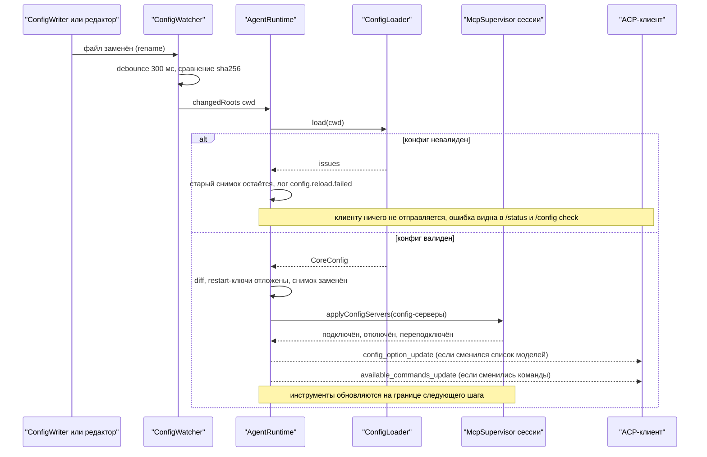
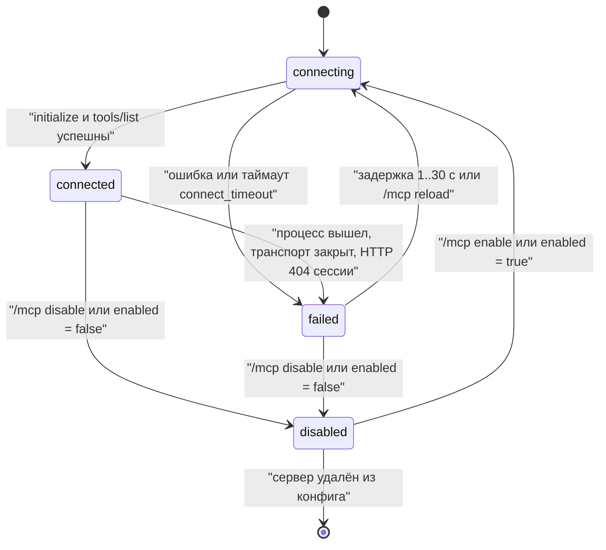

# 17.5. Настройка агента: провайдеры, секреты, реестр настроек, живая перезагрузка

> Часть [архитектуры ядра агента CodeLab](../agent-core-architecture.md). Status: Accepted. Общие соглашения, термины и порядок чтения — в оглавлении.

← [17.4. Вынос огромного результата инструмента в файл (T-28)](17-4-output-spill.md) · [Оглавление ядра](../agent-core-architecture.md) · [17.6. Управление сессиями: переименование, ветки, перемотка, lease](17-6-session-management.md) →

Цели: L-25 (предконфигурация провайдера из окружения), P-12 (секреты по имени в хранилище ОС),
E-15 (реестр общих настроек CLI и app), E-04 (переподключение MCP и перечитывание конфига),
E-13 со стороны агента (команды `/mcp list`, `/mcp reload`), P-17 (`--debug-secrets`, Could).
Мастер провайдера, страницы настроек провайдеров и MCP-серверов в клиентах и пакет
`codelab_setup` описаны в документе клиентов
([`dart-agent-and-clients.md`](../dart-agent-and-clients.md) §12.4); здесь — контракт агента, на
который они опираются. Затрагивает §6.4 (MCP-инструменты), §10.3 (`SecretStore`,
`AgentCoreServices`), §11.5 (перечитывание project context), §12.3 (события `config.*`,
`secrets.*`, `mcp.*`), §12.4 (источники точных секретов), §13.4 (подключение MCP), §13.6
(команды `/mcp`, `/config`, строки `/status`), §15.2–§15.6 (слой окружения, ключи `secrets` и
`config`, подстановка `${secret:…}`), §17.2.9 (пример `available_commands_update`).

## 17.5.1. Назначение

В MVP конфиг читается один раз при старте, ключи провайдеров приходят из переменных окружения
или связки ключей, а настройки правятся только руками в YAML. Этого мало для четырёх сценариев:

1. **Контейнер и CI.** Файла конфига нет, есть только окружение. Агент должен получить провайдера
   и модель из двух переменных (L-25).
2. **Ключ без файла.** Пользователь вводит ключ один раз — в CLI или в настройках app; ключ
   уходит в хранилище секретов ОС, а конфиг хранит только его имя (P-12). Ключ, вписанный в
   конфиг значением, — ошибка с подсказкой, как сделать правильно.
3. **Одни настройки в двух клиентах.** CLI и app редактируют один и тот же конфиг через один
   писатель и показывают одни и те же ключи из одного реестра (E-15). Тест полноты не даёт
   добавить ключ в схему и забыть про него в настройках.
4. **Без перезапуска.** Правка конфига (руками или из настроек) применяется к работающему агенту;
   упавший MCP-сервер переподключается сам; сервер, сменивший список инструментов, обновляет
   реестр (E-04). Человек видит состояние серверов и может переподключить их командой (E-13).

Раздел не меняет схему §15.4 и правила доверия §15.3: он добавляет к ним второй источник (окружение),
путь записи (`ConfigWriter`), путь перечитывания (`ConfigSource`) и описание каждого ключа для UI
(`SettingsRegistry`).

## 17.5.2. Контракт

**Секреты.** `SecretStore` из §10.3 не меняется. Расширение — необязательный интерфейс описания
бэкенда и резолвер ядра, через который проходит каждое чтение секрета
(`codelab_agent_core/lib/src/secrets/`):

```dart
/// Расширение §10.3: реализация сообщает, куда пишет и читает. Хранилища codelab_agent_io
/// реализуют его все; MemorySecretStore тестов — тоже (id "memory").
abstract interface class DescribedSecretStore implements SecretStore {
  SecretBackendInfo get backend;
}
final class SecretBackendInfo {
  final String id;                 // keychain-macos | secret-service | wincred | env | file | memory
  final bool writable;             // env — только чтение
  final String? unavailableReason; // почему ОС-хранилище не выбрано (для `auto`), иначе null
}
/// Хранилище недоступно или не ответило за 10 с. Сообщение не содержит значения секрета.
final class SecretStoreUnavailableException implements Exception {
  final String backend; final String reason;
}

/// Правило имени секрета (SecretNames.validate бросает ArgumentError с причиной).
abstract final class SecretNames {
  static final RegExp pattern = RegExp(r'^[a-z0-9][a-z0-9._/-]{0,127}$');  // без "..", без "/" в конце
  static String envOverride(String name);   // "codelab/anthropic" → "CODELAB_SECRET_CODELAB_ANTHROPIC"
  static String suggestFor(String configPath); // "providers.openai.api_key" → "codelab/openai"
  /// "github", "Authorization" → "codelab/mcp/github/authorization": обе части в нижнем регистре,
  /// символы вне [a-z0-9._-] → "-"; так же suggestFor("mcp.servers[github].headers.Authorization").
  static String forMcp(String server, String key);
}

/// Единственная дорога к значению секрета в ядре (§17.5.4). Значения кэшируются до invalidate().
final class SecretResolver {
  SecretResolver({required SecretStore store, required Map<String, String> environment,
      required Redactor redactor, required Logger logger, bool debug = false});
  /// api_key_secret, ${secret:<name>}, exec.secrets. purpose — путь ключа конфига.
  Future<String?> secret(String name, {required String purpose});
  /// api_key_env и ${ENV} в ключах провайдеров.
  String? env(String variable, {required String purpose});
  void invalidate();               // при перезагрузке конфига (§17.5.6)
}
```

`AgentCoreServices` (§10.3) получает два необязательных поля:

```dart
  final ConfigSource? config;      // null → живая перезагрузка и команда /config недоступны
  final bool debugSecrets;         // --debug-secrets или CODELAB_DEBUG_SECRETS=1 (P-17)
```

**Источник конфига и перезагрузка** (`codelab_agent_core/lib/src/config/`). `ConfigSource` — порт
хоста: `apps/codelab_agent` и `codelab_embedded` реализуют его поверх `ConfigLoader` и
`ConfigWatcher` из `codelab_agent_io`; мобильный и web-хосты — поверх хранилища приложения.

```dart
enum ConfigIssueKind { syntax, profile, unknownKey, type, value, inlineSecret, semantic }
final class ConfigIssue {          // одна проблема валидации (§15.5)
  final ConfigIssueKind kind;      // класс проблемы: тестам и ConfigInlineSecretException не нужен разбор текста
  final String key;                // путь ключа: "mcp.servers[github].url"; "" — файл целиком (синтаксис)
  final String source;             // путь файла, "env", "flags", "app-storage" или "env:CODELAB_PROVIDER_CONFIG"
  final int? line, column;         // из ConfigTree.positions (§15.1); null — у слоя без позиций
  final String message;            // для человека; никогда не содержит значения секрета
  final String? event;             // только у предупреждений: имя события лога (§12.2)
  final Map<String, Object?> fields; // поля события без значений ключей
  final LogLevel level;            // уровень записи предупреждения; по умолчанию warning
}
final class ConfigLoadResult {
  final CoreConfig? config;        // null ⇔ issues не пусто
  final HostSettings? host;        // ключи хоста: sessions.*, logging.*, profile.* (§15.1)
  final List<ConfigIssue> issues, warnings;
  final List<String> sources;      // слои по порядку: "defaults", пути файлов, "env:…", "flags"
  CoreConfig orThrow();            // config или ConfigException / ConfigInlineSecretException
}
// codelab.toml не читается (§15.7, решение пользователя 2026-10-29): поля legacy нет, найденный
// файл — предупреждение config.legacy_found в warnings.
// ConfigInlineSecretException.suggestedSecretName добавляет change add-agent-secret-store (8.9)
// вместе с SecretNames; в 8.5 исключение несёт только key первой проблемы inlineSecret.
abstract interface class ConfigSource {
  Future<ConfigLoadResult> load({required String cwd});
  /// Изменился один из файлов, прочитанных для этого cwd (уже после debounce 300 мс).
  Stream<String> get changedRoots; // cwd затронутых сессий; "" — глобальный слой, все сессии
}
final class ConfigApplyReport {
  final bool applied;              // false: конфиг невалиден или изменений нет
  final List<ConfigIssue> issues;
  final List<String> changedKeys, restartRequiredKeys;
  final List<String> mcpConnected, mcpDisconnected, mcpReconnected;
}
// AgentRuntime (§10.3) получает:
//   Future<ConfigApplyReport> reloadConfig({String? cwd});   // /config reload, /mcp reload, ConfigSource
//   Future<ConfigApplyReport> applyConfig(String cwd, CoreConfig next);   // мобильный и web-хост
//   ConfigStatus configStatus(String cwd);                    // для /status и /config check
final class ConfigStatus {
  final DateTime loadedAt; final List<String> sources;
  final DateTime? lastFailureAt; final List<ConfigIssue> lastIssues;   // пусто, если последняя попытка удалась
  final List<String> pendingRestartKeys;
}
```

**MCP-супервизор** — интерфейс ядра (`codelab_agent_core/lib/src/mcp/mcp_supervisor.dart`),
реализация на сессию — `McpSessionSupervisor` в `codelab_agent_mcp`:

```dart
enum McpServerState { connecting, connected, failed, disabled }
enum McpServerOrigin { config, session }      // mcp.servers конфига или session/new.mcpServers
final class McpServerStatus {
  final String id; final McpServerOrigin origin;
  final String transport;                     // stdio | http
  final McpServerState state;
  final int toolCount;
  final String? lastError;                    // после редакции §12.4, ≤ 200 символов
  final Duration? retryIn;                    // только для failed
}
abstract interface class McpSupervisor {
  List<McpServerStatus> snapshot();           // порядок: config по порядку конфига, затем session
  Stream<List<McpServerStatus>> get changes;  // для страницы настроек встроенного агента
  Future<void> reconnect(String id);          // /mcp reload <id>: разорвать и подключить сразу
  Future<void> setEnabled(String id, bool enabled);   // /mcp enable|disable: только эта сессия
  Future<void> applyConfigServers(List<McpServerConfig> servers);   // §17.5.7; session-серверы не трогает
}
```

**Правки конфига** — чистые типы ядра (`codelab_agent_core/lib/src/config/config_edit.dart`): их
используют писатель `codelab_agent_io`, клиентский пакет `codelab_setup` (через реэкспорт, без
зависимости от `codelab_agent_io`) и мобильный и web-хосты. Вместе с `ConfigIssue`,
`SettingsRegistry` и `SecretNames` они составляют всё, что клиентам нужно знать о конфиге без
`dart:io`.

```dart
enum ConfigLayer { user, project, projectLocal }   // слои 2, 3, 4 из §15.2; иные не пишутся

final class ConfigTarget {
  final ConfigLayer layer; final String? cwd;
  const ConfigTarget.user();                      // $CODELAB_HOME/config.yaml — по умолчанию
  const ConfigTarget.project(String cwd);          // <cwd>/.codelab/config.yaml — флаг --project
  const ConfigTarget.projectLocal(String cwd);     // <cwd>/.codelab/config.local.yaml — флаг --local
}
final class ConfigSnapshot {
  final ConfigTarget target; final String path;   // путь после разрешения символической ссылки
  final String? fingerprint;                      // sha256 байтов файла; null — файла нет
  final Map<String, Object?> values;              // разобранный слой (без слияния)
  Object? get(String key);                        // "providers.openai.base_url", "mcp.servers[github].url"
}
sealed class ConfigEdit { const ConfigEdit(); }
final class SetValue extends ConfigEdit { final String key; final Object value; const SetValue(this.key, this.value); }
final class UnsetValue extends ConfigEdit { final String key; const UnsetValue(this.key); }
final class UpsertMcpServer extends ConfigEdit { final Map<String, Object?> server; const UpsertMcpServer(this.server); }   // по name
final class RemoveMcpServer extends ConfigEdit { final String name; const RemoveMcpServer(this.name); }
/// Ключ-отображение целиком со всем поддеревом: "providers.local-1234" удаляет и providers.local-1234.models.*.
final class RemoveTable extends ConfigEdit { final String key; const RemoveTable(this.key); }

/// Встроенный секрет (CFG-9): бросают валидатор §15.5 (шаг 3) и ConfigWriter.apply.
final class ConfigInlineSecretException extends ConfigException {
  final String key; final String suggestedSecretName;   // для подсказки `codelab secret set <name>`
}
```

**Запись конфига** (`codelab_agent_io/lib/src/config/config_writer.dart`, `dart:io`):

```dart
final class ConfigWriteResult {
  final String path; final String fingerprint;
  final List<ConfigIssue> warnings;               // например, ${VAR} не задана в окружении писателя
  final List<String> restartRequiredKeys;         // по SettingsRegistry
}

final class ConfigWriter {
  ConfigWriter({required String codelabHome, required Map<String, String> environment,
      required ConfigLoader loader, required Logger logger});
  Future<ConfigSnapshot> read(ConfigTarget target);
  /// Применяет правки к YAML-документу base через YamlEditor, проверяет итог и атомарно
  /// заменяет файл (§17.5.5). ConfigConflictException — файл изменился после read;
  /// ConfigInlineSecretException; ConfigException(issues) — итог невалиден или правку нельзя
  /// выполнить без потери структуры документа. Файл при ошибке не меняется.
  Future<ConfigWriteResult> apply(ConfigSnapshot base, List<ConfigEdit> edits);
}
final class ConfigConflictException implements Exception { final String path; }
```

Исключения `apply` — контракт для вызывающих: `ConfigConflictException`, `ConfigInlineSecretException` (подкласс `ConfigException`, поэтому
проверяется раньше него), `ConfigException(issues)`. Клиентский порт `AgentConfigStore`
переводит каждое в свой результат сохранения (dart-agent-and-clients §12.4.2).

**Реестр настроек** (`codelab_agent_core/lib/src/config/settings_registry.dart`, чистый Dart:
им пользуются мобильный и web-хосты и клиенты через реэкспорт `codelab_setup`):

```dart
enum SettingScope { shared, fileOnly }
enum SettingType { string, int, float, bool, duration, path, enumeration, stringList, pathList,
    modelRef, modelRefList, secretName, envVarName, map, mapList }

final class SettingDescriptor {
  final String key;               // путь с "*" вместо имён: "providers.*.base_url", "mcp.servers"
  final SettingType type;
  final Object? defaultValue;     // как в §15.4; null — «нет»
  final SettingScope scope;
  final String? fileOnlyReason;   // обязателен ⇔ scope == fileOnly
  final String section;           // группа UI: Models, Providers, Permissions, Budget, MCP, Tools, Agent, Logging, Advanced
  final String label, description;// английский; клиент МОЖЕТ локализовать по key
  final bool secret;              // значение — имя секрета; редактор: «задать ключ» через SecretStore
  final bool restartRequired;     // изменение не применяется живой перезагрузкой (§17.5.6)
  final List<String>? enumValues;
  final num? min, max;
  final Set<ConfigLayer> layers;  // в какие слои писатель может писать ключ
}
abstract final class SettingsRegistry {
  static List<SettingDescriptor> get all;                   // порядок — порядок показа в UI
  static SettingDescriptor? lookup(String key);              // с учётом "*" и покрытия поддерева
  static Object parseCliValue(SettingDescriptor d, String raw);   // для `codelab config set`
}
```

## 17.5.3. Алгоритм: загрузка с окружением (L-25)

Две переменные задают провайдера целиком: `CODELAB_PROVIDER_TYPE` — `"openai-compatible"`,
`"anthropic"` или, после MVP, `"gemini"` (§17.10.3) — как `kind`, §15.4; другие значения — ошибка со списком допустимых,
`CODELAB_PROVIDER_CONFIG` — JSON-объект. Вместо второй МОЖНО задать
`CODELAB_PROVIDER_CONFIG_BASE64` (тот же JSON в base64, стандартный или URL-safe алфавит,
`=` в конце необязательны) — для оркестраторов, которые портят кавычки.

| Поле JSON | Тип | Обязательно | Куда попадает |
|---|---|---|---|
| `id` | string `[a-z0-9_-]+` | нет, `"env"` | `<id>` в `providers.<id>` |
| `base_url` | string | для `openai-compatible` | `providers.<id>.base_url`; `${ENV}` допустим |
| `model` | string | да | `providers.<id>.models.<model>` и `agent.default_model = "<id>/<model>"` |
| `context_window` | int | да | `…models.<model>.context_window` |
| `max_output_tokens`, `name`, `image`, `reasoning` | как в §15.4 | нет | `…models.<model>.*` |
| `api_key_env` \| `api_key_secret` | string | нет, не оба | `providers.<id>.api_key_env` \| `api_key_secret` |
| `auth_header` | string | нет | `providers.<id>.auth_header` |
| `headers` | object string→string | нет | `providers.<id>.headers`; `${ENV}` и `${secret:<name>}` допустимы |
| `connect_timeout`, `idle_timeout` | duration | нет | `providers.<id>.*` |

```text
envPreconfigLayer(environment, flags):
1. если flags.providerType или flags.providerConfig заданы → источник := флаги
     (--provider-type, --provider-config <json | @путь>); переменные CODELAB_PROVIDER_* не читаются,
     лог info config.preconfig.shadowed {by: "flags"}
   иначе источник := окружение; ни одной из трёх переменных нет → вернуть null
2. заданы обе CODELAB_PROVIDER_CONFIG и CODELAB_PROVIDER_CONFIG_BASE64 → ConfigException
   задана только TYPE или только CONFIG → ConfigException("CODELAB_PROVIDER_TYPE задан, а CODELAB_PROVIDER_CONFIG нет")
3. BASE64 → декодировать; ошибка → ConfigException("CODELAB_PROVIDER_CONFIG_BASE64: не base64")
4. разобрать JSON; ошибка → ConfigException("<имя переменной>: неверный JSON, смещение <n>")
     текст исключения парсера НЕ включается: он цитирует фрагмент значения
   корень не объект → ConfigException("<имя>: ожидается JSON-объект")
5. проверка полей по таблице: неизвестное поле → ConfigException("<имя>.<поле>: неизвестное поле
     (может быть, <ближайшее>?)"); поля api_key, apiKey, key → ConfigInlineSecretException (CFG-9);
     неверный тип → ошибка с ожидаемым типом; значение поля в сообщение не попадает
6. построить слой-таблицу: providers.<id> {kind: TYPE, …} и agent.default_model
7. вернуть слой с источником "env:CODELAB_PROVIDER_CONFIG" (или "…_BASE64", "flags")
```

Слой окружения встаёт в §15.5 на шаг 7 как часть слоя 5 (флаги — слой 6), то есть приоритет
**флаг → окружение → локальный проектный → проектный → пользовательский**. Внутри слоя 5
предконфигурация применяется первой, `CODELAB_MODEL` — после неё (более частное значение).
Слой проходит ту же строгую проверку §15.5 и правила подстановки; доверие §15.3 к нему не
применяется (окружение задаёт тот, кто запускает агента). Таблица `providers.<id>` сливается с
файлами по §15.2: одноимённый провайдер из файла дополняется, поля окружения побеждают.
`host.config.loaded` перечисляет источники (`"env:CODELAB_PROVIDER_CONFIG"`), но не значения;
значения `headers` регистрируются как точные секреты `Redactor` (§12.4, п. 4).

## 17.5.4. Алгоритм: секреты (P-12, P-17)

**Ссылки на секреты в конфиге.** У провайдера (и у бэкенда поиска, §17.1.6) — ровно одно из
`api_key_secret = "<name>"` и `api_key_env = "<VAR>"`; оба сразу — `ConfigException`. В значениях
`headers` и `env` MCP-серверов и `headers` провайдеров допустима подстановка `${secret:<name>}`
рядом с `${ENV}` (§15.5): значение берётся из `SecretResolver` при подключении или запросе,
отсутствующий секрет — ошибка подключения сервера с текстом `secret <name> is not set`.

**Встроенный ключ — ошибка (CFG-9).** Валидатор §15.5 (шаг 3) отклоняет:

1. ключи `api_key`, `apiKey`, `token`, `secret`, `password` в `providers.*`,
   `tools.web.search.backends.*`, `mcp.servers.*`;
2. литеральное (не целиком из `${…}`) значение в `headers.*` и `mcp.servers.*.env.*`, совпадающее с
   любым шаблоном таблицы §12.4;
3. значение `api_key_env` или `api_key_secret`, совпадающее с шаблоном §12.4 (частая ошибка:
   ключ вписан вместо имени).

Ошибка — `ConfigInlineSecretException` с подсказкой; значение в сообщение не попадает:
`config.yaml:7:5: providers.openai.api_key: ключ не хранится в конфиге. Сохраните его командой
codelab secret set codelab/openai и укажите api_key_secret: codelab/openai`. Имя в подсказке —
`SecretNames.suggestFor(путь)`: `codelab/<id провайдера>`, `codelab/mcp/<сервер>/<ключ>`
(`SecretNames.forMcp`: имя переменной `env` или заголовка, в нижнем регистре),
`codelab/search-<имя бэкенда>`. Эти же имена пишут мастер и страницы настроек клиентов.
После MVP пул ключей: имена `<name>_2` … `<name>_16` и переменные `NAME_2` … (§17.10.4); токены
входа — `codelab/oauth/<id>` (§17.10.6).

**Порядок разрешения** `SecretResolver.secret(name)`:

```text
1. SecretNames.validate(name); ошибка → ConfigException на загрузке (а не здесь)
2. кэш процесса содержит name → вернуть (без лога, кроме --debug-secrets: source "cache")
3. v := environment[SecretNames.envOverride(name)]; v не пуст → source "env", перейти к 6
     CODELAB_SECRET_* — переопределение для CI и контейнеров без связки ключей
4. v := await store.read(name) с таймаутом 10 с; source := store.backend.id
     SecretStoreUnavailableException → лог warning secrets.backend.unavailable {backend, reason},
     вернуть null
5. v == null → вернуть null; вызывающий превращает это в ошибку там, где ключ нужен:
     провайдер — AgentError(cls: provider, errorClass: auth) с текстом "API key secret codelab/openai is not set.
     Run: codelab secret set codelab/openai"; MCP — сервер failed с тем же текстом
6. redactor.addExact(v); кэш[name] := v; вернуть v
debug: на шагах 2–5 лог info secrets.lookup {name, purpose, source, found}; значения, длины,
  префиксы, хеши — никогда (CFG-10)
```

`SecretResolver.env(VAR)` читает только окружение процесса хоста; найденное значение тоже
регистрируется в `Redactor`. Без `--debug-secrets` чтения не логируются, кроме отказов бэкенда.

**Бэкенды** (`codelab_agent_io/lib/src/secrets/`). Служба — `codelab`, учётная запись — имя
секрета. Значение секрета НЕ ДОЛЖНО попадать в argv дочернего процесса: argv виден другим
пользователям через `ps`.

| Бэкенд (`id`) | Платформа | Запись | Чтение | Список имён |
|---|---|---|---|---|
| `keychain-macos` | macOS | `security -i`, команда `add-generic-password -U -s codelab -a <name> -w "<value>"` подаётся в stdin (экранирование `"` и `\`; значение с переводом строки отклоняется) | `security find-generic-password -s codelab -a <name> -w` (stdout) | индекс `$CODELAB_HOME/secret-names.json` (только имена), сверяется чтением |
| `secret-service` | Linux | `secret-tool store --label "CodeLab: <name>" service codelab account <name>`, значение — в stdin без перевода строки | `secret-tool lookup service codelab account <name>` | `secret-tool search --all service codelab`, поле `attribute.account` |
| `wincred` | Windows | `dart:ffi` → `advapi32` `CredWriteW`, цель `codelab:<name>`, `CRED_TYPE_GENERIC`, `CRED_PERSIST_LOCAL_MACHINE` | `CredReadW` | `CredEnumerateW("codelab:*")` |
| `env` | все | нет: `SecretStoreUnavailableException("env backend is read-only")` | `CODELAB_SECRET_<…>` | имена из окружения |
| `file` | все, только по явному выбору | `$CODELAB_HOME/secrets.yaml`, права `0600`, атомарно (tmp + rename) | тот же файл; права шире `0600` → отказ чтения с ошибкой | ключи файла |

Выбор — ключ `secrets.backend` (только глобальный конфиг, §15.3): `"auto"` (по умолчанию) —
ОС-хранилище, если доступно (Linux: `secret-tool` в `PATH`, задан `DBUS_SESSION_BUS_ADDRESS`, проба
`secret-tool search --all service codelab` завершилась с кодом 0 за 3 с), иначе `env` с одним
предупреждением `secrets.backend.unavailable` при старте; `"keychain"` — ОС-хранилище обязательно,
недоступно → ошибка старта; `"env"` — только окружение; `"file"` — открытый текст, при каждом
старте предупреждение `secrets.backend.plaintext`. Мобильный и web-хосты передают свою
реализацию `DescribedSecretStore` поверх хранилища платформы; встроенный агент desktop-app
использует ту же реализацию `codelab_agent_io`, что и CLI.

**Почему нет зашифрованного файла по умолчанию.** Ключ шифрования пришлось бы хранить рядом —
на том же диске, с теми же правами; такой файл не защищает ни от кого, кто может прочитать
`$CODELAB_HOME`, но создаёт впечатление защиты. Запрашивать пароль при каждом старте агент без
TTY (`agent-serve`, CI) не может. Поэтому выбор честный: хранилище ОС, переменные окружения или
явно выбранный открытый файл с правами `0600`.

**CLI.** `codelab secret set <name>` читает значение из stdin (с TTY — без эха, ввод до Enter; без
TTY — весь stdin, один завершающий `\n` отбрасывается); значение аргументом командной строки —
ошибка использования `pass the secret value on stdin, not as an argument`. Имя, у которого
`envOverride` совпадает с `envOverride` уже существующего другого имени, отклоняется.
`codelab secret delete <name>`; `codelab secret list` печатает бэкенд и имена, без значений и длин.
Те же подкоманды есть у `codelab-agent`.

## 17.5.5. Алгоритм: запись конфига

`ConfigWriter` — единственный путь программной записи конфига: подкоманды CLI (`codelab config`,
`codelab provider`, `codelab mcp`) и экраны настроек клиентов для **локальных** профилей
(встроенный агент и агент, запущенный клиентом через stdio на той же машине с тем же
`CODELAB_HOME`, который клиент передал дочернему процессу). Конфиг удалённого агента по WebSocket
клиенты не пишут: файлы лежат на другой машине, их правит оператор, агент подхватывает правку
перезагрузкой (§17.5.6).

```text
apply(base, edits):
1. для каждой правки SetValue/UpsertMcpServer: d := SettingsRegistry.lookup(key); нет →
     ConfigException("неизвестный ключ …"); UnsetValue принимает и ключ вне реестра, если он есть
     в файле (так удаляются опечатки и запрещённые ключи вроде api_key)
   RemoveTable: key — экземпляр именованного отображения из схемы (providers.<id>,
     providers.<id>.models.<m>, tools.web.search.backends.<name>); иначе ConfigException;
     ключа нет в слое → ConfigException("<key>: нет в <путь>"); d — дескриптор любого ключа поддерева
   base.target.layer ∉ d.layers → ConfigException("<key> записывается только в <слои>")
   SetValue со значением-секретом (правила CFG-9) → ConfigInlineSecretException (ничего не пишется)
2. слой project: правило доверия §15.3 для ключа и значения при текущем trusted_projects;
   ключ был бы проигнорирован → ConfigException("<key>: в недоверенном проекте ключ не действует;
   используйте --local или добавьте проект в trusted_projects")
3. lock := эксклюзивное создание <path>.lock (существующий старше 10 с — удалить, лог warning);
   занят → ConfigConflictException
4. bytes := прочитать <path> (нет файла → пусто); sha256(bytes) != base.fingerprint →
   снять lock, ConfigConflictException(path): вызывающий перечитывает (read) и повторяет правки
5. text := применить правки к bytes через YamlEditor (ниже); перевод строк (LF/CRLF) и
     завершающий \n — как в файле; файла нет → документ строится с пустого
6. проверка: loader.validateCandidate(target, text) — §15.5 шаги 1–8 по всем файловым слоям
   с заменой этого слоя на text плюс слой окружения процесса писателя;
   незаданная ${VAR} — предупреждение, а не ошибка (окружение агента может отличаться);
   ошибки → снять lock, ConfigException(issues); файл не тронут
7. записать <path>.tmp-<pid>-<rand> в том же каталоге (права — как у файла, новый — 0644),
   flush + fsync; rename поверх <path> (Windows — MoveFileEx с заменой); fsync каталога (POSIX)
8. снять lock; лог info config.write {path, keys}; вернуть ConfigWriteResult(новый fingerprint,
   предупреждения, restartRequiredKeys по реестру)
```

**Правка с сохранением формата.** Писатель не пересериализует документ: он применяет правки
через `YamlEditor` из `package:yaml_edit` (`codelab_agent_io`), и всё вне изменённых узлов
остаётся побайтово тем же — комментарии, пустые строки, порядок ключей и стиль.

1. Путь правки `a.b.c` — последовательность ключей отображений; сегмент берётся целиком, точка
   внутри id модели (`providers.local.models."qwen2.5-coder-32b".context_window`) пишется в
   аргументе в кавычках и в YAML даёт один ключ. `mcp.servers[<name>]` — индекс элемента списка
   с этим `name`.
2. `SetValue` существующего ключа — `YamlEditor.update(path, value)`: меняется только узел
   значения, хвостовой комментарий `# …` остаётся. Нового ключа — `update` в ближайшее
   существующее отображение-предок; новый ключ добавляется в конец этого отображения;
   недостающие предки создаются как вложенные отображения в блочном стиле.
3. `UnsetValue` — `YamlEditor.remove(path)`; опустевшее отображение-предок удаляется тем же
   способом, если в нём нет комментариев.
4. `UpsertMcpServer` — `update` элемента `mcp.servers[<name>]` по ключам (лишние ключи —
   `remove`, новые — в конец элемента) или `appendToList(["mcp", "servers"], server)`;
   `RemoveMcpServer` — `remove` элемента списка. `RemoveTable(key)` — `remove(key)`: ключ
   удаляется вместе со всем поддеревом и комментариями внутри него; комментарий над следующим
   ключом сохраняется.
5. Стиль. Новые отображения и списки писатель создаёт в блочном стиле с отступом файла (2
   пробела, если в файле нет вложенности); правка внутри существующей flow-коллекции
   (`{…}`, `[…]`) сохраняет её flow-стиль — так работает `yaml_edit`, документ не
   переформатируется. Строки пишутся без кавычек, если значение читается обратно той же
   строкой по профилю §15.5, иначе в двойных кавычках (`"off"`, `"yes"`, `"${GITHUB_TOKEN}"`,
   `"exec:git push --force"`); `int`, `float`, `bool`; `duration` — строка `30s`.
6. Если `YamlEditor` отказывает (документ нарушает профиль §15.5 или правку нельзя выполнить без
   потери структуры), писатель возвращает `ConfigException` с путём ключа и текстом
   `cannot edit <key> automatically; edit the file manually`; файл не трогается.
7. После правок документ разбирается заново (`package:yaml`, профиль §15.5) и проверяется на шаге
   6 алгоритма выше; результат, не прошедший проверку, не пишется.

**Подкоманды CLI** (общая реализация в `codelab_agent_io/lib/src/cli/` — типизированные методы
`ConfigCommands` с результатом `{exitCode, stdout, stderr}`; `check` асинхронный (`Future<ConfigCommandResult>`): он ждёт загрузчик файлов проекта (change `add-agent-project-files`, D13); аргументы разбирают сами приложения
своим `package:args`, которого в allowlist `codelab_agent_io` нет; `codelab` вызывает реализацию
через `package:codelab_setup/io.dart`; у `codelab` и `codelab-agent` подкоманды одинаковые; слой по умолчанию — `user`, `--project` и `--local` — слои 3 и 4
для текущего `cwd`; код выхода 0 — успех, 1 — ошибка валидации или конфликт, 64 — ошибка
использования, как у `codelab -p`, dart-agent-and-clients §9.11):

| Подкоманда | Действие |
|---|---|
| `config path [--project\|--local]` | путь файла слоя; без флага — все слои с пометкой `exists`/`missing` |
| `config get <key> [--layer user\|project\|local\|merged]` | значение (по умолчанию итоговое) и слой-источник; секреты — только имя |
| `config set <key> <value> [--project\|--local]` | `SetValue`; значение разбирает `SettingsRegistry.parseCliValue` (списки и таблицы — JSON) |
| `config unset <key> [--project\|--local]` | `UnsetValue` |
| `config check [--cwd <dir>]` | полная загрузка §15.5 для `cwd` с окружением процесса целиком (включая `CODELAB_CONFIG`), без флагов `serve`. Первая строка — `Sources: defaults, <канонический абсолютный путь>, …` (`ConfigLoadResult.sources`); проблемы — `ConfigIssue.toString()` (подсказка `did you mean …?` — часть текста); предупреждения — `warning: <location>: [<key>: ]<message>`, включая `config.legacy_found` (§15.7) и `config.env.unknown` (неизвестные `CODELAB_*` распознаёт `ConfigLoader`); последняя строка `Config: valid` или `Config: invalid (issues: <n>)`, предупреждения проблемами не считаются. Только при валидном конфиге, перед последней строкой — диагностика файлов проекта для канонического `cwd` (тот же `ProjectFilesLoader`, что у runtime, §17.2): `error`/`warning` — строками `warning: <path>[:<line>[:<column>]]: <message>` (фиксированные тексты кодов, без фрагментов файлов), для недоверенного проекта — `note: <каталог>: the project is not trusted; add it to trusted_projects` по строке на `.codelab/prompts`/`.codelab/agents`, прочие `info` не печатаются; сбой загрузчика — `warning: <cwd>: project files could not be read: <runtimeType>`, загрузка дольше 5 с — `warning: <cwd>: project files were not read within 5 s`. На код выхода диагностика файлов проекта не влияет (change `add-agent-project-files`, D13). Код `0` / `1` / `64`; `64` — несуществующий `--cwd`, `ConfigUsageException` (`CODELAB_CONFIG` с `.toml` или относительный; `CODELAB_HOME` вида `~user/…` или `~` без домашнего каталога, §15.6, D17) или ошибка разбора аргументов: текст и справка в stderr, stdout пуст. Ничего не пишет. Появляется первой, в change `add-agent-configuration` (8.5, D13) |
| `provider add <id> --kind <kind> [--base-url U] --model M --context-window N [--api-key-secret S \| --api-key-env V \| --api-key-stdin] [--default]` | одна `apply` со списком `SetValue` ключей `providers.<id>.*` и `providers.<id>.models.<M>.*`; `--api-key-stdin` сначала пишет секрет `codelab/<id>`; `--default` — `SetValue("agent.default_model", "<id>/<M>")` |
| `provider list` | id, kind, base_url, модели, источник ключа (`secret codelab/openai: found`); первая строка — `Secrets: <backend.id>`, при `unavailableReason` — `Secrets: env (<причина>)` |
| `provider remove <id>` | `RemoveTable("providers.<id>")`; ссылка из `agent.*` или `llm.roles.*` → ошибка валидации с подсказкой сменить модель |
| `mcp add <name> --type stdio --command C [--arg A]… [--env K=V]… \| --type http --url U [--header K=V]… [--disabled]` | `UpsertMcpServer`; литеральный секрет в `--header`/`--env` → подсказка `${secret:<name>}` |
| `mcp list` | серверы файлов по слоям: name, type, слой, enabled (без подключения) |
| `mcp remove <name>` | `RemoveMcpServer` |
| `secret set\|delete\|list` | §17.5.4 |
| `config export-providers [--layer user\|project\|local\|merged] [--output F] [--provider ID]…` | после MVP: файл обмена провайдеров без значений секретов (§17.14.4.3) |
| `config import-providers <file\|-> [--force] [--dry-run] [--skip-agent] [--map-secret OLD=NEW]… [--project\|--local]` | после MVP: слияние провайдеров, моделей и ролей одной `apply`; существующее не меняется без `--force` (§17.14.4.4) |

Команды `config migrate` нет: `codelab.toml` не читается и не переводится (§15.7), запись конфига
от его наличия не зависит.

Клиент `codelab` дополняет `provider add` мастером: без обязательных флагов на TTY подкоманда
запускает общий автомат клиентов, а с флагами проверяет адрес запросом списка моделей до записи
(`--skip-check` пропускает проверку, `--preset` подставляет `kind` и `base_url`)
([`dart-agent-and-clients.md`](../dart-agent-and-clients.md) §12.4.4). Флаги ядра, набор правок и
коды выхода те же; `codelab-agent provider add` мастера и проверки не имеет.

## 17.5.6. Алгоритм: живая перезагрузка (E-04)

**Наблюдение.** `ConfigWatcher` (`codelab_agent_io`) следит за файлами, прочитанными загрузчиком
для каждого корня: глобальный конфиг, `--config`, и для каждого `cwd` живых сессий —
`.codelab/config.yaml` и `.codelab/config.local.yaml`, включая ещё не существующие. Механизм —
`FileSystemEntity.watch` на родительском каталоге (замена файла через rename — событие каталога);
где события недоступны или каталог на сетевой ФС — опрос раз в `config.poll_interval`
(`"2s"`) по `(mtime, size)` и sha256 при их смене. Событие запускает таймер 300 мс; новые события
перезапускают его (debounce). Совпадение sha256 с последним загруженным — не изменение. Окружение
и флаги не перечитываются: они не меняются у живого процесса. `config.watch = false` выключает
наблюдение; `/config reload` работает и тогда.

Хост, обслуживающий сессии с разными `cwd`, держит снимок `CoreConfig` на корень (глобальный слой
общий): правка проектного файла касается только сессий этого `cwd`.

```text
reloadConfig(cwd?):                       // ConfigSource.changedRoots, /config reload, /mcp reload
1. перезагрузка уже идёт → отметить повтор (не больше одного в очереди), вернуть её результат
2. корни := cwd ? [cwd] : все корни живых сессий; для каждого: result := source.load(cwd)
3. result.issues не пусто →
     status.lastFailureAt := now; status.lastIssues := issues
     лог error config.reload.failed {cwd, sources, issues (ключи и файлы, без значений)}
     старый снимок остаётся полностью; клиентам ничего не отправляется; к следующему корню
4. diff := листовые ключи, у которых значение отличается (mcp.servers — по name)
   секретный кэш: resolver.invalidate() — даже при пустом diff (ключ в связке мог смениться)
5. restart := diff ∩ {d.restartRequired}; в новом снимке их значения заменяются старыми;
   повторная семантическая проверка снимка; ошибка → как шаг 3
   restart не пусто → status.pendingRestartKeys ∪= restart; лог warning config.reload.restart_required
6. атомарно заменить снимок корня; применение — по таблице ниже
7. для каждой сессии корня:
     a. mcp: supervisor.applyConfigServers(новые config-серверы)        // §17.5.7
     b. каталог skills и шаблонов перечитан (§17.2.4), если изменились skills.*, prompts.*
        или файлы каталогов; команды пересчитаны → изменились → CommandsChanged
        → available_commands_update
     c. опции model пересчитаны (каталог моделей) → изменились → config_option_update (полный снимок)
     d. project context (AGENTS.md, §11.5) перечитан; действует со следующего хода
8. status.lastIssues := []; лог info config.reload.applied {cwd, keys, restart_required,
     mcp_connected, mcp_disconnected, mcp_reconnected}; вернуть ConfigApplyReport
```

| Ключи | Когда действует новое значение |
|---|---|
| `providers.*` (после MVP — включая `preset`, `auth`, `key_rotation`, `key_cooldown`, кварки, `overflow_phrases`, `models.*.tools`, §17.10.12), `agent.fallback`, `agent.summary_model`, `llm.roles.*` (включая `vision`) | следующий шаг любой сессии корня; модель сессии, удалённая из каталога, остаётся на старом снимке своего `ProviderConfig` до смены модели и остаётся в опциях `model` как текущая; после MVP при перезагрузке отклонённые ключи пула (§17.10.4) возвращаются |
| `logging.llm_snapshot` (после MVP, §17.10.10) | следующий запрос к модели |
| `llm.retry.*`, `llm.timeouts.*` (после MVP, §17.10.12) | следующий запрос к модели |
| `images.*` (после MVP, §17.11.10) | следующая подготавливаемая картинка; `images.dedup`, `max_per_request` — следующий запрос |
| `sessions.search.*` (после MVP, §17.6.17) | новые соединения: capability `sessionSearch` пересчитывается в следующем `initialize` |
| `agent.default_model`, `agent.effort`, `permissions.mode` | новые сессии; режим и модель идущей сессии — выбор пользователя, их меняют `/mode`, `/model` |
| `permissions.deny`, `permissions.tools`, `permissions.timeout` | следующий вызов инструмента |
| `tools.disabled` | новые сессии: набор инструментов фиксируется при создании сессии (§6.3.8) |
| `tools.load`, `tools.mounted`, `tools.edit.anchors` (после MVP, §17.11.10); `tools.inspect_image.enabled`, `tools.checkpoint.enabled`, `tools.history.enabled` | новые сессии: набор схем фиксируется при создании |
| `compaction.engine` (после MVP, §17.13.4) | новые и загружаемые сессии: набор инструментов фиксируется при создании |
| `tools.read.*`, `tools.inspect_image.*`, `tools.checkpoint.*`, `tools.ask.timeout`, `tools.history.*` (кроме `enabled`; после MVP, §17.11.10), `tools.heartbeat.*` (после MVP, §17.12.3) | следующий вызов инструмента |
| `memory.*` (кроме `enabled`; после MVP, §17.11.10) | следующий ход |
| `hooks.*` (после MVP, §17.14.2.4) | следующий вызов инструмента (снимок шага) |
| `plugins.<name>.*` (после MVP, §17.14.3.4) | новые сессии (снимок `PluginSessionContext`) |
| `loop.*` (после MVP — включая `loop.final_response.*`, §17.12.4) | следующий ход |
| `redact.*` (после MVP — включая `redact.block` и `redact.command_rewrite`, §17.12.6–§17.12.7) | следующий вызов `redact` (выражения компилируются при применении снимка); `redact.block`, `redact.command_rewrite` — следующий вызов инструмента |
| `model_catalog.*`, `providers.*.list_models*` | при применении — `ModelCatalog.refresh(force: true)` в фоне; изменение списка → `config_option_update` (§2.12.2) |
| `budget.*`, `compaction.*` (кроме `engine`), `prompts.*`, `skills.*` (кроме `enabled`) | следующий ход (системный промпт не меняется посреди хода, PR-3) |
| `tools.output.*`, `tools.untrusted_paths`, `tools.web.*` (кроме `enabled`), `exec.*` (кроме `shell`), `tools.spill.*` (кроме `enabled`), `subagents.*` (лимиты), `jobs.*` (кроме `enabled`; идущие задачи сохраняют свой срок) | следующий вызов инструмента |
| `mcp.servers` | сразу: подключение и отключение; набор инструментов — на границе шага (§17.5.7) |
| `steering.*` (после MVP, §17.7.7) | следующий ход; объявленная в `initialize` capability в рамках соединения не меняется: `enabled: false` → отказ `steeringDisabled` |
| `lsp.servers.*` (после MVP, §17.8.10) | следующий вызов `lsp`: сервер с изменившимся `fingerprint` или удалённый останавливается после запросов в полёте; новый или изменённый запускается лениво; `failed` и `backoff` сбрасываются у всех серверов корня |
| `lsp.idle_timeout`, `lsp.*_timeout`, `lsp.max_*`, `lsp.rename_max_files`, `lsp.diagnostics_after_edit` (после MVP) | следующий вызов `lsp` или инструмента; `max_servers` меньше числа живых — лишние простаивающие останавливаются по старшинству `lastUsed` |
| `logging.level` | сразу |
| `a2a.agents.*`, `a2a.client.*` (после MVP, §17.15.5) | следующий прогон удалённого типа; набор типов в `enum` `task` — в новых сессиях (схемы стабильны, §17.3.2) |
| `a2a.server.tokens` (после MVP, §17.15.4) | сразу: новые запросы проверяются по новому списку, потоки отозванных токенов закрываются |
| `trusted_projects` | в этом же проходе: проектные слои переоцениваются по §15.3 |
| `logging.file`, `logging.trace`, `logging.trace_payload`, `sessions.*` (кроме `sessions.search.*`), `profile.*`, `secrets.backend`, `config.*`, `exec.shell`, `tools.web.enabled`, `skills.enabled`, `tools.spill.enabled`, `subagents.enabled`, `subagents.background`, `subagents.follow_ups` (§17.3.8.1), `lsp.enabled`, `jobs.enabled`; после MVP — `sessions.window.*`, `sessions.segments.*` (§17.13.2, как `sessions`), `tools.ask.enabled`, `memory.enabled` (capability на соединение, §17.11), `plugins.enabled` (§17.14.3.4), `a2a.server.*` кроме `tokens` (§17.15.4) | только после перезапуска (`restartRequired`): sink, транспорт и набор capability собираются один раз (§10.7) |

«Следующий шаг» означает: шаг читает снимок конфига в начале и пользуется им до конца, идущий
вызов инструмента доигрывает со старыми значениями. Транспорт ACP (`--stdio`, `--ws`, порт) —
параметры запуска, а не конфиг, и не перезагружаются.

**Ошибка перезагрузки не шлёт сообщений.** Вне хода в ACP нет канала для текста агента:
`agent_message_chunk` без `session/prompt` клиент не связывает ни с чем, а ход ради ошибки
открывать нельзя. Ошибка видна в логе, в `/status` (строка `Config:`) и в `/config check`;
`codelab config check` даёт то же из терминала. Записи, сделанные через `ConfigWriter`, уже
провалидированы до замены файла, поэтому сбой перезагрузки возможен только после ручной правки,
а её автор и запускает проверку.



**Агентские команды** (стандартный `available_commands_update`; обрабатываются без модели, в
журнал не пишутся, ответ — `agent_message_chunk` и `stopReason: end_turn`, как `/status`, §13.6).
Команда объявлена, только если `services.config != null`; в мобильном и web-хосте её нет. Запись
в `available_commands_update` — после `redact`, перед `mcp` (порядок §13.4):
`{"name":"config","description":"Reload or check the agent config","input":{"hint":"reload | check"}}`.

| Команда | Ответ (фиксированный английский текст) |
|---|---|
| `/config reload` | `Config reloaded: <n> keys changed.` \| `Config unchanged.` \| `Config reload failed (<n> issues). Current settings kept. Run /config check.`; при отложенных ключах — строка `Restart required: <k1>, <k2>` |
| `/config check` | перезагрузка без применения. Первая строка — ровно `Config: ok` или `Config: invalid`; при `invalid` — по строке на проблему `- <source>:<line>: <message>` (без номера строки — `- <source>: <message>`); затем `Sources: …` и `Restart required: …` (если есть). Клиенты определяют исход только по первой строке |
| `/config` с другим аргументом | `Usage: /config reload \| /config check` |

`/status` (§13.6) получает строки: `Config: ok` или
`Config: reload failed at <ISO-время> (<n> issues). Run /config check.`, и при наличии —
`Restart required: <ключи>`.

## 17.5.7. Алгоритм: MCP-переподключение и команды (E-04, E-13)

Супервизор живёт в сессии и ведёт каждый сервер сессии — из конфига (`origin: config`) и из
`session/new.mcpServers` (`origin: session`; при совпадении имени побеждает сервер клиента, §13.4).
Переподключение после сбоя работает для обоих; перезагрузка конфига трогает только `config`.



```text
supervise(server):
1. state := connecting; открыть транспорт (McpTransportFactory), initialize, tools/list с
   пагинацией (cursor), prompts/list при capability prompts; всё — в пределах connect_timeout
2. успех → state := connected; lastError := null; инструменты → отложенное обновление реестра;
   prompts → команды <server>:<prompt>; attempt := 0, если прошлое соединение прожило ≥ 10 с
     (иначе attempt не сбрасывается: сервер, падающий сразу после подключения, не дёргается раз в секунду)
3. сбой → state := failed; lastError := redact(краткая причина) (≤ 200 символов)
   вызовы этого сервера в полёте → результат isError: "MCP server <id> disconnected during the call: <reason>"
     (повтора нет: у вызова могли быть побочные эффекты)
   delay := min(30 с, 2^attempt с × (1 + 0.2·r)), r ∈ [0, 1) из Random хоста; attempt += 1
   лог warning mcp.server.failed на 1-м и каждом 10-м подряд сбое, info mcp.server.retry — на остальных
   ждать delay, или wake (перезагрузка, /mcp reload), или отмены сессии → п. 1
4. пока failed после успешного подключения, инструменты сервера остаются в реестре (схемы стабильны);
   вызов → isError "MCP server <id> is not connected (retry in <n>s). Continue without it or try later."
   сервер, ни разу не подключившийся, инструментов не имеет (§13.4)
5. disabled → закрыть транспорт, снять таймер; инструменты и команды сервера удаляются
6. закрытие сессии → закрыть транспорт; stdio-процессу SIGTERM, через 5 с SIGKILL

onToolsListChanged(server):               // notifications/tools/list_changed
1. re-list уже идёт → pending := true; вернуть
2. tools/list → новый набор; коллизия имён после нормализации (§6.4) → сервер disabled с причиной
3. pendingTools[server] := набор; pending → повторить с п. 2
4. на границе шага (до сборки payload, никогда внутри пакета вызовов): заменить
   mcp__<server>__* в реестре; лог info mcp.tools.changed {server, added, removed, changed}
onPromptsListChanged(server): prompts/list → команды → CommandsChanged → available_commands_update
   (инструменты в available_commands_update не входят, SKL-6; их смена клиенту не сообщается)

applyConfigServers(servers):             // из перезагрузки
1. old, new := config-серверы по name; серверы, затенённые session-сервером того же name, пропускаются
2. в new, нет в old (или enabled стал true) → supervise
3. в old, нет в new (или enabled = false) → дождаться вызовов в полёте (≤ 10 с, затем отмена) → disabled → удалить
4. в обоих, любое поле отличается → разорвать и supervise заново (attempt := 0)
5. в обоих без изменений → не трогать (идущий backoff не сбрасывается)
```

**Команда `/mcp`** — одна запись в `available_commands_update` (между `config` и `help`):
`{"name":"mcp","description":"List, reload, enable or disable MCP servers","input":{"hint":"list | reload [<id>] | enable <id> | disable <id>"}}`;
объявлена при включённой capability `mcp`.

| Вызов | Действие | Ответ |
|---|---|---|
| `/mcp list` (и `/mcp` без аргументов) | `supervisor.snapshot()` | таблица ниже |
| `/mcp reload` | `reloadConfig(cwd)` (config-серверы по `applyConfigServers`), затем немедленное `wake` всех `failed` | строка итога (`Config reloaded: …` или `Config reload failed (<n> issues); MCP servers unchanged. Run /config check.`), затем таблица |
| `/mcp reload <id>` | `supervisor.reconnect(id)` без перечитывания конфига; работает и для `session`-сервера | таблица |
| `/mcp disable <id>`, `/mcp enable <id>` | `setEnabled` — только для этой сессии, в памяти: не пишется ни в конфиг, ни в журнал; после `session/load` действует конфиг | таблица |
| неизвестный `<id>` | — | `Unknown MCP server: <id>. Run /mcp list.` |
| другой аргумент | — | `Usage: /mcp list \| /mcp reload [<id>] \| /mcp enable <id> \| /mcp disable <id>` |

Таблица `/mcp list` — фиксированный английский текст в блоке ```` ```text ````, колонки выровнены
пробелами по самой длинной ячейке плюс два пробела; `LAST ERROR` — `lastError` или `-`, для
`failed` с суффиксом ` (retry in <n>s)`; пустой список — строка `No MCP servers.` без блока:

```text
MCP servers (3)
ID        SOURCE   TRANSPORT  STATE      TOOLS  LAST ERROR
github    config   http       connected  12     -
docs      session  stdio      failed     4      process exited with code 1 (retry in 8s)
local-db  config   stdio      disabled   0      disabled by /mcp disable
```

Постоянные изменения (добавить, изменить, удалить, выключить сервер) делают клиенты через
`ConfigWriter` (§17.5.5); агент подхватывает их перезагрузкой. Страница настроек app для
встроенного агента читает `McpSupervisor.snapshot()` и `changes` напрямую и вызывает
`reconnect`; для локального stdio-агента — отправляет `/mcp list` и `/mcp reload <id>` обычным
`session/prompt`. Машиночитаемый статус по ACP — не часть этого раздела; если понадобится, он
добавляется только через OpenSpec.

## 17.5.8. Алгоритм: реестр настроек (E-15)

Схема §15.4 становится данными: валидатор строится из `ConfigSchema` (листовые ключи, типы,
значения по умолчанию, перечисления, диапазоны), реестр — из `SettingsRegistry.all`. Клиенты
(`/settings` в CLI, страница настроек app) рисуют редакторы по `type` и пишут через
`ConfigWriter`: `secretName` — поле «задать ключ» (`SecretStore.write`, затем `SetValue` имени),
`modelRef` — выбор из каталога моделей, `mapList` (`mcp.servers`) — список с формой сервера.
Ключи `fileOnly` клиенты не показывают, а дают ссылку «открыть файл» с `fileOnlyReason`.

Начальное содержимое (ключ без `*` покрывает своё поддерево, если тип `map`/`mapList`):

| Ключ | Тип | Scope | Restart | Причина `fileOnly` / заметка |
|---|---|---|---|---|
| `trusted_projects` | pathList | shared | нет | слой только `user` |
| `agent.default_model`, `agent.fallback`, `agent.summary_model` | modelRef, modelRefList, modelRef | shared | нет | — |
| `agent.effort` | enumeration `low, medium, high` | shared | нет | — |
| `providers.*.kind`, `.base_url` | enumeration (после MVP в `enumValues` — также `gemini`, §17.10.3), string | shared | нет | — |
| `providers.*.preset` | enumeration id пресетов | shared | нет | после MVP (§17.10.2) |
| `providers.*.auth` | enumeration `api-key, oauth, none` | shared | нет | после MVP (§17.10.6) |
| `providers.*.key_rotation`, `.key_cooldown` | bool, duration | fileOnly | нет | после MVP: пул ключей; значения по умолчанию подходят почти всем |
| `providers.*.think_tags`, `.usage_in_choice`, `.image_reject_retry`, `.schema_simplify_retry`, `.overflow_phrases` | bool ×4, stringList | fileOnly | нет | после MVP: совместимость конкретного сервера; пресет задаёт значения |
| `providers.*.api_key_secret` | secretName (`secret: true`) | shared | нет | — |
| `providers.*.api_key_env` | envVarName | shared | нет | — |
| `providers.*.auth_header`, `.headers` | string, map | fileOnly | нет | нестандартные шлюзы; заголовки содержат `${…}`-ссылки и редактируются как текст |
| `providers.*.connect_timeout`, `.idle_timeout`, `.rate_limit_retries`, `.transient_retries`, `.idle_timeout_reasoning` | duration, int | fileOnly | нет | тонкая настройка сети; значения по умолчанию подходят почти всем |
| `providers.*.stall_retries`, `.stall_key_rotations`, `.stall_base_delay`, `.stall_max_delay`, `.retry_base_delay`, `.retry_max_delay`, `.max_retry_after` | int ×2, duration ×5 | fileOnly | нет | после MVP (§17.10.10.1): переопределение `llm.retry.*` на провайдера |
| `providers.*.prompt_cache_key`, `.reasoning_format`, `.list_models`, `.list_models_include` | bool, enumeration, bool, stringList | fileOnly | нет | совместимость конкретного сервера; значения по умолчанию подходят почти всем |
| `providers.*.models.*.context_window`, `.max_output_tokens`, `.name`, `.image`, `.reasoning`, `.cost_*`, `.hidden_reasoning`, `.thinking_mode` | int, int, string, bool, bool, float, bool, string | shared | нет | — |
| `providers.*.models.*.tools` | bool | shared | нет | после MVP (§17.10.11) |
| `llm.roles.*.models` | modelRefList | shared | нет | после MVP покрывает и роль `vision` (§17.11.5) |
| `llm.roles.*.connect_timeout`, `.stream_idle_timeout` | duration | fileOnly | нет | тонкая настройка сети |
| `llm.roles.*.context_window`, `.max_output_tokens` | int | fileOnly | нет | лимиты роли поверх каталога моделей |
| `llm.retry` | map | fileOnly | нет | после MVP (§17.10.12): бюджеты повторов и лестница зависания; значения по умолчанию подходят почти всем |
| `llm.timeouts` | map | fileOnly | нет | после MVP (§17.10.12) |
| `images.dedup` | bool | shared | нет | после MVP (§17.11.2.2) |
| `images` (прочие) | map | fileOnly | нет | после MVP (§17.11.10): лимиты подготовки картинок |
| `model_catalog` | map | fileOnly | нет | внешний источник метаданных и сетевые параметры каталога |
| `permissions.mode` | enumeration `plan, ask, standard, accept-edits, bypass` | shared | нет | — |
| `permissions.timeout`, `permissions.deny`, `permissions.tools` | duration, stringList, map | shared | нет | значения `permissions.tools` — `allow, ask, deny` |
| `budget.*` | int, int, float, duration | shared | нет | — |
| `compaction.enabled` | bool | shared | нет | — |
| `compaction.engine` | enumeration `classic, structured` | shared | нет | после MVP (§17.13.4) |
| `compaction.structured` | map | fileOnly | нет | после MVP: бюджеты маркеров, пинов и раскрытия; доли окна §17.13.4 |
| `compaction.context_window_cap`, `.reserve_tokens`, `.keep_recent_tokens`, `.keep_recent_user_turns` | int | fileOnly | нет | арифметика токенов §9.4; неверное значение ломает сжатие |
| `tools.output`, `tools.untrusted_paths`, `tools.project_context` | map, pathList, map | fileOnly | нет | граница доверия и лимиты усечения; меняются осознанно |
| `tools.disabled` | stringList | shared | нет | — |
| `tools.load` | enumeration `all, essential` | shared | нет | после MVP (§17.11.9) |
| `tools.mounted` | stringList | shared | нет | после MVP (§17.11.9) |
| `tools.edit.anchors` | bool | shared | нет | после MVP (§17.11.3) |
| `tools.read`, `tools.inspect_image`, `tools.checkpoint`, `tools.history` | map | fileOnly | нет | после MVP: лимиты форматов и вспомогательных инструментов (§17.11.10) |
| `tools.ask.enabled` | bool | shared | да | после MVP: capability `userQuestions` на соединение (§17.11.7) |
| `tools.ask.timeout` | duration | shared | нет | после MVP |
| `tools.heartbeat` | map | shared | нет | после MVP (§17.12.3) |
| `loop.empty_response_retries`, `loop.misuse`, `loop.final_response` | int, map, map | fileOnly | нет | поведение цикла при сбоях модели, после MVP — ревизии и одобрение ответа (§17.12.4); значения по умолчанию подходят почти всем |
| `redact` | map | fileOnly | нет | граница безопасности: ослабление редакции — сознательная правка файла; после MVP покрывает `redact.block` и `redact.command_rewrite` (§17.12.6–§17.12.7) |
| `tools.web.enabled` | bool | shared | да | — |
| `tools.web.search.backend` | enumeration | shared | нет | — |
| `tools.web.*` (прочие), `tools.web.search.backends` | — | fileOnly | нет | сетевые лимиты, `allow_private_network` (безопасность), поля разбора бэкендов |
| `tools.spill` | map | fileOnly | `enabled` — да | квоты диска; §17.4.8 |
| `exec` | map | fileOnly | `shell` — да | окружение и секреты команд — граница безопасности; правится в файле |
| `mcp.servers` | mapList | shared | нет | секреты — через `${secret:<name>}` |
| `sessions.search.enabled`, `sessions.search.allow_all` | bool | fileOnly | нет | после MVP (§17.6.17): действует для новых соединений |
| `sessions` | map | fileOnly | да | раскладка журналов на диске; после MVP — также `lease.*`, `branch_summary.*`, `read_only.*` (§17.6.12): механизм одного писателя и сводок веток; `window.*`, `segments.*` (§17.13.2): окно открытия и ротация сегментов |
| `steering.enabled` | bool | shared | нет | после MVP (§17.7.7) |
| `steering` (прочие) | map | fileOnly | нет | лимиты очереди steering; `yield_long_tools`, `yield_after` — уступка долгого `exec` (§17.9.7) |
| `lsp.enabled` | bool | shared | да | после MVP (§17.8.10) |
| `lsp.diagnostics_after_edit` | bool | shared | нет | — |
| `lsp.servers` | map | fileOnly | нет | команды запуска процессов и их окружение — граница безопасности; правятся в файле |
| `lsp` (прочие) | map | fileOnly | нет | лимиты пула и таймауты серверов |
| `prompts.templates` | bool | shared | нет | — |
| `prompts` (прочие) | map | fileOnly | нет | длинные тексты и пути промптов, в том числе `append_system`, `append_system_text` (§11.6.1) |
| `skills.enabled` | bool | shared | да | — |
| `skills.operative.lines` | stringList | shared | нет | — |
| `skills` (прочие) | map | fileOnly | нет | согласие на чужие каталоги (`extra_roots`) даётся правкой файла; лимиты каталога |
| `subagents.enabled`, `subagents.background`, `subagents.follow_ups` | bool | shared | да | `follow_ups` — после MVP (§17.3.8.1) |
| `subagents` (прочие) | map | fileOnly | нет | лимиты параллелизма и бюджеты детей |
| `jobs.enabled` | bool | shared | да | после MVP (§17.9.12) |
| `jobs` (прочие) | map | fileOnly | нет | лимиты фоновых команд и журналов вывода |
| `memory.enabled` | bool | shared | да | после MVP: capability `memory` на соединение (§17.11.4) |
| `memory.inject` | bool | shared | нет | после MVP |
| `memory` (прочие) | map | fileOnly | нет | лимиты хранилища и бюджета вставки (§17.11.10) |
| `hooks` | mapList (`before_tool`, `after_tool`), map | fileOnly | нет | после MVP (§17.14.2.4): команды, исполняемые на машине агента на каждом вызове, — граница безопасности; правятся в файле |
| `plugins.enabled` | stringList | shared | да | после MVP: имена плагинов, собранных в бинарь (§17.14.3) |
| `plugins.*` (прочие) | map | fileOnly | нет | после MVP: схему ключей задаёт плагин в бинаре; клиентам она неизвестна |
| `a2a.agents`, `a2a.client` | mapList, map | fileOnly | нет | после MVP (§17.15.5): адреса, куда агент отправляет задачи с фрагментами кода, и их секреты — граница безопасности; правятся в файле |
| `a2a.server.tokens` | list | fileOnly | нет | после MVP (§17.15.4): принципалы и имена секретов; ротация без перезапуска |
| `a2a.server` (прочие) | map | fileOnly | да | после MVP (§17.15.4): сетевой сервер агента с shell; адрес, режим и лимиты — сознательной правкой файла |
| `logging.level` | enumeration | shared | нет | — |
| `logging.file`, `logging.trace`, `logging.trace_payload` | path, bool, bool | fileOnly | да | sink открывается один раз; trace — диагностика |
| `logging.llm_snapshot` | enumeration `off, headers, body` | fileOnly | нет | после MVP (§17.10.10): диагностика; тело запроса — только сознательной правкой |
| `profile` | map | fileOnly | да | сужение capability зависит от хоста; после MVP — также `memory`, `user_questions`, `user_hooks` |
| `secrets.backend` | enumeration `auto, keychain, env, file` | fileOnly | да | открытый файл секретов выбирается только сознательной правкой; слой только `user` |
| `config.watch`, `config.poll_interval` | bool, duration | fileOnly | да | поведение наблюдателя; из UI менять бессмысленно |

Новые ключи этого раздела (дополнение §15.4): `secrets.backend` (`"auto"`) — только глобальный
конфиг; `config.watch` (`true`) и `poll_interval` (`"2s"`, `1s..60s`) — слои 2 и 4.

**Тест полноты** (`settings_registry_complete_test.dart`):

```text
1. leaves := все листовые пути ConfigSchema (имена — "*")
2. для каждого leaf: ровно один дескриптор покрывает его (сам ключ или предок с типом map/mapList)
3. для каждого дескриптора: путь есть в ConfigSchema; type, defaultValue, enumValues, min/max
   совпадают со схемой валидатора
4. scope == fileOnly ⇔ fileOnlyReason не пуст; label и description не пусты
5. каждый ключ верхнего уровня схемы покрыт хотя бы одним дескриптором (формулировка E-15)
6. restartRequired == true ровно для ключей из таблицы §17.5.6
7. layers ⊆ слоёв, которые §15.3 разрешает для ключа
```

`SettingsRegistry.lookup`: более конкретный дескриптор побеждает `*` и «прочие» (`plugins.enabled`
против `plugins.*`, `memory.enabled` против `memory`); в шаге 2 теста «ровно один» — после этого
правила.

Новый ключ в схеме без дескриптора роняет тест с сообщением
`config key <path> has no SettingDescriptor: declare it shared or fileOnly with a reason`.

## 17.5.9. Конфигурация и команды CLI

```yaml
# ~/.codelab/config.yaml
secrets:
  backend: auto               # auto | keychain | env | file

config:
  watch: true
  poll_interval: 2s

providers:
  anthropic:
    kind: anthropic
    api_key_secret: codelab/anthropic

mcp:
  servers:
    - name: github
      type: http
      url: https://api.githubcopilot.com/mcp
      headers:
        Authorization: "Bearer ${secret:codelab/mcp/github/authorization}"
```

Доверие (дополнение таблицы §15.3):

| Ключи | Слой 3 (проект) | Слой 4 (локальный) | Условие снятия ограничения |
|---|---|---|---|
| `secrets.*` | нет | нет | только глобальный конфиг |
| `config.*` | нет | да | — |
| `${secret:<name>}` в `headers`, `env` | нет (подстановка — литерал с предупреждением) | да | проект в `trusted_projects` |

Окружение и флаги (дополнение §15.6):

| Переменная | Флаг | Смысл |
|---|---|---|
| `CODELAB_PROVIDER_TYPE` | `--provider-type <kind>` | тип провайдера предконфигурации (§17.5.3) |
| `CODELAB_PROVIDER_CONFIG` | `--provider-config <json \| @путь>` | JSON провайдера |
| `CODELAB_PROVIDER_CONFIG_BASE64` | — | то же в base64 |
| `CODELAB_SECRET_<ИМЯ>` | — | переопределение секрета по имени (§17.5.4) |
| `CODELAB_DEBUG_SECRETS=1` | `--debug-secrets` | лог каждого обращения к секретам без значений (P-17) |

События лога (дополнение §12.3): `config.reload.applied`, `config.reload.failed`,
`config.reload.noop`, `config.reload.restart_required`, `config.preconfig.shadowed`,
`config.write`; `secrets.lookup` (только `--debug-secrets`), `secrets.backend.unavailable`,
`secrets.backend.plaintext`; `mcp.server.state`, `mcp.server.retry`, `mcp.tools.changed`.

Подкоманды CLI — таблица §17.5.5 и §17.5.4: `codelab config get|set|unset|path|check|export-providers|import-providers`,
`codelab provider add|list|remove`, `codelab mcp add|list|remove`,
`codelab secret set|delete|list`; агентские команды — `/config reload|check`,
`/mcp list|reload [<id>]|enable <id>|disable <id>`.

## 17.5.10. Примеры

**Контейнер без файла конфига.**

```bash
docker run \
  -e CODELAB_PROVIDER_TYPE=openai-compatible \
  -e CODELAB_PROVIDER_CONFIG='{"id":"gw","base_url":"https://llm.internal/v1","model":"qwen3-coder","context_window":131072,"api_key_env":"GW_KEY"}' \
  -e GW_KEY \
  codelab-agent serve --stdio
```

Итоговый каталог содержит `gw/qwen3-coder`, `agent.default_model = "gw/qwen3-coder"`; лог
`host.config.loaded {sources: ["defaults", "env:CODELAB_PROVIDER_CONFIG"]}`. Опечатка
`"contex_window"` →
`CODELAB_PROVIDER_CONFIG.contex_window: неизвестное поле (может быть, context_window?)`.

**Ключ в конфиге.** Файл содержит `api_key: sk-proj-…` в `providers.openai`. Старт:

```text
config.yaml:9:5: providers.openai.api_key: ключ не хранится в конфиге. Сохраните его командой codelab secret set codelab/openai и укажите api_key_secret: codelab/openai
```

Исправление:

```bash
codelab secret set codelab/openai                      # ввод без эха
codelab config unset providers.openai.api_key          # итог валиден — запись проходит
codelab config set providers.openai.api_key_secret codelab/openai
```

**Сохранение формата.** До `codelab config set agent.default_model anthropic/claude-sonnet-4`:

```yaml
# Основные настройки
agent:
  default_model: openai/gpt-4o   # рабочая модель
  fallback: [anthropic/claude-sonnet-4]
```

После — изменилась одна строка, комментарии и flow-стиль списка на месте:

```yaml
# Основные настройки
agent:
  default_model: anthropic/claude-sonnet-4   # рабочая модель
  fallback: [anthropic/claude-sonnet-4]
```

**`--debug-secrets`.** Строки лога одного запроса:

```json
{"level":"info","event":"secrets.lookup","fields":{"name":"codelab/anthropic","purpose":"providers.anthropic.api_key_secret","source":"keychain-macos","found":true}}
{"level":"info","event":"secrets.lookup","fields":{"name":"codelab/anthropic","purpose":"providers.anthropic.api_key_secret","source":"cache","found":true}}
```

**Перезагрузка после ручной ошибки.** Пользователь опечатался в `reserve_token`; агент продолжает
работать со старым конфигом. `/status`:

```text
Config: reload failed at 2026-10-21T08:03:10Z (1 issues). Run /config check.
```

`/config check`:

```text
Config: invalid
- /Users/me/.codelab/config.yaml:12:3: неизвестный ключ compaction.reserve_token (может быть, reserve_tokens?)
Sources: defaults, /Users/me/.codelab/config.yaml, /work/demo/.codelab/config.yaml
```

**Сервер упал.** stdio-сервер `docs` завершился с кодом 1 через минуту работы: `failed`, повторы
через ≈1, 2, 4, 8 с; на четвёртой попытке подключился, `tools/list` вернул тот же набор — реестр
не изменился, схемы следующего шага те же. Вызов `mcp__docs__search` во время простоя вернул
модели `MCP server docs is not connected (retry in 4s). Continue without it or try later.`

## 17.5.11. Инварианты

Нумерация продолжает §15.10 (CFG-1 … CFG-8); CFG-20 и CFG-21 — тоже в §15.10.

9. **CFG-9.** Ключ API и другой секрет не принимаются значением ни в файле конфига, ни в JSON предконфигурации: только `api_key_secret`, `api_key_env` или `${secret:…}`/`${ENV}`. Ошибка называет ключ и команду `codelab secret set <name>` и не содержит значения.
10. **CFG-10.** Значение секрета не попадает в лог (в том числе при `--debug-secrets`: ни значение, ни длина, ни префикс, ни хеш), в сообщения об ошибках, в argv дочерних процессов и в файл конфига; каждое прочитанное значение регистрируется в `Redactor` до первого использования.
11. **CFG-11.** Открытое хранение секретов — только при `secrets.backend = "file"` в глобальном конфиге; без этого ключа агент не пишет секреты на диск сам.
12. **CFG-12.** Приоритет источников провайдера: флаг → окружение → локальный проектный → проектный → пользовательский конфиг. Ошибка предконфигурации называет переменную и поле и не цитирует значение.
13. **CFG-13.** `ConfigWriter` либо атомарно заменяет файл YAML-документом, прошедшим валидацию §15.5, либо не меняет его вовсе; байты вне изменённых узлов (комментарии, порядок ключей, стиль) сохраняются; файл, изменённый после чтения, не перезаписывается (`ConfigConflictException`); TOML писатель не пишет никогда (CFG-20).
14. **CFG-14.** Клиенты пишут конфиг только локального агента (встроенного или запущенного через stdio на той же машине); конфиг удалённого агента клиент не пишет.
15. **CFG-15.** Невалидный конфиг при перезагрузке не применяется ни частично: остаётся прежний снимок целиком, клиентам ничего не отправляется, ошибка видна в логе, `/status` и `/config check`.
16. **CFG-16.** Новый конфиг вступает в силу только на границах: шаг, вызов инструмента, ход или новая сессия по таблице §17.5.6; набор схем инструментов внутри шага неизменен; ключи `restartRequired` не применяются частично и перечисляются как ожидающие перезапуска.
17. **CFG-17.** Упавший MCP-сервер переподключается с задержкой от 1 до 30 с (экспонента с джиттером), пока жива сессия; перезагрузка трогает только изменившиеся `config`-серверы и никогда не трогает серверы `session/new`.
18. **CFG-18.** `/mcp` и `/config` не вызывают модель, не пишут журнал и отвечают фиксированным английским текстом; `/mcp enable|disable` действуют только на текущую сессию и не меняют конфиг.
19. **CFG-19.** Каждый листовой ключ схемы конфига покрыт ровно одним `SettingDescriptor`; `fileOnly` всегда с причиной; значения по умолчанию, типы и перечисления реестра совпадают с валидатором.

## 17.5.12. Обоснование решения

* **Окружение — слой, а не отдельный путь.** Предконфигурация превращается в такую же таблицу,
  как файл, и проходит ту же строгую проверку и слияние; второй код загрузки провайдеров
  расходился бы с первым. Ключа внутри JSON нет: контейнеру проще передать ключ отдельной
  переменной (`api_key_env`), чем следить, чтобы JSON с ключом не попал в лог оркестратора.
* **Ошибка JSON без цитаты.** Сообщения парсеров показывают фрагмент входа; во входе может быть
  заголовок с токеном. Смещение достаточно, чтобы найти ошибку.
* **Переопределение `CODELAB_SECRET_<…>`.** Один конфиг работает и на рабочей машине (связка
  ключей), и в CI (переменная) без правки файла.
* **`security`/`secret-tool` процессами, а не FFI** на macOS и Linux: нет новых нативных
  зависимостей; значение идёт через stdin. На Windows консольной утилиты, читающей пароль
  обратно, нет — поэтому FFI.
* **Писатель правит документ, а не пересериализует дерево.** Сериализация разобранного дерева
  теряет комментарии и порядок; пользователь, чей прокомментированный конфиг переписан «чисто»,
  перестаёт доверять настройкам UI. `yaml_edit` меняет только узлы правки, поэтому собственный
  построчный редактор не нужен; правку, которую редактор не может выполнить без потери
  структуры, писатель отклоняет, а не угадывает.
* **Валидация до замены и отпечаток файла.** Писатель не может оставить агента с файлом, который
  не загрузится после перезапуска; отпечаток не даёт UI затереть ручную правку, сделанную, пока
  экран настроек был открыт.
* **Без сообщения клиенту об ошибке перезагрузки.** Текст вне хода в ACP некуда привязать, а
  расширение протокола ради редкого случая (ручная правка) не окупается.
* **`enable/disable` только на сессию.** Постоянное выключение — правка конфига, у неё уже есть
  путь (`ConfigWriter`) и аудит в файле; второй путь записи из агента нарушил бы CFG-14 для
  удалённого агента.
* **Инструменты упавшего сервера остаются.** Удаление и возврат схем при каждом сбое ломали бы
  кэш префикса и сбивали модель; текст `not connected` объясняет ей ситуацию честнее.
* **Реестр в ядре, а не в клиенте.** Мобильный и web-хосты тоже показывают настройки; тест
  полноты, проверяющий схему валидатора, работает только когда оба описания — данные одного
  пакета.

## 17.5.13. Как проверить

Тесты ядра — `packages/dart/codelab_agent_core/test/config/` и `test/secrets/`; хранилища, писатель
и наблюдатель — `packages/dart/codelab_agent_io/test/{secrets,config}/`; супервизор —
`packages/dart/codelab_agent_mcp/test/supervisor/`.

* `provider_preconfig_env_test.dart` — критерий матрицы **`core/provider-preconfig-from-env`**: `TYPE` + `CONFIG` без файлов → каталог с `env/<model>`, `default_model` из JSON; `_BASE64` даёт тот же `CoreConfig`; флаги затеняют переменные; файл с `default_model` проигрывает окружению, `CODELAB_MODEL` выигрывает у предконфигурации; битый JSON, обе переменные сразу, неизвестное поле → `ConfigException` с именем переменной; ни в одном сообщении и записи лога нет подстроки значения (CFG-12).
* `config_inline_secret_test.dart` — **`core/config-rejects-inline-api-key`**: `api_key` в провайдере, `Authorization = "Bearer ghp_…"` литералом в MCP, `api_key_env = "sk-…"`, `api_key` в JSON предконфигурации → `ConfigInlineSecretException` с `codelab secret set codelab/<id>`; текст исключения не содержит значения; `${secret:…}` и `${ENV}` принимаются (CFG-9).
* `debug_secrets_test.dart` — **`core/debug-secrets-never-logs-value`**: `MemorySecretStore` со значением `sk-test-0123456789abcdef`, флаг `debug`; запрос к scripted-провайдеру → записи `secrets.lookup` с `found: true` и `source`; в сырых `LogRecord` **до** редакции нет значения, его префикса из 4+ символов, длины и хеша; без флага `secrets.lookup` нет (CFG-10).
* `settings_registry_complete_test.dart` — **`core/settings-registry-complete`**: алгоритм §17.5.8; отдельный случай — фиктивный ключ, добавленный в схему теста, роняет проверку с текстом про `SettingDescriptor` (CFG-19).
* `mcp_reconnect_test.dart` — **`core/mcp-reconnect-after-crash`**: fake-транспорт закрывается после подключения; fake `Clock` и `Random(0)` → задержки 1, 2, 4, 8, 16, 30, 30 с (с джиттером в пределах +20 %, не больше 30 с); после успеха и 10 с жизни счётчик сброшен; вызов во время простоя → текст `not connected`; вызов в полёте при падении → `disconnected during the call`; после переподключения с новым `tools/list` реестр меняется только на границе шага (CFG-17).
* `mcp_list_changed_test.dart`: `notifications/tools/list_changed` дважды за шаг → один re-list после текущего, замена на границе; `prompts/list_changed` → `CommandsChanged`; коллизия имени → сервер `disabled` с причиной.
* Golden ACP-фикстура **`acp/slash-mcp-list`**: `session/new` с одним `session`-сервером и конфигом с двумя серверами (один `enabled = false`); `session/prompt` с `/mcp list` → один `agent_message_chunk` с таблицей §17.5.7 побайтово, `stopReason: end_turn`, запросов к scripted-модели нет, журнал без новых записей; `/mcp disable github` → `STATE disabled`; `/mcp frob` → текст `Usage: …` (CFG-18).
* `config_reload_test.dart`: правка `permissions.deny` → действует на следующем вызове; `agent.default_model` → только новые сессии; `logging.file` → `Restart required: logging.file` в `/config reload` и `/status`; невалидная правка → прежний снимок, ни одного кадра клиенту, `/status` со строкой `Config: reload failed`; правка списка моделей → `config_option_update` с полным снимком (CFG-15, CFG-16).
* `mcp_apply_config_test.dart`: изменён `url` одного сервера → переподключён только он; удалён сервер → инструменты убраны после вызовов в полёте; одноимённый `session`-сервер не тронут; backoff неизменённого сервера продолжается (CFG-17).
* `config_watcher_test.dart` (`codelab_agent_io`): три записи за 200 мс → одна перезагрузка через 300 мс после последней; замена через rename замечена; файл появился после старта — замечен; та же sha256 — без перезагрузки; режим опроса на временном каталоге.
* `config_writer_test.dart`: комментарии (в том числе хвостовые), пустые строки, порядок ключей и CRLF сохранены побайтово вне изменённого узла; новый ключ — в конец своего отображения, недостающие предки — в блочном стиле с отступом файла; правка внутри flow-списка `[…]` сохраняет flow-стиль; строки `off`, `yes`, `${VAR}` записаны в кавычках и читаются обратно строками; элемент `mcp.servers` находится и заменяется по `name`, новый — в конец списка; `RemoveTable("providers.local")` удаляет `providers.local` вместе с `models."qwen2.5-coder-32b"` и комментариями внутри, комментарий над следующим ключом сохранён; `RemoveTable` несуществующего ключа и ключа вне схемы → `ConfigException`; сегмент в кавычках (`models."qwen2.5-coder-32b"`) находится и создаётся одним ключом; отказ `YamlEditor` → `ConfigException` с `edit the file manually`, файл не изменён; невалидный итог → файл не изменён; правка файла между `read` и `apply` → `ConfigConflictException`; `mcp.servers` в недоверенный проектный слой → отказ с подсказкой `--local`; `trusted_projects` в проектный слой → отказ(CFG-13).
* `config_writer_atomic_test.dart`: сбой после записи tmp и до rename → исходный файл цел, tmp удалён при следующей записи; символическая ссылка сохраняется, правится цель.
* `secret_store_backends_test.dart`: fake `ProcessRunner` — значение секрета ни разу не встречается в argv `security` и `secret-tool`, только в stdin; таймаут 10 с → `SecretStoreUnavailableException`; `auto` без D-Bus → `env` с предупреждением; `file` с правами `0644` → отказ чтения (CFG-10, CFG-11). Реальные хранилища ОС — интеграционные тесты с тегом `os-keychain`, вне обязательного CI.
* `secret_resolver_test.dart`: `CODELAB_SECRET_CODELAB_OPENAI` побеждает хранилище; отсутствие → `AgentError` с текстом `codelab secret set`; `invalidate` после перезагрузки перечитывает; коллизия `envOverride` при `secret set` отклонена; `SecretNames.forMcp("GitHub", "Authorization") == "codelab/mcp/github/authorization"` и `suggestFor` для пути MCP-заголовка дают одно имя, проходящее `pattern`.
* `cli_config_commands_test.dart`: `codelab config set|get|unset|path|check`, `provider add --api-key-stdin` (секрет записан, в конфиге только имя), `mcp add|list|remove`, `secret set` со значением аргументом → код 64.

---

← [17.4. Вынос огромного результата инструмента в файл (T-28)](17-4-output-spill.md) · [Оглавление ядра](../agent-core-architecture.md) · [17.6. Управление сессиями: переименование, ветки, перемотка, lease](17-6-session-management.md) →
