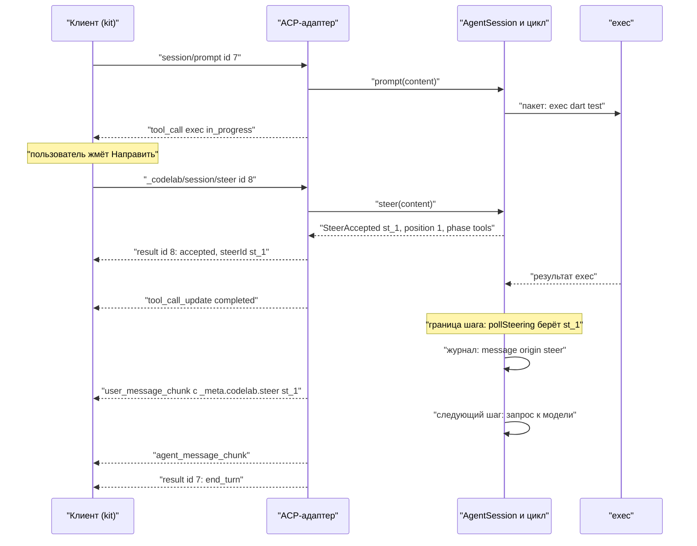
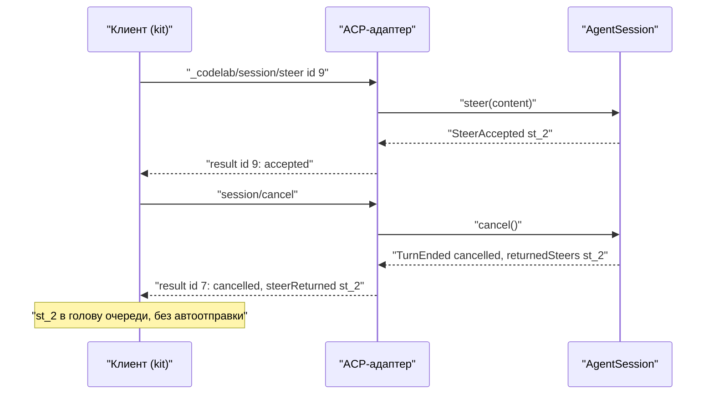

# 17.7. Steering: сообщение посреди хода

> Часть [архитектуры ядра агента CodeLab](../agent-core-architecture.md). Status: Accepted. Общие соглашения, термины и порядок чтения — в оглавлении.

← [17.6. Управление сессиями: переименование, ветки, перемотка, lease](17-6-session-management.md) · [Оглавление ядра](../agent-core-architecture.md) · [17.8. LSP: языковые серверы](17-8-lsp.md) →

Цель: C-03 (steering: сообщение пользователя посреди хода). Связанные цели: U-15 (клиентская
очередь промптов, уже есть), R-18 (очередь в app, «отправить сейчас» с отменой хода), T-10
(фоновые команды — только точка расширения через `yieldToken`), C-06 (фоновые уведомления
субагентов, §17.3.8). Закрывает открытый вопрос «Steering (C-03): расширение ACP или только
клиентская очередь?» из [целей паритета](../agent-parity-goals.md) §8. Затрагивает §3.3
(мягкая уступка), §5.2 (`MessageQueue`), §5.4 (`pollSteering`), §5.6 (`Agent.steer`,
`AgentSession.steer`), LOOP-8, CAN-6, §8.2.3 (поле записи `origin`), §9 (CMP-7), §13.2, §13.5,
§13.7, §13.8, §13.10, §13.12, §15.4, а также [клиентский kit](../dart-agent-and-clients/09-10-stage-5-client-kit.md),
[ввод CLI](../dart-agent-and-clients/12-2-cli-display-and-input.md) и
[отображение в app](../dart-agent-and-clients/12-3-desktop-display.md).

## 17.7.1. Назначение

Ход агента длится минуты: модель читает файлы, правит, запускает `dart test`. Пользователь видит,
что агент пошёл не туда («тесты в `test/legacy/` не трогай», «используй `package:http`, а не
`dart:io`»), но сегодня у него два плохих пути. Очередь (U-15) доставит поправку только после
конца хода, когда неверная работа уже сделана. «Отправить сейчас» (R-18) отменит ход и потеряет
незавершённый шаг, а вызов, прерванный посреди `edit`, оставит рабочее дерево в промежуточном
состоянии.

Steering — третий путь: сообщение, отправленное во время хода, **входит в контекст на ближайшей
границе шага**, не отменяя ход и не прерывая работающий инструмент (CAN-6). Модель видит поправку
сразу после результатов текущего пакета инструментов и продолжает тот же ход уже с ней.

Ядро умеет это с MVP: у цикла есть очередь `steering` и лимит `maxSteeringSteps` (§5.2, §5.4,
LOOP-8), фоновые уведомления субагентов уже ходят через `Agent.steer` (§17.3.8). Не хватает
трёх вещей, и этот раздел их вводит:

1. **Протокол.** В ACP нет способа передать сообщение во время хода: `session/prompt` при
   активном ходе отклоняется `-32602 turnActive` (§13.7, шаг 2). Вводится расширение
   `_codelab/session/steer` с согласованием в `initialize`.
2. **Гарантия доставки.** Принятое сообщение ДОЛЖНО быть либо доставлено модели ровно один раз,
   либо возвращено клиенту, если ход закончился раньше границы шага. Молча теряться оно НЕ ДОЛЖНО.
3. **Клиентский UX.** Пользователь явно выбирает «в очередь» или «направить»; без поддержки у
   агента kit незаметно откатывается к очереди U-15.

Не входит: прерывание работающего инструмента, отзыв уже принятого steering-сообщения, доставка
субагентам, перевод долгой команды в фон (только зарезервированная точка, §17.7.3.5).

## 17.7.2. Контракт

### 17.7.2.1. Ядро (Dart)

Файл `codelab_agent_core/lib/src/loop/steering.dart`:

```dart
extension type const SteerId(String value) {}       // "st_" + IdGenerator, уникален в сессии

/// Откуда сообщение попало в очередь steering. Поле ЗАПИСИ журнала (§8.2.3), модель его не видит.
sealed class MessageOrigin { const MessageOrigin(); }
final class SteerOrigin extends MessageOrigin { final SteerId id; const SteerOrigin(this.id); }
final class SubagentNoticeOrigin extends MessageOrigin { final SubagentId id; const SubagentNoticeOrigin(this.id); }
final class JobNoticeOrigin extends MessageOrigin { final JobId id; const JobNoticeOrigin(this.id); }   // §17.9.6
/// После MVP (§17.12.5): не элемент очереди steering — вставляется циклом на шаге 10a и шагов не открывает.
final class DeadlineNoticeOrigin extends MessageOrigin {
  final String deadlineId; final List<DeadlineThreshold> thresholds;
  const DeadlineNoticeOrigin(this.deadlineId, this.thresholds);
}
/// После MVP (§17.3.8.1): только в журнале субагента; не элементы очереди steering — сообщение прогона.
final class ParentMessageOrigin extends MessageOrigin { final int run; final String toolCallId; const ParentMessageOrigin(this.run, this.toolCallId); }
final class SubagentResumeOrigin extends MessageOrigin { final int run; final String failure; const SubagentResumeOrigin(this.run, this.failure); }
/// Классификация «слова пользователя» — только §8.2.5 (isUserWordsEvent); здесь её не дублировать.

/// Элемент очереди steering (§5.2: MessageQueue<SteeringItem> вместо MessageQueue<Message>).
final class SteeringItem { final UserMessage message; final MessageOrigin origin; }

enum TurnPhase { model, tools, permission }          // для подсказки в UI, не для логики

sealed class SteerAdmission { const SteerAdmission(); }
final class SteerAccepted extends SteerAdmission {
  final SteerId id;
  final int position;                                // 1-based место в очереди steering на момент приёма
  final TurnPhase phase;                             // чего ждёт ход сейчас
}
final class SteerRefused extends SteerAdmission { final SteerRefusal reason; }
enum SteerRefusal { noActiveTurn, steerLimit, steerTooLarge, steeringDisabled }
```

Изменения API §5.6:

```dart
final class Agent {
  // ...
  void steer(Message m, {MessageOrigin? origin});    // как раньше: уведомления (§17.3.8, SubagentNoticeOrigin); без хода — в начало следующего
  /// Пользовательский steering: принимается только в идущем и НЕ запечатанном ходе (§17.7.3.1).
  /// Синхронный: решение и место в очереди известны до возврата.
  SteerAdmission trySteer(UserMessage m, {required SteerId id});
}

abstract interface class AgentSession {
  // ...
  SteerAdmission steer(List<ContentBlock> content);  // было void; валидация блоков — как у prompt (§13.4)
}
```

События §5.3 получают по одному полю:

```dart
final class MessageStarted extends AgentEvent { /* ... */ final MessageOrigin? origin; }   // null — промпт или ответ
final class TurnEnded extends AgentEvent { /* ... */ final List<SteerId> returnedSteers; } // принятые и не доставленные
```

### 17.7.2.2. Расширение ACP (через OpenSpec)

Все формы ниже вводятся одним OpenSpec change и перечисляются в §13.12 (ACP-2). Они соответствуют
правилам расширяемости ACP: метод начинается с `_`, свои поля — только внутри `_meta`,
возможность объявляется в `_meta` объекта capability.

| Форма | Где | Смысл |
|---|---|---|
| `agentCapabilities._meta.codelab.steering: {"maxBytes": 65536, "maxPending": 8}` | ответ `initialize` | агент принимает `_codelab/session/steer`; лимиты для UI. Нет поля — клиент не шлёт steering |
| запрос `_codelab/session/steer` `{sessionId, prompt: ContentBlock[]}` | клиент → агент | сообщение посреди хода; блоки — как у `session/prompt` |
| ответ `{"accepted": true, "steerId", "position", "phase"}` | агент → клиент | принято; будет доставлено на ближайшей границе шага |
| ошибка `-32602`, `data.codelab.reason`: `noActiveTurn`, `steerLimit`, `steerTooLarge`, `steeringDisabled`, `sessionBusy` | ответ на `_codelab/session/steer` | не принято; клиент откатывается к очереди (§17.7.4) |
| `_meta.codelab.steer: {"id": "<steerId>"}` | `user_message_chunk` (вживую и при реплее) | момент и место доставки; связь с ответом на запрос |
| `_meta.codelab.steerReturned: ["<steerId>", …]` | ответ `session/prompt` (при JSON-RPC ошибке — `data.codelab.steerReturned`); `_meta.codelab.turnEnded` в `session_info_update` (§13.5, шаг 9) | принятые, но не доставленные сообщения: ход закончился раньше границы шага |

Клиентская capability не нужна: кадры с `_meta.codelab.steer` и `steerReturned` получает только
клиент, который сам отправлял steering, а `_meta` любой клиент вправе игнорировать.
Семантика стандартного `session/prompt` не меняется: во время хода он по-прежнему отклоняется
`turnActive` (STEER-11).

## 17.7.3. Алгоритмы: агент

### 17.7.3.1. Приём (`_codelab/session/steer`)

```text
handleSteer(params, connection):
 1  агент не объявил steering (steering.enabled = false) → -32601 Method not found
 2  сессии нет → -32002; блоки не проходят декодер или правила §13.4 → -32602
 3  ход сессии идёт в другом соединении → -32602 reason sessionBusy
 4  admission := session.steer(blocks)                 # синхронно, без await до ответа
 5  SteerAccepted → ответ {accepted, steerId, position, phase} в OutboundQueue; лог steer.accepted
    SteerRefused  → -32602 с data.codelab.reason = admission.reason; лог steer.refused
```

`AgentSession.steer(blocks)` → `Agent.trySteer`:

```text
 1  steering.enabled = false → steeringDisabled
 2  нет хода, ход отменяется (abort вызван) или ход ЗАПЕЧАТАН → noActiveTurn
 3  суммарный UTF-8 размер текстовых блоков > steering.max_bytes → steerTooLarge
 4  pendingUserSteers ≥ steering.max_pending или steeringSteps ≥ maxSteeringSteps → steerLimit
 5  id := SteerId("st_" + ids.next()); steering.add(SteeringItem(UserMessage(blocks), SteerOrigin(id)))
 6  вернуть SteerAccepted(id, position = steering.length, phase = текущая фаза)
```

**Запечатывание.** Ход запечатывается синхронно в тот момент, когда цикл решил больше не начинать
шагов: финальный опрос (§5.4, шаг 6–7) не нашёл ввода, сработал бюджет (шаг 9), ход отменён
(шаги 10, 24) или ответ модели — `error`/`aborted` (шаг 16). После запечатывания `trySteer`
возвращает `noActiveTurn`, хотя `TurnEnded` ещё не эмитирован. Цикл и обработчик кадров
исполняются в одном isolate, а проверка и постановка в очередь синхронны, поэтому гонки «принято
после финального опроса» нет. Фаза: `model` между `StepStarted` и концом ответа; `tools` во время
пакета; `permission`, если у сессии есть неотвеченный `session/request_permission` (адаптер знает
это по своей таблице запросов).

### 17.7.3.2. Доставка (изменение §5.4)

`pollSteering()` вызывается там же, где сейчас (шаги 3, 6 и 25), но работает так:

```text
pollSteering():
 1  if steeringSteps ≥ maxSteeringSteps: return                    # LOOP-8
 2  if следующий шаг не начнётся (cancel.isCancelled или budgetExceeded): return
 3  items := steering.takeAll()                                    # ВСЕ элементы, FIFO
 4  if items пусто: return
 5  для item из items: transcript.add(item.message);
        emit MessageStarted(item.message, origin: item.origin), MessageEnded(item.message)
 6  steeringSteps++; hasNewInput = true                            # один шаг на опрос, не на сообщение
```

Граница шага — только два места: после того как **все** результаты пакета добавлены в транскрипт
(шаг 19, затем шаги 20–25), и после ответа модели без вызовов. Steering НЕ ДОЛЖЕН вставляться между
`toolCall` ответа и его результатом: это ломает парность (TOOL-6) у всех провайдеров. Поэтому в
последовательном пакете сообщение ждёт конца всего пакета, а не текущего вызова (уточнение §3.3).

Пользовательские сообщения и уведомления фоновых субагентов (§17.3.8) и фоновых команд (§17.9.6)
лежат в **одной** очереди в порядке поступления: steering от человека не обгоняет отчёт ребёнка и не отстаёт от него.

Если ответ модели без вызовов уже стримился, когда пришло steering, финальный ответ остаётся в
транскрипте как есть, а шаг 25 добавляет сообщение и открывает ещё один шаг: модель отвечает на
поправку в том же ходе. Заметка `Revise` (§5.4, шаг 22) и steering одной границы идут в один шаг.

### 17.7.3.3. Возврат недоставленных

При `TurnEnded` все `SteeringItem` с `SteerOrigin`, оставшиеся в очереди, **удаляются** из неё и
перечисляются в `TurnEnded.returnedSteers` в порядке приёма. Агент НЕ ДОЛЖЕН переносить
пользовательское steering в следующий ход: следующего хода может не быть, а пользователь, увидев
итог, может передумать. Решение принимает клиент (§17.7.4). Уведомления субагентов остаются
в очереди и ждут следующего хода, как в §17.3.8 (`Agent.steer` без хода), — в `returnedSteers` они
не попадают.

Причины возврата: отмена (`session/cancel`), исчерпанный бюджет, `failed`/`refused`, отсоединение
без переподключения за `detachGrace`, процесс агента упал (тогда список восстанавливает клиент,
§17.7.4, шаг 8).

### 17.7.3.4. Взаимодействие с другими механизмами

| Ситуация | Поведение |
|---|---|
| Ход ждёт ответа на `session/request_permission` | steering принимается с `phase: permission`, на запрос НЕ отвечает и его не отменяет; доставляется после пакета, то есть после ответа на разрешение и исполнения (или отказа) вызова |
| `session/cancel` после принятого steering | ход отменяется как обычно (§3); сообщение возвращается в `steerReturned` ответа с `stopReason: cancelled` |
| Блокирующий субагент (`task`) работает | steering ребёнку не доставляется (§17.3.4); родитель получает его после результата `task`. Остановить ребёнка — `/tasks cancel` или доска U-21 |
| Фоновое уведомление субагента | общая FIFO-очередь, один опрос — один шаг (§17.7.3.2) |
| `prepareNextStep` сжимает контекст (шаг 23) | сжатие идёт до опроса (шаг 25), поэтому steering попадает в контекст после резюме и дословно |
| Автосжатие после хода (§9) | доставленное steering — обычное сообщение пользователя: входит в `userTurns` и под CMP-7 сохраняется дословно, как промпт |
| Аварийное сжатие при переполнении | так же: сообщение уже в транскрипте и в журнале |
| `maxSteeringSteps` исчерпан | новые steering отклоняются `steerLimit`; принятые ранее доставляются, так как приём проверяет тот же счётчик |
| Текст начинается с `/` | агент НЕ ДОЛЖЕН разбирать steering как команду (§13.6): текст уходит модели как есть. Клиент сам решает, отправлять ли команду через очередь (§17.7.4, шаг 2) |
| `codelab -p` | steering не используется: промпт один, ввода во время хода нет |

### 17.7.3.5. Мягкая уступка долгого инструмента (будущее, необязательно)

Статус: реализовано в §17.9.7, по умолчанию выключено. `ToolContext.yieldToken` (§3.3) отменяется
только по правилу §17.9.7 (STEER-12, JOB-9). Правило: если steering
принят, а в текущем пакете дольше `steering.yield_after` работает инструмент, объявивший
`yieldable: true` (например, `exec` с поддержкой фона), агент отменяет `yieldToken` этого вызова.
Инструмент не убивает процесс, а переводит его в фоновую задачу и сразу возвращает результат
`Command moved to background job <id> because the user sent a message. Use job_output to read
its output.` Пакет заканчивается раньше, steering доставляется, процесс продолжает работать.
Ключ `steering.yield_long_tools` (`false`) включает уступку при `jobs.enabled` (§17.9.7).

## 17.7.4. Алгоритм: клиент (`acp_client_kit`)

Изменения [kit](../dart-agent-and-clients/09-10-stage-5-client-kit.md) §5.4 и `SessionHandle`:

```dart
abstract interface class SessionHandle {
  // ...
  /// Направить сообщение в идущий ход. Без поддержки у агента или без хода — как send().
  Future<SteerSubmission> steer(String text,
      {List<PromptAttachment> attachments = const [], bool allowOutsideCwd = false});
}
abstract interface class PromptQueue {
  // ...
  Future<SteerSubmission> steer(String id);          // направить элемент очереди, не отменяя ход (рядом с sendNow, R-18)
}
sealed class SteerSubmission {}
final class Steered extends SteerSubmission { final String steerId; final int position; }
final class FellBackToPrompt extends SteerSubmission { final PromptSubmission submission; final SteerFallbackReason reason; }
enum SteerFallbackReason { unsupported, idle, command, noActiveTurn, steerLimit, steerTooLarge, sessionBusy, steeringDisabled }

// SessionView: новое поле
final List<PendingSteerView> pendingSteers;          // id, text, attachments, phase, state: sending | accepted
// UserItem (§12.1.1): новое поле origin: user | steer
```

```text
SessionHandle.steer(text, attachments):
 1  blocks := PromptContentBuilder.build(text, attachments)                 # как send
 2  текст — известная команда (клиентская или из available_commands) → send(); reason command
 3  нет agentCapabilities._meta.codelab.steering → send(); reason unsupported
    статус сессии не running (idle, cancelling, failed, detached) → send(); reason idle
 4  pendingSteers += PendingSteerView(localId, state: sending)
 5  _codelab/session/steer(sessionId, blocks):
      result accepted → state accepted(steerId, position, phase); вернуть Steered
      -32602 noActiveTurn → убрать из pendingSteers; send(); reason noActiveTurn
                             # ход только что закончился: промпт уйдёт сразу или встанет в очередь
      -32602 steerLimit | steerTooLarge | sessionBusy → убрать; send() (в очередь);
                             NoticeItem с причиной; reason по коду
      -32602 steeringDisabled → убрать; считать capability отсутствующей до конца соединения;
                             send(); reason steeringDisabled
      -32601 → считать capability отсутствующей до конца соединения; send(); reason unsupported
 6  user_message_chunk с _meta.codelab.steer.id == steerId → убрать из pendingSteers;
    UserItem(origin: steer) в ТЕКУЩЕЕ место транскрипта (после завершённых вызовов пакета);
    повторные chunk того же id дописывают блоки в тот же UserItem
 7  ответ session/prompt (или turnEnded после переподключения) со steerReturned:
    каждый id из pendingSteers → QueuedPrompt в ГОЛОВУ очереди в исходном порядке;
    NoticeItem "Не доставлено: ход завершился раньше. Сообщение в очереди."
    дальше — правила очереди U-15: после end_turn и max_turn_requests очередь разбирается сама;
    после cancelled — ждёт явного действия (как сейчас в kit)
 8  переподключение (session/load): id, встреченные в реплее с _meta.codelab.steer, → доставлены;
    если ход больше не идёт и turnEnded не пришёл (агент упал), остальные pending → шаг 7
```

Kit НЕ ДОЛЖЕН терять ввод: каждый вызов `steer` заканчивается доставкой, промптом или элементом
очереди (STEER-10). Пустой `prompt` в `_codelab/session/steer` kit не отправляет.

## 17.7.5. Журнал и реплей

Доставка — это запись `message` на `MessageStarted` с `origin` (подписчик `AgentSession`, «хост
сохраняет, цикл эмитит», §5.6). Поле `origin` §8.2.3 получает значение `"steer"` и сопутствующее
поле записи `steerId`:

```json
{"type":"message","id":"u7st0001","parentId":"r1aa0003","timestamp":"2026-10-22T10:14:07.410Z","origin":"steer","steerId":"st_01JC4M9Q2V7Y3K8D5R1T6W0X4B","message":{"role":"user","timestamp":"2026-10-22T10:14:07.410Z","content":[{"type":"text","text":"Не трогай test/legacy, правь только test/unit"}]}}
```

* `message` побайтово совпадает с тем, что увидит модель: обёрток, префиксов и тегов нет (STEER-9).
  `origin` и `steerId` — поля записи, `Message` их не содержит, `buildLlmContext` (§8.7) их не читает.
* Принятое, но не доставленное сообщение в журнал **не пишется** вовсе: очередь живёт в памяти.
  После сбоя оно не всплывёт в контексте само; вернуть его — дело клиента (§17.7.4, шаг 8).
* Продолжение прерванного хода (§8.8) обрабатывает запись `origin: "steer"` как любое сообщение
  пользователя: если после неё нет ответа модели, ход продолжается с ней.
* Реплей (§13.5, шаг 5): запись `user` с `origin: "steer"` → `user_message_chunk` на каждый блок с
  `_meta.codelab.steer: {"id": steerId}`. В отличие от `subagent_notice`, она не пропускается: это
  слова пользователя. Клиент без расширения покажет её как обычное сообщение пользователя на
  правильном месте — между результатами инструментов и следующим ответом.
* Сводка `session/list` (§8.10) считает steering в `messageCount` как сообщение пользователя.
* Вживую: `MessageStarted(user, origin: SteerOrigin)` → `user_message_chunk` с тем же `_meta`.
  Обычный промпт клиенту вживую по-прежнему не отправляется (§13.7): клиент показал его сам.

## 17.7.6. UX клиентов

Общее правило обоих клиентов: **Enter во время хода — в очередь** (поведение U-15 и R-18 не
меняется), steering — отдельное явное действие. Пользователь всегда видит, куда ушло сообщение:
ожидающее steering показывается над композером с фазой («ждёт конца инструментов», «ждёт ответа на
разрешение», «ждёт ответа модели»), доставленное — в транскрипте как сообщение пользователя с
пометкой, возвращённое — в очереди с заметкой.

**CLI** ([12.2.9](../dart-agent-and-clients/12-2-cli-display-and-input.md)):

* Действие реестра клавиш `steer`, по умолчанию Ctrl+Enter (различим при CSI u, kitty или
  modifyOtherKeys, как Shift+Enter; `/terminal-setup` сообщает, различим ли он). Alt+Enter занят
  действием `newline`.
* Клиентская команда `/steer <текст>` работает в любом терминале; `/queue steer <n>` направляет
  n-й элемент очереди (рядом с `/queue drop`).
* Без хода или без capability у агента `steer` ведёт себя как `submit`; подсказка TUI показывает
  `Ctrl+Enter направить` только во время хода и только при объявленной capability.
* Транскрипт: строка пользователя с префиксом `↳` и тусклой пометкой `(во время хода)`; ожидающее
  — строка `↳ направлено: <начало текста> · ждёт конца инструментов`. Сегмент статус-строки
  `queue` показывает `в очереди: 2 · направлено: 1`.

**App** ([12.3](../dart-agent-and-clients/12-3-desktop-display.md)):

* Во время хода кнопка отправки — разделённая: основное действие «В очередь» (Enter),
  дополнительное «Направить» (Cmd+Shift+Enter на macOS, Ctrl+Shift+Enter на остальных: Cmd/Ctrl+Enter
  в app уже одобряет запрос разрешения, dart-agent-and-clients §12.3.3, A9). Без capability
  вторая часть кнопки скрыта.
* Панель очереди (R-18): у каждой строки рядом с «Отправить сейчас» (отмена хода) появляется
  «Направить» (без отмены) — вызывает `PromptQueue.steer(id)`.
* Пузырь пользователя с меткой «во время хода»; ожидающий — полупрозрачный, с фазой; возвращённый
  — снова строка очереди с заметкой.

**Настройка** `input.enter_while_running: queue | steer` (CLI — `~/.codelab/cli.yaml`, app — в
настройках) меняет местами основное и дополнительное действие; по умолчанию `queue`.

## 17.7.7. Конфигурация

Раздел `steering` конфигурации агента (§15.4):

| Ключ | Тип | По умолчанию | Смысл |
|---|---|---|---|
| `enabled` | bool | `true` | объявлять `_meta.codelab.steering` и принимать `_codelab/session/steer` |
| `max_steps` | int | `20` | `maxSteeringSteps` (LOOP-8): шагов, добавленных steering-ом за ход; общий с уведомлениями субагентов |
| `max_pending` | int | `8` | принятых и ещё не доставленных пользовательских сообщений за раз |
| `max_bytes` | int | `65536` | суммарный UTF-8 размер текстовых блоков одного сообщения; картинки и ресурсы — по правилам `session/prompt` (§13.4) |
| `yield_long_tools` | bool | `false` | уступка долгого `exec` в фоновую задачу при steering (§17.9.7); `true` при `jobs.enabled: false` → `ConfigException` |
| `yield_after` | duration | `"10s"` | сколько вызов должен проработать до уступки (§17.9.7) |

Проектный конфиг (§15.3) может только ужесточать: `enabled = false` и уменьшение лимитов принимаются
без доверия к проекту, увеличение — только для проекта из `trusted_projects`. Валидация (§15.5):
`max_steps ≥ 1`, `1 ≤ max_pending ≤ max_steps`, `1024 ≤ max_bytes ≤ 1048576`. Изменение раздела
при живой перезагрузке (§17.5) действует со следующего хода; объявленная в `initialize`
capability в рамках соединения не меняется (выключение → `steeringDisabled`).

Клиентские ключи: `keys.steer: [ctrl+enter]`, `input.enter_while_running: queue` в
`~/.codelab/cli.yaml`; те же значения — в настройках app.

## 17.7.8. Примеры

Согласование (фрагмент ответа `initialize`):

```json
{"jsonrpc":"2.0","id":0,"result":{"protocolVersion":1,"agentCapabilities":{"loadSession":true,"promptCapabilities":{"image":true,"audio":false,"embeddedContext":true},"mcpCapabilities":{"http":true,"sse":false},"sessionCapabilities":{"list":{}},"_meta":{"codelab":{"steering":{"maxBytes":65536,"maxPending":8}}}},"agentInfo":{"name":"codelab-agent","title":"CodeLab Agent","version":"0.1.0"},"authMethods":[]}}
```

Steering во время `exec` (golden `acp/prompt-steer-during-tool`):

```json
{"jsonrpc":"2.0","id":7,"method":"session/prompt","params":{"sessionId":"01JB8Q2W6R9T3M5K7N1P4X8Z0C","prompt":[{"type":"text","text":"Почини падающие тесты"}]}}
{"jsonrpc":"2.0","method":"session/update","params":{"sessionId":"01JB8Q2W6R9T3M5K7N1P4X8Z0C","update":{"sessionUpdate":"tool_call","toolCallId":"call_1","title":"Run dart test","kind":"execute","status":"pending","rawInput":{"command":"dart test"}}}}
{"jsonrpc":"2.0","method":"session/update","params":{"sessionId":"01JB8Q2W6R9T3M5K7N1P4X8Z0C","update":{"sessionUpdate":"tool_call_update","toolCallId":"call_1","status":"in_progress"}}}
{"jsonrpc":"2.0","id":8,"method":"_codelab/session/steer","params":{"sessionId":"01JB8Q2W6R9T3M5K7N1P4X8Z0C","prompt":[{"type":"text","text":"Не трогай test/legacy, правь только test/unit"}]}}
{"jsonrpc":"2.0","id":8,"result":{"accepted":true,"steerId":"st_01JC4M9Q2V7Y3K8D5R1T6W0X4B","position":1,"phase":"tools"}}
{"jsonrpc":"2.0","method":"session/update","params":{"sessionId":"01JB8Q2W6R9T3M5K7N1P4X8Z0C","update":{"sessionUpdate":"tool_call_update","toolCallId":"call_1","status":"completed","content":[{"type":"content","content":{"type":"text","text":"00:04 +12 -3: Some tests failed."}}]}}}
{"jsonrpc":"2.0","method":"session/update","params":{"sessionId":"01JB8Q2W6R9T3M5K7N1P4X8Z0C","update":{"sessionUpdate":"user_message_chunk","content":{"type":"text","text":"Не трогай test/legacy, правь только test/unit"},"_meta":{"codelab":{"steer":{"id":"st_01JC4M9Q2V7Y3K8D5R1T6W0X4B"}}}}}}
{"jsonrpc":"2.0","method":"session/update","params":{"sessionId":"01JB8Q2W6R9T3M5K7N1P4X8Z0C","update":{"sessionUpdate":"agent_message_chunk","content":{"type":"text","text":"Понял, ограничусь test/unit."}}}}
{"jsonrpc":"2.0","id":7,"result":{"stopReason":"end_turn"}}
```

Хода нет (гонка с концом хода) и возврат при отмене:

```json
{"jsonrpc":"2.0","id":11,"error":{"code":-32602,"message":"No active turn: send the message as a new prompt.","data":{"codelab":{"reason":"noActiveTurn"}}}}
{"jsonrpc":"2.0","id":7,"result":{"stopReason":"cancelled","_meta":{"codelab":{"steerReturned":["st_01JC4N2B8H5X1Q9M3V7K0R6T2E"]}}}}
```





## 17.7.9. Инварианты

1. **STEER-1.** Steering не отменяет токен хода, не прерывает работающий инструмент и не отвечает на ожидающий `session/request_permission` (продолжение CAN-6).
2. **STEER-2.** Steering входит в транскрипт только на границе шага: после того как все результаты пакета добавлены, или после ответа модели без вызовов; между `toolCall` и его результатом сообщение пользователя не появляется никогда (TOOL-6).
3. **STEER-3.** Каждое принятое сообщение (`SteerAccepted`) за ход либо доставлено ровно один раз (запись журнала `origin: "steer"`, `MessageStarted`, `user_message_chunk` с тем же `steerId`), либо перечислено в `returnedSteers` / `steerReturned` этого хода. Агент не переносит пользовательское steering в следующий ход.
4. **STEER-4.** Ответ на `_codelab/session/steer` стоит в `OutboundQueue` раньше любого `user_message_chunk` с его `steerId`.
5. **STEER-5.** Steering принимается только в идущем, не отменяемом и не запечатанном ходе; иначе — `noActiveTurn`. Steering никогда не начинает ход (как SUB-13).
6. **STEER-6.** Один опрос забирает все элементы очереди в порядке FIFO и добавляет ровно один шаг; число таких шагов за ход не превышает `maxSteeringSteps` (LOOP-8). Пользовательские сообщения и уведомления субагентов упорядочены по времени поступления.
7. **STEER-7.** За доставленным steering в том же ходе начинается хотя бы один шаг: опрос не забирает сообщения, если ход отменён или бюджет исчерпан.
8. **STEER-8.** Содержимое steering валидируется как `session/prompt` (§13.4) и никогда не разбирается агентом как slash-команда.
9. **STEER-9.** Модель видит steering побайтово равным полю `message` записи журнала; при реплее оно приходит как `user_message_chunk` с `_meta.codelab.steer` на своём месте в истории.
10. **STEER-10.** В kit каждый вызов `steer` заканчивается ровно одним из исходов: доставка, отправка как промпт, элемент очереди; ввод пользователя не теряется и не дублируется.
11. **STEER-11.** Семантика стандартных методов не меняется: `session/prompt` во время хода — `-32602 turnActive`; без `agentCapabilities._meta.codelab.steering` kit не шлёт `_codelab/session/steer`.
12. **STEER-12.** Steering не доставляется субагентам; `yieldToken` отменяется только по правилу §17.9.7 (JOB-9).

## 17.7.10. Обоснование решения

* **Отдельный метод `_codelab/session/steer`, а не `session/prompt` с флагом в `_meta`.** У
  `session/prompt` в ACP одна семантика: запрос открывает ход и получает ответ со `stopReason`
  по его окончании. Второй `session/prompt` с `_meta.codelab.steer: true` дал бы два
  незакрытых запроса на одну сессию: непонятно, когда отвечать на второй и что значит его
  `stopReason`. Хуже всего откат: агент, не знающий флага, либо отклонит запрос `turnActive`
  (клиент не отличит его от «нет поддержки»), либо, если он иначе понимает спецификацию, начнёт
  параллельный ход. Неизвестный метод `_…` по правилам ACP даёт чистый `-32601`, а capability в
  `initialize` позволяет вообще не пробовать. Отдельный метод ещё и даёт естественное место для
  `steerId` и `position` в ответе.
* **Имя `_codelab/session/steer`, а не `_codelab/steer`.** Пространство `_codelab/<область>/<действие>`
  уже используется (`_codelab/subagents/*`, §13.12); метод работает с сессией, как `session/*`.
* **«Не делать» (только очередь U-15) отклонено.** Очередь доставляет поправку после конца хода, то
  есть после неверной работы; «отправить сейчас» (R-18) теряет незавершённый шаг. Ядро уже
  содержит всю механику steering (§5.4, LOOP-8) и пользуется ею для субагентов; недостающее —
  тонкий протокольный слой. Клиентская очередь остаётся откатом и основным путём по Enter.
* **Возврат клиенту, а не перенос в следующий ход.** Агент не начинает ход сам (§17.3.8), и
  «следующий ход» может не наступить. Пользователь, увидев отменённый ход, мог передумать. Клиент
  кладёт сообщение в голову очереди: оно не теряется и не уходит без ведома пользователя после
  отмены.
* **Все сообщения за один опрос.** Если пользователь отправил две поправки за время долгого `exec`,
  модель должна увидеть обе до следующего действия; при одном сообщении на опрос она успела бы
  сделать шаг по первой поправке, противоречащий второй. Счётчик LOOP-8 считает шаги, а не
  сообщения, поэтому лимит сохраняет смысл.
* **Доставка после всего пакета, а не после текущего вызова.** Пользовательское сообщение между
  результатами одного ответа нарушает парность вызовов у всех провайдеров. Пропускать оставшиеся
  вызовы последовательного пакета («пользователь что-то сказал — остальное не делаем») отклонено:
  это меняет исход действий, которые модель запланировала вместе; кто хочет остановить работу,
  отменяет ход.
* **Steering не отвечает на запрос разрешения.** Ответ «отклонить с комментарием» — отдельная
  семантика одобрений (§7) с собственными гарантиями PERM-4; смешивать её со steering значит
  получить отказ, о котором пользователь не просил. Клиент показывает фазу `permission`, чтобы
  было понятно, чего ждёт сообщение.
* **Без обёртки вокруг текста.** Steering — слова пользователя, им доверяют так же, как промпту.
  Обёртка вроде `<user-interjection>` разошлась бы с журналом и реплеем и дала бы модели повод
  считать сообщение менее весомым. Место в транскрипте (после результатов инструментов) и так
  показывает, что оно пришло посреди работы.
* **Enter по умолчанию — в очередь.** Это сохраняет поведение U-15/R-18 и их тесты; steering меняет
  ход работы, поэтому требует явного действия. Кто хочет наоборот — `input.enter_while_running: steer`.
* **Отзыва принятого steering нет.** Окно между приёмом и доставкой обычно короткое, а отзыв
  требует ещё одного метода и гонки «отозвано или уже доставлено». Если понадобится, добавляется
  отдельным методом без изменения этого контракта.
* **Перевод долгой команды в фон** входит в формулировку C-03, но зависит от фоновых задач (T-10).
  Здесь зарезервированы `yieldToken`, `yieldable` и ключи конфигурации, чтобы включить уступку без
  изменения протокола steering; сама уступка реализована в §17.9.7.

## 17.7.11. Как проверить

Тесты ядра — `packages/dart/codelab_agent_core/test/loop/`; адаптера —
`packages/dart/codelab_agent_acp/test/`; kit — `packages/dart/acp_client_kit/test/steer/`;
fake-модель scripted, fake `exec` с управляемым завершением.

* Golden ACP-фикстура **`acp/prompt-steer-during-tool`** (цель C-03, после OpenSpec): кадры
  §17.7.8; ответ на steer раньше `user_message_chunk` (STEER-4); `user_message_chunk` после
  `tool_call_update completed` и до первого `agent_message_chunk` следующего шага (STEER-2);
  `session/load` той же сессии реплеит его с тем же `_meta.codelab.steer` (STEER-9).
* `acp/steer-no-active-turn`: steer без хода и сразу после запечатывания → `-32602 noActiveTurn`;
  steer из другого соединения → `sessionBusy`; без capability → `-32601`; `session/prompt` во
  время хода по-прежнему `turnActive` (STEER-5, STEER-11).
* `acp/steer-returned-on-cancel`: steer принят, затем `session/cancel` → ответ `cancelled` со
  `steerReturned`; в журнале нет записи `origin: "steer"` (STEER-3).
* `acp/initialize-steering-capability`: `steering.enabled = false` → поля `_meta.codelab.steering`
  нет; `true` → лимиты из конфига.
* `steer_does_not_cancel_test.dart` (существующий, CAN-6) расширяется: steer во время ожидания
  разрешения — запрос не отвечен, после ответа и исполнения вызова сообщение доставлено (STEER-1).
* `steering_test.dart` (LOOP-8) обновляется под STEER-6: три steering за один пакет → один шаг с
  тремя сообщениями в порядке приёма; уведомление субагента между ними сохраняет порядок; при
  `max_steps = 2` третий опрос не делается, `trySteer` → `steerLimit`.
* `steer_sequential_batch_test.dart`: пакет из трёх `sequential` вызовов, steer после первого →
  все три исполнены, сообщение после третьего результата; парность сохранена (STEER-2, TOOL-6).
* `steer_seal_test.dart`: steer, пришедший во время стрима финального ответа, → ещё один шаг в том
  же ходе; steer после запечатывания → `noActiveTurn`; бюджет исчерпан на границе → сообщение не
  забрано и в `returnedSteers` (STEER-5, STEER-7).
* `steer_journal_test.dart`: запись `origin: "steer"` со `steerId`; текст запроса к модели побайтово
  равен `message` записи (STEER-9); `healInterruptedTurn` после сбоя сразу за steering продолжает
  ход с ним (§8.8); автосжатие сохраняет последнее steering дословно (CMP-7).
* `steer_validation_test.dart`: `max_bytes + 1` → `steerTooLarge`; текст `/compact` уходит модели
  как текст (STEER-8); пустой `prompt` → `-32602`.
* `steer_subagent_test.dart`: steer при работающем блокирующем `task` — ребёнок его не получает,
  родитель получает после результата `task` (STEER-12).
* `config_steering_test.dart`: `yield_long_tools: true` при `jobs.enabled: false` → `ConfigException`; увеличение
  `max_steps` в проектном конфиге без доверия отклонено, уменьшение принято.
* Kit, `session_steer_test.dart`: каждый откат таблицы §17.7.4 (unsupported, idle, command,
  noActiveTurn, steerLimit) даёт ровно один промпт или элемент очереди; `steerReturned` кладёт
  сообщение в голову очереди и после `cancelled` не отправляет его само, после `end_turn` —
  отправляет; переподключение с реплеем доставленного id убирает его из `pendingSteers` (STEER-10).
* CLI, `cli/prompt-steer-during-turn`: во время хода Ctrl+Enter и `/steer` шлют
  `_codelab/session/steer`, Enter — в очередь (`cli/prompt-queue-drains-after-turn` не меняется);
  строка `↳` в транскрипте; агент без capability → `/steer` ставит в очередь.
* App, `app:prompt_steer_flow_test.dart`: «Направить» в композере и в строке очереди; пузырь с
  меткой; «Отправить сейчас» (R-18) по-прежнему отменяет ход (`app:prompt_queue_flow_test.dart`
  не меняется).

---

← [17.6. Управление сессиями: переименование, ветки, перемотка, lease](17-6-session-management.md) · [Оглавление ядра](../agent-core-architecture.md) · [17.8. LSP: языковые серверы](17-8-lsp.md) →
