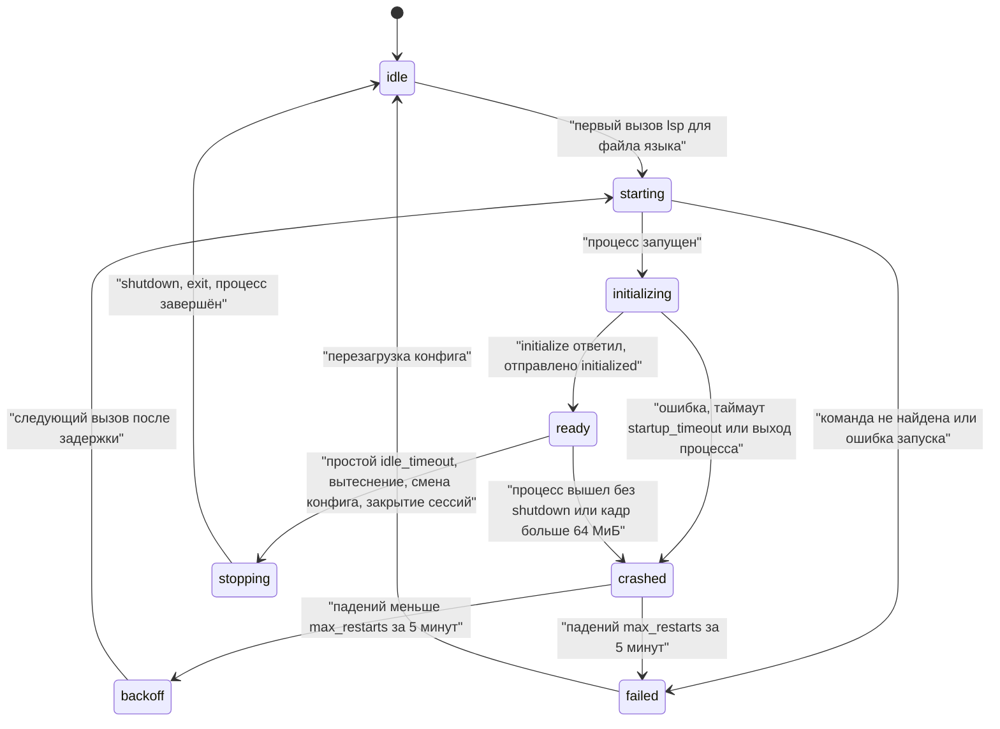
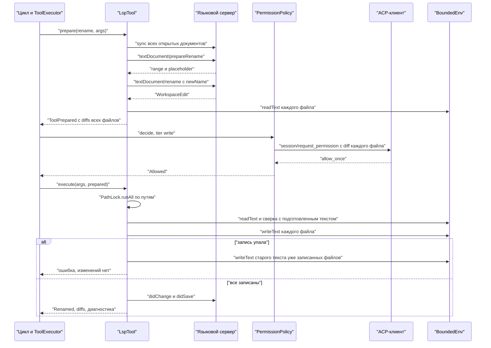

# 17.8. LSP: языковые серверы

> Часть [архитектуры ядра агента CodeLab](../agent-core-architecture.md). Status: Accepted. Общие соглашения, термины и порядок чтения — в оглавлении.

← [17.7. Steering: сообщение посреди хода](17-7-steering.md) · [Оглавление ядра](../agent-core-architecture.md) · [17.9. Фоновые команды](17-9-background-commands.md) →

Цели: T-15 (`lsp`: диагностика, определение, ссылки, переименование), E-12 (команды запуска
языковых серверов в конфигурации). Связанные цели: P-01 (одна точка проверки). Затрагивает
§1.2 (новый пакет `codelab_agent_lsp`), §4 (порт долгоживущего процесса), §6.2–§6.3 (уровень,
вид и подготовка вызова по аргументам, несколько diff на вызов, блокировка набора путей), §7.2,
§7.4, §7.8 (вопрос с несколькими файлами), §8.2 (поле записи `diffs`), §10 (новая capability
`languageServers`), §11.5 (секция `tools/lsp`), §12.3 (события `lsp.*`), §15.3–§15.4 (таблица `lsp`).

## 17.8.1. Назначение

`search` находит текст, но не символ: он не отличает объявление от одноимённой локальной
переменной, не видит импорт под другим именем и не знает, что метод переопределён в трёх
классах. Языковой сервер проекта (Dart analysis server, `typescript-language-server`, `pyright`)
это знает. Инструмент `lsp` даёт модели шесть действий поверх сервера: `diagnostics`,
`definition`, `references`, `hover`, `symbols` и `rename`.

Принципы:

* серверы запускаются **только** командами из конфигурации (`lsp.servers.<id>`, E-12); модель не
  выбирает ни команду, ни аргументы, ни окружение;
* сервер запускается лениво, при первом вызове `lsp` для файла его языка, и живёт в пуле хоста;
* действия чтения — уровень `read`; `rename` — уровень `write`, вид `edit`: правка всех файлов
  показывается человеку одним вопросом со всеми diff и применяется целиком или не применяется;
* сервер видит те же байты, что `read` и `edit`: перед каждым запросом документ
  синхронизируется из `ExecutionEnv` сессии;
* сервер — процесс на машине агента. Поэтому `lsp` доступен только там, где корень сессии лежит
  в локальной файловой системе агента: встроенные профили и `agent-serve` со stdio-клиентом
  (§17.8.9);
* исполнение — через единую точку (§6.3.1, P-01); своего пути к файлам у сервера через агента
  нет: правки, которые сервер предлагает сам (`workspace/applyEdit`), отклоняются.

## 17.8.2. Контракт

**Пакет.** Новый пакет `packages/dart/codelab_agent_lsp` — чистый Dart, по образцу
`codelab_agent_mcp`: протокол, кадрирование, клиент, пул, инструмент. Процесс приходит портом
из ядра, реализация порта с `dart:io` — в `codelab_agent_io`.

| Пакет | Ответственность | Зависит от | Запрещено |
|---|---|---|---|
| `packages/dart/codelab_agent_lsp` | кадрирование `Content-Length`, JSON-RPC, `LspClient`, `LspPool`, кодеки позиций, планировщик `WorkspaceEdit`, инструмент `lsp`, `LspToolFactory` | ядро | `dart:io` (процесс приходит портом `ByteProcessLauncher`), Flutter, ACP |

Allowlist `dependencies`: `codelab_agent_lsp` — `codelab_agent_core`, `meta`, `async`;
`codelab_embedded` — пять агентских пакетов (было четыре); `apps/codelab_agent` получает
зависимость `codelab_agent_lsp`. У `codelab_agent_io` новых зависимостей нет.

Раскладка `lib/src/`: `protocol/` (кадры, JSON-RPC, типы), `client/` (`LspClient`, документы,
кэш диагностики), `pool/`, `edits/` (кодек позиций, план `WorkspaceEdit`), `tool/`; тестовые
`FakeLanguageServer` и `InMemoryProcessLauncher` — в `lib/testing/`. Порт процесса — в ядре
(`env/process_port.dart`), порт языковых серверов — `tools/language_servers.dart`, запуск
процесса — `codelab_agent_io/lib/src/process/local_process_launcher.dart`.

**Порт процесса** (ядро, `env/process_port.dart`). В отличие от `Shell.exec` процесс
долгоживущий и с открытым `stdin`; shell не участвует.

```dart
abstract interface class ByteProcessLauncher {
  int? get hostPid;                                  // pid агента для initialize.processId; null — неизвестен
  /// Запуск без shell: executable ищется в PATH окружения env. Окружение — базовый набор §4.5
  /// плюс env; окружение процесса хоста целиком не наследуется (ENV-6).
  Future<Result<ByteProcess, ExecError>> start(String executable, List<String> args,
      {required String workingDirectory, Map<String, String> env = const {}});
}
abstract interface class ByteProcess {
  int get pid;
  StreamSink<List<int>> get stdin;
  Stream<List<int>> get stdout;
  Stream<List<int>> get stderr;
  Future<int> get exitCode;
  /// Завершение дерева процессов: SIGTERM всем потомкам, через grace — SIGKILL (§4.6, шаг 6).
  Future<void> terminate({Duration grace = const Duration(seconds: 2)});
}
```

`LocalProcessLauncher` (`codelab_agent_io`) — `Process.start(executable, args,
runInShell: false, includeParentEnvironment: false)`; нет файла в PATH →
`Err(ExecError(spawnFailed, message: 'command "<executable>" was not found'))`. Тот же порт может
позже принять stdio-транспорт MCP; это не часть этого раздела.

**Порт языковых серверов** (ядро, `tools/language_servers.dart`). Ядро не импортирует пакет LSP;
хост передаёт реализацию в `AgentCoreServices`.

```dart
final class AgentCoreServices {                    // дополнение §10.3
  // ...поля §10.3 без изменений...
  final LanguageServerToolFactory? languageServers;  // null → languageServers off
}

abstract interface class LanguageServerToolFactory {
  /// Один раз на сессию при её создании. Серверы не запускает (LSP-7).
  LanguageServerSession openSession(LanguageServerSessionSpec spec);
  Future<void> shutdownAll();                      // остановка хоста
}
final class LanguageServerSessionSpec {
  final String root;                               // нормализованный и разрешённый корень сессии
  final ExecutionEnv env;                          // тот же BoundedEnv, что у инструментов (ENV-2)
  final PathLock locks;                            // экземпляр сессии (§6.3.4)
  final LspSettings settings;
  final List<String> untrustedPaths;               // tools.untrusted_paths
  final Logger logger; final Clock clock;
}
abstract interface class LanguageServerSession {
  AgentTool get tool;                              // инструмент lsp
  AfterToolCallHook get afterToolCall;             // синхронизация и диагностика после правок (§17.8.5)
  void applySettings(LspSettings settings);        // живая перезагрузка (§17.8.10)
  Future<void> close();                            // снять ссылки на серверы пула (§17.8.4)
}

final class LspSettings {                          // из lsp (§17.8.10), уже провалидировано
  final int maxServers, maxRestarts, maxOpenDocuments, renameMaxFiles;
  final Duration idleTimeout, startupTimeout, requestTimeout, diagnosticsTimeout;
  final bool diagnosticsAfterEdit;
  final Map<String, LspServerConfig> servers;      // только enabled; ключ — id сервера
}
final class LspServerConfig {
  final String id, command; final List<String> args; final Map<String, String> env;
  final List<String> extensions;                   // '.dart'; в нижнем регистре
  final Map<String, String> languageIds;           // '.tsx' → 'typescriptreact'; по умолчанию id
  final List<String> rootMarkers;
  final Object? initializationOptions, settings;   // JSON-совместимые значения
  String get fingerprint;                          // канонический JSON всех полей (§17.8.10)
}
```

**Дополнения контракта инструмента** (правка §6.2). Все с поведением по умолчанию, поэтому
существующие инструменты не меняются.

```dart
abstract base class AgentTool {
  // ...члены §6.2...
  ToolTier tierOf(Map<String, Object?> args) => tier;          // политика читает tierOf (§7.4, шаг 7)
  ToolKind kindOf(Map<String, Object?> args) => kind;          // ACP kind, PermissionRequest.kind
  ToolExecutionMode? executionModeOf(Map<String, Object?> args) => executionMode;   // §5, режим пакета
  bool offersAllowAlways(Map<String, Object?> args) => true;   // false → вариант allow_always не предлагается
  /// Асинхронная подготовка после preflight и до разрешений (§6.3.1, шаг 3b). Ошибка — текст
  /// для модели, вопрос человеку не задаётся. presentation заменяет present(args) для вопроса.
  Future<ToolPreparation> prepare(Map<String, Object?> args, ToolContext ctx) async => const ToolPrepared();
}
sealed class ToolPreparation { const ToolPreparation(); }
final class ToolPrepared extends ToolPreparation {
  const ToolPrepared({this.presentation, this.state});
  final ToolPresentation? presentation; final Object? state;    // state → ToolContext.prepared
}
final class ToolPrepareFailed extends ToolPreparation { const ToolPrepareFailed(this.message); final String message; }

final class ToolPresentation { final String title; final List<Location> locations; final List<FileDiff> diffs; }
final class ToolExecutionResult { /* ... */ final List<FileDiff> diffs; }   // было FileDiff? diff
final class ToolContext { /* ... */ final Object? prepared; }               // результат prepare
final class PathLock { Future<T> runAll<T>(Iterable<String> keys, Future<T> Function() body); }
```

`runAll` захватывает ключи в лексикографическом порядке (вложенные `run`), поэтому две
многофайловые правки не взаимоблокируются. `diff` одного файла остаётся частным случаем:
`diffs.length == 1`.

**Инструмент** (`codelab_agent_lsp`):

```dart
final class LspTool extends AgentTool {
  @override String get name => 'lsp';
  @override String get description => lspDescription;
  @override ToolTier tierOf(Map<String, Object?> a) => a['action'] == 'rename' ? ToolTier.write : ToolTier.read;
  @override ToolKind kindOf(Map<String, Object?> a) => switch (a['action']) {
      'rename' => ToolKind.edit, 'diagnostics' || 'hover' => ToolKind.read, _ => ToolKind.search };
  @override ToolExecutionMode? executionModeOf(Map<String, Object?> a) =>
      a['action'] == 'rename' ? ToolExecutionMode.sequential : ToolExecutionMode.parallel;
  @override bool offersAllowAlways(Map<String, Object?> a) => a['action'] != 'rename';
  @override ContentTrust outputTrust(Map<String, Object?> a);   // §17.8.7, таблица доверия
  @override String permissionPattern(Map<String, Object?> a);   // §17.8.9
  @override String? preflight(Map<String, Object?> a);          // §17.8.7, шаг 1
  @override Future<ToolPreparation> prepare(Map<String, Object?> a, ToolContext ctx);   // только rename
  @override Future<ToolExecutionResult> execute(Map<String, Object?> a, ToolContext ctx);
}
```

Тексты, которые видит модель (фиксированы):

```dart
const lspDescription =
    'Ask the language server of the project about code. Actions: diagnostics (errors and '
    'warnings of a file, or the known ones under a directory), definition, references, hover, '
    'symbols (outline of a file), rename (renames a symbol in every file that uses it; needs '
    'approval). Lines and columns are 1-based; columns count characters. Prefer passing symbol '
    '(the identifier text) together with line instead of counting columns.';
```

```json
{"type":"object","properties":{
  "action":{"type":"string","enum":["diagnostics","definition","references","hover","symbols","rename"]},
  "path":{"type":"string","description":"File path, relative to the workspace root or absolute. diagnostics also accepts a directory."},
  "line":{"type":"integer","description":"1-based line number."},
  "column":{"type":"integer","description":"1-based column in characters."},
  "symbol":{"type":"string","description":"Identifier text to locate on the line, or in the whole file if line is omitted."},
  "new_name":{"type":"string","description":"rename: the new identifier."},
  "include_declaration":{"type":"boolean","description":"references: include the declaration. Default true."}},
 "required":["action","path"]}
```

## 17.8.3. Алгоритм: кадрирование и JSON-RPC

**Кадр.** `Content-Length: <N>\r\n` + необязательный `Content-Type: …\r\n` + `\r\n` + `N` байт
JSON в UTF-8. Кодирование: `utf8.encode(jsonEncode(message))`, заголовок только
`Content-Length`. Декодер `LspFrameDecoder` (чистая функция над буфером байт):

1. Накапливать байты stdout в буфер.
2. Искать `\r\n\r\n` в первых 8 КиБ буфера. Не найден, а буфер длиннее 8 КиБ → мусор: найти
   следующее вхождение `Content-Length:`, отбросить байты до него, лог `warning lsp.frame.bad`
   (не чаще раза в 10 с на сервер); нет вхождения — отбросить буфер, кроме последних 15 байт.
3. Заголовки — строки `Имя: значение`, имена без учёта регистра; нет `Content-Length` или он
   не число → как мусор (шаг 2). `N > 64 МиБ` → сервер считается неисправным: соединение
   закрывается, состояние `crashed` с причиной `message too large (<N> bytes)`.
4. Ждать `N` байт тела; `jsonDecode(utf8.decode(тело, allowMalformed: true))`; ошибка разбора
   или не объект → сообщение отброшено, `warning lsp.frame.bad`.
5. Повторять с остатка буфера: один чанк stdout может содержать несколько кадров или часть кадра.

**JSON-RPC** (`JsonRpcConnection`, один на сервер):

* исходящие id — целые с 1, по возрастанию; `pending[id] = (method, completer, timer)`;
* ответ с известным id завершает `completer` результатом или `LspResponseError(code, message)`;
  ответ с неизвестным id (поздний после таймаута или отмены) игнорируется с `debug`-логом;
* **таймаут** запроса — `request_timeout` (30 с), для `initialize` — `startup_timeout` (60 с):
  по истечении — уведомление `$/cancelRequest {"id": <id>}` и ошибка
  `Language server request <method> timed out after <n> s.`;
* **отмена** хода (`ctx.cancel`) — `$/cancelRequest` и `CancelledException` (outcome
  `cancelled`, §6.3.1 шаг 7); ответ сервера, если придёт, игнорируется;
* `stdin` пишется последовательно через очередь: кадры не перемешиваются;
* stderr сервера — кольцевой буфер 64 КиБ; строки уходят в лог `debug lsp.server.stderr`;
  последние 2 КиБ (после редакции, §12.4) входят в причину падения.

**Запросы сервера к клиенту.** Каждый получает ответ, иначе сервер может ждать бесконечно:

| Метод | Ответ агента |
|---|---|
| `workspace/configuration` | массив по `items`: значение по пути `section` (ключи через `.`) из `settings` сервера или `null` |
| `client/registerCapability` | `null`; регистрации `workspace/didChangeWatchedFiles` запоминаются (шаблоны glob, §17.8.5) |
| `client/unregisterCapability` | `null`; регистрация снимается |
| `window/workDoneProgress/create` | `null` |
| `window/showMessageRequest` | `null` (действие не выбрано) |
| `workspace/applyEdit` | `{"applied": false, "failureReason": "The client applies edits only through the approved rename action."}` (LSP-2) |
| `workspace/workspaceFolders` | `[{"uri": <root>, "name": <имя каталога>}]` |
| прочие | ошибка `-32601 Method not found` |

Уведомления: `textDocument/publishDiagnostics` → кэш диагностики (§17.8.5);
`window/logMessage`, `window/showMessage`, `$/progress`, `telemetry/event` → `debug`-лог;
прочие игнорируются.

## 17.8.4. Алгоритм: жизненный цикл сервера и пул

**Пул.** `LspPool` — один на процесс хоста; ключ сервера — `(id, root, fingerprint)`. Сессии с
одним корнем делят сервер (Dart analysis server занимает сотни мегабайт); у сервера счётчик
ссылок — множество сессий, открывших его. `max_servers` (4) ограничивает число живых серверов
всего пула.



**Запуск** (`acquire(id, root)` из вызова `lsp`):

1. Сервер с ключом есть и `ready` → вернуть; `starting`/`initializing` → ждать готовности того
   же запуска (второй процесс не запускается); `backoff` до истечения задержки →
   `Language server <id> is restarting after a crash (retry in <n>s).`; `failed` →
   `Language server <id> is disabled after <n> failures: <reason>. Fix the command or the config; it is retried after a config reload.`
2. Живых серверов `max_servers` → вытеснить `ready`-сервер без запросов в полёте с самым старым
   `lastUsed` (остановка ниже); таких нет → `Too many language servers are running (<n>). Try again after one becomes idle.`
3. `launcher.start(command, args, workingDirectory: root, env: env)`. `Err(spawnFailed)` →
   `failed` сразу (повтор не поможет): `Language server <id> failed to start: <message>.`
4. `initialize` (таймаут `startup_timeout`) с параметрами ниже; ответ → запомнить
   `capabilities`, выбранную `positionEncoding` (§17.8.6), режим `textDocumentSync`;
   `initialized {}`; состояние `ready`; лог `info lsp.server.ready {server, root, pid, duration_ms, position_encoding}`.

```json
{"processId":4242,"clientInfo":{"name":"codelab-agent","version":"<версия>"},
 "rootUri":"file:///work/demo","rootPath":"/work/demo",
 "workspaceFolders":[{"uri":"file:///work/demo","name":"demo"}],
 "initializationOptions":{},
 "capabilities":{
  "general":{"positionEncodings":["utf-32","utf-16","utf-8"]},
  "textDocument":{
   "synchronization":{"didSave":true,"willSave":false,"dynamicRegistration":false},
   "publishDiagnostics":{"versionSupport":true,"relatedInformation":false},
   "diagnostic":{"dynamicRegistration":false},
   "definition":{"linkSupport":true},"references":{},
   "hover":{"contentFormat":["markdown","plaintext"]},
   "documentSymbol":{"hierarchicalDocumentSymbolSupport":true},
   "rename":{"prepareSupport":true}},
  "workspace":{"workspaceFolders":true,"configuration":true,"applyEdit":false,
   "workspaceEdit":{"documentChanges":true,"resourceOperations":[],"failureHandling":"abort"},
   "didChangeWatchedFiles":{"dynamicRegistration":true}},
  "window":{"workDoneProgress":false}}}
```

`rootUri` и единственная `workspaceFolders` — корень сессии, а не каталог маркера:
монорепозиторий с несколькими `pubspec.yaml` обслуживается одним сервером.
`initializationOptions` — из конфига (`{}` по умолчанию).

**Падение.** Процесс вышел без нашего `shutdown`, или `initialize` не удался → `crashed`:
запросы в полёте получают `Language server <id> exited during <method>: <reason>.` (повтора нет:
результат мог устареть, LSP-9); документы сервера забываются; `crashes` — моменты падений за
последние 5 минут. `crashes.length < max_restarts` (3) → `backoff` с задержкой
`min(30 с, 2^(crashes.length − 1) с)`; иначе `failed`. Причина — код выхода или сигнал плюс хвост
stderr (≤ 2 КиБ, после редакции); лог `warning lsp.server.crash {server, exit_code, crashes}`.
Перезапуск ленивый — следующим вызовом `lsp`, а не таймером: упавший сервер не потребляет
ресурсы, пока он не нужен.

**Остановка** (`stopping`): дождаться запросов в полёте (≤ 5 с, затем `$/cancelRequest` и
ошибка вызова), `shutdown` (таймаут 5 с), `exit`, ждать выхода процесса 2 с, затем
`process.terminate()`. Вся остановка — не дольше 10 с (LSP-8). Поводы:

| Повод | Когда |
|---|---|
| простой | нет запросов `idle_timeout` (10 мин) с последнего использования; таймер на `Clock` хоста |
| закрытие сессии | `LanguageServerSession.close()` убирает сессию из ссылок; ссылок не осталось → остановка сразу |
| вытеснение | шаг 2 запуска |
| смена конфига | `fingerprint` сервера изменился или сервер удалён (§17.8.10) |
| остановка хоста | `shutdownAll()`: все серверы параллельно |

`processId` в `initialize` — pid агента (`hostPid`): сервер, поддерживающий слежение за
родителем, завершится сам, если агент упал и остановка не выполнилась.

## 17.8.5. Алгоритм: синхронизация документов и диагностика

Сервер держит открытые документы (`DocumentStore`: `uri → (version, text, languageId, stale)`).
Содержимое берётся из `ExecutionEnv` сессии — того же `BoundedEnv`, через который работают
`read` и `edit`; поэтому номера строк, которые модель видела в `read`, совпадают с номерами
сервера. В `agent-serve` это ACP `fs/read_text_file` (буфер редактора), в встроенных профилях —
локальный диск. Файлы, которые не открыты, сервер читает с диска сам.

`sync(server, path)` — перед **каждым** запросом о документе (LSP-6):

1. `text := env.readText(path)`; ошибка env → текст §6.4 (`File not found: <path>` и др.).
   Ведущий `U+FEFF` снимается (как в `edit`, §6.4).
2. Документа нет: открытых `max_open_documents` (200) → `didClose` документа с самым старым
   использованием; `didOpen {uri, languageId, version: 1, text}`.
3. Документ есть и `text` отличается → `version += 1`; `textDocumentSync.change` = `None` →
   `didClose` + `didOpen`; иначе `didChange` с одним изменением без `range` (полный текст —
   допустимая форма и для `Full`, и для `Incremental`).
4. Совпадает → ничего не отправлять; `stale := false`.

Для `references` и `rename` перед запросом синхронизируются **все** открытые документы
сервера (их текст влияет на ответ); для прочих действий — целевой документ и документы с
`stale = true`.

**Собственные правки агента.** Хук `afterToolCall` сессии (`LanguageServerSession.afterToolCall`)
для завершённых `write`, `edit` и `lsp rename`:

1. Для каждого пути из `result.diffs` и каждого `ready`-сервера пула с корнем сессии, чьё
   расширение совпадает: документ открыт → `sync` (шаги 1–4) и `didSave` (если сервер объявил
   `textDocumentSync.save`); не открыт и есть регистрация `didChangeWatchedFiles`, чей glob
   совпадает с путём → `workspace/didChangeWatchedFiles` (`type` 1 для нового файла, 2 для
   изменённого).
2. Для `exec` (команда могла поменять что угодно: `dart format`, `git checkout`) — всем
   открытым документам серверов этого корня `stale := true`; без чтения файлов.
3. Ошибки синхронизации в хуке логируются (`warning lsp.sync.failed`) и не меняют результат
   инструмента.

Изменения вне агента (правка в редакторе, другой процесс) не отслеживаются наблюдением за
файлами: открытые документы догоняет шаг 3 `sync`, а неоткрытые сервер обычно читает сам при
следующем анализе.

**Диагностика.** Кэш `uri → (version?, receivedAt, List<Diagnostic>)` пополняется каждым
`publishDiagnostics`. `diagnosticsFor(server, path)`:

1. `sync`. Сервер объявил `diagnosticProvider` → запрос `textDocument/diagnostic` (pull);
   результат `kind: "unchanged"` → кэш; иначе — ответ.
2. Иначе (push): ждать `publishDiagnostics` для `uri`, пришедший после последнего `didOpen` или
   `didChange` (с `version`, равной текущей, если сервер её передаёт), затем ещё 300 мс тишины
   по этому `uri` (сервер может прислать уточнение); не дольше `diagnostics_timeout` (10 с).
3. Синхронизация на шаге 1 ничего не отправила и в кэше есть запись → кэш сразу.
4. Таймаут → кэш (возможно, пустой) с заметкой
   `[Note: the language server did not report diagnostics within 10 s; results may be stale.]`.

**Диагностика после правки** (`lsp.diagnostics_after_edit`, по умолчанию `false`). Если
включено, хук `afterToolCall` для завершённого `write`/`edit` файла, у языка которого сервер
уже `ready`, ждёт диагностику (шаги 1–4, но не дольше 3 с) и дописывает к результату только
ошибки (`severity` 1), не больше 20 строк:

```text
Edited lib/a.dart: replaced lines 12-12.
...
[Diagnostics after edit: 1 error]
lib/a.dart:12:9: error: Undefined name 'cnt'. [undefined_identifier]
```

Сервер ради этого не запускается; нет ошибок — ничего не дописывается. Для `rename` ошибки в
изменённых файлах дописываются всегда (§17.8.8, шаг 12): переименование — действие самого
`lsp`, и сломанный импорт после него — главное, что нужно знать модели.

## 17.8.6. Алгоритм: позиции и кодировки

API инструмента: `line` и `column` с 1; `column` — номер **символа** (Unicode code point) в
строке, как модель видит текст в выводе `read`. LSP: `line` и `character` с 0; `character` — в
единицах согласованной кодировки. Кодировка — `capabilities.positionEncoding` из ответа
`initialize`; нет поля → `utf-16` (обязательная по протоколу).

`PositionCodec(encoding)` над текстом документа:

* строки делятся по `\r\n`, `\n`, `\r` (правило LSP); для файлов с LF и CRLF номера совпадают с
  `read`;
* `toLsp(line, column)`: `lspLine = line − 1`; префикс строки из `column − 1` code points;
  `character` = его длина в code points (`utf-32`), в единицах UTF-16 (`utf-16`, длина Dart
  `String`) или в байтах UTF-8 (`utf-8`);
* `fromLsp(line, character)`: обратное; `character` внутри суррогатной пары или многобайтного
  символа округляется вниз до границы символа;
* `line` больше числа строк → `Line <l> is out of range: <path> has <n> lines.`; `column` больше
  длины строки + 1 → конец строки и `[Note: column <c> is past the end of line <l>; using <m>.]`.

Позиции в ответах сервера для файлов внутри корня переводятся по тексту файла из env; для
файлов вне корня (SDK, кэш пакетов) текст не читается, и столбец выводится как `character + 1`
без перевода (расхождение возможно только для символов вне BMP).

**Помощник `symbol`.** Модели плохо считают столбцы, поэтому позицию можно задать текстом:

1. `symbol` задан → искать вхождения как целого идентификатора (соседние символы не из
   `[A-Za-z0-9_$]`) в строке `line`, а без `line` — во всём файле.
2. Нет вхождений → `Symbol "<s>" not found on line <l> of <path>.` (без `line` —
   `Symbol "<s>" not found in <path>.`).
3. Несколько в строке: задан `column` → ближайшее к нему, иначе первое. Без `line` — первое
   в файле и заметка `[Note: "<s>" occurs <n> times in <path>; using line <l>. Pass line to choose another.]`.
4. Позиция — первый символ вхождения.
5. Нет ни `symbol`, ни `column` при заданном `line` → первый непробельный символ строки.

## 17.8.7. Алгоритм: действия чтения

`execute` для `diagnostics`, `definition`, `references`, `hover`, `symbols`:

1. `preflight` (синхронно, до разрешений): `definition`, `references`, `hover`, `rename` без
   `line` и без `symbol` → `<action> needs line or symbol.`; `column` без `line` →
   `column needs line.`; `rename` без непустого `new_name` → `rename needs new_name.`; расширение
   `path` не обслуживает ни один включённый сервер (кроме `diagnostics` каталога) →
   `No language server is configured for "<ext>" files: <path>. Configured: dart (.dart), typescript (.ts, .tsx).`
2. Сервер по расширению; маркер: нет ни одного файла из `root_markers` в каталогах от каталога
   файла до корня сессии → `No <id> project found for <path> (looked for pubspec.yaml up to the workspace root).`
   Пустой `root_markers` — проверки нет.
3. `acquire` (§17.8.4); действие без capability сервера (`definitionProvider`,
   `referencesProvider`, `hoverProvider`, `documentSymbolProvider`, `renameProvider`) →
   `Language server <id> does not support <action>.`
4. `sync` (§17.8.5); позиция (§17.8.6); запрос; ошибка ответа →
   `Language server <id> returned an error for <method>: <message> (code <code>).`
5. Формат результата — ниже. Пути: относительно `cwd`; вне корня — абсолютные. Порядок
   детерминирован: путь, строка, столбец. Текст строки-источника — из env, обрезан по краям
   и до 200 символов. Счётные слова (`edit`, `file`, `error`, `reference`) — в единственном
   числе при `n = 1`, иначе во множественном.

`present(args)` (заголовок `tool_call` до исполнения): `Diagnostics <path>`, `Definition at <path>:<line>`,
`References at <path>:<line>`, `Hover at <path>:<line>`, `Symbols in <path>`,
`Rename <symbol | identifier at line> in <path>`; `locations` — `path` и `line`. Для `rename`
вопрос человеку строится из `ToolPrepared.presentation` (§17.8.8, шаг 10).

| Действие | Запрос LSP | Формат и лимит |
|---|---|---|
| `diagnostics` файла | §17.8.5 | заголовок `Diagnostics for <path> (<id>): errors <e>, warnings <w>, infos <i>, hints <h>.`; строка `<path>:<l>:<c>: <severity>: <message> [<code>]`; сообщение — первые 300 символов с переводами строк, заменёнными пробелом; порядок — строка, столбец, серьёзность; ≤ 200; пусто → `No diagnostics for <path> (<id>).` |
| `diagnostics` каталога | только кэш `ready`-серверов корня | файлы под каталогом; заголовок `Known diagnostics under <dir>: …`; заметка `[Note: only files analyzed by running language servers are included.]`; ни одного сервера → `No language server is running yet. Run diagnostics on a file first.` |
| `definition` | `textDocument/definition` (`Location`, `Location[]`, `LocationLink[]`) | `Definition of "<s>" at <path>:<l>:<c>:` и по строке `<path>:<l>:<c>: <текст строки>`; ≤ 50; пусто → `No definition found at <path>:<l>:<c>.` |
| `references` | `textDocument/references`, `context.includeDeclaration` = `include_declaration` (`true`) | `References to "<s>" (<n> in <f> files):` и строки как у `definition`; ≤ 200 |
| `hover` | `textDocument/hover` | `Hover at <path>:<l>:<c>:` и текст (`MarkupContent` как есть, `MarkedString[]` — через пустую строку); ≤ 4000 символов; `null` → `No hover information at <path>:<l>:<c>.` |
| `symbols` | `textDocument/documentSymbol` | `Symbols in <path>:` и дерево с отступом 2 пробела на уровень: `<kind> <name> (<l>:<c>)`; `kind` — английское имя `SymbolKind` в нижнем регистре (`class`, `method`, `field`, …); плоский `SymbolInformation[]` — без вложенности; ≤ 500 |

`<s>` — текст идентификатора в позиции запроса. Превышение лимита — уведомление
`[Showing <k> of <n> <items>. Narrow the path.]` (для `diagnostics`) или
`[Showing <k> of <n> <items>.]`; затем общее усечение §6.3.5. `lsp` не `spillable`: свои лимиты
меньше лимитов усечения.

**Доверие вывода** (`outputTrust(args)` и `OutputTrustPolicy`, §10.6):

| Действие | Доверие |
|---|---|
| `diagnostics`, `symbols`, `rename` | `trusted`, кроме путей из `tools.untrusted_paths` (как `read`) |
| `definition`, `references` | как `search` (§10.6): хоть одна позиция вне `cwd` или в `untrusted_paths` → весь результат `untrusted` |
| `hover` | всегда `untrusted`: документация может прийти из чужого пакета |

Огороженный вывод получает `source="lsp"` (§6.3.6).

## 17.8.8. Алгоритм: rename



**`prepare`** (§6.3.1, шаг 3b; до разрешений, вопрос человеку не задаётся при ошибке). Его
допустимые побочные эффекты до проверки разрешений (исключение PERM-1) — только ленивый запуск
сервера из доверенной конфигурации (LSP-11) и синхронизация документов (`didOpen`/`didChange`);
на диск `prepare` не пишет:

1. Шаги 1–3 §17.8.7; `sync` всех открытых документов и целевого.
2. Сервер объявил `renameProvider.prepareProvider` → `textDocument/prepareRename`; `null` или
   ошибка → `Cannot rename at <path>:<l>:<c>: <message | no renameable symbol here>.`; старое
   имя — `placeholder` или текст `range`. Иначе старое имя — идентификатор в позиции.
3. `new_name == старое имя` → `new_name is the same as the current name "<s>".`
4. `textDocument/rename {textDocument, position, newName}`; `null` или пустая правка →
   `The language server returned no edits for this rename.`
5. Нормализация `WorkspaceEdit`: `documentChanges` (если есть) иначе `changes`. Элемент
   `CreateFile`, `RenameFile` или `DeleteFile` → вся правка отклоняется:
   `The language server proposed file operations (<kind> <path>) that lsp does not apply. Rename or move the file separately, then run rename again.`
   (LSP-4). `changeAnnotations` игнорируются: человек и так одобряет всю правку.
6. Каждый `uri`: схема не `file` → отказ `Unsupported document URI in the rename: <uri>.`; путь
   вне корня, в `readOnlyRoots` или в `tools.untrusted_paths` → вся правка отклоняется:
   `The rename would change files outside the editable workspace: <paths>.` (не больше 5 путей и
   `and <n> more`).
7. Файлов больше `rename_max_files` (200) → `The rename would change <n> files; the limit is 200.`
8. `TextDocumentEdit.textDocument.version` не `null` и документ открыт с другой версией →
   `The document <path> changed while the rename was computed. Run rename again.`
9. Для каждого файла: `old := env.readText` (BOM снят, запомнен); правки → смещения через
   `PositionCodec` по `old`; сортировка по началу; пересекающиеся диапазоны (кроме одинаковых
   правок-дубликатов, которые схлопываются) → `The language server returned overlapping edits for <path>.`;
   диапазон за пределами текста → `The language server returned an edit outside <path>.`;
   применение с конца к началу; одинаковые начала — в порядке массива; BOM возвращается.
   `new == old` → файл исключается.
10. `ToolPrepared(presentation: ToolPresentation(title: 'Rename <old> to <new> (<f> files)',
    locations: [первая правка каждого файла], diffs: [FileDiff(абсолютный путь, old, new) ...]),
    state: RenamePlan(files: [(path, old, new, editCount)]))`. Порядок файлов — по пути.

**Разрешение.** `tierOf = write` → таблица §7.3 (в `standard` — вопрос, в `plan` — запрет `write`);
`offersAllowAlways = false`: вопрос без `allow_always` (§17.8.9).

**`execute`** (под `PathLock.runAll` всех путей плана, LSP-3):

1. После захвата — проверка отмены (§6.3.1, шаг 6).
2. Каждый файл: `cur := env.readText`; `cur != old` → ничего не записывать:
   `<path> changed after the rename was prepared. Run rename again.`
3. Записать файлы по порядку; `written` — список уже записанных.
4. Ошибка записи файла `k` → откат: записать `old` каждого файла из `written` в обратном
   порядке; лог `warning lsp.edit.rollback {files, failed_path}`; результат-ошибка
   `Rename failed while writing <path>: <ошибка env>. No files were changed.`; если откат сам не
   удался — `Rename failed while writing <path>: <ошибка>. Rollback failed for <paths>; these files contain the renamed text.`
5. Отмена хода между записями не прерывает шаги 3–4: окно записи короткое, и полузаписанная
   правка хуже позднего завершения.
6. Успех: хук `afterToolCall` синхронизирует документы (§17.8.5); `diffs` результата — из плана.
7. Вывод:

```text
Renamed "count" to "total": 7 edits in 3 files.
lib/src/counter.dart: 3 edits
lib/src/view.dart: 2 edits
test/counter_test.dart: 2 edits
```

8. Ждать диагностику изменённых файлов (≤ 3 с суммарно) и дописать ошибки: `[Diagnostics after rename: 1 error]` и строки §17.8.7 (≤ 20).

«Атомарность» здесь — для наблюдателей через агент: все `write`/`edit`/`rename` этих путей ждут
блокировку, а сбой записи откатывается. Аварийное завершение процесса агента между записями не
покрыто: такой файл виден в diff журнала и в `git status`.

## 17.8.9. Разрешения и профили

**Уровни и виды:**

| Действие | `tierOf` | `kindOf` (ACP) | `executionModeOf` |
|---|---|---|---|
| `diagnostics`, `hover` | `read` | `read` | `parallel` |
| `definition`, `references`, `symbols` | `read` | `search` | `parallel` |
| `rename` | `write` | `edit` | `sequential` |

Таблица §7.3 применяется к `tierOf(args)` без изменений: в `standard` чтение без вопроса,
`rename` — с вопросом; в `ask` спрашивается всё; в `plan` `rename` запрещён
(`Permission denied for lsp: … `), чтение разрешено; в `bypass` и `autopilot` всё разрешено, кроме `rename`, затрагивающего пути
конфигурации агента (§7.6.1): в `bypass` он спрашивается, в `autopilot` отклоняется.
`permissions.tools.lsp` действует на все действия; правило для одного действия задаётся
шаблоном в `permissions.deny` (`{tool: lsp, pattern: "rename"}`).

**Шаблон «разрешить всегда».** Действия чтения: `permissionPattern` = `query` — одно согласие в
`ask` снимает вопросы для всех запросов чтения `lsp` в сессии (они читают только рабочую папку).
`rename`: шаблон `rename`, но `offersAllowAlways = false` — каждое переименование меняет свой
набор файлов, и согласие на одно не должно разрешать другое.

**Вопрос с несколькими файлами.** `PermissionRequest.diffs` (правка §7.2) — все файлы плана;
`AcpPermissionGate` (правка §7.8) кладёт в `toolCall.content` первым текстовый блок
`Rename "<old>" to "<new>": <n> edits in <f> files.`, затем по одному
`{"type":"diff","path","oldText","newText"}` на файл, `locations` — первая правка каждого
файла. Это стандартный `ToolCallContent` ACP: расширений протокола не требуется. Те же `diffs`
уходят в `tool_call_update` `completed` и в запись журнала (поле `diffs` при двух и более
файлах, `diff` — при одном; правка §8.2.3).

**Где работают серверы.** Сервер — всегда процесс на машине агента через `ByteProcessLauncher`;
ACP `terminal/*` для него не подходит (нет потокового `stdin`). Сервер читает неоткрытые файлы
с диска по `rootUri`, поэтому `lsp` имеет смысл, только если корень сессии лежит в локальной
файловой системе агента.

| Профиль | `languageServers` |
|---|---|
| `agent-serve` | transport `local` для stdio-клиента (та же машина, как `fileListing`, §10.4); off для WebSocket: «корень сессии может быть не на файловой системе агента» |
| `embedded-app-desktop` | transport `local` |
| `embedded-cli` | transport `local` |
| `mobile` | off: «нет процессов» |
| `web` | off: «нет процессов» |

Сужение в сборке (§10.7, шаг 1): `services.languageServers == null` → off(«фабрика языковых
серверов не передана»); `lsp.enabled = false` → off(«выключено конфигом»); нет ни одного
включённого сервера → off(«нет настроенных языковых серверов»). Capability не требует
`shellExec`: команда сервера задана пользователем в конфиге, а не моделью. При выключенной
capability модель не видит ни схемы `lsp`, ни секции `tools/lsp`, и ни один процесс не
запускается (HOST-4, LSP-7). Секция промпта `tools/lsp` (§11.5, после `tools/web`): используй
`lsp definition`/`references` вместо `search` для символов; для переименования через несколько
файлов — `lsp rename`, а не цепочку `edit`; передавай `symbol` вместе с `line`. Текст
`prompts/tools/lsp.md`:

```markdown
---
id: tools.lsp
description: Rules for the lsp tool
vars: []
tools: [lsp]
---
Use lsp for questions about code symbols: definition and references instead of search when you
look for a symbol, diagnostics after a change, hover for types and documentation. To rename a
symbol across files, use lsp rename instead of a chain of edit calls. Pass symbol (the identifier
text) together with line instead of counting columns.
```

**Доверие проекту.** Команда сервера исполняется на машине пользователя без вопроса, поэтому
серверы из проектного конфига без доверия не принимаются (§17.8.10), как `mcp.servers` (CFG-3).

## 17.8.10. Конфигурация

**`lsp`** (после MVP):

| Ключ | Тип | По умолчанию | Смысл |
|---|---|---|---|
| `enabled` | bool | `true` | `false` → capability `languageServers` off |
| `max_servers` | int | `4` | живых серверов в пуле хоста; `1..16` |
| `idle_timeout` | duration | `"10m"` | остановка без запросов; `1m..24h` |
| `startup_timeout` | duration | `"60s"` | `initialize`; `5s..10m` |
| `request_timeout` | duration | `"30s"` | любой другой запрос; `1s..5m` |
| `diagnostics_timeout` | duration | `"10s"` | ожидание push-диагностики (§17.8.5); `1s..2m` |
| `diagnostics_after_edit` | bool | `false` | ошибки после `write`/`edit` (§17.8.5) |
| `max_restarts` | int | `3` | падений за 5 минут до `failed`; `1..10` |
| `max_open_documents` | int | `200` | открытых документов на сервер; `10..2000` |
| `rename_max_files` | int | `200` | файлов в одном `rename`; `1..2000` |

**`lsp.servers.<id>`** — `<id>`: `[a-z0-9_-]+`, имя в текстах и логах.

| Ключ | Тип | По умолчанию | Смысл |
|---|---|---|---|
| `command` | string | обязателен | исполняемый файл (ищется в `PATH`), без shell |
| `args` | string[] | `[]` | аргументы; `${ENV}` допустим |
| `env` | map string→string | `{}` | поверх базового окружения §4.5; `${ENV}` и `${secret:<name>}` (§17.5.4) допустимы |
| `extensions` | string[] | обязателен | расширения с точкой; одно расширение у двух включённых серверов → `ConfigException` |
| `language_ids` | map string→string | `{}` | `languageId` по расширению; по умолчанию `<id>` |
| `root_markers` | string[] | `[]` | файлы, один из которых должен быть между каталогом файла и корнем (§17.8.7, шаг 2) |
| `initialization_options` | any | `{}` | `initializationOptions` для `initialize` |
| `settings` | any | `{}` | ответы на `workspace/configuration` |
| `enabled` | bool | `true` | выключение без удаления |

Встроенное значение по умолчанию — один сервер `dart` (`command: dart`, `args:
[language-server, --protocol=lsp, --client-id=codelab-agent]`, `extensions: [.dart]`,
`root_markers: [pubspec.yaml]`). Если `dart` нет в `PATH`, первый вызов получает
`Language server dart failed to start: command "dart" was not found.` Слияние слоёв — по ключам
(`lsp.servers` — отображение, §15.2): `lsp.servers.dart.enabled: false` в локальном конфиге
выключает встроенный сервер.

```yaml
# ~/.codelab/config.yaml
lsp:
  idle_timeout: 20m
  diagnostics_after_edit: true
  servers:
    dart:
      command: dart
      args: [language-server, --protocol=lsp, --client-id=codelab-agent]
      extensions: [.dart]
      root_markers: [pubspec.yaml]
      initialization_options:
        onlyAnalyzeProjectsWithOpenFiles: false
    typescript:
      command: typescript-language-server
      args: [--stdio]
      extensions: [.ts, .tsx, .js, .jsx, .mjs, .cjs]
      language_ids: {.ts: typescript, .tsx: typescriptreact, .js: javascript, .jsx: javascriptreact, .mjs: javascript, .cjs: javascript}
      root_markers: [tsconfig.json, jsconfig.json, package.json]
    python:
      command: pyright-langserver
      args: [--stdio]
      extensions: [.py]
      root_markers: [pyproject.toml, setup.py, setup.cfg, requirements.txt, pyrightconfig.json]
      settings:
        python:
          analysis:
            typeCheckingMode: basic
```

**Доверие** (строки таблицы §15.3):

| Ключи | Слой 3 (проект) | Слой 4 (локальный) | Условие снятия ограничения |
|---|---|---|---|
| `lsp.enabled = false`, `lsp.servers.<id>.enabled = false`; уменьшение `lsp.max_servers`, таймаутов, `max_open_documents`, `rename_max_files`; `diagnostics_after_edit` | да | да | — |
| новый `lsp.servers.<id>`; любое поле существующего сервера, кроме `enabled = false` (`command`, `args`, `env`, `extensions`, `language_ids`, `root_markers`, `initialization_options`, `settings`) | нет (игнорируется с предупреждением `config.project.untrusted_key`) | да | проект в `trusted_projects` |
| увеличение лимитов `lsp.*` | нет | да | глобальный конфиг или проект в `trusted_projects` |
| `${secret:<name>}` в `lsp.servers.*.env` | нет | да | проект в `trusted_projects` |

`initialization_options` и `settings` требуют доверия наравне с командой: через них многие
серверы принимают пути к плагинам и интерпретаторам, то есть косвенно задают исполняемый код.

**Живая перезагрузка** (строки таблицы §17.5.6):

| Ключи | Когда действует |
|---|---|
| `lsp.servers.*` | следующий вызов `lsp`: сервер с изменившимся `fingerprint` или удалённый останавливается (§17.8.4, после запросов в полёте); новый или изменённый запускается лениво; `failed` и `backoff` сбрасываются у всех серверов корня |
| `lsp.idle_timeout`, `*_timeout`, `max_*`, `rename_max_files`, `diagnostics_after_edit` | следующий вызов `lsp` или инструмента; `max_servers` меньше числа живых — лишние простаивающие останавливаются по старшинству `lastUsed` |
| `lsp.enabled` | только после перезапуска (`restartRequired`): набор capability собирается один раз (§10.7) |

Если при старте не было ни одного включённого сервера, capability выключена, и сервер,
добавленный позже, станет виден только после перезапуска агента (подсказка в
`config.reload.restart_required`). Ключ `profile.<name>.language_servers = "off"` сужает профиль
(§15.4).

**Наблюдаемость** (область `lsp`, дополнение §12.3): `lsp.server.start`, `lsp.server.ready`,
`lsp.server.stop` (с `reason`: `idle`, `evicted`, `config`, `session_closed`, `host_shutdown`),
`lsp.server.crash`, `lsp.server.failed`, `lsp.server.stderr` (`debug`), `lsp.request.timeout`,
`lsp.frame.bad`, `lsp.sync.failed`, `lsp.edit.rollback`. Поля: `server`, `root`, `pid`, `method`,
`duration_ms`, `exit_code`, `crashes`. Тексты документов, ответы сервера и `newName` — только на
`debug` и после редакции (§12.4).

## 17.8.11. Примеры

Диагностика (сервер `dart`, файл с ошибкой):

```json
{"action":"diagnostics","path":"lib/counter.dart"}
```

```text
Diagnostics for lib/counter.dart (dart): errors 1, warnings 1, infos 0, hints 0.
lib/counter.dart:3:8: warning: Unused import: 'dart:io'. Try removing the import directive. [unused_import]
lib/counter.dart:12:12: error: Undefined name 'cnt'. Try correcting the name to one that is defined, or defining the name. [undefined_identifier]
```

Определение по символу без подсчёта столбцов:

```json
{"action":"definition","path":"lib/view.dart","line":8,"symbol":"increment"}
```

```text
Definition of "increment" at lib/view.dart:8:15:
lib/counter.dart:9:8: void increment() {
```

Ошибки до разрешений (preflight): `{"action":"rename","path":"README.md","line":1,"new_name":"x"}`
→ `No language server is configured for ".md" files: README.md. Configured: dart (.dart).`;
`{"action":"hover","path":"lib/a.dart"}` → `hover needs line or symbol.`

Переименование в ACP (режим `standard`, ответ `allow_once`); кадры укорочены:

```json
{"jsonrpc":"2.0","method":"session/update","params":{"sessionId":"${sessionId}","update":{
  "sessionUpdate":"tool_call","toolCallId":"call_5","title":"Rename count in lib/counter.dart","kind":"edit","status":"pending",
  "rawInput":{"action":"rename","path":"lib/counter.dart","line":5,"symbol":"count","new_name":"total"}}}}
{"jsonrpc":"2.0","id":41,"method":"session/request_permission","params":{"sessionId":"${sessionId}",
  "toolCall":{"toolCallId":"call_5","title":"Rename count to total (2 files)","kind":"edit","status":"pending",
    "rawInput":{"action":"rename","path":"lib/counter.dart","line":5,"symbol":"count","new_name":"total"},
    "locations":[{"path":"/work/demo/lib/counter.dart","line":5},{"path":"/work/demo/lib/view.dart","line":8}],
    "content":[
      {"type":"content","content":{"type":"text","text":"Rename \"count\" to \"total\": 3 edits in 2 files."}},
      {"type":"diff","path":"/work/demo/lib/counter.dart",
       "oldText":"class Counter {\n  int count = 0;\n  void increment() => count++;\n}\n",
       "newText":"class Counter {\n  int total = 0;\n  void increment() => total++;\n}\n"},
      {"type":"diff","path":"/work/demo/lib/view.dart",
       "oldText":"Text('${c.count}')\n","newText":"Text('${c.total}')\n"}]},
  "options":[
    {"optionId":"allow_once","name":"Allow once","kind":"allow_once"},
    {"optionId":"reject_once","name":"Reject","kind":"reject_once"},
    {"optionId":"reject_always","name":"Always reject","kind":"reject_always"}]}}
{"jsonrpc":"2.0","id":41,"result":{"outcome":{"outcome":"selected","optionId":"allow_once"}}}
{"jsonrpc":"2.0","method":"session/update","params":{"sessionId":"${sessionId}","update":{
  "sessionUpdate":"tool_call_update","toolCallId":"call_5","status":"completed",
  "content":[
    {"type":"content","content":{"type":"text","text":"Renamed \"count\" to \"total\": 3 edits in 2 files.\nlib/counter.dart: 2 edits\nlib/view.dart: 1 edit"}},
    {"type":"diff","path":"/work/demo/lib/counter.dart","oldText":"…","newText":"…"},
    {"type":"diff","path":"/work/demo/lib/view.dart","oldText":"…","newText":"…"}]}}}
```

Варианта `allow_always` нет (`offersAllowAlways = false`). При `reject_once` модель получает
`Permission denied for lsp: rejected by the user. …`, файлы не меняются, сервер не получает
`didChange`.

## 17.8.12. Инварианты

1. **LSP-1.** `lsp` исполняется только через единую точку исполнения (TOOL-1); `rename` не меняет ни одного файла до решения `Allowed` политики, а отказ `prepare` не порождает вопрос человеку.
2. **LSP-2.** Агент не применяет правок, инициированных сервером: `workspace/applyEdit` всегда получает `applied: false`; файлы через агент меняет только одобренный `rename`.
3. **LSP-3.** `rename` применяется целиком или не применяется: все файлы плана записываются под `PathLock.runAll`; файл, изменившийся после подготовки, отменяет всю правку до первой записи; сбой записи откатывает уже записанные файлы, а неудачный откат перечисляется в результате поимённо.
4. **LSP-4.** Операции над файлами из `WorkspaceEdit` (`CreateFile`, `RenameFile`, `DeleteFile`) не применяются никогда; правка, задевающая путь вне корня, в `readOnlyRoots` или в `tools.untrusted_paths`, отклоняется целиком.
5. **LSP-5.** Позиции в API инструмента — с 1, столбец в символах; перевод в позиции LSP идёт по согласованной `positionEncoding`, при её отсутствии — по UTF-16.
6. **LSP-6.** Перед каждым запросом о документе сервер имеет его текст, равный тексту из `ExecutionEnv` сессии; для `references` и `rename` — все открытые документы сервера.
7. **LSP-7.** Процесс сервера запускается только вызовом `lsp` для файла его языка; при выключенной capability `languageServers` нет ни схемы `lsp`, ни секции `tools/lsp`, ни процессов (HOST-4).
8. **LSP-8.** Каждый запущенный сервер останавливается не позже чем через 10 с после повода остановки (простой, закрытие последней сессии, вытеснение, смена конфига, остановка хоста); после остановки его дерево процессов завершено.
9. **LSP-9.** Падения сервера ограничены: не больше `max_restarts` за 5 минут, перезапуск с задержкой и только по следующему вызову; запросы в полёте при падении не повторяются.
10. **LSP-10.** Каждый запрос к серверу ограничен таймаутом; таймаут и отмена хода отправляют `$/cancelRequest`, поздний ответ игнорируется.
11. **LSP-11.** Команда, аргументы, окружение, `initialization_options` и `settings` сервера берутся только из глобального, локального или доверенного проектного конфига; аргументы модели на них не влияют.
12. **LSP-12.** Вывод `lsp` детерминирован (фиксированный английский текст, сортировка по пути, строке и столбцу) и ограничен лимитами §17.8.7; `hover` всегда огорожен.
13. **LSP-13.** `languageServers` включается только там, где корень сессии лежит в локальной файловой системе агента: встроенные профили и `agent-serve` со stdio-клиентом.
14. **LSP-14.** Тесты ядра и пакета LSP не запускают реальных языковых серверов; исключение — smoke-тест с тегом `lsp-smoke`, выключенный по умолчанию.

## 17.8.13. Обоснование решения

* **Отдельный пакет, процесс — портом ядра.** Протокол, пул и планировщик правок — чистый Dart и
  тестируются на in-memory транспорте без `dart:io`, как MCP-клиент. В ядро LSP не помещён:
  ядро должно оставаться маленьким и встраиваемым. В `codelab_agent_io` — только запуск
  процесса: обобщённый порт `ByteProcessLauncher` переиспользует завершение дерева процессов
  §4.6 и не тянет в `_io` знание о LSP.
* **Один инструмент с действиями, а не шесть.** Одна схема дешевле для контекста и кэша промпта;
  различия в уровне и виде выражены `tierOf`/`kindOf` по аргументам, и политика остаётся одной
  таблицей §7.3. Альтернатива — `lsp` и `lsp_rename` — дублирует описание и разрывает действия,
  которые модель использует вместе.
* **`prepare` до разрешений.** Человек должен увидеть diff всех файлов до решения, а получить
  его можно только запросом к серверу. Синхронный `present` этого не может, а вопрос из
  `execute` обошёл бы единую точку проверки (P-01). Отдельный шаг 3b оставляет вопрос в политике,
  а ошибки сервера отдаёт модели без вопроса.
* **Сверка с подготовленным текстом, а не версии сервера.** Между вопросом и ответом человека
  могут пройти минуты; файл мог измениться в редакторе. Сравнение байтов прочитанного текста с
  тем, на котором построен diff, — единственная проверка, которая гарантирует, что записано
  ровно одобренное.
* **Операции над файлами отклоняются.** Переименование файла меняет пути, которые не покрыты
  блокировками и diff; откат перемещения сложнее отката текста. Типичный `rename` символа
  операций над файлами не содержит, а клиент объявляет `resourceOperations: []`.
* **Синхронизация из env, а не с диска.** Модель видит файлы через `read`; если сервер видел бы
  другие байты (сохранённый файл вместо буфера редактора), позиции разошлись бы. Цена —
  неоткрытые файлы сервер читает с диска; это допустимо, потому что позиции запросов всегда в
  открытом документе.
* **Пул на хост, ленивый запуск.** Языковой сервер тяжёлый: запуск на каждую сессию или при
  старте сессии тратит память и секунды индексации на проекты, где `lsp` не вызовут. Ограничение
  `max_servers` и простой защищают машину пользователя.
* **Только локальный корень.** Сервер читает проект с диска по `rootUri`; при WebSocket-клиенте
  на другой машине он анализировал бы не те файлы. Условие совпадает с `fileListing` и
  проверяемо (§10.4).
* **Команды только из доверенного конфига.** Запуск сервера — исполнение кода без вопроса;
  склонированный репозиторий не должен получать этот канал, как не получает `mcp.servers`.

## 17.8.14. Как проверить

Тесты — в `packages/dart/codelab_agent_lsp/test/`, фикстуры — в `test/fixtures/lsp/`.
Сервер — `FakeLanguageServer` (`lib/testing/`): сценарий «запрос → ответ, уведомления после
`didOpen`/`didChange`» поверх `InMemoryProcessLauncher` (потоки `stdin`/`stdout` на
`StreamController`, управляемый `exitCode`); время — fake `Clock`; файлы — `MemoryExecutionEnv`
под `BoundedEnv`.

* `framing_test.dart`: кадр, разрезанный на чанки по 1 байту; два кадра в одном чанке;
  `Content-Type` в заголовке; мусор перед `Content-Length` → ресинхронизация и `lsp.frame.bad`;
  невалидный JSON → сообщение отброшено, следующее принято; `Content-Length` 65 МиБ → `crashed`.
* `json_rpc_test.dart`: корреляция id; ответ с неизвестным id игнорируется; таймаут → кадр
  `$/cancelRequest` и текст `timed out after 30 s`; отмена токена → `$/cancelRequest`,
  `CancelledException`, поздний ответ игнорируется (LSP-10); ответы на запросы сервера по
  таблице §17.8.3, включая `workspace/applyEdit` → `applied: false` и ни одной записи в env (LSP-2).
* `lifecycle_test.dart`: первый вызов запускает процесс, второй параллельный ждёт того же
  запуска; параметры `initialize` (`rootUri`, `workspaceFolders`, `positionEncodings`,
  `resourceOperations: []`) равны golden `fixtures/lsp/initialize.golden.json`; создание сессии
  не запускает процессов (LSP-7); три падения подряд → задержки 1, 2 с и `failed` с текстом;
  перезагрузка конфига сбрасывает `failed` (LSP-9); простой 10 мин → `shutdown`, `exit`;
  сервер, не ответивший на `shutdown`, завершён `terminate` не позже 10 с по fake-времени;
  закрытие последней сессии останавливает сервер (LSP-8).
* `pool_limits_test.dart`: пятый язык при `max_servers = 4` вытесняет простаивающий сервер с
  самым старым `lastUsed`; все заняты → текст `Too many language servers are running (4).`; две
  сессии одного корня делят один процесс.
* `document_sync_test.dart`: `didOpen` с текстом env; повторный запрос без изменений не шлёт
  `didChange`; правка `edit` → хук шлёт `didChange` с `version` 2 и `didSave`; `exec` помечает
  документы `stale`, следующий запрос перечитывает их; `change: None` → `didClose` + `didOpen`;
  `max_open_documents` → `didClose` старейшего; BOM не попадает в текст (LSP-6).
* `position_codec_test.dart`: строка `a😀b` — столбец 3 (`b`) → `character` 3 в UTF-16, 2 в
  UTF-32, 5 в UTF-8 и обратно; CRLF и одиночный `\r`; столбец за концом строки → заметка;
  строка вне файла → текст ошибки; сервер без `positionEncoding` → UTF-16 (LSP-5).
* `symbol_locator_test.dart`: `count` не совпадает внутри `counter`; ближайшее к `column`;
  без `line` — первое в файле и заметка о числе вхождений; нет вхождений → текст.
* `workspace_edit_plan_test.dart`: `changes` и `documentChanges`; `RenameFile` → отказ целиком
  (LSP-4); путь вне корня и в `node_modules` → отказ; пересекающиеся правки → отказ;
  дубликаты схлопнуты; вставки в одну позицию — в порядке массива; устаревшая `version` → отказ;
  больше `rename_max_files` → текст лимита.
* `rename_apply_test.dart`: успешный план из трёх файлов → все записаны, `diffs` в результате и
  в `PermissionRequest`; файл изменён между `prepare` и `execute` → ни одной записи; fake env
  падает на записи второго файла → первый откатан, текст `No files were changed.`; откат тоже
  падает → текст перечисляет файл; параллельный `edit` одного из файлов ждёт `runAll` (LSP-3).
* `lsp_permissions_test.dart`: таблица §17.8.9 «режим × действие»: `standard` — чтение без
  вопроса, `rename` с вопросом без `allow_always`; `plan` — `rename` отклонён, `prepare` всё
  равно не пишет файлы; `reject_once` → файлы и документы сервера не изменились (LSP-1);
  preflight-ошибки не вызывают gate.
* `lsp_output_golden_test.dart`: вывод каждого действия на сценарии fake-сервера побайтово равен
  `fixtures/lsp/<action>.golden.txt`; лимиты 200/50/500 и уведомления; `hover` и `references` в
  пакет кэша зависимостей огорожены `source="lsp"` (LSP-12).
* `lsp_diagnostics_dart_test.dart` — критерий матрицы **`core/lsp-diagnostics-dart`** (T-15,
  E-12): конфиг по умолчанию (сервер `dart`) и `FakeLanguageServer`, отвечающий как Dart
  analysis server (`capabilities` из `fixtures/lsp/dart/initialize_result.json`, push-диагностика
  после `didOpen` из `fixtures/lsp/dart/publish_diagnostics.json`); `lsp diagnostics
  lib/counter.dart` → результат побайтово равен `fixtures/lsp/dart/diagnostics.golden.txt`;
  `InMemoryProcessLauncher` получил `dart language-server --protocol=lsp
  --client-id=codelab-agent` с `workingDirectory` = корень; при `diagnostics_after_edit = true`
  `edit`, вносящий ошибку, получает строку `[Diagnostics after edit: 1 error]`.
* `lsp_config_test.dart` (`codelab_agent_io`): проектный конфиг без доверия с
  `lsp.servers.evil.command` и с изменённым `args` встроенного `dart` → предупреждения
  `config.project.untrusted_key`, сервера нет, `dart` без изменений; `enabled: false` из проекта
  действует; одно расширение у двух серверов → `ConfigException` с путём ключа; перезагрузка с
  новым `args` останавливает сервер и запускает новый при следующем вызове (LSP-11).
* `test/host/profiles/<profile>.golden.json` (§10.12): `embedded-*` и `agent-serve` (stdio)
  содержат схему `lsp` и секцию `tools/lsp`; `agent-serve` (WebSocket), `mobile`, `web` и
  профиль с `lsp.enabled = false` — нет (LSP-7, LSP-13, HOST-4).
* Правило `codelab_agent_lsp` в `codelab_architecture_tests` (`import_guard_test.dart`, `pubspec_allowlist_test.dart`): нет `dart:io`,
  Flutter и ACP; зависимости — `codelab_agent_core`, `meta`, `async` (PKG-1, §1.4).
* `no_real_language_server_guard_test.dart` (тест-сторож): в `test/**` пакетов ядра, `_lsp`,
  `_io` и `_acp` нет `LocalProcessLauncher(` вне файлов с тегом `lsp-smoke` и вне
  `codelab_agent_io/test/process/` (LSP-14).
* `packages/dart/codelab_agent_io/test/process/local_process_launcher_test.dart`: `cat` как эхо
  байтов через `stdin`/`stdout`; несуществующая команда → `spawnFailed` с текстом;
  `terminate` убивает процесс, игнорирующий SIGTERM, не позже `grace` + 1 с; окружение без
  переменных вне базового набора (ENV-6).
* `real_dart_server_smoke_test.dart` с тегом `lsp-smoke` (`dart test -t lsp-smoke`; в CI
  запускается только при `CODELAB_LSP_SMOKE=1` и наличии `dart` в `PATH`): временный пакет с
  `pubspec.yaml` и файлом с неопределённым именем → `diagnostics` содержит `error` с
  `undefined_identifier`; `definition` находит функцию в соседнем файле; `rename` меняет оба
  файла; закрытие сессии завершает процесс.
* Golden ACP-фикстура **`acp/tool-lsp-rename-permission`**
  (`packages/dart/acp_testing/fixtures/acp/tool-lsp-rename-permission.json`, цели T-15, P-01):
  кадры §17.8.11 — `tool_call` с `kind: "edit"`, `session/request_permission` с текстовым блоком
  и двумя `diff`, без `allow_always`, ответ `allow_once`, `completed` с двумя `diff`; сценарий
  fake-сервера задаётся в `setup.lsp`, драйвер conformance подставляет `InMemoryProcessLauncher`.
  Вариант `acp/tool-lsp-rename-permission-reject`: `reject_once` → `failed` с
  `_meta.codelab.outcome: "rejected"` (расширение §13.12), файлы клиента не менялись.

---

← [17.7. Steering: сообщение посреди хода](17-7-steering.md) · [Оглавление ядра](../agent-core-architecture.md) · [17.9. Фоновые команды](17-9-background-commands.md) →
