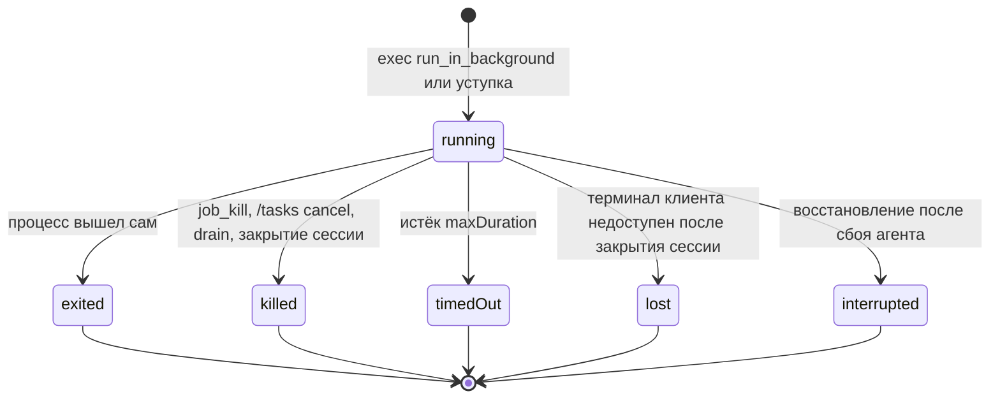
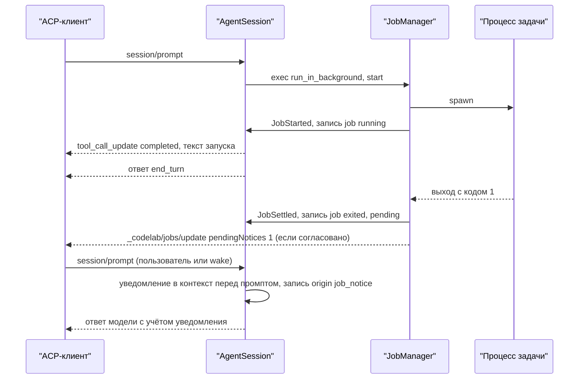

# 17.9. Фоновые команды

> Часть [архитектуры ядра агента CodeLab](../agent-core-architecture.md). Status: Proposed. Общие соглашения, термины и порядок чтения — в оглавлении.

← [17.8. LSP: языковые серверы](17-8-lsp.md) · [Оглавление ядра](../agent-core-architecture.md) · [17.10. Провайдеры и устойчивость LLM](17-10-providers.md) →

Цели: T-10 (фоновые команды: dev-сервер, watcher). Связанные цели: H-05 (ожидание фоновой работы
в `codelab -p`), S-15 (запечатывание сессии, §8.5.1), C-03 (перевод долгой команды в фон при
steering, §17.7.3.5), S-13 (восстановление после сбоя). Затрагивает §3.3 (`yieldToken`), §4.2–§4.7
(порт `BackgroundShell`), §5.6 (`AgentSession.close`), §6.4 (`exec`: параметр
`run_in_background`; инструменты `job_output`, `job_kill`), §7.4, §8.2.3 (`origin: "job_notice"`),
§8.2.4 (запись `job`), §8.3, §8.9, §10.2–§10.8 (capability `backgroundJobs`), §11.2, §12.3
(события `job.*`), §13.6 (`/tasks`), §13.7, §13.10, §13.12, §15.3–§15.4 (раздел `jobs`), §17.3.8–§17.3.9
(общая очередь уведомлений, drain), §17.4 (журнал вывода в каталоге выноса), §17.5.8, §17.6.7,
§17.7.3.5, а также [stream-json](../dart-agent-and-clients/12-5-stream-json.md) и
[CLI](../dart-agent-and-clients/09-11-stage-6-cli-mvp.md).

## 17.9.1. Назначение

`exec` держит вызов до выхода процесса или до таймаута (§6.4). Для команд, которые не
заканчиваются сами — `npm run dev`, `dart run build_runner watch`, `flutter run -d web-server`, — это
тупик: модель ждёт 120 секунд, получает таймаут, а процесс убит. Фоновая команда отделяет время
жизни процесса от вызова инструмента: `exec` с `run_in_background: true` запускает процесс и
**сразу** возвращает идентификатор задачи (`job_…`); модель продолжает работу, читает вывод по id
(`job_output`), останавливает задачу (`job_kill`), а когда процесс выходит сам, получает
**уведомление** тем же путём, что и отчёт фонового субагента (§17.3.8).

Принципы:

* **Тот же `exec`, те же разрешения.** Запуск в фоне — вызов `exec` с тем же уровнем `exec`, тем
  же шаблоном «разрешить всегда», той же проверкой критических команд и тем же запретом в режиме
  `plan` (§7). Человек видит в вопросе заголовок `Run in background: <команда>`.
* **Задача не переживает сессию.** Закрытие сессии, выход процесса агента и `AgentRuntime.dispose`
  завершают дерево процессов каждой задачи (локально) или вызывают `terminal/kill` и
  `terminal/release` (во внешнем режиме). После сбоя задачи не перезапускаются.
* **Агент не начинает ход сам** (SUB-13): уведомление входит в контекст через `steer` идущего хода
  или перед сообщением пользователя следующего `session/prompt` (в том числе пробуждения).
* **Вывод хранится отредактированным.** Секреты (§12.4) вырезаются до записи в буфер, файл и
  уведомление; позиции `offset` считаются по отредактированному потоку.
* **Одна очередь уведомлений.** Уведомления задач и фоновых субагентов лежат в одной FIFO-очереди
  с пользовательским steering (§17.7.3.2) и доставляются ровно один раз, в том числе после сбоя.

Не входит: интерактивный ввод в фоновый процесс (`stdin` закрыт, как у `exec`, T-11 — Won't),
автоматический перевод долгой команды в фон без сообщения пользователя, перезапуск задач после
сбоя, задачи у субагентов, перенос задач между процессами агента.

## 17.9.2. Контракт

### 17.9.2.1. Порт исполнения в фоне

Опциональная возможность `ExecutionEnv` (`env/background_shell.dart`), проверяется через `is`, как
`DirectoryListing` (§4.2):

```dart
abstract interface class BackgroundShell {
  /// Запускает команду через shell хоста и возвращается сразу после запуска процесса
  /// (локально) или ответа на terminal/create (ACP). Окружение и cwd — как у Shell.exec (§4.5).
  Future<Result<BackgroundProcess, ExecError>> spawn(String command, BackgroundExecOptions options);
}

final class BackgroundExecOptions {
  const BackgroundExecOptions({required this.cwd, this.env = const {}, required this.outputByteLimit,
      this.onTerminal});
  final String cwd;                                   // абсолютный путь внутри корня (BoundedEnv)
  final Map<String, String> env;
  final int outputByteLimit;                          // ACP: outputByteLimit terminal/create; локально — размер кольца
  final void Function(String terminalId)? onTerminal; // ACP: встраивание терминала в tool_call
}

abstract interface class BackgroundProcess {
  BackgroundEnvKind get kind;                         // local | terminal
  int? get pid;                                       // local; null на ACP
  DateTime? get processStart;                         // local: время старта по `ps -o lstart=`; для проверки при восстановлении
  String? get terminalId;                             // ACP
  /// local: поток сырых чанков stdout+stderr в порядке поступления (Utf8Decoder allowMalformed).
  /// ACP: пустой поток — вывод забирается через snapshot().
  Stream<String> get chunks;
  /// ACP: terminal/output (полный текущий вывод клиента, truncated, exitStatus). local: не используется.
  Future<Result<TerminalSnapshot, ExecError>> snapshot();
  /// Код или сигнал выхода. local: Process.exitCode; ACP: exitStatus из snapshot() (опрос, §17.9.8).
  Future<ExecExit> get exited;
  /// local: завершение дерева процессов (§4.6, шаг 6); ACP: terminal/kill. Идемпотентно.
  Future<void> kill();
  /// ACP: terminal/release (ровно один раз, ошибка только логируется); local: закрыть пайпы.
  Future<void> release();
}
enum BackgroundEnvKind { local, terminal }
final class ExecExit { final int? exitCode; final String? signal; }
final class TerminalSnapshot { final String output; final bool truncated; final ExecExit? exit; }
```

`LocalExecutionEnv` и `AcpClientExecutionEnv` реализуют `BackgroundShell`; `BoundedEnv`
пробрасывает его с теми же проверками `cwd`, что у `exec` (§4.4); `MemoryExecutionEnv` — нет. В
`agent-serve` с флагом `--local-exec` (`exec.local_fallback`) фоновые команды исполняются
локально, как и обычные.

### 17.9.2.2. Ядро: задачи сессии

Файлы `codelab_agent_core/lib/src/jobs/`:

```dart
typedef JobId = String;                               // 'job_' + 8 символов [0-9a-z] от IdGenerator, уникален в сессии

enum JobState { running, exited, killed, timedOut, lost, interrupted }   // всё, кроме running, — терминальное
enum JobKillReason { model, user, sessionClose, timeout, drain }

final class JobSpec {
  final String toolCallId;                            // вызов exec, который запустил задачу
  final String command, cwd;
  final Duration maxDuration;                         // аргумент timeout или jobs.max_duration
  final ContentTrust trust;                           // классификация команды при запуске (§6.3.6, §10.6)
  final bool yielded;                                 // задача получена уступкой (§17.9.7)
}

final class JobSnapshot {
  final JobId id; final String toolCallId, command, cwd;
  final BackgroundEnvKind kind;
  final JobState state;
  final int? exitCode; final String? signal;
  final JobKillReason? killedBy;
  final DateTime startedAt; final DateTime? endedAt;
  final int outputBytes;                              // длина отредактированного потока на сейчас
  final String? logPath;                              // абсолютный путь журнала вывода или null (§17.9.4)
  final bool yielded;
}

final class JobRead {                                 // результат чтения вывода
  final JobSnapshot job;
  final String text;                                  // отредактированный текст [from, to)
  final int from, to, total;                          // байтовые позиции отредактированного потока
  final List<(int, int)> gaps;                        // недоступные диапазоны внутри [from, to)
}

final class JobNotice {
  final JobId id; final JobSnapshot job;
  final String tail;                                  // последние строки вывода (§17.9.6)
  final DateTime settledAt;
}

abstract interface class JobManager {                 // один на AgentSession, создаётся при capability backgroundJobs
  /// Лимит jobs.max_running проверяется здесь; Err — текст для модели.
  Future<Result<JobSnapshot, String>> start(JobSpec spec, BackgroundProcess process);
  JobSnapshot? lookup(JobId id);
  List<JobSnapshot> list();                           // все задачи сессии в порядке запуска, включая завершённые
  Future<JobRead> read(JobId id, {int? offset, int? tailLines, Duration wait = Duration.zero});
  /// Терминальная задача — без изменений, возвращает её снимок.
  Future<JobSnapshot> kill(JobId id, JobKillReason reason);
  /// Закрытие сессии: kill(sessionClose) всем running, ожидание не дольше 5 с на задачу (ENV-5).
  Future<void> closeAll();
  // Очередь уведомлений — та же форма, что у SubagentManager (§17.3.8):
  List<JobNotice> takePendingNotices();               // FIFO по settledAt
  int get pendingNoticeCount;
  Stream<void> get noticesChanged;
  Stream<JobEvent> get events;                        // JobStarted, JobSettled — для журнала, доски и логов
}

final class JobStarted extends AgentEvent { final JobSnapshot job; }   // уровень AgentSession, как SubagentStarted
final class JobSettled extends AgentEvent { final JobSnapshot job; final bool notice; }
final class JobNoticeOrigin extends MessageOrigin { final JobId id; const JobNoticeOrigin(this.id); }   // §17.7.2.1
```

`ToolServices` (§6.2) получает поле `JobManager? jobs`; при выключенной capability оно `null`,
и инструментов задач нет (правило «выключено — невидимо», §10.9).

### 17.9.2.3. Инструменты

**`exec`** (§6.4) получает параметр, если capability `backgroundJobs` включена:

```json
"run_in_background":{"type":"boolean","default":false,"description":"Start the command in the background and return at once with a job id. Use it for dev servers, watchers and other commands that run until stopped. You will receive a notice when the command exits. Read its output with job_output and stop it with job_kill. Stop background commands you no longer need before you finish."}
```

Описание `timeout` в этом случае рендерится как `Timeout in seconds. Default 120, maximum 3600. For a background command the default and the maximum are <maxDurationSeconds>.`, где
`<maxDurationSeconds>` — `jobs.max_duration` в секундах.

Новые инструменты регистрируются вместе с `exec` (§10.7), только при capability `backgroundJobs`:

| Инструмент | Параметры | tier / kind | Режим пакета |
|---|---|---|---|
| `job_output` | `id` (необязательный); `offset` (int ≥ 0); `tail` (1–2000 строк); `wait_seconds` (0–120, по умолчанию 0) | `read` / `read` | `parallel` |
| `job_kill` | `id` (обязательный) | `read` / `think` | `sequential` |

```json
{"name":"job_output","parameters":{"type":"object","properties":{
  "id":{"type":"string","description":"Job id returned by exec with run_in_background. Omit it to list the background jobs of this session."},
  "offset":{"type":"integer","minimum":0,"description":"Byte offset in the job output to read from, as given by next_offset in an earlier result. Default: continue after the output you read last time."},
  "tail":{"type":"integer","minimum":1,"maximum":2000,"description":"Return only the last N lines of the output."},
  "wait_seconds":{"type":"integer","minimum":0,"maximum":120,"default":0,"description":"Wait up to this many seconds for new output or for the job to exit."}}}}
{"name":"job_kill","parameters":{"type":"object","properties":{
  "id":{"type":"string","description":"Job id to stop."}},"required":["id"]}}
```

Описания инструментов — `prompts/tool_descriptions/job_output.md` и `job_kill.md` (§11.2);
секция `tools/exec` (§11.5) получает абзац `prompts/tools/exec_background.md`:

```text
Use exec with run_in_background for commands that keep running, such as dev servers and file
watchers. Do not use it for builds or tests that finish on their own. A background command keeps
running until it exits, you stop it with job_kill, or the session ends. When it exits you receive
a notice. Its output is kept outside of the conversation; read it with job_output.
```

**Решение: отдельные `job_output` и `job_kill`, а не `task_status`/`task_cancel`.** У субагента
и у задачи разные результаты: отчёт против потока байтов с позициями и хвостом; общий инструмент
потребовал бы взаимоисключающих параметров (`offset`, `tail` бессмысленны для субагента) и
двух форм ответа. Кроме того, `task_*` есть только при `subagents.background`, а задачи — при
`backgroundJobs`, и одна возможность не должна зависеть от другой. Форма заимствована целиком:
`job_output` без `id` — список, как `task_status` без `id`; `wait_seconds` — тот же диапазон;
`job_kill` не спрашивает разрешения (уровень `read`; кроме режима `ask`, где по §7.3 спрашивается и он), как `task_cancel`. Человеку оба вида фоновой работы видны в
одной команде `/tasks` (§17.9.11).

**Тексты результатов** (английские, фиксированы; `<d>` — длительность в секундах с одним знаком
после запятой и суффиксом ` s`):

| Ситуация | Текст | outcome |
|---|---|---|
| запуск | `Started background job <id>: <command>. Its output is saved to <logPath>. You will receive a notice when it exits. Use job_output to read its output and job_kill to stop it.` (без журнала вывода — без второго предложения) | `completed` |
| лимит | `Background job limit reached: at most <N> run at once. Stop one with job_kill or wait for a notice.` | `failed` |
| `run_in_background` у субагента | параметра нет в схеме (§17.9.3, шаг 1) | — |
| `job_output` без `id`, задач нет | `No background jobs.` | `completed` |
| `job_output` без `id` | по строке на задачу: `<id> <state> <d> "<command>"`, где `<state>` — `running`, `exited <code>`, `killed`, `timed_out`, `lost`, `interrupted` | `completed` |
| неизвестный `id` | `Unknown background job: <id>. Call job_output without id to list jobs.` | `failed` |
| `offset` и `tail` вместе | `Use either offset or tail, not both.` (`preflight`, §6.2) | `failed` |
| `job_output` с `id` | строка-заголовок, затем текст (ниже) | `completed` |
| `job_kill` running-задачи | `Stopped background job <id> (<command>) after <d>.` + при непустом выводе `\nLast output:\n<до 20 строк хвоста>` | `completed` |
| `job_kill` терминальной задачи | `Background job <id> is not running (state: <state>).` | `completed` |

Заголовок `job_output`:

```text
[job <id> <status>; output bytes <from>-<to> of <total>; next_offset=<to>]
```

`<status>`: `running for <d>`, `exited with code <N> after <d>`, `was killed by signal <SIG> after <d>`
(выход по сигналу без `job_kill`), `was stopped after <d>`, `timed out after <d>`, `was lost after <d>`,
`was interrupted`. Пустой текст — строка `(no new output)`. Недоступный диапазон внутри
`[from, to)` — отдельная строка `[Note: output bytes <a>-<b> are no longer available.]` на его месте.
Если после `to` есть ещё вывод (сработал лимит усечения) — последняя строка
`[More output is available: call job_output again to continue from offset <to>.]`.

## 17.9.3. Алгоритм: запуск

`ExecTool.execute` (§6.4) при `run_in_background: true`:

```text
1  schema: параметр run_in_background есть, только если services.jobs != null и сессия —
   не дочерняя (у субагента параметра нет, инструменты job_* в его набор не входят, SUB-1)
2  timeout: нет → maxDuration := jobs.max_duration; есть → привести к 1..max_duration с [Note: …]
   (exec.default_timeout и предел 3600 к фоновой команде не применяются)
3  разрешение — до execute, единая точка исполнения (§6.3.1): tierOf = exec, permissionPattern —
   тот же, что у обычного exec (по команде, без учёта run_in_background), present().title =
   "Run in background: <command>"; критические шаблоны спрашиваются всегда (§7.6)
4  лимит: число задач в состоянии running ≥ jobs.max_running → текст лимита, outcome failed,
   процесс не запускается
5  env is! BackgroundShell → "Background commands are not available in this environment." (failed)
6  p := await env.spawn(command, BackgroundExecOptions(cwd, env: exec.env + секреты (§4.5),
       outputByteLimit: jobs.buffer_bytes, onTerminal: → ToolCallProgress с terminal))
   Err(spawnFailed | shellUnavailable | outsideWorkspace) → тексты §6.4 (failed)
7  trust := OutputTrustPolicy.classify(exec, args) (§10.6) — фиксируется на всю жизнь задачи
8  job := await jobs.start(JobSpec(toolCallId, command, cwd, maxDuration, trust), p)
   внутри start, синхронно до первого await после выдачи id:
     a. id := 'job_' + IdGenerator.nextChars(8) (повтор при коллизии, как RecordId §8.4)
     b. открыть журнал вывода (§17.9.4); запустить приём вывода и таймер maxDuration
     c. emit JobStarted → SessionWriter пишет job{status: running} (durable) — ДО возврата из start
9  вернуть текст запуска; outcome completed; ToolCallFinished(exec) — сразу (JOB-2)
```

Запись `job` со `status: running` пишется раньше результата `exec`: если процесс агента упадёт
между ними, восстановление (§17.9.9) найдёт задачу и по записи, и по синтетическому результату
`interrupted` вызова `exec` (§8.8).

## 17.9.4. Алгоритм: буфер, журнал вывода, редакция

У задачи три хранилища одного отредактированного потока байтов (позиции — UTF-8 байты после
редакции, с 0):

| Хранилище | Где | Объём | Что даёт |
|---|---|---|---|
| кольцевой буфер | память `JobManager` | последние `jobs.buffer_bytes` (1 МиБ) | хвост для уведомления и `tail`; чтение после переполнения журнала |
| журнал вывода | `<каталог выноса сессии>/job_<id>.log` (§17.4, §8.9) | первые `jobs.log_max_bytes` (16 МиБ) | чтение с любого `offset`, `read` модели, просмотр человеком |
| терминал клиента | только внешний режим: буфер `terminal/create` у клиента | `outputByteLimit = jobs.buffer_bytes` | источник для зеркала (§17.9.8) |

**Приём вывода** (`JobOutputSink`, на каждый чанк сырого текста):

```text
1  pending += chunk
2  пока в pending есть '\n': line := до '\n' включительно; emit(Redactor.redact(line))
3  нет '\n', но pending ≥ 4096 байт или 250 мс без новых чанков (приглашение dev-сервера без
   перевода строки) → emit(Redactor.redact(pending)); pending := ''
4  emit(text): ring.add(text); log.append(text) (если журнал открыт и не исчерпан); total += bytes(text)
5  при выходе процесса — сброс pending по шагу 3 без ожидания
```

Редакция построчная (§12.4): секрет, разрезанный принудительным сбросом шага 3 посреди строки
длиннее 4 КиБ, может не распознаться — то же ограничение, что у потоковых `ToolCallProgress`
обычного `exec`. Сырой текст нигде не хранится (JOB-5).

**Журнал вывода.** Файл в каталоге выноса сессии (`SpillStore.dirOf`, §17.4.2): поэтому на него
действуют те же правила, что на файлы выноса, без новых механизмов — корень только для чтения в
`BoundedEnv` (модель может `read`/`search` журнала, писать в него не может, §17.4.4), удаление
вместе с каталогом сессии (§17.4.7), квота сессии `tools.spill.max_session_bytes` (байты журналов
считаются вместе с выносами). Отличие от выноса — запись не атомарная, а дописыванием:

```text
open:   capability outputSpill off → журнала нет (logPath = null, хранится только кольцо)
        путь := dir + '/job_<id>.log'; файл создаётся при первом emit (FileMode.append)
append: written + bytes > log_max_bytes или used + bytes > max_session_bytes →
          дописать строку '[Note: the log reached its size limit; later output is kept only in
          memory (the last <buffer_bytes> bytes).]' и закрыть журнал (дальше — только кольцо)
        ошибка записи → лог job.log_failed, журнал закрыть, задача продолжает работу
close:  при терминальном состоянии — flush и закрыть; размер и число строк — в итоговую запись job
```

Доверие при чтении журнала моделью (`read`, `search`): `SpillService.lookup` (§17.4.4) находит
и журналы задач — по полю `log` записи `job` (`trust`, `source: "exec"`), поэтому вывод
недоверенной команды и при чтении файла остаётся в ограде `source="exec"`.

## 17.9.5. Алгоритм: `job_output` и `job_kill`

```text
job_output(id?, offset?, tail?, wait_seconds):
1  id нет → строки списка (§17.9.2.3) по jobs.list(); конец
2  job := lookup(id); нет → текст unknown id (failed)
3  wait_seconds > 0 и job.state == running и (tail == null и from(offset) ≥ total) →
     ждать первое из: новый вывод после from, терминальное состояние, wait_seconds, отмена хода
4  tail задан → from := позиция начала последних tail строк кольца; to := total
   иначе from := offset ?? cursor[id] (0 у новой задачи); from > total → from := total
5  собрать текст [from, …): из журнала, пока позиция < log.written, затем из кольца;
   позиции, которых нет ни там, ни там (журнал закрыт, кольцо уже вытеснило) → gap
6  усечение головы §6.3.5 (2000 строк / 50 КиБ): to := конец последней взятой строки
7  cursor[id] := max(cursor[id], to)    — только при чтении без tail
8  результат: заголовок, текст с пометками gap, строка «More output…» при to < total;
   ограда по job.trust: untrusted → <untrusted-content source="exec"> (§6.3.6)
```

`job_output` результат не выносится (`spillable == false`): весь вывод уже лежит в журнале, а
лимит усечения и `next_offset` дают дочитать остальное. Поведение `cursor` — «продолжить с того
места, где остановился»: два вызова подряд без `offset` не возвращают один текст дважды.

```text
job_kill(id):
1  job := lookup(id); нет → текст unknown id (failed); терминальная → текст «not running»
2  snapshot := await jobs.kill(id, JobKillReason.model):
     a. state := killed; endedAt; таймер maxDuration снят
     b. local: process.kill() — дерево процессов (§4.6, шаг 6); ACP: terminal/kill, затем
        финальный snapshot() в зеркало (§17.9.8), затем terminal/release (finally)
     c. сброс pending, закрытие журнала
     d. emit JobSettled(job, notice: false) → запись job{status: killed, killedBy: "model",
        notice: false} (durable) — ДО результата job_kill
3  результат: текст остановки с хвостом ≤ 20 строк (ограда по trust)
```

Задача, которую остановила сама модель, уведомления не получает (`notice: false`): результат
`job_kill` уже сообщил итог. Остановка человеком (`/tasks cancel`, доска) и всеми прочими
причинами уведомление даёт: модель должна узнать, что её dev-сервер больше не работает.

## 17.9.6. Алгоритм: завершение и уведомление

Задача становится терминальной по одной из причин:

| Причина | `state` | `killedBy` | Уведомление |
|---|---|---|---|
| процесс вышел сам (любой код, сигнал не от агента) | `exited` | — | да |
| `job_kill` | `killed` | `model` | нет |
| `/tasks cancel`, `_codelab/jobs/kill` | `killed` | `user` | да |
| `_codelab/jobs/kill` из drain `codelab -p` (§17.3.9, шаг 8) | `killed` | `drain` | да: запись пишется до закрытия и запечатывания, уведомление доставляется при `--resume` |
| закрытие сессии, выход процесса (§17.9.9) | `killed` | `sessionClose` | да, если сессия не запечатана; доставляется при следующем открытии |
| истёк `maxDuration` | `timedOut` | `timeout` | да |
| внешний режим: соединение клиента закрыто окончательно (§17.9.8) | `lost` | — | да |
| восстановление после сбоя (§17.9.9) | `interrupted` | — | да |

По `JobSettled(job, notice: true)`:

```text
1  итоговая запись job{status, exitCode?, signal?, killedBy?, endedAt, log{bytes, lines}} — durable
2  notice := JobNotice(job, tail := последние 20 строк, не больше 2048 байт, из кольца)
   добавить в FIFO pending; noticesChanged; лог job.end
3  текст уведомления (user-сообщение, origin "job_notice"):
     <job-notice id="<id>" status="<state>" exit_code="<N | none>" duration="<d>" command="<command>">
     <фраза статуса> <фраза вывода>
     </job-notice>
     + tail (если не пуст) отдельным блоком текста; при trust untrusted — внутри
       <untrusted-content source="exec">
   command в атрибуте: кавычки → ', переводы строк → пробел, не длиннее 200 символов с '…'
4  ход идёт → agent.steer(message, origin: JobNoticeOrigin(id)); иначе — ждать следующего prompt()
5  доставка = запись message{role: user, origin: "job_notice", jobId} и MessageStarted;
   из pending уведомление удаляется только после этой записи
6  AgentSession.prompt(content) при непустом pending (задачи и субагенты): сначала все
   уведомления по одному user-сообщению в порядке settledAt (субагентов — по времени итоговой
   записи; при равенстве — по id), затем content пользователя; всё — в одном ходе (§17.3.8, шаг 6)
```

Фразы статуса (фиксированы):

| `state` | Фраза статуса |
|---|---|
| `exited` | `The background command exited with code <N>.`; выход по сигналу — `The background command was terminated by signal <SIG>.` |
| `killed`, `user` | `The background command was stopped by the user.` |
| `killed`, `drain` | `The background command was stopped because the headless run ended.` |
| `killed`, `sessionClose` | `The background command was stopped because the session was closed.` |
| `timedOut` | `The background command was stopped after reaching its time limit of <d>.` |
| `lost` | `The background command was lost: the client terminal that ran it is no longer available.` |
| `interrupted` | `The background command stopped being tracked: the session was closed or the agent process stopped while it was running.` + одно из: ` It was terminated during recovery.`, ` It may still be running (pid <pid>).`, ` It ran in the client terminal; its state is unknown.` |

Фраза вывода: есть журнал — `The last lines of its output follow. Full output: <logPath>. Use job_output with offset to read more.`; журнала нет, кольцо живо — `The last lines of its output follow. Use job_output to read more.`; вывода нет — `It produced no output.`; после восстановления без журнала — `Its output is no longer available.`

Пример уведомления:

```text
<job-notice id="job_k3f9a1c2" status="exited" exit_code="1" duration="8.4 s" command="npm run dev">
The background command exited with code 1. The last lines of its output follow. Full output: /Users/me/.codelab/sessions/work-demo-9c3e51a7/2026-10-21T08-00-00-000Z_01JB8Q2W6R9T3M5K7N1P4X8Z0C/spills/job_k3f9a1c2.log. Use job_output with offset to read more.
</job-notice>
```

```text
Error: listen EADDRINUSE: address already in use :::3000
    at Server.setupListenHandle [as _listen2] (node:net:1817:16)
```

**Общая очередь со steering.** Уведомление задачи — элемент той же FIFO-очереди `steering`, что
пользовательские сообщения и уведомления субагентов (§17.7.3.2): один опрос забирает все элементы
и добавляет один шаг (STEER-6, лимит `steering.max_steps` общий). В `TurnEnded.returnedSteers`
уведомления не попадают: недоставленное остаётся в pending до следующего хода. Счётчик
`pendingNotices` в `_codelab/subagents/update` и `_codelab/jobs/update` — **сумма**
недоставленных уведомлений сессии обоих видов; пробуждение `_meta.codelab.wake` (§17.3.8)
доставляет все.

## 17.9.7. Мягкая уступка долгого `exec` (C-03, §17.7.3.5)

Входит в этот раздел, но **выключена по умолчанию**: включается ключом `steering.yield_long_tools:
true` (зарезервирован в §17.7.7; при включённой capability `backgroundJobs` значение `true`
больше не `ConfigException`). Без ключа `exec` работает ровно как в §6.4, и `yieldToken` не
отменяется никогда (STEER-12 сохраняется для профилей без задач).

При включённой уступке:

```text
1  exec без run_in_background, у которого env is BackgroundShell, объявляет yieldable: true и
   исполняется через spawn (§17.9.2.1) как «присоединённая» задача: JobManager выдаёт id,
   ведёт кольцо и журнал вывода (§17.9.4), но записи job нет и уведомления не будет
2  вызов ждёт первое из: выход процесса → результат по §6.4 (из кольца и журнала, с выносом
   §17.4); таймаут exec → как §6.4, шаг 5; отмена хода → как §6.4 (дерево процессов, cancelled);
   yieldToken. Во всех случаях, кроме yieldToken, журнал вывода присоединённой задачи удаляется
   после формирования результата: долговечный след — только результат exec и его вынос
3  цикл отменяет yieldToken вызова, если принят пользовательский steering (не уведомление) и
   вызов работает дольше steering.yield_after (10 с); проверка — при приёме steering и затем раз
   в секунду до конца пакета
4  по yieldToken: running-задач меньше jobs.max_running → задача становится фоновой:
     emit JobStarted(yielded: true) → запись job{status: running, yielded: true} (durable);
     срок жизни — оставшийся таймаут exec (а не jobs.max_duration);
     результат exec: "Command moved to background job <id> because the user sent a message.
     Use job_output to read its output." (completed, текст §17.7.3.5)
   лимит исчерпан → уступки нет, лог job.yield_skipped, вызов продолжает ждать
5  пакет завершается, steering доставляется на границе шага (STEER-2), процесс продолжает работу
```

Вывод до и после уступки — один поток: `job_output` с `offset: 0` возвращает его с начала.
Присоединённая задача, не дошедшая до уступки, после сбоя восстанавливается как обычный `exec`
(синтетический `interrupted`, §8.8): записи `job` у неё нет.

## 17.9.8. Внешний и встроенный режим

| | Встроенный (`LocalExecutionEnv`: `embedded-*`, `agent-serve --local-exec`) | Внешний (`AcpClientExecutionEnv`, `agent-serve` с `terminal`) |
|---|---|---|
| запуск | `Process.start(shell, ['-c', command])` как §4.6, шаги 1–3; `stdin` закрыт | `terminal/create` (`command: shell`, `args: ["-c", command]`, `cwd`, `env`, `outputByteLimit = jobs.buffer_bytes`); `terminal/wait_for_exit` **не** вызывается |
| вывод | поток чанков `stdout`/`stderr` → `JobOutputSink` | зеркало: опрос `terminal/output` |
| выход | `Process.exitCode` | `exitStatus` в ответе `terminal/output` |
| остановка | дерево процессов §4.6, шаг 6 | `terminal/kill` → финальный `terminal/output` → `terminal/release` |
| отображение | текст в `tool_call` | `{"type":"terminal","terminalId"}` в `tool_call`: клиент показывает живой вывод и после `release` |
| после сбоя агента | процесс-сирота: проверка и завершение при восстановлении (§17.9.9) | терминал принадлежит клиенту; агент ничего не может сделать |

**Зеркало терминала** (`TerminalMirror`). `terminal/output` возвращает весь текущий вывод
клиента (не больше `outputByteLimit`, хвост), поэтому агент вычисляет приращение сам:

```text
mirror():
1  s := await snapshot()                     // terminal/output
   Err (соединение потеряно) → не менять состояние; следующий опрос повторит
2  если !s.truncated: delta := s.output[rawSeen..]; rawSeen := len(s.output)
   иначе: i := последнее вхождение anchor (последние ≤ 4096 сырых байт, уже переданных) в s.output
          найдено → delta := s.output после anchor
          не найдено → JobOutputSink получает строку '[Note: some output was dropped by the
            client terminal before this point.]\n', delta := s.output; лог job.output_gap
   anchor := последние ≤ 4096 байт s.output
3  JobOutputSink(delta)
4  s.exit != null → состояние exited (или timedOut/killed, если остановка шла от агента),
   финальный сброс, release, JobSettled
```

Опрос — раз в `jobs.poll_interval` (5 с), пока задача `running`, а также немедленно перед
`job_output`, `/tasks output` и остановкой. Ожидающий `terminal/wait_for_exit` на часы жизни
dev-сервера не держится: часть клиентов ограничивает время ответа на запрос, а `exitStatus` в
`terminal/output` даёт тот же результат с задержкой не больше интервала опроса (§17.9.15).

**Соединение.** Пока соединение `detached` (§13.10), опросы получают ошибку и повторяются; при
переподключении в пределах `detachGrace` зеркало продолжает работу с тем же `terminalId`. Если
сессия закрывается после окончательного отсоединения, задача переходит в `lost` (агент не может
ни остановить терминал, ни освободить его: это делает клиент при разрыве), уведомление — при
следующем открытии сессии.

## 17.9.9. Жизненный цикл: закрытие сессии, выход процесса, сбой

**Закрытие сессии.** `AgentSession.close({bool seal = false})` (§5.6, §8.5.1):

```text
1  идёт ход → отменить и дождаться TurnEnded (§8.5.1, шаг 1)
2  seal → SessionWriter.seal()                          // до остановок: их записи отбрасываются (S-15)
3  subagents.closeAll(); jobs.closeAll()                // параллельно
   jobs.closeAll: для каждой running — kill(sessionClose): дерево процессов или
   terminal/kill + output + release; ожидание не дольше 5 с на задачу (ENV-5);
   не остановившаяся в срок — лог job.kill_timeout, состояние всё равно killed
4  дождаться очереди записи журнала; освободить lease (§17.6.8)
```

Когда ACP-адаптер закрывает сессию: окончательное отсоединение (все соединения сессии
отсоединены и `detachGrace` истёк без переподключения, §13.10), конец stdin для stdio,
`shutdown()` агента, `AgentRuntime.dispose` встроенного хоста. Сессия, открытая с
`_meta.codelab.sealOnClose: true` (§8.5.1), закрывается **без** `detachGrace` при отсоединении
открывшего её соединения и с `seal: true`.

**Выход процесса агента.** Обычный выход (`SIGTERM` агенту, конец stdin, `dispose`) проходит через
`shutdown()` → `close()` каждой сессии: задачи останавливаются. `kill -9` и падение оставляют
локальные процессы задач сиротами — их обрабатывает восстановление.

**Восстановление** (после `open`, `healInterruptedTurn` и `SpillService.attach`, §8.6, §8.8;
только владелец lease, не в режиме только чтения):

```text
1  для каждой записи job по всем веткам (последняя с данным jobId выигрывает) со status running:
   a. kind local, host записи == hostname, pid жив и `ps -o lstart= -p <pid>` совпадает с
      procStart записи (с точностью до секунды) → завершить дерево процессов (§4.6, шаг 6);
      фраза « It was terminated during recovery.»; лог job.recovery{action: killed}
   b. kind local, pid жив, но проверка не прошла (другой хост, нет procStart, pid переиспользован)
      → процесс не трогается; фраза « It may still be running (pid <pid>).» только для того же
      host; лог job.recovery{action: left}
   c. kind local, pid мёртв → без фразы; лог job.recovery{action: gone}
   d. kind terminal → фраза « It ran in the client terminal; its state is unknown.»
   e. дописать job{status: interrupted, endedAt: now} (durable); журнал вывода закрыт как есть,
      log.bytes — по размеру файла
2  pending := итоговые записи job, у которых notice != false и нет message с origin "job_notice"
   и тем же jobId (по всем веткам; порядок — порядок итоговых записей); хвост уведомления —
   из журнала вывода (последние 20 строк), без журнала — фраза «Its output is no longer available.»
3  pending доставляется по §17.9.6, шаг 6, при следующем prompt()
4  задачи не перезапускаются (JOB-7)
```

Журнал вывода без записи `job` (сбой между первым выводом и записью `running` или присоединённая
задача, не дошедшая до уступки, §17.9.7) — сирота: `SpillService.attach` удаляет его вместе с
`*.tmp` (§17.4.5, шаг 3).



Терминальные состояния не меняются; каждое пишется одной итоговой записью `job` (кроме
запечатанной сессии, где запись отбрасывается и состояние восстанавливается как `interrupted`).

## 17.9.10. Журнал

Запись `job` (§8.2.4) — по одной на изменение состояния; последняя запись с данным `jobId`
выигрывает. В контекст модели не входит.

| Поле | Тип | Смысл |
|---|---|---|
| `jobId` | string | `job_…` |
| `toolCallId` | string | вызов `exec`, запустивший задачу |
| `command`, `cwd` | string | после редакции (§12.4) |
| `kind` | `"local"` \| `"terminal"` | где исполняется |
| `status` | `"running"` \| `"exited"` \| `"killed"` \| `"timed_out"` \| `"lost"` \| `"interrupted"` | состояние |
| `exitCode`, `signal` | int?, string? | итог выхода |
| `killedBy` | `"model"` \| `"user"` \| `"drain"` \| `"session_close"` \| `"timeout"` | причина остановки |
| `notice` | bool? | `false` — уведомления не будет (`job_kill` модели); отсутствует — будет |
| `pid`, `procStart`, `host` | int?, string?, string? | только `local`: для проверки сироты при восстановлении |
| `terminalId` | string? | только `terminal` |
| `log` | object? | `{path, bytes, lines, trust, source}` — как поле `spill` (§17.4.5), `path` относительно `sessions/`; `bytes`/`lines` — в итоговой записи |
| `startedAt`, `endedAt` | string | ISO-8601 UTC |
| `maxDurationMs` | int | срок жизни |
| `yielded` | bool? | задача получена уступкой (§17.9.7) |

```json
{"type":"job","id":"j4k5l6m7","parentId":"t5y6u7i8","timestamp":"2026-10-21T08:02:00.000Z","jobId":"job_k3f9a1c2","toolCallId":"call_5","command":"npm run dev","cwd":"/work/demo","kind":"local","status":"running","pid":48213,"procStart":"2026-10-21T08:02:00Z","host":"mbp.local","log":{"path":"work-demo-9c3e51a7/2026-10-21T08-00-00-000Z_01JB8Q2W6R9T3M5K7N1P4X8Z0C/spills/job_k3f9a1c2.log","trust":"trusted","source":"exec"},"startedAt":"2026-10-21T08:02:00.000Z","maxDurationMs":28800000}
{"type":"job","id":"n8b9v0c1","parentId":"j4k5l6m7","timestamp":"2026-10-21T08:02:08.400Z","jobId":"job_k3f9a1c2","toolCallId":"call_5","command":"npm run dev","cwd":"/work/demo","kind":"local","status":"exited","exitCode":1,"log":{"path":"…/spills/job_k3f9a1c2.log","bytes":2210,"lines":31,"trust":"trusted","source":"exec"},"startedAt":"2026-10-21T08:02:00.000Z","endedAt":"2026-10-21T08:02:08.400Z","maxDurationMs":28800000}
{"type":"message","id":"q2w3e4r5","parentId":"n8b9v0c1","timestamp":"2026-10-21T08:03:00.000Z","origin":"job_notice","jobId":"job_k3f9a1c2","message":{"role":"user","timestamp":"2026-10-21T08:03:00.000Z","content":[{"type":"text","text":"<job-notice id=\"job_k3f9a1c2\" status=\"exited\" …>…</job-notice>"},{"type":"text","text":"Error: listen EADDRINUSE …"}]}}
```

`SessionWriter` (§8.3): `JobStarted` → `job` со `status: running` (durable); `JobSettled` →
итоговая `job` (durable); вывод задачи в журнал сессии не пишется (только в журнал вывода).
Задачи принадлежат процессу, а не ветке: восстановление и вычисление pending смотрят записи
`job` и `message` с `origin: "job_notice"` по **всем** веткам; уведомление доставляется на текущий
лист. Перемотка и смена ветки задачи не трогают. Fork (§17.6.7) копирует записи `job` пути и их
журналы вывода, как файлы выноса, и сразу дописывает в новую сессию `job{status: "interrupted",
notice: false}` для каждой скопированной задачи без итогового состояния: процесс принадлежит
исходной сессии.

## 17.9.11. Проекция: ACP, `/tasks`, headless, stream-json

**Стандартная проекция** (§13.7):

| Что | Кадр | Поля |
|---|---|---|
| `ToolCallStarted(exec)` с `run_in_background` | `tool_call` | `kind: "execute"`, `title: "Run in background: <command>"`, `status: "pending"`, `rawInput` |
| запуск во внешнем режиме (`onTerminal`) | `tool_call_update` | `content: [{"type":"terminal","terminalId"}]` |
| `ToolCallFinished(exec)` | `tool_call_update` | `status: "completed"`, `content`: терминал (внешний режим) и текст запуска |
| `JobStarted`, `JobSettled` | — | лог `job.start` / `job.end`; доска (ниже) |
| уведомление (`origin: "job_notice"`) | — | в ленту как `user_message_chunk` не отправляется ни вживую, ни при реплее (как `subagent_notice`, §13.5, шаг 5) |
| `job_output`, `job_kill` | `tool_call` … `tool_call_update` | обычные вызовы: `kind` `read` / `think`, `title` `Read output of <id>` / `Stop background job <id>` |
| уступка (§17.9.7) | `tool_call_update` | `status: "completed"`, текст §17.7.3.5; терминал остаётся в `content` |

**Расширение (через OpenSpec change `add-background-jobs`).** Согласование:
`agentCapabilities._meta.codelab.jobs: {"version": 1}` и `clientCapabilities._meta.codelab.jobBoard:
true` в `initialize`. Только при обеих:

| Метод или поле | Направление | Параметры → результат |
|---|---|---|
| `_codelab/jobs/update` (уведомление) | агент → клиент | `{sessionId, jobs: [JobSnapshotJson], pendingNotices}`; на каждый `JobStarted`/`JobSettled` и изменение очереди уведомлений; и вне хода |
| `_codelab/jobs/list` | клиент → агент | `{sessionId}` → `{jobs: [...]}` — все задачи сессии, включая завершённые |
| `_codelab/jobs/output` | клиент → агент | `{sessionId, jobId, offset?, tail?}` → `{text, from, to, total, state}`; курсор модели не двигает |
| `_codelab/jobs/kill` | клиент → агент | `{sessionId, jobId}` → `{job}`; `killedBy: user` (или `drain`, если в параметрах `"reason": "drain"`) |
| `tool_call_update` с `_meta.codelab.job: {id, state, exitCode}` | агент → клиент | по `JobSettled` для `toolCallId` вызова `exec`, всем подключённым соединениям, в том числе вне хода; `status` остаётся `completed`, `content` — прежний плюс строка `Background job <id> <status>.` |

```json
{"id":"job_k3f9a1c2","toolCallId":"call_5","command":"npm run dev","cwd":"/work/demo","kind":"local",
 "state":"running","exitCode":null,"startedAt":"2026-10-21T08:02:00.000Z","endedAt":null,
 "outputBytes":18342,"terminalId":null,"yielded":false}
```

Без расширения клиент видит вызов `exec`, завершившийся текстом запуска (и живой терминал во
внешнем режиме), а о завершении узнаёт из ответа модели и из `/tasks`. Реплей (`session/load`)
показывает `tool_call` вызова `exec` с `content` записи результата; при расширении — с
`_meta.codelab.job` из последней записи `job`.

**Команда агента `/tasks`** (§17.3.8, R-07) перечисляет **обе** формы фоновой работы сессии:

```text
Background work:
sub_k3f9a1c2  subagent  explore  running  4 steps   "Find auth code"
job_p2r7t9w1  job                running  2m 14s    "npm run dev"
job_x8c7v6b5  job                exited 1 8.4 s     "npm test -- --watch"
```

Пустой список — `No background work.` Подкоманды: `/tasks cancel <id>` (по префиксу `sub_` —
`SubagentManager.cancel`, `job_` — `jobs.kill(id, user)`; ответ `Stopped <id>.` или
`<id> is not running.`), `/tasks output <id>` (последние 40 строк задачи из кольца или журнала,
без модели, курсор модели не двигается). Неизвестный id — `Unknown background item: <id>.`
Команда исполняется агентом без вызова модели, как `/status` (§13.6).

**Headless (H-05, §17.3.9).** `codelab -p` объявляет `jobBoard`. Шаг 3 drain объединяет
`_codelab/subagents/list` и `_codelab/jobs/list` (элементы `running`); шаг 8 вызывает
`_codelab/jobs/kill` с `reason: "drain"` для оставшихся задач. Задача, которая не завершается
сама (dev-сервер), держит drain до `--drain-timeout`, затем останавливается, и код `0` превращается
в `1` (§17.3.9, шаг 9): описание `exec` поэтому просит модель останавливать ненужные фоновые
команды. После drain CLI закрывает соединение; сессия открыта с `sealOnClose`, поэтому её
закрытие запечатывает журнал до остановки задач (§8.5.1).

**stream-json** ([§12.5](../dart-agent-and-clients/12-5-stream-json.md)) — без новой версии схемы:

* запуск — обычные `tool_call` и `tool_result` вызова `exec` (`output.text` — текст запуска,
  `terminal` — снимок терминала внешнего режима);
* `JobSettled` (из `_codelab/jobs/update`) → `notice` с `level: "info"`, `code: "job_settled"`,
  `message` — `background job <id> <state> (<command>)`, и необязательным полем `job`
  `{id, toolCallId, command, state, exitCode}`; `turn` — номер текущего хода или `null` вне хода;
* `init.capabilities` получает необязательное поле `jobBoard` (bool).

## 17.9.12. Конфигурация

Раздел **`jobs`** (§15.4):

| Ключ | Тип | По умолчанию | Смысл |
|---|---|---|---|
| `enabled` | bool | `true` | `false` → capability `backgroundJobs` off: нет параметра `run_in_background`, инструментов `job_*`, строк задач в `/tasks` |
| `max_running` | int | `4` | задач в состоянии `running` на сессию; `1..16` |
| `max_duration` | duration | `"8h"` | срок жизни задачи без `timeout` и верхняя граница `timeout`; `1m..7d` |
| `buffer_bytes` | int | `1048576` | кольцевой буфер и `outputByteLimit` терминала; `65536..16777216` |
| `log_max_bytes` | int | `16777216` | предел журнала вывода одной задачи; `0` — журнал не ведётся; иначе `1048576..tools.spill.max_session_bytes` |
| `poll_interval` | duration | `"5s"` | опрос `terminal/output` во внешнем режиме; `1s..60s` |

Ключи `steering.yield_long_tools` и `steering.yield_after` (§17.7.7) управляют уступкой
(§17.9.7); `yield_long_tools: true` при `jobs.enabled: false` → `ConfigException("steering.yield_long_tools requires jobs.enabled")`.

Доверие (§15.3): проектный конфиг может только ужесточать — `enabled = false` и уменьшение
`max_running`, `max_duration`, `buffer_bytes`, `log_max_bytes`; увеличение и `poll_interval` —
слой 4, глобальный конфиг или проект из `trusted_projects`. Живая перезагрузка (§17.5.6): лимиты —
со следующего вызова инструмента (идущие задачи сохраняют свой `maxDuration`), `jobs.enabled` —
только после перезапуска. Реестр настроек (§17.5.8): `jobs.enabled` — `shared`, `restartRequired`;
прочие — `fileOnly`.

```yaml
jobs:
  max_running: 2
  max_duration: 2h
```

Capability `backgroundJobs` (§10.2) по профилям: `agent-serve` — transport `acp-terminal` или
`local` (как `shellExec`); `embedded-app-desktop`, `embedded-cli` — transport `local`; `mobile`,
`web` — off «на платформе нет shell». Требования (§10.8): `shellExec` включена и `baseEnv is
BackgroundShell`; журнал вывода — только при включённой `outputSpill`, иначе задачи работают с
одним кольцом.

## 17.9.13. Примеры

Пользователь: «Подними dev-сервер и проверь, что главная страница отвечает». Режим `standard`,
`npm run dev` уже разрешён «всегда» (`exec:npm run dev`), встроенный режим.

```json
[{"type":"toolCall","id":"call_5","name":"exec","arguments":{"command":"npm run dev","run_in_background":true}}]
```

Результат (модель видит):

```text
Started background job job_k3f9a1c2: npm run dev. Its output is saved to /Users/me/.codelab/sessions/work-demo-9c3e51a7/2026-10-21T08-00-00-000Z_01JB8Q2W6R9T3M5K7N1P4X8Z0C/spills/job_k3f9a1c2.log. You will receive a notice when it exits. Use job_output to read its output and job_kill to stop it.
```

Следующий шаг — `job_output {"id": "job_k3f9a1c2", "wait_seconds": 10}`:

```text
[job job_k3f9a1c2 running for 3.1 s; output bytes 0-212 of 212; next_offset=212]
> demo@0.1.0 dev
> vite

  VITE v5.4.0  ready in 412 ms
  ➜  Local:   http://localhost:5173/
```

Затем `exec curl -s -o /dev/null -w '%{http_code}' http://localhost:5173/` → `200`, затем
`job_kill {"id": "job_k3f9a1c2"}` → `Stopped background job job_k3f9a1c2 (npm run dev) after 21.7 s.`
Уведомления нет (`notice: false`).

Внешний режим, тот же запуск (кадры укорочены):

```json
{"jsonrpc":"2.0","id":21,"method":"terminal/create","params":{"sessionId":"01JB8Q2W6R9T3M5K7N1P4X8Z0C","command":"/bin/sh","args":["-c","npm run dev"],"cwd":"/work/demo","env":[{"name":"PAGER","value":"cat"}],"outputByteLimit":1048576}}
{"jsonrpc":"2.0","id":21,"result":{"terminalId":"term_9"}}
{"jsonrpc":"2.0","method":"session/update","params":{"sessionId":"01JB8Q2W6R9T3M5K7N1P4X8Z0C","update":{"sessionUpdate":"tool_call_update","toolCallId":"call_5","status":"completed","content":[{"type":"terminal","terminalId":"term_9"},{"type":"content","content":{"type":"text","text":"Started background job job_k3f9a1c2: npm run dev. …"}}]}}}
{"jsonrpc":"2.0","id":22,"method":"terminal/output","params":{"sessionId":"01JB8Q2W6R9T3M5K7N1P4X8Z0C","terminalId":"term_9"}}
{"jsonrpc":"2.0","id":22,"result":{"output":"> vite\n  VITE v5.4.0  ready in 412 ms\n","truncated":false}}
{"jsonrpc":"2.0","id":30,"method":"terminal/kill","params":{"sessionId":"01JB8Q2W6R9T3M5K7N1P4X8Z0C","terminalId":"term_9"}}
{"jsonrpc":"2.0","id":31,"method":"terminal/output","params":{"sessionId":"01JB8Q2W6R9T3M5K7N1P4X8Z0C","terminalId":"term_9"}}
{"jsonrpc":"2.0","id":32,"method":"terminal/release","params":{"sessionId":"01JB8Q2W6R9T3M5K7N1P4X8Z0C","terminalId":"term_9"}}
```

Завершение вне хода и доставка следующим промптом:



## 17.9.14. Инварианты

1. **JOB-1.** Запуск фоновой команды проходит те же разрешения, что обычный `exec`: уровень `exec`, тот же `permissionPattern`, проверка критических команд, запрет в `plan`. `job_output` и `job_kill` — уровень `read`; остановка задачи не требует вопроса в `standard`.
2. **JOB-2.** `exec` с `run_in_background` возвращает результат, не дожидаясь выхода процесса; запись `job` со `status: running` записана (`durable`) до `ToolCallFinished(exec)`.
3. **JOB-3.** Ни одна задача не переживает свою сессию: `AgentSession.close` останавливает каждую `running`-задачу (дерево процессов локально; `terminal/kill`, `terminal/output`, `terminal/release` во внешнем режиме) не дольше 5 с на задачу. `session/cancel` хода фоновые задачи не останавливает; присоединённый `exec` до уступки останавливается, как обычный.
4. **JOB-4.** Каждая задача, ставшая терминальной с `notice != false`, даёт ровно одно уведомление: оно входит в контекст только внутри хода (через `steer` или перед сообщением пользователя `session/prompt`, SUB-13), удаляется из pending только после записи `message` с `origin: "job_notice"` и после сбоя восстанавливается по итоговым записям `job` без такого сообщения.
5. **JOB-5.** Вывод задачи хранится только отредактированным (§12.4): кольцо, журнал вывода, уведомление, ответы `job_output` и `_codelab/jobs/output` не содержат исходного текста секретов; позиции `offset` относятся к отредактированному потоку.
6. **JOB-6.** Вывод задачи попадает к модели с доверием, вычисленным для команды при запуске; при `untrusted` — внутри ограды `source="exec"`, в том числе при чтении журнала вывода через `read`.
7. **JOB-7.** Одновременно `running` не больше `jobs.max_running` задач сессии. После сбоя задачи не перезапускаются; процесс-сирота завершается при восстановлении только после проверки `host`, `pid` и времени старта процесса.
8. **JOB-8.** Во внешнем режиме каждый терминал задачи освобождается `terminal/release` ровно один раз; агент не вызывает `terminal/wait_for_exit` для фоновой задачи. Во встроенном режиме `terminal/*` не вызывается.
9. **JOB-9.** `yieldToken` отменяется только при `steering.yield_long_tools: true`, принятом пользовательском steering и вызове `yieldable`, работающем дольше `steering.yield_after`; уступка не прерывает процесс, а вывод до и после неё — один поток.
10. **JOB-10.** Субагенты не запускают фоновые команды: у дочернего `exec` нет параметра `run_in_background`, инструментов `job_*` в наборе ребёнка нет.
11. **JOB-11.** Записи `job` в контекст модели не входят; уведомления задач не отправляются клиенту как `user_message_chunk` ни вживую, ни при реплее.

## 17.9.15. Обоснование решения

* **Параметр `exec`, а не отдельный инструмент запуска.** Фоновая команда — та же команда shell:
  то же окружение, та же граница `cwd`, тот же шаблон «разрешить всегда» и тот же список
  критических команд. Отдельный `exec_background` удвоил бы правила разрешений и дал бы модели
  повод обходить отказ, повторяя команду другим инструментом. Человек видит разницу в заголовке
  вопроса.
* **Отдельные `job_output`/`job_kill`.** См. §17.9.2.3: у задач и субагентов разные результаты и
  разные условия включения; общая команда `/tasks` даёт человеку одно место управления.
* **Уведомление тем же путём, что у фонового субагента.** ACP не позволяет агенту начать ход;
  §17.3.8 уже решает доставку (steer, следующий prompt, пробуждение) и «ровно один раз» после
  сбоя. Второй механизм для того же ограничения дал бы две очереди, которые могут обгонять друг
  друга.
* **Нет уведомления после `job_kill` модели.** Модель уже получила итог в результате вызова;
  повтор — шум в контексте. Остановка любым другим путём — новая информация для модели.
* **Журнал вывода в каталоге выноса.** Граница чтения, доверие, квота, удаление и fork уже решены
  в §17.4; журналу задачи нужно только другое имя файла и запись дописыванием. Отдельный каталог
  потребовал бы повторить все эти правила.
* **Кольцо в памяти поверх журнала.** Dev-сервер пишет часами; журнал ограничен 16 МиБ, а хвост
  (ошибка запуска, последний запрос) нужен всегда. Кольцо даёт хвост после исчерпания журнала, а
  пометки gap честно говорят модели о потере середины.
* **Опрос `terminal/output` вместо `terminal/wait_for_exit`.** Запрос, висящий часами, плохо
  переживает переподключение и таймауты клиентов; опрос раз в 5 с даёт и вывод для журнала, и
  `exitStatus`. Цена — до 5 с задержки уведомления и передача окна терминала при каждом опросе
  (не больше `buffer_bytes`).
* **Уступка выключена по умолчанию.** Перевод идущей команды в фон меняет её судьбу (она переживёт
  ход и может быть остановлена только явно) без явного запроса модели. Пока поведение не
  проверено на реальных сессиях, оно включается ключом; механизм зарезервирован в §17.7 и здесь
  реализован целиком, чтобы включение не требовало изменения протокола.
* **Проверка сироты по времени старта.** Убить процесс по одному `pid` после сбоя опасно: pid мог
  достаться чужому процессу. Совпадение `host`, `pid` и времени старта практически исключает
  ошибку; при сомнении процесс не трогается, а модель получает pid и может решить сама.
* **Задачи — свойство процесса, а не ветки.** Процесс один, сколько бы веток ни было в журнале.
  Перемотка не может «отменить» запущенный сервер, поэтому задачи и уведомления считаются по всем
  веткам, а fork не наследует чужие процессы.
* **Без новой версии stream-json.** Набор `type` закрыт на версию; `notice` с открытым списком
  `code` и необязательным полем покрывает событие завершения без `version + 1`.

## 17.9.16. Как проверить

Тесты ядра — `packages/dart/codelab_agent_core/test/jobs/`; env — `codelab_agent_io/test/env/`;
адаптера — `codelab_agent_acp/test/`; scripted LLM, fake `BackgroundShell` с управляемым выводом и
выходом, детерминированные `Clock` и `IdGenerator`.

* `exec_background_schema_test.dart`: при `backgroundJobs` схема `exec` содержит
  `run_in_background`, описание `timeout` рендерится с `max_duration`; `job_output`, `job_kill`
  зарегистрированы; при `jobs.enabled: false` — ни параметра, ни инструментов, ни строк задач в
  `/tasks`; у дочерней сессии параметра и инструментов нет (JOB-10, SUB-1).
* `exec_background_permission_test.dart`: фоновая команда спрашивает разрешение так же, как
  обычная, с заголовком `Run in background: …`; `allow_always` обычного `exec npm run dev`
  разрешает фоновый запуск той же команды и наоборот; критическая команда спрашивается при
  `bypass`; в `plan` — отказ; `job_kill` в `standard` без вопроса (JOB-1).
* `core/background-job-settle-notice` (`job_notice_test.dart`): `exec` с `run_in_background`
  возвращается до выхода процесса с текстом запуска; запись `job running` в журнале раньше
  результата `exec` (JOB-2); процесс выходит с кодом 1 во время хода → уведомление `<job-notice
  … status="exited" exit_code="1" …>` с хвостом доставлено `steer` на ближайшей границе шага;
  выход после хода → уведомление входит в контекст перед сообщением пользователя следующего
  `prompt()`, одно user-сообщение с `origin: "job_notice"`; уведомление задачи и субагента в
  одном ходе — в порядке завершения (JOB-4).
* `job_notice_once_test.dart` (`core/background-job-notice-once`): процесс агента убит после
  итоговой записи `job`, но до доставки → после `open` уведомление доставлено ровно один раз;
  повторный `open` после доставки не повторяет; `job_kill` модели → уведомления нет ни сразу, ни
  после `open` (JOB-4).
* `job_output_offsets_test.dart`: курсор без `offset` не возвращает текст дважды; `offset`
  читает журнал, затем кольцо; журнал исчерпан и кольцо вытеснило середину → строка
  `[Note: output bytes a-b are no longer available.]`; `tail: 5` — последние 5 строк, курсор не
  сдвинут; `offset` и `tail` вместе → текст preflight; вывод больше 50 КиБ → строка
  `More output is available…` и верный `next_offset`; `wait_seconds` возвращается раньше при
  новом выводе и при выходе.
* `job_log_redaction_test.dart`: секрет из `exec.secrets` в выводе отсутствует в кольце, журнале,
  уведомлении и ответе `job_output`; строка без `\n` сбрасывается через 250 мс; позиции считаются
  после редакции (JOB-5).
* `job_trust_test.dart`: задача `curl …` (сетевая по §10.6) → `job_output`, уведомление и `read`
  журнала — в ограде `source="exec"`; `dart test` — без ограды (JOB-6).
* `job_limits_test.dart`: пятый запуск при `max_running = 4` → текст лимита, процесс не
  запущен; `timeout: 5` → состояние `timed_out` и фраза времени; журнал больше `log_max_bytes` →
  строка-заметка и дальнейшее чтение из кольца; квота `max_session_bytes` общая с выносами (JOB-7).
* `core/background-job-killed-on-close` (`job_session_close_test.dart`): `close()` останавливает
  все задачи не дольше 5 с на каждую; fake-процесс, игнорирующий SIGTERM, получает SIGKILL;
  `session/cancel` хода задачу не останавливает; без запечатывания пишется `job{killed,
  session_close}`, уведомление доставляется при следующем `open` + `prompt` (JOB-3).
* `job_recovery_orphan_test.dart` (fake `ProcessProbe`): `pid` жив и время старта совпадает →
  дерево процессов завершено, фраза `terminated during recovery`; время старта не совпадает →
  процесс не тронут, фраза `may still be running (pid …)`; `terminal` → фраза `state is unknown`;
  задачи не перезапущены (JOB-7).
* `core/exec-yield-to-background` (`exec_yield_test.dart`): `yield_long_tools: true`, `exec`
  работает 15 с, через 12 с принят steering → `yieldToken` отменён, результат `Command moved to
  background job …`, steering доставлен на границе шага, процесс жив, `job_output offset 0`
  возвращает вывод до и после уступки; без ключа — уступки нет, `yieldToken` не отменяется;
  уведомление субагента уступку не вызывает; лимит `max_running` → `job.yield_skipped` (JOB-9).
* `local_background_shell_test.dart` (`codelab_agent_io`): `spawn` возвращается до выхода,
  `stdin` закрыт, чанки stdout и stderr в порядке поступления, `kill` завершает внука,
  `processStart` заполнен.
* `acp/tool-exec-background-terminal`: внешний режим — `terminal/create` с `outputByteLimit =
  buffer_bytes`, `tool_call_update completed` с терминалом и текстом запуска до выхода процесса,
  ни одного `terminal/wait_for_exit`, опрос `terminal/output`; `job_kill` → `terminal/kill`,
  `terminal/output`, `terminal/release` ровно один раз; усечённый вывод клиента без якоря → строка
  `dropped by the client terminal` в журнале (JOB-8).
* `acp/tool-exec-background-local`: встроенный режим — ни одного кадра `terminal/*`; `tool_call`
  с `title` `Run in background: …` сразу `completed` (JOB-8).
* `acp/session-load-background-job`: реплей показывает `exec` с текстом запуска; уведомление
  задачи не отправляется как `user_message_chunk` (JOB-11).
* `acp/slash-tasks` (расширение §17.3.14): `/tasks` перечисляет фоновых детей и задачи; `/tasks
  cancel job_…` останавливает задачу (`killedBy: user`, уведомление будет); `/tasks output job_…`
  — последние 40 строк; модель не вызывается.
* `acp/jobs-board` (после OpenSpec `add-background-jobs`): без согласования методов
  `_codelab/jobs/*` и `_meta.codelab.job` нет; с ним — `update` на старт и завершение, в том числе
  вне хода, `pendingNotices` — сумма уведомлений задач и субагентов; `tool_call_update` с
  `_meta.codelab.job` после выхода процесса.
* `cli/headless-drains-background-job` (§17.3.14, вариант задач): scripted-агент объявляет
  `jobs`, модель запускает фоновую команду и отвечает; CLI печатает строку ожидания, получает
  `job_settled`, выходит с кодом 0; бесконечная задача и `--drain-timeout 1s` →
  `_codelab/jobs/kill` с `reason: drain`, код 1; журнал после выхода побайтово равен журналу на
  момент результата (запечатывание, §8.5.1).
* `cli/headless-stream-json-job-settled`: `--output-format stream-json` → `notice` с
  `code: "job_settled"` и полем `job`; строка проходит `stream-json.v1.schema.json`.
* `config_jobs_test.dart`: границы ключей; `log_max_bytes` больше `tools.spill.max_session_bytes`
  → `ConfigException`; `steering.yield_long_tools: true` при `jobs.enabled: false` →
  `ConfigException`; увеличение `max_running` в проектном конфиге без доверия отклонено,
  уменьшение принято.
* `fork_jobs_test.dart`: fork сессии с работающей задачей → в новой сессии `job{interrupted,
  notice: false}`, журнал вывода скопирован, процесс исходной сессии не тронут.

---

← [17.8. LSP: языковые серверы](17-8-lsp.md) · [Оглавление ядра](../agent-core-architecture.md) · [17.10. Провайдеры и устойчивость LLM](17-10-providers.md) →
