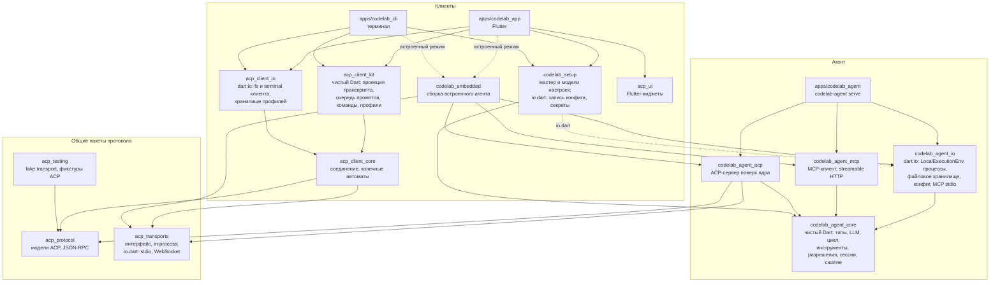
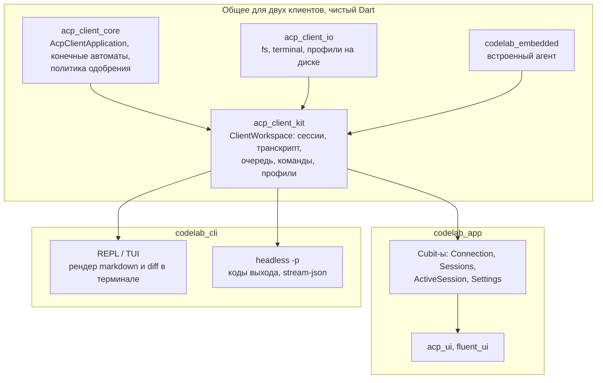

# 4. Целевая архитектура

> Часть предложения [«Dart-агент и клиенты CodeLab»](../dart-agent-and-clients.md). Status: Proposed. Исходные решения, связанные документы и порядок чтения — в оглавлении.

← [3. Рассмотренные варианты](03-options-considered.md) · [Оглавление](../dart-agent-and-clients.md) · [5. Контракты ядра](05-core-contracts.md) →

## 4.0. Подсистемы ядра

Подробное описание каждой подсистемы — контракты, инварианты, схемы и проверки — в документе
ядра. Таблица показывает, в каком пакете живёт подсистема и на каком этапе она появляется.

| Подсистема | Раздел документа ядра | Наш пакет | Этап |
|---|---|---|---|
| Контракт LLM `StreamFunction`: ошибки как события, каждое событие несёт снимок частичного ответа, декораторы watchdog / ретраев / fallback, адаптеры OpenAI-совместимый и Anthropic | §2 | `codelab_agent_core` | 1 |
| Отмена `CancelToken` до HTTP, процессов и ожиданий клиента | §3 | `codelab_agent_core` | 1 |
| Окружение `ExecutionEnv` с `Result`, capability-интерфейсами и декораторами; `BoundedEnv`; `MemoryExecutionEnv` | §4 | интерфейс и Memory — core; Local — `_io`; ACP-клиент — `_acp` | 2 (Local, Memory), 4 (ACP) |
| Чистый цикл `runAgentLoop` + `Agent` с состоянием + закрытая иерархия событий + хуки + очередь steering | §5 | `codelab_agent_core` | 2; супервизоры — после 9 |
| Контракт инструмента, реестр, валидатор с приведением типов, парность tool calls, блокировка по пути | §6 | `codelab_agent_core` | 2 |
| Разрешения: политика как первый хук `beforeToolCall`, уровни × режимы, критические шаблоны команд, «разрешить всегда» по шаблону аргументов | §7 | core; UI-часть — `AcpPermissionGate` в `_acp` | 2, 4 |
| Сессия как JSONL-дерево с `parentId` и `leaf`, проекции, `SessionStore` | §8 | контракт — core; файлы — `_io` | 3 |
| Классическое сжатие контекста по токенам | §9 | `codelab_agent_core` | 3; структурное — после 9 |
| Сборка ядра `buildAgentCore` и профили хостов | §10 | core; вызывают `codelab_embedded` и `apps/codelab_agent` | 2 (минимальная), 4, 7 |
| Промпты в Markdown + кодоген | §11 | `codelab_agent_core` | 2 |
| Наблюдаемость и модель ошибок | §12 | все агентские пакеты | 1–4 |
| ACP-адаптер: проекция событий, `AcpClientExecutionEnv`, `AcpPermissionGate`, реплей | §13 | `codelab_agent_acp` | 4 |
| Формат golden-фикстур | §14 | `acp_testing` | 0 |
| Конфигурация | §15 | загрузка — `_io`; модель и валидация — core | 4 (минимальная), 8 |
| MCP-клиент | §1 (пакеты), §6 (инструменты), §7 (разрешения) | `codelab_agent_mcp` | 8 |
| Skills, подагенты `task`, правки по якорям, супервизоры, структурное сжатие | §16 | core | после 9 |
| Правила посреди стрима, декларативная песочница ОС, второй собственный протокол | §16 | — | не берём: ACP-адаптер выполняет роль протокола; `BoundedEnv` и разрешения закрывают дефекты F5 |

## 4.1. Пакеты

Один Dart-монорепозиторий (melos + pub workspaces): текущий репозиторий расширяется пакетами
агента. Так `acp_protocol` и тестовые утилиты общие, а кросс-проектный contract test проходит в
одном CI.

Система включает три приложения:

| Приложение | Роль | Как говорит с агентом |
|---|---|---|
| `apps/codelab_agent` | бинарь **агента**: `codelab-agent serve --stdio`, `serve --ws` | сервер ACP |
| `apps/codelab_app` | **десктопный клиент** (Flutter) | ACP: внешний агент по stdio/WS или встроенный через in-process транспорт |
| `apps/codelab_cli` | **терминальный клиент** (чистый Dart, AOT-бинарь `codelab`) | ACP — так же, как codelab-app: внешний агент или встроенный |

Оба клиента — полноценные ACP-клиенты: они работают с Dart-агентом, с Python-агентом на время
миграции и со сторонними агентами (Claude Code ACP и др.). CLI заменяет Python TUI.

| Пакет | Ответственность | Можно импортировать | Нельзя |
|---|---|---|---|
| `codelab_agent_core` | типы сообщений, контракт провайдера и адаптеры (HTTP через внедрённый клиент), цикл агента, реестр и встроенные инструменты поверх `ExecutionEnv`, проверка разрешений, журнал сессии, сжатие, промпты, `MemoryExecutionEnv`, `AgentRuntime` | чистый Dart; зависимости только из allowlist: `http` (интерфейс `Client`), `meta`, `collection`, `async` | `dart:io`, `dart:isolate`, `dart:ffi`, `dart:html`, `package:web`, `package:flutter`, `acp_protocol`, `acp_transports` |
| `codelab_agent_io` | `LocalExecutionEnv` (файлы, процессы), `JsonlSessionStore` на диске, секреты из env и keychain, загрузка конфигурации, процессный транспорт для MCP stdio | ядро, `dart:io` | Flutter, ACP |
| `codelab_agent_mcp` | MCP-клиент (stdio через порт процесса, streamable HTTP), проекция MCP-инструментов в `AgentTool` | ядро | `dart:io`, Flutter, ACP |
| `codelab_agent_acp` | ACP-сервер: `initialize`, `session/*`, проекция `AgentEvent → session/update`, `AcpClientExecutionEnv`, `AcpPermissionGate`, реплей `session/load` | ядро, `acp_protocol`, платформенно-нейтральная часть `acp_transports` | `dart:io`, `package:acp_transports/io.dart`, Flutter |
| `apps/codelab_agent` | AOT-бинарь агента: `serve --stdio`, `serve --ws`, конфиг, выбор профиля хоста | всё агентское, `package:acp_transports/io.dart` | Flutter, клиентские пакеты |
| `acp_client_core` (есть) | соединение, корреляция запросов, конечные автоматы, политика одобрения, порты fs/terminal | `acp_protocol`, платформенно-нейтральная часть `acp_transports` | Flutter, `dart:io` (после этапа 0) |
| `acp_client_kit` (новый) | **общая логика клиентов без UI**: модель рабочего пространства, инкрементальная проекция транскрипта, очередь промптов, список сессий, slash-команды и палитра, опции конфигурации (Mode/Model/Effort), профили подключения, `session/load` после reconnect | `acp_client_core` | Flutter, `dart:io` |
| `acp_client_io` (новый) | реализации портов клиента на `dart:io`: `TextFileReader`/`TextFileWriter`, `TerminalProcessRunner`, `WorkingDirectoryProvider`, JSON-хранилища профилей и недавних проектов | `acp_client_kit`, `acp_client_core`, `dart:io` | Flutter |
| `codelab_embedded` (новый) | одна функция сборки встроенного агента для любого клиента: runtime + ACP-сервер + `InProcessAcpLink` | агентские пакеты, `acp_transports` | Flutter; в основном барели — `dart:io` (IO-сервисы — в `io.dart`) |
| `codelab_setup` (новый, этап 7; §12.4.2) | общая логика настройки агента для обоих клиентов: мастер провайдера `ProviderSetupFlow`, проверка `/models`, готовность провайдера, черновики MCP-серверов, `SettingsAccess`, модели представления, порт `AgentConfigStore`; реэкспорт чистых типов конфига и секретов ядра (agent-core-architecture §17.5.2). `io.dart` — `FileAgentConfigStore` поверх `ConfigWriter`, `systemSecretStore()`, вход в подкоманды CLI ядра | основной барель: `codelab_agent_core`, `http`, `meta`; `io.dart`: `codelab_agent_io`, `dart:io` | Flutter, `package:acp_*`; в основном барели — `dart:io`, `webUnsafe`, `codelab_agent_io` |
| `acp_ui` (есть) | Flutter-виджеты | — | протокол |
| `apps/codelab_app` | Flutter UI: Cubit-ы — тонкие обёртки над `acp_client_kit` | клиентские пакеты, `codelab_embedded`, `codelab_setup` (`io.dart` — только infrastructure) | агентские пакеты напрямую |
| `apps/codelab_cli` | терминальный UI (REPL, позже полноэкранный TUI) и headless-режим `-p` поверх `acp_client_kit` | клиентские пакеты, `codelab_embedded`, `codelab_setup` | Flutter, агентские пакеты напрямую |
| `codelab_architecture_tests` (новый, только тесты) | тест-сторож импортов и зависимостей для всего монорепозитория (§9.5) | файловая система репозитория | — |

Клиенты не импортируют ядро агента напрямую — только через `codelab_embedded` (встроенный агент)
и `codelab_setup` (типы конфига и секретов для настроек, §12.4). Так встроенный агент для них
ничем не отличается от внешнего: это ещё один профиль подключения.

`codelab_agent_acp` не импортирует `dart:io`. Поэтому ACP-адаптер работает и в web — например,
как ACP-агент внутри браузерной вкладки, отдающий события в UI через тот же in-process транспорт.

**Правило создания пакетов.** Пакет создаётся на том этапе, где в нём появляется первый
содержательный код (`AGENTS.md` §13: пустые слои и абстракции «на вырост» запрещены). Этап 0
создаёт только `codelab_agent_core` (нужен сторожу и web-сборке) и `codelab_architecture_tests`.

## 4.2. Слои внутри ядра

Снаружи внутрь: публичный API (`AgentRuntime`, `AgentSession`, `AgentEvent`) → цикл агента →
инструменты, LLM и сессии → порты хоста (`ExecutionEnv`, `PermissionGate`, `SessionStore`,
`SecretStore`, HTTP-клиент, `Clock`, `Logger`). Схема и правила слоёв — документ ядра §1.

Правило: всё, что касается внешнего мира, — порт, который передаёт хост. Ядро не знает, где лежат
файлы (на диске, у ACP-клиента, в IndexedDB) и кто одобряет действия (UI, ACP-клиент, политика
headless). Время, идентификаторы и HTTP-клиент тоже приходят от хоста, поэтому тесты ядра
детерминированы (документ ядра §1, инвариант PKG-6).

## 4.3. Ключевая идея: ExecutionEnv объединяет две модели исполнения

В ACP файлы и терминал исполняет **клиент** (`fs/*`, `terminal/*`). Встроенному агенту удобнее
исполнять их **внутри процесса**. В новой архитектуре обе модели — реализации одного порта
`ExecutionEnv`: `LocalExecutionEnv` (`dart:io`, процессы ОС), `AcpClientExecutionEnv` (`fs/*`, `terminal/*`
клиента), `MemoryExecutionEnv` (файлы в памяти, без shell), `PersistentWebEnv` (IndexedDB) и
декоратор `BoundedEnv` поверх любой из них (контракт — документ ядра §4).

Выбор реализации при создании сессии:

| Хост | Реализация env |
|---|---|
| `codelab-agent serve`, клиент (codelab-app, codelab_cli, Zed) объявил `fs` и `terminal` | `AcpClientExecutionEnv` (как сейчас в Python): файлы и команды исполняет клиент |
| `codelab-agent serve`, клиент без `fs`/`terminal` | `LocalExecutionEnv` (если разрешено конфигом) или соответствующие инструменты выключаются |
| codelab-app или codelab_cli, встроенный режим, десктоп | `LocalExecutionEnv` (у codelab-app App Sandbox выключен) |
| iOS / Android (codelab-app) | `LocalExecutionEnv` в папке документов приложения, без shell |
| web (codelab-app) | `PersistentWebEnv` |

Во всех случаях снаружи стоит декоратор `BoundedEnv`: граница рабочей папки проверяется **один раз,
в одном месте, через нормализованный путь**. Алгоритм (документ ядра §4):

1. Относительный путь разрешается от `cwd` сессии.
2. Путь нормализуется: убираются `.`, `..`, повторные разделители.
3. Для существующего пути берётся `realpath` (раскрываются симлинки); для нового файла —
   `realpath` ближайшего существующего родителя плюс оставшийся хвост.
4. Путь принимается, только если он равен `realpath(cwd)` или начинается с `realpath(cwd)` **плюс
   разделитель**. Поэтому `/proj_evil` для `cwd=/proj` отклоняется по построению.
5. Отказ — значение `Result` с типизированной ошибкой, а не исключение; инструмент возвращает её
   модели текстом.

## 4.4. Два клиента: общий слой и различия

Сегодня вся клиентская логика codelab-app сосредоточена в `CodeLabShellCubit` (2264 строки). Он
импортирует `acp_ui`, `fluent_ui` и `flutter_bloc`, поэтому терминальный клиент не может его
переиспользовать. Без выделения общего слоя логика проекции транскрипта, очереди промптов, команд
и reconnect была бы написана дважды и разошлась бы.

Публичный API `acp_client_kit` (`ClientWorkspace`, `SessionHandle`, `ConnectionProfile`,
`AgentBackend`) и таблица переноса ответственности из `CodeLabShellCubit` — в §9.10 (этап 5).

**Различия клиентов:**

| Аспект | codelab-app | codelab_cli |
|---|---|---|
| Платформы | macOS, позже iOS/Android/web | macOS, Linux, Windows (AOT-бинарь) |
| UI | Flutter, `acp_ui` | терминал: REPL на старте, полноэкранный TUI позже |
| Одобрение действий | карточки в ленте | вопрос в терминале `y / a / n / N`; в headless — политика из флага (по умолчанию отказ) |
| fs и terminal клиента | `acp_client_io` | `acp_client_io` (тот же код) |
| Режимы подключения | внешний stdio/WS, встроенный | внешний stdio/WS, встроенный; по умолчанию — встроенный (не нужен отдельный процесс агента) |
| Headless | нет | `codelab -p "..."`: коды выхода по `stopReason`, вывод текстом или `stream-json` |
| Несколько сессий одновременно | да | одна активная, переключение командой |
| Хранилище профилей | `~/.codelab/profiles.json` через `acp_client_io` (общий с CLI) | то же |

## 4.5. Нужен ли клиентам прямой API ядра в обход ACP

**Технически это возможно.** `codelab_agent_core` — обычная Dart-библиотека: и codelab-app, и
codelab_cli могут создать `AgentRuntime` и подписаться на `AgentEvent` напрямую. Вопрос в том,
стоит ли это делать.

Важно: встраивание в один процесс **не требует** обхода ACP. При `InProcessAcpTransport` агент
уже работает внутри приложения: без отдельного процесса, без сокетов и без JSON-строк (передаются
объекты `JsonRpcMessage`). Значит, сравнивать нужно не «встроенный против внешнего», а
**«встроенный через ACP-объекты» против «встроенный через `AgentEvent`»**.

| Критерий | Через ACP (in-process) | Напрямую (`AgentEvent`) |
|---|---|---|
| Работа в одном процессе | да | да |
| Накладные расходы | проекция события в ACP-объект; строкового JSON нет — ничтожно по сравнению с задержкой LLM | нет |
| Путей кода в клиенте | **один** для встроенного, внешнего Dart-агента, Python-агента и сторонних агентов | **два**: прямой для своего ядра и ACP для остальных; каждую функцию UI надо делать и тестировать дважды |
| Одинаковость режимов | функции одинаковы во встроенном и внешнем режиме | то, что доступно только через прямой API, **пропадает**, когда агент внешний (`codelab-agent serve`, удалённая машина) |
| Возможности сверх ACP (usage и стоимость, steering посреди хода, ветки и rewind, панель подагентов, типизированные ошибки) | через расширения ACP: `_meta` и методы с префиксом `_codelab/` — работают во **всех** режимах, включая удалённый | доступны сразу, но только во встроенном режиме |
| Проверка протокола | встроенный режим постоянно прогоняет тот же ACP-код, что и внешний: ошибки адаптера ловятся раньше | ACP-адаптер используется реже и стареет незаметно |
| Отладка | protocol trace одинаков для всех режимов | два разных журнала |

**Решение: клиентам достаточно ACP.** И codelab-app, и codelab_cli встраивают ядро только через
`InProcessAcpTransport`. Возможности сверх стандарта ACP добавляются расширениями протокола
(`_meta`, `_codelab/*`), а не прямым API. Расширения разрешены механизмом extensibility ACP
(`docs/acp/protocol/15-Extensibility.md`). По правилу `AGENTS.md` §3.4 каждое из них вводится только
через OpenSpec change, чтобы не изобретать семантику ACP. Причины выбора ACP:
1. один путь кода в каждом клиенте;
2. одинаковое поведение встроенного и внешнего агента;
3. работа со сторонними агентами без отдельной ветки логики.

**Прямой API ядра при этом сохраняется** — но для других потребителей:

| Потребитель | Зачем прямой API |
|---|---|
| тесты ядра | проверка цикла, инструментов и сжатия без протокола |
| `codelab_agent_acp` | сам ACP-адаптер построен на прямом API |
| сторонние Dart-приложения (ядро как SDK) | встроить агента в свой продукт без ACP-клиента |
| будущие хосты без UI-клиента | например, фоновые задачи или CI-бот на Dart |

**Запасной вариант на будущее.** Чтобы прямой путь можно было добавить без переделки UI,
`acp_client_kit` получает данные от агента через внутренний порт `AgentBackend` (§9.10); его
единственная реализация сейчас — `AcpClientBackend` поверх `AcpClientApplication`. Если
когда-нибудь понадобится `DirectBackend`, UI-слои обоих клиентов не изменятся.

**Когда пересмотреть решение** (любой пункт):
- расширение ACP для нужной функции оказывается заметно сложнее и дороже прямого вызова. Пример — передача больших бинарных данных между ядром и UI без копирования;
- замеры показывают, что проекция в ACP-объекты заметно нагружает UI при длинных потоках;
- клиенты отказываются от поддержки сторонних агентов.

---

← [3. Рассмотренные варианты](03-options-considered.md) · [Оглавление](../dart-agent-and-clients.md) · [5. Контракты ядра](05-core-contracts.md) →
