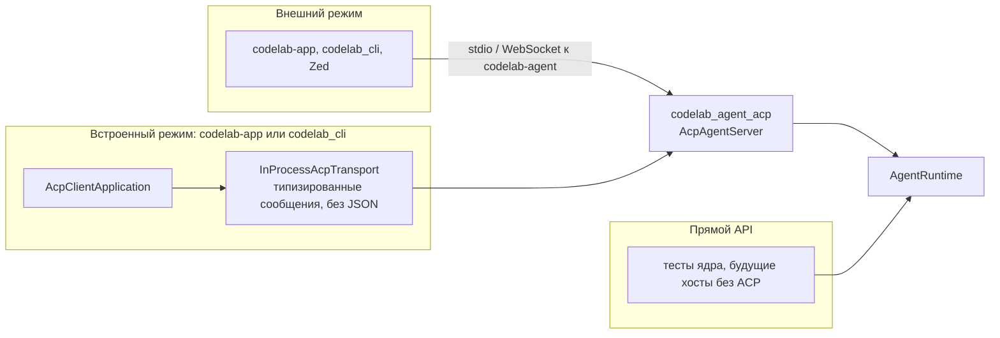
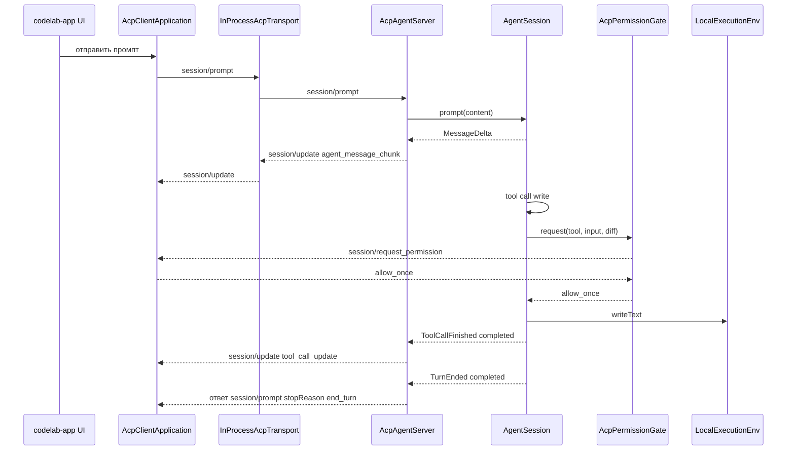

# 6. Режимы работы и потоки

> Часть предложения [«Dart-агент и клиенты CodeLab»](../dart-agent-and-clients.md). Status: Accepted. Исходные решения, связанные документы и порядок чтения — в оглавлении.

← [5. Контракты ядра](05-core-contracts.md) · [Оглавление](../dart-agent-and-clients.md) · [7. Источники решений](07-decision-sources.md) →

## 6.1. Три способа подключиться к ядру

`InProcessAcpTransport` реализует существующий интерфейс `AcpTransport` и соединяет
`AcpClientApplication` с `AcpAgentServer` парой потоков в памяти (код — §9.12). Сообщения
передаются как объекты `JsonRpcMessage`, без кодирования в текст. Оба клиента используют его
одинаково через `codelab_embedded`. Код UI, конечных автоматов и одобрений у каждого клиента один
для встроенного и внешнего агента.

Прямой API ядра (без ACP) остаётся для тестов ядра и для будущих хостов, которым протокол не нужен.
Пользовательские клиенты им не пользуются (§4.5).

## 6.2. Ход во встроенном режиме

Разрешения во встроенном режиме запрашиваются **через ACP**: `AcpPermissionGate` отправляет
`session/request_permission`, и клиент показывает свой обычный UI одобрения. Отдельного
«прямого» гейта для UI нет: так UI одобрения один для обоих режимов, и клиент остаётся обычным
ACP-клиентом.

Встроенный агент исполняет файлы и команды через `LocalExecutionEnv`, а не через `fs/*`:
ядро и UI находятся в одном процессе, и гонять запросы через протокол незачем. Опасные действия
(запись файла, команда) агент перед исполнением в режиме по умолчанию согласует через
`session/request_permission` (режим одобрения по умолчанию — `standard`, agent-core-architecture §10.5).

Это не меняет модель разрешений клиента (`AGENTS.md` §10, `docs/architecture/permissions.md`).
Для `fs/*` и `terminal/*` клиент по-прежнему не вводит собственного одобрения, а только
ограничивает пути рабочей папкой, потому что по ACP одобрение — ответственность агента. Новый
агент эту ответственность выполняет. Python-агент делал это не всегда: одобрение запрашивалось
без аргументов, а «разрешить всегда» действовало на целый вид инструментов.

## 6.3. Ход во внешнем режиме (как сейчас)

Те же события, но `AcpAgentServer` работает поверх stdio- или WebSocket-транспорта,
`env = AcpClientExecutionEnv`, `gate = AcpPermissionGate`. Для клиента ничего не меняется, кроме
исправленных несовместимостей (F5.5).

---

← [5. Контракты ядра](05-core-contracts.md) · [Оглавление](../dart-agent-and-clients.md) · [7. Источники решений](07-decision-sources.md) →
