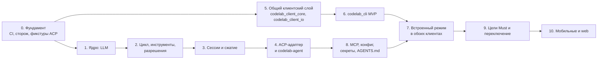
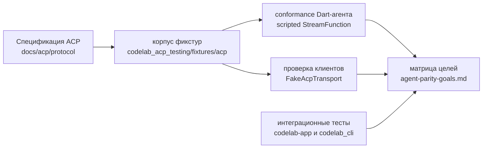

# 9. План миграции

> Часть предложения [«Dart-агент и клиенты CodeLab»](../dart-agent-and-clients.md). Status: Accepted. Исходные решения, связанные документы и порядок чтения — в оглавлении.

← [8. Сквозные аспекты](08-cross-cutting.md) · [Оглавление](../dart-agent-and-clients.md) · [9.5. Этап 0 — Фундамент](09-05-stage-0-foundation.md) →

## 9.0. Общие правила

Правила действуют для всех этапов §9.5–§9.15.

1. **Одна задача — одно ревьюируемое изменение** (PR), которое оставляет `melos run check`
   зелёным. Номер задачи (`2.4`) указывается в заголовке PR. Задачи собираются в итерации
   (правило 8).
2. **OpenSpec change создаётся до кода** (`AGENTS.md` §17): `openspec/changes/<имя>/` с
   `proposal.md`, `design.md`, `specs/`, `tasks.md`. Пункты `tasks.md` — это задачи этапа из
   этого документа; `design.md` может уточнять решения этого документа, но не противоречить
   документу ядра без его правки.
3. **TDD.** Каждая задача начинается с красного теста из критерия приёмки матрицы целей или из
   раздела «Как проверить» документа ядра; затем минимальный код до зелёного; затем рефакторинг.
   Пункты `tasks.md` идут парами «тест → реализация» со ссылкой на критерий. В PR красный тест
   виден в истории коммитов до кода, или PR ссылается на критерий, который закрывает. Уровень
   теста — минимально необходимый (`docs/architecture/testing.md` §1): чистый Dart там, где можно.
   Исключения:
   * (а) рефакторинг существующего кода — сначала характеризационные тесты, фиксирующие текущее
     поведение (этап 5, задача 5.0 для `CodeLabShellCubit`);
   * (б) интеграционные тесты app и PTY-e2e CLI — приёмочные ворота, а не цикл разработки:
     они пишутся до закрытия этапа, но не до каждой задачи. PTY-e2e CLI идёт на Dart VM в CI ветки
     этапа; app-тесты на устройстве или симуляторе (`test:e2e:app:*`) в ветках `feature/*` и
     `hotfix/*` не запускаются — их прогон выполняется только в ветке `release/<version>`
     (`AGENTS.md` §21);
   * (в) UI — test-first для Cubit и модели отображения (§12.1), widget-тесты проверяют поведение,
     а не вёрстку;
   * (г) реальные провайдеры, keychain, процессы ОС — test-first на фейках, реальные проверки —
     отдельными интеграционными тестами;
   * (д) разведка (выбор библиотеки, бенчмарк isolate) — spike с ограничением по времени без
     тестов; код по его итогам пишется по TDD.
4. **Команды** запускаются через FVM и melos из корня репозитория. Обозначение `melos run X`
   означает `fvm dart run melos run X`.
5. **Definition of Done этапа** включает общие пункты: все итерации этапа завершены (правило 8);
   полный `melos run check` зелёный в CI на `develop` после merge, проверки затронутого
   (`AGENTS.md` §21) зелёные локально и в CI pull request;
   новые пакеты добавлены в `workspace:` корневого `pubspec.yaml` и в правила сторожа;
   `docs/architecture/` обновлены, если изменилась граница; строки матрицы целей этапа имеют
   доказательства.
6. **OpenSpec change архивируется в конце этапа:** когда DoD выполнен, change переносится в
   архив, а его delta specs сливаются в `openspec/specs/`. Задачи с пометкой «Should — не
   блокирует MVP», не сделанные к концу этапа, переносятся в отдельный change и не держат архив.
7. **Новый пакет получает вложенный `AGENTS.md`** в том этапе, где он создаётся (правила пакета,
   сторож импортов, TDD по п. 3, готовность итерации по п. 8); корневой `AGENTS.md` дописывается
   окончательно в задаче 9.7.
8. **Итерации: feature first.** Разработка идёт маленькими итерациями, и каждая итерация — тонкий
   сквозной срез одной функции (строки матрицы целей или её части) через все слои, которые этой
   функции нужны, а не достройка одного слоя целиком. Итерация — от одной задачи до нескольких,
   обычно 1–3 PR и не дольше недели. `tasks.md` OpenSpec change этапа группирует задачи по
   итерациям; первая итерация этапа — самый тонкий работающий срез его функции (для этапов 1–4
   это срез P0, [дорожная карта §5](../delivery-roadmap.md#5-срез-p0-poc)), следующие его
   расширяют.

   **Архитектура закладывается с первой итерации.** Границы пакетов, порты, инварианты и
   точки расширения взяты из документа ядра и этого предложения и с первой итерации проверяются
   автоматически: сторож импортов и allowlist зависимостей (задача 0.4), детерминированные порты
   (`Clock`, `IdGenerator`, `Random`, задача 1.11), sealed-иерархии событий и результатов. Пустые
   пакеты и абстракции «на вырост» при этом не создаются (`AGENTS.md` §6, §13): пакет появляется
   в итерации, где в нём появляется первая функция, но сразу со своими правилами в стороже и
   вложенным `AGENTS.md`.

   **Итерация завершена**, когда выполнены все пункты:
   * (а) **функция работает без ошибок:** критерии строк матрицы, которые закрывает итерация,
     зелёные; полный `melos run check` (формат, анализ без предупреждений, все тесты) зелёный в CI
     на `develop` после merge, проверки затронутого (`AGENTS.md` §21) зелёные локально и в CI
     pull request;
   * (б) **unit-тесты** покрывают каждое новое поведение и каждый новый публичный элемент
     (написаны по TDD, п. 3); **интеграционные тесты** — для каждой границы, которую итерация
     пересекает (кадры ACP, файловая система, процессы, HTTP, хранилище), на фейках или в
     процессе: `InProcessAcpLink`, `MockClient`, `MemoryExecutionEnv`, временный каталог,
     scripted-агент; где интеграционный тест невозможен, PR говорит почему и чем это закрыто;
   * (в) **архитектура готова к следующей итерации:** в PR названа следующая итерация по
     `tasks.md` и точка, в которую встаёт её функция; нужные ей контракты уже есть или
     добавляются расширением — без изменения сигнатур, которыми уже пользуются;
   * (г) **архитектура легко расширяема:** новая функция добавлена в точке расширения,
     предусмотренной документом ядра (`ToolRegistry`, порты `AgentCoreServices`, capabilities
     `HostProfile`, ветка sealed-иерархии `AgentEvent`, ключ схемы конфига, фабрика провайдеров),
     а не новыми условиями в существующем коде; сторож импортов и allowlist зелёные; нет обходов
     — `TODO` без задачи, `// ignore:` без причины, временных флагов без задачи на удаление;
   * (д) **рефакторинг сделан:** шаг refactor цикла TDD выполнен, дублирование, появившееся в
     итерации, устранено;
   * (е) **документы и код не расходятся:** если итерации понадобилось изменить контракт
     документа ядра или этого предложения, документ правится в том же PR.

## 9.1. Этапы

Зависимости: 0 → 1 → 2 → 3 → 4; 0 → 5 → 6; 4 → 8; {6, 8} → 7; 7 → 9 → 10. Этап 7 зависит от
этапов 6 и 8 (а не от 4 и 6): встроенному агенту нужны загрузка конфигурации (задача 8.5) и
хранилище секретов (задача 8.9); этап 4 входит в него через этап 8.

Клиентская ветка (этапы 5–6) не зависит от агентской (1–4) и идёт параллельно с ней.
CLI на этапе 6 работает с **текущим Python-агентом** и scripted-агентом из `codelab_acp_testing`, а
после этапа 4 — и с Dart-агентом.

| Этап | Результат | Главная проверка | Подробно |
|---|---|---|---|
| **0. Фундамент** | конфигурация melos в одном месте; CI; разделение `codelab_acp_transports`; пакет `codelab_agent_core` с web-smoke; сторож архитектуры; корпус golden ACP-фикстур и клиентский прогон; лицензия и `THIRD_PARTY_NOTICES.md`; `AGENTS.md` для агентских пакетов и TDD (задача 0.11) | CI зелёный; сторож валит сборку при импорте `dart:io` в ядро | §9.5 |
| **1. LLM** | контракт `StreamFunction`, `CancelToken`, SSE, адаптеры OpenAI-совместимый и Anthropic, декораторы, учёт usage, `ScriptedStreamFunction` | стрим с отменой посреди ответа; обрыв сети → событие `ErrorEvent`, не исключение | §9.6 |
| **2. Цикл, инструменты, разрешения** | `Agent`, цикл с парностью вызовов, `AgentRuntime` в памяти, инструменты `read/write/edit/ls/search/exec/update_plan`, политика разрешений первым хуком, `BoundedEnv`, `MemoryExecutionEnv`, `LocalExecutionEnv`, промпты, минимальный `buildAgentCore` | сценарий «прочитать → отредактировать → запустить» на scripted LLM; ни один инструмент не исполняется в обход политики; `/proj_evil` не проходит при `cwd=/proj` | §9.7 |
| **3. Сессии и сжатие** | JSONL-журнал, проекции, `loadSession`/`listSessions`, классический компактор, вынос огромного результата в файл сессии (`outputSpill`, задача 3.8 — Should — не блокирует MVP) | обрыв процесса посреди хода не ломает загрузку; длинная сессия продолжается после сжатия без ошибки переполнения | §9.8 |
| **4. ACP-адаптер и codelab-agent** | `AcpAgentServer`, `AcpClientExecutionEnv`, `AcpPermissionGate`, реплей; бинарь `codelab-agent serve --stdio / --ws` | **codelab-app без изменений работает с Dart-агентом** по stdio; conformance агента на корпусе фикстур; применимые интеграционные тесты app проходят против Dart-агента (`CODELAB_E2E_AGENT=dart`, задача 4.9) | §9.9 |
| **5. Общий клиентский слой** | `codelab_client_core` и `codelab_client_io`; `CodeLabShellCubit` — фасад над kit; `listSessions`, таймауты запросов, `session/load` после reconnect | 8 интеграционных тестов app проходят без изменений; kit покрыт юнит-тестами без Flutter | §9.10 |
| **6. codelab_cli MVP** | AOT-бинарь `codelab`: REPL, одобрение, slash-команды, профили; headless `-p` с кодами выхода и `stream-json`; `codelab test-scenario` | CLI проходит e2e-сценарии против Python-агента и scripted-агента; `codelab -p` работает в CI | §9.11 |
| **8. MCP, конфиг, секреты, AGENTS.md** | MCP stdio + HTTP, полная конфигурация, загрузка `AGENTS.md`, slash-команды агента, определения агентов в Markdown (задача 8.8); хранилище секретов: `SecretResolver`, хранилища ОС, `codelab secret` (задача 8.9, нужна этапу 7); запись конфига, живая перезагрузка, реестр настроек, переподключение MCP (задача 8.10 — Should — не блокирует MVP) | MCP-инструмент проходит через `ToolExecutor` (`tools/executor.dart`); битый конфиг даёт понятную ошибку | §9.13 |
| **7. Встроенный режим** | `InProcessAcpLink`, `codelab_embedded`; профиль «встроенный агент» в app и CLI (в CLI — по умолчанию); пакет `codelab_setup` (провайдеры и мастер первого запуска; часть для D-05 — Should — не блокирует MVP) | интеграционные тесты app и e2e CLI проходят в режиме встроенного агента | §9.12 |
| **9. Цели Must и переключение** | закрыты все Must; профиль по умолчанию — Dart-агент; Python-агент и Python TUI заморожены, затем удалены; выпуск (задача 9.4) и онбординг (задача 9.6) — Should — не блокирует MVP | каждая строка Must подтверждена фикстурой или тестом; ручная проверка с Zed | §9.14 |
| **10. Мобильные и web** | `PersistentWebEnv`, профили `mobile` и `web`; сборка app для iOS/Android/web | ядро и app собираются для web; сценарий без shell проходит на iOS-симуляторе | §9.15 |

Параллельность:
- агентская ветка (этапы 1–4) и клиентская (5–6) идут одновременно;
- внутри агентской ветки этапы 1 и 2 частично параллельны: инструменты и `ExecutionEnv` не зависят от LLM-адаптеров (цикл тестируется на `ScriptedStreamFunction`, который появляется в начале этапа 1);
- этап 8 идёт после этапа 4 параллельно с клиентской веткой; этап 7 начинается, когда готовы
  этапы 6 и 8 (в таблице этап 8 поэтому стоит перед этапом 7).

**Срез P0.** Допустимое сокращение пути: до полного объёма этапов 1–4 собирается PoC «промпт →
LLM → read/edit/exec → ответ в codelab-app по stdio» без этапа 3. P0 — явное исключение из
зависимости «этап 4 после этапа 3» (§9.9 «Зависимости»); после P0 этапы 1–4 доводятся до
полного объёма в обычном порядке. Состав, пропуски и критерий выхода — в
[дорожной карте](../delivery-roadmap.md#5-срез-p0-poc).

## 9.2. Первый полезный результат

**Первый полезный результат** — после **этапов 4 и 6**:
- Dart-агент заменяет Python-агента для codelab-app по stdio;
- codelab_cli работает с любым из двух агентов и заменяет Python TUI;
- дефекты F5 закрыты архитектурой, а не латками: граница папки (`BoundedEnv`), `cancelled` в ACP
  (проекция в адаптере), «разрешить всегда» по виду (ключ по шаблону аргументов), одобрение без
  аргументов (`rawInput` в запросе). Обход проверки через MCP закрывается на этапе 8, когда
  появляется MCP: у MCP-инструментов нет собственного пути исполнения.

Это ещё не MVP. **MVP** — все Must-строки матрицы целей зелёные и профиль по умолчанию
переключён на Dart-агента: ворота этапа 9 (критерий матрицы
[§6](../agent-parity-goals.md#6-критерий-вывода-python-агента-и-переключения-по-умолчанию)).
Публичный релиз (задача 9.4) в MVP не входит. Единственное определение ступеней PoC → первый
полезный результат → MVP → продукт 1.0 — в [дорожной карте](../delivery-roadmap.md#2-ступени-и-определения).

## 9.3. Golden ACP-фикстуры, тесты клиентов и цели

Эталон поведения — спецификация ACP. Он закрепляется корпусом golden-фикстур, общим для агента и
клиентов: один корпус — один контракт. Формат фикстуры (кадры, направление, нормализация, ссылка
на раздел спецификации, сценарий scripted LLM) определён в документе ядра §14; здесь — как корпус
используется.

- **Где лежит корпус:** `packages/dart/codelab_acp_testing/fixtures/acp/<имя>.json` — плоско, без
  подкаталогов групп (фикстуры расширений ACP лежат там же и помечены полем `"extensions"`). Id фикстуры — `acp/` + имя
  файла, имя — `<область>-<сценарий>[-<исход>]`, области — agent-core-architecture §14.2; например
  `acp/prompt-tool-permission-allow`.
- **Conformance агента** (этап 4): драйвер проигрывает кадры клиента, агент работает на scripted
  `StreamFunction` из той же фикстуры, ответы сравниваются с ожидаемыми кадрами после
  нормализации. Тест: `packages/dart/codelab_agent_acp/test/conformance_test.dart` (agent-core-architecture §14.13).
- **Проверка клиентов** (этап 0 для `codelab_client_acp`, этап 5 для `codelab_client_core`):
  `FakeAcpTransport` проигрывает кадры агента; проверяются ответы клиента и состояние. Тесты:
  `packages/dart/codelab_client_acp/test/fixtures/client_fixture_conformance_test.dart`,
  `packages/dart/codelab_client_core/test/fixtures/kit_fixture_projection_test.dart`.
- **Драйвер из командной строки** (этап 6): `codelab test-scenario <фикстура> --agent <профиль>`
  проигрывает фикстуры против любого агента — встроенного, `codelab-agent serve --stdio`,
  Python-агента. Проигрывание фикстур — это headless ACP-клиент, поэтому он построен на
  `codelab_client_core`, и фикстуры одновременно проверяют агента и общий клиентский слой.
- **Матрица целей:** у каждой строки Must есть доказательство — id фикстуры и/или имя теста
  клиента. Проверка наличия доказательств автоматизирована (этап 9, §9.14).
- **Критерий вывода Python-агента:** все строки Must зелёные плюс ручная проверка с Zed. Прогон
  Python-агента на фикстурах допустим как справочный, но не блокирует.
- **Правило изменения фикстуры:** фикстура меняется только вместе со ссылкой на раздел
  спецификации и с объяснением в OpenSpec change; флаг `--update-golden` пишет новые ожидаемые
  кадры, но коммит такого изменения требует ревью владельца ACP-границы.

## 9.4. Как устроен каждый этап

Каждый этап ниже описан по одной схеме: **цель → задачи → OpenSpec change → что прочитать →
Definition of Done → зависимости → риски**. Общие правила для всех этапов — §9.0.

---

← [8. Сквозные аспекты](08-cross-cutting.md) · [Оглавление](../dart-agent-and-clients.md) · [9.5. Этап 0 — Фундамент](09-05-stage-0-foundation.md) →
