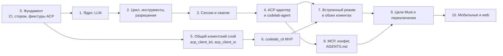
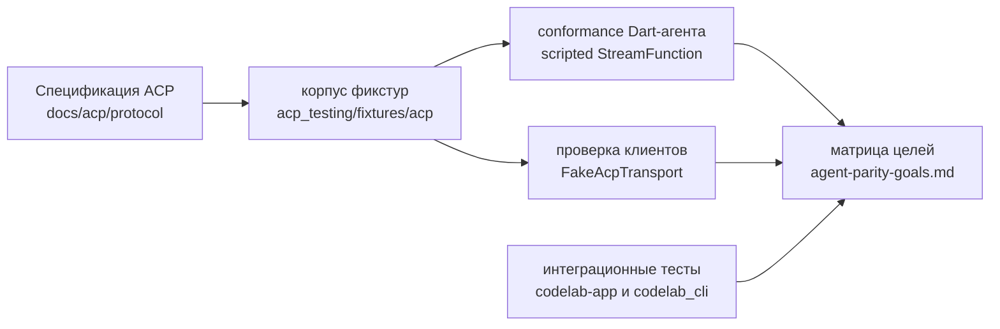

# 9. План миграции

> Часть предложения [«Dart-агент и клиенты CodeLab»](../dart-agent-and-clients.md). Status: Proposed. Исходные решения, связанные документы и порядок чтения — в оглавлении.

← [8. Сквозные аспекты](08-cross-cutting.md) · [Оглавление](../dart-agent-and-clients.md) · [9.5. Этап 0 — Фундамент](09-05-stage-0-foundation.md) →

## 9.1. Этапы

Клиентская ветка (этапы 5–6) не зависит от агентской (1–4) и идёт параллельно с ней.
CLI на этапе 6 работает с **текущим Python-агентом** и scripted-агентом из `acp_testing`, а
после этапа 4 — и с Dart-агентом.

| Этап | Результат | Главная проверка | Подробно |
|---|---|---|---|
| **0. Фундамент** | конфигурация melos в одном месте; CI; разделение `acp_transports`; пакет `codelab_agent_core` с web-smoke; сторож архитектуры; корпус golden ACP-фикстур и клиентский прогон; лицензия и `THIRD_PARTY_NOTICES.md` | CI зелёный; сторож валит сборку при импорте `dart:io` в ядро | §9.5 |
| **1. LLM** | контракт `StreamFunction`, `CancelToken`, SSE, адаптеры OpenAI-совместимый и Anthropic, декораторы, учёт usage, `ScriptedStreamFunction` | стрим с отменой посреди ответа; обрыв сети → событие `ErrorEvent`, не исключение | §9.6 |
| **2. Цикл, инструменты, разрешения** | `Agent`, цикл с парностью вызовов, `AgentRuntime` в памяти, инструменты `read/write/edit/ls/search/exec/update_plan`, политика разрешений первым хуком, `BoundedEnv`, `MemoryExecutionEnv`, `LocalExecutionEnv`, промпты, минимальный `buildAgentCore` | сценарий «прочитать → отредактировать → запустить» на scripted LLM; ни один инструмент не исполняется в обход политики; `/proj_evil` не проходит при `cwd=/proj` | §9.7 |
| **3. Сессии и сжатие** | JSONL-журнал, проекции, `loadSession`/`listSessions`, классический компактор, вынос огромного результата в файл сессии (`outputSpill`, задача 3.8) | обрыв процесса посреди хода не ломает загрузку; длинная сессия продолжается после сжатия без ошибки переполнения | §9.8 |
| **4. ACP-адаптер и codelab-agent** | `AcpAgentServer`, `AcpClientExecutionEnv`, `AcpPermissionGate`, реплей; бинарь `codelab-agent serve --stdio / --ws` | **codelab-app без изменений работает с Dart-агентом** по stdio; conformance агента на корпусе фикстур; применимые интеграционные тесты app проходят против Dart-агента | §9.9 |
| **5. Общий клиентский слой** | `acp_client_kit` и `acp_client_io`; `CodeLabShellCubit` — фасад над kit; `listSessions`, таймауты запросов, `session/load` после reconnect | 8 интеграционных тестов app проходят без изменений; kit покрыт юнит-тестами без Flutter | §9.10 |
| **6. codelab_cli MVP** | AOT-бинарь `codelab`: REPL, одобрение, slash-команды, профили; headless `-p` с кодами выхода и `stream-json`; `codelab test-scenario` | CLI проходит e2e-сценарии против Python-агента и scripted-агента; `codelab -p` работает в CI | §9.11 |
| **7. Встроенный режим** | `InProcessAcpLink`, `codelab_embedded`; профиль «встроенный агент» в app и CLI (в CLI — по умолчанию); пакет `codelab_setup` (провайдеры и мастер первого запуска) | интеграционные тесты app и e2e CLI проходят в режиме встроенного агента | §9.12 |
| **8. MCP, конфиг, AGENTS.md** | MCP stdio + HTTP, полная конфигурация, загрузка `AGENTS.md`, slash-команды агента, определения агентов в Markdown (задача 8.8), настройка агента: секреты, команды `config`/`provider`/`mcp`/`secret`, живая перезагрузка (задача 8.9) | MCP-инструмент проходит через `ToolExecutor` (`tools/executor.dart`); битый конфиг даёт понятную ошибку | §9.13 |
| **9. Цели Must и переключение** | закрыты все Must; профиль по умолчанию — Dart-агент; Python-агент и Python TUI заморожены, затем удалены | каждая строка Must подтверждена фикстурой или тестом; ручная проверка с Zed | §9.14 |
| **10. Мобильные и web** | `PersistentWebEnv`, профили `mobile` и `web`; сборка app для iOS/Android/web | ядро и app собираются для web; сценарий без shell проходит на iOS-симуляторе | §9.15 |

Параллельность:
- агентская ветка (этапы 1–4) и клиентская (5–6) идут одновременно;
- внутри агентской ветки этапы 1 и 2 частично параллельны: инструменты и `ExecutionEnv` не зависят от LLM-адаптеров (цикл тестируется на `ScriptedStreamFunction`, который появляется в начале этапа 1);
- этапы 7 и 8 идут параллельно после этапа 4.

## 9.2. Минимальный жизнеспособный результат

После **этапов 4 и 6**:
- Dart-агент заменяет Python-агента для codelab-app по stdio;
- codelab_cli работает с любым из двух агентов и заменяет Python TUI;
- дефекты F5 закрыты архитектурой, а не латками: граница папки (`BoundedEnv`), `cancelled` в ACP
  (проекция в адаптере), «разрешить всегда» по виду (ключ по шаблону аргументов), одобрение без
  аргументов (`rawInput` в запросе). Обход проверки через MCP закрывается на этапе 8, когда
  появляется MCP: у MCP-инструментов нет собственного пути исполнения.

## 9.3. Golden ACP-фикстуры, тесты клиентов и цели

Эталон поведения — спецификация ACP. Он закрепляется корпусом golden-фикстур, общим для агента и
клиентов: один корпус — один контракт. Формат фикстуры (кадры, направление, нормализация, ссылка
на раздел спецификации, сценарий scripted LLM) определён в документе ядра §14; здесь — как корпус
используется.

- **Где лежит корпус:** `packages/dart/acp_testing/fixtures/acp/<имя>.json` — плоско, без
  подкаталогов групп (фикстуры расширений ACP лежат там же и помечены полем `"extensions"`). Id фикстуры — `acp/` + имя
  файла, имя — `<область>-<сценарий>[-<исход>]`, области — agent-core-architecture §14.2; например
  `acp/prompt-tool-permission-allow`.
- **Conformance агента** (этап 4): драйвер проигрывает кадры клиента, агент работает на scripted
  `StreamFunction` из той же фикстуры, ответы сравниваются с ожидаемыми кадрами после
  нормализации. Тест: `packages/dart/codelab_agent_acp/test/conformance_test.dart` (agent-core-architecture §14.13).
- **Проверка клиентов** (этап 0 для `acp_client_core`, этап 5 для `acp_client_kit`):
  `FakeAcpTransport` проигрывает кадры агента; проверяются ответы клиента и состояние. Тесты:
  `packages/dart/acp_client_core/test/fixtures/client_fixture_conformance_test.dart`,
  `packages/dart/acp_client_kit/test/fixtures/kit_fixture_projection_test.dart`.
- **Драйвер из командной строки** (этап 6): `codelab test-scenario <фикстура> --agent <профиль>`
  проигрывает фикстуры против любого агента — встроенного, `codelab-agent serve --stdio`,
  Python-агента. Проигрывание фикстур — это headless ACP-клиент, поэтому он построен на
  `acp_client_kit`, и фикстуры одновременно проверяют агента и общий клиентский слой.
- **Матрица целей:** у каждой строки Must есть доказательство — id фикстуры и/или имя теста
  клиента. Проверка наличия доказательств автоматизирована (этап 9, §9.14).
- **Критерий вывода Python-агента:** все строки Must зелёные плюс ручная проверка с Zed. Прогон
  Python-агента на фикстурах допустим как справочный, но не блокирует.
- **Правило изменения фикстуры:** фикстура меняется только вместе со ссылкой на раздел
  спецификации и с объяснением в OpenSpec change; флаг `--update-golden` пишет новые ожидаемые
  кадры, но коммит такого изменения требует ревью владельца ACP-границы.

## 9.4. Как устроен каждый этап

Каждый этап ниже описан по одной схеме: **цель → задачи → OpenSpec change → что прочитать →
Definition of Done → зависимости → риски**. Общие правила:

1. **Одна задача — одно ревьюируемое изменение** (PR), которое оставляет `melos run check`
   зелёным. Номер задачи (`2.4`) указывается в заголовке PR.
2. **OpenSpec change создаётся до кода** (`AGENTS.md` §17): `openspec/changes/<имя>/` с
   `proposal.md`, `design.md`, `specs/`, `tasks.md`. Пункты `tasks.md` — это задачи этапа из
   этого документа; `design.md` может уточнять решения этого документа, но не противоречить
   документу ядра без его правки.
3. **Тесты пишутся вместе с кодом** на минимально необходимом уровне (`docs/architecture/testing.md`
   §1): чистый Dart там, где можно.
4. **Команды** запускаются через FVM и melos из корня репозитория. Обозначение `melos run X`
   означает `fvm dart run melos run X`.
5. **Definition of Done этапа** включает общие пункты: `melos run check` зелёный локально и в CI;
   новые пакеты добавлены в `workspace:` корневого `pubspec.yaml` и в правила сторожа;
   `docs/architecture/` обновлены, если изменилась граница; строки матрицы целей этапа имеют
   доказательства.

---

← [8. Сквозные аспекты](08-cross-cutting.md) · [Оглавление](../dart-agent-and-clients.md) · [9.5. Этап 0 — Фундамент](09-05-stage-0-foundation.md) →
