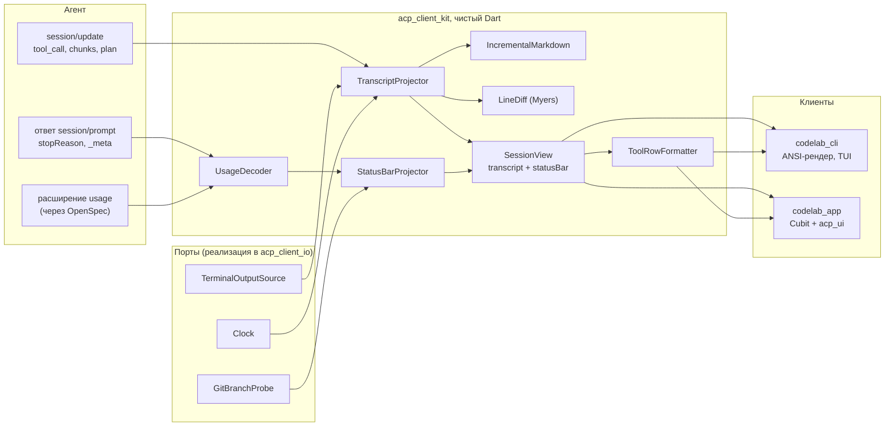

# 12.1. Общая модель отображения в `acp_client_kit`

> Часть предложения [«Dart-агент и клиенты CodeLab»](../dart-agent-and-clients.md). Status: Accepted. Исходные решения, связанные документы и порядок чтения — в оглавлении.

← [12. Отображение и настройка в клиентах: спецификации после MVP](12-0-clients-post-mvp.md) · [Оглавление](../dart-agent-and-clients.md) · [12.2. CLI: отображение и ввод](12-2-cli-display-and-input.md) →

**Назначение.** Оба клиента показывают одно и то же: мысли модели отдельно от ответа (U-08,
D-08), строки инструментов без сырого JSON (U-09), markdown (U-10, D-06), diff правок (U-11,
D-07), статус с моделью, режимом, токенами и стоимостью (U-13, D-09), вложения (U-14, D-12).
Всё, что не зависит от способа вывода, вычисляется один раз в `acp_client_kit`: разбор markdown в
нейтральное дерево, построчный diff, извлечение детали строки инструмента, сборка статуса из
опций конфигурации и usage, превращение вложений в блоки ACP. Клиент получает готовые модели и
решает только, как их нарисовать: CLI — ANSI-последовательностями (§12.2), app — виджетами
`acp_ui` (§12.3). Пакет остаётся на чистом Dart: без Flutter и без `dart:io`; всё, что требует
файловой системы, процессов или часов, приходит через порты, реализованные в `acp_client_io`.

Модель расширяет эскиз `TranscriptItem` из §9.10 и не меняет алгоритм инкрементальной проекции:
шаги 1–8 §9.10 остаются, проектор дополнительно заполняет поля ниже.



## 12.1.1. Контракт (Dart)

Эскиз: конструкторы, `==` и `copyWith` опущены; модели неизменяемые (freezed, как в §9.10).
Файлы — в `packages/dart/acp_client_kit/lib/src/view/` (модели отображения) и
`lib/src/attachments/`; экспорт через `lib/acp_client_kit.dart`.

```dart
// ---------- Транскрипт: поля для отображения ----------
final class UserItem implements TranscriptItem {
  final String id;
  final String text;
  final List<PromptAttachmentView> attachments;     // чипы: имя, вид, предупреждение
  final UserOrigin origin;                          // после MVP: steer — доставлено посреди хода (C-03)
}
enum UserOrigin { user, steer }                     // steer — user_message_chunk с _meta.codelab.steer

// После MVP (agent-core-architecture §17.10.4.1, OpenSpec add-rate-limit-info): NoticeItem
// (kind: error, §9.10) получает поле RateLimitNoticeView? rateLimit — из data.codelab.rateLimit
// ошибки session/prompt; без поля — показывается data.codelab.message как есть.
final class RateLimitNoticeView {
  final String kind;            // requests | tokens | subscription | quota | unknown; неизвестное → unknown
  final String provider, model;
  final Duration? retryAfter;   // из retryAfterMs
  final DateTime? resetAt;      // UTC, показывается в часовом поясе устройства
}

// После MVP (agent-core-architecture §17.6.10): у каждого TranscriptItem (§9.10) — поле
// `String? recordId`: id записи журнала из `_meta.codelab.recordId` реплея и эха промпта;
// null без расширения sessionTree. По нему UI предлагает «перемотать сюда».

/// После MVP (C-03, agent-core-architecture §17.7.4): принятое, но ещё не доставленное steering.
final class PendingSteerView {
  final String localId; final String? steerId;      // steerId — после ответа агента
  final String text; final List<PromptAttachmentView> attachments;
  final SteerPhaseView? phase;                      // model | tools | permission — «чего ждёт ход»
  final PendingSteerState state;                    // sending | accepted
}
enum SteerPhaseView { model, tools, permission }
enum PendingSteerState { sending, accepted }
// SessionView (§9.10) получает поле `List<PendingSteerView> pendingSteers` (над композером);
// доставленное steering становится UserItem(origin: steer), возвращённое — элементом очереди.

// ---------- После MVP: управление сессией (S-06…S-09, agent-core-architecture §17.6.11) ----------
// Дополнение SessionHandle (§9.10); методы вызывают _codelab/session/* при объявленной
// agentCapabilities._meta.codelab.sessionTree, иначе — агентскую команду того же имени.
abstract interface class SessionHandle {
  Stream<SessionAccessView> get access;             // write | readOnly(owner); текущее значение — первым
  Future<String> rename(String title);
  Future<SessionTreeView> branches();               // ветки, сообщения активной ветки, метки
  Future<BranchSwitchView> switchBranch(String targetId, {bool? summarize});
  Future<RewindView> rewind(String messageId, {bool? summarize, bool dryRun = false});   // prompt для поля ввода
  Future<ForkView> fork({String? recordId, bool beforeMessage = false, String? title});
  Future<void> label(String targetId, String? label);
}
sealed class SessionAccessView { const SessionAccessView(); }
final class WriteAccess extends SessionAccessView { const WriteAccess(); }
final class ReadOnlyAccess extends SessionAccessView { final String profile; final int pid; final String host; final DateTime since; }

final class AgentTextItem implements TranscriptItem {
  final String id;
  final String text;                                // исходный текст, байт в байт (для pipe)
  final bool streaming;
  final MarkdownDocument markdown;                  // разбор text по §12.1.4
}

final class ThoughtItem implements TranscriptItem {
  final String id;
  final String text;
  final bool streaming;
  final DateTime startedAt;                         // по Clock клиента: первый chunk
  final DateTime? endedAt;                          // следующий элемент другого вида или конец хода
  Duration? get duration;                           // null, пока streaming
}

final class ToolCallItem implements TranscriptItem {
  final String id;                                  // == toolCallId
  final String toolCallId;
  final String title;                               // как прислал агент
  final ToolKind kind;                              // из acp_protocol; неизвестное значение → other
  final ToolCallStatusView status;
  final Map<String, Object?>? rawInput;             // для /inspect и детали строки; не рисуется как JSON
  final List<ToolLocationView> locations;
  final List<ToolContentView> content;              // последний присланный набор (замена целиком)
  final String? progressText;                       // строка прогресса, пока status == running
  final DateTime? startedAt;                        // переход в in_progress (по Clock клиента)
  final DateTime? finishedAt;                       // переход в итоговый статус
  final ApprovalStateView? approval;
}

enum ToolCallStatusView { pending, running, completed, failed, rejected, cancelled, interrupted }

final class ToolLocationView {
  final String path;                                // абсолютный, как в ACP
  final String displayPath;                         // относительно cwd сессии, если внутри него
  final int? line;
}

sealed class ToolContentView {}
final class ToolTextContent extends ToolContentView {
  final String text;
  final SpillMarker? spill;                         // распознанная пометка «[output spilled: …]»
}
final class ToolDiffContent extends ToolContentView { final DiffView diff; }
final class ToolTerminalContent extends ToolContentView {
  final String terminalId;
  final TerminalOutputView? output;                 // null, если терминал создавал не этот клиент
}
final class ToolOtherContent extends ToolContentView {
  final String label;                               // «image/png, 34 КБ», «resource: file:///…»
}

final class SpillMarker { final String path; }      // только подсказка; файл клиент не читает

final class TerminalOutputView {
  final List<String> tail;                          // последние строки (лимит — параметр проектора)
  final int totalLines;
  final int? exitCode;
  final bool truncated;
}

// ---------- Diff ----------
final class DiffView {
  final String path;
  final String displayPath;
  final DiffChange change;                          // created | modified | deleted (newText пустой и oldText не пуст)
  final List<DiffHunk> hunks;                       // пусто, если tooLarge или binary
  final int added;
  final int removed;
  final DiffLimitReason? limited;                   // null — diff полный
}
enum DiffChange { created, modified, deleted }
enum DiffLimitReason { tooLarge, binary, budgetExceeded }

final class DiffHunk {
  final int oldStart, oldCount, newStart, newCount; // 1-based, как в заголовке @@
  final List<DiffLine> lines;
}
final class DiffLine {
  final DiffOp op;                                  // context | added | removed
  final String text;                                // без '\n'
  final int? oldLine, newLine;
  final bool noNewlineAtEnd;                        // «\ No newline at end of file»
}
enum DiffOp { context, added, removed }

abstract final class LineDiff {
  static DiffView compute({required String path, required String displayPath,
      String? oldText, required String newText, DiffLimits limits = const DiffLimits()});
}
final class DiffLimits {
  final int maxLinesPerSide = 20000;
  final int maxEditDistance = 4000;                 // D в алгоритме Майерса
  final int context = 3;
}

// ---------- Markdown ----------
final class MarkdownDocument {
  final List<MdBlock> blocks;
  final int stableCount;                            // blocks[0 .. stableCount) больше не изменятся
}
sealed class MdBlock {}
final class MdHeading extends MdBlock { final int level; final List<MdInline> inlines; }
final class MdParagraph extends MdBlock { final List<MdInline> inlines; }
final class MdList extends MdBlock {
  final bool ordered; final int start; final List<MdListItem> items;
}
final class MdListItem { final bool? checked; final List<MdBlock> blocks; }   // checked != null — задача
final class MdCodeBlock extends MdBlock {
  final String? language; final String code; final bool closed;   // closed == false — ограда не закрыта
}
final class MdQuote extends MdBlock { final List<MdBlock> blocks; }
final class MdTable extends MdBlock {
  final List<List<MdInline>> header; final List<MdAlign> align; final List<List<List<MdInline>>> rows;
}
final class MdThematicBreak extends MdBlock {}
enum MdAlign { none, left, center, right }

sealed class MdInline {}
final class MdText extends MdInline { final String text; }
final class MdCode extends MdInline { final String code; }
final class MdEmphasis extends MdInline { final bool strong; final List<MdInline> children; }
final class MdStrike extends MdInline { final List<MdInline> children; }
final class MdLink extends MdInline { final List<MdInline> children; final String url; }
final class MdImage extends MdInline { final String alt; final String src; }  // клиент не загружает
final class MdLineBreak extends MdInline {}

/// Инкрементальный разбор: append — дописать дельту, close — конец потока.
final class IncrementalMarkdown {
  MarkdownDocument get document;
  void append(String delta);
  void close();
  static MarkdownDocument parse(String text);       // разбор с нуля закрытого текста
}

// ---------- Строка инструмента ----------
final class ToolRowView {
  final ToolRowGlyph glyph;                         // pending | running | done | failed | rejected | cancelled
  final String label;                               // «Read», «Edit», «Run», … или title
  final String detail;                              // одна строка, без управляющих символов; может быть пустой
  final String? elapsed;                            // «0.8s», «12s», «2m03s»; null, пока не начат
  final String? secondary;                          // progressText, первая строка ошибки, подсказка spill
  final DiffView? diff;                             // первый ToolDiffContent, если есть
  final TerminalOutputView? terminal;
}
enum ToolRowGlyph { pending, running, done, failed, rejected, cancelled }

abstract final class ToolRowFormatter {
  static ToolRowView format(ToolCallItem item, {required DateTime now,
      required String cwd, ToolRowStrings strings = const ToolRowStrings()});
}

// ---------- Статус-строка ----------
final class SessionStatusBar {
  final String? modelId, modelLabel;                // config option категории model
  final String? modeId, modeLabel;                  // config option категории mode или current_mode_update
  final UsageView usage;
  final String? gitBranch;
  final int queued;                                 // длина очереди промптов
  final int steered;                                // после MVP: длина SessionView.pendingSteers (C-03)
  final bool readOnly;                              // после MVP: access == ReadOnlyAccess (S-09)
}

final class UsageView {
  final TokenCounts? lastTurn;
  final TokenCounts? session;
  final bool sessionPartial;                        // сумма только по ходам, увиденным этим клиентом
  final Money? lastTurnCost, sessionCost;
  final int? contextUsed, contextWindow;
  final UsageSource source;
  double? get contextFraction;                      // null, если нет contextUsed или contextWindow
  static const UsageView unknown = UsageView(source: UsageSource.none);
}
final class TokenCounts { final int input, output, cacheRead, cacheWrite, reasoning; }
final class Money { final int micros; final String currency; }        // целые микроединицы
enum UsageSource { none, extension }

/// Единственное место, знающее форму расширения usage (решается OpenSpec, §12.1.5).
abstract interface class UsageDecoder {
  UsageSample? fromPromptResponse(PromptResponse response);
  UsageSample? fromNotification(String method, Map<String, Object?> params);
}
final class UsageSample {
  final TokenCounts? turn; final TokenCounts? sessionTotal;
  final Money? turnCost, sessionCost;
  final int? contextUsed, contextWindow;
}

// ---------- Вложения ----------
sealed class PromptAttachment {}
final class FileAttachment extends PromptAttachment {
  final String path;                                // как ввёл пользователь
  final AttachmentOrigin origin;                    // flag | mention | drop | clipboard (список файлов из буфера, §12.3)
}
final class ImageAttachment extends PromptAttachment {
  final Uint8List bytes;                            // dart:typed_data — допустимо в чистом Dart
  final String name;                                // «clipboard-1.png» или имя файла
}
final class ShellOutputAttachment extends PromptAttachment {   // после MVP: вывод `!<cmd>` (§12.6.2)
  final String command;
  final int? exitCode;                              // null — отменена или таймаут
  final String output;                              // без ANSI, усечённый, после SecretRedactor
  final int omittedBytes;
}
enum AttachmentOrigin { flag, mention, drop, clipboard }

final class PromptAttachmentView {
  final String name;
  final AttachmentKindView kind;                    // как вложение уйдёт (или не уйдёт) агенту
  final int? bytes;                                 // размер файла или картинки; null — неизвестен
  final List<AttachmentWarningKind> warnings;       // пусто — без предупреждений
}
enum AttachmentKindView {
  image,                                            // блок image (+ resource_link, если есть файл)
  embedded,                                         // блок resource с текстом файла
  link,                                             // блок resource_link
  pathText,                                         // путь строкой в тексте промпта (повтор, §12.1.7, шаг 5)
  inlineText,                                       // блок text перед текстом промпта (вывод !, §12.6.2)
  notSent,                                          // не отправляется; причина — в warnings
}

final class AttachmentWarning {
  final int index;                                  // позиция в списке attachments
  final AttachmentWarningKind kind;
  final String? path;                               // нормализованный путь, если есть
}
enum AttachmentWarningKind {
  missing,                                          // нет файла или не читается
  directory,                                        // путь — папка
  outsideCwd,                                       // вне cwd сессии: нужна явная отправка (VIEW-8)
  imageNotSupported,                                // агент не принимает image: уйдёт ссылкой
  downgradedBySize,                                 // сверх лимита встраивания: уйдёт ссылкой
  tooLarge,                                         // картинка без файла сверх лимита: не уйдёт
  tooMany,                                          // сверх AttachmentLimits.maxCount: не уйдёт
  maybeSecret,                                      // имя похоже на файл секретов; не блокирует
}

final class AttachmentLimits {
  final int maxCount = 10;
  final int maxImageBytes = 5 << 20;                // 5 МиБ
  final int maxEmbeddedTextBytes = 256 << 10;       // 256 КиБ на файл
  final int maxEmbeddedTotalBytes = 20 << 20;       // 20 МиБ встраиваемого на промпт
}

final class PromptContentPlan {
  final List<ContentBlock> blocks;                  // готово для session/prompt
  final List<PromptAttachmentView> attachments;     // по одному на вход, в том же порядке (чипы)
  final List<AttachmentWarning> warnings;           // показать до отправки
}

/// Одна функция и для предпросмотра чипов, и для отправки (SessionHandle.send вызывает её же).
abstract final class PromptContentBuilder {
  static Future<PromptContentPlan> build({required String text,
      required List<PromptAttachment> attachments, required PromptCapabilities capabilities,
      required String cwd, required AttachmentFiles files,
      bool allowOutsideCwd = false,                 // true — пользователь подтвердил (VIEW-8)
      AttachmentLimits limits = const AttachmentLimits()});
}

// ---------- Очередь промптов (дополняет §9.10) ----------
final class QueuedPrompt {
  final String id;
  final String text;
  final List<PromptAttachment> attachments;         // сохраняются при правке и отправке из очереди
  final bool allowOutsideCwd;                       // подтверждение, данное при постановке в очередь
}

// ---------- Порты (реализации — acp_client_io) ----------
abstract interface class Clock { DateTime now(); }
abstract interface class GitBranchProbe { Future<String?> branchOf(String cwd); }
abstract interface class TerminalOutputSource {
  TerminalOutputView? snapshot(String terminalId);
  Stream<String> get changes;                       // terminalId изменившегося терминала
}
abstract interface class AttachmentFiles {
  Future<String> resolve(String path, {required String cwd});   // абсолютный нормализованный путь
  Future<FileProbe> probe(String absolutePath);    // exists, size, первые 16 байт
  Future<Uint8List> readBytes(String absolutePath, {required int maxBytes});
}
final class FileProbe { final bool exists; final int size; final Uint8List head; }
// после MVP (§12.6.8): порт чтения папки проекта и правила .gitignore — контракт в §12.6.8
abstract interface class ProjectFiles { /* canonicalRoot, list, read, watch — §12.6.8 */ }
abstract interface class GitIgnoreMatcher { /* чистый Dart, §12.6.8 */ }
final class IgnoreStack { /* .git/info/exclude + .gitignore по папкам, §12.6.8 */ }
// после MVP (U-27, §12.6.9): память модели по папке; реализация FileFolderChoiceStore — acp_client_io
abstract interface class FolderChoiceStore { /* read, write, forget по FolderKey — §12.6.9 */ }
final class FolderModelMemory { /* applyToNewSession, remember — §12.6.9 */ }
// после MVP (D-17, §12.6.12): поиск и фильтр сессий; типы SessionQuery, DateFilter,
// SessionMatchView, MessageSnippetView, SessionSearchView — контракт в §12.6.12
abstract interface class SessionSearch { /* view, update, loadMore, dispose — §12.6.12 */ }
abstract interface class LocalCalendar { DateTime startOfLocalDay(DateTime instant); }
```

`SessionView` (§9.10) получает поле `final SessionStatusBar statusBar;`. Имя `SessionStatusView`
в §9.10 уже занято состоянием сессии (`idle | running | …`), поэтому модель статус-строки
названа `SessionStatusBar`. `SessionView.queue` — список `QueuedPrompt` выше: промпт с
вложениями, поставленный в очередь, хранит их до отправки, а `PromptQueue.edit` меняет только
текст.

## 12.1.2. Алгоритм: проекция полей инструмента и мыслей

Дополняет шаги 2–4 алгоритма §9.10.

1. **Статус.** `pending` → `pending`; `in_progress` → `running`; `completed` → `completed`;
   `failed` уточняется по `_meta.codelab.outcome`: `rejected` → `rejected`, `cancelled` →
   `cancelled`, `interrupted` → `interrupted`, иначе `failed`. Неизвестный `outcome` → `failed`.
   Без расширения (сторонний агент) статус — только по стандартному полю.
2. **Время.** `startedAt` ставится по `Clock` при первом переходе в `running`; если вызов пришёл
   сразу итоговым (реплей `session/load`), `startedAt` и `finishedAt` остаются `null`, и время в
   строке не показывается (реплей не знает реальной длительности). `finishedAt` — при первом
   итоговом статусе; повторная доставка того же статуса время не меняет.
3. **Пути.** `locations[i].path` → `ToolLocationView`; `displayPath` — путь относительно `cwd`
   сессии, если путь внутри `cwd`, иначе абсолютный с заменой домашнего каталога на `~` (домашний
   каталог передаёт composition root, kit его не читает).
4. **Содержимое.** Каждый элемент `content` по виду:
   * `content` с текстовым блоком → `ToolTextContent`; если в тексте есть строка вида
     маркера выноса (agent-core-architecture §17.4.3: `[output spilled: … Full output: <путь>. …]`; путь — группа регулярного выражения `^\[output spilled: .*? Full output: (.+?)\.(?: |\]$)` в любой строке),
     заполняется `spill` — это только подсказка «полный вывод: <путь>», текст остаётся текстом;
   * `content` с блоком `image`, `audio`, `resource`, `resource_link` → `ToolOtherContent` с
     меткой (MIME-тип и размер или URI); данные в модель не копируются;
   * `diff` → `ToolDiffContent(LineDiff.compute(...))`; результат запоминается по ключу
     `(path, hash(oldText), hash(newText))`, повторная доставка не пересчитывает diff;
   * `terminal` → `ToolTerminalContent(terminalId, TerminalOutputSource.snapshot(id))`; при
     событии `TerminalOutputSource.changes` элемент с этим `terminalId` обновляется (новая ревизия
     `SessionView`, склейка по шагу 8 §9.10).
5. **Строка прогресса.** Пока статус `running`, последний `ToolTextContent` трактуется как
   прогресс: `progressText` = последняя непустая строка, обрезанная до 200 символов. Так
   показывается прогресс субагента (`kind: think`, строка заменяется каждым `tool_call_update`).
   В итоговом статусе `progressText = null`, текст становится результатом.
6. **Мысли.** `ThoughtItem.startedAt` — время первого `agent_thought_chunk` элемента;
   `endedAt` — момент, когда потоковый элемент закрыт (шаг 2 §9.10) или ход закончился.
7. **Markdown.** Для `AgentTextItem` проектор держит `IncrementalMarkdown` по `id`: дельта
   `agent_message_chunk` → `append`, закрытие элемента → `close`. При реплее (`session/load`)
   элемент строится заново тем же путём. Мысли не размечаются: их текст показывается как есть.
8. **Тождественность экземпляров.** Новая ревизия `SessionView` переиспользует экземпляры всех
   `TranscriptItem`, которых обновление не коснулось (тот же объект, `identical`), а новый
   `MarkdownDocument` — экземпляры блоков `blocks[0 .. stableCount)` предыдущего документа того же
   элемента. Новый объект создаётся только для изменённого элемента и блоков хвоста. Клиенты
   кэшируют отрисовку по `identical` и не сравнивают содержимое (VIEW-11).

## 12.1.3. Алгоритм: построчный diff

`LineDiff.compute` — чистая функция без ввода-вывода.

1. **Разбиение.** Тексты делятся по `\n`; `\r\n` нормализуется в `\n` только для сравнения
   (строка `DiffLine.text` хранится без `\r`). Если текст не кончается `\n`, у последней строки
   флаг `noNewlineAtEnd`. `oldText == null` → `created`, все строки `added`; `newText` пустой при
   непустом `oldText` → `deleted`.
2. **Бинарные данные.** Символ `U+0000` в любой из сторон → `limited: binary`, `hunks` пусто,
   `added`/`removed` = 0. Клиент показывает «бинарный файл изменён».
3. **Размер.** Больше `maxLinesPerSide` строк в любой стороне → `limited: tooLarge`, `hunks`
   пусто, счётчики — `newLines - общий префикс - общий суффикс` и то же для старых (дешёвая оценка
   без полного diff).
4. **Обрезка.** Общий префикс и суффикс строк отбрасываются до запуска основного алгоритма
   (типичная правка — несколько строк в большом файле).
5. **Алгоритм Майерса O((N+M)·D)** по строкам середины: строки сравниваются через таблицу
   интернирования (строка → целый id), чтобы сравнение было `int == int`. Если `D` превысил
   `maxEditDistance`, вычисление останавливается → `limited: budgetExceeded`, `hunks` — один
   блок «вся середина удалена и вставлена», счётчики точные по длинам середины.
6. **Сборка блоков.** Последовательность операций → блоки с `context = 3` строками контекста;
   два изменения, между которыми не больше `2 × context` общих строк, попадают в один блок.
   `oldStart/newStart` 1-based; для пустой стороны блока `start` = номер строки перед блоком
   (как в unified diff, `@@ -0,0 +1,3 @@` для нового файла).
7. Результат детерминирован: при равной длине пути предпочитается удаление перед вставкой
   (стандартный порядок Майерса), поэтому golden-тесты стабильны.

Ограничение отображения (сколько строк diff рисовать в ленте) — дело клиента (§12.2.5), модель
хранит diff целиком в пределах лимитов выше.

## 12.1.4. Алгоритм: инкрементальный markdown

Поддерживаемое подмножество: ATX-заголовки `#`…`######`; абзацы; маркированные (`-`, `*`, `+`)
и нумерованные (`1.`, `1)`) списки с вложенностью по отступу и задачами `[ ]`/`[x]`; ограды
`` ``` `` и `~~~` с языком; цитаты `>`; таблицы с выравниванием в строке-разделителе; горизонтальная
черта `---`/`***`; inline — код в обратных кавычках, `*`/`_` и `**`/`__`, `~~`, ссылки
(`[текст]`, сразу за ним адрес в круглых скобках) и автоссылки `<https://…>`, картинки (та же
форма с `!` впереди) → `MdImage` (ни один клиент
картинку не загружает: показываются `alt` и адрес, VIEW-12), жёсткий перенос (два пробела или
`\` в конце строки).
Setext-заголовки, HTML, сноски и ссылки-определения не поддерживаются и остаются текстом абзаца:
они меняют смысл уже показанных строк задним числом и редки в ответах модели.

**Правило «стабильный префикс + нестабильный хвост».** Документ — список блоков; первые
`stableCount` блоков закреплены и больше не разбираются; остальные — хвост, который разбирается
заново при каждой дельте.

1. Состояние: исходный текст `src`, закреплённые блоки, смещение `stableEnd` в `src`, где они
   кончаются, и флаг «внутри ограды» на `stableEnd` (всегда `false`: граница не ставится внутри
   ограды).
2. `append(delta)`: `src += delta`; хвост `src[stableEnd..]` разбирается блочным парсером с нуля,
   учитываются только **полные** строки хвоста плюс неполная последняя строка как черновик.
3. **Граница блока считается безопасной**, если после неё парсер на верхнем уровне и выполнено
   одно из условий:
   * блок — ограда, и встретилась закрывающая строка ограды;
   * блок — заголовок или горизонтальная черта (одна строка, закрыта переводом строки);
   * после блока идёт пустая строка, а за ней — непустая строка, которая не продолжает список
     (нет отступа под маркер) и не продолжает цитату;
   * за абзацем, таблицей или цитатой следует строка, начинающая блок другого вида с
     безусловным признаком (заголовок, ограда, черта).
   Все блоки хвоста до последней безопасной границы переносятся в закреплённые, `stableEnd`
   сдвигается на конец границы.
4. Таблица распознаётся только при наличии строки-разделителя `|---|`; до её прихода строка
   с `|` — абзац хвоста (нестабильна, поэтому позднее превращение в таблицу корректно).
5. `close()`: весь хвост закрепляется; незакрытая ограда — `MdCodeBlock(closed: false)`.
6. Разбор inline выполняется для блока целиком; блоки хвоста получают inline-разбор заново при
   каждом `append`. Незакрытый `**` или `` ` `` в хвосте — пока текст; при закреплении блока
   разбор окончательный.

Стоимость `append` — O(длина дельты + длина хвоста); хвост ограничен одним-двумя блоками, кроме
длинной ограды: внутри ограды строки не разбираются, проверяется только закрывающая строка, а
предыдущие строки ограды хранятся списком и не переразбиваются (ограда — частный случай
«открытого блока с дописыванием»).

**Пример.** Поток `"# План\n\nСначала "`, затем `"тесты.\n\n- a\n"`, затем `"- b\n\nГотово"`:

| После дельты | Закреплено (`stableCount`) | Хвост |
|---|---|---|
| 1 | `MdHeading(1, "План")` (1) | `MdParagraph("Сначала ")` |
| 2 | заголовок, абзац «Сначала тесты.» (2) | `MdList[a]` |
| 3 | заголовок, абзац, `MdList[a, b]` (3) | `MdParagraph("Готово")` |
| `close()` | все 4 | — |

## 12.1.5. Алгоритм: статус-строка и usage

1. **Модель и режим.** `modelId/modelLabel` — текущее значение опции конфигурации категории
   `model` (если категорий нет — опции с id `model`); подпись — `name` выбранного значения.
   Режим — то же для категории `mode`, иначе `currentModeId` из `current_mode_update` с именем из
   списка режимов сессии. Ничего нет — поле `null`.
2. **Usage.** Источники — только расширение агента. Форма расширения — открытый вопрос матрицы
   целей (§8 матрицы, L-11): поле `_meta.codelab.usage` в ответе `session/prompt`, отдельное
   уведомление `_codelab/usage` или совместимое с другими агентами обновление usage. Выбор
   делается OpenSpec change `add-usage-extension` (`AGENTS.md` §3.4); kit реализует выбранную
   форму в одной реализации `UsageDecoder`, остальная модель от формы не зависит. Предлагаемое
   содержимое любой формы — поля `UsageSample`:
   `{"turn":{"input":1200,"output":310,"cacheRead":9800,"cacheWrite":0,"reasoning":0},
   "session":{…},"cost":{"turn":"0.0041","session":"0.0372","currency":"USD"},
   "context":{"used":11000,"size":128000}}`.
3. **Свёртка.** Каждый `UsageSample` обновляет `UsageView`: `lastTurn` — из `turn`; `session` —
   из `sessionTotal` (поле `UsageSample`, в JSON — `session`), если агент его прислал (тогда `sessionPartial = false`); иначе клиент
   суммирует `turn` по ходам, увиденным в этой сессии, и ставит `sessionPartial = true` (после
   `session/load` ранние ходы неизвестны). Стоимость — так же. `contextUsed/contextWindow` — только
   из `context`; клиент не оценивает окно модели сам. Деньги хранятся в целых микроединицах:
   сумма дробных долларов в `double` накапливает ошибку.
4. **Без расширения** `UsageView.unknown`: сегменты токенов, стоимости и контекста отсутствуют
   (не «0»). Это обычный режим со сторонним агентом.
5. **Ветка git.** `GitBranchProbe.branchOf(cwd)` вызывается при открытии сессии, после каждого
   хода и не чаще раза в 5 с; результат кэшируется. Реализация в `acp_client_io` читает
   `.git/HEAD` (с переходом по файлу `.git` с `gitdir:` для worktree и подмодулей), без запуска
   процесса: `ref: refs/heads/<имя>` → `<имя>`, иначе первые 7 символов хеша. Нет репозитория
   или ошибка чтения → `null`.
6. `StatusBarProjector` собирает `SessionStatusBar` из пунктов 1–5 и длины очереди; изменение
   любого источника даёт новую ревизию `SessionView`.
7. **Сообщение о лимите** (после MVP, L-32). `NoticeItem` с `rateLimit` показывается одной
   локализованной строкой: `requests` — «Лимит запросов исчерпан», `tokens` — «Лимит токенов
   исчерпан», `subscription` — «Лимит подписки исчерпан», `quota` — «Квота аккаунта исчерпана»,
   `unknown` — «Лимит провайдера исчерпан»; хвост «сброс через <N с | N мин | N ч | N дн>» по
   `retryAfter`, иначе по `resetAt − now`; без времени — «повторите позже». Обратный отсчёт не
   обновляется (строка — факт на момент ошибки). Тело ответа провайдера клиенту не приходит.

## 12.1.6. Алгоритм: строка инструмента

`ToolRowFormatter.format` — чистая функция; грамматика строки:
`<glyph> <label> <detail> <elapsed>` и необязательная вторая строка `secondary`.

1. **Значок** по статусу: `pending` → `pending`; `running` → `running`; `completed` → `done`;
   `failed`, `interrupted` → `failed`; `rejected` → `rejected`; `cancelled` → `cancelled`.
   Символы выбирает клиент (§12.2.4).
2. **Метка** по `kind`: `read` → `Read`, `edit` → `Edit` (`Create`, если diff `created`),
   `delete` → `Delete`, `move` → `Move`, `search` → `Search`, `execute` → `Run`, `fetch` →
   `Fetch`, `think` → `Task`, если в `rawInput` есть `agent`, иначе `Think`; `other` → `title`
   (для MCP-инструментов агент кладёт туда имя). Строки меток — в `ToolRowStrings`
   (локализация клиента).
3. **Деталь** — первое подходящее правило; значение всегда скаляр-строка из `rawInput` или
   `locations`, никогда не сериализация объекта:

   | `kind` | Источник детали |
   |---|---|
   | `execute` | `rawInput.command` (строка или массив, склеенный пробелами); первая строка, пробелы схлопнуты; если команды нет — `title` |
   | `read` | `displayPath` первой локации или `rawInput.path`; при `offset`/`limit` — суффикс `:<offset>-<offset+limit-1>` |
   | `edit`, `delete` | `displayPath` первой локации или `rawInput.path`; при нескольких локациях — суффикс `+<n-1>` |
   | `move` | `<from> → <to>` из двух локаций или `rawInput.source`/`destination` |
   | `search` | `"<pattern>"` из `rawInput.pattern` или `rawInput.query`; суффикс ` in <path>` и ` (<glob>)`, если заданы |
   | `fetch` | `rawInput.url` без схемы и без query-строки (query может содержать секрет) |
   | `think` | `rawInput.agent: rawInput.description`, иначе `rawInput.description`, иначе пусто |
   | `other` | первое строковое поле из `command`, `path`, `file_path`, `url`, `query`, `pattern`, `description`, `name`; иначе пусто |

   Затем: управляющие символы (`U+0000`–`U+001F`, `U+007F`, ESC-последовательности) заменяются
   пробелом; значение проходит `SecretRedactor` (§9.11); длина ограничена 160 символами с `…`
   (дальнейшее усечение под ширину — у клиента). Если деталь совпадает с меткой или пуста, а
   `title` отличается от метки — деталью становится `title` без повторяющегося слова метки.
4. **Время** — `finishedAt - startedAt` или `now - startedAt` для `running`: меньше 10 с —
   `0.8s` (одна десятичная), меньше минуты — `12s`, иначе `2m03s`; без `startedAt` — `null`.
5. **Вторая строка:** `running` → `progressText`; `failed`, `rejected` → первая непустая строка
   первого `ToolTextContent` (причина отказа или ошибка); `completed` со `spill` → «полный вывод:
   <путь>»; иначе `null`.
6. `diff` — первый `ToolDiffContent`; `terminal` — вывод первого `ToolTerminalContent`.

**Пример.**

| Вход (`kind`, `status`, `rawInput`) | `ToolRowView` |
|---|---|
| `execute`, `in_progress`, `{"command":"npm test --\n  --watch=false"}`, 3.2 с | `running · Run · npm test -- --watch=false · 3.2s` |
| `read`, `completed`, `{"path":"lib/a.dart","offset":10,"limit":20}` | `done · Read · lib/a.dart:10-29 · 0.1s` |
| `edit`, `failed` + `outcome: rejected`, текст «Отклонено пользователем» | `rejected · Edit · README.md`, вторая строка «Отклонено пользователем» |
| `think`, `in_progress`, `{"agent":"explore","description":"Find auth code"}`, прогресс `Search "login" in lib` | `running · Task · explore: Find auth code · 4.0s`, вторая строка `Search "login" in lib` |
| `fetch`, `completed`, `{"url":"https://example.com/docs?token=abc"}` | `done · Fetch · example.com/docs · 1.4s` |
| `other`, `completed`, `{"items":[1,2]}`, `title: "mcp__db__stats"` | `done · mcp__db__stats` (детали нет, JSON не показан) |

## 12.1.7. Алгоритм: вложения → блоки ACP

`PromptContentBuilder.build`:

1. Первый блок — `text` с текстом промпта (упоминания `@path` в тексте остаются как есть: модель
   видит, на что ссылался пользователь).
2. Вложения сверх `limits.maxCount` → `notSent` + `tooMany`. Для `FileAttachment`:
   `AttachmentFiles.resolve(path, cwd)` (нормализация и разрешение символических ссылок, realpath);
   файла нет или он не читается → `notSent` + `missing`; папка → `notSent` + `directory`. Путь вне
   `cwd` → предупреждение `outsideCwd`; при `allowOutsideCwd == false` вложение — `notSent`, клиент
   до отправки спрашивает подтверждение (§12.2.8, §12.3) и вызывает `build` повторно с
   `allowOutsideCwd: true`. Имя файла по шаблонам `.env*`, `*.pem`, `*.key`, `id_*` →
   предупреждение `maybeSecret` (не блокирует).
3. Тип определяется по первым байтам (`FileProbe.head`), а не по расширению: PNG
   `89 50 4E 47 0D 0A 1A 0A`, JPEG `FF D8 FF`, GIF `47 49 46 38`, WebP `52 49 46 46 ?? ?? ?? ??
   57 45 42 50`. Картинка:
   * `promptCapabilities.image == true` и размер не больше `maxImageBytes` → вид `image`: блок
     `image` (`data` в base64, `mimeType` по сигнатуре) и `resource_link` на файл (у картинки из
     буфера ссылки нет);
   * иначе картинка с файлом → вид `link` (`resource_link` на файл) с предупреждением
     `imageNotSupported` или `downgradedBySize`; картинка из буфера без файла → `notSent` с
     `imageNotSupported` или `tooLarge`.
   После MVP для агента CodeLab `maxImageBytes` вложения можно поднять до `images.max_input_bytes`
   агента: агент сам уменьшит картинку (T-29, agent-core-architecture §17.11.2.1).
4. Не картинка: `promptCapabilities.embeddedContext == true`, файл не больше
   `maxEmbeddedTextBytes`, декодируется как UTF-8, без `U+0000` в первых 8 КиБ и сумма
   встраиваемого не превысит `maxEmbeddedTotalBytes` → вид `embedded`, блок `resource` с текстом
   файла; иначе → вид `link`, блок `resource_link` с `uri: file://<абсолютный путь>`, `name`,
   `size` (сверх лимита — с `downgradedBySize`). `resource_link` и `text` агент обязан принимать
   по ACP всегда, поэтому для файлов это базовый путь.
5. Если агент не принимает даже `resource_link` (нарушение ACP, но встречается у сторонних
   агентов: ответ `-32602` на первый промпт с вложением), `SessionHandle.send` один раз повторяет
   промпт с текстовыми ссылками `Вложение: <путь>` в конце текста (вид `pathText`) и показывает
   `NoticeItem`.
6. `ImageAttachment` из буфера: только пункт 3 по байтам `bytes`.
6а. После MVP: `ShellOutputAttachment` → отдельный блок `text` с шапкой §12.6.2, шаг 8, перед
   блоком текста промпта, вид `inlineText`; capability не требуется.
7. Порядок блоков: текст, затем вложения в порядке добавления; дубликаты одного пути — один
   блок. `plan.attachments[i]` описывает `attachments[i]`; `UserItem.attachments` отправленного
   промпта — те же `PromptAttachmentView`.
8. `SessionHandle.send(text, attachments: …, allowOutsideCwd: …)` вызывает `build` с теми же
   аргументами и актуальными `promptCapabilities` в момент отправки (для промпта из очереди — в
   момент выхода из очереди). Поэтому чип, построенный тем же вызовом, показывает ровно то, что
   уйдёт агенту, пока не сменились возможности агента; смена агента или переподключение требуют
   пересчёта чипов.

## 12.1.8. Инварианты

1. **VIEW-1.** `acp_client_kit` не импортирует Flutter, `dart:io` и `dart:ui`; часы, файлы, git и
   вывод терминалов — только через порты `Clock`, `AttachmentFiles`, `GitBranchProbe`,
   `TerminalOutputSource`. Проверка — сторож §9.5.
2. **VIEW-2.** Ни одна модель отображения (`ToolRowView`, `SessionStatusBar`,
   `PromptAttachmentView`) не содержит сериализованного JSON из `rawInput`; полный `rawInput`
   доступен только через `/inspect` и подробный просмотр одобрения.
3. **VIEW-3.** Для любого текста `t` и любого разбиения на дельты: документ после всех `append` и
   `close` равен `IncrementalMarkdown.parse(t)`; закреплённые блоки после закрепления не
   меняются ни при каких последующих дельтах.
4. **VIEW-4.** `AgentTextItem.text` хранит исходный текст байт в байт; разбор markdown не меняет
   его.
5. **VIEW-5.** Применение hunks `LineDiff.compute(old, new)` к `old` даёт `new` для любых входов в
   пределах `DiffLimits`; при `limited != null` клиент не показывает частичный diff как полный.
6. **VIEW-6.** Отсутствие расширения usage даёт `UsageView.unknown`, и ни один клиент не
   показывает нулевые токены или стоимость как известные значения.
7. **VIEW-7.** Блок `image` уходит агенту, только если `promptCapabilities.image == true`;
   `resource` — только при `embeddedContext == true`.
8. **VIEW-8.** Вложение с путём вне `cwd` сессии не уходит агенту без явного подтверждения
   пользователя.
9. **VIEW-9.** Деталь строки инструмента проходит `SecretRedactor` и не содержит query-строки URL.
10. **VIEW-10.** Проекция полей отображения подчиняется свойству §9.10: проекция с нуля равна
    инкрементальной, кроме полей времени `startedAt/finishedAt` (в проекции с нуля они `null`).
11. **VIEW-11.** Неизменившийся `TranscriptItem` и закреплённый блок markdown сохраняют один и
    тот же экземпляр Dart во всех последующих ревизиях `SessionView` (`identical`); новый
    экземпляр получают только изменённый элемент и блоки хвоста.
12. **VIEW-12.** `MdImage` никогда не загружается клиентом: CLI и app показывают `alt` и адрес
    как текст или ссылку.
13. **VIEW-13.** Вид вложения, показанный до отправки, получен тем же
    `PromptContentBuilder.build`, что и блоки `session/prompt`, при тех же возможностях агента.

## 12.1.9. Обоснование

* **Модель в kit, рисование в клиенте.** Без общего слоя правила «какая деталь у строки
  инструмента», «когда блок markdown закреплён», «что делать без usage» разошлись бы между CLI и
  app так же, как сейчас разошлась бы логика `CodeLabShellCubit` (§4.4). Цвета, символы и
  виджеты зависят от поверхности и остаются в клиенте.
* **Свой разбор markdown, а не пакет.** Пакеты разбора markdown для Dart работают с закрытым
  документом и не дают «стабильного префикса»: на каждой дельте пришлось бы переразбирать весь
  ответ, а в CLI построчного режима нельзя перерисовать уже напечатанное. Подмножество выбрано
  так, чтобы ни одна новая строка не меняла смысл закреплённых.
* **Майерс с бюджетом.** Даёт минимальный и привычный (как у `git diff`) результат; бюджет `D`
  и предел строк защищают UI от многосекундного расчёта на перезаписанном файле — тогда честнее
  сказать «файл переписан целиком», чем зависнуть.
* **Usage только из расширения.** Оценка токенов на клиенте (символы / 4) расходилась бы с
  реальным счётом провайдера и стоимостью; неизвестное значение лучше неверного.
* **`.git/HEAD` вместо `git`.** Чтение файла не порождает процесс на каждый ход, работает без
  установленного git и не блокирует при сетевых файловых системах дольше, чем чтение одного
  файла.
* **Тип вложения по байтам.** Расширение может лгать (`.png`, сохранённый как JPEG), а агент
  отклонит картинку с неверным `mimeType`.

## 12.1.10. Как проверить

Тесты — в `packages/dart/acp_client_kit/test/`.

* `view/markdown/incremental_markdown_property_test.dart`: для корпуса ответов из фикстур и
  случайных разбиений на дельты (включая разрыв посреди `**`, строки ограды, `|---|`, `\r\n`)
  результат равен `parse` целого текста; закреплённые блоки не меняются (VIEW-3).
* `view/markdown/markdown_parser_test.dart`: табличные случаи каждого блока и inline-элемента;
  setext-заголовок остаётся абзацем; незакрытая ограда → `closed: false`.
* `view/diff/line_diff_test.dart`: новый файл, удаление, правка в середине, две правки на
  расстоянии 6 и 7 строк (один и два блока), `\ No newline at end of file`, `\r\n`, бинарный
  файл, 20 001 строка (`tooLarge`), превышение бюджета; свойство «применение hunks даёт `new`» на
  случайных текстах (VIEW-5).
* `view/tool_row_formatter_test.dart`: таблица примеров §12.1.6 для каждого `kind`; `rawInput` с
  вложенным объектом не попадает в деталь; токен в `command` редактируется; URL без query
  (VIEW-2, VIEW-9).
* `transcript/tool_call_display_projection_test.dart`: `outcome` → статус; `startedAt` по
  фальшивым часам; строка прогресса субагента заменяется; spill-пометка распознана; реплей без
  времени (VIEW-10).
* `view/status_bar_projector_test.dart`: модель и режим из опций категорий и из
  `current_mode_update`; без usage — `UsageView.unknown`; частичная сумма после `session/load`;
  деньги без накопления ошибки на 1000 ходах (VIEW-6).
* `usage/usage_decoder_test.dart`: форма, утверждённая OpenSpec; неизвестные поля игнорируются,
  неверный тип поля — `null` и диагностика, не исключение.
* `attachments/prompt_content_builder_test.dart`: PNG с расширением `.jpg` → `image/png`; без
  `image` в возможностях → `resource_link` и пометка; `embeddedContext` → `resource`; путь вне
  `cwd` без подтверждения не отправлен; одиннадцатое вложение → `tooMany`; `.env` →
  `maybeSecret`; `plan.attachments` совпадает с видами блоков `plan.blocks` (VIEW-7, VIEW-8,
  VIEW-13).
* `view/rate_limit_notice_test.dart` (после MVP, L-32): `data.codelab.rateLimit` с `kind: requests`,
  `retryAfterMs: 10800000` → строка «Лимит запросов исчерпан, сброс через 3 ч»; без поля — текст
  `message`; неизвестный `kind` → «Лимит провайдера исчерпан».
* `transcript/instance_identity_test.dart`: 200 дельт ответа — экземпляры прежних элементов и
  закреплённых блоков `identical` во всех ревизиях; новый экземпляр — только у последнего
  элемента и хвоста (VIEW-11).
* `view/markdown/markdown_parser_test.dart` дополнительно: картинка с `alt` и адресом `https://x/y.png` → `MdImage`
  (VIEW-12); задачи `- [ ]`/`- [x]` → `MdListItem.checked`.
* Golden ACP-фикстура **`acp/prompt-image-block`**
  (`packages/dart/acp_testing/fixtures/acp/prompt-image-block.json`, цель U-14): агент объявил
  `promptCapabilities.image: true`, клиент отправляет промпт с вложением PNG — кадр
  `session/prompt` содержит `text`, `image` с `mimeType: "image/png"` и `resource_link`; вариант
  `prompt-image-block-no-capability` — без `image` в кадре только `text` и `resource_link`.
* `melos run guard`: правило VIEW-1 для `acp_client_kit` (без изменений сторожа: правило уже
  есть в §9.5).

---

← [12. Отображение и настройка в клиентах: спецификации после MVP](12-0-clients-post-mvp.md) · [Оглавление](../dart-agent-and-clients.md) · [12.2. CLI: отображение и ввод](12-2-cli-display-and-input.md) →
