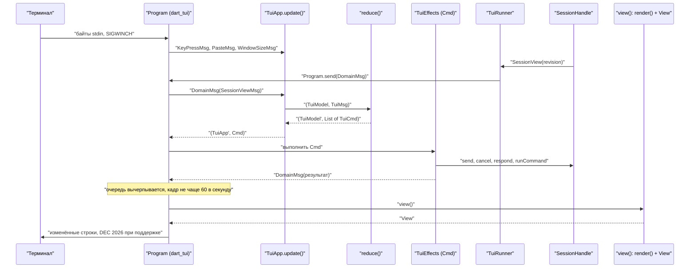

# 12.2. CLI: отображение и ввод

> Часть предложения [«Dart-агент и клиенты CodeLab»](../dart-agent-and-clients.md). Status: Accepted. Исходные решения, связанные документы и порядок чтения — в оглавлении.

← [12.1. Общая модель отображения в `codelab_client_core`](12-1-view-model.md) · [Оглавление](../dart-agent-and-clients.md) · [12.3. Десктоп-приложение: отображение](12-3-desktop-display.md) →

**Назначение.** Как codelab_cli рисует модели §12.1 и принимает ввод в двух режимах: построчном
REPL (§9.11, этап 6) и полноэкранном TUI (U-12, после MVP). Раздел дополняет «Спецификацию CLI»
§9.11 и не меняет её: команды, флаги, клавиши, UX одобрения и headless остаются как там; здесь —
вывод (U-08–U-11, U-13), полноэкранный режим (U-12), вложения (U-14), расширенный ввод (U-23) и
дополнение путей (U-24). Код — в `apps/codelab_cli/lib/src/render/`, `lib/src/repl/`,
`lib/src/tui/`, `lib/src/input/`.

## 12.2.1. Поверхности вывода

Поверхность определяется один раз при старте, `lib/src/render/output_surface.dart`:

| Условие (первое подходящее) | Поверхность | Поведение |
|---|---|---|
| stdout не TTY (pipe, файл) | `raw` | текст ответа байт в байт как пришёл; без ANSI, без разбора markdown; мысли не печатаются; строки инструментов — простым текстом в stderr |
| `TERM=dumb` | `plain` | разбор markdown, вывод без ANSI: заголовки — текст, списки — `-`/`1.`, код — с отступом 4 пробела, таблицы — выровненный текст |
| `NO_COLOR` задан (любое непустое значение) или `--no-color` | `plain` | как выше |
| `--ui tui` (или `ui.mode = "tui"`) и stdin, stdout — TTY | `tui` | §12.2.6 |
| иначе | `ansi` | построчный REPL с цветом и markdown |

Флаг `--ui line|tui` и ключ `ui.mode` новые. По умолчанию — `line`, пока TUI не прошёл
приёмку U-12; затем значение по умолчанию меняется на `tui` отдельным OpenSpec change. Headless
(`-p`) всегда использует `raw` для `text` и свой формат для `stream-json` (§9.11), независимо от
TTY: вывод headless — данные для скриптов.

## 12.2.2. ANSI-рендер markdown

`lib/src/render/ansi_markdown.dart` переводит `MdBlock` в строки заданной ширины
(`stdout.terminalColumns`, минимум 20). Соответствие:

| Элемент | `ansi` | `plain` |
|---|---|---|
| `MdHeading` 1–2 | жирный + акцентный цвет; уровень 1 — подчёркнут | текст, пустая строка после |
| `MdHeading` 3–6 | жирный | текст |
| `MdParagraph` | перенос по словам с учётом ширины символов (East Asian Wide и эмодзи — 2 колонки) | то же |
| `MdList` | маркер `•` (уровни 2+ — `◦`), номер `1.`; задачи `☐`/`☑`; отступ 2 на уровень | `-`, `1.`, `[ ]`/`[x]` |
| `MdCodeBlock` | рамка слева `│` приглушённым цветом, подпись языка над блоком; строки не переносятся, а обрезаются с `…` (переносы ломают код при копировании); подсветка синтаксиса не делается | отступ 4 пробела |
| `MdQuote` | `▎` приглушённым цветом + курсив | `> ` |
| `MdTable` | колонки по ширине содержимого; если не помещается — каждая строка таблицы печатается блоком `заголовок: значение` | то же |
| `MdThematicBreak` | `─` на ширину | `---` |
| `MdCode` | инверсный фон или акцентный цвет | `` `code` `` |
| `MdEmphasis` | курсив / жирный (SGR 3 / 1) | текст без маркеров |
| `MdStrike` | SGR 9 | `~~текст~~` |
| `MdLink` | текст подчёркнут; OSC 8 гиперссылка, если терминал известен как поддерживающий (`TERM_PROGRAM` из списка в `terminal_caps.dart`), иначе `текст (url)` — правила ниже, «Ссылки (OSC 8)» | `текст (url)` |
| `MdImage` | `[картинка: alt]` приглушённо и адрес по правилу `MdLink`; картинка не загружается (VIEW-12) | `[картинка: alt] (src)` |

Цвета («акцентный», «приглушённый», зелёный, красный, жёлтый, голубой, фоны diff) — токены темы
§12.6.3.

**Ссылки (OSC 8, U-36).** Источник ссылки — `MdLink`, `MdImage` (адрес картинки) и голые URL
в тексте ответа (`http://`, `https://` до первого пробела или закрывающей скобки без пары).

1. Адрес разбирается `Uri.tryParse`. Гиперссылкой становится только адрес со схемой `http`,
   `https` или `file`; любая другая схема (`javascript:`, `data:`, `vbscript:`, своя схема
   приложения) и неразборчивый адрес — только текст ссылки, без адреса и без OSC 8.
2. Из адреса и текста ссылки до вывода вырезаются управляющие символы C0 (0x00–0x1F), DEL
   (0x7F) и C1 (0x80–0x9F), в том числе `ESC` и `BEL`: адрес не может закрыть
   последовательность раньше времени или вставить свою. Пробелы в адресе кодируются `%20`.
   Адрес длиннее 2048 байт после кодирования — без OSC 8, печатается `текст (url)` с адресом,
   обрезанным посередине `…`.
3. Поддерживающий терминал (поверхность `ansi`, `terminal_caps.dart` знает `TERM_PROGRAM`,
   `NO_COLOR` не задан) — `ESC ]8;;<url> ESC \` + текст + `ESC ]8;; ESC \`; завершающая
   последовательность — `ESC \` (ST), а не `BEL`. Ссылка не переносится через границу строки
   кадра: при переносе последовательность закрывается в конце строки и открывается заново в
   начале следующей (TUI-9).
4. Неизвестный терминал на поверхности `ansi` — `текст (url)`; если текст совпадает с адресом —
   один раз адрес. Поверхность `plain` и pipe — исходный markdown ссылки без изменений (TUI-1).
5. Внутри `MdCode` и `MdCodeBlock` ссылки не распознаются: код печатается как есть.

Перенос строк сохраняет SGR: каждая перенесённая строка заканчивается `ESC[0m` и следующая
начинается с восстановленных атрибутов, чтобы цвет не «протекал» в композер и статус-строку.

**Потоковый вывод в построчном режиме.** Вывод только дописывается, перерисовки нет:

1. Закреплённый блок (`index < stableCount`) печатается один раз целиком, когда закрепился.
2. Хвост: строки ограды печатаются по мере прихода полных строк (строки кода не меняются);
   строки абзаца и списка без символа `|` печатаются по полным строкам с inline-разбором одной
   строки (незакрытый `**` в конце строки печатается как текст); строка с `|` и неполная
   последняя строка держатся до закрепления блока.
3. Счётчик «напечатано строк блока» хранится на блок; при закреплении допечатываются только
   оставшиеся строки. Если закреплённый блок отличается от напечатанного черновика (редкий
   случай: абзац превратился в таблицу), блок печатается заново целиком после черновика — вывод
   избыточен, но не теряет данных.
4. Конец хода — `close()` и допечатка хвоста.

На поверхности `raw` дельты пишутся в stdout сразу, без буферизации, кроме ведущих пробельных
дельт ответа (держатся до первого непробельного символа, чтобы не печатать пустые строки).

## 12.2.3. Мысли

Ключ `display.thoughts = "dim" | "collapsed" | "hidden"`, по умолчанию `dim`; переключение в
сессии — `/thoughts dim|collapsed|hidden` (новая клиентская команда).

| Режим | Построчный REPL (`ansi`) | TUI | `plain` |
|---|---|---|---|
| `dim` | текст мыслей печатается по мере прихода приглушённым цветом (SGR 2) курсивом с префиксом `┆ `, без разбора markdown; после мыслей — пустая строка перед ответом | блок приглушённым цветом; после окончания сворачивается в строку `▸ думал 12s` (Ctrl+O разворачивает все) | префикс `┆ ` без цвета |
| `collapsed` | одна строка `… думает` при первом chunk; по окончании печатается `▸ думал 12s` | строка `… думает 4s` обновляется; затем `▸ думал 12s` | строка `думал 12s` |
| `hidden` | ничего | ничего | ничего |

На поверхности `raw` мысли не печатаются никогда (stdout pipe — только ответ). После MVP headless
`--stream-thinking` выводит мысли в **stderr**, а stdout не меняется (H-08, §12.6.11). Длительность — из
`ThoughtItem.duration`.

## 12.2.4. Строки инструментов

Рисует `lib/src/render/tool_row_renderer.dart` из `ToolRowView`:

```text
✓ Read lib/auth/session.dart:10-29                                    0.1s
• Run npm test -- --watch=false                                       3.2s
  └ PASS test/a.test.js
⊘ Edit README.md
  └ Отклонено пользователем
✗ Fetch example.com/docs                                              1.4s
  └ HTTP 404
```

| Значок | UTF-8 | ASCII (`LANG`/`LC_ALL` без UTF-8 или `display.ascii = true`) | Цвет |
|---|---|---|---|
| `pending` | `○` | `-` | приглушённый |
| `running` | `•` (в TUI — вращающийся `⠋⠙⠹⠸⠼⠴⠦⠧⠇⠏`, 100 мс) | `*` | акцентный |
| `done` | `✓` | `+` | зелёный |
| `failed` | `✗` | `x` | красный |
| `rejected`, `cancelled` | `⊘` | `!` | жёлтый |

Правила:

1. Ширина: значок, пробел, метка жирным, пробел, деталь, время — прижато вправо. Если не
   помещается — деталь обрезается **в середине** для путей (`lib/…/session.dart`) и в конце для
   остального; время не обрезается.
2. Построчный режим (`ansi`, `plain`): строка печатается, когда вызов перешёл в `running` (или
   сразу итоговым), и ещё раз — итоговая, когда завершился. Если между ними ничего не было
   напечатано и stdout — TTY, итоговая строка заменяет предыдущую (`ESC[1A ESC[2K`); иначе
   печатается новой строкой. Вторая строка — после итоговой.
3. Вывод терминала (`terminal`): в TUI во время `running` — последние 5 строк приглушённо под
   строкой; после завершения сворачивается, кроме `failed` (тогда последние 10 строк). В
   построчном режиме вывод не печатается (он уже в журнале агента и доступен по
   `/inspect <id>`), кроме последних 10 строк при `failed`.
4. TUI: Enter на выделенной строке инструмента (режим просмотра, `Ctrl+↑`) раскрывает подробности
   — то же содержимое, что `/inspect`.

## 12.2.5. Diff правок

`lib/src/render/diff_renderer.dart` из `DiffView`:

```text
✓ Edit README.md  +1 -1                                               0.0s
  @@ -1,3 +1,3 @@
     1   1  # Проект
     2     -Старое описание foo
         2 +Старое описание bar
     3   3
```

1. Заголовок блока `@@ -a,b +c,d @@` — голубым; удалённые строки — красным, добавленные — зелёным
   (SGR 31/32; на 256 цветах — фон `ESC[48;5;52m`/`ESC[48;5;22m` под строкой), контекст — обычным.
   Номера строк старой и новой версии — приглушённо, ширина колонки по максимальному номеру.
   На `plain` — классический unified diff с `-`/`+`/` ` без номеров.
2. Количество строк в ленте ограничено `display.diff_max_lines` (по умолчанию 40); остальное —
   строка `… ещё 120 строк (/inspect call_7)`. В одобрении (`?` в запросе, §9.11) diff
   показывается целиком через пейджер `$PAGER` (если не задан — `less -R`, если нет — печать
   целиком).
3. `limited: binary` → `бинарный файл изменён`; `tooLarge` → `файл переписан:
   +N -M строк (diff не показан)`; `budgetExceeded` → единственный блок «середина заменена
   целиком» (§12.1.3) по правилам шагов 1–2 и строка `diff упрощён: показана замена целиком`.
4. Табуляция заменяется пробелами до кратного 4 (ширина колонок не плывёт).

## 12.2.6. Статус-строка

Сегменты по порядку вывода и порядок отбрасывания на узком терминале:

| Сегмент | Пример | Источник | Отбрасывается |
|---|---|---|---|
| режим | `plan` | `modeLabel` | никогда |
| модель | `gpt-4.1` | `modelLabel`; при нехватке места — часть после последнего `/` | 5-м (сначала сокращается) |
| контекст | `ctx 18%` | `usage.contextFraction`; ≥ 80 % — жёлтым, ≥ 95 % — красным | 4-м |
| токены | `↑12.3k ↓1.1k` | `usage.session`: вход = `input + cacheRead + cacheWrite`, выход = `output`; `~` перед числами при `sessionPartial` | 3-м |
| стоимость | `$0.04` | `usage.sessionCost`; `~` при `sessionPartial` | 2-м |
| ветка | `⎇ main` (ASCII: `git:main`) | `gitBranch` | 1-м |
| очередь | `в очереди: 2`; после MVP при ожидающем steering — `в очереди: 2 · направлено: 1` | `queued > 0`; `steered > 0` (длина `SessionView.pendingSteers`, C-03, §12.1, agent-core-architecture §17.7.6) | никогда |
| только чтение | `read-only` | после MVP: `readOnly` (`SessionHandle.access` — `ReadOnlyAccess`, S-09, agent-core-architecture §17.6.11) | никогда |

Разделитель ` · `; сегмент без данных не выводится (VIEW-6). Если даже режим и очередь не
помещаются — строка обрезается с `…`. Числа токенов: до 1000 — как есть, далее `12.3k`, `1.2M`.

* **Построчный режим:** после каждого хода печатается одна приглушённая строка
  `─ plan · gpt-4.1 · ctx 18% · ↑12.3k ↓1.1k · $0.04 · ⎇ main`; на `plain` — без цвета; на `raw` и
  в headless — не печатается (в `stream-json` usage идёт полем `usage` событий `turn_end` и
  `result`; `null` без расширения, §12.5.3).
  Ключ `status_line.after_turn = true|false` (по умолчанию `true`).
* **TUI:** последняя строка экрана, обновляется при каждой ревизии `SessionView`; во время хода
  слева добавляется значок хода и время `• 12s`.
* **Набор сегментов:** `status_line.segments = ["mode", "model", "context", "tokens", "cost",
  "branch", "queue"]` — список и порядок; неизвестное имя — предупреждение при старте и пропуск.

## 12.2.7. Полноэкранный TUI

**Технология.** Полноэкранный режим построен на пакете
[`dart_tui`](https://pub.dev/packages/dart_tui) (MIT, `^3.0.0`; [технологический стек](../../technology-stack.md),
§20а) — каркас Model–Update–View в духе Elm и Bubble Tea: `Model` с `init()`, `update(Msg)` и
`view()`, асинхронные команды `Cmd`, `Program`, который владеет циклом событий и терминалом.
Пакет импортируется только из `apps/codelab_cli/lib/src/tui/` (правило сторожа, §9.5);
построчный REPL, headless, рендеры `lib/src/render/` и декодер `lib/src/input/key_decoder.dart`
о нём не знают и пишут в stdout сами. Возможности, которые проверяет разведка этапа 6
(задача 6.11), — «Чек-лист разведки» ниже.

**Архитектура Model–Update–View.** Два слоя.

1. **Чистое ядро экрана** (`tui_model.dart`, `tui_update.dart`, `tui_view.dart`) — без
   `package:dart_tui` и `dart:io`. Состояние экрана — неизменяемая `TuiModel`; `reduce(model,
   msg)` — чистая функция, возвращающая новую модель и список команд-данных `TuiCmd`;
   `render(model)` — чистая функция, возвращающая кадр (`Frame`: строки ширины `size.columns`
   и позиция курсора). Ядро тестируется без терминала и без пакета (TUI-5).
2. **Адаптер к `dart_tui`** (`tui_app.dart`, `tui_input.dart`, `tui_effects.dart`,
   `tui_runner.dart`). `TuiApp implements Model` (dart_tui): `update(Msg)` переводит сообщение
   dart_tui в `TuiMsg` (`TuiInput`: `KeyPressMsg` — через реестр клавиш §12.2.9, `PasteMsg`,
   `WindowSizeMsg`, после MVP — мышь), вызывает `reduce` и переводит `List<TuiCmd>` в один `Cmd`
   dart_tui (`TuiEffects.toDartTuiCmd`, несколько команд — `batch`); `view()` вызывает `render` и
   заворачивает `Frame` в `View`. Режимы терминала (альтернативный экран, мышь, расширенные
   клавиши, bracketed paste) объявляются полями `View`, а не командами: `Program` сам включает и
   выключает их по разнице между кадрами.

Ввод-вывод TUI — только в `Program` dart_tui (цикл событий, raw-режим, альтернативный экран,
размер, мышь, вывод кадров, сигналы) и в функциях `Cmd`, которые строит `TuiEffects`
(единственный владелец `SessionHandle`, процессов и буфера обмена в TUI); запуск `Program`,
подписка на kit и гарантия восстановления терминала — `TuiRunner`. Логика kit не дублируется:
`TuiModel` хранит последний `SessionView` и локальное состояние экрана (композер, прокрутка,
раскрытые элементы, открытое меню).

`TuiCmd` остаётся запечатанным классом данных, а не замыканием dart_tui: тесты `reduce`
сравнивают команды по значению; весь ввод-вывод собран в одном файле `tui_effects.dart`; новая
команда — новый подкласс и ветка `switch` в `toDartTuiCmd`, анализатор находит пропущенную ветку.
Если разведка 6.11 отвергнет пакет, запасной рендер (§12.2.12) встаёт за тот же `reduce` и
`render`, а ядро и его тесты не меняются.

```dart
// apps/codelab_cli/lib/src/tui/tui_model.dart — без package:dart_tui и dart:io
final class TuiModel {
  // После MVP (U-37, §12.6.13): поля сессии — composer, scroll, expanded, approval —
  // переезжают в SessionScreen, а модель держит open, active и screens по SessionId.
  final SessionView? session;          // из SessionHandle.view
  final WorkspaceState workspace;
  final ComposerState composer;        // текст, курсор, вложения, история, режим вставки
  final ScrollState scroll;            // offsetFromBottom, follow, newSinceHold
  final OverlayState? overlay;         // slash-меню, дополнение путей, пикер, подробности
  final PendingApproval? approval;     // зона одобрения вместо композера
  final TerminalSize size;
  final Set<String> expanded;          // id элементов, раскрытых пользователем
  final bool mouse;                    // после MVP: tui.mouse и /mouse (§12.6.5) → View.mouseMode
  final int errorStreak;               // ошибок reduce/render подряд (шаг 7 цикла)
}

sealed class TuiMsg {}
final class KeyMsg extends TuiMsg { final KeyEvent key; }       // из KeyPressMsg dart_tui
final class PasteMsg extends TuiMsg { final String text; }      // из PasteMsg dart_tui
final class ResizeMsg extends TuiMsg { final TerminalSize size; } // из WindowSizeMsg
final class SessionViewMsg extends TuiMsg { final SessionView view; }
final class WorkspaceMsg extends TuiMsg { final WorkspaceState state; }
final class ApprovalMsg extends TuiMsg { final PendingApproval approval; }
final class TickMsg extends TuiMsg {}               // 100 мс, только пока есть running-элементы
final class ClipboardImageMsg extends TuiMsg { final ImageAttachment? image; final String? error; }
final class EffectFailedMsg extends TuiMsg { final TuiCmd cmd; final Object error; }
final class MouseMsg extends TuiMsg { … }           // после MVP: из MouseMsg dart_tui (§12.6.5)
final class CopyResultMsg extends TuiMsg { final CopyOutcome outcome; }  // после MVP (§12.6.10)

sealed class TuiCmd {}                              // данные; исполняет TuiEffects
final class SubmitCmd extends TuiCmd { final String text; final List<PromptAttachment> attachments; }
final class CancelTurnCmd extends TuiCmd {}
final class RespondCmd extends TuiCmd { final ApprovalRequestId id; final PermissionOptionId option; }
final class RunCommandCmd extends TuiCmd { final String input; }
final class ReadClipboardImageCmd extends TuiCmd {}
final class QuitCmd extends TuiCmd {}
final class RunShellCmd extends TuiCmd { final String command; } // после MVP: `!<cmd>` (§12.6.2)
final class RestartAgentCmd extends TuiCmd {}                    // после MVP: `/restart` (§12.6.7)
final class CopyCmd extends TuiCmd { final String text; }        // после MVP: копирование (U-28, §12.6.10)
final class SwitchSessionCmd extends TuiCmd { final SessionId id; }               // после MVP: U-37, §12.6.13
final class CloseSessionCmd extends TuiCmd { final SessionId id; final bool cancelTurn; } // после MVP: U-37

(TuiModel, List<TuiCmd>) reduce(TuiModel model, TuiMsg msg);    // tui_update.dart
Frame render(TuiModel model);                                   // tui_view.dart
```

```dart
// apps/codelab_cli/lib/src/tui/tui_app.dart — единственный тип, который видит Program
import 'package:dart_tui/dart_tui.dart' as tea;

/// Результат команды или событие kit, уже переведённое в язык ядра экрана.
final class DomainMsg extends tea.Msg {
  DomainMsg(this.msg);
  final TuiMsg msg;
}

final class TuiApp implements tea.Model {
  TuiApp(this.state, this.input, this.effects);
  final TuiModel state;
  final TuiInput input;        // сообщения dart_tui → TuiMsg; null — сообщение не нужно ядру
  final TuiEffects effects;    // TuiCmd → tea.Cmd; сам ввод-вывод — только внутри Cmd

  @override
  tea.Cmd? init() => effects.startup(state);   // опрос размера на Windows (шаг 5)

  @override
  (tea.Model, tea.Cmd?) update(tea.Msg msg) {
    final m = msg is DomainMsg ? msg.msg : input.translate(msg, state);
    if (m == null) return (this, null);
    final (next, cmds) = reduceGuarded(state, m);         // шаг 7: ошибка → прежняя модель
    return (TuiApp(next, input, effects), effects.toDartTuiCmd(cmds));
  }

  @override
  tea.View view() => frameToView(renderGuarded(state), state);  // altScreen, cursor, mouseMode
}
```



**Раскладка кадра** (сверху вниз): транскрипт (всё оставшееся место); строка «↓ N новых» (только
в режиме удержания); зона одобрения или композер (1–10 строк, дальше композер прокручивается
внутри); строка подсказок клавиш (скрывается при высоте < 15 строк); статус-строка.

**Цикл `Program`.** В каждом шаге сказано, что делает dart_tui и что — наш код.

1. **Старт.** Наш `TuiRunner.run`: собирает `Program(options: [withAltScreen(), withFps(60),
   withOutput(terminalSink)])` (`terminalSink` — наша обёртка `IOSink` над stdout, шаг 8),
   начальную `TuiApp` из текущего значения `SessionHandle.view` и вызывает `run`. dart_tui:
   raw-режим stdin (`echoMode`, `lineMode`; на macOS и Linux — termios через `dart:ffi`, сброс
   ISIG, IEXTEN, IXON; на Windows — `SetConsoleMode` с `ENABLE_VIRTUAL_TERMINAL_INPUT`),
   альтернативный экран `ESC[?1049h`, скрытый курсор, bracketed paste `ESC[?2004h`, расширенные
   клавиши (kitty `ESC[=<флаги>;1u` и xterm modifyOtherKeys `ESC[>4;2m`, §12.2.9), после MVP —
   отчёты мыши по `View.mouseMode` (§12.6.5). Запоминает включённое сам.
2. **События kit.** Наш `TuiRunner` — владелец подписок на `SessionHandle.view`, одобрения и
   состояние workspace: каждое событие → `program.send(DomainMsg(…))`. Подписки открываются сразу
   после вызова `run` (до запуска `send` отбрасывает сообщение, но начальное состояние уже в
   модели) и отменяются в `finally` шага 6. Если `Program.send` в будущей версии пакета исчезнет,
   запасной путь — команда-«слушатель»: `Cmd`, который ждёт следующего события потока kit и
   возвращает его как `DomainMsg`; `reduce` выпускает её заново после каждого такого события.
3. **Склейка.** dart_tui вычерпывает всю очередь сообщений перед кадром и строит кадр не чаще
   `withFps` (60 в секунду, раз в 16 мс) по последней модели. Наш `reduce` отбрасывает
   `SessionViewMsg` с ревизией меньше последней полученной.
4. **Кадр.** dart_tui (`AnsiRenderer` по умолчанию) сравнивает кадр с предыдущим построчно,
   переписывает только изменённые строки и оборачивает вывод в synchronized output
   `ESC[?2026h … ESC[?2026l`, если терминал подтвердил режим 2026 на запрос DECRQM; иначе пишет
   без обёртки (выбор `withCellRenderer()` для таких терминалов — пункт чек-листа). Содержимое
   `View` пакет пишет как есть, поэтому за него отвечает наш `render`: каждая строка не шире
   `size.columns` (ширина символов — §12.2.2), кончается сбросом атрибутов (TUI-9), а текст
   агента и инструментов проходит санитизацию до попадания в кадр (TUI-11).
5. **Размер.** dart_tui на macOS и Linux слушает `ProcessSignal.sigwinch` и присылает
   `WindowSizeMsg`; на Windows сигнала нет и пакет размер не опрашивает, поэтому
   `TuiEffects.startup` раз в 250 мс выпускает `requestWindowSize()` (`Program` отвечает
   `WindowSizeMsg` из `stdout.terminalColumns/Lines`). `TuiInput` отбрасывает неизменившийся
   размер; `ResizeMsg` сбрасывает кэш переносов и предыдущий кадр (полная перерисовка).
6. **Завершение.** `QuitCmd` → `quit` dart_tui; SIGTERM dart_tui превращает в `QuitMsg`, внешний
   `kill -INT` — в `InterruptMsg`. Ctrl+C и Ctrl+Z в raw-режиме 3.x приходят клавишами, поэтому
   двойной Ctrl+C за 1 с (§9.11) — действие `exit` реестра клавиш, а не сигнал. Выход из `run`
   любым путём, включая исключение из `update` или `view`: dart_tui в своём `finally` выключает
   включённое (мышь `ESC[?1000l ESC[?1002l ESC[?1003l ESC[?1006l`, фокус, `ESC[?2004l`,
   клавиши `ESC[>4m ESC[=0;1u`, курсор `ESC[?25h`, `ESC[?1049l`) и возвращает режим stdin. Наш
   `TuiRunner` поверх этого держит `try/finally`: отменяет подписки шага 2, повторно пишет те же
   последовательности выключения (повтор безвреден) и возвращает `echoMode`/`lineMode` stdin, —
   так TUI-4 не зависит от версии пакета. После выхода в обычный экран печатается последний
   ответ агента и статус-строка, чтобы результат остался в scrollback.
7. **Ошибки.** Исключение в `reduce` или `render` ловит `TuiApp` (`reduceGuarded`,
   `renderGuarded`): запись в диагностику, модель и кадр не меняются, цикл продолжается; три
   ошибки подряд (`errorStreak`) — `QuitCmd`, и `TuiRunner` печатает ошибку после восстановления
   терминала. Каждая функция `Cmd` из `TuiEffects` сама ловит исключение и возвращает
   `DomainMsg(EffectFailedMsg)`: обработчик dart_tui для исключений команд печатает в stderr
   поверх кадра и завершает программу, поэтому до него ошибка не доходит.
8. **Последовательности вне кадра.** OSC 8 (ссылки, §12.2.2) — часть содержимого `View`: рендер
   dart_tui отслеживает открытую ссылку и закрывает её на границе строки. OSC 52 (копирование,
   §12.6.10) — команда `setClipboard` dart_tui, если обёртка tmux или screen не нужна; с
   обёрткой — запись `TuiEffects` в `terminalSink` из `Cmd`. Кадр dart_tui пишет синхронно, без
   `await` между частями, поэтому запись из команды не попадает внутрь кадра и внутрь
   `ESC[?2026h … l`. Команда `raw()` dart_tui не используется: в 3.0.0 `Program` не пишет
   `RawMsg` в терминал.

**Компоненты dart_tui.** Используются: `SpinnerModel` — значок хода в статус-строке и значок
`running` строк инструментов (кадры `⠋⠙⠹⠸⠼⠴⠦⠧⠇⠏`, 100 мс, §12.2.4); `ViewportModel` —
оверлеи со статичным длинным текстом (подробности `/inspect` и Enter на строке инструмента,
`/help keys`, полный diff по `?` в зоне одобрения); `ListModel` (с фильтром) и
`SelectListModel` — пикеры (`/model`, `/sessions`, `/resume`, после MVP — `/theme`); `HelpModel`
— строка подсказок клавиш, построенная из реестра §12.2.9 через адаптер `RegistryKeyMap
implements KeyMap` (таблица действий остаётся одна, TUI-7). Не используются: `TextAreaModel` и
`TextInputModel` (клавиши зашиты в компонент, нет реестра, чипов вложений, истории и `@`),
транскрипт на `ViewportModel` (компонент переносит весь текст при каждом изменении, а стрим
меняет только последний элемент), стили `Style` для markdown, формы и разовые помощники
(`promptSelect`, `spin`, `pager`).

Свои, общие с построчным режимом или только для TUI: ANSI-рендер markdown §12.2.2 вместе с
OSC 8 и санитизацией, строки инструментов §12.2.4, diff §12.2.5, статус-строка §12.2.6,
композер, транскрипт с кэшем переносов, slash-меню и дополнение путей §12.2.8 (нечёткий поиск
`CommandCatalog`, семантика Tab U-24), реестр клавиш §12.2.9, темы §12.6.3.

**Чек-лист разведки** (задача 6.11, исключение (д) §9.0; итог — таблица в `design.md` change
`add-codelab-cli`, по строке на пункт: «да», «нет → запасной путь», ссылка на файл спайка).
Пункты 1–6 по исходникам 3.0.0 поддерживаются и подтверждаются запуском в терминалах из
таблицы §12.2.9; 7–10 по исходникам не установлены и проверяются впервые.

| № | Возможность | Что показал разбор 3.0.0 | Запасной путь, если «нет» |
|---|---|---|---|
| 1 | внешние сообщения | `Program.send(Msg)` есть | команда-«слушатель» (шаг 2) |
| 2 | bracketed paste | `PasteMsg`, `View.disableBracketedPasteMode = false` по умолчанию | — (без него U-23 не выполняется → отказ от пакета) |
| 3 | Shift+Enter, Ctrl+Enter | kitty CSI u и modifyOtherKeys включаются, ответ — `KeyboardEnhancementsMsg` | `\` + Enter, Alt+Enter, Ctrl+J (§12.2.9, шаг 5) |
| 4 | synchronized output | DECRQM `?2026`, обёртка кадра только при подтверждении | `withCellRenderer()` |
| 5 | восстановление терминала | `finally` в `run`, SIGTERM → `QuitMsg` | повторная запись `TuiRunner` (шаг 6) |
| 6 | тестовый ввод-вывод | `withInput(Stream)`, `withOutput(IOSink)`, `withWindowSize`, `withoutSignalHandler` | — |
| 7 | Windows Terminal и conhost | ввод VT через `SetConsoleMode`; вывод VT и размер — не проверены | опрос размера (шаг 5); при поломке вывода `--ui tui` на Windows отключён, остаётся REPL |
| 8 | ширина символов | у пакета своя таблица ширины графем, у рендера §12.2.2 — своя | строки кадра режутся по нашей ширине с запасом в одну колонку для спорных символов |
| 9 | tmux и SSH | не проверено | `withCellRenderer()`; без исправления — известное ограничение в `/terminal-setup` |
| 10 | запись вне кадра | синхронная запись кадра по исходникам | OSC 52 только командой `setClipboard`, без обёрток tmux и screen |

Пункт 2 обязателен: без него разведка отвергает пакет, и TUI строится запасным рендером
(§12.2.12).

**Транскрипт и прокрутка.** Каждый `TranscriptItem` рендерится в строки отдельно; кэш переносов
по ключу `(item.id, ревизия элемента, ширина, раскрыт ли)`: при дельте перерисовывается только
изменившийся (обычно последний) элемент. Прокрутка — `offsetFromBottom` в строках:

* `follow = true` (по умолчанию): новые строки сдвигают окно, видна последняя строка;
* PgUp, колесо вверх (при включённой мыши, U-22) или `Ctrl+↑` → `follow = false`, окно
  удерживается на месте, новые строки увеличивают `offsetFromBottom` и счётчик «↓ N новых»;
* End, PgDn до низа, колесо вниз до низа, отправка нового промпта или ответ на одобрение → `follow = true`; новые
  дельты `follow` не включают (UX-11, §12.6.5);
* история в памяти не ограничена числом элементов `SessionView`, но строки рендерятся только
  для видимого окна плюс один экран сверху и снизу.

После MVP `select_item` открывает режим выбора: фокус в транскрипте, `c` — копировать элемент,
Enter — подробности, Esc — назад; другой печатный символ возвращает фокус в композер и вводится
туда; при ожидающем одобрении режим выбора выключен (U-28, §12.6.10, шаг 8; UX-22).

**Композер.** Многострочный редактор (`lib/src/tui/composer.dart`): курсор в 2D, перенос по
ширине, история (общая с REPL, `~/.codelab/cli_history`), чипы вложений над текстом
(`[img clipboard-1.png 34 КБ] [file lib/a.dart]`; Backspace в начале пустой строки удаляет
последний чип). Ввод `/` в начале открывает slash-меню (U-03), `@` — дополнение путей
(§12.2.8). Пока ждёт одобрение, вместо композера — зона одобрения с той же разметкой и клавишами,
что в §9.11.

## 12.2.8. Вложения и дополнение путей

**Источники вложений.**

| Источник | Как | Вложение |
|---|---|---|
| флаг `--attach <файл>` (повторяемый; REPL и headless) | к первому промпту | `FileAttachment(origin: flag)` |
| `@<путь>` в тексте | токен `@` в начале строки или после пробела, до пробела; пробелы в пути — `@"путь с пробелом"`; `\@` — буквальный `@` | `FileAttachment(origin: mention)` |
| вставка картинки (`Ctrl+V` в TUI, `/paste-image` в REPL) | `ReadClipboardImageCmd` | `ImageAttachment(bytes, name)` (§12.1.1) |
| перетаскивание файла в терминал | терминал вставляет путь (часто в кавычках или с `\ `) bracketed paste; если вставка — один существующий путь, композер предлагает «приложить?» (Tab — да) | `FileAttachment(origin: drop)` |

Перед отправкой композер вызывает `PromptContentBuilder.build` (§12.1.7); предупреждения
показываются строкой над композером (REPL — печатью), а путь вне `cwd` требует подтверждения
`y/n` (VIEW-8). Повторная отправка без изменений после предупреждения «нет файла» отправляет
промпт без этого вложения.

**Картинка из буфера обмена** (`lib/src/input/clipboard_image.dart`, `dart:io`): команда
платформы с таймаутом 3 с, результат — байты PNG.

| ОС | Команда | Примечание |
|---|---|---|
| macOS | `osascript -e 'the clipboard as «class PNGf»'` с разбором hex-ответа; если доступен `pngpaste` — `pngpaste -` | без новых зависимостей |
| Linux, Wayland (`WAYLAND_DISPLAY`) | `wl-paste --type image/png` | нет `wl-paste` — сообщение «установите wl-clipboard» |
| Linux, X11 | `xclip -selection clipboard -t image/png -o` | нет `xclip` — сообщение |
| Windows | `powershell -NoProfile -Command` с `Get-Clipboard -Format Image` и сохранением в PNG во временный файл | файл удаляется после чтения |

Пустой буфер или не картинка → `ClipboardImageMsg(error: "в буфере нет картинки")`. Байты
проверяются по сигнатуре (§12.1.7), размер — до 5 МиБ. Команды запускаются клиентом локально;
это не инструмент агента и не проходит одобрение.

**Дополнение путей по Tab** (`lib/src/input/path_completer.dart`, перечисление файлов — через
`codelab_client_io`):

1. Токен под курсором: начинается с `@`, или содержит `/`, или начинается с `./`, `../`, `~/`.
   Строка, начинающаяся с `/` без второго `/`, — команда (дополнение команд §9.11), а не путь.
2. База — `cwd` сессии; `~/` — домашний каталог; абсолютный путь допускается, но кандидаты вне
   `cwd` помечаются `↗`.
3. Токен делится на каталог и префикс имени; читается только этот каталог (без рекурсии),
   не больше 2000 записей; кандидаты — записи с этим префиксом (без учёта регистра на macOS и
   Windows), каталоги с `/` на конце. Скрытые записи — только если префикс начинается с `.`.
   Записи из `.gitignore` корня `cwd` и каталоги `.git`, `node_modules`, `.dart_tool`, `build`
   пропускаются, если префикс пуст.
4. Если префикс пуст или нет точных совпадений префикса, используется нечёткий поиск по
   подпоследовательности (тот же алгоритм, что у `CommandCatalog`) по именам этого каталога.
5. Один кандидат → подстановка (для каталога — с `/`, следующий Tab идёт внутрь); несколько →
   подставляется общий префикс; если он не длиннее введённого, второй Tab показывает список
   (TUI — меню над композером, ↑/↓ и Tab/Enter выбирают; REPL — печать столбцами, не больше 50,
   «… ещё N»). В открытом меню Tab принимает выделенный пункт (U-24).
6. Пути с пробелами подставляются в кавычках `@"a b.txt"`.
7. Перечисление выполняется асинхронно с таймаутом 300 мс; по таймауту — сообщение «папка
   слишком большая» и без дополнения (ввод не блокируется).

## 12.2.9. Ввод с клавиатуры

**Два источника клавиш, один реестр.** В построчном REPL байты stdin разбирает наш декодер
(ниже). В TUI их разбирает dart_tui: `KeyPressMsg` (код клавиши, модификаторы, текст), `PasteMsg`,
после MVP — сообщения мыши; `TuiInput` (`lib/src/tui/tui_input.dart`) переводит `KeyPressMsg` в
тот же `KeyEvent`, что даёт наш декодер, и дальше оба режима идут через один реестр клавиш. Тест
`test/tui/tui_input_test.dart` сверяет перевод с декодером на одних и тех же последовательностях
(таблица шагов 3–6). Чего dart_tui не умеет (по итогам чек-листа §12.2.7), добавляется без
правки пакета: перевод или подавление сообщения — `withFilter` или `TuiInput`; своя разборка
байт — `withInput` с потоком, прошедшим через наш фильтр; своя управляющая последовательность —
запись в `terminalSink` из `Cmd` (§12.2.7, шаг 8). Если нужная возможность невозможна и так,
действует запасной путь из чек-листа, а не обход пакета в обычном коде.

**Декодер** (`lib/src/input/key_decoder.dart`, чистый Dart, тестируется на байтах; построчный
REPL): конечный автомат над потоком байт stdin.

1. UTF-8 собирается в символы; неполная последовательность ждёт следующих байт.
2. `ESC` один: если за 50 мс нет следующего байта — клавиша Esc; иначе начало
   последовательности. `ESC` + печатный символ — Alt+символ; `ESC` + `CR` — Alt+Enter.
3. CSI `ESC [ параметры финал`: стрелки, Home/End, PgUp/PgDn, Delete, F-клавиши, модификаторы
   `;2`–`;8` (Shift, Alt, Ctrl и комбинации).
4. Kitty keyboard protocol: `ESC [ <код> ; <модификаторы> u` (например `ESC[13;2u` —
   Shift+Enter, `ESC[27u` — Esc без задержки).
5. xterm modifyOtherKeys: `ESC [ 27 ; <модификаторы> ; <код> ~` (`ESC[27;2;13~` —
   Shift+Enter).
6. Bracketed paste: всё между `ESC[200~` и `ESC[201~` — одно `PasteMsg(text)` без разбора клавиш;
   `\r\n` и `\r` нормализуются в `\n`; управляющие символы, кроме `\n` и `\t`, удаляются.
   Вставка никогда не отправляет промпт и не исполняет команд (U-23). Незакрытая вставка через
   1 с — завершается принудительно.
6а. SGR-мышь `ESC [ < b ; x ; y M|m` в REPL не включается и этим декодером не разбирается; в TUI
   её разбирает dart_tui (`MouseWheelMsg`, `MouseClickMsg`, `MouseReleaseMsg`), `TuiInput`
   переводит в `MouseMsg` (после MVP, §12.6.5).
7. Неизвестная последовательность игнорируется и пишется в диагностику (`--verbose`).

**Включение расширенных клавиш** при старте TTY-сессии REPL (в TUI то же делает dart_tui: он
сразу включает kitty `ESC[=<флаги>;1u` и modifyOtherKeys `ESC[>4;2m`, запрашивает `ESC[?u` и
сообщает ответ `KeyboardEnhancementsMsg`; выключение — `ESC[>4m ESC[=0;1u`; шаг 5 ниже
действует в обоих режимах):

1. `ESC[?2004h` — bracketed paste (выключение `ESC[?2004l`).
2. Запрос kitty-протокола `ESC[?u`; ответ `ESC[?<флаги>u` в течение 100 мс → включить
   `ESC[>1u` (disambiguate), выключение `ESC[<u`.
3. Нет ответа → modifyOtherKeys `ESC[>4;2m`, выключение `ESC[>4m`.
4. Внутри tmux (`TMUX` задан) запросы идут как есть: tmux передаёт их при `extended-keys on`.
5. Если за сессию ни разу не пришла различимая Shift+Enter, а пользователь нажал Enter на
   строке, заканчивающейся `\`, — `\` удаляется и вставляется перевод строки (запасной путь,
   который работает в любом терминале).

**Реестр клавиш** (`lib/src/input/key_bindings.dart`): одна таблица действий; из неё строятся
обработка, строка подсказок TUI и `/help keys`. Действие, на которое ссылается подсказка, но нет
в реестре, — ошибка теста. Переопределение — отображение `keys` в `~/.codelab/cli.yaml`
(`submit: [enter]`, `newline: [shift+enter, alt+enter, ctrl+j]`); конфликт двух действий
в одной области — ошибка при старте с именами действий. Области «идёт команда `!`» и
«вопрос `ask`» вложены в «идёт ход» и приоритетнее её: пока активна такая область, Esc и Ctrl+C
не вызывают `cancel_turn`. Область «режим выбора» вложена в «транскрипт»; пока ждёт одобрение,
она неактивна, поэтому `c` и `y`/`a`/`n`/`N` не пересекаются (UX-22).

| Действие | Клавиши по умолчанию | Область | Режим |
|---|---|---|---|
| `submit` | Enter | композер | REPL, TUI |
| `newline` | Shift+Enter, Alt+Enter, Ctrl+J; `\` + Enter | композер | REPL, TUI |
| `cancel_turn` | Esc, Ctrl+C | идёт ход | REPL, TUI |
| `cancel_shell` | Esc, Ctrl+C | идёт команда `!` (приоритет над `cancel_turn`, §12.6.2) | REPL, TUI |
| `decline_ask` | Esc | вопрос `ask` (после MVP; ответ `declined`, agent-core-architecture §17.11.7; приоритет над `cancel_turn`) | REPL, TUI |
| `clear_input` | Esc (нет хода), Ctrl+C (первое нажатие) | композер | REPL, TUI |
| `exit` | Ctrl+C дважды за 1 с (§9.11, U-07), Ctrl+D на пустой строке | композер | REPL, TUI |
| `history_prev` / `history_next` | ↑ / ↓ (на первой/последней строке композера) | композер | REPL, TUI |
| `complete` | Tab | композер, меню | REPL, TUI |
| `paste_image` | Ctrl+V | композер | TUI (`/paste-image` в REPL) |
| `toggle_thoughts` | Ctrl+O | транскрипт | TUI |
| `scroll_up` / `scroll_down` | PgUp / PgDn | транскрипт | TUI |
| `follow` | End | транскрипт | TUI |
| `select_item` | Ctrl+↑ / Ctrl+↓, Enter — подробности | транскрипт | TUI |
| `copy_item` | `c` | режим выбора (после `select_item`; после MVP, U-28, §12.6.10) | TUI |
| `copy_mode_exit` | Esc | режим выбора | TUI |
| `clear_screen` | Ctrl+L | любая | REPL, TUI |
| `line_start` / `line_end` / `kill_line` / `kill_word` | Ctrl+A / Ctrl+E / Ctrl+K / Ctrl+W | композер | REPL, TUI |
| ответы одобрения | `y`, `a`, `n`, `N`, `?` (§9.11) | одобрение | REPL, TUI |
| `steer` | Ctrl+Enter (после MVP, C-03) | композер, идёт ход | REPL, TUI |
| `toggle_tasks` | Ctrl+T (после MVP, U-21) | любая; вид `tasks` — доска субагентов и фоновых задач при capability `subagentBoard` или `jobBoard` (§12.3, A15); без неё — подсказка `/tasks` | TUI |
| `session_switcher` | Ctrl+G (после MVP, U-37, §12.6.13) | любая | TUI |
| `session_1` … `session_9` | Alt+1 … Alt+9 (после MVP, U-37) | любая | TUI |
| `session_next` / `session_prev` | Ctrl+PgDn / Ctrl+PgUp (после MVP, U-37) | любая | TUI |

**Steering** (после MVP, C-03, agent-core-architecture §17.7.6). Enter во время хода по-прежнему
ставит сообщение в очередь (U-15); действие `steer` направляет его в идущий ход через
`SessionHandle.steer` (§9.10): kit шлёт `_codelab/session/steer`, а без хода, без
`agentCapabilities._meta.codelab.steering` или при отказе агента откатывается к обычной отправке
или очереди. Ctrl+Enter различим только при CSI u, kitty или modifyOtherKeys (как Shift+Enter);
Alt+Enter занят действием `newline`. Клиентские команды, работающие в любом терминале:
`/steer <текст>` и `/queue steer <n>` — направить n-й элемент очереди, не отменяя ход (рядом с
`/queue drop`). Подсказка TUI `Ctrl+Enter направить` показывается только во время хода и только
при объявленной capability. Транскрипт: доставленное сообщение — строка пользователя с префиксом
`↳` и тусклой пометкой `(во время хода)`; ожидающее — строка
`↳ направлено: <начало текста> · ждёт конца инструментов` (фаза из `PendingSteerView`, §12.1);
возвращённое — снова элемент очереди с заметкой. Ключ `input.enter_while_running: steer`
(§12.2.10) меняет местами Enter и Ctrl+Enter.

**`/terminal-setup`** (новая клиентская команда, `lib/src/repl/commands/terminal_setup.dart`):
печатает, какие возможности обнаружены (bracketed paste, kitty, modifyOtherKeys, различим ли
Shift+Enter и, после MVP, Ctrl+Enter для `steer` — по факту последнего нажатия; если Ctrl+Enter
неразличим — подсказка `/steer <текст>`), и подсказку для терминала по `TERM_PROGRAM`, `TERM`,
`TMUX`. Команда только печатает текст; файлы настроек терминала не меняет.

| Окружение | Подсказка |
|---|---|
| Apple Terminal | Shift+Enter неразличим; использовать Alt+Enter: «Профили → Клавиатура → Использовать Option как Meta» |
| iTerm2 | «Profiles → Keys → General → Report modifiers using CSI u» включает различимый Shift+Enter |
| VS Code (`TERM_PROGRAM=vscode`) | добавить в `keybindings.json` правило `shift+enter` → `workbench.action.terminal.sendSequence` с `\u001b[13;2u` |
| tmux | `set -s extended-keys on` и `set -as terminal-features 'xterm*:extkeys'` в `~/.tmux.conf` |
| kitty, WezTerm, Ghostty, foot | протокол поддерживается; ничего настраивать не нужно |
| Windows Terminal | Shift+Enter различим при modifyOtherKeys; иначе Alt+Enter или Ctrl+J |
| неизвестно | Alt+Enter, Ctrl+J и `\` + Enter работают везде |

## 12.2.10. Конфигурация клиента

Файл `~/.codelab/cli.yaml` (и `.codelab/cli.yaml` проекта поверх него) читает только codelab_cli;
агент его не читает. Отдельный файл нужен потому, что валидатор `config.yaml` агента отвергает
неизвестные ключи, а настройки отображения агенту не принадлежат. Формат — YAML в том же профиле,
что конфиг агента (agent-core-architecture §15.5, «Профиль YAML»): неизвестный ключ, неверный тип
и `yes`/`no` вместо `true`/`false` — ошибка при старте с файлом, строкой и столбцом. CLI этот
файл только читает. Настройки отображения Python TUI (`[tui]` в `codelab.toml`) не переносятся.

```yaml
# ~/.codelab/cli.yaml
ui:
  mode: tui
display:
  thoughts: collapsed
  diff_max_lines: 80
status_line:
  segments: [mode, model, context, cost]
keys:
  newline: [shift+enter, alt+enter, ctrl+j]
```

| Ключ | Значения | По умолчанию |
|---|---|---|
| `ui.mode` | `line`, `tui` | `line` (до приёмки U-12) |
| `display.thoughts` | `dim`, `collapsed`, `hidden` | `dim` |
| `display.diff_max_lines` | целое ≥ 0 | `40` |
| `display.ascii` | `true`/`false` | `false` (авто: `true` без UTF-8 в локали) |
| `display.markdown` | `true`/`false` (`false` — ответ как текст на любой поверхности) | `true` |
| `display.language` | `auto`, `en`, `ru` — язык строк CLI (ниже, «Язык строк CLI») | `auto` |
| `status_line.after_turn` | `true`/`false` | `true` |
| `status_line.segments` | список из `mode`, `model`, `context`, `tokens`, `cost`, `branch`, `queue` | все в этом порядке |
| `keys.<действие>` | список сочетаний | таблица §12.2.9 |
| `keys.steer` | список сочетаний (после MVP, C-03) | `[ctrl+enter]` |
| `input.enter_while_running` | `queue`, `steer` (после MVP): что делает Enter во время хода; второе действие уходит на `keys.steer` | `queue` |
| `display.theme` | после MVP (U-18, §12.6.3): `auto`, `dark`, `light`, `high-contrast`, `mono` или имя из `~/.codelab/themes/` | `auto` |
| `tui.mouse` | после MVP (U-22, §12.6.5): `true`/`false` | `true` |
| `tui.scroll_lines` | после MVP (U-22): целое 1–20 | `3` |
| `power.mode` | после MVP (U-25, §12.6.6): `off`, `turn`, `always` | `turn` |
| `power.release_grace` | после MVP (U-25): длительность 0–60s | `5s` |
| `shell.command` | после MVP (U-16, §12.6.2): путь к shell | `$SHELL`, иначе `/bin/sh`; Windows — `cmd.exe` |
| `shell.timeout` | после MVP (U-16): длительность ≥ 1s | `10m` |
| `shell.attach` | после MVP (U-16): `auto`, `ask`, `never` | `auto` |
| `shell.max_output_bytes` | после MVP (U-16): целое 64 КиБ–64 МиБ | `1048576` |
| `update.check` | после MVP (U-20, §12.6.4): `true`/`false` | `true` |
| `update.channel` | после MVP (U-20, U-29): `stable`, `beta`, `pinned` (§12.7.3) | из `install.json`, иначе `stable` |
| `update.base_url` | после MVP (U-20): `https://…` | `kUpdateBaseUrl` |
| `models.remember_per_folder` | после MVP (U-27, §12.6.9): `true`/`false` | `true` |
| `clipboard.method` | после MVP (U-28, §12.6.10): `auto`, `osc52`, `system`, `off` | `auto` |
| `clipboard.osc52_max_bytes` | после MVP (U-28): целое 1 КиБ–1 МиБ | `100000` |
| `clipboard.max_bytes` | после MVP (U-28): целое 1 КиБ–64 МиБ | `8388608` |
| `headless.stream_thinking` | после MVP (H-08, §12.6.11): `true`/`false` | `false` |
| `headless.liveness_interval` | после MVP (H-08): `0` (выключено) или длительность 5s–5m | `10s` |

Слой проекта не задаёт `shell.command`, `update.channel`, `update.base_url` (§12.6.14, UX-14).
CLI сам пишет только файлы состояния (`~/.codelab/cli_state.json` — модели папок, U-27, §12.6.9;
`update_state.json` — §12.6.4); `cli.yaml` он по-прежнему только читает.

Флаги командной строки побеждают файл: `--ui`, `--no-color`, `--lang`; новый флаг `--attach <файл>`
(повторяемый).

**Язык строк CLI.** Правило то же, что у app (D-19): строки, которые codelab_cli показывает
человеку, по умолчанию английские, русский — через слой локализации. Это статус-строка, строки
инструментов и мыслей, зона одобрения, подсказки клавиш и `/help`, вопросы мастера §12.4,
предупреждения и ошибки клиента.

1. Строки берутся из каталога `lib/src/l10n/` (`CliStrings`: ключ → шаблон с параметрами), а не
   из литералов в коде рендера. Языки — `en` (по умолчанию и запасной) и `ru`.
2. Выбор: флаг `--lang en|ru`, затем `display.language`. При `auto` CLI смотрит `LC_ALL`,
   `LC_MESSAGES` и `LANG` по порядку; первая непустая переменная с языком `ru` даёт русский,
   любая другая или ни одной — английский. Нет строки в каталоге `ru` — выводится английская
   строка, а не ключ.
3. Не переводятся: тексты, которые видит модель, и строки ядра (agent-core-architecture
   §12.2) — CLI печатает их как есть; ответ и мысли агента, вывод инструментов, пути и команды;
   машинные форматы — stream-json §12.5, коды выхода, имена команд, флагов, ключей `cli.yaml` и
   клавиш.
4. Примеры строк в этом разделе и в §9.11 записаны по-русски: это вид каталога `ru`. Тексты
   мастера в §12.4 записаны по-английски: это каталог `en`. Основные строки в обоих языках:

| Ключ | `en` (по умолчанию) | `ru` |
|---|---|---|
| `thoughts.done` / `thoughts.running` | `▸ thought 12s` / `… thinking 4s` | `▸ думал 12s` / `… думает 4s` |
| `tool.rejected` | `Rejected by user` | `Отклонено пользователем` |
| `diff.more` | `… 120 more lines (/inspect call_7)` | `… ещё 120 строк (/inspect call_7)` |
| `diff.binary` | `binary file changed` | `бинарный файл изменён` |
| `diff.too_large` | `file rewritten: +N -M lines (diff not shown)` | `файл переписан: +N -M строк (diff не показан)` |
| `diff.simplified` | `diff simplified: shown as a full replacement` | `diff упрощён: показана замена целиком` |
| `status.queue` / `status.steered` | `queued: 2` · `steered: 1` | `в очереди: 2` · `направлено: 1` |
| `approval.title` / `approval.risk` | `Permission: exec npm test` · `risk: medium` | `Разрешение: exec npm test` · `риск: средний` |
| `approval.command` / `approval.folder` | `command:` / `folder:` | `команда:` / `папка:` |
| `approval.keys` | `[y] allow once  [a] always allow  [n] reject  [N] always reject  [?] details` | `[y] разрешить один раз  [a] разрешить всегда  [n] отклонить  [N] отклонить всегда  [?] подробнее` |
| `md.image` | `[image: alt]` | `[картинка: alt]` |

## 12.2.11. Инварианты

1. **TUI-1.** При выводе в pipe (stdout не TTY) в stdout нет ни одного байта `ESC` (0x1B), текст
   ответа совпадает с конкатенацией дельт `agent_message_chunk` байт в байт.
2. **TUI-2.** При заданном `NO_COLOR` или `TERM=dumb` вывод не содержит SGR-последовательностей.
3. **TUI-3.** Bracketed paste никогда не вызывает `submit`: текст вставки с любыми переводами
   строк попадает в композер целиком.
4. **TUI-4.** После выхода из TUI любым путём (команда, сигнал, исключение) терминал
   восстановлен: основной экран, курсор виден, bracketed paste и расширенные клавиши выключены,
   stdin в исходном режиме, и отчёты мыши выключены. Восстановление делает `Program` dart_tui
   в своём `finally`, а `TuiRunner` повторяет его в своём `finally` независимо от пакета
   (§12.2.7, шаг 6).
5. **TUI-5.** `reduce`, `render` и `TuiApp.update`/`TuiApp.view` не выполняют ввод-вывод: они
   только строят модель, кадр и описания команд. Весь ввод-вывод TUI — в `Program` dart_tui и в
   функциях `Cmd`, которые строит `TuiEffects`. Файлы ядра экрана (`tui_model.dart`,
   `tui_update.dart`, `tui_view.dart`) не импортируют ни `dart:io`, ни `package:dart_tui/`.
6. **TUI-6.** Ни одна строка вывода CLI (строки инструментов, статус, предупреждения) не
   содержит сериализованного `rawInput`; полный `rawInput` печатают только `/inspect` и `?` в
   одобрении.
7. **TUI-7.** Каждое действие, упомянутое в подсказках и `/help keys`, есть в реестре клавиш; две
   клавиши одной области не привязаны к разным действиям.
8. **TUI-8.** Дополнение путей не читает каталоги рекурсивно и не блокирует ввод дольше 300 мс.
9. **TUI-9.** Цвет и атрибуты не переходят через границу строки: каждая строка кадра и каждая
   напечатанная строка кончается сбросом атрибутов.
10. **TUI-10.** Последовательность OSC 8 выводится только для адреса со схемой `http`, `https`
    или `file`, и ни адрес, ни текст ссылки не несут в терминал управляющих символов C0, DEL и C1
    (§12.2.2, «Ссылки (OSC 8)»).
11. **TUI-11.** Текст из сессии (ответ и мысли агента, вывод и заголовки инструментов, имена
    файлов, сообщения об ошибках) попадает в `View` только через наш рендер: управляющие
    символы C0 (кроме `\t`, который раскрывается в пробелы, и `\n`, который делит строки), DEL и
    C1, в том числе `ESC`, вырезаются до построения кадра. Управляющие последовательности в кадре
    — только те, что создал сам рендер (SGR, OSC 8 по TUI-10); dart_tui пишет содержимое `View`
    без фильтрации.
12. **TUI-12.** Язык меняет только человекочитаемые строки клиента. При `en` в выводе нет строк
    каталога `ru`; строка без перевода выводится по-английски, а не ключом. Stdout headless,
    stream-json и коды выхода при `--lang en` и `--lang ru` совпадают байт в байт.

## 12.2.12. Обоснование

* **Построчный режим по умолчанию до приёмки TUI.** REPL уже закрывает замену Python TUI (U-12 —
  Should); полноэкранный режим включается флагом и становится умолчанием только после PTY-тестов,
  чтобы различия терминалов не сломали основной путь.
* **TUI на `dart_tui`** (решение владельца продукта; закрывает вопрос §11 «чем рисовать TUI»).
  Почему: та же архитектура Model–Update–View, что задумана для TUI, поэтому пакет не навязывает
  чужой модели виджетов и не конфликтует с `SessionView` kit; поддерживаемые компоненты (список с
  фильтром, viewport, spinner, help) и готовый терминальный слой — raw-режим с termios и
  консолью Windows, альтернативный экран, построчный diff кадра с DEC 2026, kitty-протокол и
  modifyOtherKeys, bracketed paste, мышь, сигналы, восстановление терминала; своего
  терминального кода в CLI становится меньше, и он не дублирует пакет. Лицензия MIT совместима
  с репозиторием (§7а, п. 4–5); ограничение SDK пакета `>=3.5.0` покрывает наш `>=3.8.0`.
* **Риски `dart_tui`** (§10): пакет молодой — 3.0.0 вышел 2026-10-17, при этом уже три мажорные
  версии (2.0 и 3.0 с заметками о миграции; 3.0 поменял обработку Ctrl+C и событий клавиш);
  на Windows проверен только ввод VT, а вывод VT, размер окна и conhost не подтверждены;
  своего тестового стенда (аналога `teatest`) нет; нативная часть — `dart:ffi` (termios, kernel32)
  и зависимость `ffi`; один издатель.
* **Меры.** (1) Изоляция: `package:dart_tui/` разрешён только в `apps/codelab_cli/lib/src/tui/`
  (сторож §9.5), а ядро экрана внутри `tui/` не импортирует его вовсе (TUI-5) — замена пакета
  затрагивает четыре файла адаптера. (2) Версия `^3.0.0` в `pubspec.yaml`, точная — в
  `pubspec.lock`; переход на новую мажорную версию — отдельный PR с прогоном PTY-тестов и
  чек-листа §12.2.7. (3) Разведка в начале этапа 6 (задача 6.11, исключение (д) §9.0) по
  чек-листу §12.2.7; итог — в `design.md` `add-codelab-cli`. (4) Модульные тесты чистых
  `reduce`/`render` не зависят от dart_tui; адаптер тестируется через `withInput`/`withOutput`
  (`test/tui/tui_app_test.dart`); PTY-e2e (`cli/tui-smoke` и после MVP `cli/tui-*`) не
  меняются. (5) Запасной путь: если разведка отвергнет пакет (нет пункта 2 чек-листа или
  неустранимая поломка на macOS или Linux), за тем же `reduce`/`render` встаёт свой рендер —
  `Frame` в построчный diff, свой цикл и наш декодер §12.2.9; это меняет только адаптер и
  оформляется правкой этого раздела и `design.md`.
* **Model–Update–View.** Чистые `reduce`/`render` тестируются без PTY и без dart_tui на тысячах
  сценариев (клавиши → кадр), PTY-тест остаётся дымовым; так же устроены Cubit-ы app поверх
  того же `SessionView`.
* **`TuiCmd` — данные, а не `Cmd` dart_tui.** Замыкание нельзя сравнить в тесте и нельзя
  перечислить анализатором; данные сравниваются по значению, а их исполнение собрано в одном
  `TuiEffects`. Цена — одна функция перевода `toDartTuiCmd`.
* **Построчный diff кадра, а не перерисовка экрана.** Стрим даёт десятки дельт в секунду; полная
  перерисовка мерцает и грузит медленные SSH-соединения. Diff делает рендер dart_tui; наш кэш
  переносов по элементам транскрипта избавляет от переноса всего текста на каждом кадре.
* **Markdown в построчном режиме по закреплённым блокам.** Перерисовать напечатанное нельзя,
  поэтому печатается только то, что уже не изменится; строки кода и обычного текста идут сразу,
  чтобы стрим не «замирал» до конца абзаца.
* **Отдельный `cli.yaml`.** Настройки отображения — клиента; смешивание с конфигом агента
  ломало бы строгий валидатор и встроенный режим app, который читает тот же `config.yaml`.
* **Буфер обмена командами платформы.** Плагины буфера обмена — Flutter; CLI — AOT-бинарь без
  Flutter, а утилиты ОС уже есть или ставятся одной командой.

## 12.2.13. Как проверить

Модульные тесты — `apps/codelab_cli/test/`; E2E — `apps/codelab_cli/test/e2e/` через PTY
(§9.11, задача 6.10) против scripted stdio-агента из `codelab_acp_testing`. Имена E2E = id строк
матрицы. Тесты, которые сверяют текст строк ниже по-русски, запускают CLI с `--lang ru`; без
флага ожидается каталог `en`.

* **`cli/strings-localized`** (`test/e2e/strings_localized_test.dart`, «Язык строк CLI»,
  TUI-12): одобрение `exec` и отклонённый `edit` в PTY с `LANG=en_US.UTF-8` — `Permission:` и
  `Rejected by user`; с `LANG=ru_RU.UTF-8` — `Разрешение:` и `Отклонено пользователем`; с
  `LANG=ru_RU.UTF-8 --lang en` — снова английские. Headless `-p --output-format stream-json`
  при `--lang en` и `--lang ru` даёт одинаковые байты. Модульно —
  `test/l10n/cli_strings_test.dart`: у каждого ключа есть `en`, нет ключа в `ru` → `en`.

* **`cli/thought-rendered-dimmed`** (`test/e2e/thought_rendered_dimmed_test.dart`, U-08):
  агент шлёт три `agent_thought_chunk`, затем ответ; в PTY текст мыслей окружён `ESC[2m`
  (приглушённо) и стоит до ответа; с `display.thoughts = "collapsed"` — только строка
  `думал …s`; в pipe мыслей в stdout нет.
* **`cli/tool-row-format`** (`test/e2e/tool_row_format_test.dart`, U-09): вызовы `read`,
  `exec` (`rawInput` с вложенным объектом `env`), `edit` с отказом; в выводе строки
  `✓ Read <путь>`, `✓ Run <команда> <время>`, `⊘ Edit <путь>` и причина; ни `{`, ни `"env"` в
  выводе нет (TUI-6). Модульно — `test/render/tool_row_renderer_test.dart` (усечение в середине
  пути, ASCII-значки).
* **`cli/markdown-pipe-raw`** (`test/e2e/markdown_pipe_raw_test.dart`, U-10): ответ с
  заголовком, таблицей и оградой; stdout в pipe совпадает с ответом байт в байт и без `0x1B`
  (TUI-1); с `NO_COLOR=1` в PTY — разметка применена, SGR нет (TUI-2). Модульно —
  `test/render/ansi_markdown_test.dart` (golden-кадры ширины 40 и 100) и
  `test/render/line_mode_markdown_stream_test.dart` (дельты посреди `**` и таблицы: напечатанное
  не повторяется, итог совпадает с рендером целого ответа).
* **`cli/markdown-osc8-links`** (`test/e2e/markdown_osc8_links_test.dart`, U-36): ответ со
  ссылками `[док](https://example.com/a b)`, `[x](javascript:alert(1))`, голым URL и адресом с
  `ESC` внутри; в PTY с `TERM_PROGRAM=iTerm.app` — `ESC ]8;;https://example.com/a%20b ESC \`
  вокруг «док», для `javascript:` — только «x» без адреса, `ESC` из адреса вырезан (TUI-10); с
  неизвестным `TERM_PROGRAM` — `док (https://example.com/a%20b)`; в pipe — исходный markdown.
  Модульно — `test/render/osc8_link_test.dart` (вырезание C0/C1, адрес 2048+ байт, перенос
  ссылки через границу строки).
* **`cli/edit-diff-rendered`** (`test/e2e/edit_diff_rendered_test.dart`, U-11): `tool_call_update`
  с `content` типа `diff`; в выводе `@@ -1,3 +1,3 @@`, строка с `-` красным (`ESC[31m`), с `+`
  зелёным; на `plain` — unified diff без цвета; правка на 300 строк обрезана до 40 с
  `… ещё`.
* **`cli/tui-smoke`** (`test/e2e/tui_smoke_test.dart`, U-12): `codelab --ui tui` в PTY 100×30;
  вывод содержит `ESC[?1049h`; промпт → ответ появляется в области транскрипта, статус-строка
  в последней строке; Ctrl+D → `ESC[?1049l`, `ESC[?2004l`, курсор виден (TUI-4); SIGTERM во время
  хода — то же восстановление. Модульно, без dart_tui — `test/tui/tui_update_test.dart` (клавиши
  → модель и команды `TuiCmd`), `test/tui/tui_view_golden_test.dart` (кадры; строки не шире
  терминала, сброс атрибутов в конце, TUI-9; `ESC` из текста агента вырезан, TUI-11). Адаптер —
  `test/tui/tui_app_test.dart`: `Program` с `withInput` (поток байт), `withOutput` (буфер),
  `withWindowSize(100, 30)` и `withoutSignalHandler()`; Shift+Enter в kitty и modifyOtherKeys →
  `newline`, вставка → одно `PasteMsg`, `Program.send(DomainMsg(SessionViewMsg))` → строка в
  буфере вывода; исключение в `reduce` → кадр прежний, три подряд → выход и последовательности
  восстановления в буфере (TUI-4). `test/tui/tui_effects_test.dart` — каждая ветка
  `toDartTuiCmd` на фальшивом `SessionHandle`; исключение команды → `EffectFailedMsg`.
  `test/tui/tui_input_test.dart` — §12.2.9, «Два источника клавиш».
* **`cli/status-line-usage`** (`test/e2e/status_line_usage_test.dart`, U-13): scripted-агент
  отвечает с usage в форме, утверждённой OpenSpec; после хода строка содержит модель, режим,
  `ctx 9%`, `↑…k ↓…`, `$0.04`, ветку временного git-репозитория; тот же сценарий без usage — нет
  сегментов токенов, стоимости и контекста и нет `0` (VIEW-6). Модульно —
  `test/render/status_line_renderer_test.dart`: ширины 120, 60, 30, 15 — сегменты отбрасываются в
  порядке таблицы §12.2.6.
* **`cli/prompt-steer-during-turn`** (после MVP, C-03, agent-core-architecture §17.7.11): во время
  хода Ctrl+Enter и `/steer` шлют `_codelab/session/steer`, Enter — в очередь
  (`cli/prompt-queue-drains-after-turn` не меняется); строка `↳` в транскрипте и сегмент
  `направлено: 1`; агент без capability → `/steer` ставит в очередь. Модульно —
  `test/input/key_bindings_test.dart`: `input.enter_while_running: steer` меняет действия местами.
* `test/e2e/session_commands_test.dart` (после MVP, S-06–S-09, agent-core-architecture §17.6.11):
  `/rename`, `/branches`, `/rewind` (вопрос `Files will not be restored: …`, исходный текст в поле
  ввода), `/fork` (новая сессия открыта); без `sessionTree` — те же команды уходят агентскими;
  `--resume` занятой сессии → код 1 и подсказка `--read-only`; `--read-only` → сегмент `read-only`.
* **`acp/prompt-image-block`** — фикстура §12.1.10; E2E-вариант
  `test/e2e/attach_image_test.dart`: `codelab -p "что на картинке" --attach fixture.png` против
  агента с `image: true` даёт кадр с блоком `image`.
* **`cli/bracketed-paste-no-submit`** (`test/e2e/bracketed_paste_no_submit_test.dart`, U-23): в
  REPL и в TUI в PTY подаётся `ESC[200~строка1\nстрока2\nстрока3ESC[201~`; агент не получает
  `session/prompt`; после Enter получает один промпт с тремя строками (TUI-3). Модульно —
  `test/input/key_decoder_test.dart`: kitty `ESC[13;2u` и modifyOtherKeys `ESC[27;2;13~` →
  Shift+Enter; одиночный ESC по таймауту; UTF-8, разрезанный между чтениями; незакрытая вставка.
* **`cli/tab-path-completion`** (`test/e2e/tab_path_completion_test.dart`, U-24): во временной
  папке `lib/auth/session.dart`, `lib/auth/sso.dart`; ввод `@lib/au` + Tab → `@lib/auth/`; `s` +
  Tab → общий префикс `s`; второй Tab показывает оба; в меню Tab принимает пункт. Модульно —
  `test/input/path_completer_test.dart` (кавычки для пробелов, `.gitignore`, нечёткий поиск,
  таймаут 300 мс на фальшивой файловой системе).
* `test/input/key_bindings_test.dart`: все действия подсказок есть в реестре; конфликт в `keys`
  — ошибка с именами действий (TUI-7).
* `test/input/clipboard_image_test.dart`: выбор команды по ОС и переменным окружения на фальшивом
  запускателе процессов; не-PNG байты → ошибка; таймаут 3 с.
* `test/repl/terminal_setup_test.dart`: для каждого `TERM_PROGRAM` из таблицы §12.2.9 —
  ожидаемая подсказка; команда не пишет файлов.

---

← [12.1. Общая модель отображения в `codelab_client_core`](12-1-view-model.md) · [Оглавление](../dart-agent-and-clients.md) · [12.3. Десктоп-приложение: отображение](12-3-desktop-display.md) →
