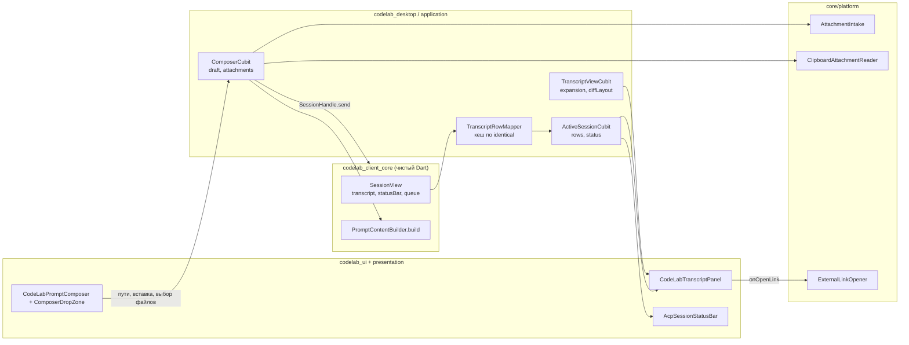
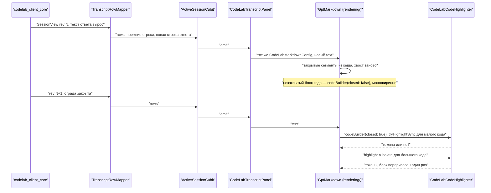
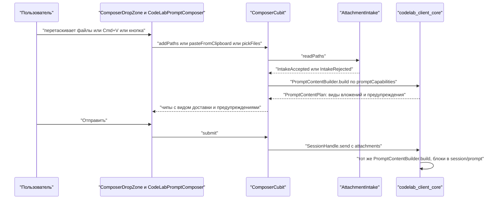

# 12.3. Десктоп-приложение: отображение

> Часть предложения [«Dart-агент и клиенты CodeLab»](../dart-agent-and-clients.md). Status: Accepted. Исходные решения, связанные документы и порядок чтения — в оглавлении.

← [12.2. CLI: отображение и ввод](12-2-cli-display-and-input.md) · [Оглавление](../dart-agent-and-clients.md) · [12.4. Первый запуск и настройки](12-4-first-run-and-settings.md) →

## 12.3.1. Назначение

Раздел задаёт, как codelab-app показывает модель отображения из §12.1: markdown-ответы с
подсветкой кода (D-06), diff правок (D-07), мысли модели в сворачиваемом блоке (D-08), usage и
стоимость в статусе чата (D-09) и вложения в композере (D-12). Работа идёт после разделения
Cubit-ов (задача 5.9): app получает `SessionView` из `codelab_client_core` и только отображает его.
Логика проекции, построения hunks
(`LineDiff`, §12.1.3), строки инструмента (`ToolRowFormatter`, §12.1.6), статус-строки
(`SessionStatusBar`, §12.1.5) и выбора `ContentBlock` (`PromptContentBuilder.build`, §12.1.7)
остаётся в kit.

> **Уточнение 2026-11-11 (решение пользователя, change [`add-desktop-markdown`](../../../../openspec/changes/archive/2026-11-11-add-desktop-markdown/design.md), D1).** Markdown
> app разбирает не kit: ответ агента (`AgentTextItem.text`) рисует пакет `gpt_markdown` внутри
> `codelab_ui` (`lib/src/rendering/`) со своими builder'ами и темой из `FluentTheme`; подсветка —
> `val_highlight` за `CodeLabCodeHighlighter`. Модель `MarkdownDocument` и `IncrementalMarkdown`
> (§12.1.4) остаются для CLI (change `add-cli-markdown`). Альтернатива «свой разбор в kit, своя
> отрисовка блоков и `re_highlight`» — прежняя редакция этого раздела — отклонена пользователем
> после прототипа. Ниже строки, которые она меняет, помечены ссылкой на change; имена `Acp*`
> в остальных строках соответствуют нынешним `CodeLab*` кита.

Исходная точка в коде сегодня:

* `CodeLabTranscriptPanel` (`packages/flutter/codelab_ui/lib/src/organisms/codelab_transcript_panel.dart`)
  рисует `List<CodeLabTranscriptEntry>` через `ListView.separated`. Тело агента выводится одним
  `CodeLabText` без разметки. Мысли и ответ склеиваются в одинаковые записи «Agent»
  (`_StreamingChunkKind` в `shell_cubit.dart`).
* Вызов инструмента показывает `CodeLabToolCallSummary` (имя, статус, цель, деталь) и встроенную
  карточку одобрения `CodeLabTranscriptApproval`. У карточки есть только текстовый `diffSummary`.
* `CodeLabPromptComposer` принимает только текст, команды `/` и чипы опций конфигурации.
* В `pubspec.yaml` пакетов нет markdown, подсветки, drag&drop, чтения изображений из буфера и
  открытия ссылок. Из плагинов есть только `file_selector`, он остаётся в app.

Улучшения НЕ ДОЛЖНЫ ломать существующие возможности: очередь промптов (R-18), чек-лист плана
(R-19), палитру Cmd+K (R-20), вкладки сессий со статусом (R-21), выбор проекта (R-22), инспектор
и лог-вьюер (R-23), а также встроенные одобрения с автопрокруткой (D-01, D-02).

Раздел также задаёт карту экранов app и правила навигации между ними (A13), хронологию хода
(A14, D-22) и доску субагентов и фоновых задач (A15, D-25). Макет всех экранов и граф навигации —
холст Claude Design «CodeLab Desktop — Feature UI/UX» (страница «Навигация и покрытие»); номера
экранов 01–27 ниже совпадают с номерами артбордов. Холст иллюстрирует этот раздел и §12.4; при
расхождении действует текст.

## 12.3.2. Контракт

**Размещение компонентов.** `codelab_ui` (ui_kit) содержит виджеты и собственные
презентационные модели без бизнес-логики и без зависимости от `codelab_client_core`. Feature
`workbench` содержит Cubit-ы, маппер kit → `codelab_ui` и обвязку с плагинами.

| Компонент | Пакет / путь | Слой | Ответственность |
|---|---|---|---|
| `AcpTranscriptRow` и наследники (сейчас `CodeLabTranscriptRow`) | `codelab_ui/lib/src/organisms/` | ui_kit | неизменяемые модели строк ленты; ответ агента — `CodeLabAgentTextRow(id, text, streaming)`, без модели markdown-блоков (`add-desktop-markdown`, D3) |
| `CodeLabTranscriptPanel` (расширен) | `codelab_ui/lib/src/organisms/` | ui_kit | виртуализированная лента строк, следование за хвостом, автопрокрутка к одобрению |
| `CodeLabMarkdown`, `CodeLabMarkdownConfig`, `CodeLabMarkdownScope`, `CodeLabCodeBlock` | `codelab_ui/lib/src/rendering/` | ui_kit | ответ агента через `gpt_markdown`: тема и builder'ы, созданные один раз; политика ссылок и изображений из app; код с подсветкой, языком и кнопкой копирования (`add-desktop-markdown`, D2–D4) |
| `AcpThoughtBlock` | `codelab_ui/lib/src/molecules/` | ui_kit | сворачиваемый блок мыслей |
| `AcpDiffView`, `AcpDiffViewerDialog` | `codelab_ui/lib/src/molecules/`, `organisms/` | ui_kit | unified и side-by-side, свёрнутый предпросмотр, полный просмотр в диалоге |
| `AcpSessionStatusBar` | `codelab_ui/lib/src/molecules/` | ui_kit | модель, режим, токены, стоимость, заполнение контекста |
| `AcpAttachmentChip`, композер с вложениями | `codelab_ui/lib/src/molecules/` | ui_kit | чипы, удаление, подсветка зоны сброса |
| `CodeLabCodeHighlighter`, `CodeLabCodeTheme` | `codelab_ui/lib/src/rendering/` | ui_kit | токенизация кода на `val_highlight` (синхронно или в isolate), кеш, палитры светлой и тёмной темы (`add-desktop-markdown`, D4) |
| `TranscriptRowMapper` | `apps/codelab_desktop/lib/features/workbench/application/ui_mappers.dart` | application | `SessionView` → `List<AcpTranscriptRow>` с переиспользованием неизменившихся строк |
| `isOpenableLink`, `isLoadableImage` | `apps/codelab_desktop/lib/core/platform/link_policy.dart` | infrastructure | политика ссылок (`http`, `https`, `mailto`) и изображений (только `https`) для ленты (`add-desktop-markdown`, D2, D5, D6) |
| `ActiveSessionCubit` (из 5.9) | `.../workbench/application/` | application | строки ленты и статус активной сессии |
| `TranscriptViewCubit` | `.../workbench/application/` | application | только UI-состояние: ручное раскрытие блоков, режим diff |
| `ComposerCubit` | `.../workbench/application/` | application | черновик и вложения по сессиям, лимиты, отправка через `SessionHandle.send` |
| `AttachmentIntake`, `ClipboardAttachmentReader`, `ExternalLinkOpener` | `apps/codelab_desktop/lib/core/platform/` | infrastructure | чтение файлов и буфера, MIME, открытие URL |
| `ComposerDropZone` | `.../workbench/presentation/widgets/` | presentation | обёртка над плагином drag&drop, передаёт только пути |
| `ProjectFilesCubit` (после MVP, D-13, §12.6.8; change `add-file-preview-and-tree`) | `apps/codelab_desktop/lib/features/project_files/application/` | application | раскрытые папки, плоский список видимых строк, просмотр, Following |
| `CodeLabFileTree`, `CodeLabFilePreview` (после MVP, §12.6.8) | `codelab_ui/lib/src/organisms/`, `models/` | ui_kit | виртуализированное дерево, просмотр с номерами строк (подсветка — `CodeLabCodeHighlighter` change `add-desktop-markdown`) |
| `ProjectFilesPane` (после MVP, §12.6.8) | `.../project_files/presentation/` | presentation | панель Files дока инструментов (A13, шаг 0): дерево сверху, просмотр снизу; «Insert as mention» и связь с `ComposerCubit` — после D-12 |
| `SessionSearchCubit` (после MVP, D-17, A12) | `.../workbench/application/` | application | владеет `SessionSearch` kit (§12.6.12): склейка ввода, фильтр даты, область, строки результатов |
| `AcpSessionSearchField`, `AcpSessionSearchResults`, `AcpSessionSearchRowData` (после MVP, A12) | `codelab_ui/lib/src/molecules/`, `organisms/`, `models/` | ui_kit | поле поиска с фильтрами даты и области; список результатов с подсветкой и сниппетами |
| `AppDestination`, `NavigationCubit` (A13) | `apps/codelab_desktop/lib/app/navigation/` | application | закрытый список экранов, текущий экран и вкладка инспектора, последняя страница настроек; переходы — только через Cubit |
| `CommandPaletteCubit` (A13, R-20) | `.../workbench/application/` | application | группы палитры: команды агента из `available_commands_update`, действия сессии, переходы, действия app; нечёткий поиск |
| `AcpTurnTimeline`, `AcpTurnStepData` (после MVP, D-22, A14) | `codelab_ui/lib/src/organisms/`, `models/` | ui_kit | панель дока «Timeline»: шаги хода, раскрытие шага до его вызовов |
| `SubagentBoardCubit`, `JobBoardCubit` (после MVP, D-25, A15) | `.../workbench/application/` | application | снимки `_codelab/subagents/*` и `_codelab/jobs/*` через kit, действия «Stop», «Kill», «Output» |
| `AcpTaskBoard`, `AcpTaskRowData` (после MVP, D-25, A15) | `codelab_ui/lib/src/organisms/`, `models/` | ui_kit | таблицы субагентов и фоновых задач, панель транскрипта ребёнка только для чтения |

**Поток состояния.**



**Состояния Cubit-ов.** Неизменяемые; `copyWith` и `==` опущены.

```dart
// apps/codelab_desktop/lib/features/workbench/application/active_session_cubit.dart
final class ActiveSessionState {
  final SessionId? sessionId;
  final int sourceRevision;                  // SessionView.revision, из которого построены rows
  final List<AcpTranscriptRow> rows;         // результат TranscriptRowMapper
  final AcpSessionStatusData status;         // из SessionView.statusBar; UsageView.unknown → null-поля
  // план, очередь, команды, опции конфигурации — как в 5.9, без изменений
}

// .../application/transcript_view_cubit.dart — только UI-состояние, по сессиям
final class TranscriptViewState {
  final Map<String, bool> expansionOverrides; // id строки мыслей/diff → выбор пользователя
  final AcpDiffLayoutPreference diffLayout;   // auto | unified | sideBySide
  final CodeLabViewMode viewMode;                 // существующий summary | normal | verbose
}

// .../application/composer_cubit.dart
final class ComposerState {
  final String draft;
  final List<DraftAttachment> attachments;   // порядок = порядок добавления
  final AttachmentIntakeStatus intake;       // idle | reading(count) — явный автомат, не bool
  final AttachmentNotice? notice;            // последнее отклонение с причиной, сбрасывается
  final PromptContentPlan? plan;             // последний PromptContentBuilder.build по вложениям
}

final class DraftAttachment {
  final String id;                           // локальный, для ключей чипов
  final PromptAttachment source;             // FileAttachment | ImageAttachment, §12.1
  final PromptAttachmentView? view;          // plan.attachments[i]: вид и предупреждения; null — идёт расчёт
}
```

Предупреждения и вид вложения — типы kit (`AttachmentKindView`, `AttachmentWarningKind`,
§12.1.1); app своих не вводит.

Состояние раскрытия хранится в `TranscriptViewCubit`, а не в `State` виджета. Строки
виртуализированного списка уничтожаются при уходе с экрана, поэтому `State` виджета теряет выбор
пользователя. Это UI-состояние, а не состояние сессии. Оно не попадает в kit и не
сохраняется между запусками.

**Публичные API виджетов `codelab_ui`.**

```dart
// Строки ленты. Каждая строка неизменяема; равенство — по id и ревизии содержимого.
sealed class AcpTranscriptRow { String get id; }
final class AcpUserRow extends AcpTranscriptRow {
  final String text; final List<AcpAttachmentChipData> attachments; // только чтение
}
// Ответ агента — одна строка с исходным текстом; markdown разбирает gpt_markdown внутри
// CodeLabMarkdown (change add-desktop-markdown, D1, D3). Строка на блок (AcpAgentBlockRow)
// и «Копировать ответ» не вводятся.
final class CodeLabAgentTextRow extends AcpTranscriptRow {
  final String text;             // AgentTextItem.text
  final bool streaming;          // последний ответ идущего хода, вычисляет маппер
}
final class AcpThoughtRow extends AcpTranscriptRow {
  final String text;             // ThoughtItem.text как есть: мысли не размечаются (§12.1.2, шаг 7)
  final bool streaming; final Duration? duration;   // ThoughtItem.duration
}
final class AcpToolCallRow extends AcpTranscriptRow {
  final AcpToolRowData header;              // из ToolRowView (§12.1.6): glyph, label, detail, elapsed, secondary
  final AcpToolStatus status;               // зеркало ToolCallStatusView, для подписи доступности
  final List<AcpDiffData> diffs;            // из ToolDiffContent.diff (DiffView)
  final List<String>? terminalTail;         // ToolTerminalContent.output.tail
  final String? spillPath;                  // ToolTextContent.spill.path: только текст с копированием
  final CodeLabTranscriptApproval? approval;    // существующий тип, без изменений
}
final class AcpNoticeRow extends AcpTranscriptRow { final CodeLabTone tone; final String text; }

class CodeLabTranscriptPanel extends StatefulWidget {
  const CodeLabTranscriptPanel({
    required List<AcpTranscriptRow> rows,
    Map<String, bool> expansionOverrides = const {},
    ValueChanged<({String rowId, bool expanded})>? onExpansionChanged,
    AcpDiffLayoutPreference diffLayout = AcpDiffLayoutPreference.auto,
    CodeLabViewMode viewMode = CodeLabViewMode.normal,
    String emptyLabel = 'No transcript yet',
    Key? key,
  });
  /// Переходный конструктор: старые CodeLabTranscriptEntry → строки (для превью и тестов).
  factory CodeLabTranscriptPanel.entries({required List<CodeLabTranscriptEntry> entries, ...});
}

// codelab_ui/lib/src/rendering/ (change add-desktop-markdown, D2–D4)
class CodeLabMarkdown extends StatelessWidget {
  const CodeLabMarkdown({required String text, bool streaming = false, Key? key});
}
// Политика app над лентой; без scope ссылки и изображения неактивны.
class CodeLabMarkdownScope extends InheritedWidget {
  final bool Function(Uri) canOpenLink; final ValueChanged<Uri> onOpenLink;
  final bool Function(Uri) canLoadImage; final ImageProvider Function(Uri) imageFor;
  final Set<String> shownImages; final ValueChanged<String> onShowImage;
}
class CodeLabCodeBlock extends StatefulWidget {
  const CodeLabCodeBlock({required String code, String? language, bool closed = true, Key? key});
}
class AcpThoughtBlock extends StatelessWidget {
  const AcpThoughtBlock({required AcpThoughtRow row, required bool expanded,
      required ValueChanged<bool> onToggle, Key? key});
}
class AcpDiffView extends StatelessWidget {
  const AcpDiffView({required AcpDiffData diff, required AcpDiffPresentation presentation,
      AcpDiffLayoutPreference layout = AcpDiffLayoutPreference.auto,
      VoidCallback? onOpenFull, ValueChanged<bool>? onToggle, Key? key});
}
enum AcpDiffPresentation { summaryLine, preview, full }
enum AcpDiffLayoutPreference { auto, unified, sideBySide }

class AcpSessionStatusBar extends StatelessWidget {
  const AcpSessionStatusBar({required AcpSessionStatusData data, Key? key});
}
final class AcpSessionStatusData {
  final String? model; final String? mode;                // modelLabel, modeLabel
  final AcpUsageData? turn; final AcpUsageData? session;  // null — агент не сообщает usage
  final double? contextFraction;                          // UsageView.contextFraction, null — неизвестно
  final bool turnRunning;
}
final class AcpUsageData {                                // из TokenCounts и Money (§12.1.1)
  final int input, output, cacheRead, cacheWrite, reasoning;
  final String? costLabel;                                // готовая строка из Money; null — цена неизвестна
  final bool partial;                                     // UsageView.sessionPartial → префикс «~»
}

// Композер: новые параметры, существующие не меняются.
//   attachments: List<AcpAttachmentChipData>, onRemoveAttachment: ValueChanged<String>,
//   onPickFiles: VoidCallback?, onPasteAttachment: Future<bool> Function()?,
//   isDropHovering: bool, isReadingAttachments: bool
final class AcpAttachmentChipData {
  final String id; final String label; final String sizeLabel;
  final AcpAttachmentKind kind;            // image | file
  final AcpAttachmentDeliveryLabel delivery; // image | embedded | link | pathText | notSent (= AttachmentKindView)
  final List<String> warnings;             // готовые подписи AttachmentWarningKind
  final Uint8List? thumbnail;              // только для изображений, уменьшенная копия
}
```

Ключи для тестов: `transcript-row-<id>`, `thought-toggle-<id>`, `diff-open-full-<id>`,
`code-copy-<rowId>-<n>` (`n` — номер блока кода в ответе), `status-bar-usage`, `status-bar-cost`, `status-bar-context`,
`composer-attachment-chip-<id>`, `composer-attachment-remove-<id>`, `composer-attach-button`,
`composer-drop-zone`; после MVP (§12.6.8) — `tool-pane-files`, `tool-toggle-files`,
`file-tree-row-<relativePath>`, `file-tree-show-ignored`, `file-preview`,
`file-preview-path`, `file-preview-copy-path`, `file-preview-secret-warning`, `file-preview-following`, `tool-row-open-file-<toolCallId>`.

**Порты платформы.**

```dart
// apps/codelab_desktop/lib/core/platform/attachment_intake.dart
abstract interface class AttachmentIntake {
  /// Нормализует пути (realpath), отклоняет папки и нечитаемые файлы. Содержимое не читает:
  /// тип по сигнатуре, лимиты и блоки определяет PromptContentBuilder.build через AttachmentFiles.
  Future<List<IntakeResult>> readPaths(List<String> paths);
  Future<List<String>> pickFiles();               // file_selector.openFiles
}
abstract interface class ClipboardAttachmentReader {
  /// Изображение (→ ImageAttachment) или список файлов (→ FileAttachment(origin: clipboard));
  /// null — в буфере только текст.
  Future<List<PromptAttachment>?> read();
}
abstract interface class ExternalLinkOpener {
  Future<bool> open(Uri uri);                      // только http, https, mailto; url_launcher
}
sealed class IntakeResult {}
final class IntakeAccepted extends IntakeResult { final FileAttachment attachment; }
final class IntakeRejected extends IntakeResult { final String path;
  final IntakeRejectReason reason; }               // directory | unreadable
```

Реализация `AttachmentFiles` (порт kit, §12.1.1) в app — та же, что в CLI, из `codelab_client_io`:
app на десктопе может зависеть от `dart:io`-пакетов.

## 12.3.3. Алгоритмы

**A1. Маппинг ленты с переиспользованием строк.** `TranscriptRowMapper.map(SessionView view,
List<AcpTranscriptRow> previous)` вызывается на каждую новую `revision`.

1. Для каждого `TranscriptItem` маппер ищет в кеше `Expando<List<AcpTranscriptRow>>` строки,
   построенные из того же экземпляра (`identical`). Kit не пересоздаёт неизменившиеся элементы и
   закреплённые блоки markdown (VIEW-11, §12.1.2, шаг 8). Поэтому при стриме попадание в кеш
   идёт по всей ленте, кроме последнего элемента.
2. `AgentTextItem` → одна `CodeLabAgentTextRow(id, text, streaming)`; `streaming` — последний
   элемент идущего хода. Разбор и кеш блоков — внутри `gpt_markdown` (A2, A3). Прежний вариант —
   строка `AcpAgentBlockRow` на каждый блок `markdown.blocks` с id `<itemId>#<blockIndex>` —
   отменён решением пользователя 2026-11-11 (change `add-desktop-markdown`, D1, D3).
3. `ThoughtItem` → одна `AcpThoughtRow`. `ToolCallItem` → `AcpToolCallRow`: заголовок — из
   `ToolRowFormatter.format(item, now: clock.now(), cwd: …)` (`ToolRowView`), статус — из
   `ToolCallStatusView`, diff — из каждого `ToolDiffContent.diff`, хвост терминала — из
   `ToolTerminalContent.output`, путь выноса — из `ToolTextContent.spill` (файл лежит на машине
   агента, app его не открывает и не читает; строка показывает «полный вывод: <путь>» с кнопкой
   копирования), одобрение — из существующего маппинга `CodeLabTranscriptApproval`. `NoticeItem` →
   `AcpNoticeRow`. `UserItem` → `AcpUserRow` с чипами только для чтения из
   `UserItem.attachments` (`PromptAttachmentView`).
4. Если ни одна строка не изменилась (тот же список по `identical`), Cubit не эмитит состояние.
   Работа маппера на один chunk — O(число блоков хвоста), а не O(длины ленты).

**A2. Отрисовка при стриме: стабильный префикс и хвост.**



1. `CodeLabTranscriptPanel` строит `ListView.builder` с `ValueKey(row.id)` и
   `findChildIndexCallback`. Вставка строк выше не пересоздаёт `State` нижних строк.
2. Ответ рисует `GptMarkdown(text, isStreaming: streaming, animation: none)`. Пакет делит
   документ на сегменты верхнего уровня и кеширует виджет каждого; при дописывании текста
   перестраивается только хвост. Кеш работает, только если тема (`GptMarkdownThemeData`),
   builder'ы и `htmlTags` — те же объекты между сборками: пакет сравнивает их по identity, а
   новая тема на каждой сборке перестраивает все закрытые блоки (в прототипе — в 3–4 раза
   медленнее). Поэтому `CodeLabMarkdownConfig` создаётся один раз на тему Fluent и хранится в
   `State` ленты, builder'ы — его поля; политика app приходит через `CodeLabMarkdownScope` и
   читается из `context`, не пересоздавая конфигурацию (change `add-desktop-markdown`, D3).
   `SliverGptMarkdown` не используется: лента — `ListView.builder` строк.
3. Незакрытый блок кода (`codeBuilder` с `closed == false`) выводится моноширинным текстом без
   подсветки (DSK-6). Таблица до строки-разделителя — абзац (так разбирает пакет).
4. Частоту обновлений ограничивает kit: не больше одной публикации за кадр (§9.10, шаг 8; на
   2026-11-11 склейка не реализована, Flutter всё равно строит не больше одного кадра).
   Дополнительно Cubit склеивает эмиты в `SchedulerBinding.scheduleFrameCallback`. Это
   ограничение только на границе отображения (`streaming.md`, §15), события не теряются.
5. Следование за хвостом. Если перед обновлением список был в пределах 80 px от низа
   (существующий `_autoScrollBottomThreshold`), после кадра он прокручивается к низу без анимации.
   Если пользователь прокрутил вверх, позиция не меняется и появляется кнопка
   «К последнему сообщению». Существующая анимированная автопрокрутка к новому ожидающему
   одобрению сохраняется без изменений.

**A3. Markdown.** Ответ агента разбирает и рисует пакет `gpt_markdown` внутри
`codelab_ui/lib/src/rendering/`; app markdown не разбирает (DSK-2; решение пользователя
2026-11-11, change `add-desktop-markdown`, D1–D9). Пакет вызывается без Material-предка, поэтому
всё, что он по умолчанию берёт из Material, заменено своими builder'ами:

| Элемент | Отображение |
|---|---|
| тема | `GptMarkdownThemeData` из `FluentTheme` (типографика, `accentColor`, `resources`), без `Theme.of` Material |
| заголовки, абзац, курсив, жирный, зачёркнутый, inline-код, цитата, таблица, черта | разметка пакета со стилями темы; inline-код — моноширинный шрифт на `resources.cardBackgroundFillColorSecondary` |
| списки задач | `checkboxBuilder` → Fluent `Checkbox` только для чтения (встроенный флажок без Material-предка падает, issue #154 пакета) |
| блок кода | `codeBuilder` → `CodeLabCodeBlock`: подпись языка вне выделения (`SelectionContainer.disabled`), кнопка «Copy», подсветка (A4); встроенная подсветка пакета не используется — в тёмной теме Fluent она светлая |
| ссылка | `inlineLinkBuilder` и `linkBuilder` по `url` из пакета (не по тексту, как `onLinkTap`); правила ниже |
| изображение | `imageBuilder` всегда переопределён — без него пакет сам грузит PNG и SVG; правила ниже |
| HTML | `html: false`: теги показываются текстом как написаны, `` и `<a>` не становятся элементами |
| формулы | только `\(…\)` и `\[…\]` (`val_latex_flutter`, без сети); `$` — обычный символ (`useDollarSignsForLatex: false`) |

Выделение текста — `SelectableRegion` из `package:flutter/widgets.dart` с собственными
`TextSelectionControls` без ручек и миксином `TextSelectionHandleControls`
(`_NoHandleSelectionControls`; без миксина `contextMenuBuilder` не вызывается и показывается
меню Material) вокруг строки ответа, а не `SelectionArea`: `SelectionArea` и его
меню принадлежат Material, а кит без Material-предка (change `add-desktop-markdown`, D4, D8, D10).
Копирование — Cmd/Ctrl+C; правый клик — своё меню Fluent «Copy» и «Select all» через
`contextMenuBuilder` (решение пользователя 2026-11-11). Ответ не является остановкой Tab
(`FocusNode(skipTraversal: true)`). Ограничение пакета: при копировании через несколько блоков
между ними нет перевода строки. Кнопка «Copy» блока кода кладёт в буфер исходный код без ограды;
номер блока в ключе `code-copy-<rowId>-<n>` даёт лёгкий сканер оград в `rendering/`, потому что
builder пакета номера не получает (D4). Ответ с вложенностью цитат и списков глубже
`kMaxMarkdownNestingDepth` пакету не передаётся и показывается моноширинным текстом: глубокая
вложенность даёт Stack Overflow в сборке пакета (D14). Запись в буфер — обычное действие
пользователя на границе presentation (`platform-integration.md`, §29). «Копировать ответ» и
выделение через несколько строк ленты не вводятся (change `add-desktop-markdown`, решение Q5).

Политика ссылок. Решение принимает app (`isOpenableLink` в `core/platform/link_policy.dart`) и
передаёт через `CodeLabMarkdownScope` стабильными функциями (tear-off Cubit, функции верхнего
уровня), `shownImages` неизменяемо. Адрес с userinfo (`https://good.com@evil.com`) не активен;
`mailto` открывается только с адресатами и `subject`, остальные параметры отбрасываются; ссылка —
`TextSpan`, который переносится с абзацем (`WidgetSpan` отклонён), подсказка — свой оверлей
Fluent, до 2048 символов. Адреса локальной сети не отличаются от прочих — риск CSRF к локальным
сервисам принят пользователем 2026-11-11 (решения пользователя, change `add-desktop-markdown`). Активна ссылка `http` или `https` с непустым хостом либо `mailto` с
адресом: подчёркнутый `accentColor`, полный адрес в подсказке (управляющие, bidi- и невидимые символы
экранированы `escapeForDisplay`, change `add-desktop-markdown`, D5). Клик сразу вызывает `onOpenLink` → `CodeLabShellCubit.openExternalLink` →
повторная проверка схемы → `ExternalLinkOpener.open` (`url_launcher`). Окна подтверждения нет —
решение пользователя 2026-11-11 (прежняя редакция предлагала окно с «Открыть» и «Копировать»).
Прочие схемы (`file:`, `javascript:`, `data:`, `vscode:`, `xmpp:`), protocol-relative адреса и
относительные пути — обычный текст. Журнал — компонент `workbench`, схема, хост (до 255 символов), исход, без пути и query. Агент не может
открыть URL сам: открытие всегда начинается с клика пользователя (`platform-integration.md`,
§35).

Политика изображений (VIEW-12, DSK-7). Изображение не загружается без явного действия
пользователя: автозагрузка — канал утечки через prompt injection
(``). По умолчанию — заглушка «Image» с
хостом и именем файла (пакет не передаёт `alt` в `imageBuilder`; подпись тоже проходит
`escapeForDisplay`) и полным адресом в подсказке.
Кнопка «Show image» — только для `https` с хостом (`isLoadableImage`); после клика app
загружает картинку через `ResizeImage` 1440×1440 с `fit` (против декомпрессионной бомбы), тело
≤ 32 МБ, каждый редирект проверяется `isLoadableImage` (на `http` не принимается); адрес с
userinfo не загружается. Выбор хранится в `TranscriptViewCubit` по
строке и адресу на время запуска.

**A4. Подсветка кода.** `CodeLabCodeHighlighter` на движке `val_highlight` (чистый Dart, приходит
с `gpt_markdown`; change `add-desktop-markdown`, D4). Токены — плоский список `(start, end, CodeLabTokenClass)` со смещениями по всему коду, а не по строкам. В фоновый isolate (`Isolate.spawn` с `kill` по таймауту 5 с) уходит только `(язык, код)`, обратно — тот же простой список; объектов Flutter между isolate нет.

| Размер кода | Режим |
|---|---|
| ≤ 300 строк, ≤ 16 Ki code units и каждая строка ≤ 150 code units | синхронно в кадре построения (типичная стоимость заметно ниже бюджета кадра) |
| ≤ 5000 строк, ≤ 256 Ki code units и каждая строка ≤ 1000 code units | фоновый isolate (`Isolate.spawn` с `kill` по таймауту 5 с); до результата — моноширинный текст без цвета, затем одна перерисовка |
| больше | без подсветки; для diff (A5) — свёрнуто, полный просмотр в диалоге с виртуализированным списком строк; блок кода в ответе показывается целиком без подсветки (сворачивание и диалог не входят в change `add-desktop-markdown`) |

Ограничения после ревью итерации 3 (change `add-desktop-markdown`, D4): (1) порог и по самой длинной строке: синхронно — только если каждая строка ≤ 150 code units, в фоне — ≤ 1000, длиннее — без подсветки; причина — `val_highlight` на `RegExp` с возвратами квадратичен по длине строки (swift `'#' * 16000` — 4,6 с в UI isolate, csharp `'$' * n` так же; обещание линейности в README пакета не подтверждается); пороги сняты по замеру AOT второго круга ревью безопасности: строка 300 символов давала до 73 мс синхронно (swift `#`), 2000 — до 7,8 с в фоне, то есть за таймаутом; пороги 16 и 256 КиБ — это code units (`*MaxChars`); (2) фоновая токенизация идёт в фоновый isolate (`Isolate.spawn` с `kill` по таймауту 5 с), а не в `compute`: `compute` нельзя прервать, и зависший на возвратах `RegExp` изолят жил бы до конца процесса; задачи в полёте дедуплицируются по ключу `(язык, код)`; по таймауту код остаётся без подсветки, отчёт содержит язык и `timeout` (`AGENTS.md` §12: операция, переживающая владельца, ограничена); исходы «таймаут» и «сбой» запоминаются негативной записью кеша по `(язык, код)` как «без подсветки» — повтор не запускает изолят и не шлёт новый отчёт; (3) границы токенов, попавшие внутрь суррогатной пары, сдвигаются на границу пары — грамматики работают без флага unicode, и иначе отрисовка падает с `ArgumentError: string is not well-formed UTF-16`; (4) LRU ограничен и числом записей (256), и суммарным бюджетом около 8 Mi единиц: code unit кода — 1 единица, токен — 20 (оценка памяти ~40 байт на токен против 1–2 байт на code unit); (5) подпись языка проходит `escapeForDisplay` (D5) и обрезается до 32 символов с многоточием.

Кеш — LRU на 256 записей у каждого экземпляра `CodeLabCodeHighlighter` и общий экземпляр `CodeLabCodeHighlighter.shared` для ленты; ключ — `(language, hash(code))`, а запись хранит и сам код и сверяет его при попадании: коллизия хеша не подставит чужие токены. Повторное построение строки, например после прокрутки, не запускает токенизацию снова. Язык берётся из info-строки блока. Языки — 55 грамматик `LanguageRegistry(allLanguages)` `val_highlight` с их псевдонимами, без учёта регистра; `plaintext` и `generic` (а значит и `text`) не подсвечиваются; неизвестный язык или его отсутствие — без подсветки; автоопределения нет (у `val_highlight` оно есть — не используется). Классы — по корню области `val_highlight`: `comment` → comment; `string`, `regexp` → string; `number` → number; `keyword`, `literal` → keyword; `type` → type; `function` → function; `variable`, `property` → variable; `operator` → operator; `attribute`, `tag`, `meta` → attribute; прочее — обычный текст. Сбой движка — пустой список токенов (код без цвета) и `FlutterError.reportError` только с языком и типом исключения, без текста кода (`AGENTS.md` §12, §16).

Палитра: `CodeLabCodeTheme` — `ThemeExtension` в `FluentThemeData.extensions`; палитра, зарегистрированная приложением, побеждает встроенную. Фон блока — `solidBackgroundFillColorBase` с наложенным `cardBackgroundFillColorSecondary`: непрозрачный, потому что полупрозрачный фон scaffold Fluent в тёмной теме давал белый фон под кодом. Цвета классов — из ролей и акцентов Fluent (`lighter` в тёмной теме, `darker` в светлой); если контраст на фоне ниже 4,7, лёгкость цвета сдвигается шагом 0,025 до контраста ≥ 4,7, так что требование 4,5:1 (DSK-19) выполняется по построению (решение Q4). Темы `val_highlight` не используются. Палитра выбирается по `FluentTheme.brightness`. Шрифт: системный
моноширинный список (`SF Mono`, `Menlo`, `Consolas`, `monospace`); шрифты JetBrains Mono
(`gpt_markdown`) и Latin Modern (`val_latex_flutter`) попадают в сборку с пакетами и указаны в
`THIRD_PARTY_NOTICES.md`.

**A5. Diff.** Источник — `ToolDiffContent.diff` (`DiffView`, §12.1.3): `displayPath`, `change`
(`created | modified | deleted`), `hunks` (`DiffHunk` из `DiffLine` с `DiffOp`, номерами строк и
`noNewlineAtEnd`), счётчики `added`/`removed` и `limited` (`DiffLimitReason`). Hunks строит
`LineDiff` в kit; десктоп выбирает форму и объём.

1. Форма. При `diffLayout == auto` выбирается side-by-side, если ширина строки ленты
   (`LayoutBuilder`) ≥ 960 px, иначе unified. Ручной выбор в заголовке diff сохраняется в
   `TranscriptViewCubit` для текущего запуска. В side-by-side удалённые и добавленные строки
   одного блока изменений ставятся рядом по порядку; лишние строки одной стороны получают пустую
   пару.
2. Объём зависит от `CodeLabViewMode`: `summary` — одна строка `displayPath  +added −removed`; `normal` — предпросмотр
   (первые 2 hunk, не больше 20 строк); `verbose` — полностью, но не больше 300 строк inline.
3. Большой diff (> 300 строк во всех hunks или > 512 КиБ текста) всегда свёрнут: показываются
   сводка, путь и первые 20 строк с кнопкой «Показать полностью» (`diff-open-full-<id>`).
   Кнопка открывает `AcpDiffViewerDialog` с виртуализированным `ListView.builder` по строкам.
4. Подсветка внутри diff — по расширению пути (тот же `CodeLabCodeHighlighter`), и только когда весь
   diff попадает в лимит фоновой токенизации из A4. Цвет фона строки — `CodeLabTone.success` и `CodeLabTone.danger`
   с прозрачностью из темы. Знаки `+` и `−` в поле номеров строк показываются всегда, поэтому
   цвет не единственный носитель смысла.
5. `change == created` показывается как «новый файл, N строк» (`N = added`) и далее теми же
   правилами; `deleted` — «файл удалён, N строк» (`N = removed`). Ограниченный diff (VIEW-5):
   `limited == binary` — «бинарный файл изменён» без строк; `tooLarge` — сводка «файл переписан:
   +N −M строк (diff не показан)» без предпросмотра и без диалога (hunks пусты); `budgetExceeded`
   — единственный блок «середина заменена целиком» с отметкой «diff упрощён: показана замена
   целиком». Частичный diff никогда не подаётся как полный.
6. Карточка одобрения (D-02) для правки использует `AcpDiffView` в режиме `preview` вместо
   текстового `diffSummary`. Кнопки и горячие клавиши карточки не меняются.

**A6. Мысли.** `AcpThoughtRow` рисуется блоком, отличным от ответа: приглушённый текст
(`CodeLabTextRole.caption`), левая пунктирная полоса, иконка и заголовок «Размышления».

1. Пока `streaming == true`, блок раскрыт и показывает последние 6 строк, с заголовком
   «Размышляет… N с». Таймер в заголовке тикает раз в секунду и перестраивает только заголовок.
2. Когда поток закончился, блок сворачивается до заголовка «Размышления · N с» без анимации,
   чтобы лента не прыгала у читающего пользователя. Исключения: пользователь уже вручную
   раскрыл или свернул этот блок (`expansionOverrides[id]` побеждает), или включён
   `CodeLabViewMode.verbose` (раскрыт по умолчанию).
3. В раскрытом законченном блоке текст выводится как есть, без разбора markdown (kit мысли не
   размечает, §12.1.2, шаг 7), с переносом строк. Если текст длиннее 4000 символов, видны первые
   4000 и кнопка «Показать всё».
4. Мысли не попадают в «Копировать ответ» и не подсвечиваются как ответ. При `summary` блок
   остаётся одной строкой заголовка.

**A7. Статус чата и usage.** `AcpSessionStatusBar` стоит строкой под композером, слева
направо: модель · режим · контекст · токены · стоимость.

Источник — `SessionView.statusBar` (`SessionStatusBar`, §12.1.5); десктоп ничего не собирает
сам.

| Поле | Источник | Неизвестно |
|---|---|---|
| модель | `SessionStatusBar.modelLabel` (kit уже выбрал опцию категории `model`) | поле скрыто |
| режим | `SessionStatusBar.modeLabel` (опция категории `mode` или `current_mode_update`) | поле скрыто |
| контекст | `usage.contextFraction` (из `contextUsed`/`contextWindow`) | индикатор скрыт; 0 % не показывается |
| токены хода и сессии | `usage.lastTurn`, `usage.session` (`TokenCounts`); при `sessionPartial` — префикс `~` | `UsageView.unknown`: «usage: —» с подсказкой «агент не сообщает расход» |
| стоимость хода и сессии | `usage.lastTurnCost`, `usage.sessionCost` (`Money`) | «—»; при известных токенах без цены — «цена неизвестна» |

`gitBranch` и `queued` статус-бар десктопа не показывает: очередь видна в своей панели (R-18),
ветка — вне объёма D-09.

Данные usage приходят от агента через расширение ACP для usage (L-11, OpenSpec change
`add-usage-extension`, §12.1.5). Без расширения kit отдаёт `UsageView.unknown`, поля остаются в
состоянии «неизвестно» и никогда не превращаются в нули (VIEW-6). Подпись:
`12,3k → 1,2k · $0,042 · сессия $1,20`; вход — `input + cacheRead + cacheWrite`, выход —
`output`, как в CLI (§12.2.6). Подсказка показывает `input`, `output`, `cacheRead`,
`cacheWrite`, `reasoning`. Если агент шлёт usage во время хода, значение хода обновляется на
месте. Если только в ответе `session/prompt`, оно появляется в конце хода; до этого рядом с полем
хода крутится `CodeLabProgressIndicator`. Пороги контекста: ≥ 80 % — `CodeLabTone.warning`, ≥ 95 % —
`CodeLabTone.danger`. Стоимость форматируется из целых микроединиц `Money.micros` без `double` по
локали: 2 значащих знака после первой ненулевой цифры для сумм меньше 0,01 и 2 знака после
запятой для остальных. Валюта — `Money.currency`; десктоп ничего не пересчитывает.

**A8. Вложения.**



1. Источники. (a) Drag&drop — `ComposerDropZone` над всей колонкой ленты и композера. Во время
   перетаскивания выставляется `isDropHovering`, композер подсвечивается рамкой `accentColor`. Плагин
   отдаёт только пути, которые сразу уходят в `ComposerCubit.addPaths`. (b) Вставка: Cmd/Ctrl+V
   в поле композера вызывает `onPasteAttachment`. Если `ClipboardAttachmentReader` вернул
   изображение (`ImageAttachment`) или файлы (`FileAttachment(origin: clipboard)`), они
   становятся вложениями. Иначе выполняется штатная вставка текста. (c) Кнопка «Прикрепить»
   (`composer-attach-button`) → `AttachmentIntake.pickFiles` (`file_selector.openFiles`, уже есть
   в app).
2. Нормализация в `AttachmentIntake`. Путь приводится к realpath с разрешением символических
   ссылок; папки и нечитаемые файлы отклоняются сразу, с причиной. Остальное — `FileAttachment`
   (`origin: drop` или `flag` для кнопки). Тип по сигнатуре (`png/jpeg/gif/webp`), размер и
   решение «встроить или сослаться» принимает kit (§12.1.7, шаги 3–4) через порт
   `AttachmentFiles`; чтение асинхронное, вне кадра, и большие файлы не читаются целиком, если
   они уйдут ссылкой.
3. Лимиты — `AttachmentLimits` kit (§12.1.1): до 10 вложений на промпт; изображение до 5 МиБ;
   встраиваемый текстовый ресурс до 256 КиБ и только в UTF-8; суммарное встраиваемое содержимое
   промпта до 20 МиБ. Файл сверх лимита встраивания уходит `resource_link`, на чипе —
   `downgradedBySize` («отправится ссылкой»). Вставленное изображение без файла сверх 5 МиБ —
   `notSent` + `tooLarge`: чип не создаётся, показывается уведомление, потому что понижать его не
   до чего. Одиннадцатое вложение `ComposerCubit` не добавляет (`tooMany`, уведомление).
4. Вид доставки чипа — `plan.attachments[i]` из `PromptContentBuilder.build`; ту же функцию
   с теми же аргументами вызывает `SessionHandle.send` при отправке, поэтому чип показывает то,
   что реально уйдёт (VIEW-13). `ComposerCubit` пересчитывает план при изменении списка
   вложений и при смене `promptCapabilities` (смена агента, переподключение); текст черновика на
   план вложений не влияет и пересчёта не вызывает. Без `promptCapabilities.image` изображение
   с файлом уходит `resource_link` с пометкой `imageNotSupported`, а без файла не отправляется.
   Без `embeddedContext` текстовый файл уходит `resource_link` (базовая возможность ACP). Если
   агент отклонил и `resource_link`, kit один раз повторяет промпт с путями текстом (`pathText`,
   §12.1.7, шаг 5) и добавляет `NoticeItem`.
5. Предупреждения на чипе (тон `warning`): `maybeSecret` («может содержать секреты» — имя
   совпадает с `.env*`, `*.pem`, `*.key`, `id_*`) отправку не блокирует. `outsideCwd` («вне папки
   проекта» — realpath не внутри `cwd` сессии) требует подтверждения (VIEW-8): при отправке
   `ComposerCubit` показывает окно «Отправить файлы вне папки проекта?» со списком путей;
   «Отправить» → `send(..., allowOutsideCwd: true)`, «Отмена» → промпт остаётся в композере.
   Для чипа план считается с `allowOutsideCwd: true`, чтобы показать вид доставки после
   подтверждения.
6. Чип показывает иконку или миниатюру (уменьшенную до 64 px копию, декодированную через
   `ui.instantiateImageCodec` с `targetWidth`), имя, размер (`PromptAttachmentView.bytes`), вид
   доставки и предупреждения. Удаление — кнопка на чипе или Delete/Backspace при фокусе на чипе.
7. Отправка: `SessionHandle.send(text, attachments: …, allowOutsideCwd: …)`. Если идёт ход,
   промпт с вложениями ставится в очередь (R-18) как `QueuedPrompt` с `attachments` и
   `allowOutsideCwd` (§12.1.1). Строка очереди показывает число вложений, а правка текста промпта
   в очереди вложения сохраняет. После успешной передачи в kit вложения композера очищаются
   вместе с черновиком. При ошибке до отправки они остаются.

**A9. Доступность и клавиатура.**

* Каждая строка ленты — `Semantics(container: true)` с ролью в подписи: «Вы», «Ответ агента»,
  «Размышления», «Инструмент: <метка> <деталь>, <статус>» (из `ToolRowView` и
  `ToolCallStatusView`). Блок мыслей и свёрнутый diff — кнопки
  `Semantics(button: true, expanded: …)`. Enter или Space переключает их.
* Строки diff получают подписи «добавлено: …» и «удалено: …»; поле номеров с `+`/`−` видно
  всегда.
* Поток не озвучивается по chunk. `liveRegion` есть только у статуса хода («ответ завершён»,
  «ожидает одобрения»).
* Статус-бар: подписи «Стоимость хода …», «Использование неизвестно», «Контекст заполнен на
  N процентов».
* Фокус: `FocusTraversalGroup` для ленты, композера и чипов. В ряду чипов работают стрелки
  влево и вправо. Backspace в пустом поле переводит фокус на последний чип. Существующие
  сочетания не переназначаются: Cmd/Ctrl+K — палитра, Esc — отмена, Cmd/Ctrl+Enter и
  Cmd/Ctrl+Backspace — одобрить и отклонить, Alt+←/→ — инспектор. Поэтому удаление чипа
  делается простым Delete/Backspace, а не Cmd+Backspace.
* Контраст палитр подсветки и фонов diff — не ниже 4,5:1 к фону темы. Масштаб текста ОС
  учитывается, размеры в логических пикселях не фиксируются.

**A10. Управление сессиями (после MVP, S-06…S-09, D-10; agent-core-architecture §17.6.11).**
Логика — в `SessionHandle` kit (§12.1.1); app только рисует и вызывает методы.

* Контекстное меню сессии в сайдбаре: «Rename» (поле ввода, `SessionHandle.rename`; ошибка
  `invalidTitle` — под полем) и «Fork» (`fork()` от листа; новая сессия открывается вкладкой).
  Новый заголовок приходит `session_info_update` и во все открытые окна этой сессии.
* «Rewind to here» — на наведении сообщения пользователя с `recordId`: сначала
  `rewind(recordId, dryRun: true)`, затем диалог-предупреждение со списком файлов, которые **не**
  будут восстановлены, и пометкой о прочих эффектах; «Rewind» → `rewind(...)`, перезагрузка
  транскрипта, исходный текст сообщения — в композер. Без `recordId` (агент без `sessionTree`)
  пункта нет.
* Панель веток: список `branches()` (превью, число сообщений, время, метки; активная выделена);
  клик — `switchBranch(tipId)`; ответ с `filesNotRestored` показывается уведомлением ленты.
  `branchChanged` в `session_info_update` → kit перезагружает сессию (`session/load`).
* Режим только чтения: при `access == ReadOnlyAccess` над композером баннер
  `Read-only: this session is open in <profile>. Fork to continue here.` с кнопками «Fork» и
  «Try again» (повторный `session/load` с `openMode: "write"`); композер выключен. Сессия CLI
  открывается через профиль `ws://` того же агента: сайдбар показывает отметку `lease`, а
  `session/load` подключает app вторым клиентом (D-10).

**A11. Steering (после MVP, C-03; agent-core-architecture §17.7.6).**

* Во время хода кнопка отправки — разделённая: основное действие «В очередь» (Enter),
  дополнительное «Направить» (Cmd+Shift+Enter на macOS, Ctrl+Shift+Enter на остальных:
  Cmd/Ctrl+Enter уже одобряет запрос, A9) — `SessionHandle.steer`. Без
  `agentCapabilities._meta.codelab.steering` вторая часть кнопки скрыта. Настройка
  app `codelab.input.enter_while_running` (`queue` | `steer`, `shared_preferences`, §12.6.1;
  не ключ `cli.yaml`) меняет действия местами.
* Панель очереди (R-18): у каждой строки рядом с «Отправить сейчас» (отмена хода) — «Направить»
  (без отмены), `PromptQueue.steer(id)`.
* Ожидающее steering (`SessionView.pendingSteers`) — полупрозрачный пузырь над композером с фазой
  («ждёт конца инструментов», «ждёт ответа на разрешение», «ждёт ответа модели»); доставленное —
  пузырь пользователя с меткой «во время хода» на своём месте ленты; возвращённое — снова строка
  очереди с заметкой.

**A12. Поиск и фильтр сессий (после MVP, D-17; логика — kit, §12.6.12; агент —
agent-core-architecture §17.6.17).** App ничего не фильтрует и не ищет сам: `SessionSearchCubit`
передаёт запрос в `SessionSearch` kit и превращает `SessionSearchView` в строки `codelab_ui`.

```dart
// apps/codelab_desktop/lib/features/workbench/application/session_search_cubit.dart
final class SessionSearchState {
  final String text;                            // поле ввода
  final AcpSessionDateFilter date;              // all | today | week | range(from, to)
  final AcpSessionSearchScope scope;            // thisProject | allProjects
  final SessionSearchUiStatus status;           // inactive | filtering | searchingText | done | textFailed(message)
  final List<AcpSessionSearchRowData> rows;     // пусто при inactive
  final bool titlesOnly;                        // !SessionSearchView.textSearchAvailable
  final bool moreAvailable;
}
```

1. **Поле.** Над `CodeLabSessionSidebar` — `AcpSessionSearchField`: `TextBox` с иконкой поиска и
   кнопкой очистки; ряд фильтров `All · Today · 7 days · Range…` (Range — два `DatePicker`,
   `from > to` подсвечивает поле и не отправляет запрос); переключатель
   `This project | All projects`. Фокус — Cmd+Shift+F на macOS, Ctrl+Shift+F на остальных
   (новое сочетание, существующие по DSK-18 не меняются). Esc в фокусированном поле очищает его,
   в пустом — возвращает фокус композеру; вне поля Esc сохраняет прежний смысл.
2. **Склейка.** `SessionSearch` создаётся `workspace.openSessionSearch()` при первом вводе и
   закрывается в `close()` Cubit-а (AGENTS.md §9). Ввод склеивается 250 мс: заголовочный фильтр
   kit отрабатывает по загруженным сводкам, текстовый поиск — после склейки (§12.6.12, шаг 5).
   Пустой текст и `All` → `inactive`: сайдбар показывает обычный список сессий (R-21 без
   изменений).
3. **Результаты** — `AcpSessionSearchResults` вместо списка: строка — заголовок с подсветкой
   терминов (фон `selection` и жирный — не только цвет), время, при `All projects` — имя папки;
   под ней до двух сниппетов (роль, текст с подсветкой; сниппет вне активной ветки — пометка
   «earlier branch»). Подпись под полем при `titlesOnly` —
   «Titles only — the agent does not support text search»; `textFailed` — «Text search failed:
   <message>» (результаты по заголовку остаются); `moreAvailable` — кнопка «Load more»
   (`loadMore`); пусто — «No sessions match». Число найденных объявляется `Semantics(liveRegion)`.
4. **Открытие.** Клик по строке — `activate` уже открытой сессии или `loadSession(id, cwd:
   row.cwd)` (папка сессии, не текущий проект). Клик по сниппету — то же и, если транскрипт
   содержит элемент с этим `recordId` (агент объявил `sessionTree`, §17.6.10), прокрутка к нему
   с кратковременной подсветкой; иначе только открытие.
5. **Ключи тестов:** `session-search-field`, `session-search-clear`,
   `session-search-date-<all|today|week|range>`, `session-search-scope`,
   `session-search-row-<sessionId>`, `session-search-snippet-<sessionId>-<recordId>`,
   `session-search-load-more`, `session-search-titles-only`.
6. Запрос, фильтр и область — UI-состояние окна: в `shared_preferences` и в kit они не
   сохраняются.

**A13. Карта экранов и навигация.** Экраны переключает состояние приложения, а не пакет
маршрутизации: навигация — часть application state (AGENTS.md §8), а новая библиотека для
задачи, которую решает существующий state management, не добавляется (AGENTS.md §4). Текущий
экран выбирает `NavigationCubit`, `CodeLabAppWidget` рисует экран по его состоянию.

```dart
// apps/codelab_desktop/lib/app/navigation/app_destination.dart
sealed class AppDestination {}
final class BootDestination extends AppDestination {}              // 08, §12.4.7
final class OnboardingDestination extends AppDestination {}        // 07, D-11
final class ProjectPickerDestination extends AppDestination {}     // 11, R-22
final class WorkbenchDestination extends AppDestination {          // 01 — единственный хаб
  final List<SessionId> visibleSessions; // 1 или 2: одна сессия или split view (29)
  final SessionId focusedSession;        // к ней привязаны панели инструментов
  final bool sidebarCollapsed;           // Cmd/Ctrl+B
  final ToolDockState dock;              // открытые панели инструментов, разбиение, ширина
  final WorkbenchOverlay? overlay;       // palette (12) | sessionHistory (14) | shortcuts (27)
}
final class ToolDockState {
  final List<ToolPane> open;             // files | diff | terminal | plan | timeline | agents | usage | branches | protocol
  final ToolPane? lower;                 // вторая панель под первой (разбиение дока по вертикали)
  final double width;                    // CodeLabResizeHandle, shared_preferences
}
final class SettingsDestination extends AppDestination { final SettingsPage page; }  // §12.4.9
```

Иерархия вводится двумя OpenSpec changes. `add-app-settings-shell` вводит `NavigationCubit`,
`WorkbenchDestination`, `SettingsDestination` (с `returnTo` — сессией, к которой ведут Esc и «Back»),
сочетание Cmd/Ctrl+, и кнопку «Settings» сайдбара (design.md этого change, D1, D2). В этом change
`WorkbenchDestination` без полей — поля из листинга выше появляются вместе со своими экранами, —
а `SettingsDestination(page, {returnTo})` несёт страницу и id сессии возврата (`String?`).
Переходы — `NavigationCubit.openSettings({page, required source})`, `selectSettingsPage(page)` и
`back({toSession})`; последняя страница хранится slug-ом в `codelab.settings.last_page`
(`apps/codelab_desktop/lib/app/navigation/`).
`add-app-navigation-shell` добавляет остальные ветки (`Boot`, `Onboarding`, `ProjectPicker`, оверлеи
workbench) и сочетания шага 3 вместе с их экранами. Пустых веток «на вырост» нет (AGENTS.md §13).

0. **Раскладка рабочего места** (идея — Claude desktop, собрано из виджетов `fluent_ui`):

   | Зона | Виджеты `fluent_ui` | Что в ней |
   |---|---|---|
   | шапка | `NavigationAppBar`, `AutoSuggestBox`, `CommandBar` из `ToggleButton` | палитра Cmd/Ctrl+K; переключатели панелей инструментов; состояние соединения |
   | слева — сессии | панель `NavigationView` (`open`, `compact`, `minimal` по ширине), `PaneItemExpander`, `PaneItem` с `InfoBadge` | «New session», поиск (A12), раздел «Pinned», сессии **всех** проектов, сгруппированные по проекту (S-18), со статусами R-21; «Open folder…» (11); в подвале Settings. Сайдбар сворачивается (Cmd/Ctrl+B) |
   | центр — сессии | собственный `CodeLabSessionArea`: одна панель сессии или две рядом (split view, 29) с `CodeLabResizeHandle` между ними | у каждой панели сессии своя шапка (заголовок, проект, режим, `CommandBar`: Rename, Fork, «Open to the side», More), лента и композер со статус-баром |
   | справа — панели инструментов | собственный `CodeLabToolDock`: `TabView` открытых панелей, разбиение по вертикали на две, `CodeLabResizeHandle` по левому краю | Files (D-13), Diff (правки сессии, D-07), Terminal (A16), Plan (R-19), Timeline (A14), Agents (A15), Usage (D-09), Branches (A10), Protocol (R-23) |

   Панели инструментов привязаны к сессии в фокусе: Files открывается в её папке, Diff,
   Plan, Agents, Usage и Branches показывают её данные. Исключение — Terminal: его вкладки
   принадлежат папке проекта, а не сессии (A16, шаг 2). Каждая панель открывается независимо —
   переключателем в шапке, сочетанием или из палитры — и закрывается крестиком вкладки; набор
   открытых панелей, разбиение и ширина дока — UI-состояние окна (`shared_preferences`,
   `codelab.dock.*`). Вынос панели или сессии в отдельное окно в этой версии не делается:
   Flutter desktop не даёт нескольких окон без новой зависимости, а `platform-integration.md` §34
   требует сначала определить зависимости уровня окна (§11).
1. **Хаб.** Рабочее место (01) — единственный хаб. Любой экран открывается из него одним
   действием: пунктом сайдбара, переключателем панели инструментов, палитрой Cmd/Ctrl+K или
   сочетанием клавиш.
   Любая страница настроек — двумя: «Settings» в подвале сайдбара (или Cmd/Ctrl+,) → пункт
   навигации настроек. Esc и «Back» возвращают на рабочее место, к той сессии, с которой ушли. На самом рабочем месте без открытого оверлея Esc сохраняет смысл A9 — отмена хода.
2. **Экраны.**

   | № | Экран | Цели | Вход |
   |---|---|---|---|
   | 01 | рабочее место: сайдбар сессий по проектам, панель сессии, док панелей инструментов | D-01…D-09, R-18…R-21, S-18 | хаб |
   | 02 | идущий ход: мысли, очередь, steering | D-08, R-18, C-03 | состояние 01 |
   | 03 | панель Files: дерево папки сессии и предпросмотр | D-13 | переключатель Files, Cmd/Ctrl+Shift+E |
   | 04 | поиск и фильтр сессий | D-17, D-10 | поле над сайдбаром, Cmd/Ctrl+Shift+F (A12) |
   | 05, 05b, 10, 20–27 | страницы настроек | §12.4.9 | Cmd/Ctrl+, , подвал сайдбара |
   | 06 | мастер провайдера (`ContentDialog`) | L-24, U-17 | «Add provider», onboarding |
   | 07 | onboarding | D-11 | первый запуск |
   | 08 | сторож запуска | D-15 | старт app |
   | 09 | узкий макет (< 900 px) | D-21 | ширина окна |
   | 11 | выбор проекта и профиля подключения | R-22, U-06 | старт без проекта, «Open folder…» в сайдбаре, Cmd/Ctrl+O |
   | 12 | палитра команд | R-20, U-26, S-21 | Cmd/Ctrl+K, поле в app bar |
   | 13 | меню композера: режим, модель, effort, профиль агента, `/`, `@`, вложения, Queue / Steer | U-05, L-16, P-05, C-04, D-12, C-03 | кнопки строки композера |
   | 14 | история сессии: rename, fork, ветки, rewind, экспорт | S-06…S-08, S-21 | шапка панели сессии, контекстное меню сайдбара, панель Branches (A10) |
   | 15 | вопрос агента и одобрения `web_fetch` и критических шаблонов | T-22, T-13, P-07 | запрос агента |
   | 16 | панель Agents: субагенты и фоновые задачи | D-25, T-10, E-22 | переключатель Agents, чип в статус-баре (A15) |
   | 17 | панель Usage: usage и стоимость | D-09, L-29, C-13, C-15 | клик по статус-бару, переключатель Usage |
   | 18 | панель Protocol: кадры ACP и лог | R-23, E-16 | Cmd/Ctrl+Shift+I, палитра |
   | 19 | состояния соединения и ошибок хода | L-04, L-32, L-08, K-04, S-09 | значок соединения в app bar, уведомления ленты |
   | 28 | панель Terminal: терминал пользователя (A16) | D-28 | переключатель Terminal, Ctrl+`, палитра |
   | 29 | split view: две сессии рядом | R-21 | «Open to the side» в шапке сессии, Cmd/Ctrl+\\, перетаскивание сессии из сайдбара к краю |

3. **Сочетания.** Новые: Cmd/Ctrl+N — новая сессия; Cmd/Ctrl+O — выбор проекта;
   Cmd/Ctrl+B — свернуть или развернуть сайдбар; Cmd/Ctrl+\\ — открыть сессию сбоку (split
   view); панели инструментов: Cmd/Ctrl+Shift+E — Files, Cmd/Ctrl+Shift+D — Diff, Ctrl+` на всех
   платформах — Terminal (Ctrl+Shift+` — новая вкладка терминала; A16, шаг 2), Cmd/Ctrl+Shift+I —
   Protocol; повторное сочетание закрывает панель. Исключение — Ctrl+`: повторное нажатие из
   терминала возвращает фокус композеру, а панель закрывают переключатель или крестик вкладки дока
   (A16, шаг 2). Cmd/Ctrl+/ — список сочетаний (страница 27). Существующие по DSK-18 не меняются.
4. **Палитра (R-20).** `CommandPaletteCubit` строит четыре группы: «Agent commands» — команды из
   `available_commands_update` с меткой источника (агент, MCP-prompt, skill, шаблон); выбор
   отправляет `session/prompt`, а `/compact` и `/plan` выполняют действие; «Session» — Rename,
   Fork, Rewind…, Export to Markdown, Copy as Markdown (S-21); «Go to» — каждый экран таблицы
   шага 2 с его сочетанием; «App» — Restart agent (U-26), Keyboard shortcuts, смена темы (D-20).
   Палитра не дублирует логику экранов: пункт «Go to» вызывает тот же переход `NavigationCubit`,
   что и сайдбар.
5. **Диалоги не накладываются.** Одновременно открыт не больше одного модального окна. Второй
   вопрос агента (T-22) или запрос разрешения ждут в ленте строкой «Question pending» или
   карточкой одобрения; модальное окно поверх модального не открывается.
6. **Панели инструментов вместо инспектора.** Бывшие вкладки инспектора — Plan (R-19), Timeline
   (A14), Usage (D-09), Agents (A15), Branches (A10) — стали панелями дока наравне с Files, Diff,
   Terminal и Protocol. Панель без данных не предлагается: Timeline и Agents — без
   соответствующего расширения агента, Branches — без `sessionTree`.
6a. **Split view (29).** В центре одна или две панели сессии; третья сессия, открытая сбоку,
   заменяет ту, что не в фокусе. Фокус — по клику в панель; к сессии в фокусе привязаны панели
   инструментов и сочетания композера. Закрытие панели сессии не закрывает сессию, она остаётся в
   сайдбаре.
6b. **Ширина окна.** Док справа колонкой — при окне ≥ 1280 px, уже — выдвижная панель поверх
   ленты. Split view — при ширине центральной области не меньше 2 × 560 px; иначе «Open to the
   side» открывает сессию вместо текущей. Лента не уже 560 px.
7. **Узкий макет (D-21).** Граф тот же; сайдбар (`minimal`) и док становятся выдвижными
   панелями, лента и композер занимают всю ширину, split view недоступен.
8. **Ключи тестов:** `nav-<destination>`, `palette-item-<id>`, `tool-pane-<pane>`,
   `tool-toggle-<pane>`, `session-pane-<sessionId>`, `sidebar-project-<project>`,
   `settings-nav-<page>`.

**A14. Хронология хода (после MVP, D-22, Could).** Панель дока «Timeline» показывает шаги
цикла последнего или выбранного хода. Границы шагов и usage шага приходят в
`_meta.codelab.*` по OpenSpec change вместе с расширением usage (`add-usage-extension`, L-11);
форма полей задаётся этим change, не здесь.

1. Строка шага: номер, модель, токены входа и выхода, время, заполненность контекста после шага,
   число вызовов инструментов; сжатие (K-01, K-02) — отдельная строка между шагами.
2. Раскрытие шага показывает его вызовы (`AcpToolRowData`, §12.1.6); клик по вызову прокручивает
   ленту к строке вызова и кратковременно подсвечивает её.
3. Без расширения вкладка скрыта (A13, шаг 6): границы шагов из одного `tool_call` не
   восстанавливаются, и app их не угадывает.
4. Данные строит kit (`TurnTimelineView`, вводится тем же change); app только рисует.

**A14a. Субагенты и список задач в ленте (C-06, C-20; change `add-subagents-and-tasks`, D24, D25,
D27; артборд 30 холста «CodeLab Desktop — Feature UI/UX», утверждён; отклонённый вариант — 30a).** Компактный
вид, ориентир — Claude Code; протокол и ядро для него не меняются, всё — проекция kit:

1. **Операции со списком задач** (`task_*`) — тихие строки без рамки и тега: иконка списка и
   «Tasks #1–#4 added to the plan», «Task #2 done»; подряд идущие сливаются. Kit узнаёт их по
   `plan` с `_meta.codelab.task`, пришедшему во время успешного вызова. Ошибка операции —
   обычная строка вызова с причиной.
2. **Завершённый `agent`** свёрнут в одну строку: глиф статуса, `Subagent <type>: <description>`,
   справа «4 tool calls · 18.2k · 48s» (итог `_meta.codelab.subagent.summary`), шеврон. Тег «Done»
   и `#id` пункта в свёрнутом виде не показываются; «Failed» и «Cancelled» остаются. Раскрытие —
   дерево шагов (этап 2) и отчёт.
3. **Работающий `agent`** свёрнут: справа счётчик, под строкой хвост — три последних вызова
   потомков и «+N more tool calls · Nk tokens»; строка прогресса — только без вызовов потомков.
4. **Вопрос потомка** — блок под строкой `agent` корневого уровня с путём «review › explore wants
   to run», командой и обычной панелью решения; деревья предков не раскрываются, заголовок задачи
   спрашивающего — в подсказке. В дереве вызов виден на своём месте.
5. **Сводка плана над композером** скрыта, пока открыта панель Plan.

**A15. Доска субагентов и фоновых задач (после MVP, D-25, Could; agent-core-architecture
§17.3.7, §17.9.11).** App объявляет `clientCapabilities._meta.codelab.subagentBoard: {"version": 1}` и
`jobBoard: {"version": 1}`. Доска есть, только если агент объявил ту же capability; иначе дети и задачи
видны только как строки `tool_call` ленты и как ответ команды агента `/tasks` из палитры.

1. **Субагенты.** Строка — снимок `_codelab/subagents/update`: `type` (A2A — тип
   `a2a:<name>`, E-22), `description`, `state`, время по `startedAt`/`endedAt`, `steps`,
   `toolCalls`, `tokens`, `cost`, `lastActivity`, номер запуска `run` (C-17); фоновые дети
   (`background: true`) остаются на доске вне хода.
2. **Действия ребёнка.** «Open transcript» — `_codelab/subagents/history`; реплей рисуется в
   отдельной панели `CodeLabTranscriptPanel` только для чтения и в ленту сессии не попадает. «Stop» —
   `_codelab/subagents/cancel`. Отправить сообщение ребёнку (C-17, D-25) в §17.3.7 метода нет:
   кнопка «Message» появляется только после OpenSpec change, который его вводит.
3. **Фоновые задачи (T-10).** Строка — снимок `_codelab/jobs/update`: `command`, `state`,
   `exitCode`, время; хвост вывода — `_codelab/jobs/output` с `tail`; «Kill» —
   `_codelab/jobs/kill`.
4. **Запрос разрешения ребёнка** приходит обычным `session/request_permission` родителя с
   префиксом в `title` и рисуется блоком одобрения под строкой `agent` корневого уровня (A14a, п. 4; §17.3.7). Строка ребёнка на доске
   получает пометку «needs you», клик по ней прокручивает ленту к карточке.
5. Статус-бар показывает чип «N running» при работающих детях или задачах; клик открывает
   панель Agents.
6. CLI (U-21): те же данные kit рисует полноэкранный вид `tasks`, который открывается только
   командой `/tasks` (Ctrl+T в TUI прячет и показывает список задач, §12.2; design.md change
   `add-subagents-and-tasks`, D26); без capability — только текст `/tasks`.

**A16. Панель терминала пользователя (1.0 с ограничениями, D-28; OpenSpec change `add-integrated-terminal`).**
Входит в 1.0 с ограничениями — итерации 1–2 change; доработка (Q24, итерация 3: Ctrl+`, палитра, выход из app) — после 1.0 (решение пользователя 2026-11-12, вариант 2; design.md change, D14, «Известные ограничения терминала в 1.0»).
Поведение задаёт change: требования — `specs/integrated-terminal/spec.md`, решения и риски —
[`design.md`](../../../../openspec/changes/add-integrated-terminal/design.md) (решения пользователя 2026-11-11). Здесь — только место панели в рабочем
месте и связь с остальными экранами.

1. **Место.** Панель Terminal — одна из панелей дока инструментов справа (A13, шаг 0), вкладка
   дока наравне с Plan и Protocol. Внутри — свои вкладки shell, «+», закрытие вкладки; предела
   числа вкладок нет. Ширина — общая ширина дока. Отдельной нижней строки и переключателя
   положения нет. «Maximize» на всю центральную область и разбиение дока по вертикали в change
   не входят (Q10): разбиение — общее для всех панелей, отдельный change.
2. **Вход.** Переключатель Terminal в шапке, Ctrl+` на всех платформах (решение Q5; сочетание
   сопоставляется по физической клавише `` ` ``, поэтому работает и на русской раскладке, где
   эта клавиша даёт `]`) и команда `/terminal` палитры (A13). Ctrl+` вне
   терминала открывает панель и фокусирует вкладку; из терминала — возвращает фокус композеру,
   панель остаётся открытой. Это уточняет общее правило A13, шаг 3 («повторное сочетание
   закрывает панель»): Terminal закрывают переключатель или крестик вкладки дока. Ctrl+Shift+` —
   новая вкладка. Фокус в терминале отдаёт shell остальные клавиши, в том числе Esc и
   Ctrl-сочетания рабочего места. Вкладки терминала принадлежат **сессии** (решение Q4,
   пересмотрено 2026-11-11, как в Claude Code desktop): при выборе другой сессии панель показывает
   её вкладки, процессы прежней продолжают работать. Вкладки живут до закрытия пользователем или
   выхода из app — смена проекта, другой агент и потеря соединения их не закрывают (Q18). Без
   активной сессии панель показывает подсказку «Open a session to use the terminal» и shell не
   запускает (Q17).
3. **Рабочая папка.** Вкладка стартует в `cwd` своей сессии на момент создания (Q19); `cd` внутри
   её не меняет (односторонняя связь, требование change). Shell —
   `$SHELL -l` с окружением app (Q9).
4. **Граница с агентом.** Команды выполняются от имени пользователя вне одобрений агента
   (§10 AGENTS.md охраняет действия агента). Вывод не проходит редакцию секретов; при первом
   открытии панели за запуск app — предупреждение об обоих фактах, закрывается крестиком (Q7). Агент вывода не получает: передача
   вывода в промпт — будущее расширение (Non-goals change), не часть D-28.
5. **Терминалы агента** (`terminal/*`, клиентская сторона ACP) в эту панель не попадают: они
   остаются строками инструмента в ленте (A1, §12.1.6).
6. **Где нет панели.** Мобильные и web (§12.8, профиль без процессов) и платформа, где PTY
   недоступен: тогда нет ни переключателя, ни `/terminal`, Ctrl+` ничего не делает. Сессия
   WebSocket-агента на другом хосте панели не мешает: вкладки привязаны к локальной папке
   проекта, а не к `cwd` сессии.
7. **Ключи тестов:** `tool-pane-terminal`, `tool-toggle-terminal`, `terminal-tab-<id>`,
   `terminal-tab-close-<id>`, `terminal-new-tab`, `terminal-disclosure`, `palette-item-terminal`.

**A13. Секреты в файле конфига встроенного агента (задача 8.11; решения пользователя 2026-11-04
R8-3, R8-4; design.md change `add-config-literal-secrets-and-migrate`, D8).** Литеральный секрет в файле
конфига не мешает старту встроенного агента, а даёт предупреждение загрузки `config.secret.in_file`.
Мост сводит его к признаку `EmbeddedAgent.secretsInConfig`. Раньше предупреждения конфига были видны
только в окне лога.
- Резолвер `lib/app/` передаёт признак в `SecretMigrationOffer`.
- `SecretMigrationCubit` (application) ведёт автомат
  `hidden → offered → planning → planReady|planFailed → applying → applied|applyFailed`.
- Порт `SecretMigrationRunner` реализован только в `lib/app/` через `SecretMigrator` из
  `codelab_embedded/io.dart` (app уже опирается на этот барель; нового ребра графа нет): `--all` для
  папки проекта, без `--force`, с тем же `CODELAB_HOME`, `CODELAB_CONFIG` и окружением, что у
  открывателя встроенного агента. Тексты ошибок — только из типизированного отчёта или имени типа,
  никогда из `error.toString()`.
- Над транскриптом — Fluent `InfoBar` уровня `warning` (как `CodeLabConnectionBanner`) с текстом
  `Secrets are stored in the agent config file.` и кнопкой `Migrate secrets`. Закрытие крестиком
  скрывает его до следующего подключения; признак вычисляется при открытии агента и до
  переподключения не пересчитывается.
- Диалог:
  - план без значений;
  - бэкенд `env` → сообщение и `Close`;
  - конфликт имени с хранилищем → текст и `Close`;
  - находки только в `CODELAB_CONFIG` → план и `Close`;
  - иначе → `Migrate`/`Cancel`.
- После переноса — `Restart agent`: повторное подключение тем же профилем, недоступно во время хода.
- Поздние результаты отбрасываются по номеру попытки. Виджеты IO не делают.

## 12.3.4. Примеры

Ответ агента «Исправил:\n\n```dart\nfinal a = 1;\n```\nГотово.» во время стрима, сразу после
прихода «```dart\nfinal a» даёт одну строку `agent-7` (`streaming: true`): в ней абзац —
закрытый сегмент `gpt_markdown`, а код — хвост, `codeBuilder(closed: false)`, моноширинно. Когда
приходит закрывающая ограда, блок кода становится закрытым сегментом и подсвечивается синхронно
(одна строка кода). «Готово.» — новый хвост. Абзац за всё время строится один раз (DSK-3).

Правка `lib/a.dart` на 1200 строк изменений при ширине ленты 1100 px в режиме `normal`: заголовок
`lib/a.dart  +900 −300`, первые 20 строк side-by-side без подсветки (вне лимита) и кнопка
«Показать полностью». Диалог показывает все строки с прокруткой.

Агент без расширения usage: статус-бар показывает `claude-sonnet · standard · usage: —`. Тот же
агент после включения расширения через OpenSpec показывает
`claude-sonnet · standard · ▮▮▮▯ 62 % · 12,3k → 1,2k · $0,042 · сессия $1,20`.

Пользователь перетаскивает `shot.png` (800 КиБ) и `/etc/hosts` в сессию с `cwd = ~/proj`.
Агент объявил `image: true, embeddedContext: false`. Получаются чипы `shot.png · 800 КБ ·
изображение` и `hosts · 1 КБ · ссылка · вне папки проекта`. «Отправить» открывает окно
подтверждения с путём `/etc/hosts`; после «Отправить» уходят блоки `text`, `image` и
`resource_link` для `shot.png` (§12.1.7, шаг 3) и `resource_link` для `/etc/hosts`.

## 12.3.5. Инварианты

1. **DSK-1.** Виджеты `codelab_ui` НЕ ДОЛЖНЫ импортировать `codelab_client_core`, `codelab_acp_protocol` или
   плагины платформы. Модели kit превращает в модели `codelab_ui` только `ui_mappers.dart`.
2. **DSK-2.** Построение hunks и выбор `ContentBlock` ДОЛЖНЫ выполняться в kit; десктоп НЕ ДОЛЖЕН
   вычислять diff заново. Markdown ответа агента разбирает пакет `gpt_markdown` только внутри
   `codelab_ui/lib/src/rendering/`; Cubit-ы, мапперы и прочий код app НЕ ДОЛЖНЫ разбирать
   markdown (уточнение 2026-11-11, change `add-desktop-markdown`, D1, D2).
3. **DSK-3.** Закрытый блок ответа ДОЛЖЕН строиться не больше одного раза за время стрима
   ответа. Обновление хвоста НЕ ДОЛЖНО перестраивать закрытые блоки и другие элементы ленты.
   Выполняется кешем сегментов `gpt_markdown` при теме и builder'ах, созданных один раз
   (A2, шаг 2; change `add-desktop-markdown`, D3).
4. **DSK-4.** Маппер ДОЛЖЕН переиспользовать экземпляр `AcpTranscriptRow` для неизменившегося
   элемента kit (`identical`). Работа на один chunk ДОЛЖНА быть O(размер хвоста). На 2026-11-11
   не реализовано: маппер строит строки заново, а стоимость ответа держит кеш сегментов
   `gpt_markdown` (DSK-3); change `add-desktop-markdown` DSK-4 не вводит.
5. **DSK-5.** Токенизация кода больше синхронного лимита (300 строк, 16 Ki code units или строка
   длиннее 150 code units) НЕ ДОЛЖНА выполняться в UI isolate. Код больше 5000 строк, 256 Ki code
   units или со строкой длиннее 1000 code units НЕ ДОЛЖЕН подсвечиваться inline. Фоновая
   токенизация ДОЛЖНА иметь таймаут (5 с, изолят убивается; change `add-desktop-markdown`, D4).
6. **DSK-6.** Незакрытый блок кода в хвосте ДОЛЖЕН рисоваться моноширинным текстом без
   подсветки. Подсветка запускается только для закрытого блока.
7. **DSK-7.** Ссылка ДОЛЖНА открываться только по клику пользователя и только для `http`, `https`,
   `mailto`; полный адрес ДОЛЖЕН быть виден в подсказке, ссылки с другими схемами НЕ ДОЛЖНЫ быть
   активными. Изображения из ответа НЕ ДОЛЖНЫ загружаться без явного действия пользователя и
   ДОЛЖНЫ загружаться только по `https` (уточнение 2026-11-11, решение пользователя, change
   `add-desktop-markdown`, D5, D6; VIEW-12).
8. **DSK-8.** Diff ДОЛЖЕН показываться unified при ширине строки меньше 960 px и side-by-side
   при ≥ 960 px, если пользователь не выбрал форму вручную. Diff больше 300 строк ДОЛЖЕН быть
   свёрнут inline, а полный просмотр ДОЛЖЕН быть виртуализирован.
9. **DSK-9.** Смысл строк diff НЕ ДОЛЖЕН передаваться только цветом: знаки `+`/`−` и
   семантические подписи обязательны.
10. **DSK-10.** Блок мыслей ДОЛЖЕН быть раскрыт во время стрима и свёрнут после его окончания.
    Исключения: `verbose` и ручной выбор пользователя, который побеждает и переживает уход строки
    с экрана. Мысли НЕ ДОЛЖНЫ попадать в «Копировать ответ».
11. **DSK-11.** При отсутствии данных usage, стоимости или заполнения контекста статус-бар ДОЛЖЕН
    показывать состояние «неизвестно» (скрытое поле или «—») и НЕ ДОЛЖЕН показывать нули.
    Расширение ACP для usage вводится только через OpenSpec.
12. **DSK-12.** Вид доставки на чипе ДОЛЖЕН совпадать с тем, что уйдёт в `session/prompt`:
    оба вычисляет `PromptContentBuilder.build` kit по актуальным `promptCapabilities` (VIEW-13);
    app НЕ ДОЛЖЕН выбирать вид доставки сам.
13. **DSK-13.** Вложение НЕ ДОЛЖНО уходить блоком `image` или `resource` без соответствующей
    возможности агента (VIEW-7). Без возможности файл уходит `resource_link` с пометкой (после
    отказа агента — путём текстом), а изображение без файла не отправляется.
14. **DSK-14.** Лимиты вложений (`AttachmentLimits`: 10 штук, 5 МиБ на изображение, 256 КиБ на
    встраиваемый текст, 20 МиБ встраиваемого на промпт) ДОЛЖНЫ проверяться до отправки. Каждый
    отказ ДОЛЖЕН показываться с причиной.
15. **DSK-15.** Путь вложения ДОЛЖЕН нормализоваться в realpath до проверки «вне папки проекта»;
    вложение вне `cwd` НЕ ДОЛЖНО уходить без подтверждения пользователя (VIEW-8). Предупреждения
    НЕ ДОЛЖНЫ скрываться при понижении вида доставки.
16. **DSK-16.** Presentation НЕ ДОЛЖЕН читать файлы или буфер обмена сам. Чтение выполняют порты
    `core/platform`, плагин drag&drop передаёт только пути.
17. **DSK-17.** Существующее поведение НЕ ДОЛЖНО регрессировать: встроенное одобрение и
    автопрокрутка к новому ожидающему одобрению (D-01, D-02), очередь (R-18), чек-лист (R-19),
    палитра и её сочетания (R-20), вкладки со статусом (R-21), выбор проекта (R-22), инспектор и
    лог-вьюер (R-23). Все существующие интеграционные тесты app проходят без правок сценариев;
    меняются только ожидания `permission_flow_test.dart` о виде diff в карточке одобрения
    (`AcpDiffView` в режиме `preview` вместо текстового `diffSummary`, A5, шаг 6).
18. **DSK-18.** Новые сочетания клавиш НЕ ДОЛЖНЫ переназначать существующие (Cmd/Ctrl+K, Esc,
    Cmd/Ctrl+Enter, Cmd/Ctrl+Backspace, Alt+←/→).
19. **DSK-19.** Цвета ДОЛЖНЫ браться из `FluentTheme`, `CodeLabTone` и `CodeLabCodeTheme`; литералы цветов
    в виджетах ленты НЕ ДОЛЖНЫ появляться. Обе темы ДОЛЖНЫ давать контраст не ниже 4,5:1.
20. **DSK-20.** Состояние раскрытия и выбор формы diff НЕ ДОЛЖНЫ храниться в kit и в журнале
    сессии: это UI-состояние текущего запуска.
21. **DSK-21.** App НЕ ДОЛЖЕН фильтровать или искать сессии сам: строки результатов строятся
    только из `SessionSearchView` kit (§12.6.12, UX-26); виджеты `codelab_ui` не вызывают `session/list`
    и `_codelab/session/search`.
22. **DSK-22.** Итог прежнего запроса поиска НЕ ДОЛЖЕН показываться после смены текста, даты или
    области (поколение kit, UX-27); при пустом запросе и фильтре `All` сайдбар ДОЛЖЕН совпадать с
    обычным списком сессий.
23. **DSK-23.** Сессия из результата другой папки ДОЛЖНА открываться с `cwd` этой сессии; подсветка
    совпадений ДОЛЖНА различаться не только цветом.
24. **DSK-24.** Переход между экранами ДОЛЖЕН идти только через `NavigationCubit` (A13). Виджеты НЕ
    ДОЛЖНЫ открывать экраны в обход него. Каждый экран таблицы A13 ДОЛЖЕН быть доступен из рабочего
    места одним действием и из палитры; Esc и «Back» ДОЛЖНЫ возвращать к той сессии, с
    которой ушли.
25. **DSK-25.** Модальное окно НЕ ДОЛЖНО открываться поверх другого модального окна. Второй вопрос
    агента и второй запрос разрешения ДОЛЖНЫ ждать в ленте.
26. **DSK-26.** Панели Timeline и Agents и действия доски ДОЛЖНЫ появляться только при
    согласованной capability агента (A14, A15). App НЕ ДОЛЖЕН восстанавливать шаги хода или
    состояние детей из строк `tool_call` и НЕ ДОЛЖЕН показывать действие, для которого нет метода
    расширения.
27. **DSK-27.** Транскрипт ребёнка с доски ДОЛЖЕН открываться только для чтения и НЕ ДОЛЖЕН
    попадать в ленту сессии родителя.
28. **DSK-28.** Панель терминала НЕ ДОЛЖНА передавать ввод или вывод терминала агенту, журналу и
    диагностике и ДОЛЖНА при первом открытии за запуск app предупреждать, что команды идут вне
    одобрений агента, а вывод не редактируется (A16, шаг 4). Закрытие вкладки и выход из app
    ДОЛЖНЫ завершать процессы терминала. Закрытие панели Terminal в доке, смена проекта и смена
    сессии НЕ ДОЛЖНЫ завершать процессы и терять вывод вкладок.
29. **DSK-29.** Панели инструментов, кроме Terminal (вкладки проекта, A16, шаг 2), ДОЛЖНЫ показывать данные сессии в фокусе и НЕ ДОЛЖНЫ
    смешивать данные двух сессий split view. Док справа и split view НЕ ДОЛЖНЫ сужать ленту меньше
    560 px: при нехватке ширины док становится выдвижной панелью, а split view недоступен (A13, шаг 6b).

## 12.3.6. Обоснование

* **Свои презентационные модели в `codelab_ui`, а не зависимость от kit.** Сегодня `codelab_ui` зависит
  только от `fluent_ui`, `flutter_bloc` и `freezed_annotation`. Превью и widget-тесты строят
  модели без ядра клиента, и задача 5.9 уже требует маппинга в модели `codelab_ui`. Для markdown
  зеркальных типов нет: строка ответа несёт исходный текст (change `add-desktop-markdown`, D3).
  Вариант «`codelab_ui` зависит от kit» отклонён: ui_kit стал бы
  тянуть доменные типы, а изменение view model kit ломало бы ui_kit.
* **Markdown — пакет `gpt_markdown`, одна строка ленты на ответ** (решение пользователя
  2026-11-11 после прототипа; change [`add-desktop-markdown`](../../../../openspec/changes/archive/2026-11-11-add-desktop-markdown/design.md), D1–D3). Пакет сам
  делит документ на сегменты и перестраивает только хвост, поэтому инкрементальность kit для app
  не нужна; готовы таблицы, задачи, формулы и выделение. Условия: без Material-предка, свои
  `codeBuilder`, `checkboxBuilder`, `imageBuilder`, `inlineLinkBuilder` и тема из `FluentTheme`,
  созданные один раз; импорт пакета — только из `codelab_ui/lib/src/rendering/` (сторож), чтобы
  замена пакета оставалась локальной. Цена — 12 новых пакетов в графе (среди них `material_ui`
  и `cupertino_ui`, импорт которых в наш код запрещён сторожем) и возможное расхождение вида
  ответа с CLI, где разбор свой (change `add-cli-markdown`). Строка ответа не виртуализирует
  длинный ответ внутри себя — при просадке на ответах в сотни блоков вопрос возвращается.
  **Отклонённая альтернатива** — прежняя редакция этого раздела: строка ленты на каждый блок
  markdown, общий AST `MarkdownDocument` из kit (§12.1.4) и свой рендерер блоков в `TextSpan` и
  `Table` на теме Fluent с подсветкой `re_highlight`. Она давала общий разбор с CLI и
  виртуализацию длинных ответов, но требовала нескольких сотен строк разбора и отрисовки своими
  силами.
* **Подсветка — в `codelab_ui`, токены — простые данные.** Подсветка нужна только графическому
  клиенту. Движок — `val_highlight` (BSD-3-Clause, чистый Dart): он уже приходит с
  `gpt_markdown`, второй движок только увеличил бы сборку. Он скрыт за `CodeLabCodeHighlighter`;
  если CLI (§12.2) захочет ту же токенизацию для ANSI, токенизатор переносится в kit без
  изменения API.
* **Пороги.** 960 px — ширина, при которой две колонки по 80 моноширинных символов помещаются
  с полями номеров. 300 строк inline — примерно три экрана: дальше diff мешает читать ленту.
  Лимиты вложений консервативны и меняются константами в одном месте. В OpenSpec change их можно
  уточнить по замерам.
* **Сворачивание мыслей без анимации.** Анимация высоты в середине ленты сдвигает текст, который
  пользователь читает. Резкое сворачивание после конца стрима плюс правило «ручной выбор
  побеждает» предсказуемее.

**Новые зависимости** (каждая требует решения в OpenSpec change; AGENTS.md §4):

| Пакет | Куда | Зачем | Почему не существующее |
|---|---|---|---|
| `gpt_markdown` (≥ 1.4.1 < 1.5.0) | `codelab_ui` (`lib/src/rendering/`) | разбор и отрисовка markdown ответа со стримингом (кеш сегментов), таблицы, задачи, формулы; решение пользователя 2026-11-11, change `add-desktop-markdown` | своего разбора в проекте нет; свой разбор и отрисовка (прежняя редакция) отклонены после прототипа; `flutter_markdown` прекращён |
| `val_highlight` | `codelab_ui` (`lib/src/rendering/`) | токенизация кода, чистый Dart, работает в фоновый isolate (`Isolate.spawn` с `kill` по таймауту 5 с) | приходит с `gpt_markdown`; `re_highlight` (прежний выбор) стал бы вторым движком |
| `desktop_drop` | app (presentation) | приём файлов, перетаскиваемых из ОС, на macOS, Windows, Linux | Flutter не даёт drop внешних файлов на десктопе; `file_selector` покрывает только диалог |
| `pasteboard` | app (`core/platform`) | изображения и файлы из системного буфера | `Clipboard` Flutter читает только текст |
| `url_launcher` | app (`core/platform`) | открытие http/https/mailto по клику; принят change `add-desktop-markdown` | вызов `open`/`xdg-open` через процесс разносит проверки платформ по коду (AGENTS.md §11) |

Для каждого пакета перед добавлением нужно проверить: лицензию (политика §7а), активность
сопровождения, поддержку целевых платформ и отсутствие нативной сборки, ломающей текущий CI
macOS. Для `gpt_markdown`, `val_highlight` и `url_launcher` проверка — задача 1.1 change
`add-desktop-markdown` (лицензии транзитивных пакетов, шрифты JetBrains Mono и Latin Modern в
`THIRD_PARTY_NOTICES.md`); `desktop_drop` и `pasteboard` остаются до D-12.

## 12.3.7. Как проверить

**Widget-тесты `codelab_ui`** (`packages/flutter/codelab_ui/test/`). Для производительности проверяются
счётчики работы, а не время. Виджеты ведут debug-счётчики `CodeLabMarkdownStats.codeBlockBuilds`,
`headingBuilds`, `highlightRuns` и `highlightSyncRuns`; их значения учитываются только в `assert`.
Тесты markdown перехватывают сеть (`HttpOverrides`): любой запрос до клика — провал. Полный список
сценариев — `specs/agent-workbench-ui/spec.md` change `add-desktop-markdown`.

| Файл: тест | Цель |
|---|---|
| `acp_markdown_test.dart: renders headings lists tables quotes and inline code` | D-06 |
| `acp_markdown_test.dart: code block shows language and copy puts raw code into clipboard`; `two identical code blocks get different copy keys …`; `a code block inside a quote gets its own unique copy key`; `a rebuilt code block keeps its copy key` | D-06 |
| `acp_markdown_test.dart: streaming 200 chunks builds each closed block once` (и вариант на 48 КБ; `codeBlockBuilds`, `headingBuilds`); `rebuilding the transcript with the same theme does not …` | D-06, DSK-3 |
| `acp_markdown_test.dart: unclosed fence in tail renders plain and highlights after close`; `unclosed fence is plain and is highlighted once after close` | DSK-6 |
| `acp_markdown_test.dart: small closed block is highlighted in the first build`; `large code block is highlighted off the UI isolate` (`highlightSyncRuns == 0`); `a background result after unmount is not applied`; `a background result for an old code is not applied …`; `code over 5000 lines is shown whole and never highlighted`; `unknown language and no language stay plain`; `the dark theme uses the dark palette` | D-06, DSK-5, DSK-19 |
| `acp_markdown_test.dart: html is shown as text and makes no network requests`; `dollar is not a formula and backslash parentheses are …`; `thoughts are shown without markdown …` | D-06 |
| `acp_markdown_test.dart: right click offers Copy and Select all in Fluent`; `Cmd or Ctrl+C copies the selection without the language label`; `the context menu stays inside the window near the bottom right corner`; `the answer is not a Tab stop` | D-06 (D8) |
| `acp_markdown_test.dart: deeply nested quotes and lists fall back to plain text` и остальные тесты предела глубины (`nesting at the threshold …`, `nesting guard …`, `indentation after quote and list markers counts as nesting`, `an ordinary technical answer stays markdown`) | D14 |
| `acp_markdown_test.dart: links are inert plain text until the app enables them`; `escapeForDisplay shows control and direction characters as escapes`; `image placeholder escapes control and direction characters`; `markdown images are placeholders and make no network …` (итерация 4 добавит `link tap calls onOpenLink and non-http schemes are not tappable` и загрузку по клику) | DSK-7, VIEW-12 |
| `rendering/code_highlighter_test.dart`: `up to 300 lines and 16 KiB is tokenized synchronously`, `over 300 lines or 16 KiB goes to the background`, `up to 5000 lines and 256 KiB still goes to the background`, `over 5000 lines or 256 KiB is not highlighted at all`, `known languages and aliases are supported, case-insensitively`, `unknown, empty and text languages give no tokens …`, `classifies Dart tokens by offsets into the code`, `the background run returns the same tokens as the sync run`, `a repeated request does not tokenize again`, `the 257th distinct block evicts the least recently used one`, `gives no tokens and reports without the code text`, `every token class has contrast of at least 4.5:1 …`, `the dark palette differs from the light one`, `a palette registered in FluentThemeData.extensions wins` | D-06, DSK-5, DSK-19 |
| `acp_diff_view_test.dart: unified below 960 px and side-by-side at 960 px or wider` | D-07, DSK-8 |
| `acp_diff_view_test.dart: diff over 300 lines is collapsed and opens full viewer` | D-07, DSK-8 |
| `acp_diff_view_test.dart: summary normal verbose view modes show line, preview, full` | D-07 |
| `acp_diff_view_test.dart: added and removed lines have sign gutter and semantic labels` | DSK-9 |
| `acp_diff_view_test.dart: created, deleted, binary, tooLarge and budgetExceeded diffs are labelled` | D-07 |
| `acp_thought_block_test.dart: expanded while streaming and collapsed after stream end` | D-08, DSK-10 |
| `acp_thought_block_test.dart: user toggle wins over auto collapse and survives scrolling off screen` | D-08, DSK-10 |
| `acp_thought_block_test.dart: visually distinct from agent answer and excluded from copy` | D-08 |
| `acp_thought_block_test.dart: thought text is shown as is without markdown parsing` | D-08 |
| `acp_thought_block_test.dart: Enter and Space toggle with expanded semantics` | A9 |
| `acp_session_status_bar_test.dart: unknown usage shows dash and never zero` | D-09, DSK-11 |
| `acp_session_status_bar_test.dart: context thresholds switch tone at 80 and 95 percent` | D-09 |
| `acp_prompt_composer_test.dart: chips render delivery and warnings and remove by button and Delete` | D-12 |
| `acp_prompt_composer_test.dart: Cmd+Backspace still rejects approval and does not remove chip` | DSK-18 |
| `acp_transcript_panel_test.dart: pending approval auto-scroll unchanged with row model` | DSK-17 |
| `acp_transcript_panel_test.dart: inserting rows above keeps state of rows below` | DSK-4 |
| `acp_session_search_test.dart: highlights terms with bold and selection, shows snippets and titles-only caption` (после MVP) | D-17, DSK-23 |
| `acp_session_search_test.dart: Esc clears focused field and empty field returns focus` (после MVP) | D-17, DSK-18 |
| `acp_turn_timeline_test.dart: step rows show model tokens time and context, expanding a step lists its tool calls` (после MVP) | D-22 |
| `acp_task_board_test.dart: subagent and job rows render snapshot fields, needs-you mark and no Message button without method` (после MVP) | D-25, DSK-26 |
| существующие `codelab_organisms_test.dart`, `codelab_molecules_test.dart`, `codelab_previews_test.dart` | DSK-17 |

**Unit-тесты app** (`apps/codelab_desktop/test/features/workbench/application/`,
`apps/codelab_desktop/test/core/platform/`):

* `ui_mappers_transcript_test.dart: unchanged kit items map to identical rows` (DSK-4);
* `ui_mappers_test.dart`: ответ агента — одна строка с `streaming` у последнего ответа идущего
  хода, огороженный ответ — без `unfenceSingleBlock` (change `add-desktop-markdown`, D3, D11);
* `link_policy_test.dart`: таблица схем ссылок и изображений; `external_link_opener_test.dart` и
  тест `CodeLabShellCubit.openExternalLink` — повторная проверка схемы, журнал без query (D5, D6);
* `ui_mappers_transcript_test.dart: spill marker becomes copyable path and is never opened`;
* `composer_cubit_test.dart: chip view equals plan used by send and is recomputed when promptCapabilities change` (DSK-12);
* `composer_cubit_test.dart: limits reject eleventh attachment and oversize pasted image` (DSK-14);
* `session_search_cubit_test.dart` (после MVP, D-17): ввод склеивается 250 мс; `inactive` при пустом
  тексте и `All`; смена текста отбрасывает итог прежнего поколения; `close()` закрывает
  `SessionSearch` (DSK-21, DSK-22);
* `navigation_cubit_test.dart` (A13; переходы workbench ↔ настройки — change `add-app-settings-shell`, остальное — `add-app-navigation-shell`): каждый `AppDestination` достижим из рабочего места одним
  переходом; Esc и «Back» возвращают к исходной сессии; второй запрос модального окна
  при открытом первом ставится в очередь (DSK-24, DSK-25);
* `command_palette_cubit_test.dart` (R-20): группы и метки источника команд; «Go to» вызывает тот
  же переход, что и сайдбар; `/compact` и `/plan` выполняются, остальные команды агента уходят
  `session/prompt`;
* `composer_cubit_test.dart: oversize file is downgraded to link and keeps warnings` (DSK-15);
* `composer_cubit_test.dart: outside cwd attachment asks confirmation and cancel keeps draft` (DSK-15);
* `composer_cubit_test.dart: queued prompt keeps attachments after text edit` (R-18);
* `attachment_intake_test.dart: symlink is resolved to realpath, directory and unreadable file are rejected`.

Сигнатуры файлов, лимиты и пометка «вне папки» проверяются тестами kit (§12.1.10,
`attachments/prompt_content_builder_test.dart`); app их не дублирует.

**Интеграционные тесты** (`apps/codelab_desktop/integration_test/`, macOS, scripted-агент из
`codelab_acp_testing`; во внешнем и во встроенном режиме, §9.12, задача 7.7):

* `app:prompt_attachments_flow_test.dart` (D-12). Нативные drag&drop и буфер ОС в
  `integration_test` не управляются, поэтому тест вызывает обработчик `composer-drop-zone` с
  путями, а вставку выполняет через тестовую реализацию `ClipboardAttachmentReader`, подменённую
  в scope зависимостей. Сценарии:
  1. агент с `image: true, embeddedContext: true`: перетащить `a.txt` и `shot.png` → два чипа →
     удалить `a.txt` → отправить → агент получил ровно `text`, `image` и `resource_link` на
     `shot.png`;
  2. агент без `image` и `embeddedContext`: вставить файл `b.txt` → чип «ссылка» → агент получил
     `resource_link`; вставка изображения без пути → уведомление, чипа нет;
  3. файл вне `cwd` → чип с «вне папки проекта»; «Отправить» открывает подтверждение; «Отмена» —
     агент ничего не получил, черновик на месте; «Отправить» — агент получил `resource_link`;
  4. во время хода промпт с вложением ставится в очередь, после хода агент получает вложение
     (совместно с R-18).
* `app:attach_ws_session_flow_test.dart` (после MVP, D-10, agent-core-architecture §17.6.16):
  CLI-клиент создаёт сессию у fake-агента по WebSocket и запускает ход; app находит сессию в
  сайдбаре, получает реплей и живые события; после хода промпт app виден CLI; сессия, занятая
  другим процессом, — баннер только чтения и кнопка «Fork»; «Rename», «Fork», «Rewind to here»
  (диалог со списком файлов) и панель веток работают через `SessionHandle`.
* `app:session_search_flow_test.dart` (новый, после MVP, D-17, §12.6.12): scripted-агент со
  120 сессиями в двух папках. Без `sessionSearch`: ввод `sso` → в сайдбаре только сессии с `sso`
  в заголовке, подпись `session-search-titles-only`; «Today» с фальшивыми часами — только
  сегодняшние; очистка — обычный список. С `sessionSearch`: агент получает один
  `_codelab/session/search` после склейки (не на каждую букву), строка со сниппетом, клик по
  сниппету открывает сессию и прокручивает к `recordId`; «All projects» → `session/list` без
  `cwd`, `scope: "all"`, открытие сессии другой папки — `session/load` с её `cwd`; ответ поиска,
  пришедший после смены текста, не показывается (DSK-22).
* `app:prompt_steer_flow_test.dart` (после MVP, C-03, agent-core-architecture §17.7.11):
  «Направить» в композере и в строке очереди шлёт `_codelab/session/steer`; пузырь с меткой «во
  время хода»; агент без capability — второй части кнопки нет; «Отправить сейчас» (R-18)
  по-прежнему отменяет ход (`app:prompt_queue_flow_test.dart` не меняется).
* `app:usage_display_flow_test.dart` (D-09):
  1. агент без расширения usage → `status-bar-usage` показывает «—», стоимость скрыта;
  2. агент с расширением (режим scripted-агента после принятия расширения через OpenSpec)
     присылает usage двух ходов → поле хода показывает второй ход, поле сессии — сумму;
     подсказка содержит пять счётчиков; контекст 85 % в тоне `warning`.
* `app:transcript_rendering_flow_test.dart` (новый, D-06/D-07/D-08 сквозь весь стек): scripted
  агент стримит мысли, markdown с блоком кода и правку файла → блок мыслей свёрнут после конца,
  код подсвечен, diff показан и открывается полностью, одобрение правки показывает diff.
* Терминал (D-28) — тесты change `add-integrated-terminal` (`tasks.md`, итерации 1–3): Cubit
  вкладок, панель в доке, клавиши и палитра, выход из app; на устройстве —
  `integration_test/terminal_flow_test.dart` только в `release/*`.
* `app:workbench_layout_flow_test.dart` (новый, A13, шаги 0 и 6–6b): сайдбар группирует сессии по
  проекту и показывает «Pinned»; «Open to the side» открывает вторую панель сессии, третья заменяет
  не сфокусированную; панели Files и Plan показывают данные сессии в фокусе, Terminal — вкладки её проекта; при окне
  1200 px док выдвигается поверх ленты, split view недоступен (DSK-29).
* `app:navigation_flow_test.dart` (новый, A13): из рабочего места по сочетаниям и из палитры
  открываются файлы, поиск сессий, инспектор протокола, настройки и список сочетаний; Esc
  возвращает на исходную вкладку; при ожидающем одобрении вопрос агента ждёт в ленте (DSK-25).
* `app:subagent_board_flow_test.dart` (после MVP, D-25): scripted-агент с `subagentBoard` и
  `jobBoard` запускает ребёнка и фоновую команду → строки на вкладке «Agents»; «Open transcript»
  показывает реплей только для чтения, лента родителя не меняется; «Stop» и «Kill» шлют
  `_codelab/subagents/cancel` и `_codelab/jobs/kill`; агент без capability — вкладки нет.
* `app:turn_timeline_flow_test.dart` (после MVP, D-22, после `add-usage-extension`): шаги хода с
  usage, раскрытие шага и прокрутка ленты к вызову.
* Все существующие `app:*` (`permission_flow_test.dart`, `prompt_queue_flow_test.dart`,
  `plan_progress_checklist_flow_test.dart`, `multi_session_concurrency_flow_test.dart`,
  `open_project_flow_test.dart` и остальные) проходят без правок сценариев (DSK-17). Единственное
  изменение ожиданий — в `permission_flow_test.dart`: карточка одобрения правки показывает
  предпросмотр `AcpDiffView` (ключ `diff-open-full-<id>`, строки `+`/`−`) вместо текстового
  `diffSummary`; шаги сценария и проверки кнопок не меняются.

**Scripted-агент `codelab_acp_testing`.** Новые режимы для тестов этого раздела:

* настраиваемые `promptCapabilities` (`image`, `embeddedContext`, `audio`) в ответе `initialize`;
* запись полученных `ContentBlock` каждого `session/prompt`, чтобы тест проверял точный состав
  блоков (сценарии `prompt_attachments_flow_test.dart`);
* отказ `-32602` на промпт с `resource_link` (проверка повтора с путями текстом, §12.1.7, шаг 5);
* usage в форме, утверждённой OpenSpec change `add-usage-extension` — добавляется только после
  принятия расширения; до этого сценарий 2 `usage_display_flow_test.dart` помечен `skip` со
  ссылкой на change;
* стрим мыслей, markdown с оградой и правки с `content` типа `diff` по сценарию из фикстуры
  (`transcript_rendering_flow_test.dart`).

**Скрипты melos** (в корневом `pubspec.yaml`, как остальные `test:e2e:app:*`, §9.5):
`test:e2e:app:attachments` (`prompt_attachments_flow_test.dart`), `test:e2e:app:usage`
(`usage_display_flow_test.dart`), `test:e2e:app:transcript-rendering`
(`transcript_rendering_flow_test.dart`).

---

← [12.2. CLI: отображение и ввод](12-2-cli-display-and-input.md) · [Оглавление](../dart-agent-and-clients.md) · [12.4. Первый запуск и настройки](12-4-first-run-and-settings.md) →
