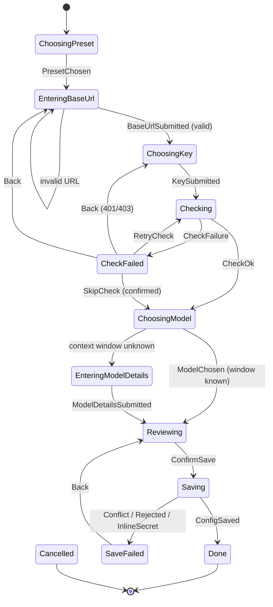
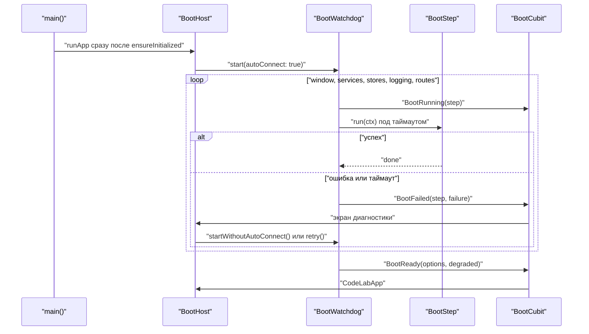

# 12.4. Первый запуск и настройки

> Часть предложения [«Dart-агент и клиенты CodeLab»](../dart-agent-and-clients.md). Status: Accepted. Исходные решения, связанные документы и порядок чтения — в оглавлении.

← [12.3. Десктоп-приложение: отображение](12-3-desktop-display.md) · [Оглавление](../dart-agent-and-clients.md) · [12.5. Headless-формат stream-json](12-5-stream-json.md) →

## 12.4.1. Назначение

Раздел описывает, как клиенты помогают пользователю настроить агента и как app переживает
неудачный запуск. Этапы и инварианты:

| Цель | Что даёт | Этап | Где |
|---|---|---|---|
| D-15 | сторож запуска app: шаги с таймаутами и экран диагностики вместо пустого окна | 5 | app |
| D-05 | страница провайдера, `base_url`, модели и ключа для встроенного агента | 7 (страница и статус ключа); запись через `ConfigWriter` — с §17.5.5 ядра (этап 8), до него страница только читает | app |
| U-17 | мастер первого запуска CLI, если провайдер не готов | 9 | CLI |
| L-24 | мастер пользовательского провайдера: `/provider add` в CLI и тот же мастер в app | 9+ | CLI, app |
| E-13 | страница «MCP servers» в app: добавить, изменить, удалить, переподключить | 9+ | app (+ команды агента `/mcp`) |
| U-19 (Could) | экран настроек CLI `/settings` | 9+ | CLI |
| D-11 (Could) | onboarding app: первые экраны поверх того же мастера | 9+ | app |
| — | единая навигация настроек app: группы Agent и App, порядок страниц, доступ по профилю (§12.4.9) | 7 (с первой страницей настроек) | app |
| D-24 (Could) | страница «Redaction»: слои, белый список, исключения, проверка на примере текста (§12.4.9) | 9+ | app |

Префикс инвариантов — `SETUP-`.

Раздел опирается на решения ядра ([`agent-core-architecture.md`](../agent-core-architecture.md) §15,
§17.5; ниже ссылки на §15 и §17.5 — разделы ядра). Клиенты их только используют:

* **Правки и запись конфига** (§17.5.2, §17.5.5). Чистые типы ядра `ConfigLayer`, `ConfigTarget`,
  `ConfigSnapshot` и семейство `ConfigEdit` (`SetValue`, `UnsetValue`, `UpsertMcpServer`,
  `RemoveMcpServer`, `RemoveTable`) описывают правку. `ConfigWriter` (`codelab_agent_io`) применяет
  её к YAML-документу через `yaml_edit` с сохранением форматирования, порядка ключей и
  комментариев, проверяет итог валидатором ядра и атомарно заменяет файл. Ошибки — исключения
  `ConfigConflictException` (файл изменился после чтения), `ConfigInlineSecretException` и
  `ConfigException(issues)` (в том числе правка, которую редактор не может выполнить:
  `edit the file manually`).
* **Секреты** (§17.5.4). `SecretStore` и его расширение `DescribedSecretStore` с описанием
  бэкенда `SecretBackendInfo` (интерфейсы в ядре, бэкенды — в `codelab_agent_io`) хранят ключи. В
  конфиге — только `api_key_secret: <имя>` или `api_key_env: <VAR>`, в `headers`/`env`
  MCP-серверов — подстановка `${secret:<имя>}`. Имена — по `SecretNames`: `codelab/<id провайдера>`,
  `codelab/mcp/<сервер>/<ключ>`.
* **Живое перечитывание** (§17.5.6, §17.5.7). Агент следит за своим конфигом и применяет изменения
  провайдеров, моделей, MCP-серверов и skills без перезапуска. Изменения приходят клиентам
  стандартными `config_option_update` и `available_commands_update`. Агент отвечает
  фиксированным текстом без модели на команды `/config reload`, `/config check`, `/mcp list`,
  `/mcp reload [<id>]`. Если новый конфиг невалиден, агент продолжает работать на старом, а
  первая строка ответа `/config check` — `Config: invalid`.
* **`SettingsRegistry.all`** (§17.5.8) — список `SettingDescriptor` для общих редакторов настроек.
* **Подкоманды CLI** `config`, `provider`, `mcp`, `secret` (§17.5.5) — общая реализация ядра для
  `codelab` и `codelab-agent`; клиент добавляет к `provider add` мастер (§12.4.4).

Сегодня в коде нет ни мастера, ни страницы настроек, ни сторожа запуска. Есть только диалог
подключения `ConnectionSetupDialog` с полями stdio и WebSocket
(`features/workbench/presentation/widgets/`). Строки UI app — английские литералы, как в
существующих виджетах: слоя локализации в app нет, и его введение — отдельное решение.

Мастер и страницы пишут только схему ядра (§15.4): `providers.<id>` с `kind`,
`agent.default_model`, файл `config.yaml` (YAML). TOML клиенты не пишут никогда. Старый
Старый `codelab.toml` Python-агента не читается и не переводится (решение 2026-10-29, change
`add-agent-configuration`, D14): режима «только чтение», действия «Migrate to config.yaml» и
команды `codelab config migrate` нет (SETUP-15).

## 12.4.2. Контракт

**Где живёт общая логика.** Мастер и модели страниц настроек нужны обоим клиентам. Они не
относятся к ACP и не нужны внешнему агенту. Решение — новый пакет
`packages/dart/codelab_setup` с двумя барелями, по образцу `codelab_embedded`.

**Минимальный состав в этапе 8 (задача 8.5, OQ2 (а) change `add-agent-configuration`).** Пакет
создаётся сразу, но с минимумом: основной барель реэкспортирует только чистые типы ядра
`ConfigIssue` и `ConfigLoadResult`; `io.dart` реэкспортирует `ConfigCommands` из `codelab_agent_io`
(вход для `codelab config check`). Мастер, `AgentConfigStore`, `SettingsAccess`, `FileAgentConfigStore`
и остальное ниже приходят со своими потребителями (задачи 8.10, 9.6), без абстракций «на вырост».
Таблица ниже — полный состав.

| Барель | Содержимое | Можно | Нельзя |
|---|---|---|---|
| `codelab_setup.dart` (чистый Dart) | `ProviderSetupFlow`, пресеты, `ProviderCheck` и `HttpProviderCheck` поверх `http.Client`, `ProviderReadiness`, `McpServerDraft`, `SettingsAccess`, модели представления, порт `AgentConfigStore` и `ConfigSaveOutcome`; реэкспорт чистых типов ядра (§17.5.2): `ConfigLayer`, `ConfigTarget`, `ConfigSnapshot`, `ConfigEdit` и его подклассы, `ConfigIssue`, `ConfigLoadResult`, `SettingsRegistry`, `SettingDescriptor`, `SettingScope`, `SettingType`, `SecretNames`, `SecretStore`, `DescribedSecretStore`, `SecretBackendInfo` | `codelab_agent_core`, `http`, `meta` | `dart:io`, `codelab_agent_io`, Flutter, `package:codelab_acp_*`, `package:codelab_client_*` |
| `io.dart` (десктоп и CLI) | `FileAgentConfigStore` поверх `ConfigWriter` и `ConfigLoader`, `systemSecretStore()` (бэкенд по `secrets.backend`, §17.5.4), пути `$CODELAB_HOME`, вход в общие подкоманды CLI ядра `config`/`provider`/`mcp`/`secret` (§17.5.5) | `codelab_agent_io`, `dart:io` | Flutter, `package:codelab_acp_*`, `package:codelab_client_*` |

Сторож (§9.5) получает новое правило: основной барель `codelab_setup` не импортирует то, что
запрещено `webUnsafe`, а также `package:codelab_agent_io`, `package:codelab_acp_`, `package:codelab_client_` и `package:flutter/`;
presentation app не импортирует `package:codelab_setup/io.dart`. Клиенты по-прежнему не
импортируют `codelab_agent_*` напрямую: нужные типы ядра приходят реэкспортом из
`codelab_setup`, как `ProviderConfig` через `codelab_embedded`. `ConfigWriter`, бэкенды секретов и
исключения писателя (`ConfigConflictException`) видит только
`io.dart`.

Почему не другие места:

* `codelab_client_core` — это модель ACP-клиента, она одинакова для любого агента. Конфиг своего
  агента в ней — чужая ответственность, а зависимость kit от ядра нарушила бы §4.1.
* `codelab_agent_io` — там `dart:io`. Автомат мастера нельзя было бы тестировать как чистый Dart
  и использовать на мобильных платформах. Клиенты не импортируют этот пакет напрямую.
* `codelab_embedded` — он собирает работающего агента и тянет ACP-сервер и MCP. Настройки нужны и
  без запущенного агента (`codelab provider add`), и для локального stdio-агента.

**Порты и доступ к настройкам.**

```dart
// packages/dart/codelab_setup/lib/src/access/settings_access.dart
/// Можно ли этому клиенту писать конфиг агента, к которому он подключён (или подключится).
sealed class SettingsAccess {}
final class EditableSettings extends SettingsAccess {
  final ConfigPaths paths;                 // user, projectLocal, project (только чтение), extra (--config)
}
final class RemoteReadOnly extends SettingsAccess {
  final Uri endpoint;                      // WebSocket-агент: конфиг на чужой машине
}
final class NotManaged extends SettingsAccess {
  final String agentName;                  // сторонний stdio-агент: конфиг не наш
}

/// Входы — простые данные, чтобы не зависеть от ConnectionProfile из kit.
SettingsAccess resolveSettingsAccess({
  required AgentLaunchKind kind,           // embedded | stdio | webSocket
  String? agentName,                       // agentInfo.name из initialize, если уже подключены
  List<String> args = const [], Map<String, String> env = const {},
  Uri? endpoint, required String cwd, required String defaultCodelabHome,
});

// Цель записи — ConfigTarget ядра (§17.5.2). Мастер и страницы пишут только
// ConfigTarget.user() (слой 2) и ConfigTarget.projectLocal(cwd) (слой 4); ConfigTarget.project(cwd)
// (слой 3) — только явная подкоманда `codelab config set --project` (§17.5.5).

// packages/dart/codelab_setup/lib/src/config/agent_config_store.dart
final class AgentConfigSnapshot {
  final String cwd;
  final Map<ConfigLayer, ConfigSnapshot> layers;   // база для apply; project — только для чтения
  final ConfigLoadResult loaded;                   // итог §15.5: config, issues, warnings, sources
  final Map<String, String> origins;               // листовой ключ → источник: путь файла, "env:…", "flags"
  final SecretBackendInfo secrets;                 // DescribedSecretStore.backend (§17.5.4)
}

abstract interface class AgentConfigStore {
  /// Все слои с происхождением ключей; loaded.issues — ошибки валидатора.
  Future<AgentConfigSnapshot> snapshot({required String cwd});
  /// base — ConfigSnapshot нужного слоя из snapshot(); его fingerprint защищает от конфликта.
  Future<ConfigSaveOutcome> apply(ConfigSnapshot base, List<ConfigEdit> edits);
}

/// Результат порта; исключения ConfigWriter.apply (§17.5.2) сюда переводит FileAgentConfigStore.
sealed class ConfigSaveOutcome {}
final class ConfigSaved extends ConfigSaveOutcome {
  final String fingerprint; final List<ConfigIssue> warnings; final List<String> restartRequiredKeys;
}
final class ConfigConflict extends ConfigSaveOutcome { final String path; }      // файл изменился после чтения
final class ConfigRejected extends ConfigSaveOutcome { final List<ConfigIssue> issues; }
final class ConfigInlineSecret extends ConfigSaveOutcome { final String key; final String suggestedSecretName; }

/// Значение секрета в памяти клиента. toString и JSON — всегда «***».
final class SecretValue {
  SecretValue(this._value);
  final String _value;
  String reveal() => _value;
  @override String toString() => '***';
}
```

`FileAgentConfigStore.apply` вызывает `ConfigWriter.apply(base, edits)` и переводит результат и
каждое исключение ядра в `ConfigSaveOutcome`; другие исключения не перехватываются (ошибка
программиста). Порядок проверки — сверху вниз: `ConfigInlineSecretException` — подкласс
`ConfigException`.

| `ConfigWriter.apply` (§17.5.2) | `ConfigSaveOutcome` | Что видит пользователь |
|---|---|---|
| `ConfigWriteResult` | `ConfigSaved(fingerprint, warnings, restartRequiredKeys)` | баннер `saved`; ключи `restartRequired` — пометка `(applies after restart)` |
| `ConfigConflictException(path)` | `ConfigConflict(path)` | баннер конфликта, черновик сохранён (SETUP-6) |
| `ConfigInlineSecretException(key, suggestedSecretName)` | `ConfigInlineSecret(key, suggestedSecretName)` | подсказка сохранить значение как секрет `suggestedSecretName` |
| `ConfigException(issues)` | `ConfigRejected(issues)` | баннер `rejected` со списком проблем |

**Мастер провайдера.** Один автомат на оба клиента. Побочные эффекты — только через порты:
проверка (`ProviderCheck`) и запись (`ProviderSetupCommitter`).

```dart
// packages/dart/codelab_setup/lib/src/provider/provider_setup_flow.dart
// После MVP ProviderPreset — реэкспорт ядра (agent-core-architecture §17.10.2): добавлены поля
// auth, oauth, quirks, reasoningFormat, wizard; ProviderPresets.all — таблица ядра.
final class ProviderPreset {
  final String id;                         // openai | anthropic | openrouter | ollama | custom-openai | custom-anthropic
  final String label;
  final String kind;                       // значение providers.<id>.kind из SettingsRegistry: "openai-compatible" | "anthropic" | "gemini"
  final String? baseUrl;                   // null — пользователь вводит сам
  final KeyRequirement key;                // required | optional | none
  final String? suggestedEnvVar;           // OPENAI_API_KEY, ANTHROPIC_API_KEY, OPENROUTER_API_KEY
}

sealed class KeyChoice {}
final class StoreSecret extends KeyChoice { final SecretValue value; }       // → SecretStore "codelab/<id>"; только при backend.writable
final class KeepStoredSecret extends KeyChoice {}                            // правка: ключ не менять
final class UseEnvVar extends KeyChoice { final String name; }
final class NoKey extends KeyChoice {}
final class SignIn extends KeyChoice {}   // OAuthLoginService.login; только при preset.oauth != null

sealed class ProviderSetupState {}
final class ChoosingPreset extends ProviderSetupState { final List<ProviderPreset> presets; }
final class EnteringBaseUrl extends ProviderSetupState { final ProviderDraft draft; final String? error; }
final class ChoosingKey extends ProviderSetupState { final ProviderDraft draft; final String? error; }
final class Checking extends ProviderSetupState { final ProviderDraft draft; final Uri probeUrl; }
final class CheckFailed extends ProviderSetupState { final ProviderDraft draft; final ProviderCheckFailure failure; }
final class ChoosingModel extends ProviderSetupState {
  final ProviderDraft draft; final List<RemoteModel> models;   // пусто → только ручной ввод
  final bool checked;                      // false — пользователь явно пропустил проверку
}
final class EnteringModelDetails extends ProviderSetupState { final ProviderDraft draft; final String modelId; }
final class Reviewing extends ProviderSetupState { final ProviderSetupPlan plan; final List<String> warnings; }
final class Saving extends ProviderSetupState { final ProviderSetupPlan plan; }
final class SaveFailed extends ProviderSetupState { final ProviderSetupPlan plan; final ConfigSaveOutcome outcome; }
final class Done extends ProviderSetupState { final ProviderSetupPlan plan; }
final class Cancelled extends ProviderSetupState {}

sealed class ProviderSetupEvent {}
// PresetChosen(presetId) · BaseUrlSubmitted(text) · KeySubmitted(KeyChoice) · RetryCheck · SkipCheck
// ModelChosen(id) · ModelEnteredManually(id) · ModelDetailsSubmitted(contextWindow, maxOutputTokens?)
// ReviewEdited(providerId?, makeDefault?, target?) · ConfirmSave · Back · Cancel

final class ProviderSetupFlow {
  ProviderSetupFlow({
    required ProviderCheck check,
    required ProviderSetupCommitter committer,
    required AgentConfigSnapshot snapshot,        // занятые id, текущий default_model, существующие ключи
    List<ProviderPreset> presets = ProviderPresets.all,
    ProviderEntryView? editing,                   // правка существующего: id зафиксирован, старт с EnteringBaseUrl
    Duration checkTimeout = const Duration(seconds: 10),
  });
  ProviderSetupState get current;
  Stream<ProviderSetupState> get states;
  void dispatch(ProviderSetupEvent event);        // событие не к месту текущего состояния → игнор + лог
  Future<void> dispose();                         // сбрасывает SecretValue из черновика
}

final class ProviderSetupPlan {
  final String providerId; final String kind; final String? baseUrl;
  final KeyChoice key; final String? secretName;  // SecretNames.suggestFor("providers.<id>.api_key") = "codelab/<id>"
  final ModelEntry model;                          // id, contextWindow, maxOutputTokens?, name?
  final bool makeDefault; final ConfigTarget target;   // ConfigTarget.user() | ConfigTarget.projectLocal(cwd)
  List<ConfigEdit> toEdits();                      // список SetValue/UnsetValue, §12.4.4 шаг 7
}

// .../provider/provider_check.dart
abstract interface class ProviderCheck {
  Future<ProviderCheckResult> listModels(String kind, Uri baseUrl, SecretValue? key, {required Duration timeout});
}
sealed class ProviderCheckResult {}
final class CheckOk extends ProviderCheckResult { final List<RemoteModel> models; }   // RemoteModel(id, contextWindow?)
final class CheckFailure extends ProviderCheckResult { final ProviderCheckFailure failure; }
enum ProviderCheckFailureKind { unauthorized, notFound, unreachable, timeout, tlsError, badResponse }

/// Порядок записи и откат — один на оба клиента.
final class ProviderSetupCommitter {
  ProviderSetupCommitter({required AgentConfigStore config, required DescribedSecretStore secrets});
  Future<ConfigSaveOutcome> commit(ProviderSetupPlan plan, ConfigSnapshot base);   // base — слой plan.target
}

// .../provider/provider_readiness.dart — для мастера первого запуска
sealed class ProviderReadiness {}
final class ProviderReady extends ProviderReadiness { final String model; }
final class NoProviderConfigured extends ProviderReadiness {}              // нет default_model / провайдеров
final class ProviderKeyMissing extends ProviderReadiness {
  final String providerId; final String reference;                          // "secret codelab/openai" | "env OPENAI_API_KEY"
  final SecretBackendInfo backend;                                           // куда предлагать сохранить ключ
}
final class ConfigBroken extends ProviderReadiness { final List<ConfigIssue> issues; }
/// Наличие секрета — по names() и переопределению SecretNames.envOverride; значение не читается.
Future<ProviderReadiness> checkProviderReadiness(AgentConfigSnapshot snapshot, DescribedSecretStore secrets, Map<String, String> env);
```

**Модели представления настроек** (чистый Dart, общие для app и CLI):

```dart
// packages/dart/codelab_setup/lib/src/views/
final class ProviderEntryView {
  final String id; final String kind; final String? baseUrl;
  final KeyStatusView key;                 // inSecretStore(name, backendId) | secretMissing(name, backendId) | env(name, isSet) | none
  final List<String> models;               // "<id>/<model>"
  final ConfigSourceView source;           // файл и слой, где определён провайдер
  final bool editable;                     // false для слоя 3, --config и переменных окружения
}
final class McpServerEntryView {
  final String name; final McpServerType type;                // stdio | http
  final String target;                     // "npx -y …" или URL без секретов
  final bool enabled; final List<String> secretRefs;          // имена из ${secret:<name>} в env/headers
  final ConfigSourceView source; final bool editable;
}
final class McpServerDraft {               // форма добавления и правки; validate() → List<ConfigIssue>
  final String name; final McpServerType type;
  final String? command; final List<String> args; final String? url;
  final List<McpValueDraft> env; final List<McpValueDraft> headers;   // plain(value) | secret(SecretValue | keep)
  final bool enabled; final ConfigTarget target;
  /// [UpsertMcpServer(map)]; значение secret(…) пишется как "${secret:<SecretNames.forMcp(name, key)>}".
  List<ConfigEdit> toEdits();
  Map<String, SecretValue> secretsToWrite();   // "codelab/mcp/<name>/<key>" (нижний регистр, SecretNames.forMcp)
}
final class SettingFieldView {             // строка общего редактора, из SettingDescriptor scope: shared
  final SettingDescriptor descriptor;
  final Object? effectiveValue; final ConfigSourceView? source;   // null source → значение по умолчанию
}
```

Ссылки на секреты MCP — подстановка ядра `${secret:<name>}` в значениях `env` и `headers`
(§15.5, §17.5.4); новых ключей схемы клиенты не вводят. Значение, помеченное «Secret», целиком
заменяется ссылкой (`Authorization: "${secret:codelab/mcp/github/authorization}"`); если
пользователь вписал ссылку сам (`"Bearer ${secret:…}"`), черновик сохраняет её как обычный текст.

**Состояния Cubit-ов app.** Feature `apps/codelab_desktop/lib/features/settings/`:
`application/` содержит Cubit-ы, `infrastructure/settings_module.dart` связывает
`FileAgentConfigStore`, `systemSecretStore()` и `HttpProviderCheck(IOClient())` из
`codelab_setup/io.dart`, `presentation/` содержит страницы. Presentation не видит ни файлов, ни
связки ключей.

```dart
// apps/codelab_desktop/lib/features/settings/application/provider_settings_cubit.dart
sealed class ProviderSettingsState {}
final class ProviderSettingsLoading extends ProviderSettingsState {}
final class ProviderSettingsReadOnly extends ProviderSettingsState {
  final SettingsAccess access;             // RemoteReadOnly | NotManaged
  final String? activeModel;               // из configOptions активной сессии, если есть
}
final class ProviderSettingsReady extends ProviderSettingsState {
  final List<ProviderEntryView> providers;
  final String? defaultModel;
  final ConfigTarget target;
  final SecretBackendInfo secretBackend;   // строка «Key storage» страницы
  final SettingsBanner? banner;            // saved | conflict(path) | rejected(issues) | inlineSecret(key, name)
                                           // | storeUnavailable(reason)
  final Map<String, ProviderCheckView> lastChecks;           // id → ok(n моделей) | failed(kind)
}

// .../application/provider_wizard_cubit.dart — тонкая обёртка: state = ProviderSetupState
// .../application/mcp_settings_cubit.dart
sealed class McpSettingsState {}
final class McpSettingsLoading extends McpSettingsState {}
final class McpSettingsReadOnly extends McpSettingsState { final SettingsAccess access; final McpAgentStatus status; }
final class McpSettingsReady extends McpSettingsState {
  final List<McpServerEntryView> servers;
  final McpServerDraft? editing;           // открыт редактор
  final McpAgentStatus status;
  final SettingsBanner? banner;
}
sealed class McpAgentStatus {}             // unavailable(reason) | loading | reply(text, at) | failed(message)
                                           // | live(List<McpServerStatus>) — только встроенный агент, §12.4.6
```

**Сторож запуска** (`apps/codelab_desktop/lib/app/boot/`; чистый Dart без Flutter, кроме
`boot_host.dart`):

```dart
enum BootStepId { window, services, stores, logging, routes }
enum BootCriticality { critical, degradable }

final class BootStep {
  final BootStepId id;
  final Duration timeout;
  final BootCriticality criticality;
  final Future<void> Function(BootContext ctx) run;
  final Future<void> Function(BootContext ctx)? fallback;   // только для degradable
}

final class BootOptions { final bool autoConnect; }           // false после «Start without auto-connect»

sealed class BootState {}
final class BootRunning extends BootState {
  final BootStepId step; final List<BootStepId> done; final bool slow;   // slow: прошло > 50 % таймаута
}
final class BootFailed extends BootState {
  final BootStepId step;
  final BootFailure failure;               // timedOut(after) | error(message, stackTrace)
  final bool canStartWithoutAutoConnect;   // false для critical шагов
  final List<BootLogEntry> log;            // события запуска, без секретов
}
final class BootReady extends BootState { final BootOptions options; final List<BootDegradation> degraded; }

final class BootWatchdog {
  BootWatchdog({required List<BootStep> steps, required Clock clock, required BootLog log});
  Stream<BootState> get states;
  Future<void> start(BootOptions options);
  Future<void> retry();                    // снова с упавшего шага, новое поколение попытки
  Future<void> startWithoutAutoConnect();  // fallback упавшего шага, затем остальные с autoConnect: false
}
```

## 12.4.3. Алгоритм: первый запуск CLI (U-17)

Срабатывает, когда `codelab` запускается с профилем `embedded` (по умолчанию, §9.11) и в
`embedded`-профиле нет готового провайдера.

1. До запуска агента `composition_root.dart` читает `AgentConfigStore.snapshot(cwd)` и вызывает
   `checkProviderReadiness`. `ProviderReady` → обычный старт.
2. `ConfigBroken` → мастер не запускается. В stderr печатаются ошибки с путём ключа (как
   `codelab config check`), выход с кодом `64` (agent-core-architecture §13.10, §9.11). Мастер НЕ ДОЛЖЕН переписывать сломанный файл.
3. Нет TTY на stdin или stdout (`-p`, pipe, CI) → мастер не запускается. В stderr:
   `No model provider is configured. Run "codelab provider add" or set OPENAI_API_KEY / ANTHROPIC_API_KEY.`,
   выход с кодом `1`, как при неудачном подключении (§9.11).
4. `ProviderKeyMissing` (провайдер есть, ключа нет). Если `backend.writable`, CLI предлагает
   `Store a key for "<id>" in <backend.id>? [Y/n]`. «Да» → шаг ключа мастера в режиме правки
   этого провайдера (`editing`, старт с `ChoosingKey`); «нет» → печать подсказки и выход `1`.
   Бэкенд `env` (только чтение, ОС-хранилище недоступно) → вопроса нет: CLI печатает
   `No writable secret store (<backend.unavailableReason>). Set <SecretNames.envOverride(name)> or the provider's api_key_env variable.`
   и выходит с кодом `1`.
5. `NoProviderConfigured` → полный мастер `ProviderSetupFlow` (§12.4.4) с целью
   `ConfigTarget.user()` и `makeDefault: true`.
6. `Done` → CLI продолжает старт обычным путём. Встроенный агент читает уже записанный конфиг,
   поэтому живое перечитывание здесь не нужно. `Cancelled` или Ctrl+C → выход `130`, конфиг не
   изменён.
7. Мастер не запускается для `--agent stdio:…`, id профиля и `ws://`. У внешнего агента своя
   конфигурация, а его ошибку «нет ключа» клиент показывает как обычную ошибку хода.

## 12.4.4. Алгоритм: мастер провайдера (общий для CLI и app, L-24)



`Cancel` допустим из любого состояния, кроме `Saving` и `Done`. `Back` возвращает на предыдущий
шаг и сохраняет черновик.

1. **Тип API.** `ChoosingPreset` показывает пресеты из `ProviderPresets.all`: OpenAI, Anthropic,
   OpenRouter, Ollama (локальный, без ключа), «Custom OpenAI-compatible», «Custom
   Anthropic-compatible». Виды берутся из `enumValues` дескриптора
   `providers.*.kind` реестра ядра (`SettingsRegistry.lookup`). Пресеты — `ProviderPresets.all`
   ядра с `wizard: true`: OpenAI, Anthropic, Gemini, OpenRouter, Ollama, Kimi, MiniMax, Z.AI, Custom
   OpenAI-compatible, Custom Anthropic-compatible (после MVP, agent-core-architecture §17.10.2).
2. **Адрес.** `EnteringBaseUrl` подставляет `baseUrl` пресета. Допустимы только `http` и `https`.
   `http` разрешён только для `localhost`, `127.0.0.0/8` и `::1`; для других хостов нужно
   подтверждение («key will be sent unencrypted»). Завершающий `/` убирается. У Anthropic-вида
   адрес без `/v1`, у OpenAI-совместимого — с `/v1` (§15.4). Если пользователь ввёл адрес
   OpenAI-совместимого вида без `/v1` и проверка дала `notFound`, мастер предлагает вариант с
   `/v1`.
3. **Ключ.** `ChoosingKey` предлагает три варианта: ключ в хранилище секретов (`StoreSecret`, имя
   `codelab/<id>`; подпись называет `backend.id`, например `keychain-macos`), переменную окружения
   (`UseEnvVar`, подсказка — `suggestedEnvVar`) или «без ключа» (`NoKey`; по умолчанию для
   `KeyRequirement.none`). При `backend.writable == false` варианта `StoreSecret` нет, а шаг
   показывает `backend.unavailableReason`. При правке добавляется `KeepStoredSecret`. После MVP для
   пресетов с `oauth` — вариант «Sign in» (`SignIn`): результат пишет `OAuthLoginService`
   (agent-core-architecture §17.10.6), проверка шага 4 идёт с полученным ключом. Введённый ключ живёт только в `SecretValue` черновика. При `UseEnvVar`
   проверка берёт значение переменной из окружения процесса клиента, если оно там есть.
4. **Проверка до сохранения.** `Checking` вызывает `ProviderCheck.listModels` с таймаутом 10 с:
   * OpenAI-совместимый вид: `GET <base_url>/models`, заголовок `Authorization: Bearer <key>`
     (или `auth_header`);
   * Anthropic: `GET <base_url>/v1/models`, заголовки `x-api-key` и `anthropic-version`.

   Результат:
   * `200` с JSON `data[].id` → `CheckOk`. Окно контекста берётся из `context_length`,
     `context_window` или `max_context_length`, если поле есть.
   * `401`/`403` → `unauthorized`;
   * `404` → `notFound`. Сервер не умеет список моделей, но адрес жив: разрешён ручной ввод
     модели без «пропуска проверки»;
   * ошибка соединения, TLS или таймаут → `unreachable`, `tlsError` или `timeout`.

   Тело ответа об ошибке в сообщение не попадает: только код статуса и вид отказа.
5. **Отказ проверки.** `CheckFailed` предлагает «Retry», «Back», а для `unreachable`/`timeout`
   ещё «Save without check» (`SkipCheck`). `SkipCheck` требует подтверждения и добавляет в
   `Reviewing` предупреждение `Not verified: <kind>`. Молча сохранить после отказа нельзя.
6. **Модель.** `ChoosingModel` показывает список с фильтром по подстроке (в CLI — нечёткий поиск,
   как у команд) и строку «Enter model id manually». Если окно неизвестно,
   `EnteringModelDetails` спрашивает `context_window`: он нужен, если окно не известно ни из одного
   источника agent-core-architecture §2.12.2. Подсказка — значение из каталога известных моделей
   ядра, если оно есть, иначе безопасное значение по умолчанию `32000` (там же).
7. **Проверка плана.** `Reviewing` собирает `ProviderSetupPlan`:
   * id: для пресета — id пресета, для custom — имя хоста (`localhost:1234` → `local-1234`).
     Имя приводится к `[a-z0-9_-]+`. При совпадении с занятым id добавляется суффикс `-2`, `-3`.
     При правке id не меняется.
   * `makeDefault` — `true`, если `agent.default_model` нет; иначе выбор пользователя (по
     умолчанию `false`).
   * `target` — `ConfigTarget.user()`; в app доступен переключатель «This project only» →
     `ConfigTarget.projectLocal(cwd)`.

   `toEdits()` — список листовых правок ядра (§17.5.2) в одном `apply`; сегмент `<m>` с `.` или `/`
   пишется в кавычках (§17.5.5):
   * `SetValue("providers.<id>.kind", kind)`, при наличии `SetValue("providers.<id>.base_url", …)`;
   * ключ: `StoreSecret` → `SetValue("providers.<id>.api_key_secret", "codelab/<id>")`, `UseEnvVar` →
     `SetValue("providers.<id>.api_key_env", name)`; второй из пары при правке —
     `UnsetValue` (ключи взаимоисключающие, §15.4); `NoKey` → `UnsetValue` обоих, если они были;
     `KeepStoredSecret` → правок ключа нет;
   * `SetValue("providers.<id>.models.<m>.context_window", n)` и при наличии `max_output_tokens`,
     `name`;
   * при `makeDefault` — `SetValue("agent.default_model", "<id>/<m>")`.
8. **Запись** — `ProviderSetupCommitter.commit`:
   1. Для `StoreSecret` проверить, есть ли уже секрет с таким именем (`names()`), и записать
      значение `SecretStore.write`.
   2. `AgentConfigStore.apply(base, plan.toEdits())`, где `base` — `ConfigSnapshot` слоя
      `plan.target`.
   3. Если запись не удалась (любой исход, кроме `ConfigSaved`) и секрет создан на шаге 1
      впервые → `SecretStore.delete`. Ранее существовавший секрет не трогается.
   4. Если `SecretStore.write` бросил исключение (`SecretStoreUnavailableException`: хранилище
      недоступно, не ответило за 10 с или пользователь отказал в доступе), конфиг не пишется.
      Мастер возвращается в `ChoosingKey` с предложением `UseEnvVar`.

   Сначала секрет, потом конфиг. В обратном порядке получился бы конфиг со ссылкой на
   несуществующий секрет, а это ошибка при первом ходе.
9. **После записи.** Для встроенного и локального stdio-агента ничего делать не нужно: агент
   перечитает конфиг и пришлёт `config_option_update` с новым списком `model` (§17.5 ядра). CLI
   печатает `Saved provider "<id>". Models are available in /model.`, app показывает баннер
   `saved`. Если агент не подключён, новый провайдер подхватится при следующем запуске.
10. **Конфликт.** `ConfigConflict` → `SaveFailed`. CLI печатает
    `Config file changed on disk since it was read: <path>. Run the command again.` и выходит с
    кодом `1`. App перечитывает снимок и возвращает пользователя в `Reviewing` с тем же планом и
    баннером «Config changed on disk — review and save again». Автоматического повтора нет.

Точки входа мастера:

* CLI: `codelab provider add` (без REPL) и `/provider add` в REPL. Шаги — вопросы в терминале
  через `line_editor.dart`. Ключ вводится без эха.
* App: диалог `ProviderWizardDialog` на странице провайдеров.

Флаги — те же, что у подкоманды ядра (§17.5.5: `<id> --kind --base-url --model --context-window
--api-key-secret | --api-key-env | --api-key-stdin --default`), плюс клиентские `--preset <id>`
(подставляет `kind` и `base_url`), `--skip-check` и `--yes`. Например,
`codelab provider add openai --preset openai --model gpt-4.1 --api-key-env OPENAI_API_KEY --yes`
проходит тот же автомат без вопросов, событиями подряд; `--context-window` не нужен, если окно
известно из ответа `/models` или каталога ядра. Проверку в этом режиме можно пропустить только
явным `--skip-check`. Набор правок совпадает с подкомандой ядра.

## 12.4.5. Алгоритм: страница провайдеров app (D-05)

Страница «Providers» открывается из настроек (Cmd/Ctrl+, и пункт меню). В DI она получает
`SettingsAccess` текущего профиля, вычисленный по `EmbeddedProfile`, `StdioProfile` (с
`agentInfo.name`) или `WebSocketProfile`.

1. `EditableSettings` → `ProviderSettingsCubit.load()` читает `snapshot(cwd)`. Строки
   провайдеров строятся по эффективному конфигу с указанием источника. Провайдеры из слоя 3,
   из файла `--config` и из переменных окружения показываются с пометкой «defined in <file>» и
   не редактируются.
2. Статус ключа (`KeyStatusView`) вычисляется через `SecretStore.names()`, переопределение
   `CODELAB_SECRET_<…>` (`SecretNames.envOverride`) и наличие переменной `api_key_env`. Значение
   ключа не читается. Строка показывает `Key: in keychain-macos` (id бэкенда из
   `SecretBackendInfo`), `Key: missing in keychain-macos`, `Key: env OPENAI_API_KEY (set)` или
   `No key`. Над списком — строка `Key storage: <backend.id>`; при `unavailableReason` — баннер
   `storeUnavailable` с причиной (например, «Secret Service is not available: DBUS_SESSION_BUS_ADDRESS
   is not set»), а «Add provider» предлагает только переменную окружения.
3. Выбор модели по умолчанию — выпадающий список всех моделей каталога. Изменение пишет
   `SetValue("agent.default_model", …)` в слой, где ключ определён сейчас (если этот слой
   редактируемый), иначе в `ConfigTarget.user()`.
4. «Add provider» → мастер. «Edit» → мастер с `editing`: id зафиксирован, старт с
   `EnteringBaseUrl`, ключ по умолчанию `KeepStoredSecret`.
5. «Check» строки выполняется в infrastructure-адаптере: ключ читается из `SecretStore` и сразу
   передаётся в `ProviderCheck`. В состоянии Cubit остаётся только `ProviderCheckView`
   (`ok, 12 models` или вид отказа).
6. «Remove» показывает подтверждение с флажком «Also delete the stored key». Флажок включён,
   если `api_key_secret == "codelab/<id>"` и другие провайдеры этот секрет не используют. Правки
   одним `apply`: `RemoveTable("providers.<id>")` (таблица провайдера вместе с
   `providers.<id>.models.*`, §17.5.5), а если `agent.default_model` указывал на этого
   провайдера — `SetValue("agent.default_model", …)` с моделью, которую диалог требует выбрать
   из оставшихся («New default model»): ключ обязателен в схеме §15.4. Последнего провайдера
   страница не удаляет: «Remove» неактивна с подсказкой
   `The agent needs at least one provider. Add another provider first.`. Ссылки из
   `agent.fallback` или `llm.roles.*` дают `ConfigRejected` с подсказкой сменить модель. Секрет
   удаляется только после `ConfigSaved`.
7. Страница подписана на `WorkspaceState`. После `config_option_update` строка «Active in this
   session» показывает текущую модель активной сессии. Отдельный запрос не нужен.

## 12.4.6. Алгоритм: страница MCP-серверов (E-13)

1. **Список** берётся из конфига (`snapshot`): имя, тип, цель (команда или URL без значений
   секретов), `enabled`, источник. Конфиг — источник истины о составе серверов. Агент здесь не
   опрашивается.
2. **Состояние** серверов (подключён, число инструментов, последняя ошибка) берётся у агента
   активной сессии (§17.5.7):
   * **встроенный агент** — `McpSupervisor` сессии напрямую: `snapshot()` и поток `changes`
     (типы `McpSupervisor` и `McpServerStatus` реэкспортирует `codelab_embedded`) →
     `McpAgentStatus.live`; таблица страницы строится из `McpServerStatus` (`state`, `toolCount`,
     `lastError`, `retryIn`), без разбора текста;
   * **локальный stdio-агент и удалённый агент** — команда `/mcp list` через
     `SessionHandle.runCommand` активной сессии. Ответ — фиксированный текст ядра. Страница
     показывает его как есть в панели «Agent status» моноширинным блоком и не разбирает.
     Расширения ACP для структурированного статуса нет: текста достаточно человеку, а формат
     принадлежит агенту. Команда и ответ видны в ленте сессии как обычный ход.

   Без активной сессии или если агент не объявил `/mcp` в `available_commands_update` →
   `McpAgentStatus.unavailable` с подсказкой «Open a session to see live status».
3. **Добавление и правка.** Редактор `McpServerDraft` содержит поля:
   * имя `[A-Za-z0-9_-]+`, уникальное в эффективном конфиге;
   * тип;
   * для `stdio` — `command`, `args`, `env`;
   * для `http` — `url` (`http`/`https`), `headers`;
   * флажок `enabled`;
   * цель записи: `ConfigTarget.user()` или «This project only» (`ConfigTarget.projectLocal(cwd)`,
     допустим по §15.3).

   Значение `env` или заголовка можно пометить «Secret». Тогда оно уходит в `SecretStore` под
   именем `SecretNames.forMcp(name, key)` = `codelab/mcp/<name>/<key>` (нижний регистр), а в
   конфиг вместо значения пишется подстановка ядра `${secret:codelab/mcp/<name>/<key>}` (§15.5,
   §17.5.4). `${VAR}` в значении остаётся как есть: это тоже подстановка ядра. Литеральное
   значение, похожее на ключ, писатель отклоняет (`ConfigInlineSecret`), и редактор предлагает
   пометить его «Secret». `validate()` выполняется до записи; запись — одна правка
   `UpsertMcpServer(map)`. Сохранение идёт тем же порядком «секрет → конфиг → откат секрета», что
   в §12.4.4, шаг 8.
4. **Удаление.** Правка `RemoveMcpServer(name)`. Затем, после `ConfigSaved`, удаляются секреты с
   префиксом `codelab/mcp/<name>/`. Сервер из слоя 3 удалить нельзя; можно выключить его в
   `ConfigTarget.projectLocal(cwd)` правкой `UpsertMcpServer({"name": name, "enabled": false})`
   (слияние по `name`, §15.2).
5. **Применение.** После `ConfigSaved` агент перечитывает конфиг сам и присылает
   `available_commands_update` (MCP prompts как команды). Кнопка «Reconnect» строки — для
   встроенного агента `McpSupervisor.reconnect(name)`, для остальных `/mcp reload <name>`;
   «Reload all» — `/mcp reload`. После ответа страница повторяет `/mcp list` (встроенному агенту
   повтор не нужен: состояние приходит из `changes`).
6. **Невалидный результат.** Если агент отклонил новый конфиг (файл записан, но перечитывание
   не прошло — например, переменная `${GITHUB_TOKEN}` не задана в окружении агента: писатель
   считает это предупреждением, загрузчик агента — ошибкой), агент работает на старом конфиге.
   Страница после сохранения выполняет `/config check` и показывает ответ в баннере `rejected`,
   если первая строка ответа — `Config: invalid` (формат — §17.5.6; остальной текст выводится
   как есть). Предупреждения `ConfigSaved.warnings` показываются в баннере `saved` до этой
   проверки.

## 12.4.7. Алгоритм: сторож запуска (D-15)

Запуск сегодня (`lib/main.dart`, `lib/app/app_scope.dart`):

1. `WidgetsFlutterBinding.ensureInitialized()`.
2. `await getApplicationSupportDirectory()` — до `runApp`. Если платформенный канал завис,
   пользователь видит пустое окно.
3. `runApp(CodeLabBootstrap)`.
4. На первом `build` синхронно выполняется `createCodeLabRootScope`: модули логирования (файловые
   приёмники), транспортов, платформы, presentation, затем `AcpClientApplication`,
   `CodeLabShellCubit` и `CodeLabRootLifecycle`. Исключение здесь даёт серый экран релизной
   сборки.
5. Конструктор `CodeLabShellCubit` запускает `_loadRecentProjects()` (`shared_preferences`) без
   ожидания.
6. `FluentApp(home: CodeLabShell)`.

Автоподключения сейчас нет. Оно появляется вместе с `ProfileStore` kit и восстановлением после
перезапуска (последний профиль, проект и сессии из снимка `codelab.workspace.snapshot` —
«Алгоритм восстановления после перезапуска app» §9.10, задача 5.12, D-03) и встроенным профилем по
умолчанию — именно его зависание описывает D-15.

Новый порядок. `main` вызывает `runApp(BootHost(...))` сразу после `ensureInitialized`. Всё
остальное — шаги сторожа:

| Шаг | Что делает | Таймаут | Критичность | Fallback |
|---|---|---|---|---|
| `window` | первый кадр `BootHost` (`endOfFrame`), `getApplicationSupportDirectory()` | 10 с | critical | — |
| `services` | `createCodeLabRootScope` без файлового логирования: транспорты, платформа, `ClientWorkspace`, Cubit-ы | 10 с | critical | — |
| `stores` | `ProfileStore` (`~/.codelab/profiles.json`), недавние проекты (`shared_preferences`), `SettingsAccess` и снимок конфига для профиля по умолчанию, проверка доступности `SecretStore` (`names()`) | 5 с | degradable | профили и проекты в памяти, настройки только для чтения с баннером `storeUnavailable` |
| `logging` | `configureCodeLabLogging`: файловые приёмники в `<support>/logs`, перенос событий `BootLog` в лог | 5 с | degradable | консоль и `LogBuffer` без файлов, баннер «File logging is off» |
| `routes` | начальный экран: последний проект и профиль из снимка; при `autoConnect` — `WorkspaceRestorer` (§9.10, задача 5.12): `ClientWorkspace.connect` до ответа `initialize` (под таймаутом шага); `session/list` и `session/load` активной сессии продолжаются после `BootReady` | 20 с | degradable | экран workbench без подключения; снимок не удаляется |



1. `BootWatchdog.start` проходит шаги по порядку. Каждый шаг запускается через
   `Future.any([step.run(ctx), clock.timeout(step.timeout)])`. После половины таймаута состояние
   получает `slow: true`, и заставка показывает `Starting: <step>…`.
2. Ошибки внутри шага (`FlutterError.onError` и `PlatformDispatcher.instance.onError`,
   перехваченные на время запуска) превращаются в `BootFailure.error` текущего шага.
3. Поздний результат шага после таймаута отбрасывается: у каждой попытки своё поколение. Он
   только пишется в лог `app.boot.step.late`. Для `routes` при таймауте сторож вызывает
   `ClientWorkspace.disconnect()`, чтобы прервать подключение. Встроенный агент при этом
   освобождается через `EmbeddedAgent.dispose`.
4. `BootFailed` показывает экран диагностики (`boot-diagnostics`): имя шага, вид отказа
   (`Timed out after 5s` или текст ошибки после `describeFailure` с редакцией секретов), журнал
   `BootLog` и кнопки:
   * «Start without auto-connect» (`boot-start-without-autoconnect`) — только для degradable
     шагов. Выполняет `fallback` упавшего шага, затем остальные шаги с `autoConnect: false`.
   * «Retry» (`boot-retry`) — снова с упавшего шага.
   * «Copy diagnostics» — текст экрана в буфер обмена.
   * «Quit».
5. Для critical шагов кнопки «Start without auto-connect» нет: без окна или без графа
   зависимостей app не работает. Retry и Copy остаются.
6. `BootReady.degraded` — список применённых fallback. Workbench показывает каждый баннером
   (DSK-17 не нарушается: баннер — новая строка над основной областью). Выбор «без
   автоподключения» действует до конца запуска. Следующий запуск снова пытается подключиться.
7. До шага `logging` события запуска (`app.boot.step.started|completed|failed|timed_out` с
   `step` и `durationMs`) пишутся в кольцевой `BootLog` в памяти. Шаг `logging` переносит их в
   структурный лог.
8. Шаги не выполняют UI-работу, кроме `window`. `BootWatchdog` и шаги, кроме `window`, — чистый
   Dart без `BuildContext` и тестируются на фиктивных часах.

## 12.4.8. Алгоритм: удалённый агент — только чтение

1. `resolveSettingsAccess` возвращает `RemoteReadOnly` для `WebSocketProfile` (`ws://`, `wss://`).
   Возвращает `NotManaged` для `StdioProfile`, если агент назвался в `initialize` не
   `codelab-agent`, или если до подключения команда не распознана как `codelab-agent`.
2. Страницы app в этих состояниях не показывают кнопок записи и не читают локальный конфиг:
   локальный `~/.codelab/config.yaml` не относится к удалённому агенту, и показывать его было бы
   ложью. Видно:
   * модели и режимы из `configOptions` активной сессии;
   * панель «Agent status» MCP (`/mcp list`, если агент объявил команду);
   * подсказка «Settings of a remote agent are changed on the machine where it runs:
     `codelab provider add`, `codelab mcp add`, `codelab config set`».
3. CLI в REPL с таким профилем отвечает на `/provider add` и `/settings` строкой
   `Provider settings are read-only for a remote agent. Run "codelab provider add" on the agent host.`
   (для `NotManaged` — `… are managed by <agentName>.`). Конфиг не пишется.
4. `/model`, `/mode` и `/config <id> <значение>` (опции сессии по ACP) работают для любого агента:
   это не правка конфига.

**Команды CLI** (без запуска агента). Подкоманды `codelab config get|set|unset|path|check`,
`codelab provider add|list|remove`, `codelab mcp add|list|remove` и
`codelab secret set|delete|list` — общая реализация ядра (§17.5.5, §17.5.4): флаги, слои
(`--project` — слой 3, `--local` — слой 4, по умолчанию `user`), тексты и коды выхода
(0 — успех, 1 — ошибка валидации или конфликт, 64 — ошибка использования) задаёт ядро, а
`apps/codelab_cli` вызывает её через `codelab_setup/io.dart`. Клиент добавляет только:

| Команда | Дополнение клиента |
|---|---|
| `codelab provider add` | без обязательных флагов на TTY — мастер §12.4.4; с флагами — проверка `/models` до записи, `--preset`, `--skip-check`, `--yes` |
| `codelab config check` | после проблем валидатора — план сборки встроенного агента (§9.12, задача 7.6) |

`codelab provider list` и `codelab secret list` уже по ядру начинаются с бэкенда секретов
(`DescribedSecretStore.backend`); так CLI показывает, доступна ли связка ключей.

Литеральный секрет в `codelab mcp add --header K=V`/`--env K=V` писатель отклоняет с подсказкой
сохранить его командой `codelab secret set codelab/mcp/<name>/<key>` и передать
`--header 'K=${secret:codelab/mcp/<name>/<key>}'`. Явная `--project` — единственный путь записи
слоя 3 из клиента; мастер и страницы его не пишут (SETUP-3).

В REPL `/provider add|list|remove` вызывают те же обработчики. Клиентская команда `/config`
(§9.11) передаёт подкоманды `reload` и `check` агентской команде `config` (как
`/agent:config reload`), если агент её объявил. Иначе печатается
`The agent does not support /config reload.`. Опции сессии с id `reload` и `check`
затеняются — их нет ни у одного известного агента. `/mcp` в REPL — агентская команда; клиентской
`/mcp` нет, добавление серверов в CLI делает `codelab mcp add`.

## 12.4.9. Алгоритм: экран настроек CLI и onboarding app

**Экран настроек CLI (U-19, Could)** — `/settings`: список `SettingFieldView` по группам из
`SettingsRegistry.all`, только `scope: shared`. Выбор строки → редактор по типу (enum — список
`enumValues`, число — с `min`/`max`, bool — переключатель). Ключи с `secret: true` редактируются
только через `codelab secret set`. Для `restartRequired` добавляется пометка
`(applies after restart)`. Запись — `ConfigWriter`, как у `config set`. Страница «General» в app
рисует тот же список виджетами. Страница «General» в app дополнительно показывает клиентские
настройки `codelab.sidebar.tab` и `codelab.file_browser.show_ignored` (`shared_preferences`,
§12.6.8); `SettingsRegistry` их не содержит.

**Навигация настроек app.** Все страницы настроек живут в одном `NavigationView` с поиском
сверху и двумя группами (§12.3, A13: `SettingsDestination`). Открываются по Cmd/Ctrl+, и пунктом
«Settings» в подвале сайдбара; открывается последняя страница (`shared_preferences`
`codelab.settings.last_page`), при первом открытии — «Connection». Порядок страниц фиксирован:

| Группа | Страница | Цели | Что на ней | Куда пишет |
|---|---|---|---|---|
| Agent | Connection (20) | U-06, D-04, D-10, R-12, U-26 | профили `ProfileStore` (`~/.codelab/profiles.json`, общий с CLI): встроенный, stdio (команда и аргументы), WebSocket (URL, имя секрета токена); «Add profile» (ниже), «Test connection», «Connect on start», «Restart agent» | `ProfileStore`, `SecretStore` |
| Agent | Providers (05) | D-05, L-17, L-24 | §12.4.5 | `ConfigWriter` |
| Agent | MCP servers (05b) | E-02…E-05, E-13 | §12.4.6 | `ConfigWriter` |
| Agent | Agents & modes (21) | P-05, P-06, C-04, R-15, U-31, L-10, L-16, U-27, U-30, E-22 | режим новой сессии `permissions.mode` (без `autopilot`: только флаг); определения агентов из `.codelab/agents/*.md` и `~/.codelab/agents/` с ошибками загрузки; роли моделей, переопределение окна и лимита ответа, удалённые A2A-агенты — по ключам ядра этих целей | `ConfigWriter` |
| Agent | Permissions & tools (22) | P-03, P-07, P-08, T-26, T-35 | `permissions.tools` (allow, ask, deny по инструменту, включая `mcp__<server>__<tool>`), `permissions.deny`, `tools.disabled` (agent-core-architecture §6.3.8); критические шаблоны §7.6 — только для чтения; граница рабочей папки — справка; «Always allow» не показывается: решение живёт до закрытия сессии (P-03), в конфиг не пишется; запрет чтения файлов учётных данных (P-18) — строка-ссылка на «Redaction» | `ConfigWriter` |
| Agent | Redaction (23) | D-24, P-10, P-14, P-18, P-19 | ниже | `ConfigWriter` |
| Agent | Skills & extensions (24) | E-01, E-06…E-10, E-17…E-19 | откуда загружены файлы контекста, skills, шаблоны, хуки, плагины и переопределение системного промпта; «Open» открывает файл; включение — ключами ядра этих целей | `ConfigWriter` |
| Agent | Code & web (25) | T-13, T-14, T-15, T-17, T-31, E-12 | языковые серверы, память, web-инструменты | `ConfigWriter` |
| App | General (26) | E-15, D-18, D-19 | `SettingsRegistry` `scope: shared` (как `/settings`), `codelab.sidebar.tab`, `codelab.file_browser.show_ignored`, `codelab.input.enter_while_running` (§12.3, A11); язык — после слоя локализации (D-19); «About»: версия, канал, лицензия, сторонние уведомления, политика конфиденциальности (§12.7.7). App не обновляет себя сам: строка «Updates come from the installer or your package manager» | `ConfigWriter` (shared), `shared_preferences` |
| App | Appearance (10) | D-20 | §12.6.3 | `shared_preferences`, файлы тем |
| App | Keyboard (27) | — | сочетания app по группам, только для чтения, с поиском; переназначение в app не вводится | — |

Страницы группы Agent подчиняются `SettingsAccess` (§12.4.8): для `RemoteReadOnly` и
`NotManaged` каждая показывает баннер только для чтения и не пишет ничего (SETUP-2). Цели с
этапом позже текущей сборки не дают пустых страниц: страница без единого доступного ключа скрыта
из навигации (SETUP-17). Ключи тестов — `settings-nav-<page>`; существующие `settings-providers` и
`settings-mcp` сохраняются.

**Страница «Redaction» (D-24, Could).** Читает и пишет `redact.*` (agent-core-architecture
§12.4.3) только в `ConfigTarget.user()` и `ConfigTarget.projectLocal(cwd)` (SETUP-3).

1. **Слои** в порядке приоритета: `exact` (включён всегда, переключатель неактивен),
   `credential_files`, `formats`, `pem`, `connection_strings`, `key_values`, `entropy` (по
   умолчанию выключен). Общий выключатель — `redact.enabled`; при `false` активен только `exact`.
2. **Белый список**: `redact.allowlist.builtin` (`git_sha`, `uuid`) и `redact.allowlist.patterns`
   — регулярные выражения, совпадение только полное; невалидное выражение показывается ошибкой под
   полем до сохранения. **Исключения**: `redact.exempt_tools` (к `write` и `edit`). После MVP:
   `redact.block` (P-18) и `redact.command_rewrite` (P-14).
3. **Проверка на примере.** Поле с текстом примера; `RedactionPreview` (порт `codelab_setup`)
   собирает `Redactor` ядра из черновика и показывает найденные участки с тегом слоя
   (`findSecrets`) и итог `redact`. Пример не сохраняется, не пишется в логи и не уходит из
   процесса (SETUP-18).
4. **Ослабление** — то же множество правок, что недоверенному проекту запрещено (§15.3 ядра):
   `enabled: false`, выключение слоя, новая запись `allowlist.patterns`, новый `exempt_tools`,
   `block: false`, `command_rewrite: false`. Перед записью — подтверждение с перечнем
   ослаблений (SETUP-16).
5. **Счётчики** — встроенный агент: `Redactor.stats`; агент вне процесса: текст ответа
   `/redact stats` без разбора (как SETUP-11). Значения и позиции секретов не показываются.
6. Значение, заданное проектным слоем (только ужесточение), показывается с пометкой
   «set by project» и не редактируется здесь.

**Страница «Connection»: добавление профиля (U-06, R-12).** Кнопка «Add profile» в шапке
страницы открывает `ContentDialog` «Add connection profile». Профиль создаётся в общем
`ProfileStore` (`~/.codelab/profiles.json`) и сразу доступен CLI как `codelab -a <id>` (§9.11).
Логика — `ProfileDraft` и `ProfileProbe` в `codelab_client_core` (`lib/src/connection/`), одна
для app и `codelab profiles add`; app рисует её через `ConnectionSettingsCubit`
(`features/settings/application`), CLI — вопросами в терминале.

1. **Тип.** Переключатель «Local stdio» / «WebSocket». Список типов — те, для которых в
   composition root зарегистрирован `TransportResolver` (`supports`), а не проверка платформы
   (`AGENTS.md` §11): на смартфоне и планшете stdio-резолвера нет (§12.8.2), поэтому переключателя
   нет и диалог сразу открывается на WebSocket. Встроенный профиль не создаётся: он один и уже
   есть в списке.
2. **Имя и id.** Поле «Name» (`label`), под ним id: по умолчанию — имя в нижнем регистре, всё
   кроме `[a-z0-9]` заменено на `-`; id можно поправить до сохранения, после — нет (на него
   ссылаются `--agent`, снимок восстановления и память модели папки, §12.6.9). Ошибки у поля:
   id пуст, занят другим профилем, равен зарезервированному `embedded` или содержит `:` (иначе
   `--agent` разберёт его как `stdio:…` или URL).
3. **Поля stdio.** «Command» и «Arguments» — одна строка аргументов, разбор как у shell
   (кавычки, экранирование; тот же разборщик, что `--agent stdio:…`, задача 6.2); «Run in the
   project folder» (`runInProjectDirectory`, по умолчанию включено); «Environment» — пары
   `KEY=value`, свернуто. Значение, похожее на секрет (`*_KEY`, `*_TOKEN`, `*_SECRET`), не
   принимается в `env`: подсказка предлагает задать его в окружении системы или в конфиге агента
   ссылкой `${secret:…}` (SETUP-19).
4. **Поля WebSocket.** «URL» — только `ws://` и `wss://`, хост обязателен. `ws://` к нелокальному
   хосту — предупреждение «The token is sent unencrypted» и подтверждение при сохранении (как
   SETUP-10). «Token»: «No token», «Use stored secret» (выбор имени из хранилища) или «Store a new
   token» (поле со скрытым вводом; имя секрета `codelab/profiles/<id>/token`). Под полем — имя
   бэкенда хранилища из `SecretBackendInfo`; значение токена после ввода не показывается.
5. **«Test connection».** `ProfileProbe.probe(draft, timeout: 10 s)`: открыть транспорт через тот
   же `TransportResolver`, отправить `initialize`, закрыть транспорт; `session/new` не
   отправляется, stdio-процесс завершается после ответа или таймаута. Результат в диалоге:
   «Reachable · 38 ms · <agentInfo.name> <version>», «Unauthorized», «Unreachable», «Timed out»,
   «Not an ACP agent» (ответ не разобран) или «Command not found». Новый токен из шага 4
   проверяется до записи в хранилище — `ProfileProbe` получает его как `SecretValue` в памяти.
6. **«Save».** Доступна при валидном черновике; проверка не обязательна, но без успешной
   проверки строка профиля получает пометку «Not tested». Порядок записи — «секрет → профиль»:
   новый токен пишется в `SecretStore`, затем профиль — в `ProfileStore`; если профиль не
   записан, созданный этим диалогом секрет удаляется (как SETUP-5). Флажок «Use for new
   windows» (по умолчанию выключен) делает профиль активным для новых окон; текущее подключение
   диалог не меняет — переключение кнопкой «Connect» в строке профиля.
7. **Отмена.** «Cancel» и Esc закрывают диалог без записи; черновик не сохраняется.
8. **Строка профиля после сохранения:** «Test connection», «Connect», «Rename» (меняет `label`,
   не `id`), «Remove». «Remove» недоступна у встроенного профиля и у профиля текущего
   подключения (подсказка «Disconnect first»); удаление спрашивает, удалить ли и секрет
   `codelab/profiles/<id>/token`, по умолчанию — да. Для этого `ProfileStore` получает метод
   `remove(String id)`.

Профили WebSocket не делают страницу записываемой для удалённого агента: «Add profile» меняет
только локальный `profiles.json` клиента, поэтому кнопка доступна и при `RemoteReadOnly`
(SETUP-2 касается конфига агента, а не профилей клиента).

**Onboarding app (D-11, Could)**: при первом запуске (флаг `onboarding_done` в
`shared_preferences`) экраны «What CodeLab does» → «Permissions» (что агент может делать и где
спрашивает) → «Choose a model» (тот же `ProviderSetupFlow` в `ProviderWizardDialog`; шаг
пропускается при `ProviderReady`) → «Privacy» (что пишется в логи, где лежат ключи, ссылка на политику конфиденциальности §12.7.7). Onboarding
показывается после `BootReady` и не входит в шаги сторожа.

## 12.4.10. Примеры

**Первый запуск CLI** (пустой `~/.codelab`, TTY):

```text
$ codelab
No model provider is configured for the embedded agent.
Let's set one up. Press Ctrl+C to quit; run "codelab provider add" later to change it.

? API type
  › OpenAI
    Anthropic
    OpenRouter
    Ollama (local, no key)
    Custom OpenAI-compatible endpoint
    Custom Anthropic-compatible endpoint
? Base URL › https://api.anthropic.com
? API key source
  › Store in keychain-macos as "codelab/anthropic"
    Read from environment variable (ANTHROPIC_API_KEY)
    No key
? API key › ****************************
Checking https://api.anthropic.com/v1/models … ok, 9 models
? Model (type to filter) › sonnet
  › claude-sonnet-4
    claude-sonnet-4-5
Provider "anthropic"  (anthropic, https://api.anthropic.com)
  key    secret "codelab/anthropic" (keychain-macos)
  model  anthropic/claude-sonnet-4  (default)
  file   /Users/me/.codelab/config.yaml
? Save? [Y/n] y
Saved provider "anthropic". Starting the embedded agent…
>
```

**`/provider add` для локального сервера** (OpenAI-совместимый, без ключа, модель с неизвестным
окном). Новый провайдер дописан в конец отображения `providers` существующего
`~/.codelab/config.yaml`, комментарии и порядок старых ключей сохранены:

```yaml
# мои настройки
agent:
  default_model: anthropic/claude-sonnet-4

providers:
  anthropic:
    kind: anthropic
    api_key_secret: codelab/anthropic
    models:
      claude-sonnet-4:
        context_window: 200000
  local-1234:
    kind: openai-compatible
    base_url: http://localhost:1234/v1
    models:
      qwen2.5-coder-32b:
        context_window: 32768
```

`agent.default_model` не изменился: при существующем значении `makeDefault` по умолчанию `false`.
Ключа в файле нет ни в каком виде.

**MCP-сервер с секретным заголовком** (страница app, цель `ConfigTarget.user()`; значение
заголовка сохранено в хранилище секретов под именем `codelab/mcp/github/authorization`):

```yaml
mcp:
  servers:
    - name: github
      type: http
      url: https://api.githubcopilot.com/mcp
      headers:
        Authorization: "${secret:codelab/mcp/github/authorization}"
```

**Экраны app.**

* **Settings → Providers** (`settings-providers`):
  * строки `anthropic · Anthropic · Key: in keychain-macos · 1 model` и
    `local-1234 · OpenAI-compatible · http://localhost:1234/v1 · No key · 1 model`, у каждой
    кнопки «Check», «Edit», «Remove»;
  * сверху «Default model» с выпадающим списком, «Add provider» и строка
    `Key storage: keychain-macos`;
  * внизу «Config file: ~/.codelab/config.yaml».
* **Мастер** (`provider-wizard`): по шагу на экран, «Back»/«Next»; на шаге ключа поле
  `PasswordBox`; на шаге проверки — индикатор и URL запроса; на шаге «Review» — сводка как в CLI
  и переключатель «Make default», «This project only».
* **Settings → MCP servers** (`settings-mcp`): таблица `github · http ·
  https://api.githubcopilot.com/mcp · enabled · user`, кнопки «Edit», «Remove», «Reconnect»;
  под таблицей «Agent status» — для встроенного агента колонки `STATE`, `TOOLS`, `LAST ERROR` из
  `McpServerStatus`, для stdio-агента — текст ответа `/mcp list`; кнопка «Reload all».
* **Удалённый агент**: те же страницы без кнопок записи, баннер «Read-only: this agent runs on
  wss://build-box:8765».
* **Диагностика запуска** (`boot-diagnostics`): заголовок «CodeLab could not finish starting»,
  `Step: routes`, `Timed out after 20s while connecting to "Embedded agent"`, журнал шагов с
  длительностями и кнопки «Start without auto-connect», «Retry», «Copy diagnostics», «Quit».

## 12.4.11. Инварианты

1. **SETUP-1.** Значение ключа или токена НЕ ДОЛЖНО попадать в файл конфигурации, в состояние
   Cubit-ов и в `ProviderSetupState` после записи. Оно также НЕ ДОЛЖНО попадать в логи,
   диагностику, `BootLog`, вывод CLI и сообщения об ошибках. В памяти оно живёт только в
   `SecretValue`; `toString` даёт `***`.
2. **SETUP-2.** Клиенты ДОЛЖНЫ писать конфиг агента только через `ConfigWriter` (порт
   `AgentConfigStore`) и только для `EditableSettings`. Для `RemoteReadOnly` и `NotManaged` ни
   один путь клиента НЕ ДОЛЖЕН читать локальный конфиг как настройки этого агента или писать в
   него.
3. **SETUP-3.** Мастер, страницы настроек app и `/settings` НЕ ДОЛЖНЫ писать проектный слой
   `<cwd>/.codelab/config.yaml` (слой 3) и файл `--config`: они пишут только
   `ConfigTarget.user()` и `ConfigTarget.projectLocal(cwd)`. Слой 3 записывается только явной
   подкомандой ядра `codelab config set|unset --project` (§17.5.5).
4. **SETUP-4.** Мастер НЕ ДОЛЖЕН сохранять провайдера после неуспешной проверки без явного
   действия пользователя (`SkipCheck` с подтверждением или `--skip-check`). План с пропущенной
   проверкой ДОЛЖЕН содержать предупреждение.
5. **SETUP-5.** Запись провайдера и MCP-сервера ДОЛЖНА идти в порядке «секрет → конфиг».
   Секрет, созданный этой операцией, ДОЛЖЕН удаляться, если конфиг не записан. Ранее
   существовавший секрет НЕ ДОЛЖЕН удаляться или перезаписываться без выбора пользователя.
6. **SETUP-6.** Конфликт записи (файл изменился на диске) НЕ ДОЛЖЕН разрешаться автоматической
   перезаписью. Пользователь ДОЛЖЕН увидеть конфликт, черновик ДОЛЖЕН сохраниться.
7. **SETUP-7.** Мастер первого запуска НЕ ДОЛЖЕН запускаться без TTY и при невалидном конфиге. В
   этих случаях CLI ДОЛЖЕН завершаться с подсказкой и не ждать ввода: без TTY — кодом `1`, при
   невалидном конфиге — кодом `64` (§9.11).
8. **SETUP-8.** Автомат мастера ДОЛЖЕН быть один (`ProviderSetupFlow`) для CLI, app,
   неинтерактивных флагов и onboarding. Клиенты НЕ ДОЛЖНЫ реализовывать шаги, проверку или
   порядок записи сами.
9. **SETUP-9.** Presentation app НЕ ДОЛЖЕН обращаться к файлам, связке ключей и HTTP: только
   Cubit-ы `features/settings/application` поверх портов из `codelab_setup`. Основной барель
   `codelab_setup` НЕ ДОЛЖЕН импортировать `dart:io`, `codelab_agent_io`, Flutter и
   `package:codelab_acp_*`, `package:codelab_client_*`; presentation app НЕ ДОЛЖЕН импортировать `codelab_setup/io.dart`.
10. **SETUP-10.** Проверочный запрос ДОЛЖЕН идти только на введённый пользователем `base_url`, с
    таймаутом. Ключ ДОЛЖЕН уходить только в заголовке авторизации. `http://` для нелокального
    хоста — только после подтверждения.
11. **SETUP-11.** Статус MCP агента вне процесса (stdio, WebSocket) ДОЛЖЕН показываться как текст
    ответа `/mcp list` без разбора; структурированный статус для него МОЖЕТ появиться только через
    OpenSpec change с расширением ACP. Структурированный статус встроенного агента берётся только
    из `McpSupervisor` его сессии (§17.5.7), не из разбора текста.
12. **SETUP-12.** Каждый шаг запуска app ДОЛЖЕН иметь таймаут. Зависший или упавший шаг ДОЛЖЕН
    приводить к экрану диагностики с именем шага и ошибкой, а не к пустому окну. `runApp` ДОЛЖЕН
    вызываться до первого асинхронного платформенного вызова.
13. **SETUP-13.** «Start without auto-connect» ДОЛЖНА быть доступна для каждого degradable шага и
    НЕ ДОЛЖНА предлагаться для critical шагов. Результат шага, пришедший после таймаута, НЕ ДОЛЖЕН
    менять состояние запуска.
14. **SETUP-14.** Ни одна часть этого раздела НЕ ДОЛЖНА требовать расширения ACP. Изменения
    конфигурации доходят до клиентов стандартными `config_option_update` и
    `available_commands_update`, команды — обычным `session/prompt`.
15. **SETUP-15.** Клиенты НЕ ДОЛЖНЫ писать TOML и читать устаревший `codelab.toml`: он
    игнорируется целиком, режима «только чтение», действия «Migrate to config.yaml» и команды
    `codelab config migrate` нет (решение 2026-10-29, D14 change `add-agent-configuration`).
16. **SETUP-16.** Ослабление редакции (§12.4.9, страница «Redaction», шаг 4) НЕ ДОЛЖНО
    записываться без подтверждения пользователя, перечисляющего каждое ослабление. Слой `exact`
    НЕ ДОЛЖЕН выключаться из UI.
17. **SETUP-17.** Навигация настроек app ДОЛЖНА быть одна, с фиксированным порядком страниц
    (§12.4.9). Страница без доступного ключа в текущей сборке ДОЛЖНА быть скрыта, а не пуста.
18. **SETUP-18.** Текст примера на странице «Redaction» НЕ ДОЛЖЕН сохраняться, попадать в логи,
    в состояние после закрытия страницы и в запросы за пределы процесса.
19. **SETUP-19.** Профиль подключения НЕ ДОЛЖЕН содержать значение токена или другого секрета:
    WebSocket хранит только `tokenRef`, `env` stdio-профиля не принимает значения ключей,
    похожих на секрет. Новый токен ДОЛЖЕН записываться в `SecretStore` до профиля и удаляться,
    если профиль не записан.
20. **SETUP-20.** «Test connection» НЕ ДОЛЖНА создавать сессию и оставлять процесс или сокет
    открытым: только `initialize` и закрытие транспорта по ответу, ошибке или таймауту.
21. **SETUP-21.** `id` профиля ДОЛЖЕН быть уникальным, НЕ ДОЛЖЕН равняться `embedded` и
    содержать `:` и НЕ ДОЛЖЕН меняться после сохранения. Встроенный профиль и профиль текущего
    подключения НЕ ДОЛЖНЫ удаляться.
22. **SETUP-22.** Типы профиля в «Add profile» ДОЛЖНЫ определяться зарегистрированными
    `TransportResolver`, а не проверкой платформы; на хосте без stdio-резолвера диалог НЕ ДОЛЖЕН
    предлагать stdio.

## 12.4.12. Обоснование

* **Отдельный пакет `codelab_setup`.** Автомат мастера, проверка и порядок записи — это
  несколько сотен строк логики, одинаковой для двух клиентов. Каждое из мест-кандидатов (kit,
  `codelab_agent_io`, `codelab_embedded`) нарушило бы границу §4.1 или смешало бы
  ответственности. Пакет создаётся на этапе 7 вместе с D-05 — первым содержательным кодом
  (`AGENTS.md` §13). До этого `ProviderReadiness` и `ProviderSetupFlow` не нужны.
* **Автомат, а не набор форм.** Шаги зависят друг от друга: вид → путь к `/models` → заголовок
  ключа → известно ли окно. Явные состояния (`AGENTS.md` §8) убирают невозможные комбинации
  вроде «проверка идёт, но ключ не выбран». CLI, app и флаги отличаются только тем, кто посылает
  события.
* **Проверка до сохранения, но с выходом.** Неверный ключ, сохранённый молча, проявится только
  ошибкой первого хода (`401 … check api_key_env`, §13.8 ядра). Поэтому проверка обязательна. Но
  локальный сервер может быть выключен в момент настройки, отсюда явный `SkipCheck`. `404` на
  `/models` не считается отказом: многие совместимые серверы не реализуют список моделей.
* **Секрет до конфига.** Из двух неатомарных записей безопаснее та, при сбое которой остаётся
  лишний секрет в связке ключей, а не ссылка на несуществующий секрет в рабочем конфиге. Лишний
  секрет к тому же удаляется откатом.
* **Только локальные профили редактируемы.** Для WebSocket-агента клиент не знает, где лежит его
  конфиг. Писать свой локальный файл значило бы показывать пользователю настройки, которые на
  агента не влияют. Менять чужой конфиг по ACP без расширения нельзя, а расширение ради
  настроек несоразмерно: на машине агента есть `codelab provider add`.
* **Живое перечитывание вместо «перезапустите агента».** Перезапуск встроенного агента рвёт идущие
  сессии. Агент уже умеет присылать `config_option_update`, и клиенты обновляют селекторы без
  нового кода.
* **Текст `/mcp list` без разбора для агента вне процесса.** Альтернатива — расширение `_meta`
  со статусом серверов — требует OpenSpec и версии формата ради одной панели. Текст уже объявлен
  агентом и одинаков для CLI и app. Встроенный агент живёт в том же процессе, и его
  `McpSupervisor` доступен без протокола, поэтому для него страница показывает живую таблицу.
* **Ссылки на секреты MCP через `${secret:<name>}`.** E-13 требует секретов по имени, а хранить
  только `${VAR}` заставило бы пользователя app заводить переменные окружения, которых у
  GUI-приложения на macOS обычно нет. Подстановка ядра (§17.5.4) работает в тех же местах, что
  `${ENV}`, проходит те же правила доверия и редакции и не требует отдельных ключей схемы.
* **`runApp` первым.** Пустое окно D-15 возникает, потому что асинхронная работа идёт до первого
  кадра или внутри синхронного `build`. Когда заставка рисуется первой, любой шаг можно показать
  и прервать. Порядок шагов `window → services → stores → logging → routes` взят из цели: файловое
  логирование зависит от каталога из `window` и не должно блокировать запуск, поэтому оно
  degradable. Ранние события не теряются благодаря `BootLog`.
* **Критичность шагов.** «Запустить без автоподключения» полезна, только когда app может работать
  без результата шага. Для окна и графа зависимостей такого режима нет, и кнопка, которая ничего
  не делает, хуже её отсутствия.

**Новые зависимости.** Пакет `codelab_setup` (внутренний). `http` в `codelab_setup` (уже есть в
allowlist ядра). В app — `http` для `IOClient` в infrastructure, если её ещё нет транзитивно.
Сторонних пакетов раздел не добавляет. Хранилище ключей — решение ядра §17.5.4 (связка ключей
ОС, иначе переменные `CODELAB_SECRET_<…>`, открытый файл — только явным выбором), реализация — в
`codelab_agent_io`; вопрос §11 «Где хранить ключ API встроенного агента в app» этим закрыт.

* **«Add profile» — в kit, проверка — `initialize` без сессии.** Профили общие с CLI, поэтому
  разбор аргументов, правила id и порядок записи секрета живут в `codelab_client_core`, а не в
  виджете. `initialize` — самый лёгкий стандартный запрос ACP, который подтверждает и адрес, и
  токен, и то, что на том конце агент ACP; `session/new` создал бы лишнюю сессию в журнале агента.
  Проверка не обязательна, потому что профиль можно готовить заранее, до запуска агента на
  удалённой машине; пометка «Not tested» честно показывает это.

## 12.4.13. Как проверить

**Unit-тесты `codelab_setup`** (`packages/dart/codelab_setup/test/`, чистый Dart):

| Файл: тест | Цель |
|---|---|
| `provider_setup_flow_test.dart: preset to done emits states in order and plan edits are leaf SetValue for kind, key, model and default` | L-24, SETUP-8 |
| `provider_setup_flow_test.dart: read-only env backend offers no store-secret choice and shows the reason` | L-24 |
| `provider_setup_flow_test.dart: unauthorized check offers key step and no skip` | L-24 |
| `provider_setup_flow_test.dart: unreachable check allows skip only after confirmation and adds warning` | SETUP-4 |
| `provider_setup_flow_test.dart: not found allows manual model without skip warning` | L-24 |
| `provider_setup_flow_test.dart: unknown context window asks details, known skips step` | L-24 |
| `provider_setup_flow_test.dart: custom host id is sanitized and deduplicated` | L-24 |
| `provider_setup_flow_test.dart: events out of place are ignored and state is unchanged` | SETUP-8 |
| `provider_setup_flow_test.dart: secret value never appears in state toString or plan json` | SETUP-1 |
| `http_provider_check_test.dart: openai-compatible GET base/models with bearer` (`MockClient`) | L-24, SETUP-10 |
| `http_provider_check_test.dart: anthropic GET base/v1/models with x-api-key and version` | L-24 |
| `http_provider_check_test.dart: 401 403 404 timeout tls map to failure kinds and body is not exposed` | SETUP-10 |
| `provider_setup_commit_test.dart: secret is written before config and removed on rejected config` | SETUP-5 |
| `provider_setup_commit_test.dart: pre-existing secret is kept on conflict` | SETUP-5, SETUP-6 |
| `provider_setup_commit_test.dart: keychain failure writes no config` | SETUP-5 |
| `provider_readiness_test.dart: no default model, missing secret, unset env, broken config` | U-17 |
| `mcp_server_draft_test.dart: validation, secret refs and edits for stdio and http` | E-13 |
| `settings_access_test.dart: embedded editable, codelab-agent stdio editable, third-party not managed, ws read-only` | SETUP-2 |
| `settings_access_test.dart: targets never include project layer or --config file` | SETUP-3 |
| `file_agent_config_store_test.dart` (`test/io/`): `each ConfigWriter exception maps to its outcome, inline secret before generic config exception` | SETUP-6 |
| `provider_remove_test.dart: remove uses RemoveTable and a new default model, last provider cannot be removed` | D-05 |

**E2E CLI** (`apps/codelab_cli/test/e2e/`, PTY, временный `CODELAB_HOME`). Связка ключей в CI
заменяется файловым тестовым хранилищем: переменная `CODELAB_TEST_SECRET_STORE=<каталог>`
работает только в сборке с `--dart-define=CODELAB_ALLOW_TEST_SECRETS=true`, по образцу
scripted-провайдера (§9.12, задача 7.7); в обычной сборке ядро её не читает и предупреждает о
неизвестной `CODELAB_*` (agent-core-architecture §15.6). Тестовое хранилище — реализация
`DescribedSecretStore` с `backend.id == "file"`. `/models` отдаёт локальный `HttpServer` теста.

* `cli/onboarding-no-key` (U-17): пустой `CODELAB_HOME` → вопросы мастера → выбор «Custom
  OpenAI-compatible» с адресом тестового сервера, ключ, модель из списка → в конфиге
  `api_key_secret`, ключ только в тестовом хранилище, REPL стартует и выполняет ход на
  scripted-провайдере.
* `cli/onboarding-headless-no-key`: `codelab -p "hi"` без провайдера → код `1`, подсказка в
  stderr, ни одного вопроса (SETUP-7).
* `cli/onboarding-broken-config`: битый конфиг → код `64`, ошибка с путём ключа, файл не изменён.
* `cli/provider-wizard-writes-config` (L-24): `/provider add` в REPL против конфига с
  комментариями → файл совпадает с golden `test/e2e/golden/provider_add_config.yaml`, комментарии
  и порядок сохранены; встроенный агент присылает `config_option_update`, и `/model` показывает
  новую модель без перезапуска.
* `cli/provider-wizard-check-unauthorized`: тестовый сервер отвечает `401` → предложение ввести
  ключ снова, файл не изменён.
* `cli/provider-add-noninteractive`: `codelab provider add --preset … --yes` без `--skip-check`
  при недоступном сервере → код `1`, файл не изменён (SETUP-4).
* `cli/settings-remote-read-only`: REPL с `ws://` scripted-агентом, `/provider add` → сообщение
  read-only, локальный конфиг не изменён (SETUP-2).

**Интеграционные тесты app** (`apps/codelab_desktop/integration_test/`, macOS). В scope зависимостей
подменяются `SecretStore` (в памяти) и `CODELAB_HOME` (временный каталог). `/models` отдаёт
локальный `HttpServer`.

* `app:embedded_provider_settings_flow_test.dart` (D-05, L-24):
  1. встроенный профиль, пустой конфиг → «Add provider» → мастер до «Save» → строка провайдера
     с `Key: in memory` (id бэкенда тестового хранилища); ключа нет в файле; модель видна в селекторе композера;
  2. «Check» с неверным ключом в хранилище → `unauthorized` у строки;
  3. «Edit» с `KeepStoredSecret` меняет `base_url`, секрет не тронут;
  4. файл изменён тестом между чтением и записью → баннер конфликта, черновик на месте (SETUP-6);
  5. «Remove» с флажком → провайдер и секрет удалены;
  6. WebSocket-профиль → кнопок записи нет, баннер read-only (SETUP-2);
* `app:mcp_settings_flow_test.dart` (E-13):
  1. добавить `http`-сервер с секретным заголовком → в конфиге
     `Authorization: "${secret:codelab/mcp/github/authorization}"`, значение только в хранилище;
  2. агент (встроенный, scripted MCP-сервер из `codelab_acp_testing`) присылает
     `available_commands_update`; «Agent status» показывает `connected` и число инструментов из
     `McpSupervisor.snapshot()`;
  3. «Reconnect» вызывает `McpSupervisor.reconnect("github")`, состояние проходит
     `connecting → connected` через `changes`; тот же сценарий с локальным stdio-агентом
     выполняет `/mcp reload github`, затем `/mcp list` и показывает текст ответа без изменений;
  4. удалить → запись и секреты `codelab/mcp/github/*` удалены;
  5. сервер из проектного слоя — только «Disable here», запись `enabled: false` в
     `config.local.yaml` (SETUP-3).
* `app:settings_navigation_flow_test.dart` (новый, SETUP-17): Cmd/Ctrl+, открывает «Connection»
  при первом запуске и последнюю страницу после; порядок пунктов навигации совпадает с таблицей
  §12.4.9; WebSocket-профиль — баннер только для чтения на каждой странице группы Agent.
* `app:redaction_settings_flow_test.dart` (после MVP, D-24): выключение `entropy` → без
  подтверждения файл не изменён, после подтверждения в `config.yaml` новый `redact.layers`;
  невалидный шаблон белого списка — ошибка под полем, запись недоступна; пример с `sk-…`
  показывает участок слоя `formats`, и текст примера не появляется в логе (SETUP-16, SETUP-18).
* `app:boot_watchdog_flow_test.dart` (D-15). Шаги подменяются через параметр
  `CodeLabBootstrap(bootSteps: …)` с короткими таймаутами:
  1. `stores` зависает → `boot-diagnostics` с `Step: stores` и `Timed out` → «Start without
     auto-connect» → workbench с баннером `storeUnavailable`, подключения нет;
  2. автоподключение к scripted-агенту, который не отвечает на `initialize` → `Step: routes` →
     «Start without auto-connect» → workbench в состоянии `Disconnected`, процесс агента
     остановлен;
  3. `services` бросает исключение → кнопки «Start without auto-connect» нет; «Retry» после
     снятия сбоя доводит до workbench (SETUP-13);
  4. поздний успех зависшего шага после выбора безопасного старта не меняет экран.

**Unit- и widget-тесты app:** `boot_watchdog_test.dart` на фиктивных часах (порядок шагов,
`slow` на половине таймаута, поколения попыток, fallback, отбрасывание позднего результата);
`provider_settings_cubit_test.dart` (строки по слоям, editable, статус ключа без чтения значения —
`SETUP-1`); `mcp_settings_cubit_test.dart` (`unavailable` без сессии и без команды `/mcp`);
`boot_diagnostics_view_test.dart` (ключи `boot-step-name`, `boot-error`, набор кнопок по
критичности).

**Unit-тесты `codelab_client_core`** (`test/connection/`): `profile_draft_test.dart` (id из
имени, занятый и зарезервированный id, `:` в id, разбор аргументов с кавычками, `ws://` к
нелокальному хосту требует подтверждения, секретоподобный ключ в `env` отклонён — SETUP-19,
SETUP-21); `profile_probe_test.dart` (scripted-агент из `codelab_acp_testing`: успешный
`initialize` → `Reachable` с `agentInfo`; `401` WebSocket → `Unauthorized`; молчание →
`Timed out` и транспорт закрыт; нет `session/new` — SETUP-20); `profile_commit_test.dart`
(секрет до профиля, откат секрета при ошибке `ProfileStore`, `remove` с секретом и без).

**Интеграционный тест app** `app:connection_profiles_flow_test.dart` (U-06, R-12): «Add profile»
→ WebSocket на scripted-агента теста → «Store a new token» → «Test connection» показывает
`Reachable` → «Save» → строка профиля в списке, в `profiles.json` есть `tokenRef` и нет значения
токена, токен в тестовом хранилище; тот же профиль виден `codelab profiles list`; «Remove» у
активного профиля недоступна; профиль stdio с несуществующей командой → «Command not found»,
«Save» с пометкой «Not tested». Widget-тест `add_profile_dialog_test.dart`: без stdio-резолвера
переключателя типа нет (SETUP-22).

**Агент** (тесты ядра, здесь только ссылка): `acp/slash-mcp-list`, перечитывание конфига с
`config_option_update` и сохранение старого конфига при невалидном новом — по §17.5 ядра.

**Сторож:** правило `codelab_setup` (основной барель — `webUnsafe`, `package:codelab_agent_io`,
`package:codelab_acp_`, `package:codelab_client_`, `package:flutter/`); `apps/codelab_desktop/lib/features/settings/presentation/` не
импортирует `codelab_setup/io.dart` и `dart:io` (SETUP-9).

**Скрипты melos:** `test:e2e:app:settings` (`embedded_provider_settings_flow_test.dart`,
`mcp_settings_flow_test.dart`), `test:e2e:app:boot` (`boot_watchdog_flow_test.dart`).

---

← [12.3. Десктоп-приложение: отображение](12-3-desktop-display.md) · [Оглавление](../dart-agent-and-clients.md) · [12.5. Headless-формат stream-json](12-5-stream-json.md) →
