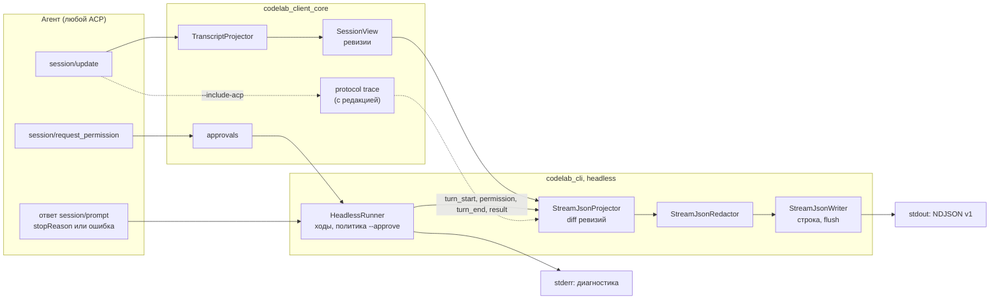
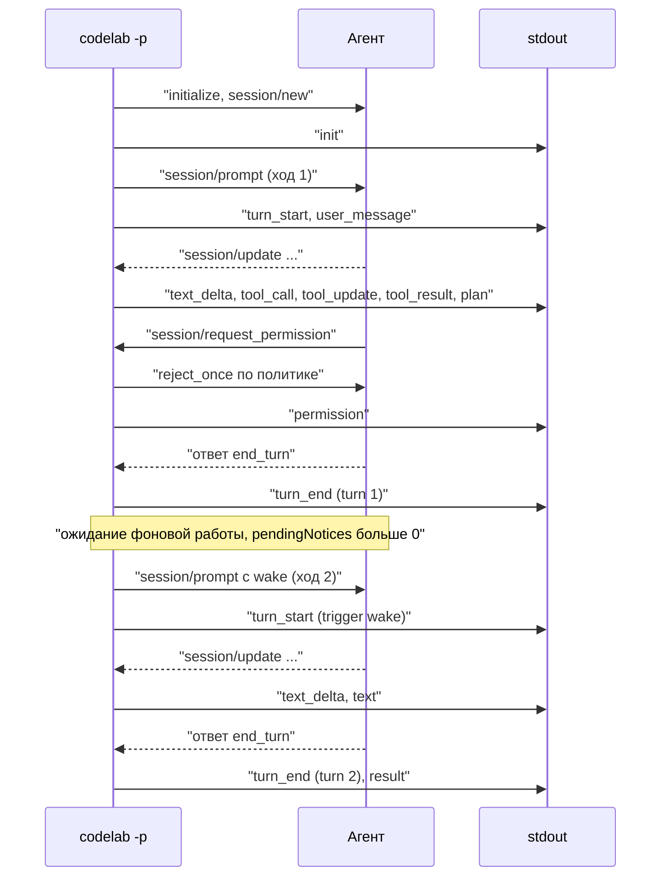

# 12.5. Headless-формат stream-json

> Часть предложения [«Dart-агент и клиенты CodeLab»](../dart-agent-and-clients.md). Status: Accepted. Исходные решения, связанные документы и порядок чтения — в оглавлении.

← [12.4. Первый запуск и настройки](12-4-first-run-and-settings.md) · [Оглавление](../dart-agent-and-clients.md) · [12.6. Удобства CLI и десктопа](12-6-cli-desktop-extras.md) →

## 12.5.1. Назначение

Раздел фиксирует машинный формат вывода `codelab -p` — цель H-03 матрицы
([`agent-parity-goals.md`](../agent-parity-goals.md) §3.7): каждое событие хода — строка NDJSON
закрытого набора типов (начало сессии, дельта текста, вызов и результат инструмента, план, конец
хода с причиной). Здесь же закрыт открытый вопрос §8 матрицы «Формат `stream-json` (H-03)».

| Что | Где описано | Что берёт этот раздел |
|---|---|---|
| Флаги, коды выхода, политика `--approve` | §9.11 «Спецификация CLI» | уточняет `--output-format`, добавляет `--include-acp`, `--include-thoughts`; коды выхода не меняет |
| Модель отображения | §12.1 (`TranscriptItem`, `ToolRowView`, `UsageView`) | формат — проекция ревизий `SessionView`, а не кадров ACP |
| Вывод CLI | §12.2.1 | headless `stream-json` не зависит от TTY и не печатает ничего, кроме NDJSON, в stdout |
| Итог хода и коды | ядро §13.7–§13.10 | `stopReason`, JSON-RPC ошибка на `session/prompt` → `turn_end` и `result` |
| Ожидание фоновой работы, пробуждения | ядро §17.3.9 (H-05) | несколько ходов в одном прогоне |
| Вынос результата | ядро §17.4 | поле `spill` в `tool_result` |
| Usage | L-11, OpenSpec `add-usage-extension` после этапа 9 | `usage` всегда есть и до расширения равно `null` |

Этап — 6 (задача 6.7, `apps/codelab_cli/lib/src/headless/`); формат утверждается OpenSpec change
`add-cli-stream-json` как «stream-json v1». MVP CLI (`add-codelab-cli`) выводит только текст:
проекции нужны поля, которых в модели отображения kit ещё нет (§12.1), поэтому формат, `json`,
флаги `--include-*` и отвод кадров вынесены в отдельный change (design.md change
`add-codelab-cli`, D1). Префикс инвариантов — `SJ-`.

## 12.5.2. Решение о формате

**Решение.** `stream-json` — собственная стабильная схема CodeLab с номером версии в строке
`init`. Это проекция модели отображения `codelab_client_core` (§9.10, §12.1) плюс события, которые
знает только headless-раннер (границы ходов, решения политики, итог прогона). Совместимость с
`--output-format stream-json` Claude Code **не обещается**. Исходные кадры ACP доступны для отладки
флагом `--include-acp` отдельными строками типа `acp`; на их содержимое гарантии стабильности не
распространяются.

Рассмотренные варианты:

| Вариант | Плюсы | Почему не выбран |
|---|---|---|
| A. Совместимость с `--output-format stream-json` Claude Code | готовые потребители, знакомый вид | схема Claude Code построена вокруг сообщений Messages API (сообщение с массивом блоков, пара «вызов — результат» внутри сообщений пользователя), а ACP и kit дают дельты и обновления вызовов: пришлось бы собирать сообщения целиком и терять потоковость; для одобрений, плана с приоритетами, `kind` инструмента, причин `max_turn_requests` и пробуждений там нет полей; схема чужая и меняется вместе с продуктом без наших сроков. Частичная совместимость хуже отсутствующей: скрипт, написанный под Claude Code, сломается на первом несовпадении молча. Если появится спрос — отдельное значение `--output-format` с адаптером поверх v1, без изменения v1 |
| B. Прямая проекция `session/update` в NDJSON (строка на уведомление) | дёшево, без потерь | протокол протекает: `sessionUpdate`, вложенные блоки `content`, `_meta.codelab.outcome`; формат меняется вместе с ACP; конца хода и причины нет (они в ответе на запрос, а не в уведомлении), решений одобрения и кода выхода тоже; каждый потребитель повторяет склейку kit (дельты, замена `content` целиком, исход в `_meta`). Остаётся отладочным режимом `--include-acp` |
| C. Снимок `SessionView` или JSON Patch на каждую ревизию | точное состояние | тяжело (транскрипт растёт), неудобно для `jq` и построчных потребителей, раскрывает внутреннюю модель kit как контракт |
| **D. Своя схема — проекция kit (выбрано)** | склейка и нормализация статусов сделаны один раз в kit; формат не зависит от эволюции ACP; одобрения, ходы и коды выхода — первого класса; одинаков для встроенного, локального и стороннего агента | своя схема требует документации и тестов — это JSON Schema в репозитории и golden-файлы (§12.5.8) |

**Поток ввода.** `--input-format stream-json` (многоходовый диалог через stdin) в v1 **не
поддерживается**: H-01 — один промпт за запуск; пробуждения (§17.3.9) управляются самим CLI;
интерактивные ответы на одобрения по stdin повторили бы ACP. Кому нужен двусторонний машинный
диалог, подключается к агенту по ACP напрямую (`codelab-agent serve --stdio`). Флаг зарезервирован:
`--input-format stream-json` → stderr `--input-format stream-json is not supported yet; use ACP
(codelab-agent serve --stdio) for multi-turn automation.`, код 64.



## 12.5.3. Контракт

### Флаги

| Флаг | Значение | По умолчанию |
|---|---|---|
| `--output-format text\|json\|stream-json` | `text` — ответ как есть (§12.2.1, `raw`); `json` — один итоговый объект в конце; `stream-json` — NDJSON v1. Только с `-p`/`-f`/stdin-промптом; в REPL → код 64 | `text` |
| `--include-thoughts` | добавляет события `thought_delta`; без флага мысли модели не выводятся | выключено |
| `--stream-thinking`, `--no-stream-thinking` | после MVP (H-08, §12.6.11): мысли в stderr для `text` и `json`; на `stream-json` не влияют — `--stream-thinking` даёт одну строку предупреждения в stderr, stdout не меняется | выключено (`headless.stream_thinking`) |
| `--include-acp` | добавляет строки `acp` с исходными кадрами (из того же отвода, что `--trace-file`, уже с редакцией); только с `stream-json`, иначе код 64 | выключено |
| `--input-format text\|stream-json` | `text` — промпт из `-p`, `-f` или stdin (H-01); `stream-json` зарезервирован → код 64 | `text` |

Остальные флаги headless (`--approve`, `--timeout`, `--drain-timeout`, `--max-wakes`) — как в
§9.11; формат на их смысл не влияет.

### Правила кодирования

* Одна строка stdout = один JSON-объект, без отступов, завершённый `\n` (U+000A). Кодировка UTF-8
  без BOM; управляющие символы внутри строк экранируются (`jsonEncode`); непарные суррогаты
  заменяются на U+FFFD при кодировании.
* Каждая строка имеет поле `type`. Все строки, кроме `init` и `result`, имеют поле `turn` (номер
  хода прогона с 1); `init`, `result` и события вне хода (`notice` до сессии) — без `turn` или с
  `turn: null`.
* Поля с неизвестным значением присутствуют со значением `null`, а не пропускаются, если они
  перечислены в схеме как обязательные (`usage`, `durationMs`, `model`).
* stdout в режиме `stream-json` и `json` принадлежит только писателю: рендер, подсказки и
  строки инструментов в stdout не пишутся; диагностика, предупреждения и строка решения
  `--approve` — в stderr.
* Время — длительности в миллисекундах (`durationMs`), абсолютных отметок времени в v1 нет.

### Типы событий v1

Набор значений `type` закрыт: `init`, `turn_start`, `user_message`, `text_delta`, `text`,
`thought_delta`, `tool_call`, `tool_update`, `tool_result`, `permission`, `plan`, `notice`,
`subagent`, `turn_end`, `acp`, `result`.

| `type` | Когда | Поля (кроме `type`, `turn`) |
|---|---|---|
| `init` | первая строка, после `session/new` или `session/load` и применения `--model`/`--mode` и, после MVP, модели папки (U-27, §12.6.9; заметка `folder_model_unavailable` — строкой `notice` сразу после `init`, SJ-2 не нарушается) | `version` (целое, `1`), `sessionId`, `resumed` (bool), `cwd`, `agent` {`name`, `version`}, `cli` {`version`}, `model` (id или `null`), `mode` (id или `null`), `capabilities` {`loadSession`, `image`, `embeddedContext`, `usage`, `subagentBoard`, `wake`, `jobBoard`} (bool; `wake` — агент объявил `agentCapabilities._meta.codelab.subagentWake`; `usage` — kit распознал расширение usage (`add-usage-extension`), до него `false`) |
| `turn_start` | перед отправкой `session/prompt` | `trigger`: `prompt` \| `wake` |
| `user_message` | после `turn_start` с `trigger: prompt` | `text` (как отправлен, с редакцией), `attachments` [{`name`, `kind`}] из `PromptAttachmentView` |
| `text_delta` | дописан текст `AgentTextItem` | `messageId`, `text` (дельта) |
| `text` | `AgentTextItem` закрыт (`streaming: false`) | `messageId`, `text` (полный текст сообщения) |
| `thought_delta` | только с `--include-thoughts` | `messageId`, `text` |
| `tool_call` | `ToolCallItem` впервые появился | `toolCallId`, `title`, `kind` (`ToolKind`), `label`, `detail` (из `ToolRowView`), `status` (`pending` \| `running`), `input` (редактированный `rawInput` или `null`), `locations` [{`path`, `line`}] |
| `tool_update` | изменился статус (не итоговый) или `progressText` | `toolCallId`, `status` (`pending` \| `running`), `progress` (строка или `null`) |
| `tool_result` | итоговый статус вызова, ровно один раз | `toolCallId`, `status` (`completed` \| `failed` \| `rejected` \| `cancelled` \| `interrupted`), `durationMs` или `null`, `output` {`text`, `bytes`, `truncated`} или `null`, `error` (первая строка причины или `null`), `diffs` [{`path`, `change`, `added`, `removed`, `limited`}], `terminal` {`exitCode`, `totalLines`} или `null`, `spill` {`path`} или `null` |
| `permission` | решение по запросу одобрения | `toolCallId`, `title`, `kind`, `options` (массив `kind` предложенных вариантов), `decision` (`allow_once` \| `reject_once` \| `cancelled`), `policy` (`reject` \| `read-only` \| `allow-all`), `reason` (`policy` \| `critical` \| `cancelled`), `subagent` {`parentToolCallId`, `agent`} или `null` |
| `plan` | `SessionView.plan` изменился | `entries` [{`content`, `status`, `priority`}] — весь план |
| `notice` | ошибка, предупреждение, служебное сообщение | `level` (`error` \| `warning` \| `info`), `code`, `message`, `job` {`id`, `toolCallId`, `command`, `state`, `exitCode`} — только у `job_settled`, необязательно |
| `subagent` | изменился снимок ребёнка доски (только при согласованной `subagentBoard`) | `subagentId`, `parentToolCallId`, `agent`, `description`, `state`, `background` (bool), `run` (int, с 1; после MVP, agent-core-architecture §17.3.8.1) |
| `turn_end` | ход завершён (ответ или ошибка на `session/prompt`, отмена, обрыв) | `stopReason` (`end_turn` \| `max_tokens` \| `max_turn_requests` \| `refusal` \| `cancelled` \| `error`), `durationMs`, `usage` или `null`, `error` {`errorClass`, `message`, `retryable`} или `null`, `budgetExceeded` (строка или `null`; после MVP среди значений — `"deadline"`, agent-core-architecture §17.12.5), `held` (строка или `null`) |
| `acp` | только с `--include-acp` | `direction` (`in` \| `out`), `frame` (объект JSON-RPC после редакции) |
| `result` | последняя строка прогона | `exitCode`, `stopReason` (последнего хода или `null`), `sessionId` (или `null`), `turns`, `wakes`, `durationMs`, `text`, `usage` или `null`, `toolCalls` {`total`, `failed`, `rejected`} |

`usage` (в `turn_end` и `result`) — `{"input","output","cacheRead","cacheWrite","reasoning",
"cost":{"amount":"0.0041","currency":"USD"}|null,"context":{"used","size"}|null}`. Источник —
`UsageView` (§12.1.5): в `turn_end` — `lastTurn` и `lastTurnCost`; в `result` — сумма по ходам
прогона, если у всех ходов `usage != null`, иначе `null`. Пока `add-usage-extension` не принят,
`usage` всегда `null`, нулей вместо неизвестного нет (VIEW-6). Сумма денег — строка десятичной
дроби из `Money.micros`, а не число с плавающей точкой.

Значения `code` в `notice` (открытый список, потребитель ДОЛЖЕН принимать неизвестные):
`provider_error`, `agent_error`, `transport_lost`, `connect_failed`, `empty_response`,
`timeout`, `budget_exceeded`, `tool_interrupted`, `allow_all`, `drain_waiting`, `drain_timeout`,
`wake_unsupported`, `redaction_truncated`, `mode_changed`, `job_settled`; после MVP —
`deadline_unsupported` (`warning`: агент не объявил команду `timer`, CLI сам отменит ход в срок
`--deadline`, agent-core-architecture §17.12.5); `folder_model_unavailable`, `folder_model_failed` (`warning`: модель или `effort`, запомненные для папки, не предложены агентом или не применились; модель — агента, U-27, §12.6.9).

`turn_end.error.errorClass` — значение `data.codelab.errorClass` из ответа агента (§13.8:
`LlmErrorClass` или `AgentErrorClass`); при ошибке, которую обнаружил сам CLI, — `transport`
(обрыв, агент завершился) или `protocol` (ответ не декодируется); стороннему агенту без
`data.codelab` — `unknown`.

### Правила стабильности

1. `version` — целое число, номер мажорной версии схемы. Внутри версии допустимы только
   добавления: новое необязательное поле, новое значение открытого перечисления (`kind`,
   `notice.code`, `error.errorClass`, `stopReason` — например, новая причина остановки ACP).
   Потребитель ДОЛЖЕН принимать неизвестные значения открытых перечислений.
2. Набор значений `type` закрыт на версию: новое значение `type`, удаление или переименование
   поля, смена типа поля или смысла значения — только с `version + 1`. Поэтому в v1 сразу входят
   `subagent` и `acp`, хотя первое пишется лишь при доске, а второе — лишь по флагу.
3. Потребитель ДОЛЖЕН игнорировать неизвестные поля и ДОЛЖЕН проверять `init.version`; строку с
   неизвестным `type` при известной версии он вправе считать ошибкой.
4. Содержимое `acp.frame` гарантий стабильности не имеет: это кадр протокола как есть.
5. Схема лежит в `apps/codelab_cli/schema/stream-json.v1.schema.json` (JSON Schema 2020-12,
   `oneOf` по `type` с `additionalProperties: true`; у `notice` — необязательное поле `job`);
   `--output-format json` описан в той же папке —
   `json.v1.schema.json`. Изменение схемы — только вместе с golden-файлами и OpenSpec change.
6. Отчёт Terminal-Bench (agent-core-architecture §17.14.5.4) читает поля строки `result`
   (`exitCode`, `stopReason`, `turns`, `durationMs`, `toolCalls`, `usage`); их переименование в
   v1 запрещено.

### Типы Dart

Файлы — `apps/codelab_cli/lib/src/headless/stream_json/`. Проектор чистый (без `dart:io`),
писатель — единственный, кто пишет в stdout.

```dart
/// Модель строки; toJson даёт порядок ключей как в таблице (стабильные golden-файлы).
sealed class StreamJsonEvent {
  String get type;
  int? get turn;
  Map<String, Object?> toJson();
}
final class InitEvent extends StreamJsonEvent { /* version, sessionId, resumed, cwd, agent, cli, model, mode, capabilities */ }
final class TurnStartEvent extends StreamJsonEvent { final TurnTrigger trigger; }
enum TurnTrigger { prompt, wake }
final class UserMessageEvent extends StreamJsonEvent { final String text; final List<AttachmentRef> attachments; }
final class TextDeltaEvent extends StreamJsonEvent { final String messageId; final String text; }
final class TextEvent extends StreamJsonEvent { final String messageId; final String text; }
final class ThoughtDeltaEvent extends StreamJsonEvent { final String messageId; final String text; }
final class ToolCallEvent extends StreamJsonEvent { /* toolCallId, title, kind, label, detail, status, input, locations */ }
final class ToolUpdateEvent extends StreamJsonEvent { final String toolCallId; final String status; final String? progress; }
final class ToolResultEvent extends StreamJsonEvent { /* toolCallId, status, durationMs, output, error, diffs, terminal, spill */ }
final class PermissionEvent extends StreamJsonEvent { /* toolCallId, title, kind, options, decision, policy, reason, subagent */ }
final class PlanEvent extends StreamJsonEvent { final List<PlanEntryView> entries; }
final class NoticeEvent extends StreamJsonEvent { final NoticeLevel level; final String code; final String message;
    final JobRef? job; }                 // только у job_settled (agent-core-architecture §17.9.11)
final class SubagentEvent extends StreamJsonEvent { /* subagentId, parentToolCallId, agent, description, state, background */ }
final class TurnEndEvent extends StreamJsonEvent { /* stopReason, durationMs, usage, error, budgetExceeded, held */ }
final class AcpFrameEvent extends StreamJsonEvent { final FrameDirection direction; final Map<String, Object?> frame; }
final class ResultEvent extends StreamJsonEvent { /* exitCode, stopReason, sessionId, turns, wakes, durationMs, text, usage, toolCalls */ }

final class StreamJsonOptions {
  final bool includeThoughts;
  final bool includeAcp;
  final int maxOutputBytes = 8 << 10;      // output.text в tool_result
  final int maxInputStringBytes = 4 << 10; // строка внутри input
  final int maxInputBytes = 16 << 10;      // input целиком
}

/// Чистая проекция: сравнивает соседние ревизии SessionView (VIEW-11: неизменённые элементы
/// identical) и события раннера. Состояние — множество выведенных toolCallId, длины текста по
/// messageId, последний статус и прогресс каждого вызова, последний план.
final class StreamJsonProjector {
  StreamJsonProjector(StreamJsonOptions options, StreamJsonRedactor redactor, {required String cwd});
  List<StreamJsonEvent> onInit(InitInfo info);
  List<StreamJsonEvent> onTurnStarted(TurnTrigger trigger, {String? text, List<PromptAttachmentView> attachments});
  List<StreamJsonEvent> onView(SessionView next);           // diff с предыдущей ревизией
  List<StreamJsonEvent> onPermission(PermissionDecision decision);
  List<StreamJsonEvent> onSubagents(List<SubagentSnapshotView> snapshot);
  List<StreamJsonEvent> onAcpFrame(FrameDirection direction, Map<String, Object?> redactedFrame);
  List<StreamJsonEvent> onNotice(NoticeLevel level, String code, String message);
  List<StreamJsonEvent> onTurnEnded(TurnOutcome outcome, UsageView usage);
  ResultEvent result(RunOutcome outcome);                   // exitCode — из exit_codes.dart
}

/// SecretRedactor (тот же, что для логов клиента и --trace-file) плюс усечение по StreamJsonOptions.
final class StreamJsonRedactor {
  Object? input(Map<String, Object?>? rawInput);            // рекурсивно, ключи-секреты → "[REDACTED]"
  String text(String s);
}

/// Пишет строки по одной; единственный владелец stdout в режимах json и stream-json.
abstract interface class StreamJsonWriter {
  Future<void> write(StreamJsonEvent event);                // add(utf8(line + '\n')) и flush
  Future<void> close();                                     // flush, затем закрытие stdout
}
```

`TurnOutcome` — `stopReason` из ответа `session/prompt` или ошибка (`JsonRpcError` с
`data.codelab`, обрыв транспорта, локальная отмена); `RunOutcome` — все ходы, число пробуждений,
итог drain и код выхода, вычисленный `exit_codes.dart` по §9.11 и §17.3.9.

### Отображение источников

| Источник (ACP → kit) | Событие stream-json | Примечание |
|---|---|---|
| ответ `session/new` / `session/load`, `initialize`, опции `model`/`mode` | `init` | реплей истории при `-r`/`-c` не выводится: только ходы этого прогона |
| `HeadlessRunner` перед `session/prompt` | `turn_start`, `user_message` | при пробуждении (`_meta.codelab.wake`) — только `turn_start` с `trigger: wake` |
| `agent_message_chunk` → `AgentTextItem` дописан | `text_delta` | дельты могут склеиваться ревизией kit; гранулярность не гарантируется |
| `AgentTextItem.streaming` → `false` | `text` | |
| `agent_thought_chunk` → `ThoughtItem` | `thought_delta` | только с `--include-thoughts` |
| `tool_call` → новый `ToolCallItem` | `tool_call` | `input` — `rawInput` после `StreamJsonRedactor` |
| `tool_call_update` `in_progress` → `running`; новый `progressText` | `tool_update` | |
| `tool_call_update` итоговый → `ToolCallStatusView` (`outcome` из `_meta` уже разобран, §12.1.2) | `tool_result` | `diffs` — из `ToolDiffContent` (только счётчики), `spill.path` — из `SpillMarker`, `terminal` — из `TerminalOutputView` |
| `session/request_permission` → `PendingApproval` → решение политики | `permission` | запрос ребёнка (`toolCallId` вида `call_3/call_1`, §17.3.7) приходит без `tool_call`; `subagent` заполнен из `_meta.codelab.subagent` |
| `plan` → `SessionView.plan` | `plan` | |
| `NoticeItem` (`error`, `cancelled`, `detached`), диагностика раннера | `notice` | `reconnected` в headless не бывает: раннер не переподключается |
| `_codelab/subagents/update` (если согласовано) | `subagent` | только изменившиеся снимки |
| `_codelab/jobs/update` (если согласовано): задача стала терминальной | `notice` | `level: "info"`, `code: "job_settled"`, `message: "background job <id> <state> (<command>)"`, поле `job`; `turn` — текущий ход или `null` (agent-core-architecture §17.9.11) |
| `available_commands_update`, `config_option_update`, `current_mode_update`, `session_info_update` | — | не события хода; смена режима посреди хода — `notice` `info` `mode_changed` |
| ответ `session/prompt` (`stopReason`, `_meta.codelab.budgetExceeded`, `held`) или JSON-RPC ошибка `-32603` (§13.8) | `turn_end` | ошибка → `stopReason: "error"` и `error` из `data.codelab` |
| кадр протокола (отвод trace) | `acp` | только с `--include-acp` |
| завершение прогона | `result` | |

## 12.5.4. Алгоритмы

**Прогон.**

```text
headless stream-json:
1  разобрать аргументы; ошибка → stderr, код 64, stdout пуст
2  подключиться, initialize, session/new | session/load; применить --model, --mode;
   после MVP для session/new — модель и effort папки (U-27, §12.6.9)
   ошибка → notice{error, connect_failed} + result{exitCode: 1, sessionId: null}; выход
3  write(init)
4  turn := 1; trigger := prompt
5  write(turn_start); если trigger == prompt → write(user_message)
6  отправить session/prompt; до ответа: на каждую ревизию SessionView → onView → write;
   на каждый PendingApproval → политика --approve → respond → write(permission) + строка в stderr
7  ответ или ошибка → дописать события последней ревизии; закрыть незавершённые вызовы (ниже);
   write(turn_end)
8  drain по §17.3.9; при пробуждении: turn += 1, trigger := wake, wakes += 1, перейти к 5;
   ожидание и итог drain — notice (drain_waiting, drain_timeout, wake_unsupported)
9  write(result); close(); выход с result.exitCode
```

**Проекция ревизии (`onView`).** Элементы `transcript` обходятся по порядку; элемент, `identical`
прошлой ревизии, пропускается (VIEW-11), поэтому стоимость шага пропорциональна изменениям.

1. `AgentTextItem`: `delta = text.substring(printed[id])`; непустая → `text_delta`; переход
   `streaming` в `false` → `text` с полным текстом. `ThoughtItem` — так же, но только
   `thought_delta` и только с `--include-thoughts`.
2. `ToolCallItem` с новым `toolCallId` → `tool_call` (статус `pending` или `running`); если вызов
   пришёл сразу итоговым — `tool_call` со статусом `running` не выдумывается: за `tool_call` со
   статусом `pending` сразу следует `tool_result`.
3. Известный вызов: изменились `status` (не итоговый) или `progressText` → `tool_update`; первый
   итоговый статус → `tool_result`; повторная доставка итогового статуса ничего не выводит.
4. `plan` изменился (сравнение по содержимому) → `plan`.
5. Новый `NoticeItem` → `notice`.
6. События одной ревизии выводятся в порядке элементов транскрипта, затем `plan`. Ревизия может
   склеить несколько обновлений ACP (§9.10, шаг 8): порядок между разными элементами внутри
   ревизии — порядок их позиций в транскрипте, порядок внутри одного элемента сохраняется всегда.

**Закрытие хода.** Перед `turn_end` каждый вызов этого хода без `tool_result` получает
`tool_result` со статусом `cancelled` (если ход отменён) или `interrupted` (иначе) и `notice`
`warning` `tool_interrupted`; открытые текстовые элементы получают `text`. Так каждый `tool_call`
закрыт до конца своего хода, даже если агент нарушил порядок ACP-3.

**Порядок вывода.** Все события проходят одну последовательную очередь писателя; источники
(ревизии kit, решения политики, ответ на запрос, кадры trace) ставят события в неё в момент
наблюдения. Гарантии — инварианты SJ-3…SJ-6.

**Сброс.** `write` кодирует строку целиком, вызывает `stdout.add` одним буфером и ждёт
`stdout.flush()` до записи следующей строки: потребитель, читающий построчно, видит событие
сразу, а не при заполнении буфера. Если потребитель не читает, очередь растёт до 4 МиБ, после
чего раннер перестаёт читать события kit (обратное давление) — события не теряются. Закрытый
stdout (`EPIPE`, потребитель вышел) → ход отменяется (`session/cancel`), дальнейший вывод
отбрасывается, stderr `codelab: stdout closed, cancelling`, код 1 (если сигнал не дал 130/143).

**Несколько ходов.** Пробуждения §17.3.9 (шаг 7) — обычные ходы: `turn_start{trigger: wake}`, без
`user_message`, свои `turn_end` и `usage`. В `result`: `turns` — число ходов, `wakes` — число
пробуждений, `stopReason` — последнего хода, `text` — тексты ответов всех ходов через пустую
строку (как в режиме `text`), `exitCode` — по §17.3.9 шаг 9 (истёкший drain превращает `0` в `1`).
Пустая строка между ответами, которую §17.3.9 печатает в режиме `text`, в `stream-json` не
выводится.

**Ошибки.**

| Ситуация | Последние строки | Код |
|---|---|---|
| JSON-RPC ошибка на `session/prompt` (§13.8) | `notice{error, provider_error \| agent_error}`, `turn_end{stopReason: "error", error}`, `result` | 1 |
| `end_turn` без текста ответа | `notice{error, empty_response}`, `turn_end{end_turn}`, `result` | 1 |
| `max_turn_requests` с `budgetExceeded` | `notice{warning, budget_exceeded}`, `turn_end`, `result` | 1 |
| обрыв транспорта, агент завершился | `notice{error, transport_lost}`, закрытие вызовов, `turn_end{stopReason: "error"}`, `result` | 1 |
| `--timeout` | `notice{warning, timeout}`, `turn_end{cancelled}`, `result` | 130 |
| SIGINT | `turn_end{cancelled}`, `result` | 130 |
| SIGTERM | `turn_end{cancelled}` (если ход успел закончиться в пределах grace), `result` | 143 |
| ошибка аргументов | stdout пуст | 64 |

При `allow-all` раннер один раз пишет `notice{warning, allow_all}` до первого `turn_start` и
предупреждение в stderr (§9.11).

**Редакция.** Всё, что попадает в stdout, проходит `StreamJsonRedactor`:

1. Каждая строка (`text`, `text_delta`, `user_message.text`, `output.text`, `error`, `detail`,
   `progress`, `notice.message`, строки внутри `input` и `acp.frame`) — через `SecretRedactor`
   (тот же экземпляр и правила, что для логов клиента и `--trace-file`). Дельта редактируется в
   составе накопленного текста сообщения, а выводится её отредактированный хвост: секрет,
   разрезанный между дельтами, не проходит по частям.
2. `input` — копия `rawInput`: значения ключей, похожих на секрет (`api_key`, `apikey`, `token`,
   `secret`, `password`, `authorization`, `cookie`, без учёта регистра), заменяются на
   `"[REDACTED]"`; строки длиннее `maxInputStringBytes` усекаются с `…`; если `input` после этого
   длиннее `maxInputBytes` — `{"_truncated": true, "bytes": <размер>}` и `notice` `info`
   `redaction_truncated` (так большие `newText` у `write` не раздувают поток).
3. `output.text` — первые `maxOutputBytes` текста результата (по границе символа), `bytes` —
   полный размер, `truncated` — признак усечения. Полный вывод — по `spill.path` (путь на машине
   агента; для удалённого агента локально может отсутствовать).
4. Агентская редакция (OBS-2 ядра) остаётся первым рубежом; клиентская повторяется для сторонних
   агентов, которые её не делают. Переменные окружения и значения из хранилища секретов CLI в
   поток не попадают никогда: CLI их не читает в headless, кроме `CODELAB_AGENT_TOKEN`, который
   зарегистрирован в `SecretRedactor` как известное значение.

**`--output-format json`.** Тот же проектор и та же редакция, но события копятся в памяти; в конце
пишется одна строка: поля `result` плюс `init` (объект `init` без `type`), `turns` (массив объектов
`turn_end` без `type`, каждый с `text` хода), `permissions` (массив событий `permission` без
`type`), `notices` и `toolCalls.items` (массив `{toolCallId, title, kind, status, durationMs}`).
Дельты, мысли и `acp` в него не входят. Схема — `json.v1.schema.json`.

## 12.5.5. Примеры



**Ход с инструментами, планом, отказом и пробуждением.** `codelab -p "Проверь тесты и найди код
авторизации" --output-format stream-json --approve read-only`; модель читает `package.json`,
запускает фонового субагента, пытается выполнить `npm test` (отклонено политикой), CLI будит
агента для доставки отчёта субагента.

```json
{"type":"init","version":1,"sessionId":"01JB8Q2W6R9T3M5K7N1P4X8Z0C","resumed":false,"cwd":"/Users/me/proj","agent":{"name":"codelab-agent","version":"0.3.0"},"cli":{"version":"0.3.0"},"model":"gpt-4.1","mode":"standard","capabilities":{"loadSession":true,"image":true,"embeddedContext":true,"usage":false,"subagentBoard":false,"wake":true,"jobBoard":false}}
{"type":"turn_start","turn":1,"trigger":"prompt"}
{"type":"user_message","turn":1,"text":"Проверь тесты и найди код авторизации","attachments":[]}
{"type":"plan","turn":1,"entries":[{"content":"Прочитать package.json","status":"in_progress","priority":"high"},{"content":"Запустить тесты","status":"pending","priority":"high"},{"content":"Найти код авторизации","status":"pending","priority":"medium"}]}
{"type":"tool_call","turn":1,"toolCallId":"call_1","title":"Read package.json","kind":"read","label":"Read","detail":"package.json","status":"pending","input":{"path":"package.json"},"locations":[{"path":"/Users/me/proj/package.json","line":null}]}
{"type":"tool_update","turn":1,"toolCallId":"call_1","status":"running","progress":null}
{"type":"tool_result","turn":1,"toolCallId":"call_1","status":"completed","durationMs":12,"output":{"text":"{\n  \"name\": \"proj\",\n  \"scripts\": {\"test\": \"jest\"}\n}\n","bytes":52,"truncated":false},"error":null,"diffs":[],"terminal":null,"spill":null}
{"type":"tool_call","turn":1,"toolCallId":"call_2","title":"Subagent explore: Find auth code","kind":"think","label":"Task","detail":"explore: Find auth code","status":"pending","input":{"agent":"explore","description":"Find auth code","prompt":"Find where login is handled","background":true},"locations":[]}
{"type":"tool_update","turn":1,"toolCallId":"call_2","status":"running","progress":null}
{"type":"tool_result","turn":1,"toolCallId":"call_2","status":"completed","durationMs":40,"output":{"text":"Started background subagent sub_k3f9a1c2.","bytes":42,"truncated":false},"error":null,"diffs":[],"terminal":null,"spill":null}
{"type":"tool_call","turn":1,"toolCallId":"call_3","title":"exec npm test","kind":"execute","label":"Run","detail":"npm test","status":"pending","input":{"command":"npm test"},"locations":[]}
{"type":"permission","turn":1,"toolCallId":"call_3","title":"exec npm test","kind":"execute","options":["allow_once","allow_always","reject_once","reject_always"],"decision":"reject_once","policy":"read-only","reason":"policy","subagent":null}
{"type":"tool_result","turn":1,"toolCallId":"call_3","status":"rejected","durationMs":null,"output":{"text":"Rejected by user","bytes":16,"truncated":false},"error":"Rejected by user","diffs":[],"terminal":null,"spill":null}
{"type":"plan","turn":1,"entries":[{"content":"Прочитать package.json","status":"completed","priority":"high"},{"content":"Запустить тесты","status":"completed","priority":"high"},{"content":"Найти код авторизации","status":"in_progress","priority":"medium"}]}
{"type":"text_delta","turn":1,"messageId":"m_4","text":"Тесты не запускались: "}
{"type":"text_delta","turn":1,"messageId":"m_4","text":"команда отклонена. Поиск авторизации идёт в фоне."}
{"type":"text","turn":1,"messageId":"m_4","text":"Тесты не запускались: команда отклонена. Поиск авторизации идёт в фоне."}
{"type":"turn_end","turn":1,"stopReason":"end_turn","durationMs":5120,"usage":null,"error":null,"budgetExceeded":null,"held":null}
{"type":"notice","turn":null,"level":"info","code":"drain_waiting","message":"waiting for 1 background item(s) (up to 60s)"}
{"type":"turn_start","turn":2,"trigger":"wake"}
{"type":"text_delta","turn":2,"messageId":"m_7","text":"Субагент нашёл вход в lib/auth/login.dart:42."}
{"type":"text","turn":2,"messageId":"m_7","text":"Субагент нашёл вход в lib/auth/login.dart:42."}
{"type":"turn_end","turn":2,"stopReason":"end_turn","durationMs":2310,"usage":null,"error":null,"budgetExceeded":null,"held":null}
{"type":"result","exitCode":0,"stopReason":"end_turn","sessionId":"01JB8Q2W6R9T3M5K7N1P4X8Z0C","turns":2,"wakes":1,"durationMs":9870,"text":"Тесты не запускались: команда отклонена. Поиск авторизации идёт в фоне.\n\nСубагент нашёл вход в lib/auth/login.dart:42.","usage":null,"toolCalls":{"total":3,"failed":0,"rejected":1}}
```

Отказ `call_3` идёт `pending → rejected` без `tool_update` со статусом `running`: проверка
разрешения раньше `in_progress` (§13.7). В stderr одновременно с событием `permission`
печатается `codelab: rejected exec npm test (policy read-only)`.

**Обрыв транспорта и spill.** Агент упал после выноса большого вывода:

```json
{"type":"tool_result","turn":1,"toolCallId":"call_5","status":"completed","durationMs":8400,"output":{"text":"PASS test/a.test.js\n…","bytes":8192,"truncated":true},"error":null,"diffs":[],"terminal":{"exitCode":0,"totalLines":51234},"spill":{"path":"/Users/me/.codelab/sessions/me-proj-4b1d7e20/2026-10-21T08-00-00-000Z_01JB8Q2W6R9T3M5K7N1P4X8Z0C/spills/1.txt"}}
{"type":"notice","turn":1,"level":"error","code":"transport_lost","message":"agent process exited with code 139"}
{"type":"text","turn":1,"messageId":"m_6","text":"Смотрю вывод"}
{"type":"turn_end","turn":1,"stopReason":"error","durationMs":9120,"usage":null,"error":{"errorClass":"transport","message":"agent process exited with code 139","retryable":false},"budgetExceeded":null,"held":null}
{"type":"result","exitCode":1,"stopReason":"error","sessionId":"01JB8Q2W6R9T3M5K7N1P4X8Z0C","turns":1,"wakes":0,"durationMs":9150,"text":"Смотрю вывод","usage":null,"toolCalls":{"total":1,"failed":0,"rejected":0}}
```

**Usage после `add-usage-extension`** (то же поле, тип не меняется):

```json
{"type":"turn_end","turn":1,"stopReason":"end_turn","durationMs":5120,"usage":{"input":1200,"output":310,"cacheRead":9800,"cacheWrite":0,"reasoning":0,"cost":{"amount":"0.0041","currency":"USD"},"context":{"used":11000,"size":128000}},"error":null,"budgetExceeded":null,"held":null}
```

**`--include-acp`** добавляет строки между событиями:

```json
{"type":"acp","turn":1,"direction":"in","frame":{"jsonrpc":"2.0","method":"session/update","params":{"sessionId":"01JB8Q2W6R9T3M5K7N1P4X8Z0C","update":{"sessionUpdate":"agent_message_chunk","content":{"type":"text","text":"Тесты не запускались: "}}}}}
```

## 12.5.6. Инварианты

1. **SJ-1.** В режимах `stream-json` и `json` каждая строка stdout — один JSON-объект, проходящий
   `stream-json.v1.schema.json` (или `json.v1.schema.json`), без отступов, в UTF-8, с `\n` в конце;
   ничего, кроме этих строк, в stdout не пишется.
2. **SJ-2.** Первая строка `stream-json` — `init` с `version`, если сессия создана или загружена;
   последняя — `result`, если процесс не убит `SIGKILL`; `result` ровно один. До сессии (ошибка
   подключения) поток — `notice` и `result`; при ошибке аргументов stdout пуст.
3. **SJ-3.** Для каждого хода `n`: `turn_start` предшествует всем событиям с `turn: n`, `turn_end`
   — последнее событие с `turn: n`, а все события хода `n` идут раньше `turn_start` хода `n + 1`.
4. **SJ-4.** Для каждого `toolCallId`: `tool_call` раньше любого `tool_update`, `permission` и
   `tool_result` этого вызова; `tool_result` ровно один и раньше `turn_end` своего хода; после него
   событий этого вызова нет. Исключение — `permission` запроса ребёнка без `tool_call` (§17.3.7).
5. **SJ-5.** Для каждого `messageId` конкатенация `text_delta` равна `text` этого сообщения;
   `text` выводится один раз и после всех его дельт.
6. **SJ-6.** Значения `type` принадлежат закрытому набору версии из `init.version`; новое значение
   `type`, удаление или изменение смысла поля возможны только с новой версией.
7. **SJ-7.** `result.exitCode` равен коду выхода процесса и вычисляется `exit_codes.dart` по
   §9.11 и §17.3.9; `turn_end.stopReason` последнего хода равен `result.stopReason`.
8. **SJ-8.** Ни одна строка stdout не содержит значения, которое `SecretRedactor` признаёт
   секретом, и значений ключей-секретов `rawInput`; секрет, разрезанный между дельтами, не
   выводится по частям.
9. **SJ-9.** `usage` присутствует в каждом `turn_end` и `result`; при `UsageView.source == none`
   оно `null`, и нулевые счётчики как известные значения не выводятся.
10. **SJ-10.** Без `--include-thoughts` нет `thought_delta`; без `--include-acp` нет `acp`; без
    согласованной доски субагентов нет `subagent`.
11. **SJ-11.** Каждый запрос одобрения, полученный в headless, даёт ровно одно событие
    `permission` и одну строку stderr с тем же решением; решение принимается только политикой
    `--approve`, без чтения stdin.
12. **SJ-12.** Реплей истории при `-r`/`-c` не выводится: первое событие хода после `init` —
    `turn_start` хода 1 этого прогона.
13. **SJ-13.** Событие выводится и сбрасывается в stdout до того, как писатель начнёт следующую
    строку; события не теряются при медленном потребителе (обратное давление вместо отбрасывания).
14. **SJ-14.** Проекция детерминирована: одна и та же последовательность ревизий `SessionView` и
    событий раннера даёт байт в байт одинаковый вывод (порядок ключей фиксирован `toJson`).
15. **SJ-15.** В режиме `stream-json` `--stream-thinking`, `--no-stream-thinking` и ключи
    `headless.*` не меняют stdout; в stderr не выводятся ни мысли, ни строки признака жизни
    `… thinking Ns` (H-08, §12.6.11): мысли — только событиями `thought_delta` по
    `--include-thoughts`.

## 12.5.7. Обоснование

* **Проекция kit, а не кадров.** Kit уже решает трудные места ACP: склейку дельт, замену
  `content` целиком, исход `rejected`/`cancelled` в `_meta`, защитный путь для `tool_call_update`
  без `tool_call`, привязку одобрений к вызовам. Повторять это в каждом потребителе NDJSON —
  значит получить столько же реализаций с разными ошибками. Цена — гранулярность дельт зависит от
  склейки ревизий; формат её и не обещает.
* **Своя схема, а не совместимость.** Формат — контракт с чужими скриптами; держать его можно,
  только если эволюцией владеем мы. Отказ от совместимости с Claude Code честнее частичной
  совместимости, которая ломается молча. Путь к адаптеру остаётся открытым.
* **`tool_call` / `tool_update` / `tool_result` вместо одного `tool_call_update`.** Потребителю
  нужен один надёжный момент «вызов закончился» (SJ-4); статусы ACP (`failed` + `_meta.outcome`)
  разложены в явные значения `rejected` и `cancelled`.
* **`text` в дополнение к `text_delta`.** Простому потребителю (`jq 'select(.type=="text")'`)
  не нужно склеивать дельты; потоковому — не нужно ждать конца.
* **Мысли по флагу.** Мысли — шум для интеграций и могут повторять содержимое файлов; кому нужны,
  включает явно. Совпадает с режимом `raw` (§12.2.1), где мысли не печатаются.
* **`usage: null` с первого дня.** Поле появляется в v1 со значением `null`; принятие
  `add-usage-extension` меняет значение, но не схему, — потребители не ломаются и версия не растёт.
* **Новый `type` = новая версия.** Закрытый набор позволяет потребителю писать исчерпывающий
  разбор; поэтому редкие типы (`subagent`, `acp`) включены в v1 заранее.
* **`acp` отдельными строками, а не полем.** Проекция не взаимно однозначна (ревизия склеивает
  несколько кадров, а `turn_end` рождается из ответа на запрос), поэтому привязать кадр к одному
  событию нельзя; отдельная строка сохраняет порядок наблюдения.
* **Нет потокового ввода.** Двусторонний машинный диалог уже есть — это ACP; второй такой
  протокол поверх stdin пришлось бы версионировать отдельно (ср. H-07).

## 12.5.8. Как проверить

**E2E** (`apps/codelab_cli/test/e2e/`, собранный бинарь против scripted stdio-агента из
`codelab_acp_testing`; golden-файлы — `test/e2e/golden/`, нормализация `sessionId` → `<session>`,
`durationMs` → `0`, путей `cwd` и каталога сессий → `<cwd>`, `<sessions>`, версий → `<version>`):

* `cli/headless-stream-json-golden` — сценарий примера §12.5.5 (чтение, фоновый субагент,
  отказ `read-only`, план, пробуждение): вывод совпадает с `stream_json_basic.ndjson`; вариант с
  `--include-thoughts` — с `stream_json_thoughts.ndjson`.
* `cli/headless-stream-json-schema` — каждая строка всех golden-файлов и живых прогонов
  `cli/headless-*` проходит `schema/stream-json.v1.schema.json` (валидатор JSON Schema 2020-12 в
  dev-зависимостях); каждый `type` из закрытого набора встречается хотя бы в одном golden, кроме
  `subagent` (отдельный сценарий с доской после U-21).
* `cli/headless-stream-json-errors` — JSON-RPC ошибка `-32603` на `session/prompt`, пустой ответ,
  `--timeout`, обрыв stdio-агента (`exit 139`): последние строки и коды — по таблице «Ошибки»;
  golden `stream_json_transport_lost.ndjson`.
* `cli/headless-stream-json-redaction` — scripted-агент присылает `sk-…` в тексте дельтами,
  разрезанными посередине секрета, и `rawInput` с `api_key`: в stdout нет ни одного фрагмента
  секрета длиной больше 4 символов, `input.api_key == "[REDACTED]"` (SJ-8).
* `cli/headless-json-single-object` — `--output-format json`: ровно одна строка, проходит
  `json.v1.schema.json`, `exitCode` совпадает с кодом процесса.
* `cli/headless-stream-json-flags` — `--include-acp` без `stream-json`, `--input-format
  stream-json`, `--output-format stream-json` в REPL → код 64 и пустой stdout; после MVP —
  `--stream-thinking` со `stream-json`: stdout совпадает с golden `stream_json_basic.ndjson`, в
  stderr одна строка предупреждения и нет `… thinking` (SJ-15, `cli/headless-stream-thinking-stderr`,
  §12.6.11).
* `cli/headless-stream-json-job-settled` — фоновая команда завершается во время ожидания drain: строка `notice` с `code: "job_settled"` и полем `job`, проходит схему (agent-core-architecture §17.9.16).
* `cli/headless-stream-json-flush` — потребитель читает построчно с паузой; `turn_start` виден
  до того, как scripted-агент ответит на `session/prompt` (SJ-13).

**Unit** (`apps/codelab_cli/test/headless/stream_json/`):

* `stream_json_ordering_property_test.dart` — генератор случайных корректных последовательностей
  `session/update` (вызовы с ветвлениями статусов, дельты, план, одобрения, отмена, обрыв) через
  `TranscriptProjector` с произвольной склейкой ревизий: для каждого прогона выполняются SJ-3, SJ-4,
  SJ-5; повтор того же входа даёт байт в байт тот же вывод (SJ-14).
* `stream_json_projector_test.dart` — таблица отображения §12.5.3 построчно; вызов, пришедший
  сразу итоговым; незакрытый вызов на `turn_end` → `interrupted`; запрос ребёнка без `tool_call`.
* `stream_json_redactor_test.dart` — ключи-секреты, усечение строк и `input`, граница символа
  UTF-8 при усечении `output.text`.
* `stream_json_usage_test.dart` — `UsageView.unknown` → `usage: null`; сумма в `result` при всех
  известных ходах и `null` при одном неизвестном; деньги из микроединиц строкой (SJ-9).
* `exit_codes_test.dart` дополняется сравнением `result.exitCode` с кодом процесса (SJ-7).

**Сторож:** `lib/src/headless/stream_json/` (кроме `stream_json_writer_io.dart`) не импортирует
`dart:io`; в режиме `stream-json` `TerminalRenderer` не создаётся (проверка в
`headless_runner_test.dart`).

**Скрипты melos:** `test:e2e:cli` включает все `cli/headless-stream-json-*`;
`check:stream-json-schema` проверяет, что схема и golden-файлы изменены в одном коммите.

---

← [12.4. Первый запуск и настройки](12-4-first-run-and-settings.md) · [Оглавление](../dart-agent-and-clients.md) · [12.6. Удобства CLI и десктопа](12-6-cli-desktop-extras.md) →
