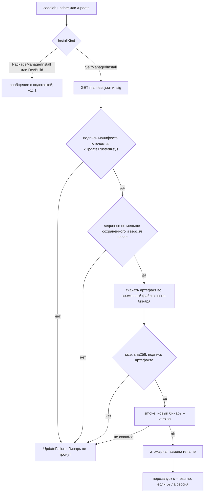
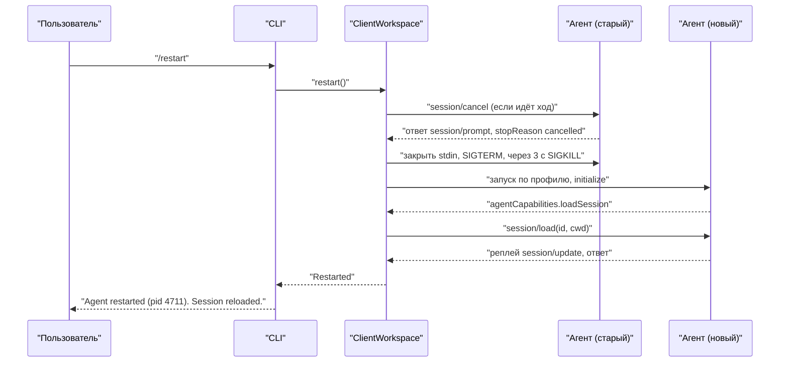
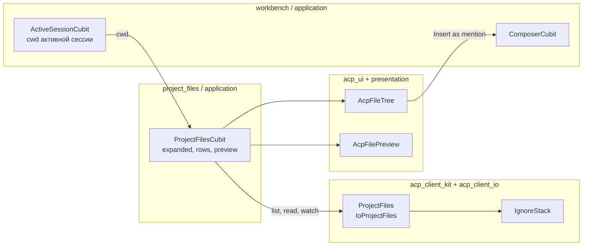

# 12.6. Удобства CLI и десктопа

> Часть предложения [«Dart-агент и клиенты CodeLab»](../dart-agent-and-clients.md). Status: Proposed. Исходные решения, связанные документы и порядок чтения — в оглавлении.

← [12.5. Headless-формат stream-json](12-5-stream-json.md) · [Оглавление](../dart-agent-and-clients.md) · [12.7. Выпуск и распространение](12-7-release-and-distribution.md) →

## 12.6.1. Назначение

Раздел закрывает строки Could и Should матрицы целей
([`agent-parity-goals.md`](../agent-parity-goals.md) §3.7–§3.9), которые живут в клиенте. Агента и
ACP меняет только D-17 — и то необязательным расширением (поиск по тексту):

| Цель | Что даёт | Где | Подраздел |
|---|---|---|---|
| U-16 | `!<cmd>` — команда пользователя в shell, вне агента; вывод прикладывается к следующему промпту | CLI | §12.6.2 |
| U-18 | встроенные темы и пользовательские темы в JSON; `/theme` | CLI | §12.6.3 |
| U-20 | самообновление: подписанный манифест, контрольная сумма и подпись ed25519, атомарная замена, перезапуск с той же сессией | CLI | §12.6.4 |
| U-22 | колесо мыши в TUI, `/mouse on\|off`, следование за выводом | CLI (TUI) | §12.6.5 |
| U-25 | запрет сна системы на время хода, `/power off\|turn\|always` | CLI | §12.6.6 |
| U-26 | `/restart` — перезапуск агента без выхода из клиента | CLI (логика — kit) | §12.6.7 |
| D-13 | файловый браузер проекта в сайдбаре app | app (логика — kit) | §12.6.8 |
| U-27 | модель и `effort` запоминаются по папке проекта | CLI (логика — kit) | §12.6.9 |
| U-28 | копирование в буфер обмена: `/copy`, OSC 52, системная утилита | CLI | §12.6.10 |
| H-08 | мысли в stderr headless-вывода (`--stream-thinking`) и признак жизни `… thinking Ns` | CLI (headless) | §12.6.11 |
| D-17 | поиск и фильтр сессий: заголовок и дата — по `session/list`, текст — расширение | kit, CLI; UI app — §12.3.3, A12; агент — agent-core-architecture §17.6.17 | §12.6.12 |

Этап — 9+ (после переключения по умолчанию). Код CLI — `apps/codelab_cli/lib/src/` (`shell/`,
`theme/`, `update/`, `power/`, `tui/`, `clipboard/`, `headless/`), общая логика — `acp_client_kit` (чистый Dart) и
`acp_client_io` (`dart:io`), app — `apps/codelab_app/lib/features/project_files/`. Префикс
инвариантов — `UX-`.

Общие правила для всех строк:

* Клиентские строки не добавляют ключей в `config.yaml` агента: настройки CLI — в `cli.yaml`
  (§12.2.10), настройки app — в `shared_preferences` (как `codelab.recent_projects`), состояние,
  которое CLI пишет сам, — в отдельных файлах `~/.codelab/` (`update_state.json`,
  `cli_state.json`). Исключение — D-17: ключи `sessions.search.*` агента (agent-core-architecture
  §17.6.12) входят в реестр `SettingsRegistry` (§17.5.8, CFG-19) тем же OpenSpec change, что и
  расширение.
* Расширений ACP нет, кроме D-17: U-26 использует только `session/cancel`, `initialize`,
  `session/load`; U-16 — обычный блок `text` в `session/prompt`; U-27 —
  `session/set_config_option`; D-17 — стандартный `session/list` и необязательный
  `_codelab/session/search` (через OpenSpec).
* Сообщения CLI — английские фиксированные строки (как в §9.11 и §12.4); проза — русская.
* Команды клиента имеют приоритет над командами агента (§9.11): агентская `/restart` или `/theme`
  остаётся доступна как `/agent:<имя>`.

## 12.6.2. `!<cmd>` — прямой shell пользователя (U-16)

**Назначение.** Пользователь запускает `git status`, `make test` или `ls` не выходя из CLI и
не тратя ход модели. Команду исполняет клиент на своей машине; агент о ней не знает, пока
пользователь не отправит промпт с приложенным выводом. Одобрения агента нет: действие инициировал
сам пользователь, а политика разрешений ядра (agent-core-architecture §6.3.1, §7.3) охраняет
действия модели, а не пользователя.

**Контракт.**

```dart
// apps/codelab_cli/lib/src/shell/user_shell.dart
final class ShellRequest {
  final String command;                 // текст после "!" без ведущих пробелов
  final String cwd;                     // SessionHandle.cwd
  final Duration timeout;               // shell.timeout
}

sealed class ShellOutcome {}
final class ShellExited extends ShellOutcome { final int exitCode; final Duration elapsed; }
final class ShellCancelled extends ShellOutcome { final Duration elapsed; }   // Esc, Ctrl+C
final class ShellTimedOut extends ShellOutcome { final Duration elapsed; }
final class ShellFailedToStart extends ShellOutcome { final String message; }

abstract interface class UserShell {                 // реализация — IoUserShell (dart:io)
  /// Чанки stdout и stderr в порядке прихода; Future — итог.
  ShellRun start(ShellRequest request);
}
final class ShellRun {
  final Stream<ShellChunk> output;      // ShellChunk(stream: stdout|stderr, text)
  final Future<ShellOutcome> outcome;
  final void Function() cancel;         // SIGINT, через 2 с — SIGKILL
}
```

Вложение в kit — новый подкласс существующего `PromptAttachment` (§12.1.1) и новое значение
`AttachmentKindView.inlineText`:

```dart
// packages/dart/acp_client_kit/lib/src/view/attachments.dart (дополнение)
final class ShellOutputAttachment extends PromptAttachment {
  final String command;
  final int? exitCode;                  // null — отменена или таймаут
  final String output;                  // без ANSI, уже усечённый (шаг 6), после SecretRedactor
  final int omittedBytes;
}
```

**Алгоритм.**

1. Композер (REPL и TUI) распознаёт `!` **первым символом** ввода; `\!` в начале — буквальный
   `!`. В TUI при вводе `!` строка подсказок меняется на `shell: Enter run · Esc cancel`, рамка
   композера — цветом токена `warning` (§12.6.3). В headless (`-p`) `!` не распознаётся: промпт
   уходит как есть.
2. Пустая команда (`!` или `!   `) → `Usage: !<command>  (runs in <cwd>, outside the agent)`.
3. Если `cwd` сессии не существует на этой машине (WebSocket-агент на другом хосте) →
   `! is unavailable: the session folder <cwd> does not exist on this machine.` Команда не
   запускается.
4. Запуск: `Process.start(shell, [flag, command], workingDirectory: cwd, runInShell: false)`,
   где `shell` — `shell.command` из `cli.yaml`, иначе `$SHELL`, иначе `/bin/sh`; флаг `-c`. На
   Windows по умолчанию `cmd.exe` с `/d /s /c`; `powershell`/`pwsh` — с `-NoProfile -Command`.
   Окружение — окружение CLI без изменений; stdin закрыт сразу (интерактивные программы
   получают EOF). Команда разрешена и во время хода агента: выполняется параллельно.
5. Вывод печатается по мере прихода: построчный REPL — как есть, если поверхность `ansi`
   (SGR пропускаются, остальные CSI и OSC удаляются); `plain`/`raw` — без ESC. TUI — элемент
   транскрипта клиента `$ <command>` (последние 10 строк, раскрывается Enter как строка
   инструмента §12.2.4). В памяти хранится не больше `shell.max_output_bytes` (1 МиБ) — дальше
   начало отбрасывается. Итог: `✓ $ make test  exit 0  3.2s` или `✗ … exit 2`, `⊘ … cancelled`.
6. Esc или Ctrl+C во время команды отменяют **команду**, а не ход агента (`cancel`): действие
   `cancel_shell` реестра клавиш §12.2.9, область «идёт команда `!`» приоритетнее `cancel_turn`; по
   `shell.timeout` (по умолчанию `10m`) — то же с итогом `ShellTimedOut`.
7. Вложение (`shell.attach`, по умолчанию `auto`): после итога создаётся
   `ShellOutputAttachment` — вывод без ANSI, через `SecretRedactor` (§9.11), усечённый до
   16 КиБ: первые 4 КиБ, строка `[… <n> bytes omitted …]`, последние 12 КиБ (по границе
   символа UTF-8). TUI показывает чип `[$ make test · exit 2 · 3.2 КБ]` (Backspace в начале
   пустой строки удаляет его, §12.2.7); REPL печатает
   `Output will be attached to your next prompt (/shell drop to discard).` `ask` — вопрос
   `Attach output to your next prompt? [y/N]`; `never` — без вложения. Больше 5 вложений
   вывода — самое старое удаляется с заметкой; все вложения вместе подчиняются
   `AttachmentLimits.maxCount` (§12.1.1).
8. Отправка: `PromptContentBuilder.build` (§12.1.7) превращает каждое `ShellOutputAttachment` в
   отдельный блок `text` **перед** текстом промпта (вид `inlineText`, без capability). Текст
   блока фиксирован:

   ````text
   The user ran this command in a local shell (outside your tools) in <cwd>:
   $ <command>
   Exit code: <code | cancelled | timed out>
   ```
   <output>
   ```
   ````

   Если в выводе есть строка из трёх и более обратных кавычек, ограда удлиняется на одну
   больше самой длинной. Вложение уходит с первым **отправленным** промптом и при постановке в
   очередь (U-15) переезжает в `QueuedPrompt.attachments`.
9. `/shell drop` — удалить приложенные выводы; `/shell` — показать их список.

**Где работает.** CLI (REPL, TUI). В app-десктопе — не в этой строке (порт `UserShell` в
`acp_client_io` позволяет добавить позже). На мобильных и web клиентах процессов нет: `!` — обычный
текст промпта.

**Пример.**

```text
> !git status --short
 M lib/auth/session.dart
?? test/auth/sso_test.dart
✓ $ git status --short  exit 0  0.1s
Output will be attached to your next prompt (/shell drop to discard).
> закоммить только session.dart
```

**Как проверить.** `cli/bang-command` (`test/e2e/bang_command_test.dart`, PTY, критерий: «команда
исполняется клиентом локально, вне агента; вывод можно приложить к следующему промпту»):
`!echo hi` во временной папке печатает `hi`; scripted-агент **не** получает ни одного кадра; после
`объясни` агент получает `session/prompt`, где первый блок `text` начинается с
`The user ran this command in a local shell` и содержит `hi`; `\!echo` уходит текстом;
`!sleep 30` + Esc → `cancelled`, ход агента не отменяется. Модульно —
`test/shell/shell_attachment_test.dart` (усечение 4 + 12 КиБ, граница UTF-8, удлинение ограды,
редакция `sk-…`) и `test/shell/user_shell_test.dart` (выбор shell по ОС на фальшивом
запускателе; несуществующий `cwd`).

## 12.6.3. Темы (U-18)

**Назначение.** Цвета CLI задаются темой — набором именованных токенов, которыми пользуется
рендер §12.2 вместо прямых SGR. Встроенные темы работают без настройки; пользовательская тема —
JSON-файл.

**Токены.** Закрытый набор; каждое место §12.2, где сказано «акцентный», «приглушённый»,
«зелёный» и т. п., читает токен:

| Токен | Где используется (§12.2) | `dark` | `light` |
|---|---|---|---|
| `text` | обычный текст ответа | `default` | `default` |
| `accent` | заголовки 1–2, значок `running`, инлайн-код, рамка меню | `cyan` | `blue` |
| `muted` | мысли (вместе с SGR 2), рамка кода `│`, номера строк diff, строка статуса, «↓ N новых» | `bright_black` | `bright_black` |
| `success` | `done` ✓, строки `+` diff | `green` | `#1a7f37` |
| `error` | `failed` ✗, строки `-` diff | `red` | `#cf222e` |
| `warning` | `rejected`/`cancelled` ⊘, контекст ≥ 80 %, режим `!` | `yellow` | `#9a6700` |
| `info` | заголовок hunk `@@`, ссылки | `bright_cyan` | `#0550ae` |
| `diff_add_bg` | фон добавленной строки (256 цветов и больше) | `256:22` | `#dafbe1` |
| `diff_remove_bg` | фон удалённой строки | `256:52` | `#ffebe9` |
| `selection` | выделенный пункт меню, выбранная строка (`Ctrl+↑`) | `256:238` | `#ddf4ff` |
| `approval_border` | рамка блока одобрения | `yellow` | `#9a6700` |
| `status_bg` | фон статус-строки TUI | `default` | `default` |

Значение токена: `default` (цвет терминала), имя из 16 ANSI (`black` … `white`,
`bright_black` … `bright_white`), `256:<0–255>`, `#rrggbb`. Атрибуты (жирный, курсив, SGR 2)
задаёт рендер, а не тема.

**Встроенные темы:** `auto` (по умолчанию), `dark`, `light`, `high-contrast` (только 16 ANSI
`bright_*` и `white` на `default`, без фонов diff), `mono` (все токены `default`: различие только
атрибутами). `dark` и `high-contrast` используют только 16 ANSI, поэтому уважают палитру
терминала.

**Контракт.**

```dart
// apps/codelab_cli/lib/src/theme/theme.dart
enum ThemeToken { text, accent, muted, success, error, warning, info, diffAddBg, diffRemoveBg,
    selection, approvalBorder, statusBg }        // JSON-имена — snake_case, как в таблице
sealed class ColorSpec {}                         // DefaultColor | AnsiColor(0–15) | Indexed(0–255) | Rgb(r,g,b)
enum ColorDepth { none, ansi16, ansi256, truecolor }

final class CliTheme {
  final String name;
  final Map<ThemeToken, ColorSpec> colors;        // полный набор: недостающие — из базовой темы
  String sgr(ThemeToken token, ColorDepth depth, {bool background = false}); // '' при ColorDepth.none
}
abstract interface class ThemeCatalog {
  List<String> get names;                         // встроенные, затем пользовательские по алфавиту
  ThemeLoadResult load(String name);              // CliTheme + предупреждения; ошибка — ThemeIssue
}
```

**Алгоритм.**

1. Глубина цвета: поверхность `raw`/`plain`, `NO_COLOR` или `--no-color` (§12.2.1) → `none` —
   тема не применяется вовсе (`NO_COLOR` сильнее темы). Иначе `COLORTERM` = `truecolor` или
   `24bit` → `truecolor`; `TERM` содержит `256color` → `ansi256`; иначе `ansi16`. `#rrggbb` на
   меньшей глубине — ближайший цвет куба 6×6×6 и серой шкалы (256) или ближайший из 16 по
   евклидову расстоянию в sRGB.
2. `auto`: запрос цвета фона OSC 11 (`ESC]11;?ESC\`), ответ в течение 100 мс; яркость > 0.5 →
   `light`, иначе `dark`. Нет ответа — `COLORFGBG` (фон 7 или 15 → `light`); иначе `dark`.
   Внутри tmux запрос не делается (tmux часто отвечает своим фоном) — сразу `COLORFGBG`.
3. Пользовательские темы — файлы `~/.codelab/themes/<name>.json` (имя `[a-z0-9-]{1,32}`, не
   совпадает со встроенным). Формат:

   ```json
   {
     "name": "solarized-dark",
     "extends": "dark",
     "colors": { "accent": "#268bd2", "muted": "#586e75", "diff_add_bg": "256:22" }
   }
   ```

   `extends` — встроенная тема (по умолчанию `dark`); цепочки между пользовательскими темами нет.
   Строгий разбор: неизвестный ключ верхнего уровня или токен, неверное значение, `name` ≠ имени
   файла → тема не загружается; печатается `Theme "<name>" is invalid: <file>:<line>:<col>
   <issue>. Using "<fallback>".`, где `fallback` — `extends` или `dark`. Файл больше 64 КиБ —
   та же ошибка.
4. Тема выбирается при старте из `display.theme` (`cli.yaml`). `/theme` печатает список (текущая
   отмечена `*`, у каждой — образец токенов `accent success error warning`); `/theme <name>`
   применяет тему до конца процесса и перерисовывает кадр TUI (полная перерисовка, как
   `ResizeMsg`). В файл выбор не пишется: CLI только читает `cli.yaml` (§12.2.10); строка
   `To keep it, set display.theme: <name> in ~/.codelab/cli.yaml.` При `none` —
   `Colors are disabled (NO_COLOR or non-TTY output).`
5. Подсветка в app (`AcpCodeTheme`, §12.3) этой темой не управляется: у app своя тема Fluent.

**Как проверить.** `cli/theme-user-json` (`test/e2e/theme_user_json_test.dart`, PTY; критерий:
«встроенные цветовые темы и пользовательские в JSON»): тема `t1.json` с `accent: "#ff0000"` и
`COLORTERM=truecolor` → заголовок окружён `ESC[38;2;255;0;0m`; без `COLORTERM` в `xterm-256color` —
`ESC[38;5;196m`; с `NO_COLOR=1` — ни одного SGR (TUI-2); тема с неизвестным токеном →
предупреждение и вывод в цветах `dark`. Модульно — `test/theme/theme_catalog_test.dart` (строгий
разбор, `extends`, понижение глубины), `test/theme/theme_detect_test.dart` (ответ OSC 11,
таймаут, `COLORFGBG`, tmux), `test/render/*_golden_test.dart` — golden-кадры прогоняются в `dark` и
`light`.

## 12.6.4. Самообновление с проверкой подписи (U-20)

**Назначение.** Установленный официальным установщиком бинарь `codelab` обновляет себя сам:
находит релиз своего канала, проверяет подпись манифеста, контрольную сумму и подпись бинаря,
атомарно заменяет файл и перезапускается в той же сессии. Подмена зеркала или CDN не может
подсунуть бинарь: доверие — только открытым ключам, вшитым в бинарь.

**Контракт.**

```text
codelab update [--check] [--channel stable|beta|pinned] [--version <x.y.z>] [--allow-downgrade] [--yes]
```

Коды: `0` — обновлено или уже последняя версия (`--check`: `0` — нет обновления, `10` — есть);
`1` — ошибка (сеть, подпись, сумма, запись, самообновление выключено); `64` — ошибка
использования. REPL-команда `/update` — то же, что `codelab update`, плюс перезапуск (шаг 10).

Манифест канала — `<base>/<channel>/manifest.json` и подпись рядом `manifest.json.sig`; для
`--version` — манифест версии `<base>/releases/<version>/manifest.json` той же схемы. `<base>`
— константа сборки `kUpdateBaseUrl`, переопределение — `update.base_url` в `cli.yaml` (только
`https://`; подпись проверяется теми же ключами). Раскладка источника релизов, каналы
(`stable`, `beta`, `pinned`), хранение и ротация ключей — §12.7.2–§12.7.4.

```json
{
  "schema": 1,
  "channel": "stable",
  "version": "1.4.0",
  "sequence": 42,
  "released_at": "2026-10-01T12:00:00Z",
  "artifacts": [
    { "target": "macos-arm64", "url": "https://…/codelab-1.4.0-macos-arm64",
      "size": 41234567, "sha256": "9f2c…", "signature": "base64…" }
  ]
}
```

`manifest.json.sig` — `{"key_id": "2026-a", "signature": "<base64 64 байта>"}`.

```dart
// apps/codelab_cli/lib/src/update/
final class UpdateManifest { final int schema; final String channel; final Version version;
  final int sequence; final DateTime releasedAt; final List<UpdateArtifact> artifacts; }
final class UpdateArtifact { final String target; final Uri url; final int size;
  final String sha256Hex; final Uint8List signature; }
const Map<String, String> kUpdateTrustedKeys = { /* key_id → hex 32 байта, вшито при сборке */ };

sealed class InstallKind {}
final class SelfManagedInstall extends InstallKind { final String binaryPath; final String channel; }
final class PackageManagerInstall extends InstallKind { final String manager; final String hint; }
final class DevBuild extends InstallKind {}

sealed class UpdateFailure {}   // badManifestSignature | unknownKey | staleManifest | noArtifact
                                // | sizeMismatch | checksumMismatch | badArtifactSignature
                                // | smokeTestFailed | notWritable | network(message)
```

Ed25519 — чистая Dart-реализация (`package:cryptography`); новая зависимость проходит проверку
§7а, проверка подписи не вызывает внешних программ. Манифесты и артефакты CLI подписывает ключ
`release-ed25519`; `SHA256SUMS` и `latest.txt` для скриптов установки подписываются отдельным
ключом ECDSA P-256 (`sums-p256`), который бинарь не проверяет (§12.7.4).

**Алгоритм.**



1. **Вид установки.** Официальный установщик (§12.7.5) кладёт рядом с бинарём `install.json`
   (формат — §12.7.3; минимум `{"method": "script", "channel": "stable"}`). Только с ним —
   `SelfManagedInstall`. Канал `pinned`: без `--version` и `--channel` обновление не
   выполняется — `codelab is pinned to <v>. Run "codelab update --version <x.y.z>" or "codelab update --channel stable".`,
   код `0`; `--version` ставит и закрепляет версию (§12.7.3). Версия
   `0.0.0-dev` или бинарь в `build/bin` — `DevBuild`. Иначе — `PackageManagerInstall`; по пути
   определяется подсказка: `/opt/homebrew/`, `/usr/local/Cellar/` → `brew upgrade codelab`;
   `/nix/store/` → менеджер `nix`; `scoop\apps\` → `scoop update codelab`; `/usr/bin/` →
   системный менеджер пакетов. Сообщение:
   `Self-update is disabled: codelab is managed by <manager>. Update it with "<hint>".`
2. **Манифест.** Таймаут запроса 10 с, размер ≤ 256 КиБ, редиректы только на `https://`.
   Подпись проверяется над байтами `"codelab-manifest-v1\n" + <байты manifest.json>` ключом
   `key_id`; неизвестный `key_id` → `unknownKey` с сообщением
   `This codelab build does not trust the release key <key_id>. Reinstall codelab with the installer.`
   (ротация ключей — §12.7.4). JSON разбирается **после** проверки.
   `schema` ≠ 1 → ошибка `Unsupported manifest schema`.
3. **Откат и повтор.** В `~/.codelab/update_state.json` хранится наибольший виденный `sequence`
   по каналу. Меньший → `staleManifest` (защита от подсовывания старого подписанного манифеста).
   Версия ≤ текущей → «уже последняя», кроме `--version` с `--allow-downgrade`.
4. **Артефакт** по `target` (`macos-arm64`, `macos-x64`, `linux-x64`, `linux-arm64`,
   `windows-x64`); нет — `noArtifact`. Загрузка во временный файл
   `<папка бинаря>/.codelab-update-<random>` (та же файловая система — rename атомарен); размер
   сверх `size` обрывает загрузку.
5. **Проверки по порядку:** длина = `size`; SHA-256 = `sha256`; подпись ed25519 над
   `"codelab-artifact-v1\n<target>\n<version>\n<sha256>"` тем же ключом, что манифест. Подпись
   связывает файл с платформой и версией: артефакт другой платформы или версии не проходит.
6. **Smoke:** `chmod 0755`; запуск `<tmp> --version` с таймаутом 5 с; вывод должен содержать
   `version` манифеста.
7. **Замена.** Unix: старый бинарь сохраняется жёсткой ссылкой `codelab.old` (одна предыдущая
   версия), затем `rename(tmp, codelab)`. Windows: работающий `.exe` переименовывается в
   `codelab.old.exe`, затем `tmp` переносится на место; `codelab.old.exe` удаляется при
   следующем старте. Папка без права записи → `notWritable`:
   `Cannot write to <dir>. Reinstall codelab or run the installer again.` Повышения прав CLI
   не запрашивает.
8. При любой ошибке временный файл удаляется, бинарь и `update_state.json` не меняются;
   `sequence` записывается только после успешной замены.
9. **Фоновая проверка.** При старте REPL, если `update.check: true`, канал не `pinned`, stdout — TTY, `CI` не
   задан и последняя проверка была больше 24 ч назад: шаги 1–3 асинхронно, ошибки — только в
   диагностику (`--verbose`). Найдена новая версия — одна строка цветом `muted`:
   `codelab 1.4.0 is available (current 1.3.2). Run /update.` Установки без команды
   пользователя нет никогда. Headless не проверяет обновления.
10. **Перезапуск** (`/update` в REPL): идущий ход → `Finish or cancel the current turn first.`;
    иначе `Restart now to use 1.4.0? [Y/n]`. Да → терминал восстанавливается (TUI-4), транспорт
    закрывается, процесс stdio-агента завершается (как §12.6.7, шаги 3–4), новый бинарь
    запускается с исходными аргументами, из которых убраны `--resume`, `--continue`, `--session`
    и первое сообщение, и добавлены `--resume <id> --cwd <cwd>` активной сессии
    (`ProcessStartMode.inheritStdio`); старый процесс ждёт его и выходит с его кодом. Внешний
    агент (`codelab-agent`) обновляется своим установщиком; встроенный агент входит в бинарь CLI.

**Как проверить.** `cli/update-rejects-bad-signature` (`test/e2e/update_test.dart`; критерий:
«загрузка релиза, проверка контрольной суммы и подписи, атомарная замена бинаря, перезапуск с
той же сессией»). Тестовая сборка с `--dart-define=CODELAB_UPDATE_TEST_KEYS=<id>:<hex>` и
`CODELAB_UPDATE_BASE_URL=http://127.0.0.1:<port>` (оба define отвергаются релизной сборкой —
проверка в `test/update/release_guard_test.dart`), локальный HTTP-сервер и копия бинаря во
временной папке с `install.json`. Случаи: чужой ключ манифеста, верный манифест и испорченная
подпись артефакта, неверный `sha256`, лишний байт, `sequence` меньше сохранённого — каждый: код
`1`, бинарь байт в байт прежний, временных файлов нет. `cli/update-replaces-and-resumes`: верный
релиз → новый бинарь на месте, `/update` в PTY перезапускает CLI, scripted-агент получает
`session/load` с прежним `sessionId`. Модульно — `test/update/install_kind_test.dart` (пути
менеджеров пакетов), `test/update/manifest_verify_test.dart` (векторы ed25519, неизвестный
`key_id`, разбор после проверки).
Канал `pinned` — `cli/update-respects-pinned` (§12.7.10).

## 12.6.5. Мышь и следование за выводом в TUI (U-22)

**Назначение.** В полноэкранном TUI (§12.2.7) транскрипт прокручивается колесом; ручная прокрутка
вверх останавливает автопрокрутку, End или новый промпт возвращают её. `/mouse off` отдаёт мышь
терминалу, чтобы выделять текст.

**Контракт** (дополнение §12.2.7):

```dart
// apps/codelab_cli/lib/src/tui/tui_model.dart
final class MouseMsg extends TuiMsg {   // TuiInput переводит из MouseWheelMsg/MouseClickMsg/MouseReleaseMsg dart_tui
  final MouseKind kind;                 // wheelUp | wheelDown | press | release
  final int column, row;                // 1-based, как в SGR 1006
  final Set<KeyModifier> modifiers;
}
// TuiModel.mouse: bool — захват мыши; render кладёт его в View.mouseMode
//   (MouseMode.cellMotion или MouseMode.none), последовательности пишет Program dart_tui
// ScrollState (§12.2.7): offsetFromBottom, follow, newSinceHold — без изменений
```

**Алгоритм.**

1. Включение при старте TUI, если `tui.mouse: true` (по умолчанию): начальная `TuiModel.mouse =
   true`, и `View.mouseMode = MouseMode.cellMotion`; `Program` dart_tui пишет `ESC[?1002h`
   (нажатия, колесо и перемещение только с нажатой кнопкой) и `ESC[?1006h` (кодировка SGR).
   Выключение — `ESC[?1000l ESC[?1002l ESC[?1003l ESC[?1006l`: при смене поля и в `finally`
   `Program`, затем повторно в `finally` `TuiRunner` (TUI-4). Режим `?1003` (`allMotion`,
   перемещение без кнопки) не включается: он засыпает поток событиями. Отдельного режима
   `?1000` в dart_tui 3.0.0 нет; события перемещения с нажатой кнопкой (`MouseMotionMsg`)
   `TuiInput` отбрасывает.
2. Разбор отчётов SGR `ESC [ < b ; x ; y M|m` делает dart_tui (`MouseWheelMsg`,
   `MouseClickMsg`, `MouseReleaseMsg` с кнопкой, координатами и модификаторами); `TuiInput`
   переводит их в `MouseMsg`: колесо вверх и вниз, нажатие и отпускание, Shift/Alt/Ctrl. Наш
   декодер §12.2.9 мышь не разбирает: в построчном REPL она не включается.
3. Колесо над транскриптом: вверх — `offsetFromBottom += tui.scroll_lines` (по умолчанию 3),
   `follow = false`; вниз — `offsetFromBottom -= scroll_lines`; дошли до 0 → `follow = true`
   (как PgDn до низа, §12.2.7). Колесо над композером прокручивает композер, над открытым
   меню — двигает выделение. Нажатия кнопок в этой строке ничего не делают.
4. Следование (общее для клавиш и мыши): при `follow = false` новые строки увеличивают
   `offsetFromBottom` и счётчик строки «↓ N новых» (§12.2.7); `follow` = `true` возвращают End,
   PgDn или колесо до низа, отправка промпта (`SubmitCmd`) и ответ на одобрение (зона одобрения
   всегда видна). Новые дельты сами `follow` не включают.
5. `/mouse on|off` меняет режим до конца процесса (`reduce` меняет `TuiModel.mouse`, следующий
   кадр несёт новый `View.mouseMode`); `/mouse` без аргумента
   печатает состояние. После `off` строка подсказок один раз показывает
   `mouse off: select text with the terminal`, после `on` —
   `mouse on: Shift+drag selects text in most terminals`. В построчном REPL —
   `Mouse is available only in the full-screen UI (--ui tui).`
6. Колесо без захвата мыши: многие терминалы в альтернативном экране шлют вместо колеса ↑/↓;
   при `tui.mouse: false` ↑/↓ в транскрипте (вне композера) — `scroll_up`/`scroll_down` по
   одной строке.

**Как проверить.** PTY-тест `cli/tui-scroll-follow` (`test/e2e/tui_scroll_follow_test.dart`;
критерий: «прокрутка транскрипта колесом; `/mouse on|off` (выключение возвращает терминалу
выделение текста); ручная прокрутка вверх останавливает автопрокрутку, End или новый промпт
возвращают её»): PTY 100×30, агент стримит 200 строк; подаётся `ESC[<64;10;5M` трижды — видимая
область перестала двигаться, есть «↓ N новых»; End → последняя строка видна; снова вверх, затем
промпт → следование; `/mouse off` → в выводе `ESC[?1002l`; выход → `ESC[?1006l` (TUI-4). Модульно
— `test/tui/tui_input_test.dart` (сообщения мыши dart_tui → `MouseMsg`, модификаторы,
`MouseMotionMsg` отброшено), `test/tui/tui_view_golden_test.dart` (`mouse` → `View.mouseMode`) и
`test/tui/tui_update_test.dart` (`MouseMsg` → `ScrollState`).

## 12.6.6. Запрет сна системы во время хода (U-25)

**Назначение.** Длинный ход агента не прерывается засыпанием машины по бездействию. Запрещается
только **сон по бездействию системы**; гашение экрана, закрытие крышки и явный сон пользователь
по-прежнему контролирует.

**Контракт.**

```dart
// apps/codelab_cli/lib/src/power/power_assertion.dart
enum PowerMode { off, turn, always }

abstract interface class PowerAssertion {     // реализация на ОС — вспомогательный процесс
  Future<void> acquire(String reason);         // идемпотентно
  Future<void> release();                      // идемпотентно; ждёт завершения помощника ≤ 2 с
  bool get held;
}

final class PowerPolicy {                       // чистая логика, тестируется без ОС
  PowerPolicy(PowerAssertion assertion, {required PowerMode mode,
      Duration releaseGrace = const Duration(seconds: 5), required Clock clock});
  void onActivity(bool active);                 // из SessionStatusView и drain headless
  set mode(PowerMode m);
  Future<void> dispose();                       // release при выходе
}
```

**Реализации.** Запрет держит дочерний процесс; запрет живёт ровно столько, сколько помощник, а
помощник сам завершается, если CLI умер (ожидание pid родителя):

| ОС | Помощник | Что запрещено |
|---|---|---|
| macOS | `caffeinate -i -w <pid CLI>` (создаёт `IOPMAssertion` типа `PreventUserIdleSystemSleep`) | сон по бездействию |
| Linux | `systemd-inhibit --what=idle:sleep --who=codelab --why="CodeLab agent turn" --mode=block tail --pid=<pid CLI> -f /dev/null` | idle и sleep через logind |
| Windows | `powershell -NoProfile -Command` со скриптом: `SetThreadExecutionState(ES_CONTINUOUS \| ES_SYSTEM_REQUIRED)` через `Add-Type`, затем `Wait-Process -Id <pid CLI>` | сон по бездействию |

`SetThreadExecutionState` действует на поток, а потоки изолята Dart не закреплены за ОС-потоком,
поэтому вызов делает помощник, а не FFI в процессе CLI. Нет помощника (`systemd-inhibit` без
logind, контейнер) — одна строка `Sleep prevention is unavailable: <reason>.` при первом ходе и
дальше тишина; ход не затрагивается.

**Алгоритм.**

1. Режим — `power.mode` (`cli.yaml`, по умолчанию `turn`); `/power off|turn|always` меняет его до
   конца процесса; `/power` печатает режим и `held: yes|no`.
2. «Активность» = активная сессия в `running` или `cancelling` (`SessionStatusView`, §9.10), или
   headless ждёт фоновую работу (drain, `--drain-timeout`, agent-core-architecture §17.3.9).
3. `turn`: активность началась → `acquire`; закончилась → таймер `power.release_grace`
   (5 с; очередь U-15 обычно сразу начинает следующий ход); активность вернулась до таймера —
   таймер сбрасывается; истёк — `release`.
4. `always`: `acquire` при старте, `release` при выходе. `off`: `release` немедленно.
5. Выход любым путём (`/exit`, двойной Ctrl+C, SIGTERM, исключение, `/restart` не считается
   выходом) — `release` в том же `finally`, что восстановление терминала; если процесс убит
   `SIGKILL`, помощник завершится сам по смерти родителя.
6. Headless применяет тот же `power.mode`.

**Как проверить.** `cli/power-assertion-released-after-turn`
(`test/e2e/power_assertion_test.dart`; критерий: «в режиме `turn` клиент держит запрет сна, пока
идёт ход, и снимает его по завершении или при выходе»): `CODELAB_POWER_HELPER` в тестовой сборке
указывает на фальшивый помощник, который пишет `start <pid>`/`stop` в файл; ход 2 с → `start` до
первой дельты, `stop` не позже `release_grace + 1 с` после `turn_end`; SIGTERM во время хода →
`stop`; `kill -9` CLI → помощник завершился в течение 2 с. Модульно —
`test/power/power_policy_test.dart` (фальшивые часы: grace, повторная активность, смена режима) и
`test/power/helper_command_test.dart` (аргументы по ОС).

## 12.6.7. `/restart` — перезапуск агента без выхода из клиента (U-26)

**Назначение.** После правки ключей с `restartRequired` (agent-core-architecture §17.5.8),
обновления `codelab-agent` или зависания агента пользователь перезапускает агента и продолжает ту
же сессию. В отличие от `/reconnect` (§9.11 — новое соединение, процесс агента не трогается
намеренно) `/restart` гарантирует, что старый процесс завершён, а встроенный агент создан заново
с перечитанным конфигом.

**Контракт** (дополнение `ClientWorkspace`, §9.10; логика в kit — общая с app, где она станет
командой палитры «Restart agent»):

```dart
abstract interface class ClientWorkspace {
  // … существующие члены §9.10 …
  /// Отменяет ход, закрывает соединение с завершением агента, подключается заново по тому же
  /// профилю и загружает открытые сессии. Ошибка подключения → ConnectionFailed, как connect().
  Future<RestartOutcome> restart({Duration cancelGrace = const Duration(seconds: 5),
      Duration terminateGrace = const Duration(seconds: 3)});
}
sealed class RestartOutcome {}
final class Restarted extends RestartOutcome { final List<SessionId> reloaded, detached; }
final class ReconnectedOnly extends RestartOutcome {}     // WebSocket: процесс не наш
final class RestartFailed extends RestartOutcome { final String message; }

/// Расширение TransportResolver: как завершить агента профиля. По умолчанию — закрыть транспорт.
abstract interface class TerminatingTransportResolver implements TransportResolver {
  Future<void> terminate(ConnectionProfile profile, {required Duration grace});
}
```



**Алгоритм** (`DefaultClientWorkspace.restart`):

1. Запомнить профиль, папку проекта, открытые сессии `(id, cwd)` и активную; повторный
   `/restart` во время перезапуска → `Restart is already in progress.`
2. Идущий ход: `session/cancel` и ожидание ответа на `session/prompt` не дольше `cancelGrace`;
   не дождались — продолжаем (ход получит `NoticeItem` `cancelled`). Ожидающие одобрения
   закрываются исходом `cancelled` (§9.10, алгоритм переподключения, шаг 5). Очередь промптов
   (U-15) сохраняется.
3. Завершение по профилю:
   * `StdioProfile` — закрыть stdin агента, ждать выхода `terminateGrace`, затем SIGTERM, ещё
     `terminateGrace`, затем SIGKILL (Windows — `Process.kill()`); код выхода — в диагностику;
   * `EmbeddedProfile` — `EmbeddedAgent.dispose()` (§9.12: `server.shutdown()`); следующий
     `open` создаёт агента заново с `loadEmbeddedAgentConfig` (конфиг перечитан);
   * `WebSocketProfile` — процесс на другой машине: только закрыть соединение; итог
     `ReconnectedOnly` и сообщение
     `The agent runs remotely; reconnected without restarting it.`
4. Поколение соединения увеличивается (`AcpClientApplication.generation`): поздние события
   старого агента отбрасываются.
5. `connect(profile, projectDirectory)` — новое `initialize`; ошибка → `RestartFailed` и
   `ConnectionFailed` с сообщением подключения (как `connect`); клиент остаётся в REPL, `/restart`
   можно повторить.
6. Для каждой открытой сессии — `loadSession(id, cwd)`; реплей проходит проектор с нуля
   (транскрипт заменяется). Без `loadSession` или при ошибке — сессия `detached` с `NoticeItem`
   и подсказкой `/new` (§9.10, шаг 4); очередь не отправляется.
7. Активная сессия снова активна; если она загружена — очередь продолжает отправку.
8. CLI печатает `Agent restarted (pid <pid>). Session reloaded.` (pid — для stdio; для
   встроенного `Embedded agent restarted. Session reloaded.`); для `detached` —
   `Agent restarted, but the session could not be reloaded: <reason>. Use /new.`

В headless `/restart` не существует (промпт уходит как текст).

**Как проверить.** `cli/restart-reloads-session` (`test/e2e/restart_reloads_session_test.dart`;
критерий: «клиент завершает процесс внешнего агента (или пересоздаёт встроенный), подключается
заново и загружает активную сессию через `session/load`; идущий ход сначала отменяется»):
scripted stdio-агент пишет свой pid; во время хода `/restart` → агент получает `session/cancel`
раньше закрытия stdin; старый pid завершён; новый агент получает `initialize`, затем
`session/load` с прежним `sessionId` и `cwd`; транскрипт после реплея совпадает с прежним;
вариант `embedded` — `EmbeddedAgent.dispose` вызван, новый агент видит изменённый `config.yaml`;
агент без `loadSession` → сообщение `Use /new`. Модульно в kit —
`test/workspace/restart_test.dart` (агент не отвечает на cancel — grace; SIGTERM игнорируется —
SIGKILL; поздние события старого поколения отброшены; WebSocket → `ReconnectedOnly`).

## 12.6.8. Файловый браузер проекта в app (D-13)

**Назначение.** В сайдбаре app вкладка «Files» показывает дерево рабочей папки активной сессии с
учётом `.gitignore`; файл можно открыть для просмотра только на чтение и вставить в композер как
упоминание. Браузер видит только `cwd` сессии; это чтение клиента, не инструмент агента, поэтому
одобрений не требует, но подчиняется той же границе рабочей папки, что ACP `fs/*` в app
(AGENTS.md §10).

**Размещение.**

| Компонент | Пакет / путь | Слой | Ответственность |
|---|---|---|---|
| `GitIgnoreMatcher`, `IgnoreStack` | `acp_client_kit/lib/src/files/` | чистый Dart | правила `.gitignore`; общие с дополнением путей CLI (§12.2.8, шаг 3) |
| `ProjectFiles` (порт), `ProjectEntry`, `FilePreview`, `ProjectFilesFailure` | `acp_client_kit/lib/src/files/` | чистый Dart | контракт чтения папки, файла и наблюдения |
| `IoProjectFiles` | `acp_client_io/lib/src/files/` | `dart:io` | realpath, перечисление, чтение, `Directory.watch` |
| `ProjectTreeState`, `ProjectFilesCubit` | `apps/codelab_app/lib/features/project_files/application/` | application | раскрытые папки, плоский список видимых строк, предпросмотр |
| `AcpFileTree`, `AcpFileTreeRowData`, `AcpFilePreview` | `acp_ui/lib/src/organisms/`, `models/` | ui_kit | виртуализированное дерево, просмотр с подсветкой (`AcpCodeHighlighter`, §12.3) |
| `ProjectFilesTab` | `.../project_files/presentation/` | presentation | вкладка сайдбара рядом с `AcpSessionSidebar`, связь с `ComposerCubit` |

`IoProjectFiles` регистрируется в `app/app_scope.dart` (cherrypick), как
`IoTextFileIo`; виджеты к файловой системе не обращаются (AGENTS.md §6, §11).



**Контракт.**

```dart
// packages/dart/acp_client_kit/lib/src/files/project_files.dart
final class ProjectEntry {
  final String relativePath;            // POSIX-разделители, от корня
  final String name;
  final ProjectEntryKind kind;          // file | directory | symlinkOutside | other
  final bool ignored;                   // по IgnoreStack
  final int? size;
}
final class DirectoryListing {
  final String relativeDir;
  final List<ProjectEntry> entries;     // папки, затем файлы; по имени без учёта регистра
  final int omitted;                    // сверх maxEntries
}
sealed class FilePreview {}
final class TextPreview extends FilePreview { final String text; final bool truncated; }
final class BinaryPreview extends FilePreview { final int size; }
final class TooLargePreview extends FilePreview { final int size; }

enum ProjectFilesFailureKind { outsideRoot, notFound, unreadable, invalidPath }
final class ProjectFilesFailure implements Exception {
  final ProjectFilesFailureKind kind; final String relativePath; }

abstract interface class ProjectFiles {
  Future<String> canonicalRoot(String cwd);                         // realpath(cwd)
  Future<DirectoryListing> list(String root, String relativeDir,
      {required IgnoreStack ignore, int maxEntries = 5000});
  Future<FilePreview> read(String root, String relativePath, {int maxBytes = 1 << 20});
  Stream<String> watch(String root, String relativeDir);            // изменившаяся папка
}

// apps/codelab_app/lib/features/project_files/application/project_files_cubit.dart
final class ProjectTreeState {
  final ProjectTreeStatus status;       // явный автомат: noSession | unavailable(reason) | loading | ready
  final String? root;
  final Set<String> expanded;           // relativeDir
  final List<AcpFileTreeRowData> rows;  // плоский список видимых строк (depth, name, kind, ignored)
  final String? selected;
  final FilePreviewState preview;       // none | loading(path) | shown(path, FilePreview) | failed(path, kind)
  final bool showIgnored;
}
```

**Алгоритм.**

1. **Корень.** При смене активной сессии `root = canonicalRoot(session.cwd)`. Папки нет на этой
   машине (WebSocket-агент) → `unavailable`: «The session folder is not on this computer.».
   Состояние дерева (раскрытые папки) хранится по сессии в памяти Cubit-а.
2. **Граница рабочей папки** — в `IoProjectFiles` для каждой операции: путь с `\0`, абсолютный
   или со сегментом `..` после нормализации → `invalidPath`; `realpath(root/rel)` должен быть
   равен `root` или начинаться с `root + separator`, иначе `outsideRoot`. Символическая ссылка с
   целью вне корня перечисляется как `symlinkOutside` (значок ↗), не раскрывается, не
   открывается и не вставляется. Проверка выполняется до чтения содержимого.
3. **Перечисление** — лениво: только корень и раскрытые папки, без рекурсии; не больше 5000
   записей на папку (строка «… N more»). Скрытые записи показываются; `.git` — никогда.
4. **`.gitignore`.** `IgnoreStack` = правила `.git/info/exclude` корня + `.gitignore` каждой
   папки на пути (загружаются при перечислении папки, файл ≤ 256 КиБ). Поддерживаются `#`, `!`,
   `/` в начале и конце, `*`, `?`, `**`, классы `[…]`, `\` перед `#` и `!`; глобальный
   `core.excludesFile` не читается. Игнорируемые записи по умолчанию скрыты; переключатель
   «Show ignored files» показывает их приглушёнными.
5. **Виртуализация.** `rows` — плоский обход раскрытых папок (пересчитывается только поддерево
   изменённой папки); `AcpFileTree` — `ListView.builder` с фиксированной высотой строки 24, ключи
   `file-tree-row-<relativePath>`. Клавиатура: ↑/↓ — выбор, → / ← — раскрыть или свернуть, Enter —
   просмотр, `Alt+Enter` (macOS — `Option+Enter`) — вставить упоминание (Cmd/Ctrl+Enter занят
   одобрением, DSK-18).
6. **Наблюдение.** На каждую раскрытую папку — `Directory(path).watch()` без рекурсии (работает
   одинаково на macOS, Linux и Windows); события склеиваются за 200 мс и вызывают повторное
   `list` этой папки; изменение `.gitignore` пересобирает правила её поддерева. Не больше 256
   наблюдаемых папок: дальше — кнопка «Refresh». Ошибка наблюдения → строка «Changes are not
   tracked» и кнопка «Refresh». Подписки отменяются при сворачивании, смене сессии и `close()`
   Cubit-а (AGENTS.md §9).
7. **Просмотр** — панель на месте инспектора, только чтение: NUL в первых 8 КиБ → «Binary file
   (N KB)»; больше 1 МиБ → «File too large to preview (N MB)»; иначе UTF-8 с заменой неверных
   байт, подсветка по расширению (`AcpCodeHighlighter`, токенизация вне UI-изолята при > 2000
   строк), виртуализированные строки. Устаревший результат (выбран другой файл) отбрасывается.
8. **Упоминание.** Действие «Insert as mention» (контекстное меню, `Alt+Enter`, перетаскивание
   строки в композер) вызывает `ComposerCubit.insertMention(relativePath)`: в позицию курсора
   вставляется `@<path>` (`@"<path>"` при пробелах, как §12.2.8) и добавляется
   `FileAttachment(path, origin: AttachmentOrigin.mention)` (§12.1.1), если такого пути ещё нет
   среди вложений. Дальше — обычный путь D-12: `PromptContentBuilder.build` решает, уйдёт ли
   файл `resource_link` или встроенным `resource`; предупреждение `maybeSecret` для `.env`
   работает как есть. Папка вставляется только текстом `@<path>/` без вложения.

**Настройки app** (`shared_preferences`, как `codelab.recent_projects`): `codelab.sidebar.tab`
(`sessions` | `files`, по умолчанию `sessions`), `codelab.file_browser.show_ignored` (`false`).

**Как проверить.** Widget-тест дерева файлов (критерий: «widget-тест дерева файлов»)
`apps/codelab_app/test/features/project_files/project_files_tab_test.dart` на фальшивом
`ProjectFiles`: дерево без записей из `.gitignore`, «Show ignored» показывает их; раскрытие папки
вызывает один `list`; 10 000 файлов — построено не больше видимых строк + запаса;
«Insert as mention» → в композере `@lib/a.dart` и чип `composer-attachment-chip-…`; событие
`watch` → новая строка без перезагрузки дерева; `symlinkOutside` не раскрывается. Плюс
`packages/flutter/acp_ui/test/acp_file_tree_test.dart` (отрисовка, клавиатура),
`packages/dart/acp_client_kit/test/files/gitignore_matcher_test.dart` (таблица правил
`.gitignore`, включая `!` и `**`), `packages/dart/acp_client_io/test/files/io_project_files_test.dart`
(временная папка: ссылка наружу → `outsideRoot`; `../` → `invalidPath`; бинарный и большой
файл; событие наблюдения).

## 12.6.9. Модель, запомненная по папке проекта (U-27)

**Назначение.** Выбор модели и уровня рассуждения — привычка проекта: в одном репозитории
пользователь работает сильной моделью, в другом — быстрой. CLI запоминает последний выбор `/model` и
`/config effort` отдельно для каждой рабочей папки и применяет его к **новой** сессии в этой папке.
Значения по умолчанию агента (`agent.default_model`, `agent.effort`, agent-core-architecture §15.4)
не меняются, `config.yaml` и `cli.yaml` не пишутся.

**Где живёт состояние — решение.** В клиенте: файл `~/.codelab/cli_state.json` (`$CODELAB_HOME`),
ключ — пара «профиль подключения + канонический `cwd`». Почему так:

* Модель и `effort` — опции конфигурации сессии ACP (`session/set_config_option`, категории
  `model` и `thought_level`, agent-core-architecture §13.6). Это стандартный механизм любого
  агента, поэтому запоминание в клиенте работает и с внешним агентом (`codelab-agent`, чужой
  ACP-агент) без расширений. Хранилище в агенте работало бы только у встроенного агента и
  потребовало бы `_meta`-расширения для `session/new`.
* Проектный `.codelab/config.yaml` — файл репозитория (часто под git): запись туда меняла бы
  рабочее дерево и навязывала выбор коллегам. Глобальный `config.yaml` менял бы все проекты —
  ровно то, что строка запрещает.
* `cli.yaml` CLI только читает (§12.2.10): настройки, которые пишет человек, отделены от
  состояния, которое пишет программа (как `update_state.json` и `cli_history`).
* Профиль в ключе нужен, потому что id моделей у разных агентов разные: выбор, сделанный с
  `-a python`, не должен применяться к `embedded`.
* Открытая через `session/load` сессия хранит модель в своём журнале (`model_change`,
  agent-core-architecture §13.6) и восстанавливается агентом; клиент её не трогает.

**Контракт.**

```dart
// packages/dart/acp_client_kit/lib/src/preferences/folder_model_memory.dart (чистый Dart)
final class FolderKey {
  final String profileKey;  // embedded | profile:<id> | stdio:<SHA-256 команды, 16 hex> | ws:<scheme://host:port/path>
  final String cwd;         // realpath; Windows — буква диска в нижнем регистре
}
final class FolderModelChoice {
  final String? model;      // currentValue опции категории model, напр. "openai/gpt-4o-mini"
  final String? effort;     // currentValue опции категории thought_level
  final DateTime updatedAt;
}
abstract interface class FolderChoiceStore {   // CLI — FileFolderChoiceStore (acp_client_io)
  Future<FolderModelChoice?> read(FolderKey key);
  Future<void> write(FolderKey key, FolderModelChoice choice);  // перечитать, слить, атомарно записать
  Future<void> forget(FolderKey key);
}
sealed class FolderApplyOutcome {}
final class FolderChoiceApplied extends FolderApplyOutcome { final String? model, effort; }
final class FolderChoiceNotOffered extends FolderApplyOutcome { final String optionId, value, current; }
final class FolderChoiceFailed extends FolderApplyOutcome { final String optionId; final String message; }

final class FolderModelMemory {
  FolderModelMemory(FolderChoiceStore store, {required Clock clock, required bool enabled});
  /// После ответа session/new и до первого промпта; explicitModel — значение --model.
  Future<List<FolderApplyOutcome>> applyToNewSession(SessionHandle session, FolderKey key,
      {String? explicitModel});
  /// После успешного set_config_option, начатого пользователем; value — currentValue из ответа.
  Future<void> remember(FolderKey key, ConfigOptionView option, String value);
}
```

Опция ищется по `category` (`model`, `thought_level`); если агент категорий не передаёт — по `id`
(`model`, `effort`). `profileKey` не содержит токенов и query-строк URL (`CODELAB_AGENT_TOKEN` в
ключ не попадает).

Файл:

```json
{"version":1,"folders":[
  {"profile":"embedded","cwd":"/work/demo","model":"openai/gpt-4o-mini","effort":"high","updatedAt":"2026-10-22T09:00:00.000Z"}
]}
```

**Алгоритм.**

1. **Ключ.** `profileKey` — из профиля подключения (§9.11, значение `--agent`); `cwd` — realpath
   `cwd` сессии. Папки нет на этой машине (WebSocket-агент на другом хосте) — `cwd` как он передан
   агенту.
2. **Приоритет для новой сессии** (первое найденное):
   * модель — `--model` (действует на процесс, не запоминается) → сохранённая для ключа →
     `currentValue` из ответа `session/new` (значение агента по умолчанию);
   * `effort` — сохранённый для ключа → значение агента. `--model` сохранённый `effort` не
     отменяет.

   `models.remember_per_folder: false` (`cli.yaml`) пропускает сохранённые значения и выключает
   запоминание.
3. **Применение** — сразу после ответа `session/new` (в том числе `/new` и `--session` с новой
   сессией), до строки `init` stream-json (§12.5.3) и до первого `session/prompt`; первый ход ждёт
   окончания шага, каждый запрос — не дольше 5 с.
   1. Опция модели есть, сохранённое значение есть среди её `options` и отличается от
      `currentValue` → `session/set_config_option`. Ответ — полный снимок опций; дальше
      используется он.
   2. Опция `thought_level` есть в снимке и сохранённое значение есть среди её `options` →
      `session/set_config_option`. Опции нет (модель без рассуждения, ACP-10) — тихий пропуск;
      сохранённое значение не стирается.
   3. Значение не предложено агентом → одна заметка на процесс и ключ:
      `The model <value> remembered for this folder is not offered by the agent; using <current>.`
      (REPL и TUI — `NoticeItem` клиента; headless `text` — строка stderr; stream-json —
      `notice {level: "warning", code: "folder_model_unavailable"}`). Запись не удаляется:
      каталог моделей агента обновляется в фоне (agent-core-architecture §2.12.2), и модель может
      вернуться.
   4. Ошибка `set_config_option` или таймаут →
      `Could not apply the model remembered for this folder: <message>.` Сессия остаётся с
      моделью агента; код выхода headless не меняется (stream-json — `notice` с
      `code: "folder_model_failed"`). Заметки stream-json выводятся сразу после `init`.
4. **`session/load`** (`--resume`, `--continue`, `/resume`, найденная `--session`, `/restart`,
   переподключение) ничего не применяет.
5. **Запоминание** — после **успешного** ответа на `session/set_config_option`, отправленного по
   действию пользователя: `/model <id>`, `/config model <v>`, `/config effort <v>`, выбор в пикере
   TUI. Значение — `currentValue` из ответа, а не введённая строка. Не запоминаются: `--model`;
   применение шага 3; `config_option_update` по инициативе агента (переход на запасную модель L-08,
   обновление каталога, `/model --role`); смены в сессии только для чтения (agent-core-architecture
   §17.6.8). После записи к подтверждению смены добавляется `Remembered for this folder.` Headless
   (`-p`) только читает файл: прогон скрипта не меняет следующий интерактивный запуск.
6. **Запись.** Перечитать файл, заменить запись ключа, записать во временный файл в той же папке и
   `rename` (права `0600`). Два процесса CLI: по одному ключу выигрывает последний писатель,
   записи других папок не теряются. Больше 500 записей → удаляются самые старые по `updatedAt`.
   Файл больше 1 МиБ, невалидный JSON или `version` ≠ 1 → одно предупреждение
   `~/.codelab/cli_state.json is invalid (<reason>); per-folder models start empty.`; при следующей
   записи файл переименовывается в `cli_state.json.invalid`. Ошибки записи — только в диагностику
   (`--verbose`); смена модели в сессии от них не откатывается.
7. **Команды.** `/model` без аргумента, кроме списка, печатает
   `Remembered for this folder: <model> (effort <effort>).` или `Nothing remembered for this folder.`;
   `/model --forget` удаляет запись ключа:
   `Forgot the model for <cwd>. New sessions here will use the agent default.`

**Где работает.** CLI: REPL и TUI читают и пишут, headless только читает. app в эту строку не
входит; порт `FolderChoiceStore` позволяет добавить хранилище `shared_preferences` без изменения
kit.

**Пример.**

```text
~/work/api $ codelab
> /model openai/gpt-4.1
… подтверждение смены модели (§9.11) …
Remembered for this folder.
> /exit
~/work/docs $ codelab          # другая папка: модель агента по умолчанию
~/work/api $ codelab -p "сводка изменений"   # → set_config_option model=openai/gpt-4.1 до промпта
```

**Как проверить.** `cli/model-remembered-per-folder`
(`test/e2e/model_remembered_per_folder_test.dart`, PTY, временный `CODELAB_HOME`; критерий: «новая
сессия в этой папке получает их через `session/set_config_option` после `session/new`, если агент
предлагает такую модель, иначе — модель по умолчанию и одна заметка; `/model` в одном проекте не
меняет выбор в других и не пишет в `config.yaml`; сессия, открытая через `session/load`, сохраняет
свою модель»). Scripted-агент предлагает `a/m1` (по умолчанию) и `a/m2`, опцию `effort`. В папке A
`/model a/m2` и `/config effort high`, выход; новый запуск в A — агент получает
`set_config_option model=a/m2`, затем `effort=high`, оба раньше первого `session/prompt`; запуск в
папке B — ни одного `set_config_option`; `-m a/m1` в A — `a/m1`, файл не изменился; агент без
`a/m2` — одна заметка, сессия на `a/m1`; `--resume` в A — `set_config_option` не шлётся;
`config.yaml` и `cli.yaml` байт в байт прежние. Модульно —
`acp_client_kit/test/preferences/folder_model_memory_test.dart` (приоритет, поиск по категории и
по id, снимок после смены модели, `NotOffered`, агентские обновления не запоминаются),
`acp_client_io/test/preferences/file_folder_choice_store_test.dart` (атомарная запись, два
писателя, вытеснение после 500, битый файл, права `0600`), `test/repl/model_command_test.dart`
(`/model --forget`).

## 12.6.10. Копирование в буфер обмена из TUI (U-28)

**Назначение.** Скопировать ответ, блок кода или элемент транскрипта в системный буфер обмена,
в том числе по SSH и внутри tmux, где выделение мышью захватывает рамки, переносы и номера строк, а
в TUI с включённой мышью (§12.6.5) не работает без Shift. Копируется исходный текст, а не
отрисованный кадр.

**Что копируется.**

| Источник | Как | Текст |
|---|---|---|
| последний ответ агента активной сессии | `/copy` | исходный markdown последнего `AgentTextItem` (`text`), без SGR, рамок и переносов по ширине |
| блок кода последнего ответа | `/copy code [n]` | содержимое n-го (с 1, по порядку) fenced-блока `MarkdownDocument` без ограды и метки языка; без `n` при одном блоке — он, при нескольких — выбор: TUI — меню (язык и первая строка), REPL — нумерованный список и `Use /copy code <n>.` |
| выбранный элемент транскрипта | TUI: `Ctrl+↑`/`Ctrl+↓` (`select_item`), затем `c` (`copy_item`) | сообщение пользователя — текст; ответ — markdown; мысли — текст; вызов инструмента — строка `ToolRowView` (`label` и `detail`), пустая строка, затем вывод: текст результата, хвост терминала или unified diff (§12.1.3) |

Нормализация одна для всех источников: `\r\n` → `\n`; удаляются ESC-последовательности и
управляющие символы C0 и C1, кроме `\n` и `\t`. Копируется то, что показано, с теми же заменами,
что в отображении; дополнительной редакции нет — пользователь копирует видимый текст. `rawInput`
вызова не копируется никогда (как TUI-6: его показывают только `/inspect` и `?` в одобрении).

**Контракт.**

```dart
// apps/codelab_cli/lib/src/clipboard/clipboard_writer.dart
enum ClipboardMethod { auto, osc52, system, off }
final class ClipboardEnvironment {        // снимок окружения при старте; тестируется без ОС
  final bool stdoutIsTty, remote;         // remote: задан SSH_CONNECTION или SSH_TTY
  final bool tmux, screen;                // TMUX; STY или TERM=screen*
  final String? term, termProgram, vteVersion;
  final ClipboardOs os;                   // macos | linux | windows | wsl (WSL_DISTRO_NAME)
  final bool wayland, x11;                // WAYLAND_DISPLAY; DISPLAY
  final TmuxClipboard? tmuxClipboard;     // ответ tmux show-options (шаг 4), null вне tmux
}
sealed class ClipboardRoute {}             // Osc52Route(wrap: none|tmux|screen) | SystemRoute(tool, args, encoding)
List<ClipboardRoute> planClipboardRoutes(ClipboardEnvironment env, ClipboardMethod method,
    {required int textBytes});            // чистая функция

sealed class CopyOutcome {}
final class CopiedBySystem extends CopyOutcome { final int characters; final String tool; }
final class SentByOsc52 extends CopyOutcome { final int characters; }    // подтверждения нет
final class CopyRefused extends CopyOutcome { final CopyRefusal reason; final String detail; }
enum CopyRefusal { nothingToCopy, tooLarge, noRoute, disabled }

abstract interface class ClipboardWriter { Future<CopyOutcome> copy(String text); }
// TUI (§12.2.7): CopyCmd { final String text; } → CopyResultMsg { final CopyOutcome outcome; }
```

**Алгоритм.**

1. **Источник** — по таблице; пусто → `Nothing to copy: <reason>.` (`no agent answer yet`,
   `the answer has no code blocks`, `code block <n> does not exist (1–<k>)`).
2. **Размер.** Больше `clipboard.max_bytes` (8 МиБ UTF-8) → `Cannot copy: the text is larger than
   8 MiB.`
3. **Маршруты** (`clipboard.method`, по умолчанию `auto`):
   * `off` → `Clipboard is disabled (clipboard.method: off in cli.yaml).`; `osc52` — только
     OSC 52; `system` — только утилита;
   * `auto`, удалённый сеанс (`remote`) → OSC 52: утилита на удалённой машине положила бы текст в
     чужой буфер;
   * `auto`, локальный сеанс → утилита (её код выхода подтверждает запись); нет утилиты или она
     завершилась с ошибкой → OSC 52;
   * OSC 52 исключается, если stdout не TTY, `TERM` = `dumb` или `linux`, `TERM_PROGRAM` =
     `Apple_Terminal` или задан `VTE_VERSION` (эти терминалы последовательность молча
     игнорируют; явный `clipboard.method: osc52` это правило отменяет), а также если длина
     последовательности больше `clipboard.osc52_max_bytes` (100 000 байт, около 74 КиБ текста:
     типичный предел терминалов и tmux).
4. **OSC 52.** Последовательность `ESC ] 52 ; c ; <base64 от UTF-8> BEL`. В TUI она пишется
   `TuiEffects` между кадрами (не внутри `ESC[?2026h … l`; §12.2.7, шаг 8): без обёртки tmux и
   screen — командой `setClipboard` dart_tui, с обёрткой — записью в `terminalSink` из `Cmd`; в
   REPL — в stdout.
   * tmux: при первом копировании в процессе CLI запускает `tmux show-options -gv set-clipboard`
     и `tmux show-options -gv allow-passthrough` (таймаут 500 мс). `set-clipboard on` →
     последовательность как есть (tmux сам передаёт её внешнему терминалу); иначе, если
     `allow-passthrough on` (tmux ≥ 3.3), — обёртка `ESC P tmux ; <последовательность с
     удвоенными ESC> ESC \`; иначе — как есть и одна подсказка
     `In tmux, enable clipboard writes: set -g set-clipboard on`.
   * GNU screen: обёртка DCS `ESC P … ESC \` кусками по 768 байт (предел строки DCS screen).
   * Итог: `Copied <N> characters via OSC 52 (the terminal must allow clipboard writes).`
5. **Утилита.** Текст передаётся через stdin (никогда в аргументах: аргументы видны в списке
   процессов), stdin закрывается; таймаут 2 с, затем `kill` и следующий маршрут. Порядок:

   | ОС | Утилиты по порядку |
   |---|---|
   | macOS | `pbcopy` |
   | Linux, Wayland | `wl-copy --type text/plain;charset=utf-8`, затем `xclip -selection clipboard -in` (XWayland) |
   | Linux, X11 | `xclip -selection clipboard -in`, затем `xsel --clipboard --input` |
   | Windows | `powershell -NoProfile -NonInteractive -Command "[Console]::InputEncoding=[Text.UTF8Encoding]::new(); Set-Clipboard -Value ([Console]::In.ReadToEnd())"`, затем `clip.exe` (UTF-16LE с BOM) |
   | WSL | `clip.exe` (UTF-16LE с BOM), затем `powershell.exe` с той же командой |

   `wl-copy` и `xclip` остаются в фоне, чтобы отдавать выделение (так устроены буферы Wayland и
   X11); CLI ждёт только запускающий процесс. Код 0 → `Copied <N> characters to the clipboard
   (<tool>).`
6. Ни одного маршрута → `Cannot copy: no clipboard method available. Install wl-clipboard or
   xclip, or use a terminal with OSC 52.`; удалённый сеанс и текст больше предела OSC 52 →
   `Cannot copy: <size> is too large for OSC 52 over SSH.`
7. `<N>` — число кодовых точек Unicode скопированного текста. TUI показывает итог в строке
   подсказок на 3 с (`copied 1234 chars`, отказ — текстом причины цветом `warning`); построчный
   REPL печатает одну строку.
8. **Режим выбора в TUI.** `select_item` переводит фокус в транскрипт: выбранный элемент
   подсвечен токеном `selection`, строка подсказок — `c copy · Enter details · Esc back`. В этом
   режиме `c` — `copy_item`, Enter — подробности (§12.2.4, правило 4), Esc — назад в композер;
   любой другой печатный символ возвращает фокус в композер и вводится туда (набранное не
   теряется). Пока ждёт одобрение, режим выбора выключен: зона одобрения (§9.11) получает `y`,
   `a`, `n`, `N`, `?`, и копирование не может случайно стать ответом.
9. В headless `/copy` не распознаётся (промпт уходит как текст, как `/restart`).

**Клавиши** (дополнение реестра §12.2.9): `copy_item` — `c` в области «режим выбора» (TUI);
`copy_mode_exit` — Esc в той же области. Глобального сочетания нет: `Ctrl+Shift+C` во многих
терминалах — их собственное копирование, Alt+C в macOS-терминалах без «Option как Meta» вводит
символ.

**Как проверить.** PTY-тест `cli/tui-copy-osc52` (`test/e2e/tui_copy_osc52_test.dart`; критерий:
«выделенный фрагмент транскрипта, последний ответ (`/copy`) или блок кода (`/copy code [n]`)
копируется в буфер обмена через OSC 52; если терминал OSC 52 не поддерживает или текст больше
его лимита — через системную утилиту; копируется исходный markdown без управляющих
последовательностей; итог — строка «скопировано N символов» или причина отказа»):

* `SSH_CONNECTION` задан: ответ с `**жирным**` и двумя блоками кода; `/copy` → в выводе PTY ровно
  одна `ESC]52;c;<base64>BEL`, base64 декодируется в исходный markdown (с `**`, без SGR);
  `/copy code 2` → содержимое второго блока без ограды;
* `TMUX` задан, в `PATH` фальшивый `tmux`, отвечающий `external` и `on` → обёртка DCS и
  подсказка;
* локальный сеанс, в `PATH` фальшивые `pbcopy`/`wl-copy`/`xclip` (пишут stdin в файл): ответ
  200 КиБ → файл равен тексту, OSC 52 в выводе нет;
* `SSH_CONNECTION` и ответ 200 КиБ → `Cannot copy: … too large for OSC 52 over SSH.`;
* `Ctrl+↑` на вызове `exec`, `c` → скопированы строка инструмента и вывод, `rawInput` не
  скопирован; в режиме выбора набор `abc` уходит в композер; приход одобрения выключает режим
  выбора.

Модульно — `test/clipboard/plan_routes_test.dart` (таблица: окружение × метод × размер),
`test/clipboard/osc52_encode_test.dart` (base64, куски screen, удвоение ESC для tmux),
`test/clipboard/copy_source_test.dart` (нормализация, нумерация блоков, вложенные ограды,
элемент инструмента без `rawInput`), `test/clipboard/system_clipboard_test.dart` (stdin вместо
аргументов, таймаут → следующий маршрут, UTF-16LE для `clip.exe`).

## 12.6.11. Мысли и признак жизни в текстовом headless-выводе (H-08)

**Назначение.** `codelab -p` в CI и по SSH: модель с рассуждением может молчать минуты до первого
слова ответа, и прогон выглядит зависшим. Строка выводит в stderr мысли модели по флагу и
периодический признак жизни, не трогая stdout: там по-прежнему только ответ (TUI-1). На
`stream-json` строка не влияет — мысли там включает `--include-thoughts` (§12.5.3, SJ-10).

**Контракт.** Новые флаги (§9.11):

| Флаг | Значение | По умолчанию |
|---|---|---|
| `--stream-thinking` | headless `text` и `json`: мысли модели — в stderr по мере прихода | `headless.stream_thinking` (`cli.yaml`), иначе выключено |
| `--no-stream-thinking` | выключает вывод мыслей явно; сильнее `headless.stream_thinking` | — |

Оба флага вместе → код 64 `--stream-thinking and --no-stream-thinking are mutually exclusive.`;
любой из них в REPL (без `-p`/`-f`/stdin-промпта) → код 64, как `--output-format`. С
`--output-format stream-json` флаг принимается, но не действует: одна строка stderr
`--stream-thinking has no effect with --output-format stream-json; use --include-thoughts.`
(для `--no-stream-thinking` строки нет — выключать нечего).

```dart
// apps/codelab_cli/lib/src/headless/headless_console.dart
/// Единственный писатель stdout и stderr headless text/json: сериализует оба потока.
final class HeadlessConsole {
  HeadlessConsole(IOSink out, IOSink err, {required bool outIsTty, required bool errIsTty,
      required ColorDepth errColor, required bool ascii, required SecretRedactor redactor});
  void answer(String delta);                    // stdout, байт в байт (TUI-1)
  void line(String text);                       // stderr: строки инструментов, решения --approve, заметки
  void thought(String messageId, String delta); // stderr; только при включённом stream thinking
  void status(String? text);                    // строка признака жизни; null — стереть
}

// apps/codelab_cli/lib/src/headless/thinking_liveness.dart — чистая логика, фальшивые часы
final class ThinkingLiveness {
  ThinkingLiveness({required Duration interval, required Clock clock,
      required void Function(Duration sincePhaseStart) onTick});
  void onView(SessionView view);                // начало и конец фазы (шаг 1)
  void onOutput();                              // любой байт в stdout или stderr
  void dispose();
}
```

**Алгоритм.**

1. **Вывод мыслей** (`--stream-thinking`). Дельта `ThoughtItem` → `HeadlessConsole.thought`.
   Блок мыслей начинается с новой строки stderr; каждая строка — с префиксом `┆ ` (`| ` при
   `display.ascii`), без разбора markdown (как `dim`, §12.2.3). stderr — TTY и цвет разрешён
   (§12.6.3, шаг 1) → токен `muted` с SGR 2 и курсивом, сброс в конце каждой строки (TUI-9); иначе
   без ESC. Блок закрывается переводом строки при переходе `streaming` в `false`, при первой
   дельте ответа или новом вызове инструмента. Текст проходит `SecretRedactor` (§9.11) с
   удержанием хвоста: секрет, разрезанный между дельтами, не выводится по частям (как SJ-8).
2. **Фаза «модель думает»** начинается при `turn_start` (отправлен `session/prompt` или
   пробуждение H-05) и когда последний незавершённый вызов инструмента хода получил итоговый
   статус; кончается первой дельтой ответа (`AgentTextItem`), новым `ToolCallItem`, запросом
   одобрения или концом хода. Дельты мыслей фазу не прерывают.
3. **Признак жизни.** Пока фаза идёт, каждые `headless.liveness_interval` (по умолчанию 10 с)
   проверяется тишина: если за последний интервал в stdout и stderr не вышло ни байта (включая
   мысли), выводится `… thinking <N>s` (`... thinking <N>s` при `display.ascii`), где `<N>` —
   целые секунды от начала фазы. Текст мыслей в строку не попадает.
4. **stderr — TTY** (и `TERM` не `dumb`): строка одна и обновляется на месте (`\r`, текст,
   `ESC[K`). Перед любым другим выводом в stdout или stderr и в конце фазы она стирается
   (`\r ESC[K`). Если stdout — тот же терминал и последний выведенный байт не `\n`, перед первой
   строкой признака выводится `\n` в stderr: ответ на экране не перезаписывается. `NO_COLOR`
   отключает только цвет, не `\r`.
   **stderr не TTY** (лог CI): каждая строка признака — новой строкой с `\n`, ничего не
   стирается.
5. `headless.liveness_interval: 0` выключает признак жизни. Флага `--quiet` в CLI нет и не будет (решено, §11):
   весь stderr глушится перенаправлением `2>/dev/null`.
6. **Форматы.** `text` и `json` — шаги 1–5. `stream-json` — ни мыслей в stderr, ни признака
   жизни: поток событий в stdout сам служит признаком, а stderr остаётся для диагностики
   (§12.5.3, «Правила кодирования»).
7. Флаги и признак жизни не меняют stdout и коды выхода (§9.11, SJ-7). Ошибка записи в stderr
   (закрытый pipe, `EPIPE`) отключает дальнейший вывод в stderr и не меняет кода выхода.

Приоритет: `--no-stream-thinking` / `--stream-thinking` → `headless.stream_thinking` (слой
проекта `cli.yaml` поверх пользовательского) → выключено.

**Пример** (stderr в файл, не TTY):

```text
$ codelab -p "почему падает a_test?" --stream-thinking >answer.md 2>err.log
$ cat err.log
┆ The test expects 2, but add() returns 1. I should read lib/a.dart first.
✓ Read lib/a.dart                                                      0.1s
… thinking 10s
… thinking 20s
┆ The bug is the missing +1 in add().
```

**Как проверить.** `cli/headless-stream-thinking-stderr`
(`test/e2e/headless_stream_thinking_test.dart`; критерий: «`--stream-thinking` печатает мысли в
stderr по мере прихода, `--no-stream-thinking` выключает их сильнее настройки, stdout при любом
значении содержит только ответ; пока модель рассуждает, в stderr раз в 10 с выводится строка
«рассуждает N с»; на `stream-json` флаги не влияют»). Scripted-агент шлёт мысли, затем молчит 25 с
(фальшивые часы через `--dart-define=CODELAB_TEST_CLOCK`, только тестовая сборка), затем ответ:

* без флагов — stdout равен ответу байт в байт, в stderr нет `┆ `, есть `… thinking 10s` и
  `… thinking 20s`;
* `--stream-thinking` — мысли в stderr с префиксом `┆ `, stdout тот же; при stderr в PTY — строка
  признака одна, обновляется через `\r`, после ответа стёрта;
* `headless.stream_thinking: true` в `cli.yaml` и `--no-stream-thinking` — мыслей нет;
* оба флага — код 64; `--output-format stream-json --stream-thinking` — stdout совпадает с
  golden без флага, в stderr одна строка предупреждения и нет `… thinking`;
* секрет `sk-…`, разрезанный между дельтами мыслей, — в stderr ни одного фрагмента длиннее 4
  символов; код выхода совпадает с прогоном без флага.

Модульно — `test/headless/thinking_liveness_test.dart` (границы фазы, тишина сбрасывается любым
выводом, `interval: 0`), `test/headless/headless_console_test.dart` (стирание строки перед
выводом, `\n` перед первой строкой при незаконченной строке stdout, без ESC при stderr не TTY и
`TERM=dumb`, `EPIPE` в stderr).

## 12.6.12. Поиск и фильтр сессий: kit и CLI (D-17)

**Назначение.** Найти прошлую сессию по заголовку, дате или тексту разговора. Фильтр по
заголовку и дате работает на стороне клиента по данным стандартного `session/list` — с любым
агентом ACP. Поиск по тексту сообщений — расширение `_codelab/session/search` (через OpenSpec,
агентская сторона — agent-core-architecture §17.6.17); без него поле ищет только по заголовку и
id. Логика — в `acp_client_kit`, общая у сайдбара app (§12.3.3, A12) и `/sessions <текст>` в CLI.

**Контракт.**

```dart
// packages/dart/acp_client_kit/lib/src/sessions/session_search.dart (чистый Dart)
sealed class DateFilter {}
final class AnyDate extends DateFilter {}
final class Today extends DateFilter {}                              // с локальной полуночи
final class LastDays extends DateFilter { final int days; }          // 7 — «неделя»: с полуночи (сегодня − 6)
final class DateRange extends DateFilter { final DateTime? from, to; } // локальные дни включительно
enum SearchScope { cwd, all }

final class SessionQuery {
  final String text;                         // как ввёл пользователь
  final List<String> terms;                  // нормализованные (шаг 1)
  final DateFilter date;
  final SearchScope scope;
  static SessionQuery parse(String text, {DateFilter date, SearchScope scope});
}
abstract interface class LocalCalendar {     // порт: локальные сутки; тест подставляет пояс
  DateTime startOfLocalDay(DateTime instant);
}

final class MessageSnippetView {
  final String recordId; final SnippetRole role;       // user | assistant
  final bool onActiveBranch;
  final String text; final List<(int, int)> highlights; // смещения UTF-16 в text
}
final class SessionMatchView {
  final SessionSummaryView session;
  final List<(int, int)> titleHighlights;
  final bool idMatch;
  final List<MessageSnippetView> snippets;   // пусто — нет совпадений в тексте или нет расширения
}
sealed class SessionSearchStatus {}           // явный автомат
final class SearchIdle extends SessionSearchStatus {}
final class SearchFiltering extends SessionSearchStatus {}       // догрузка страниц session/list
final class SearchingText extends SessionSearchStatus {}
final class SearchDone extends SessionSearchStatus { final bool truncated; }
final class TextSearchFailed extends SessionSearchStatus { final String message; }

final class SessionSearchView {
  final SessionQuery query;
  final List<SessionMatchView> results;      // updatedAt по убыванию, затем id по убыванию
  final SessionSearchStatus status;
  final bool textSearchAvailable;            // агент объявил sessionSearch
  final bool moreAvailable;                  // есть страницы session/list или nextCursor поиска
  final int listedSessions;                  // сколько сводок просмотрел фильтр
}
abstract interface class SessionSearch {      // DefaultSessionSearch над ClientWorkspace
  Stream<SessionSearchView> get view;
  void update(SessionQuery query);            // заменяет запрос; итоги прежнего отбрасываются
  Future<void> loadMore();
  Future<void> dispose();
}
// ClientWorkspace (§9.10): SessionSearch openSessionSearch();
// acp_client_core: Future<SessionSearchResultDto> searchSessions(SessionSearchParamsDto) — _codelab/session/search
```

**Алгоритм.**

1. **Нормализация запроса** (та же таблица правил, что у агента, §17.6.17, шаг 1; общая фикстура
   `session_query_cases.json`): обрезать пробелы по краям; последовательности пробельных
   символов → один пробел; `toLowerCase()`; разбить по пробелам, фраза в двойных кавычках — один
   термин; без дубликатов; не больше 8 терминов по 1–64 символа (лишние отбрасываются, статус
   получает пометку `query truncated`). Пустой запрос с `AnyDate` — обычный список без фильтра.
2. **Заголовок.** Сессия подходит, если каждый термин — подстрока `title.toLowerCase()`, либо
   запрос из одного термина длиной ≥ 4 — префикс `sessionId` без учёта регистра (`idMatch`).
   Сессия без заголовка подходит только по id. Подсветка — все вхождения терминов.
3. **Дата.** `updatedAt` (UTC из `session/list`) сравнивается с границами локальных суток
   `LocalCalendar`; `DateRange` с `from > to` — ошибка ввода (app подсвечивает поле, CLI печатает
   `Invalid date range.`).
4. **Страницы `session/list`.** Kit фильтрует загруженные страницы и, пока результатов меньше 50 и
   есть `nextCursor`, догружает следующие, но не больше 20 страниц на запрос (около 1000 сессий у
   встроенного агента, страница 50, agent-core-architecture §13.5); дальше `moreAvailable` и
   действие «Load more». При нижней границе даты догрузка останавливается, как только последняя
   сводка страницы старше границы: встроенный агент сортирует по `updatedAt` по убыванию (§8.10).
   Если страница чужого агента не упорядочена (kit проверяет), раннего останова нет — только
   предел страниц.
5. **Текст.** Если агент объявил `agentCapabilities._meta.codelab.sessionSearch` и в запросе
   есть термин длиной ≥ 2 — `_codelab/session/search` с `query` (текст как ввёл пользователь),
   `scope` и `cwd` (при `scope: "cwd"`), `updatedAfter`/`updatedBefore` из шага 3 (UTC ISO-8601),
   `limit: 20`. Совпадения сливаются с результатами шага 2 по `sessionId`: сниппеты добавляются к
   уже найденной сессии, новые сессии встают по порядку `updatedAt`. `truncated: true` или
   `nextCursor` → `moreAvailable`; «Load more» продолжает поиск с `cursor`.
6. **Устаревшие итоги.** У каждого `update` — номер поколения; ответ `session/list` или поиска
   прежнего поколения отбрасывается (AGENTS.md §9). Протокольной отмены запроса нет — kit только
   игнорирует итог.
7. **Ошибки.** JSON-RPC ошибка или таймаут 10 с поиска по тексту → `TextSearchFailed(message)`;
   результаты по заголовку остаются. `-32601` (метод не найден, несмотря на capability) →
   `textSearchAvailable = false` до переподключения. Ошибка `session/list` — как сейчас в
   списке сессий (§9.10).
8. **Scope `all`.** `session/list` без `cwd` (стандартный ACP) и `scope: "all"` в поиске; если
   агент не перечислил `"all"` в `sessionSearch.scopes`, текстовый поиск в этом режиме не
   вызывается (`textSearchAvailable = false` для запроса). Сессия из другой папки открывается
   `loadSession(id, cwd: session.cwd)` — в своей папке, а не в текущем проекте.

**CLI.** `/sessions [--all] [--since today|week|<YYYY-MM-DD>] [--until <YYYY-MM-DD>] [--more] [текст]`:

* без аргументов — как сейчас (§9.11): нумерованный список сессий папки;
* с текстом или датой — тот же `SessionSearch`; строка результата: номер, первые 8 символов id,
  время, заголовок (термины — токеном `accent` и жирным), при `--all` — `cwd`; под ней до двух
  сниппетов `  ┆ user: …fix the failing sso test…`; номера действуют для `/resume <n>`, как у
  обычного списка;
* итог — `12 sessions match "sso".` или `No sessions match "sso".`; без расширения ещё
  `Searched titles only: the agent does not support text search.`; при `moreAvailable` —
  `Showing matches among the latest <N> sessions. Use /sessions --more.` (`--more` продолжает
  последний запрос);
* `--since week` — `LastDays(7)`; неверная дата → `Invalid date: <value>. Use today, week or
  YYYY-MM-DD.`

Новых ключей `cli.yaml` нет; поле поиска в app — UI-состояние окна (§12.3.3, A12).

**Как проверить.** `cli/sessions-filter` (`test/e2e/sessions_filter_test.dart`; критерий:
«фильтр по заголовку и по дате — на стороне клиента по данным `session/list`; поиск по тексту
сообщений — через расширение, без него — только по заголовку; тот же фильтр у `/sessions
<текст>`»): scripted-агент со 120 сессиями (три страницы) без `sessionSearch` — `/sessions sso`
показывает только заголовки с `sso`, загружены все страницы, есть строка `Searched titles only…`;
`--since today` с фальшивыми часами — только сегодняшние, четвёртая страница не запрошена;
`/resume 1` открывает первую найденную; агент с `sessionSearch` — сниппет и запрос
`_codelab/session/search` с `cwd`; `--all` — `session/list` без `cwd` и `scope: "all"`. Модульно в
kit — `test/sessions/session_query_test.dart` (нормализация, кавычки, пределы; общая фикстура с
агентом), `test/sessions/session_filter_test.dart` (локальные полуночи, переход на летнее время,
id-префикс, сессия без заголовка), `test/sessions/session_search_test.dart` (догрузка не больше 20
страниц, ранний останов по дате, неупорядоченная страница, слияние сниппетов, устаревшее
поколение отброшено, `-32601` → `textSearchAvailable = false`).

## 12.6.13. Конфигурация клиента: сводка

Новые ключи `~/.codelab/cli.yaml` (тот же строгий профиль YAML, §12.2.10):

```yaml
# ~/.codelab/cli.yaml
display:
  theme: solarized-dark
tui:
  mouse: true
  scroll_lines: 3
power:
  mode: turn
  release_grace: 5s
shell:
  command: /bin/zsh
  timeout: 10m
  attach: auto
  max_output_bytes: 1048576
update:
  check: true
  channel: stable
models:
  remember_per_folder: true
clipboard:
  method: auto
headless:
  stream_thinking: false
  liveness_interval: 10s
```

| Ключ | Значения | По умолчанию | Строка |
|---|---|---|---|
| `display.theme` | `auto`, `dark`, `light`, `high-contrast`, `mono` или имя из `~/.codelab/themes/` | `auto` | U-18 |
| `tui.mouse` | `true`/`false` | `true` | U-22 |
| `tui.scroll_lines` | целое 1–20 | `3` | U-22 |
| `power.mode` | `off`, `turn`, `always` | `turn` | U-25 |
| `power.release_grace` | длительность 0–60s | `5s` | U-25 |
| `shell.command` | путь к shell | `$SHELL`, иначе `/bin/sh`; Windows — `cmd.exe` | U-16 |
| `shell.timeout` | длительность ≥ 1s | `10m` | U-16 |
| `shell.attach` | `auto`, `ask`, `never` | `auto` | U-16 |
| `shell.max_output_bytes` | целое 64 КиБ–64 МиБ | `1048576` | U-16 |
| `update.check` | `true`/`false` | `true` | U-20 |
| `update.channel` | `stable`, `beta`, `pinned` | из `install.json`, иначе `stable` | U-20, U-29 |
| `update.base_url` | `https://…` | `kUpdateBaseUrl` | U-20 |
| `models.remember_per_folder` | `true`/`false` | `true` | U-27 |
| `clipboard.method` | `auto`, `osc52`, `system`, `off` | `auto` | U-28 |
| `clipboard.osc52_max_bytes` | целое 1 КиБ–1 МиБ | `100000` | U-28 |
| `clipboard.max_bytes` | целое 1 КиБ–64 МиБ | `8388608` | U-28 |
| `headless.stream_thinking` | `true`/`false` | `false` | H-08 |
| `headless.liveness_interval` | длительность: `0` (выключено) или 5s–5m | `10s` | H-08 |

Слой проекта `.codelab/cli.yaml` **не может** задавать `shell.command`, `update.channel` и
`update.base_url`: открытый чужой репозиторий не должен менять, какой shell исполняет `!` и
откуда берутся обновления; такой ключ в слое проекта — предупреждение при старте и пропуск
(UX-14). Новых переменных окружения нет, кроме тестовых define сборки (§12.6.4, §12.6.11) и
`CODELAB_POWER_HELPER` (только тестовая сборка); U-28 только читает окружение терминала
(`SSH_CONNECTION`, `SSH_TTY`, `TMUX`, `STY`, `TERM`, `TERM_PROGRAM`, `VTE_VERSION`,
`WAYLAND_DISPLAY`, `DISPLAY`, `WSL_DISTRO_NAME`).

Файл состояния `~/.codelab/cli_state.json` (U-27, §12.6.9) — не настройки: его пишет CLI, человек
его не правит; строгий профиль YAML к нему не относится. Ключей агента (`config.yaml`) строки
U-27, U-28, H-08 не добавляют; D-17 добавляет `sessions.search.enabled` и
`sessions.search.allow_all` (agent-core-architecture §17.6.12).

## 12.6.14. Инварианты

1. **UX-1.** `!<cmd>` не порождает ни одного кадра ACP; агент узнаёт о команде только из блока
   `text` отправленного пользователем промпта.
2. **UX-2.** Вывод `!` попадает в промпт только как `ShellOutputAttachment`: без ANSI, через
   `SecretRedactor`, не длиннее 16 КиБ плюс строка пропуска, с фиксированной шапкой §12.6.2,
   шаг 8.
3. **UX-3.** Esc и Ctrl+C во время команды `!` отменяют команду и не шлют `session/cancel`.
4. **UX-4.** При `NO_COLOR`, `--no-color`, `TERM=dumb` или выводе не в TTY тема не применяется и
   вывод не содержит SGR (усиливает TUI-2).
5. **UX-5.** Невалидная пользовательская тема никогда не прерывает запуск: CLI работает в теме
   `extends` или `dark` и печатает одно предупреждение с файлом и позицией.
6. **UX-6.** Самообновление заменяет бинарь только после успешной проверки по порядку: подпись
   манифеста → `sequence` → размер → SHA-256 → подпись артефакта → smoke; JSON манифеста не
   разбирается до проверки его подписи.
7. **UX-7.** Любая неудача обновления оставляет бинарь байт в байт прежним, не оставляет
   временных файлов и не меняет `update_state.json`.
8. **UX-8.** Доверенные ключи обновления — только вшитые в бинарь; ни `cli.yaml`, ни переменные
   окружения релизной сборки не добавляют ключей. Установка менеджером пакетов и dev-сборка не
   обновляются сами.
9. **UX-9.** Обновление не устанавливается без явной команды пользователя (`codelab update`,
   `/update`).
10. **UX-10.** Выход из TUI любым путём выключает отчёты мыши (`ESC[?1006l`, `ESC[?1002l`) — часть
    TUI-4.
11. **UX-11.** Новые дельты не включают следование за выводом; его включают только End, PgDn или
    колесо до низа, отправка промпта и ответ на одобрение.
12. **UX-12.** Запрет сна держится только пока жив помощник; после выхода CLI любым путём, включая
    `SIGKILL`, запрет снят не позже чем через 2 с; в режиме `turn` — не позже `release_grace`
    после конца активности.
13. **UX-13.** `/restart` шлёт `session/cancel` идущего хода раньше закрытия транспорта, а
    события старого поколения соединения не меняют состояние после перезапуска.
14. **UX-14.** Слой проекта `cli.yaml` не задаёт `shell.command`, `update.channel`,
    `update.base_url`.
15. **UX-15.** Файловый браузер не читает и не показывает содержимое за пределами
    `realpath(cwd)` сессии: проверка границы выполняется до чтения, ссылки наружу не
    раскрываются и не вставляются.
16. **UX-16.** Файловый браузер не перечисляет папки рекурсивно: читаются только корень и
    раскрытые папки, не больше 5000 записей на папку; все подписки `watch` отменяются при
    сворачивании, смене сессии и закрытии Cubit-а.
17. **UX-17.** Запоминание модели по папке не пишет `config.yaml` и `cli.yaml`; оно меняет только
    запись своего ключа (профиль + realpath `cwd`) в `cli_state.json`, атомарно, с правами `0600`,
    не теряя записей других ключей.
18. **UX-18.** Сохранённый выбор применяется только к сессии, созданной `session/new`, раньше
    первого `session/prompt`; `--model` сильнее сохранённой модели; сессия, открытая
    `session/load`, не получает ни одного `set_config_option` от памяти папки.
19. **UX-19.** Запоминаются только значения из успешного ответа на `set_config_option`, начатого
    пользователем в REPL или TUI; `--model`, headless и `config_option_update` по инициативе агента
    файл не меняют.
20. **UX-20.** Копирование передаёт утилите текст только через stdin; в буфер попадает текст без
    ESC и управляющих символов C0/C1 (кроме `\n`, `\t`) и никогда — `rawInput` вызова.
21. **UX-21.** В удалённом сеансе (`SSH_CONNECTION`/`SSH_TTY`) режим `auto` не вызывает
    локальную утилиту буфера; OSC 52 не выводится, если stdout не TTY или последовательность
    длиннее `clipboard.osc52_max_bytes`.
22. **UX-22.** Пока ждёт одобрение, режим выбора транскрипта выключен: клавиша копирования не
    может стать ответом на запрос разрешения, а `y`/`a`/`n`/`N` — копированием.
23. **UX-23.** В headless `text` и `json` stdout байт в байт одинаков при любых значениях
    `--stream-thinking`, `--no-stream-thinking`, `headless.*`, и код выхода от них не зависит
    (усиливает TUI-1, SJ-7).
24. **UX-24.** Мысли попадают в stderr только при включённом stream thinking и только после
    `SecretRedactor` с удержанием хвоста; строка признака жизни не содержит текста мыслей и при
    stderr не TTY не содержит ESC.
25. **UX-25.** В `stream-json` headless не выводит в stderr ни мыслей, ни строк признака жизни
    (см. SJ-15).
26. **UX-26.** Фильтр сессий по заголовку и дате выполняется в kit над сводками `session/list`;
    app и CLI не реализуют свой фильтр. Без `sessionSearch` клиент не шлёт `_codelab/session/search`.
27. **UX-27.** Итог запроса поиска (страница `session/list` или ответ `_codelab/session/search`)
    прежнего поколения не меняет `SessionSearchView`; догрузка `session/list` одним запросом не
    превышает 20 страниц.

## 12.6.15. Обоснование решения

* **`!` в клиенте, а не инструмент агента.** Команда пользователя — не действие модели: гнать её
  через `exec` агента значило бы спрашивать одобрение у того, кто её набрал, тратить ход и
  писать её в журнал как действие модели. Обратная сторона — агент о команде не знает; поэтому
  вывод прикладывается явно, с честной шапкой «outside your tools», чтобы модель не считала
  его результатом своего вызова.
* **Вывод `!` — блок `text`, а не `resource`.** Блок `text` принимает любой агент без
  capability; `resource` требует `embeddedContext` и придуманного URI. Усечение «начало + конец»
  сохраняет и команду, и итог (ошибки обычно в конце).
* **Темы токенами, а не правкой SGR.** Рендер §12.2 уже говорит ролями («акцентный»,
  «приглушённый»); токены делают это контрактом и позволяют прогонять golden-кадры в двух темах.
  `dark` на 16 ANSI уважает палитру терминала — пользователь, настроивший терминал, не получит
  чужих цветов. JSON — как требует строка; строгий разбор как у YAML-профиля.
* **Свой формат манифеста и ed25519.** Подпись манифеста закрывает подмену зеркала, `sequence` —
  откат на старый подписанный релиз, подпись артефакта с целью и версией — подмену файла другой
  платформы. Контрольная сумма без подписи не защищает от того, кто контролирует сервер; подпись
  без суммы не позволяет дешёво проверить обрыв загрузки. Вшитые ключи с `key_id` дают ротацию.
  Самообновление поверх менеджера пакетов ломает его учёт — поэтому только с `install.json`.
* **Перезапуск дочерним процессом.** В Dart нет `exec` с заменой процесса; дочерний процесс с
  унаследованным stdio и выход с его кодом — переносимо на все ОС, а сессия продолжается через
  обычный `--resume`.
* **Мышь: нажатия и колесо, SGR 1006.** Перемещение без кнопки (`?1003`) не нужно; из режимов
  dart_tui ближе всего `cellMotion` (`?1002`), лишние события перетаскивания отбрасываются в
  `TuiInput`; X10 ломается на широких терминалах. По умолчанию включено, потому что TUI без
  колеса неудобен, а `/mouse off` возвращает выделение одной командой.
* **Запрет сна через помощника.** `caffeinate -w`, `systemd-inhibit … tail --pid` и
  `Wait-Process` привязывают запрет к жизни CLI: упавший CLI не оставит машину бессонной. FFI в
  процессе CLI этого не гарантирует, а на Windows вызов привязан к потоку ОС, который изолят Dart
  не держит. Запрещается только сон по бездействию — меньшее вмешательство. По умолчанию `turn`:
  запрет живёт только пока агент работает, и снимается сам.
* **`/restart` в kit.** Отмена, завершение по виду профиля, новое поколение и `session/load` —
  те же шаги, что у переподключения (§9.10); app получит ту же команду без второй реализации.
  Для WebSocket честно сообщается, что перезапуска не было.
* **Файловый браузер — порт kit и реализация io.** Правила `.gitignore` и граница папки нужны и
  CLI (дополнение путей), и app; чистый `GitIgnoreMatcher` тестируется таблицей, а `dart:io`
  остаётся в infrastructure (AGENTS.md §11). Ленивое перечисление и наблюдение только раскрытых
  папок держат стоимость пропорциональной тому, что видно, и одинаково работают на Linux, где
  `dart:io` не умеет рекурсивное наблюдение.

* **Модель папки — в клиенте.** Опция `model` стандартна для ACP, поэтому память в клиенте
  работает с любым агентом, а агенту не нужно знать о папках клиента. Профиль в ключе отделяет
  разные каталоги моделей; `cli.yaml` остаётся файлом человека, а `config.yaml` проекта — файлом
  репозитория. Headless только читает: скрипт не должен незаметно менять интерактивную работу,
  но получает ту же модель, что выбрал пользователь в этой папке; `--model` даёт
  воспроизводимость, когда она нужна.
* **Копирование: утилита локально, OSC 52 удалённо.** OSC 52 не даёт подтверждения и молча
  игнорируется частью терминалов; код выхода `pbcopy`/`wl-copy` подтверждает запись. По SSH
  наоборот: утилита писала бы в буфер удалённой машины, а OSC 52 доходит до терминала
  пользователя. Предел 100 000 байт — общий знаменатель терминалов и tmux; больший текст по SSH
  честно отклоняется. Состояние tmux CLI узнаёт у самого tmux, а не угадывает. Клавиша `c` в
  режиме выбора не совпадает с ответами одобрения, поэтому копирование не может стать
  одобрением.
* **Мысли — в stderr, признак жизни — по тишине.** stdout headless — данные скрипта (TUI-1),
  поэтому всё служебное — в stderr. Строка признака выводится только после интервала тишины: при
  потоке мыслей или строк инструментов она не нужна и не засоряет лог; секунды от начала фазы
  показывают, сколько модель уже думает, а не сколько длилась пауза. В `stream-json` признаком
  служат сами события.
* **Поиск: заголовок локально, текст — расширением.** Заголовок и дата есть в стандартном
  `session/list`, поэтому фильтр работает с любым агентом и не требует OpenSpec для базовой
  функции. Текст разговора лежит в журналах агента; читать их клиенту нельзя (агент может быть
  удалённым, журналы — его данные), поэтому полнотекстовый поиск — метод агента с пределами
  бюджета и сниппетами после редакции (agent-core-architecture §17.6.17).

## 12.6.16. Изменения в других разделах (внесены)

1. **`dart-agent-and-clients.md`** (оглавление): после строки 12.5 добавить строку
   `| 12.6 | [Удобства CLI и десктопа](dart-agent-and-clients/12-6-cli-desktop-extras.md) | \`dart-agent-and-clients/12-6-cli-desktop-extras.md\` | <число строк> |`.
2. **`12-0-clients-post-mvp.md`**: в таблицу подразделов добавить строку
   `| [12.6. Удобства CLI и десктопа](12-6-cli-desktop-extras.md#126-удобства-cli-и-десктопа) | U-16, U-18, U-20, U-22, U-25, U-26, D-13 | 9+ | \`UX-\` |`;
   в первом абзаце после «— описывает §12.5.» добавить: «Удобства CLI и десктопа — `!<cmd>`,
   темы, самообновление, мышь, запрет сна, `/restart`, файловый браузер app (U-16, U-18, U-20,
   U-22, U-25, U-26, D-13) — §12.6.»
3. **`12-5-stream-json.md`**: навигационные строки сверху и снизу дополнить
   ` · [12.6. Удобства CLI и десктопа](12-6-cli-desktop-extras.md) →`.
4. **`09-11-stage-6-cli-mvp.md`, «Спецификация CLI»**:
   * в блок команд после `codelab secret …` добавить строку
     `codelab update [--check] [--channel stable|beta|pinned] [--version <x.y.z>] [--allow-downgrade] [--yes]   самообновление (после MVP, §12.6.4)`;
   * в таблицу «Команды REPL» после `/help keys` добавить строки:
     `| \`!<команда>\` | после MVP: выполнить команду в локальном shell в \`cwd\` сессии, вне агента; вывод прикладывается к следующему промпту (U-16, §12.6.2) | — |`,
     `| \`/shell\`, \`/shell drop\` | после MVP: приложенные выводы \`!\`; удалить их | — |`,
     `| \`/theme [имя]\` | после MVP: список тем или смена темы до конца процесса (U-18, §12.6.3) | — |`,
     `| \`/update\` | после MVP: самообновление и перезапуск в той же сессии (U-20, §12.6.4) | — |`,
     `| \`/mouse [on\\|off]\` | после MVP, TUI: захват мыши (U-22, §12.6.5) | — |`,
     `| \`/power [off\\|turn\\|always]\` | после MVP: запрет сна системы (U-25, §12.6.6) | — |`,
     `| \`/restart\` | после MVP: завершить или пересоздать агента и загрузить сессию; идущий ход сначала отменяется (U-26, §12.6.7) | \`session/cancel\`, \`initialize\`, \`session/load\` |`;
   * в строку `/reconnect` добавить: «процесс агента не завершается намеренно; полный перезапуск —
     `/restart`»;
   * в таблицу «Клавиши» добавить
     `| колесо мыши | транскрипт, TUI | после MVP: прокрутка; вверх останавливает следование (U-22, §12.6.5) |`
     и `| Esc, Ctrl+C | идёт команда \`!\` | отменить команду, не ход (действие \`cancel_shell\`, приоритетнее \`cancel_turn\`; §12.2.9, §12.6.2) |`;
   * в задачу 6.10 (список E2E, после MVP): `cli/bang-command`, `cli/theme-user-json`,
     `cli/update-rejects-bad-signature`, `cli/update-replaces-and-resumes`, `cli/tui-scroll-follow`,
     `cli/power-assertion-released-after-turn`, `cli/restart-reloads-session`.
5. **`12-2-cli-display-and-input.md`**:
   * §12.2.10, таблица ключей — добавить 12 строк таблицы §12.6.13 (`display.theme`, `tui.mouse`,
     `tui.scroll_lines`, `power.mode`, `power.release_grace`, `shell.command`, `shell.timeout`,
     `shell.attach`, `shell.max_output_bytes`, `update.check`, `update.channel`,
     `update.base_url`) и абзац: «Слой проекта не задаёт `shell.command`, `update.channel`,
     `update.base_url` (§12.6.13, UX-14).»;
   * §12.2.2 после таблицы: «Цвета («акцентный», «приглушённый», зелёный, красный, жёлтый,
     голубой, фоны diff) — токены темы §12.6.3.»;
   * §12.2.7: в `sealed class TuiMsg` добавить `final class MouseMsg extends TuiMsg { … }`, в
     `TuiModel` — поле `mouse`, в `TuiCmd` — `RunShellCmd { final String command; }`,
     `RestartAgentCmd`; в «Цикл `Program`», шаг 1 — «отчёты мыши по `View.mouseMode` (§12.6.5)»; в
     «Транскрипт и прокрутка» — «колесо вниз до низа → `follow = true`; новые дельты `follow` не
     включают (UX-11)»;
   * §12.2.9, «Декодер», новый шаг между 6 и 7: SGR-мышь в REPL не разбирается, в TUI её
     разбирает dart_tui и переводит `TuiInput` в `MouseMsg` (§12.6.5);
   * §12.2.11, TUI-4 дополнить: «и отчёты мыши выключены».
6. **`12-1-view-model.md` §12.1.1**: в раздел «Вложения» добавить класс `ShellOutputAttachment`
   (§12.6.2, контракт) и значение `inlineText` в `AttachmentKindView` с комментарием
   `// блок text перед текстом промпта (вывод !, §12.6.2)`; **§12.1.7** добавить шаг:
   «`ShellOutputAttachment` → отдельный блок `text` с шапкой §12.6.2, шаг 8, перед блоком текста
   промпта, вид `inlineText`; capability не требуется.» В «Порты» добавить порт `ProjectFiles` и
   типы `GitIgnoreMatcher`, `IgnoreStack` (§12.6.8).
7. **`09-10-stage-5-client-kit.md`**: в `ClientWorkspace` добавить
   `Future<RestartOutcome> restart({…})`, типы `RestartOutcome`, `TerminatingTransportResolver`
   (§12.6.7); после «Алгоритма переподключения» — ссылку «Перезапуск агента — §12.6.7».
8. **`09-12-stage-7-embedded.md`**: `EmbeddedTransportResolver` реализует
   `TerminatingTransportResolver` (`terminate` = `_running?.dispose()`).
9. **`12-3-desktop-display.md` §12.3.2**, таблица компонентов — добавить строки таблицы
   «Размещение» §12.6.8 (`AcpFileTree`, `AcpFilePreview`, `ProjectFilesCubit`,
   `ProjectFilesTab`); ключи тестов — `file-tree-row-<relativePath>`, `file-tree-show-ignored`,
   `file-preview`.
10. **`12-4-first-run-and-settings.md` §12.4.9**, абзац про экран настроек: «Страница «General» в
    app дополнительно показывает клиентские настройки `codelab.sidebar.tab` и
    `codelab.file_browser.show_ignored` (`shared_preferences`, §12.6.8); `SettingsRegistry` их не
    содержит.»
11. **Ядро** (`agent-core/15-configuration.md`, `17-5-agent-setup.md` §17.5.6/§17.5.8,
    `10-…`, `05`, `08`, `12`, `13`, `14`): изменений нет — новых ключей `config.yaml`, событий,
    полей журнала, методов ACP и фикстур протокола раздел не вводит; реестр CFG-19 полон без
    правок.
12. **`agent-parity-goals.md`**, колонка «Критерий приёмки»:
    * U-16: `cli/bang-command` → `cli/bang-command; спецификация — dart-agent-and-clients §12.6.2`;
    * U-18: `—` → `cli/theme-user-json; спецификация — dart-agent-and-clients §12.6.3`;
    * U-20: дописать `; спецификация — dart-agent-and-clients §12.6.4`;
    * U-22: дописать `; спецификация — dart-agent-and-clients §12.6.5`;
    * U-25: дописать `; спецификация — dart-agent-and-clients §12.6.6`;
    * U-26: дописать `; спецификация — dart-agent-and-clients §12.6.7`;
    * D-13: `widget-тест дерева файлов` →
      `widget-тест дерева файлов (\`project_files_tab_test.dart\`); спецификация — dart-agent-and-clients §12.6.8`.
13. **U-27, U-28, H-08, D-17** — правки других разделов: `09-11` (флаги `--stream-thinking`,
    `--no-stream-thinking`; команды `/copy`, `/copy code [n]`, `/model --forget`, `/sessions` с
    фильтром; E2E 6.10), `12-2` (§12.2.7 `CopyCmd`/`CopyResultMsg`, режим выбора; §12.2.9 действия
    `copy_item`, `copy_mode_exit`; §12.2.10 ключи §12.6.13), `09-10` (`openSessionSearch`,
    `searchSessions`), `12-1` (типы поиска и памяти папки в «Порты»), ядро §13.2, §13.12, §15.4,
    §12 (`session.search`), матрица (ссылки спецификации U-27, U-28, H-08, D-17), оглавление и
    `12-0` (строки U-27, U-28, H-08, D-17).
14. **OpenSpec.** Каждая строка — отдельный change после этапа 9: `add-cli-bang-shell` (U-16,
    включая `ShellOutputAttachment` в kit), `add-cli-themes` (U-18), `add-cli-self-update`
    (U-20, включая зависимость `package:cryptography` по §7а и формат манифеста),
    `add-tui-mouse` (U-22), `add-cli-power-assertion` (U-25), `add-agent-restart` (U-26, API kit),
    `add-project-file-browser` (D-13, порт kit, feature `project_files`),
    `add-folder-model-memory` (U-27), `add-cli-clipboard-copy` (U-28),
    `add-headless-stream-thinking` (H-08), `add-session-search` (D-17: фильтр kit, UI app,
    расширение `_codelab/session/search` с capability `sessionSearch` и ключами
    `sessions.search.*`).

---

← [12.5. Headless-формат stream-json](12-5-stream-json.md) · [Оглавление](../dart-agent-and-clients.md) · [12.7. Выпуск и распространение](12-7-release-and-distribution.md) →
