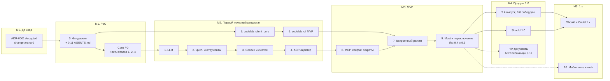

# Дорожная карта: PoC → MVP → Продукт

Status: Accepted

Date: 2026-10-22

Решение: [ADR-0001](../adr/0001-embed-dart-agent-core-behind-acp.md)

Связанные документы:

* [dart-agent-and-clients.md](dart-agent-and-clients.md) — пакеты, клиенты и план миграции по
  этапам 0–10 ([§9](dart-agent-and-clients/09-00-migration-plan.md));
* [agent-core-architecture.md](agent-core-architecture.md) — архитектура ядра агента;
* [agent-parity-goals.md](agent-parity-goals.md) — матрица целей: приоритеты Must / Should /
  Could / Won't, этапы строк, критерий переключения
  ([§6](agent-parity-goals.md#6-критерий-вывода-python-агента-и-переключения-по-умолчанию));
* [`AGENTS.md`](../../../AGENTS.md) — §17 (OpenSpec); [../adr/README.md](../adr/README.md) — §8
  (ADR до реализации).

## Содержание

1. [Назначение](#1-назначение)
2. [Ступени и определения](#2-ступени-и-определения)
3. [Вехи: обзор](#3-вехи-обзор)
4. [Вехи M0–M5](#4-вехи-m0m5)
5. [Срез P0 (PoC)](#5-срез-p0-poc)
6. [Содержание продукта 1.0](#6-содержание-продукта-10)
7. [Оценка объёма этапов](#7-оценка-объёма-этапов)
8. [OpenSpec, ADR и `AGENTS.md`](#8-openspec-adr-и-agentsmd)
9. [Итерации и TDD](#9-итерации-и-tdd)
10. [Экраны клиентов по вехам](#10-экраны-клиентов-по-вехам)

---

## 1. Назначение

План миграции ([§9](dart-agent-and-clients/09-00-migration-plan.md)) отвечает на вопрос «какие
этапы и в каком порядке», матрица целей — «что должно уметь и как проверить». Этот документ
связывает их со ступенями поставки: **когда** результат можно показать, **когда** можно
переключить клиентов на Dart-агента и **когда** можно выпустить продукт публично.

Документ задаёт:

* единственные определения ступеней PoC, «первый полезный результат», MVP, продукт 1.0 и 1.x —
  остальные документы ссылаются сюда, а не повторяют их;
* вехи M0–M5: объём, проверяемые критерии выхода, что веха блокирует и какие открытые вопросы
  нужно закрыть до неё;
* состав среза P0 — сокращённого пути к PoC;
* предложение, какие Should-строки матрицы входят в 1.0, а какие уходят в 1.x;
* грубую оценку объёма этапов и связь с OpenSpec, `AGENTS.md` и TDD.

Даты не назначаются: оценки — относительные размеры (§7). Документ не меняет этапы строк матрицы
и состав задач этапов: он только группирует их по вехам.

## 2. Ступени и определения

| Ступень | Определение | Веха |
|---|---|---|
| **PoC** | срез P0: «промпт → LLM → read/edit/exec → ответ в codelab-app по stdio» без этапа 3 (§5) | M1 |
| **Первый полезный результат** | этапы 4 и 6 выполнены полностью: Dart-агент работает с неизменённым codelab-app по stdio; codelab_cli MVP работает с Python-, scripted- и Dart-агентом ([§9.2](dart-agent-and-clients/09-00-migration-plan.md#92-первый-полезный-результат)) | M2 |
| **MVP** | все Must-строки матрицы зелёные **и** профиль по умолчанию в обоих клиентах переключён на Dart-агента: ворота этапа 9, критерий матрицы [§6](agent-parity-goals.md#6-критерий-вывода-python-агента-и-переключения-по-умолчанию). MVP — внутренняя сборка, публичный релиз в него не входит | M3 |
| **Продукт 1.0** | MVP + публичный релиз (задача 9.4: U-29, D-16, D-18, [§12.7](dart-agent-and-clients/12-7-release-and-distribution.md)) + выбранные Should (§6.1) + нефункциональные документы (§6.3) | M4 |
| **1.x** | остальной пул Should и Could по приоритету (§6.2) | M5 |

**Единственное определение MVP.** MVP = все строки **Must** из §3 и §4.1 матрицы зелёные + все
условия §6 матрицы выполнены + профиль по умолчанию — Dart-агент (задача 9.3). Других
определений нет. Раньше «MVP» называли результат этапов 4 и 6 (ADR-0001, §9.2 плана) — теперь
это «первый полезный результат». Слово «MVP» в именах подсистем ядра («подсистемы с пометкой
MVP», agent-core-architecture §16.1) и в названии этапа 6 («codelab_cli MVP») означает «нужно
до ворот MVP» и с этим определением согласовано.

**Связь с приоритетами.** Must — ровно то, что нужно для MVP ([§1.1 матрицы](agent-parity-goals.md#11-приоритеты)).
Should не блокирует MVP, даже если стоит на этапах 1–8: такие строки делаются в своём этапе,
если дёшево. Задачи, которые явно не блокируют MVP и в DoD этапа идут отдельным пунктом «если
сделано»: 3.8 (вынос результата, T-28), часть 7.5 про `codelab_setup` для D-05, 8.10 (запись
конфига и живая перезагрузка), 8.11 (редакция секретов, P-10), 9.4 (выпуск), 9.6 (онбординг, U-17).

## 3. Вехи: обзор

| Веха | Ступень | Этапы | Главный критерий выхода |
|---|---|---|---|
| **M0** | до кода | — | ADR-0001 — Accepted; OpenSpec change этапа 0 создан |
| **M1** | PoC | 0 полностью; срезы 1, 2, 4 | три теста app проходят против `codelab-agent serve --stdio` |
| **M2** | первый полезный результат | 1–6 полностью | DoD этапов 4 и 6; 62 Must этапов 1–6 зелёные |
| **M3** | MVP | 8, 7, 9 (без 9.4, 9.6) | критерий §6 матрицы; профиль по умолчанию — Dart-агент |
| **M4** | продукт 1.0 | 9.4, 9.6, 9.9–9.11; Should 1.0 | первый публичный `stable`-релиз |
| **M5** | 1.x | Should и Could 9+; этап 10 | по каждой строке — её критерий приёмки |

Порядок этапов — [§9.1 плана](dart-agent-and-clients/09-00-migration-plan.md#91-этапы):
0 → 1 → 2 → 3 → 4; 0 → 5 → 6; 4 → 8; {6, 8} → 7; 7 → 9 → 10. Клиентская ветка (5–6) идёт
параллельно с P0 и с этапами 1–4. Этап 10 не входит в 1.0: он начинается после этапа 9 по
решению владельца продукта.

## 4. Вехи M0–M5

### 4.1. M0 — до кода

**Объём.** Принятие ADR-0001 (Proposed → Accepted) по `docs/architecture/adr/README.md` §8;
согласование этого прохода документации (порядок этапов 8 → 7, деление задачи 8.9, контракт e2e
app, фикстуры с ролями, минимальный конфиг бинаря до этапа 8, TDD); задача 0.11 про `AGENTS.md`
запланирована на этапе 0; OpenSpec change этапа 0 создан.

**Критерии выхода.**

* в `adr/0001-embed-dart-agent-core-behind-acp.md` стоит `Status: Accepted`;
* проверка ссылок в `docs/architecture/` — ноль битых;
* `openspec/changes/<change этапа 0>/` содержит `proposal.md`, `design.md`, `tasks.md`, в
  `tasks.md` есть задача 0.11.

**Блокирует.** Любой код этапов 0–10: реализация начинается только после принятого решения.

**Вопросы до вехи.** ~~Допущение «монорепо» ([CL §11](dart-agent-and-clients/11-assumptions-and-open-questions.md),
допущение 1): агентские пакеты в этом репозитории или в отдельном — меняет contract test и CI.~~
Решено 2026-10-22: монорепо, агентские пакеты в этом репозитории.
Допущение 6 (melos 8 читает секцию `melos:`) проверяется в задаче 0.1 и вехи не держит.

### 4.2. M1 — PoC

**Объём.** Этап 0 полностью и срез P0 этапов 1, 2 и 4 — §5.

**Критерии выхода.** Критерий выхода P0 (§5.3).

**Блокирует.** Не блокирует этапы формально (этапы 1–4 могут идти и без P0), но служит точкой
пересмотра оценки: если P0 не уложился в ориентир по времени, план этапов 1–4 и оценки §7
пересматриваются до продолжения.

**Вопросы до вехи.** Нет: имя переменной ключа и флаги бинаря определены в задаче 4.6
(минимальный конфиг до этапа 8), формат `--llm-script` — блок `llm` фикстуры
(agent-core-architecture §14.7).

### 4.3. M2 — первый полезный результат

**Объём.** Этапы 1–4 доведены до полного объёма после P0; этапы 5 и 6 полностью.

**Критерии выхода.**

* DoD этапов 1–6 выполнены, их OpenSpec changes архивированы (§8);
* 62 строки Must этапов 1–6 (матрица [§7](agent-parity-goals.md#7-сводка-по-этапам)) имеют
  зелёные доказательства;
* conformance агента на корпусе фикстур зелёный (задача 4.8);
* применимые интеграционные тесты app проходят в режиме `CODELAB_E2E_AGENT=dart` (задача 4.9),
  все 8 — в режиме `scripted` без изменений кода app;
* e2e codelab_cli (задача 6.10) проходят против Python-, scripted- и Dart-агента; `codelab -p`
  работает в CI. Как гоняется: `CODELAB_E2E_AGENT=scripted|dart|python` (change
  `add-cli-e2e-agent-matrix`) — scripted и Dart в `check` и CI, Python (тесты обычного хода на
  mock-провайдере) — локально, `melos run test:e2e:cli:python-agent`;
* ручная проверка с Zed (задача 4.10) выполнена.

**Блокирует.** Этап 8 (нужен этап 4) и этап 7 (нужен этап 6).

**Вопросы до вехи.** Блокирующих нет. Риск терминалов (Windows Console, tmux) — PTY-тесты на
macOS и Linux, ручная проверка Windows откладывается до 1.0.

### 4.4. M3 — MVP

**Объём.** Этап 8 (задачи 8.1–8.9; 8.10 — «если сделано»), затем этап 7 (без части 7.5 для D-05),
затем этап 9: задачи 9.1–9.3, 9.5, 9.7, 9.8. Задача 9.9 начинается с заморозки Python-агента
сразу после переключения; задачи 9.4, 9.6, 9.10, 9.11 и удаление Python-агента относятся к M4.

**Критерии выхода.**

* `parity_evidence_test.dart` зелёный: у каждой строки Must есть доказательство (задача 9.1);
* выполнены все шесть условий критерия матрицы [§6](agent-parity-goals.md#6-критерий-вывода-python-агента-и-переключения-по-умолчанию);
* `test:e2e:cli` и остальные Dart VM-наборы зелёные в ночном прогоне CI три ночи подряд;
  Flutter-тесты приложения `test:e2e:app:*`, `test:e2e:app:dart-agent`, `test:e2e:app:embedded`
  в GitHub CI не запускаются — три последовательных зелёных прогона на macOS в ветке
  `release/<version>` (`AGENTS.md` §21)
  ([CL §9.14](dart-agent-and-clients/09-14-stage-9-switch-default.md));
* профиль по умолчанию в app и CLI — Dart-агент (задача 9.3); чек-лист Zed заполнен (9.8).

**Блокирует.** Публичный релиз и всё содержимое 1.0.

**Вопросы до вехи.**

* запускать ли встроенное ядро в отдельном isolate — решается на этапе 7 по замеру задачи 7.8
  (agent-core-architecture [§16.3](agent-core/16-non-mvp-and-open-questions.md#163-открытые-вопросы));
* готовый MCP-клиент на pub.dev или свой — короткая разведка в начале этапа 8 (риски §9.13).

### 4.5. M4 — Продукт 1.0

**Объём.** Задачи 9.4 (поставка по §12.7), 9.6 (онбординг), 9.10 (объявление `codelab.toml`
устаревшим), 9.11 (решение о песочнице ОС); незавершённые задачи «Should — не блокирует MVP»
(3.8, часть 7.5 для D-05, 8.10, 8.11); выбранные Should (§6.1); нефункциональные документы (§6.3).
Переключение может сначала выйти `beta`-релизом; первый `stable` выпускается только вместе с
подписанными дистрибутивами app и опубликованной политикой конфиденциальности (задача 9.4).

**Критерии выхода.**

* `release.yml` выпустил `stable`: артефакты `codelab` и `codelab-agent` для пяти целей,
  подписанный `SHA256SUMS`, `install.sh` / `install.ps1` (критерии U-29, D-16, D-18);
* критерии приёмки всех строк §6.1 зелёные;
* документы §6.3 приняты; ADR о песочнице ОС (9.11) принят, строка P-13 матрицы исправлена;
* Python-агент удалён после одного релизного цикла без регрессий (задача 9.9) — допустимо в 1.0.x.

**Блокирует.** 1.x и этап 10.

**Вопросы до вехи** ([CL §11](dart-agent-and-clients/11-assumptions-and-open-questions.md),
[§16.3 ядра](agent-core/16-non-mvp-and-open-questions.md#163-открытые-вопросы), [§8 матрицы](agent-parity-goals.md#8-открытые-вопросы)):

* владелец учётной записи Apple Developer Program и сертификата Authenticode, на кого выписаны
  (имя издателя в Gatekeeper и SmartScreen) — до задачи 9.4;
* хранение закрытых ключей `release-ed25519` и `sums-p256`: два владельца офлайн-копии, кто
  одобряет джобы окружения `release` — до задачи 9.4;
* домен источника релизов `kUpdateBaseUrl`, страница политики конфиденциальности, постоянный
  идентификатор пакета app вместо `com.example.codelabApp` — до задачи 9.4;
* песочница ОС (P-13): граница папки и одобрения, песочница только на macOS или на трёх ОС —
  задача 9.11 по модели угроз (§6.3), итог — ADR;
* пути Windows: достаточно ли приведения `C:\proj` к `/c/proj` — до выпуска Windows-целей;
* новые зависимости десктопа (`re_highlight`, `desktop_drop`, `pasteboard`, `url_launcher`) —
  архитектурное решение и проверка лицензии до D-06; пороги отображения diff — при D-07.

### 4.6. M5 — 1.x

**Объём.** Пул §6.2 по порядку; Could по решению владельца продукта; этап 10 (мобильные и web).

**Критерии выхода.** У каждой строки — её критерий приёмки из матрицы; у каждого выпуска 1.x —
тот же конвейер релиза, что у 1.0.

**Вопросы до соответствующих строк.** Форма расширения usage (`add-usage-extension`) — до U-13 и
D-09; обобщение «разрешить всегда» до префикса команды или маски пути; порог Terminal-Bench
(H-06); публикация ядра и корпуса фикстур на pub.dev; вопросы A2A (§16.3 ядра) — до E-22;
передача токена WebSocket из web-сборки — этап 10; подстройка OSC 52 — после U-28; индекс
полнотекстового поиска по журналам — после D-17.

## 5. Срез P0 (PoC)

### 5.1. Объём

| Этап | Входит в P0 |
|---|---|
| 0 | все задачи этапа 0, включая 0.11 (`AGENTS.md`); драйвер агентской проверки фикстур перенесён в задачу 4.8 |
| 1 | 1.1–1.6; из адаптеров — только OpenAI-совместимый (1.6); 1.11 (порты `Clock`, `IdGenerator`, `Logger`) и 1.12 (каталог моделей) — их требуют 2.9 и 4.6 |
| 2 | 2.1–2.2, 2.4–2.7 (из инструментов — только `read`, `edit`, `exec`; политика разрешений — первый хук), 2.9 |
| 4 | 4.1 в части методов `initialize`, `session/new`, `session/prompt`, `session/cancel` (без `session/load`, `session/list`, `session/set_mode`; агент не объявляет `loadSession`); 4.2; 4.3; 4.5 только stdio; 4.6 (`codelab-agent serve --stdio`); помощник e2e задачи 4.9 в объёме трёх тестов |

Конфиг бинаря в P0 — только флаги задачи 4.6: `--provider`, `--base-url`, `--model`, ключ из
переменной окружения, `--llm-script <file.json>` для scripted LLM.

### 5.2. Что пропускается

Адаптер Anthropic (1.7) и декораторы (1.8); весь этап 3 (журнал, загрузка и список сессий,
сжатие, вынос результата); WebSocket; корпус conformance агента (4.8) и contract test (4.7); MCP
и YAML-конфиг (этап 8); CLI (этап 6). Задачи 1.9–1.10, 2.3, 2.8, 2.10 и инструменты `write`,
`ls`, `search`, `update_plan` делаются при доводке этапов.

### 5.3. Критерий выхода

* неизменённый код codelab-app проходит `permission_flow_test`, `fs_flow_test` и
  `terminal_flow_test` против `codelab-agent serve --stdio` со scripted LLM — через контракт e2e
  (`CODELAB_E2E_AGENT=dart`, помощник `integration_test/support/e2e_agent.dart`; меняются только
  тесты, не код app);
* один ручной прогон на настоящем OpenAI-совместимом провайдере: промпт → чтение → правка →
  команда → ответ;
* тест `/proj_evil`: выход за `cwd=/proj` отклонён;
* тест «`TurnEnded` ровно один раз» на ход, включая отмену;
* `melos run check` зелёный.

**Ориентир по времени — 2–3 недели.** Выход за ориентир — повод пересмотреть оценки (§4.2), а не
расширять срез.

### 5.4. Как этапы 1–4 доводятся после P0

P0 — явное исключение из зависимости «этап 4 после этапа 3» (§9.9 «Зависимости»). После P0
этапы 1–4 доводятся до полного объёма в обычном порядке: этап 1 (Anthropic, декораторы,
фабрика, smoke) → этап 2 (остальные инструменты, хуки, промпты, сквозной сценарий) → этап 3
целиком → этап 4 (загрузка и список сессий, режимы, устойчивость кадров, WebSocket, contract
test, conformance на корпусе, все применимые тесты app, Zed). Код P0 не выбрасывается: он
пишется в целевых пакетах по документу ядра и под OpenSpec changes этапов 0, 1, 2 и 4. Эти
changes остаются открытыми до выполнения полного DoD этапа (§8).

## 6. Содержание продукта 1.0

> **Предложение, утверждается владельцем продукта.** Выбор ниже — из Should-строк матрицы
> [§3](agent-parity-goals.md#3-матрица-целей) с этапом 9 и 9+ (43 строки). Should-строки
> этапов 1–8 делаются в своих этапах, если дёшево; не сделанные к MVP попадают в 1.0, только если
> они перечислены ниже, иначе — в 1.x.

### 6.1. Should в 1.0

| Порядок | Тема | Строки | Почему в 1.0 |
|---|---|---|---|
| 1 | Публичный релиз | U-29, D-16, D-18 | определение 1.0: установщик и каналы, подписанные дистрибутивы, политика конфиденциальности |
| 2 | Первый запуск | U-17, D-05 (задачи 9.6 и часть 7.5; запись конфига и предконфигурация провайдера — задача 8.10: E-04, E-15, L-25) | публичный пользователь не правит YAML руками: без ключа — мастер, а не голая ошибка |
| 3 | Устойчивость к провайдеру | L-32, L-33 | лимит 429 и зависший стрим — самые частые сбои у настоящих пользователей |
| 4 | Целостность сессий | S-09, S-16, P-10 (задача 8.11), T-28 (задача 3.8) | app и CLI теперь ставятся вместе: второй писатель журнала и огромный вывод не должны портить сессию, а секреты из вывода инструментов — попадать в журнал |
| 5 | Изображения | T-29, C-16 | неподготовленная картинка ломает запрос к провайдеру; повтор картинки раздувает контекст |
| 6 | Режим правок | P-06 | «правки без вопроса, команды с вопросом» — основной режим ежедневной работы |
| 7 | Отображение ответа | U-10, U-11, D-06, D-07 | markdown и diff правок — базовая читаемость в обоих клиентах |
| 8 | Ежедневное удобство | U-27, U-28, H-08, D-17 | модель по папке, копирование из TUI, мысли в headless, поиск сессий |

Итого 25 строк Should: 19 из пула этапов 9 и 9+ и 6 строк этапов 3, 7 и 8 (T-28, D-05, E-04,
E-15, L-25, P-10), то есть все задачи «Should — не блокирует MVP» (3.8, часть 7.5, 8.10, 8.11,
9.4, 9.6). P-10 идёт до T-28: файл выноса не должен содержать сырых секретов (SPL-3).

### 6.2. Пул 1.x по порядку

1. Usage и стоимость: L-11, L-29, U-13, D-09 (после OpenSpec change `add-usage-extension`).
2. Полноэкранный TUI и ввод: U-12, U-24, U-36, U-37.
3. Вложения: U-14, D-12.
4. Провайдеры и сессии: L-24, S-06.
5. Steering посреди хода: C-03.
6. Управление MCP из клиентов: E-13.
7. Web-инструменты: T-13, T-14.
8. Ветки и перемотка сессий: S-07, S-08.
9. Skills: E-06.
10. Субагенты: C-06, C-17.
11. Фоновые команды: T-10.
12. LSP: T-15, E-12.
13. A2A: E-22.
14. Should этапов 1–8, не сделанные к MVP; Could — по решению владельца продукта; этап 10.

### 6.3. Нефункциональные документы 1.0

Пробелы, которые закрываются работой вехи M4; сами документы пока не пишутся.

| Документ | Содержание |
|---|---|
| Модель угроз | активы (код проекта, ключи, журналы), границы доверия (модель, MCP, вывод команд, сеть), сценарии атак и меры; основа решения 9.11 |
| НФТ с числами | задержка до первого токена сверх провайдера, время старта бинарей и app, память на сессию, размер журнала, пределы длины сессии |
| Политика версий и совместимости форматов | semver бинарей; версии формата журнала, `config.yaml`, фикстур, `stream-json` v1, расширений `_codelab/*`; срок поддержки старых версий |
| План тестирования безопасности | обход разрешений и границы папки (в том числе fuzz путей), редакция секретов, MCP-инструменты, проверка подписи релизов |
| `SECURITY.md` | как сообщить об уязвимости, поддерживаемые версии, сроки ответа, отпечатки ключей подписи |
| Владение дорожной картой | владелец продукта, кто утверждает перенос строк между Must / Should / 1.0 / 1.x, порядок пересмотра этого документа |

## 7. Оценка объёма этапов

Грубые относительные размеры (T-shirt), без дат: S < M < L < XL. Получены из аудита документов
этапов; уточняются после P0 (§4.2).

| Этап | Размер | Комментарий |
|---|---|---|
| 0. Фундамент | M–L | CI с нуля, корпус фикстур, сторож |
| 1. LLM | L | два адаптера, SSE, декораторы |
| 2. Цикл, инструменты, разрешения | XL | центральные инварианты ядра |
| 3. Сессии и сжатие | L | журнал, проекции, компактор |
| 4. ACP-адаптер | XL | больше трети Must, принимается по группам фикстур |
| 5. Общий клиентский слой | XL | рефакторинг `CodeLabShellCubit` под защитой тестов |
| 6. codelab_cli MVP | XL | REPL, headless, драйвер фикстур, PTY-e2e |
| 7. Встроенный режим | L | `InProcessAcpLink`, профили хостов, замер UI |
| 8. MCP, конфиг, секреты | XL | MCP-клиент, YAML-конфиг, хранилища секретов ОС |
| 9. Must и переключение | L (M без выпуска) | проверка доказательств, переключение; выпуск 9.4 — отдельная заметная часть |

## 8. OpenSpec, ADR и `AGENTS.md`

* **ADR до кода.** ADR-0001 должен быть Accepted до начала этапа 0 (`adr/README.md` §8: problem →
  ADR proposed → decision accepted → OpenSpec → implementation → architecture docs). Решение о
  песочнице ОС (9.11) — отдельный ADR вехи M4.
* **Change на этап.** OpenSpec change этапа создаётся в начале этапа, до кода (`AGENTS.md` §17;
  правило 2 [§9.0 плана](dart-agent-and-clients/09-00-migration-plan.md#90-общие-правила)); имена
  changes указаны в документах этапов. Расширение ACP (`_meta`, `_codelab/*`) — только через
  утверждённый change.
* **Архив в конце этапа.** Когда DoD этапа выполнен, change архивируется, delta specs сливаются в
  `openspec/specs/` (правило 6 §9.0). Срез P0 работает внутри changes этапов 0, 1, 2 и 4 и их не
  архивирует.
* **`AGENTS.md`.** Задача 0.11 на этапе 0 входит в change этапа 0: корневой `AGENTS.md` §5
  (агентские пакеты, ссылка на документ ядра как источник архитектуры агента, правило §7а) и
  вложенные `AGENTS.md` в `packages/dart/codelab_agent_*` (правила PKG-1…6, сторож импортов,
  TDD). Пакеты следующих этапов получают вложенный `AGENTS.md` в своём этапе; задача 9.7
  дописывает `AGENTS.md` окончательно. До принятия ADR `AGENTS.md` не меняется.

## 9. Итерации и TDD

Разработка идёт **feature first**, маленькими итерациями ([§9.0 плана, правило 8](dart-agent-and-clients/09-00-migration-plan.md#90-общие-правила)): каждая итерация — тонкий сквозной срез одной функции через все нужные ей слои, 1–3 PR и не дольше недели. Архитектура закладывается с первой итерации: границы пакетов, порты и точки расширения взяты из документа ядра и с первого PR проверяются сторожем импортов и allowlist, но пустые пакеты и абстракции «на вырост» не создаются. Итерация завершена, когда (а) функция работает без ошибок и `melos run check` зелёный; (б) новое поведение покрыто unit-тестами, а каждая пересечённая граница — интеграционным тестом на фейках или в процессе; (в) архитектура готова к следующей итерации — её функция встаёт в существующую точку без изменения используемых сигнатур; (г) новая функция добавлена в точке расширения документа ядра, а не условиями в существующем коде; (д) рефакторинг сделан; (е) документы и код не расходятся. Срез P0 (§5) — первая итерация этапов 1–4.

### 9.1. TDD

Правило 3 [§9.0 плана](dart-agent-and-clients/09-00-migration-plan.md#90-общие-правила): каждая
задача начинается с красного теста из критерия приёмки матрицы или раздела «Как проверить»
документа ядра, затем минимальный код до зелёного, затем рефакторинг. Пункты `tasks.md` идут
парами «тест → реализация» со ссылкой на критерий; в PR красный тест виден в истории до кода или
PR ссылается на закрываемый критерий.

Исключения (подробно — в §9.0): характеризационные тесты перед рефакторингом существующего кода
(задача 5.0); интеграционные тесты app и PTY-e2e CLI — приёмочные ворота этапа; для UI test-first
— Cubit и модель отображения, widget-тесты — на поведение; реальные провайдеры, keychain и
процессы ОС — test-first на фейках плюс отдельные интеграционные проверки; разведка — spike с
ограничением по времени без тестов, затем код по TDD.

Критерии выхода вех (§4) — это те же тесты: веха достигнута, когда зелёны доказательства строк
матрицы, а не когда закрыты задачи.

## 10. Экраны клиентов по вехам

Карта экранов app — [§12.3, A13](dart-agent-and-clients/12-3-desktop-display.md), навигация
настроек — [§12.4.9](dart-agent-and-clients/12-4-first-run-and-settings.md); макет — холст Claude
Design «CodeLab Desktop — Feature UI/UX» (номера 01–27 и C1–C14 совпадают с артбордами). Таблицы
ниже не добавляют работы: они показывают, как строки матрицы, уже распределённые по вехам (§3, §6),
складываются в экраны.

**Правило среза.** Экран появляется на вехе своей самой ранней строки и растёт строками следующих
вех. Строка Should этапов 1–8 попадает на экран к M3, только если сделана в своём этапе (§2); иначе
— по §6. Пустых экранов и пунктов навигации «на вырост» нет (SETUP-17, AGENTS.md §13): пункт
появляется вместе с первой работающей строкой.

### 10.1. codelab-app

| № | Экран | M2 | M3 | M4 (1.0) | M5 (1.x) |
|---|---|---|---|---|---|
| 01 | рабочее место | D-01, D-02, D-03, D-08, R-18…R-21 (этапы 4–5, задача 5.9) | D-04 (встроенный агент) | D-06, D-07, T-28 | D-09, D-12, D-22, D-23, C-03 |
| 02 | идущий ход | D-08, R-18, L-05 | — | — | C-03, D-23, D-25 |
| 03 | файлы проекта | — | — | — | D-13 |
| 04 | сессии | D-03, R-03, R-04 | — | D-17, S-09 | S-18, D-10 |
| 05 | Providers | — | — | D-05 (часть 7.5, 8.10) | L-17, L-24 |
| 05b | MCP servers | — | — | — | E-13 |
| 06 | мастер провайдера | — | — | готовые пресеты для D-05 и U-17 (задача 9.6) | L-24 (свой провайдер) |
| 07 | onboarding | — | — | — | D-11 |
| 08 | сторож запуска | D-15 | — | — | — |
| 09 | узкий макет | — | — | — | D-21 (этап 10) |
| 10 | Appearance | — | — | — | D-20 |
| 11 | выбор проекта | R-22 | U-06 (встроенный профиль) | — | — |
| 12 | палитра | R-20 | R-08 (команды агента) | — | U-26, S-21 |
| 13 | меню композера | U-05 (R-05, R-06), L-16, R-18 | E-07 | P-06, U-27 | D-12, C-03, C-04, U-31, E-06 |
| 14 | история сессии | — | — | — | S-06, S-07, S-08, S-21 |
| 15 | вопрос и одобрения | D-02, P-02, P-07 | — | — | T-13, T-22 |
| 16 | доска агентов и задач | — | — | — | D-25, C-06, C-17, T-10, E-22 |
| 17 | usage | — | — | — | D-09, L-29, C-15 (после `add-usage-extension`) |
| 18 | инспектор протокола | R-23, E-16 | — | — | — |
| 19 | соединение и ошибки | L-04, C-02, C-13, K-01, K-02, переподключение (§9.10) | L-08 | L-32, S-09 | C-14, U-26 |
| 20 | Settings › Connection | — | U-06, D-04, R-12 | — | D-10, U-26 |
| 21 | Settings › Agents & modes | — | P-05, R-15 | P-06, U-27 | C-04, U-31, L-10, U-30, E-22 |
| 22 | Settings › Permissions & tools | — | T-26, `permissions.*` | — | T-35 |
| 23 | Settings › Redaction | — | — | — | D-24, P-18, P-19 |
| 24 | Settings › Skills & extensions | — | E-01, E-17 (только чтение) | — | E-06, E-09, E-10, E-18, E-19 |
| 25 | Settings › Code & web | — | — | — | T-13, T-14, T-15, T-17, E-12 |
| 26 | Settings › General | — | — | E-15 (8.10), D-16, D-18 («About») | D-19 |
| 27 | Settings › Keyboard | список сочетаний A13 | — | — | — |
| 28 | панель Terminal в доке (A16) | — | — | — | D-28 (change `add-integrated-terminal`) |
| 29 | split view сессий, сайдбар по проектам, док панелей инструментов (A13, шаг 0) | — | — | — | R-21, S-18 (раскладка; док вводится вместе с первой панелью — Files, D-13) |

Навигация настроек (§12.4.9) появляется на M3 вместе с первой страницей группы Agent; до M3
подключение настраивает существующий `ConnectionSetupDialog`.

На смартфоне и планшете (этап 10, M5) те же экраны получают раскладку по ширине окна и теряют
действия, которых нет в профиле `mobile`: строки Run, `stdio`-MCP, skills, хуки, языковые серверы —
[§12.8](dart-agent-and-clients/12-8-phone-and-tablet.md). Отдельных экранов «только для
телефона» нет.

### 10.2. codelab_cli

| № | Экран | M2 | M3 | M4 (1.0) | M5 (1.x) |
|---|---|---|---|---|---|
| C4 | построчный REPL | U-01, U-02, U-07, U-08, U-09, U-15, U-23 | — | U-10, U-11, U-28 (`/copy`) | — |
| C3 | композер | U-23 | — | — | U-14, U-16, U-24 |
| C2 | одобрение | U-02 | — | — | вид TUI (U-12) |
| C14 | headless | H-01, H-02, H-03, P-09 | — | H-08, U-29 | H-05, H-09 |
| C7 | сессии | S-03, S-04, S-14 | — | S-09 | S-06, S-07, S-08, S-17, S-18, U-37 (полоса и переключатель TUI) |
| C8 | slash-меню и выбор | U-03, U-04, U-05, L-16 | E-07 | U-27 | U-31, U-30, E-06 |
| C10 | `/status`, `/usage` | R-08 | — | — | L-29 |
| C11 | `/mcp`, `/tools` | — | E-04 | — | E-13, T-35 |
| C12 | вопросы и ошибки | L-04, C-02, K-01, K-02 | L-08 | L-32 | T-22, U-26 |
| C5 | первый запуск | — | — | U-17 | L-24 |
| C1 | полноэкранный TUI | — | — | — | U-12, U-13, U-22, U-36, U-37 |
| C9 | доска задач | — | — | — | U-21, T-10, C-06 |
| C13 | `/settings` | — | — | — | U-19, U-25 |
| C6 | `/theme` | — | — | — | U-18 |

### 10.3. OpenSpec changes экранов

Экраны M2–M4 входят в changes своих этапов и строк (`add-codelab-cli`,
`add-command-palette-agent-commands`, `add-app-boot-watchdog`, `add-embedded-agent-mode`,
`add-provider-setup-ui`, `add-session-search` и другие из документов этапов). Новые changes,
которые требует этот срез:

| Change (рабочее имя) | Что вводит | Веха |
|---|---|---|
| `add-app-navigation-shell` | `NavigationCubit`, `AppDestination`, сочетания A13, навигация настроек §12.4.9 | M3 (с первой страницей настроек) |
| `add-usage-extension` (уже назван) | usage хода и шага; затем вкладки Usage и Timeline (A14) | M5 |
| `add-subagent-board` | `_codelab/subagents/*` (§17.3.7), доска app (A15) и вид `tasks` CLI | M5 |
| `add-background-jobs` (уже назван) | `_codelab/jobs/*` (§17.9.11) на той же доске | M5 |
| `add-redaction-settings` | страница «Redaction», `RedactionPreview` (§12.4.9) | M5 |
| `add-integrated-terminal` (уже создан) | панель терминала пользователя (D-28, §12.3 A16); выбор PTY-стратегии — задача 1.1 change | M5 |

---

[План миграции](dart-agent-and-clients/09-00-migration-plan.md) ·
[Матрица целей](agent-parity-goals.md) ·
[Архитектура ядра](agent-core-architecture.md) ·
[Dart-агент и клиенты](dart-agent-and-clients.md) ·
[Поставка и распространение](dart-agent-and-clients/12-7-release-and-distribution.md) ·
[ADR-0001](../adr/0001-embed-dart-agent-core-behind-acp.md)
