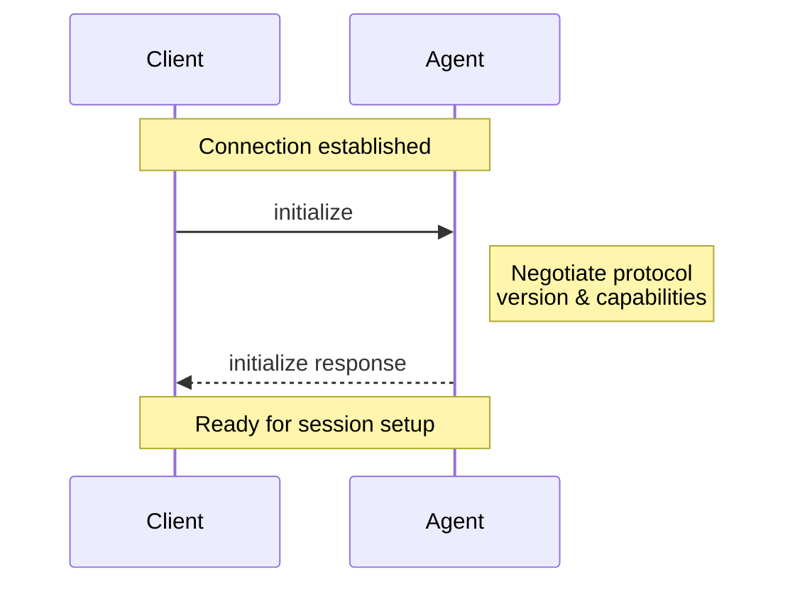

> ## Documentation Index
> Fetch the complete documentation index at: https://agentclientprotocol.com/llms.txt
> Use this file to discover all available pages before exploring further.

# Initialization

> How all Agent Client Protocol connections begin

The Initialization phase allows [Clients](https://agentclientprotocol.com/protocol/v1/overview.md#client) and [Agents](https://agentclientprotocol.com/protocol/v1/overview.md#agent) to negotiate protocol versions, capabilities, and authentication methods.



Before a Session can be created, Clients **MUST** initialize the connection by calling the `initialize` method with:

* The latest [protocol version](#protocol-version) supported
* The [capabilities](#client-capabilities) supported

They **SHOULD** also provide a name and version to the Agent.

```json theme={null}
{
  "jsonrpc": "2.0",
  "id": 0,
  "method": "initialize",
  "params": {
    "protocolVersion": 1,
    "clientCapabilities": {
      "auth": {
        "terminal": true
      },
      "fs": {
        "readTextFile": true,
        "writeTextFile": true
      },
      "terminal": true
    },
    "clientInfo": {
      "name": "my-client",
      "title": "My Client",
      "version": "1.0.0"
    }
  }
}
```

The Agent **MUST** respond with the chosen [protocol version](#protocol-version) and the [capabilities](#agent-capabilities) it supports. It **SHOULD** also provide a name and version to the Client as well:

```json theme={null}
{
  "jsonrpc": "2.0",
  "id": 0,
  "result": {
    "protocolVersion": 1,
    "agentCapabilities": {
      "loadSession": true,
      "promptCapabilities": {
        "image": true,
        "audio": true,
        "embeddedContext": true
      },
      "mcpCapabilities": {
        "http": true,
        "sse": true
      }
    },
    "agentInfo": {
      "name": "my-agent",
      "title": "My Agent",
      "version": "1.0.0"
    },
    "authMethods": []
  }
}
```

## Protocol version

The protocol versions that appear in the `initialize` requests and responses are a single integer that identifies a **MAJOR** protocol version. This version is only incremented when breaking changes are introduced.

Clients and Agents **MUST** agree on a protocol version and act according to its specification.

See [Capabilities](#capabilities) to learn how non-breaking features are introduced.

### Version Negotiation

The `initialize` request **MUST** include the latest protocol version the Client supports.

If the Agent supports the requested version, it **MUST** respond with the same version. Otherwise, the Agent **MUST** respond with the latest version it supports.

If the Client does not support the version specified by the Agent in the `initialize` response, the Client **SHOULD** close the connection and inform the user about it.

## Capabilities

Capabilities describe features supported by the Client and the Agent.

All capabilities included in the `initialize` request are **OPTIONAL**. Clients and Agents **SHOULD** support all possible combinations of their peer's capabilities.

The introduction of new capabilities is not considered a breaking change. Therefore, Clients and Agents **MUST** treat all capabilities omitted in the `initialize` request as **UNSUPPORTED**.

Capabilities are high-level and are not attached to a specific base protocol concept.

Capabilities may specify the availability of protocol methods, notifications, or a subset of their parameters. They may also signal behaviors of the Agent or Client implementation.

Implementations can also [advertise custom capabilities](https://agentclientprotocol.com/protocol/v1/extensibility.md#advertising-custom-capabilities) using the `_meta` field to indicate support for protocol extensions.

### Client Capabilities

The Client **SHOULD** specify whether it supports the following capabilities:

#### Terminal Authentication

**auth.terminal** `boolean`

The Client can reproduce the configured Agent invocation in an interactive
terminal. When `true`, the Agent may advertise `type: "terminal"`
authentication methods.

> Learn more about Terminal Authentication
>
> [Open](https://agentclientprotocol.com/protocol/v1/authentication.md)

#### File System

**readTextFile** `boolean`

The `fs/read_text_file` method is available.

**writeTextFile** `boolean`

The `fs/write_text_file` method is available.

> Learn more about File System methods
>
> [Open](https://agentclientprotocol.com/protocol/v1/file-system.md)

#### Terminal

**terminal** `boolean`

All `terminal/*` methods are available, allowing the Agent to execute and
manage shell commands.

> Learn more about Terminals
>
> [Open](https://agentclientprotocol.com/protocol/v1/terminals.md)

#### Elicitation

**elicitation** `ElicitationCapabilities Object`

The Client advertises its supported `elicitation/create` modes. Omitted or
`null` means no modes are advertised. A present object advertises each mode
only through its corresponding non-null `form` or `url` field. Empty and
all-null objects are valid but advertise no supported modes. Unlike MCP, ACP
does not treat `{}` as form support.

> Learn more about Elicitation
>
> [Open](https://agentclientprotocol.com/protocol/v1/elicitation.md)

#### Boolean Config Options

**session.configOptions.boolean** `BooleanConfigOptionCapabilities Object`

The Client supports `boolean` session configuration options. Omitted or `null`
at any level means the Client does not advertise support. Supplying `{}` means
Agents may include `type: "boolean"` options in v1 `configOptions` payloads.

> Learn more about Session Config Options
>
> [Open](https://agentclientprotocol.com/protocol/v1/session-config-options.md)

#### Session Compaction

**session.compaction** `CompactionCapabilities Object`

The Client supports ID-addressed `compaction_update` and
`compaction_summary_chunk` session updates, including their lifecycle,
placement, patch, and replay semantics. Omitted or `null` at either level
means unsupported. Supplying `{}` advertises the complete contract. Agents
must not send these updates to a v1 Client that does not advertise it.

> Learn more about Session Compaction
>
> [Open](https://agentclientprotocol.com/protocol/v1/prompt-turn.md#session-compaction)

#### Session Notices

**session.notices** `NoticeCapabilities Object`

The Client can present live `notice` session updates to the user. This field
is optional and nullable. Omitting `session` or `notices`, or setting either
to `null`, means unsupported. Supplying `{}` advertises notice support. Agents
must not send notices without this capability and may instead use an agent
message when the information should still be surfaced to the user.

> Learn more about Session Notices
>
> [Open](https://agentclientprotocol.com/protocol/v1/prompt-turn.md#session-notices)

### Agent Capabilities

The Agent **SHOULD** specify whether it supports the following capabilities:

**loadSession** `boolean`

The [`session/load`](https://agentclientprotocol.com/protocol/v1/session-setup#loading-sessions) method is
available.

**promptCapabilities** `PromptCapabilities Object`

Object indicating the different types of [content](https://agentclientprotocol.com/protocol/v1/content.md) that
may be included in `session/prompt` requests.

**auth** `AgentAuthCapabilities Object`

Authentication-related capabilities supported by the Agent.

#### Prompt capabilities

As a baseline, all Agents **MUST** support `text` and `resource_link` content blocks in `session/prompt` requests.

Optionally, they **MAY** support richer types of [content](https://agentclientprotocol.com/protocol/v1/content.md) by specifying the following capabilities:

**image** `boolean`

The prompt may include `image` content blocks

**audio** `boolean`

The prompt may include `audio` content blocks

**embeddedContext** `boolean`

The prompt may include `resource` content blocks

#### MCP capabilities

**http** `boolean`

The Agent supports connecting to MCP servers over HTTP.

**sse** `boolean`

The Agent supports connecting to MCP servers over SSE.

Note: This transport has been deprecated by the MCP spec.

#### Authentication Capabilities

**logout** `LogoutCapabilities Object`

The [`logout`](https://agentclientprotocol.com/protocol/v1/authentication#logging-out) method is available.

> Learn more about Authentication
>
> [Open](https://agentclientprotocol.com/protocol/v1/authentication.md)

#### Session Capabilities

As a baseline, all Agents **MUST** support `session/new`, `session/prompt`, `session/cancel`, and `session/update`.

Optionally, they **MAY** support other session methods and notifications by specifying additional capabilities.

**delete** `SessionDeleteCapabilities Object`

The [`session/delete`](https://agentclientprotocol.com/protocol/v1/session-delete) method is available.
Omitted or `null` both mean the Agent does not advertise support. Supplying an
empty object means the Agent supports deleting sessions from `session/list`.

**additionalDirectories** `SessionAdditionalDirectoriesCapabilities Object`

The Agent supports `additionalDirectories` on supported session lifecycle
requests. Omitted or `null` both mean the Agent does not advertise support.
Supplying `{}` means the Agent supports additional workspace roots.

> [!NOTE]
>
> `session/load` is still handled by the top-level `load_session` capability.
> This will be unified in future versions of the protocol.

## Implementation Information

Both Clients and Agents **SHOULD** provide information about their implementation in the `clientInfo` and `agentInfo` fields respectively. Both take the following three fields:

**name** `string` *required*

Intended for programmatic or logical use, but can be used as a display name
fallback if title isn’t present.

**title** `string`

Intended for UI and end-user contexts — optimized to be human-readable and
easily understood. Optional; omitted and `null` are equivalent. If not
provided, the name should be used for display.

**version** `string` *required*

Version of the implementation. Can be displayed to the user or used for
debugging or metrics purposes.

> [!NOTE]
>
> Note: in future versions of the protocol, this information will be required.

***

Once the connection is initialized, you're ready to [create a session](https://agentclientprotocol.com/protocol/v1/session-setup.md) and begin the conversation with the Agent.


This documentation is built and hosted on [Mintlify](https://mintlify.com), a developer documentation platform.