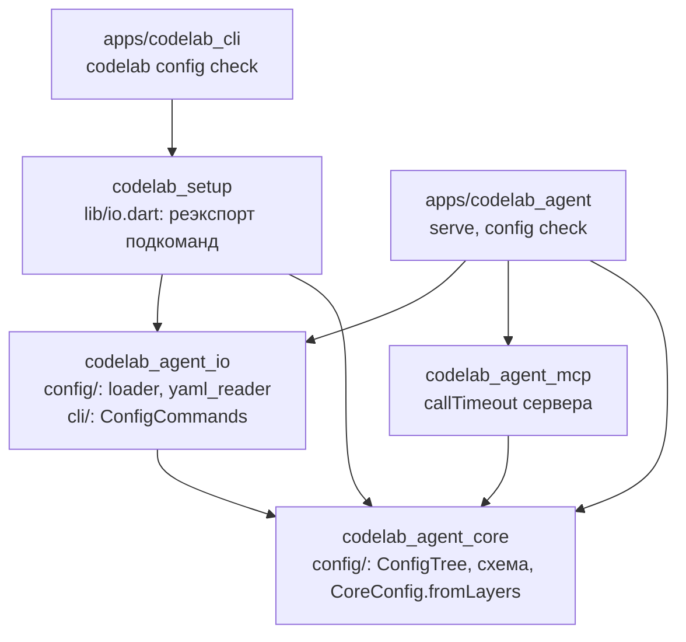

## Context

**Что есть в коде:**
- **Бинарь.** `apps/codelab_agent` собирает конфиг только из флагов и переменных (`lib/src/cli/serve_args.dart`, тип `ServeOptions`, D4 change `add-codelab-agent-binary`):
  - один провайдер `cli` из `--provider`/`--base-url`/`--model` и ключ `CODELAB_API_KEY`;
  - `--permission-mode`, `--log-level`, `--log-file`;
  - сценарий `--llm-script` для тестов;
  - `AgentHost.build` (`lib/src/host/agent_host.dart`) создаёт `StaticModelCatalog` из одного провайдера, одну функцию модели `createStreamFunction`, `JsonlSessionStore` под `$CODELAB_HOME/sessions` и `McpClientConnector`;
  - `CoreConfig` получает только `defaultModel` и режим.
- **Ядро.** `CoreConfig`, `PermissionsConfig` и `CompactionOverrides` лежат в `codelab_agent_core/lib/src/host/services.dart`. Поле `CoreConfig.mcpServers` уже есть (пусто до 8.5). Правило «сервер клиента с тем же `name` вытесняет сервер конфига» реализовано в `AgentRuntimeImpl` (D6 архива `openspec/changes/archive/2026-10-29-add-agent-mcp-client/design.md`). `ConfigException`, `ConfigTree` и `ConfigIssue` в коде нет.
- **MCP.** Таймаут `tools/call` — `McpClientOptions.callTimeout` (10 минут), один на коннектор (D8 архива). Ключ `mcp.servers[*].call_timeout` архив передал этому change.
- **IO-пакет агента.** Allowlist `codelab_agent_io` уже содержит `yaml`, `yaml_edit`, `toml` (`pubspec_allowlist_test.dart`, `ioAllowlist`; `agent-core/01-layers-and-packages.md` §1.2), но в `pubspec.yaml` их нет. После решения пользователя 2026-10-29 (D12) `toml` не нужен; убрать его из allowlist — задача 0.2, в коде — задача 7.2.
- **Клиенты.** CLI не может импортировать `package:codelab_agent_*` (PKG-4, правило `apps/codelab_cli` в `rules.dart`). Пакета-моста `codelab_setup` ещё нет: в `rules.dart` — только заготовка `// stage 7: codelab_setup`.
- **Свои настройки CLI.** У CLI есть свои профили подключения (`profiles.json`, `codelab_client_io/lib/src/stores/json_file_profile_store.dart`). Это настройки клиента, а не агента; этот change их не трогает и конкурирующего механизма не вводит (`AGENTS.md` §14).
- **Решение пользователя 2026-10-29.** Совместимость с `codelab.toml` Python-агента убрана из scope: файл не читается, не разбирается и не переводится командой. Агент только предупреждает, что нашёл его (D12). Чтения в память, `config migrate`, `ConfigLegacyReadOnlyException`, `config.legacy_ignored` и зависимости `toml` в этом change нет.

**Источники требований:**
- `agent-core/15-configuration.md` целиком;
- `agent-core/17-5-agent-setup.md` §17.5.2 (контракты `ConfigIssue`, `ConfigLoadResult`), §17.5.4 (ссылки на секреты), §17.5.5 (подкоманды CLI);
- `agent-core/12-observability-and-errors.md` §12.4.3 (ключи `redact.*`);
- `agent-core/10-core-assembly-and-profiles.md` §10.3;
- план `09-13-stage-8-mcp-config.md`, задача 8.5 и абзац «OpenSpec change»;
- `dart-agent-and-clients/12-4-first-run-and-settings.md` §12.4.2 (`codelab_setup`);
- `agent-parity-goals.md`, строки R-16, E-02, E-03, DF-12, DF-15;
- места поиска `codelab.toml` — из Python-агента (`codelab-workspace/codelab-agent`, `server/config.py`, только список путей; код не копируется, `AGENTS.md` §5).

**Расхождения документов и кода** (решаются ниже и правкой документов в итерации 0):
1. План говорит `CoreConfig` + `validate()` → `ConfigIssue(path, message)`. §15.1 говорит `CoreConfig.fromLayers(List<ConfigTree>)`, §17.5.2 — `ConfigIssue {key, source, line, column, message}`, §15.5 — `ConfigException`. Решение — D3.
2. §15.1 и план кладут `CoreConfig` в `config/core_config.dart`, а код — в `host/services.dart`. Решение — D3.
3. §15.4 не содержит `mcp.servers[*].call_timeout`, хотя D8 архива его обещает. Решение — D10.
4. §10.3 требует «один снимок `CoreConfig` на корень сессии», а `buildAgentCore` принимает один `CoreConfig` на процесс. Решение — D9, OQ1.
5. §17.5.5 кладёт общую реализацию подкоманд в `codelab_agent_io/lib/src/cli/` и говорит, что CLI вызывает её через `codelab_setup/io.dart`. Но в allowlist `codelab_agent_io` нет `args`, а `codelab_setup` не существует. Решение — D13, D14, OQ2.
6. Ключи схемы §15.4, у которых в коде ещё нет потребителя (`tools.*`, `loop.*`, `exec.*`, `prompts.*` и др.). Документ не говорит, что с ними делать до появления потребителя. Решение — D6, OQ4.
7. §15.7, §15.12, CFG-20, R-16 и план 8.5 описывают чтение `codelab.toml` и `config migrate`. Решение пользователя 2026-10-29 их отменяет; документы и строка R-16 правятся в итерации 0 (D12).

## Goals / Non-Goals

**Goals:**
- Агент читает `config.yaml` всех слоёв §15.2, проверяет его строго (CFG-1, CFG-21) и не стартует на битом конфиге: код `64`, файл, строка, столбец и путь ключа. Ошибка не всплывает исключением на первом ходе.
- Проверка — чистая функция ядра. Мобильный и web-хосты позже передадут ей настройки без позиций и получат ту же проверку (CFG-5).
- Проектный конфиг без доверия не расширяет права агента (CFG-3), ключи API — только ссылками (CFG-2), `autopilot` — только флагом (CFG-4).
- MCP-серверы из конфигурации подключаются в сессии так же, как серверы клиента (E-02, E-03), с `call_timeout`.
- Пользователь Python-агента, у которого есть только `codelab.toml`, получает одно предупреждение `config.legacy_found` с путём и ссылкой на таблицу ручного переноса; файл не читается (R-16 в редакции 2026-10-29). Неизвестный ключ или вид провайдера в YAML — ошибка, а не тихий mock (DF-15); `agents.definitions` в YAML — ошибка с подсказкой (DF-12).
- `codelab-agent config check` и `codelab config check` работают без запуска агента.
- Ядро остаётся web-безопасным, PKG-2 не расширяется.

**Non-Goals:** см. proposal, «Не входит». Главное: здесь нет записи конфига, перезагрузки, хранилища секретов и редакции.

## Decisions

### D1. Раскладка по пакетам и направление зависимостей



- **`codelab_agent_core/lib/src/config/`** — чистые типы и проверка: `config_tree.dart`, `config_issue.dart`, `schema.dart`, `core_config.dart` (переезд из `host/services.dart`), `resolve.dart` (`CoreConfig.fromLayers`), `redact_settings.dart`. Разборщиков и файлов нет (CFG-5).
- **`codelab_agent_io/lib/src/config/`**:
  - `config_loader.dart` — поиск файлов и порядок слоёв;
  - `yaml_reader.dart` — `package:yaml` и профиль §15.5 → `ConfigTree`;
  - `environment_layer.dart` — `CODELAB_*` → `ConfigTree`;
  - `legacy_notice.dart` — проверка наличия `codelab.toml` без чтения (D12).

  **`codelab_agent_io/lib/src/cli/config_commands.dart`** — общая логика подкоманды `config check`: тексты и коды выхода (D13).
- **`codelab_agent_mcp`** — `McpClientConnector` берёт `server.callTimeout ?? options.callTimeout` (D10).
- **`apps/codelab_agent`** — разбор флагов, слой флагов (`ConfigTree` с `source: flags`), `AgentHost.build` из `ConfigLoadResult`, подкоманда `config`.
- **`packages/dart/codelab_setup`** (новый, мост без стороны, ADR-0002) — по §12.4.2 (решение OQ2 (а), 2026-10-29). Основной барель реэкспортирует чистые типы ядра `ConfigIssue`, `ConfigLoadResult`. `lib/io.dart` реэкспортирует `ConfigCommands` из `codelab_agent_io`. Больше ничего: мастер, `AgentConfigStore`, `SettingsAccess` — позже, вместе с потребителями (§13: без абстракций «на вырост»).
- **`apps/codelab_cli`** — подкоманда `config`, вызывает `package:codelab_setup/io.dart`.

Направление: приложения → мост → `_io` → ядро; `_mcp` → ядро. Ядро ни от кого не зависит. Циклов нет. Клиенты не импортируют `codelab_agent_*` (PKG-4): `codelab_setup` — разрешённый мост, как запланировано в §12.4.2.

**Правила сторожа** (`rules.dart` и `pubspec_allowlist_test.dart`, задачи 1.1–1.2, 7.2, 11.1–11.2):
- `codelab_agent_core` — к запретам добавляются `package:yaml/`, `package:yaml_edit/`, `package:toml/` (§15.12, «Тест-сторож»; allowlist PKG-2 их и так не пустит, но правило импорта даёт точное сообщение и ловит транзитивный импорт через `export`);
- `codelab_agent_io` — `toml` убирается из allowlist (`ioAllowlist`): читателя TOML больше нет, а лишний пункт allowlist — приглашение вернуть его без OpenSpec;
- `codelab_setup` — правило из заготовки `rules.dart`: основной барель без `webUnsafe`, `package:codelab_agent_io/`, `package:codelab_acp_`, `package:codelab_client_`, `package:flutter/`; исключение — `lib/io.dart` и `lib/src/io/`;
- allowlist `codelab_setup` = `{codelab_agent_core, codelab_agent_io, meta}`. `http` из §12.4.2 появится с `HttpProviderCheck`. В `cliAllowlist` добавляется `codelab_setup`.

**README:** в таблицу и граф пакетов добавляется `codelab_setup`, рёбра `codelab_cli → codelab_setup → codelab_agent_io, codelab_agent_core`.

Альтернатива — подкоманды целиком в каждом приложении — отклонена. Два текста ошибок разошлись бы, а §17.5.5 требует одной реализации у `codelab` и `codelab-agent`.

### D2. Технология: `yaml` и `yaml_edit` (`AGENTS.md` §4)

Разведка pub.dev 2026-10-29:

| Пакет | Версия, дата | Издатель, лицензия | Платформы | Зависимости | Решение |
|---|---|---|---|---|---|
| `yaml` | 3.1.4, 2026-08-28 (в lock — 3.1.3 транзитивно) | `tools.dart.dev`, MIT | все, включая web и wasm | `collection`, `source_span`, `string_scanner` | единственная новая прямая зависимость `codelab_agent_io`, `^3.1.3` |
| `yaml_edit` | 2.2.4, 2026-02-13 (в lock — 2.2.4 транзитивно) | `tools.dart.dev`, BSD-3-Clause | все | `yaml`, `source_span`, `collection`, `meta` | утверждён для `ConfigWriter` (§17.5.5); в `pubspec.yaml` — в change 8.10, где появляется запись |

- **Почему разбор в `_io`, а не в ядре.** `yaml` web-безопасен, но ядро не должно знать формат файла:
  - мобильный и web-хосты передают дерево из хранилища приложения (§15.1);
  - PKG-2 запрещает расширять allowlist ядра без нужды;
  - CFG-5 прямо требует держать разборщики в `codelab_agent_io`.

  Ядро получает уже разобранный `ConfigTree`.
- **`yaml_edit` в 8.5 не добавляется:** в 8.5 нет ни одной записи конфига, а зависимость без потребителя — «на вырост» (§13).
- **`toml` не добавляется** (решение пользователя 2026-10-29, D12): `codelab.toml` не читается. `petitparser` и `web` остаются только транзитивными зависимостями других пакетов lock.

Альтернативы:
- (а) свой разборщик YAML — отклонён: строгий профиль — подмножество YAML 1.2, но позиции, flow-стиль, CRLF и экранирование — большая поверхность ошибок;
- (б) конфиг в JSON — отклонён ADR-0001, п. 11 и §15.11.

`THIRD_PARTY_NOTICES.md` не меняется: зависимости pub.dev туда не вносятся, а алгоритм Левенштейна для подсказки — общеизвестный (D6).

### D3. Контракт ядра: `ConfigTree`, `ConfigIssue`, `CoreConfig.fromLayers`

```dart
// codelab_agent_core/lib/src/config/config_tree.dart
enum ConfigLayerKind { defaults, user, project, projectLocal, extra, environment, flags, appStorage }
final class ConfigPosition { final int line, column; }            // с 1
final class ConfigTree {
  final ConfigLayerKind kind;
  final String source;                       // путь файла, "defaults", "env", "flags", "app-storage"
  final Map<String, Object?> values;         // String, int, double, bool, List, Map<String, Object?>
  final Map<String, ConfigPosition> positions;   // "mcp.servers[github].url" → позиция; пусто — без строк
}

// config_issue.dart
enum ConfigIssueKind { syntax, profile, unknownKey, type, value, inlineSecret, semantic }
final class ConfigIssue {
  final ConfigIssueKind kind;
  final String key;                          // путь ключа; "" — файл целиком (синтаксис)
  final String source; final int? line, column;
  final String message;                      // никогда не содержит значения секрета
  // только у предупреждений: имя события лога, его поля (без значений) и уровень
  final String? event; final Map<String, Object?> fields; final LogLevel? level;
}
final class ConfigLoadResult {
  final CoreConfig? config;                  // null ⇔ issues не пусто
  final HostSettings? host;                  // ключи хоста: sessions.*, logging.*, profile.*
  final List<ConfigIssue> issues, warnings;
  final List<String> sources;                // слои по порядку
  CoreConfig orThrow();                      // config или ConfigException/ConfigInlineSecretException
}
final class ConfigException implements Exception { final List<ConfigIssue> issues; }
final class ConfigInlineSecretException extends ConfigException { final String key; }

// resolve.dart
static ConfigLoadResult CoreConfig.fromLayers(List<ConfigTree> layers,
    {required Map<String, String> environment, String? projectRoot});
```

- **Сверка с планом.** «`validate()` → `ConfigIssue(path, message)`» плана — это `ConfigLoadResult.issues`. Поля `ConfigIssue` взяты по §17.5.2: путь ключа плана — `key`. Поле `kind` добавлено: тестам и `ConfigInlineSecretException` нужен класс проблемы, а не разбор текста. Поля `legacy` из §17.5.2 нет: `codelab.toml` не читается (D12). Документ §17.5.2 правится задачей 0.2. Отдельной публичной `validate()` нет: проверка без слияния никому не нужна (§13).
- **Предупреждения — тоже `ConfigIssue`** (ревью итерации 1, 2026-10-30): у них заполнены `event` (имя события D16), `fields` (поля события без значений ключей) и `level`. Хост пишет их в лог как есть, не разбирая текст. У проблем эти поля пустые.
- **Исключения.** `fromLayers` исключений не бросает. Хост, которому нужно исключение (`serve`), вызывает `ConfigLoadResult.orThrow()` (ревью итерации 1, 2026-10-30): она возвращает `CoreConfig` или бросает `ConfigException(issues)`. Если среди проблем есть `inlineSecret`, бросается `ConfigInlineSecretException` с ключом первой из них — подкласс `ConfigException`, как в §17.5.2. Поле `suggestedSecretName` §17.5.2 добавит change 8.9 вместе с `SecretNames` (D8).
- **Раскладка.** `CoreConfig`, `PermissionsConfig`, `CompactionOverrides` переезжают в `config/core_config.dart` (§1.3). Экспорт бареля тот же, сигнатуры не меняются, существующие вызовы `const CoreConfig(defaultModel: …)` компилируются.
- **Новые поля `CoreConfig`:**
  - `providers: List<CatalogProvider>` — существующий тип каталога;
  - `providerProblems: Map<String, String>` — id провайдера → причина недоступности ключа (D8);
  - `redact: RedactSettings`;
  - `projectRoot: String?` и `withoutProject: CoreConfig?` (D9).
- **`HostSettings`** — ключи, которые читает хост, а не ядро:
  - `sessionsDir`, `fsync` — строкой (`checkpoints` | `always` | `never`) (ревью итерации 1, 2026-10-30): `FsyncPolicy` живёт в `codelab_agent_io`, ядро от него не зависит, хост переводит строку в enum;
  - `logLevel`, `logFile`;
  - `profileNarrowing: Map<String, Map<HostCapability, CapabilityState>>`.

  Ключи живут в результате загрузки, а не в `CoreConfig`, чтобы ядро не получало полей, которых не читает.

**Алгоритм `fromLayers`** — §15.5, шаги 3–9, над готовыми деревьями:
1. Каждый слой проверяется по схеме (D6): неизвестный ключ — с подсказкой; неверный тип — с ожидаемым типом.
2. Поля-секреты отклоняются (D8).
3. К проектным слоям (`project` и `projectLocal`) применяются правила доверия (D7). `trusted_projects` берётся только из глобального слоя (`user` или `appStorage`) и содержит только абсолютные пути (`~` раскрывается): относительный путь — проблема `value` `expected an absolute path` с ключом `trusted_projects[i]` (ревью итерации 1, 2026-10-30). В проектных слоях этот ключ отбрасывается с предупреждением `config.project.untrusted_key` (`ignored: trusted_projects is read only from the global config`), в слое `extra` (`--config`) — проблема `value` с тем же текстом.
4. Слияние по §15.2 (D4).
5. Подстановка `${ENV}` из `environment` (D4).
6. Семантические проверки §15.5, шаг 8, для ключей 8.5:
   - `default_model` — в каталоге: модель есть в `providers.<p>.models` своего провайдера (ревью итерации 1, 2026-10-30);
   - у `openai-compatible` есть `base_url`;
   - `mcp.servers`: уникальные `name`, `stdio` имеет `command`, `http` имеет `url`;
   - `reserve_tokens > 0`, `keep_recent_tokens > 0`, `max_steps ≥ 1`;
   - `idle_timeout_reasoning ≥ idle_timeout`;
   - `permissions.mode != autopilot`;
   - `redact.*`.
7. Сборка `CoreConfig` и `HostSettings`. Если есть проблемы, `config` и `host` равны `null`.

**Имена ключей проблем** (ревью итерации 1, 2026-10-30): сужение профиля — `profile.<name>.<capability>`; элемент списка — с индексом (`redact.layers[1]`); взаимоисключение `api_key_env`/`api_key_secret` — ключ `providers.<id>.api_key_secret` (второй из пары). Тесты сверяют ключ, а не текст.

Позиции берутся из `ConfigTree.positions`. У слоя без позиций (`environment`, `flags`, `appStorage`) сообщение называет источник и путь ключа без строки (`config_validator_positions_test.dart`, §15.12).

### D4. Слои, слияние, окружение и флаги

Порядок (`ConfigLoader.load(cwd, environment, flags)`):

| # | Слой | `kind` | Когда читается |
|---|---|---|---|
| 1 | встроенные умолчания | `defaults` | всегда |
| 2 | `$CODELAB_HOME/config.yaml` | `user` | без `--llm-script` |
| 3 | `<cwd>/.codelab/config.yaml` | `project` | без `--llm-script` |
| 4 | `<cwd>/.codelab/config.local.yaml` | `projectLocal` | без `--llm-script` |
| 4а | `--config <path>` / `CODELAB_CONFIG` | `extra` | всегда, если задан; отсутствует — проблема (ниже) |
| 5 | `CODELAB_*` | `environment` | всегда |
| 6 | флаги | `flags` | всегда |

- **Только эти имена.** Читаются только `config.yaml` и `config.local.yaml`. `config.yml` рядом с ними — предупреждение `config.file.ignored` с подсказкой переименовать: молча игнорировать нельзя, а читать оба — значит выбирать между ними. У `--config` расширение `.yaml`/`.yml`; `.toml` — ошибка использования `--config needs a .yaml file; codelab.toml is not supported, see agent-core-architecture §15.7` (D12).
- **Отсутствующий файл** (решение пользователя 2026-10-30). Слои 2–4 ищутся по соглашению, и их отсутствие — норма: пропуск. Слой 4а назван явно; если файла нет или он не читается, загрузчик возвращает `ConfigIssue(kind: syntax, key: "", source: "--config" | "CODELAB_CONFIG", message: "cannot read the file: …")`, `serve` выходит с кодом `64`. Почему не пропуск: опечатка в пути запустила бы агента без ожидаемых запретов или серверов, и пользователь узнал бы об этом только по поведению. Почему `syntax`, а не новый вид: это проблема файла целиком (ключ `""`), как и невалидный UTF-8; новый `ConfigIssueKind` ради одного случая не нужен (§13).
- **`CODELAB_CONFIG` — только абсолютный путь** (решение пользователя 2026-10-30). Относительный — ошибка использования `CODELAB_CONFIG must be an absolute path` (код `64`, до загрузки). Почему: загрузчик разрешает относительный путь от корня проекта, а слой 4а правилам доверия не подчиняется. Переменная окружения переживает смену каталога (`.envrc`, профиль оболочки, CI): `CODELAB_CONFIG=.codelab/agent.yaml` в склонированном недоверенном репозитории читал бы файл этого репозитория как слой запускающего и обходил бы CFG-3. Флаг `--config` пишется на конкретный запуск и МОЖЕТ быть относительным: он разрешается от текущего каталога процесса (у `serve` это и корень проекта, поэтому файл назван осознанно тем, кто запускает).
  - Альтернатива (а): подчинить `extra` доверию, если путь лежит внутри проекта — отклонено: правило зависело бы от расположения файла, а `--config` в тестах фикстур указывает во временный каталог и внутрь проекта.
  - Альтернатива (б): разрешать относительный `CODELAB_CONFIG` от `$CODELAB_HOME` — отклонено: неочевидно пользователю и расходится с `--config`.
- **`--llm-script`.** Слои 2–4 не читаются, только `--config`, окружение и флаги. Так сохраняется инвариант спецификации `agent-binary`: «с `--llm-script` бинарь не читает `$CODELAB_HOME`». Тестам фикстур конфиг подаётся явно через `--config`. Журнал сценария — только `--sessions-dir` (без него — память, change `add-llm-script-session-store`): явно заданные `sessions.dir` и `sessions.fsync` из `--config` не применяются и дают `config.key.not_applied {key, source}` (решение пользователя 2026-10-30). Почему: `sessions.dir` из общего конфиг-файла, переданного тестом, направил бы журналы сценария в каталог пользователя, а применять ключ «частично» (только `fsync`) — путаница без потребителя.
- **`extra` и доверие.** Слой `extra` правилам доверия не подчиняется: файл назвал тот, кто запускает агента, как и у слоёв 5–6 (§15.3, последний абзац).
- **Слияние** (§15.2):
  - отображения сливаются рекурсивно;
  - скаляры и списки заменяются целиком;
  - `mcp.servers` сливается по `name`: тот же `name` заменяет сервер, новый добавляется в конец, `enabled: false` в более приоритетном слое выключает сервер;
  - `tools.disabled` слоёв 2–4 объединяется (ключ не применяется в 8.5, но правило слияния — часть схемы, и тест слияния его проверяет).
- **Подстановка `${ENV}`** — пункты 1–6 §15.5:
  - разрешена только в `providers.*.base_url`, `providers.*.headers.*`, `mcp.servers[*].args[*]`, `.env.*`, `.url`, `.headers.*`;
  - синтаксис `${NAME}`, `$${` → `${`, `$NAME` — литерал;
  - незаданная переменная — проблема `value` с путём ключа и именем переменной;
  - результат повторно не раскрывается.

  Форма `${secret:<name>}` распознаётся отдельно (D8).
- **Окружение и флаги бинаря** (§15.6), строятся хостом в `ConfigTree`:

  | Переменная | Флаг | Ключ |
  |---|---|---|
  | `CODELAB_HOME` | — | корень (не ключ) |
  | `CODELAB_CONFIG` | `--config <path>` | слой 4а |
  | `CODELAB_MODEL` | `--model` (повторяемый) | `agent.default_model`; с `--provider` — `cli/<m>` и `providers.cli.models` |
  | — | `--provider`, `--base-url` | `providers.cli.kind`, `.base_url`; слой флагов заменяет `providers.cli` целиком |
  | `CODELAB_API_KEY` | — | `providers.cli.api_key_env = "CODELAB_API_KEY"` при `--provider`, только если переменная задана и непуста |
  | `CODELAB_PERMISSION_MODE` | `--permission-mode` | `permissions.mode`; `autopilot` только флагом (CFG-4) — `PermissionsConfig.modeOverride` |
  | `CODELAB_LOG_LEVEL`, `CODELAB_LOG_FILE` | `--log-level`, `--log-file` | `logging.level`, `logging.file` |
  | `CODELAB_MAX_STEPS` | `--max-steps <n>` (новый) | `budget.max_steps` |

  - **Провайдер `cli` из флагов** (решение пользователя 2026-10-30):
    - `api_key_env: CODELAB_API_KEY` ставится, только если переменная задана и непуста. Иначе провайдер без ключа: Ollama и LM Studio работают как на этапе 4, без ложного `config.provider.key_missing` и без отказа хода `API key variable CODELAB_API_KEY is not set`. Пустая строка равна отсутствию переменной, как у остальных `CODELAB_*` (`environment_layer.dart`).
    - Слой флагов при `--provider` заменяет отображение `providers.cli` целиком, а не сливается с ним по §15.2. Почему: `headers` (в том числе `Authorization` через `${ENV}`), `api_key_env`, `api_key_secret` и модели глобального `providers.cli` относятся к его `base_url`; рекурсивное слияние отправило бы их на адрес `--base-url`, который может быть чужим (утечка секрета, приоритет 1). Это единственное исключение из рекурсивного слияния. Хост не может убрать значения нижних слоёв из своего дерева, поэтому правило живёт в слиянии ядра (`merge.dart`): у слоя вида `flags` отображение `providers.cli` заменяет итог нижних слоёв целиком. Нового публичного API не нужно, правило §15.2 для остальных ключей не меняется.
    - Альтернатива: запретить `providers.cli` в файлах — отклонено: id `cli` в файле допустим и без флагов (пользователь мог назвать так провайдера), ломать такой конфиг незачем.
  - `--model <provider>/<model>` без `--provider` выбирает модель из конфига. Ошибка «named providers come with the config of stage 8» уходит. Повтор `--model` без `--provider` — ошибка использования `--model can be repeated only together with --provider`: без провайдера флагов нет списка моделей, которым повтор служил бы.
  - `--model gpt` без косой черты и без `--provider` — ошибка использования `--model needs <provider>/<model> without --provider`.
  - Без провайдера в флагах и без `--llm-script` модель даёт `agent.default_model`; её отсутствие — проблема `agent.default_model: required` (код `64`) вместо прежнего «no model source».
  - `--max-steps` — целое `≥ 1`, иначе ошибка использования; нечисловой `CODELAB_MAX_STEPS` — проблема `type` с ключом `budget.max_steps` (источник `env`).
  - Неизвестные `CODELAB_*` — по-прежнему предупреждение `config.env.unknown`.
  - Имя переменной из `--token-env` предупреждения не даёт.

### D5. Строгий профиль YAML в `yaml_reader`

Профиль §15.5 проверяется в `codelab_agent_io` до валидатора ядра. Каждое нарушение — `ConfigIssue(kind: profile | syntax)` с файлом, строкой и столбцом (столбец и строка `package:yaml` + 1).

| Пункт §15.5 | Как проверяется |
|---|---|
| 1. один документ | `loadYamlStream`: больше одного документа — `multiple YAML documents are not supported`; пустой файл или только комментарии — пустой слой |
| 2. якоря, алиасы, `<<`, теги | `<<` — по ключу дерева. Алиас — по идентичности узлов: `package:yaml` возвращает один объект узла для якоря и ссылки. Якорь и явный тег — по тексту `span` узла: `span.text` начинается с `&` или `!` (итог разведки ниже); проверяются все узлы, включая ключи и корень документа. Нестандартный тег, на котором `package:yaml` бросает `YamlException`, переводится в ту же проблему профиля без имени тега в тексте |
| 3. ключи — только строки, без повторов | тип ключа `YamlScalar.value`; повтор — ошибка `package:yaml` `Duplicate mapping key`, позиция второго ключа из её `span`, первого — поиском того же ключа в отображении |
| 4. логические — только `true`/`false` | значения `bool` из дерева. Для поля типа `bool` строка `yes`/`no`/`on`/`off`/`y`/`n` — ошибка типа валидатора с подсказкой `use true or false` |
| 5. `null` у ключа схемы | проверяет валидатор ядра; контейнер без листьев — пустое отображение |
| 6. числа core schema | `int` не принимает `2.0`, `float` принимает `2` (валидатор) |
| 7. точка в ключе | подсказка вложенной формы (валидатор, D6) |
| 8. flow-стиль, CRLF, BOM | BOM отбрасывается до разбора; остальное — свойство `package:yaml` |

**Пределы разбора** (ревью безопасности итерации 2, 2026-10-30). Конфиг читается до транспорта, и файл из недоверенного репозитория (`.codelab/config.yaml`) не должен ронять агента исключением или занимать память без предела:
- **Размер.** Файл больше 1 MiB — `ConfigIssue(kind: syntax, key: "")` до чтения содержимого целиком (размер берётся из `stat`/по мере чтения); текст называет предел. 1 MiB на порядки больше полного примера §15.9 и равен верхней границе `steering.max_bytes` §15.5.
- **Вложенность.** Глубже 64 уровней отображений и списков — `ConfigIssue(kind: profile)` с позицией узла, где предел превышен. Рекурсивный обход дерева и рекурсия `package:yaml` на глубоком flow-списке (`[[[…]]]`) дали бы `StackOverflowError`; поэтому глубина flow- и блочных коллекций проверяется лексически до `loadYamlDocuments`, а обход дерева ограничен тем же пределом. 64 — вдвое больше `maxSchemaDepth` JSON-схем инструментов (`schema_shape.dart`) и с запасом покрывает схему §15.4 (не глубже 6 уровней).
- **Тег или якорь на корне** документа (`&r` / `!!map` перед корневым отображением) — проблема профиля в позиции корня: обход начинается с корня, а не с его детей.
- **Текст.** Ни один из этих случаев не кладёт в `message` фрагмент исходного текста (имя тега, значение).

Точное поведение `package:yaml` 3.1.x (`span` узла с якорем или тегом, `yes`/`on` как строки, `0o17`) проверяется **разведкой** (исключение (д) правила TDD, не дольше одного дня) до красных тестов профиля. Итог разведки записывается в этот раздел. Если лексическая проверка окажется ненадёжной, запасной путь такой: `package:yaml` разбирается с `recover: true`, а якоря и теги ищет собственный минимальный сканер токенов профиля. Импорт `package:yaml/src/…` запрещён (`implementation_imports`).

**Итог разведки (2026-10-30, `package:yaml` 3.1.4; задача 7.1, исключение (д) правила TDD, код разведки в `lib/` не попал).** Основной путь — лексическая проверка текста `span` узла и идентичность узлов — подтверждён, запасной путь (свой сканер токенов) не нужен:
- **Якорь и тег.** `span` узла начинается с индикатора, а `span.text` — с `&x ` или `!!str ` (скаляр `a: &x 1` → `0:3`, `&x 1`; блочное отображение или список с якорем и тегом — то же; flow-узел и ключ `&k a` — то же). Без якоря и тега `span.text` не может начинаться с `&` или `!`: обычный скаляр с этих символов не начинается, а квотированный начинается с кавычки. Поэтому проверка — `span.text.startsWith('&' | '!')` по узлам дерева, а не поиск между `:` и значением. Строка `"&x"`, `# &z` в комментарии и `|`-блок с `&x !y` ложных срабатываний не дают.
- **Алиас.** `*x` возвращает тот же объект узла, что и якорь (одинаковый `identityHashCode`), а `span` алиаса — это `span` якоря: позиции самой ссылки в дереве нет. Поэтому ссылка находится по идентичности (повторное посещение узла), а позиция её проблемы — позиция ключа отображения или списка, в котором она стоит; якорь при этом сообщается отдельной проблемой в своей позиции.
- **Слияние.** `<<: *b` — ключ-строка `<<` в `YamlMap`; ловится по ключу (и без алиаса: `<<: {a: 1}` тоже нарушение).
- **Скаляры ядра.** `yes`, `on`, `no`, `Off`, `y` — строки; `true`/`false` — `bool`; `~`, `null`, `Null` и пустое значение — `null`; `0o17` — `int` 15, `017` — `int` 17, `0x1F` — `int` 31, `2.0` и `1e3` — `double`, `1_000` — строка. Это ровно то, что требует профиль (п. 4, 6), отдельный разбор чисел не нужен.
- **Повтор ключа.** `package:yaml` бросает `YamlException('Duplicate mapping key.')` с `span` **второго** ключа (повтор в блочном, flow и квотированном виде тоже); `recover: true` на ошибку загрузчика не действует (он работает только в сканере и только у `loadYaml`, `loadYamlNode`, `loadYamlDocument`). Дерева после исключения нет, поэтому позицию первого ключа `yaml_reader` находит лексически: ближайшая выше строка отображения с тем же отступом, начинающаяся с того же ключа (с учётом префикса `- `), для flow-стиля — предыдущее вхождение в той же строке. Если найти не удалось, проблема называет только второй ключ. Ключи `"1"` и `1` различны (строка и число), первый допустим, второй — ошибка профиля.
- **Ключи не строки.** `1:`, `~:`, `true:` — `YamlScalar` с `int`/`Null`/`bool`; составной ключ `? [a, b]` — `YamlList` в роли ключа. Все различаются по типу узла-ключа.
- **Документы.** `loadYamlDocuments`: пустой файл и файл из комментариев — 0 документов, `---` без содержимого — документ со скаляром `null` (пустой слой), `a: 1\n---\nb: 2` — 2 документа, позиция второго — начало его содержимого.
- **BOM и CRLF.** CRLF позиций не сдвигает. BOM (`U+FEFF`) входит в текст и сдвигает столбец первой строки на 1, поэтому `yaml_reader` отбрасывает его до разбора (как и сказано в таблице выше). Табуляция в отступе — `YamlException` (`syntax`) с позицией.
- **Позиции.** Строка и столбец `package:yaml` считаются с 0; в `ConfigIssue` и `ConfigTree.positions` пишется значение + 1.
- **Сообщения.** В `ConfigIssue.message` попадает только `YamlException.message` (фиксированный английский текст сканера), но не `toString()` исключения: оно содержит фрагмент исходного текста, а там может быть секрет (CFG-2).

Тот же `yaml_reader` позже читает frontmatter определений агентов и skills (§15.8, задача 8.8). Поэтому функция разбора отделена от путей конфига: `readYamlTree(String text, {required String source}) → (ConfigTree | List<ConfigIssue>)`.

### D6. Схема MVP и ключи без потребителя

Схема — декларативная таблица в `schema.dart`: путь (с `*` для имён), тип, умолчание, правило проверки, область (`core` | `host`), признак «применяется». Подсказка неизвестного ключа — ближайший ключ того же отображения по расстоянию Левенштейна ≤ 2, а для ключа с точкой — вложенная форма (§15.5, п. 7). Отображения, чьи ключи — имена (`providers`, `models`, `headers`, `env`, `profile`), проверяются по формату имени.

**Применяется в 8.5** (есть потребитель в коде):
- `trusted_projects`;
- `providers.<id>.{kind, base_url, api_key_env, api_key_secret, auth_header, headers, connect_timeout, idle_timeout, idle_timeout_reasoning, rate_limit_retries, transient_retries, prompt_cache_key, reasoning_format}`;
- `providers.<id>.models.<m>.{context_window, max_output_tokens, name, image, reasoning, cost_input, cost_output, cost_cache_read, cost_cache_write, hidden_reasoning, thinking_mode}`;
- `agent.{default_model, effort}`;
- `permissions.{mode, deny, tools}`;
- `budget.*`;
- `compaction.{enabled, context_window_cap, reserve_tokens, keep_recent_tokens, keep_recent_user_turns}`;
- `mcp.servers` (D10);
- `sessions.{dir, fsync}`;
- `logging.{level, file}`;
- `profile.<name>.*` — сужение. `<name>` — только встроенные профили (`agent-serve`, `embedded-app-desktop`, `embedded-cli`, `mobile`, `web`); другое имя — `unknownKey`. Неизвестная capability — `unknownKey`, capability после MVP (`network`, `skills`, `language_servers`, `background_jobs`, `memory`, `user_questions`, `user_hooks`) — `config.key.not_applied` (ревью итерации 1, 2026-10-30). Расширение — проблема `value` с ключом `profile.<name>.<capability>`: проверка `HostProfile.of(name).narrowed(...)`, `HostWiringException` переводится в `ConfigIssue`.

**Проверяется по схеме, но не применяется:**
- `providers.*.{list_models, list_models_include}`, `model_catalog.*` (L-15);
- `agent.{fallback, summary_model}`, `permissions.timeout`;
- `tools.*`, `loop.*`, `exec.*`, `prompts.*`;
- `logging.{trace, trace_payload}`;
- `redact.*` — потребитель 8.11.

Явно заданный такой ключ даёт одно предупреждение `config.key.not_applied {key, source}` на **лист** за загрузку (ревью итерации 1, 2026-10-30): `loop: {misuse: {warn_after: 3, block_after: 6}}` — два предупреждения, с ключами `loop.misuse.warn_after` и `loop.misuse.block_after`. Значение по умолчанию ключа без потребителя предупреждения не даёт.

**Ключи после MVP** (`llm`, `images`, `skills`, `subagents`, `jobs`, `hooks`, `plugins`, `a2a`, `memory`, `steering`, `lsp`, `secrets`, `config`, `tools.web`, `tools.spill`, `sessions.lease` и другие строки §15.4 с пометкой «после MVP» или «этап 3») распознаются по имени раздела. Они дают `config.key.not_applied` без проверки типов: их схему введут их change. Любой ключ, которого нет ни в схеме, ни в списке разделов после MVP, — проблема `unknownKey` (CFG-1).

Почему так (решение OQ4 (а), 2026-10-29): ошибка на документированном ключе сломала бы старт пользователю, который следует документу. Тихий приём противоречит CFG-1 («опечатка не должна молча игнорироваться»). Предупреждение называет ключ и источник и не ломает запуск.

### D7. Доверие к проектному конфигу (§15.3) для ключей 8.5

Правила применяются к **обоим проектным слоям** — `project` (`.codelab/config.yaml`) и `projectLocal` (`.codelab/config.local.yaml`) — до слияния, пока проект не в `trusted_projects` (решение пользователя 2026-10-30). Почему и `config.local.yaml`: файл лежит в дереве проекта, и склонированный репозиторий может принести его сам (`.gitignore` не мешает закоммитить файл или положить его архивом); различать «свой» и «чужой» файл в одном каталоге агент не может. Проект доверенный, если канонический `projectRoot` есть в `trusted_projects` глобального слоя (`user` или `appStorage`). Сравнение — по компонентам пути после нормализации, хост передаёт канонический путь; в `trusted_projects` допустимы только абсолютные пути.

- **Канонизация** (ревью безопасности итерации 2, 2026-10-30). Ядро файловой системы не видит, поэтому канонизирует `codelab_agent_io`: `ConfigLoader` раскрывает symlink у корня проекта (`projectRoot`) и у каждого элемента `trusted_projects` глобального слоя (после раскрытия `~`, через `resolveSymbolicLinks`) до `fromLayers`. Элемент, которого нет на диске, остаётся нормализованным абсолютным путём: доверие к ещё не созданному каталогу не ошибка. Почему: без этого `trusted_projects: [~/work/link]` для проекта, открытого по реальному пути (или наоборот), давал бы разный ответ на один и тот же каталог; `cwd` сессии канонизируется так же (D9).

| Ключ проектного слоя | Без доверия | С доверием |
|---|---|---|
| `agent.default_model`, `agent.effort`, `compaction.*` | применяется | применяется |
| `budget.*` | только уменьшение; увеличение отбрасывается с `config.project.untrusted_key` | применяется |
| `permissions.mode` | только ужесточение: итог — `narrow(режим нижних слоёв, режим проекта)` по порядку `bypass → accept-edits → standard → ask`; смягчение отбрасывается с `config.project.untrusted_key` (ревью итерации 1). `plan` с режимом нижних слоёв `ask` и `ask` проекта поверх `plan` дают `ask` с запретом `write`/`exec` (решение пользователя 2026-10-30, ниже) | то же |
| `permissions.deny` | **объединяется** со списком нижних слоёв: проект добавляет запреты, но не снимает глобальные | применяется (заменяет, как список) |
| `permissions.tools.<t>` | применяется, только если не мягче значения нижних слоёв (`deny` > `ask` > `allow`; нет значения — как `allow`; равное применяется); мягче — отбрасывается с `config.project.untrusted_key` | применяется |
| `mcp.servers`, `providers.*`, `model_catalog.*` | отбрасывается с `config.project.untrusted_key` | применяется |
| `prompts.*` и разделы после MVP `hooks`, `plugins`, `a2a`, `lsp` | отбрасывается с `config.project.untrusted_key` (а не `config.key.not_applied`) из обоих проектных слоёв | `prompts.*` — применяется; разделы после MVP — `config.key.not_applied` |
| `secrets` (после MVP) | отбрасывается из обоих проектных слоёв с `config.project.untrusted_key`, текст `ignored: secrets is read only from the global config` | то же: только глобальный конфиг |
| `sessions.*`, `logging.*`, `exec.*` | отбрасывается с `config.project.untrusted_key` | `project` — отбрасывается (§15.3: «нет» в столбце слоя 3); `projectLocal` — применяется |
| `redact.enabled = true`, добавление слоёв, удаление записей `allowlist.*` | применяется | применяется |
| `redact.enabled = false`, удаление слоёв, новые `allowlist.patterns`, `exempt_tools` | отбрасывается с `config.project.untrusted_key` | применяется |
| `trusted_projects` | отбрасывается из обоих проектных слоёв с `config.project.untrusted_key`, текст `ignored: trusted_projects is read only from the global config` (не ошибка) | то же |

- **С чем сравнивается.** «Только уменьшение», «не мягче», «удаление слоёв» и объединение `deny` считаются относительно результата слияния нижних слоёв (умолчания, глобальный слой и для `projectLocal` — уже отфильтрованный `project`). `extra`, окружение и флаги стоят выше и правилам доверия не подчиняются.
- **`plan` + `ask`** (решение пользователя 2026-10-30). Режим — одно значение, а `plan` — это «запрет `write`/`exec`» поверх режима. Поэтому `PermissionsConfig` получает поле дополнительно запрещённых уровней (`extraDeniedTiers: Set<ToolTier>`; точное имя — по коду итерации 1). Политика запрещает уровень, если он в `mode.deniedTiers ∪ extraDeniedTiers`. Сужение даёт:
  - нижние `ask` + проект `plan` → режим `ask`, `extraDeniedTiers = {write, exec}`;
  - нижние `plan` + проект `ask` → режим `ask`, `extraDeniedTiers = {write, exec}`;
  - нижние `bypass`/`accept-edits`/`standard` + проект `plan` → режим `plan` (его `deniedTiers` уже содержит оба уровня).

  Так ужесточение не теряет ни вопроса режима `ask`, ни запретов `plan`. Смена режима сессии (`session/set_mode`) `extraDeniedTiers` не снимает: это настройка проекта, а не режима.
- **Почему недоверенный проект не снимает запретов.** Иначе склонированный репозиторий мог бы заменить глобальный `deny: ["exec:git push --force"]` пустым списком или `exec: deny` — на `allow` (CFG-3: проект без доверия не расширяет права агента).

Правило для `mcp.servers` — CFG-3: репозиторий, который пользователь только что склонировал, не может запустить процесс на его машине (§15.11). Отброшенный ключ — предупреждение, а не ошибка: репозиторий не ломает запуск (§15.3, последний абзац).

### D8. Секреты только ссылками; зависимость от 8.9

- **CFG-2.** Ключи `api_key`, `apiKey`, `token`, `secret`, `password` в `providers.*` и в элементах `mcp.servers` — проблема `inlineSecret` с текстом `<key>: secrets are not stored in the config; use api_key_env (or api_key_secret with the secret store)`; значение в текст не попадает. Это пункт 1 CFG-9 §17.5.4. Он дешёвый и даёт понятное сообщение вместо «unknown key». Пункты 2–3 (литеральные значения по шаблонам §12.4) — вместе с таблицей шаблонов редактора (8.11) и `SecretNames` (8.9).
- **Формат имён** (ревью итерации 1, 2026-10-30): значение `api_key_env` — имя переменной `^[A-Za-z_][A-Za-z0-9_]*$` (иначе `expected an environment variable name`); значение `api_key_secret` и имя в `${secret:<name>}` — имя секрета: непустое, до 128 символов, без пробелов и управляющих символов (иначе `expected a secret name (no spaces or control characters)`); точный `SecretNames.pattern` — в change `add-agent-secret-store` (8.9). Неверный формат — проблема `value` с путём ключа; само значение в сообщение не попадает: в эти поля часто по ошибке вписывают сам ключ.
- **MCP.** Поле-секрет в элементе `mcp.servers` даёт текст `<key>: secrets are not stored in the config; use ${NAME} in env or headers` (ревью итерации 1, 2026-10-30).
- **`api_key_env`** разрешается из `environment` при загрузке в `ProviderConfig.apiKey`. Незаданная переменная — предупреждение `config.provider.key_missing {provider, variable}` и запись в `CoreConfig.providerProblems`. Выбор модели этого провайдера даёт ошибку хода `API key variable <VAR> is not set` (§15.5, шаг 8: «ошибка — при выборе»; D11). `api_key_env` вместе с `api_key_secret` — проблема `value`.
- **`api_key_secret`** принимается как строка. До change `add-agent-secret-store` (8.9) значение прочитать нечем: предупреждение `config.secret.unavailable {key}` и запись в `providerProblems` с текстом `API key secret <name> cannot be read: the secret store is not available yet`. Запрос к провайдеру без ключа не уходит.
- **`${secret:<name>}`** в разрешённых ключах (§15.5, п. 7) распознаётся. До 8.9 MCP-сервер с такой подстановкой в `env`/`headers` не передаётся ядру: предупреждение `config.secret.unavailable {key}` (в логе — путь ключа, а не значение), сервер пропущен. У провайдера — то же, что у `api_key_secret`.
- **Шов для 8.9.** Change 8.9 заменяет записи `providerProblems` про секреты разрешением через `SecretResolver` при запросе (§17.5.4, «значение берётся при подключении или запросе, а не при загрузке») и снимает пропуск MCP-серверов. Порядок слоёв и схема не меняются. Если 8.9 сольётся раньше 8.5, задачи D8 сразу используют `SecretResolver`, а предупреждение `config.secret.unavailable` не вводится.

Почему не ошибка загрузки: у пользователя бывает провайдер, который он сейчас не использует. Ошибка загрузки заблокировала бы старт до 8.9, а тихий запрос без ключа дал бы непонятный 401. Отказ при выборе — та же модель, что у `api_key_env` (§15.5).

### D9. Корень проектных слоёв и сессии в другом `cwd`

§10.3: «хост, который обслуживает сессии с разными `cwd`, держит один снимок `CoreConfig` на корень сессии». Полный механизм (`ConfigSource.load(cwd)`, перечитывание) — 8.10. В 8.5:
- **Корень запуска.** Проектные слои 3–4 читаются для корня запуска хоста: у `serve` — канонический `Directory.current`, тот же каталог, что уже получает `LocalExecutionEnv`.
- **Два снимка.** Полный снимок (слои 1–6) и снимок без проектных слоёв (1, 2, 4а, 5, 6). Второй — это второй проход `fromLayers` по тем же слоям без `project`/`projectLocal` (ревью итерации 1, 2026-10-30); он лежит в `CoreConfig.withoutProject`, а `CoreConfig.projectRoot` — корень запуска.
  - Проблема в снимке без проекта (например, `agent.default_model` задан только в проекте) — проблема загрузки целиком: хост не стартует с конфигом, который сломается на первой сессии вне корня.
  - Модель по умолчанию снимка без проекта может принадлежать провайдеру из проектного слоя: каталог — общий ключ сборки полного снимка. Если её нет в каталоге полного снимка, берётся модель по умолчанию полного снимка (`fallbackModel`).
  - **Ошибка программиста хоста.** Проектные слои без `projectRoot` — `ArgumentError` в `fromLayers` (не `ConfigIssue`): без корня нельзя ни проверить доверие, ни выбрать снимок.
- **Выбор снимка.** `AgentRuntimeImpl` для `createSession` и `loadSession` берёт ключи сессии из `withoutProject` (`CoreConfig.forSessionCwd`), если канонический `cwd` сессии не равен `projectRoot`: `defaultModel`, `effort`, `permissions`, `budget`, `compaction`, `mcpServers`, `redact`. Сравнивается равенство, а не вложенность: у подкаталога может быть свой `.codelab/`, и чужой проектный конфиг к нему неприменим. При этом пишется лог `config.session.outside_root {session_id, cwd, config_root}` (info) логгером сессии, один раз на нормализованный `cwd` (ревью итерации 1, 2026-10-30).
- **Канонический `cwd`** (ревью безопасности итерации 2, 2026-10-30). `projectRoot` канонический (D7), а `cwd` из `session/new` — как прислал клиент. Перед `forSessionCwd` runtime раскрывает symlink портом `PathResolver.realpath` базового окружения (`AgentCoreServices.baseEnv`, тот же порт, что у `BoundedEnv`); ядро путь само не раскрывает: IO — в портах (`codelab_agent_core/AGENTS.md`). Почему: сессия по symlink на корень запуска иначе получила бы снимок без проекта и потеряла бы запреты проекта — `permissions.deny`, ужесточённый режим, `extraDeniedTiers` (приоритет 1). Путь не раскрылся (каталога нет, окружение без `PathResolver`) — сравнивается нормализованная запись.
- **Ключи сборки** берутся из полного снимка: провайдеры и каталог, capability `compaction`, сужение профиля, журналы, логи.

Альтернативы:
- (а) один снимок на процесс: сессия в `/B` получала бы MCP-серверы и разрешения `allow` из `config.local.yaml` проекта `/A` (§10, приоритет 1 — безопасность);
- (б) снимок на каждый корень с чтением файлов при `session/new` — это `ConfigSource` 8.10 со всей его машинерией (кэш по корню, ошибки посреди работы, перечитывание). Отложено туда (решение OQ1 (а), 2026-10-29).

### D10. MCP-серверы из конфигурации

- **Отображение.** Элемент `mcp.servers` → `McpServerConfig(origin: config)`:
  - `type: stdio` → `McpStdioServerConfig {command, args, env}`;
  - `type: http` → `McpHttpServerConfig {url, headers}`, заголовки — в порядке ключей отображения;
  - `url` разбирается `Uri.tryParse`; пустой или без схемы `http`/`https` — проблема `value`.

  Другой `type` (`sse`, `websocket`) в конфиге — проблема `value`: `mcp.servers[<name>].type: only stdio and http are supported`. В отличие от `session/new`, где неизвестный тип пропускается (D11 архива), конфиг — свой файл пользователя, и опечатка в нём — ошибка CFG-1. Матрица E-03 это уже говорит: «в конфиге допустимы только `stdio` и `http`».
- **`call_timeout`** — новый ключ элемента `mcp.servers`: тип `duration`, по умолчанию `10m`, допустимо `1s..24h`, иначе проблема `value`. В ядре `McpServerConfig` получает поле `Duration? callTimeout` (`null` — умолчание коннектора). Это добавление: существующие вызовы конструкторов компилируются, `sameConnection` поле не учитывает, потому что таймаут не влияет на соединение. `McpClientConnector` передаёт клиенту сервера `server.callTimeout ?? options.callTimeout`. Текст результата-ошибки уже содержит `<n> s` (D8 архива). У серверов из `session/new` поле `null`: в ACP такого параметра нет, и новые поля не придумываются (§3.4). `connect_timeout` — существующее поле `connectTimeout`.
- **`enabled: false`** — сервер не попадает в `CoreConfig.mcpServers`, лог `mcp.server.skipped {server, reason: "disabled in config"}`.
- **Слияние, доверие, подстановка** — D4, D7. Значения `env`/`headers` после подстановки — секреты: в `toString`, логи и журнал не попадают. Это свойство `McpServerConfig` (D6, D13 архива). Ключи `config.*` пишут только имя сервера и путь ключа.
- **Ядро не меняется в слиянии.** Серверы конфига идут первыми, сервер клиента с тем же `name` их вытесняет с `mcp.server.skipped` (D6 архива); `setMcpServers` серверы конфига не трогает.
- **`serve --ws`** — capability `mcp` выключена профилем хоста, поэтому серверы конфига пропускаются так же, как серверы клиента (D3 архива). Сужение не зависит от источника сервера: держатель токена WebSocket не должен запускать процессы и со стороны конфига.
- **Сессия вне корня запуска** получает серверы снимка без проекта (D9).

### D11. Несколько провайдеров: `createRoutedStreamFunction`

Сейчас хост создаёт одну функцию модели для провайдера `cli`. Конфиг даёт несколько провайдеров, а `ModelRef.provider` уже называет провайдера (§2.12.2). Новая публичная фабрика ядра (PKG-5 соблюдается — адаптеры по-прежнему закрыты):

```dart
StreamFunction createRoutedStreamFunction(
  List<ProviderConfig> providers,
  CoreLlmServices services, {
  Map<String, String> unavailable = const {},   // CoreConfig.providerProblems
});
```

- **Маршрут.** По одной цепочке `createStreamFunction` на провайдера, создаются лениво при первом запросе. Маршрут — по `model.provider`.
- **Отказы.** Провайдер из `unavailable` даёт поток с ошибкой класса `auth` и текстом причины (D8) без HTTP-запроса. Неизвестный провайдер — ошибка `badRequest` `unknown provider <id>`; до неё не доходит, потому что каталог содержит только известных.
- **Хосты.** Используют её бинарь и позже встроенный хост этапа 7; второй копии маршрута у хостов не будет.
- **`agent.fallback`** не применяется: цепочку моделей строит `ModelRoleResolver` (§2.10, §17.10.5, L-08); ключ даёт `config.key.not_applied` (D6).

Альтернатива — маршрут в `AgentHost` — отклонена: встроенный хост этапа 7 повторил бы его.

### D12. Найденный `codelab.toml` — только предупреждение (решение пользователя 2026-10-29)

Совместимость с `codelab.toml` Python-агента убрана: чтение в память, перевод ключей, `config migrate`, `config.legacy_ignored`, `ConfigLegacyReadOnlyException` и зависимость `toml` в этот change не входят. Взамен — подсказка, которая не даёт пользователю молча потерять настройки:

- **Где ищется.** Места поиска Python-агента: `$CODELAB_HOME/codelab.toml`, `$CODELAB_HOME/auth.toml`, `<cwd>/codelab.toml`, `<cwd>/codelab.local.toml`. `codelab.toml.example` не ищется: это шаблон.
- **Когда.** Только если нет ни одного YAML-файла слоёв 2–4 и не задан `--config`. Тогда пишется ровно одно предупреждение `config.legacy_found {files}` на процесс и `cwd` с текстом:

  `codelab.toml is not used by the Dart agent. Move the settings to config.yaml manually; the key mapping is in docs/architecture/proposals/agent-core/15-configuration.md, section 15.7.` (хвост ` Also found: <other files>.` — только если найдено несколько файлов; полный список — в поле `files`)

  `config check` печатает ту же строку как предупреждение; код выхода от неё не меняется.
- **Без чтения.** Проверяется только существование (`FileSystemEntity.isFileSync`). Файл не открывается и не разбирается, содержимое и размер в лог не попадают — только пути.
- **При YAML-конфиге** предупреждения нет: пользователь уже перешёл, повторять подсказку на каждом старте — шум.
- **С `--llm-script`** не ищется: слои 2–4 не читаются (D4).
- **Документ.** §15.7 переписывается задачей 0.1 в раздел «Перенос настроек Python-агента»: таблица соответствия ключей `codelab.toml` → `config.yaml` для ручного переноса (без алгоритма чтения и без `migrate`), места поиска и текст предупреждения. На этот раздел ссылаются предупреждение и пользовательская документация (§9.14, задача 9.7).
- **DF-12 и DF-15 — для YAML.** Ключ `agents.definitions` в YAML — проблема с подсказкой перенести определение в `.codelab/agents/<name>.md` (§15.8; `core/config-rejects-yaml-agent-definitions`). Неизвестное значение `providers.<id>.kind` — проблема `value` со списком известных видов, без подмены mock-провайдером (`core/config-unknown-provider-error`).

Альтернатива — чтение только для чтения по §15.7 (прежний D12) — отклонена пользователем: второй формат и вторая таблица перевода ради временной совместимости.

### D13. Подкоманда `config check`

**Общая реализация — `ConfigCommands` в `codelab_agent_io/lib/src/cli/`:**
- типизированный метод `check(CheckOptions)`;
- возвращает `ConfigCommandResult {int exitCode, List<String> stdout, List<String> stderr}`;
- аргументы разбирают приложения своим `package:args`. В allowlist `codelab_agent_io` пакета `args` нет, и расширять его ради одного флага не нужно (§13). Тексты, правила и коды выхода живут в одном месте (§17.5.5).

**`config check [--cwd <dir>]`** — полная загрузка §15.5 для `cwd` (по умолчанию текущий). Окружение учитывается целиком, включая `CODELAB_CONFIG`; флагов `serve` нет — проверяется то, что увидит `serve` без флагов:
- первая строка — `Sources: defaults, <канонический абсолютный путь>, …`: `ConfigLoadResult.sources` как есть;
- затем проблемы — `ConfigIssue.toString()` (`<location>: [<key>: ]<message>`, подсказка `did you mean …?` — часть текста) и предупреждения — `warning: <location>: [<key>: ]<message>`, включая `config.legacy_found` (D12; текст не повторяет путь, уже стоящий в локации) и `config.env.unknown`;
- последняя строка — `Config: valid` или `Config: invalid (issues: <n>)`; предупреждения проблемами не считаются;
- код `0` — валиден (предупреждения допустимы), `1` — есть проблемы, `64` — ошибка использования: несуществующий `--cwd` или `ConfigUsageException` загрузчика (`CODELAB_CONFIG` с `.toml` или относительный) — текст в stderr, stdout пуст;
- значения секретов не печатаются никогда; `check` ничего не пишет.

**Неизвестные `CODELAB_*`** распознаёт `ConfigLoader` (`codelab_agent_io`), а не `serve_args.dart`: иначе `codelab config check` (D14) не увидел бы `config.env.unknown`, и вывод двух бинарей разошёлся бы. Правило одно — для `serve` и обеих подкоманд.

**Регистрация.** `codelab-agent config check` — команда `config` верхнего парсера рядом с `serve` (`apps/codelab_agent/lib/src/cli/config_cli.dart`, вызов из `run.dart`). Ошибка разбора аргументов `config …` (неизвестный флаг, `--cwd` без значения), отсутствующая или неизвестная подкоманда — код `64` и справка `config` в stderr; общая справка бинаря упоминает `config check`. `codelab config check` — D14.

### D14. Мост `codelab_setup` для CLI

`codelab config check` регистрируется в `apps/codelab_cli` и вызывает `ConfigCommands` через `package:codelab_setup/io.dart`. Пакет создаётся в минимальном составе (D1): правило сторожа, allowlist, вложенный `AGENTS.md`, запись в `workspace:` и README. Остальная часть §12.4.2 — мастер, `AgentConfigStore`, `SettingsAccess` — приходит со своими потребителями (этап 7, 8.10, 9.6). До этапа 7 `codelab` не знает, где агент встроенного профиля хранит конфиг, кроме `$CODELAB_HOME`. Поэтому `codelab config` работает с тем же `CODELAB_HOME`, что `codelab-agent`, и с `--cwd` (по умолчанию текущий каталог). Решение — OQ2 (а), 2026-10-29.

Уточнения по ревью итерации 4 (2026-10-30):

- **Разбор.** `codelab config` без подкоманды — `64` и `config needs a subcommand: codelab config check [--cwd <dir>]`; неизвестная подкоманда — `64` и `Unknown command config <sub>`. Ошибки разбора — в `cli_args.dart` до любого ввода-вывода.
- **`cwd`.** `--cwd` подкоманды сильнее общего `-C/--cwd`; без него берётся общий, затем текущий каталог. Значение передаётся загрузчику как есть: канонизирует его `ConfigLoader`, поэтому у двух бинарей одинаковы stdout, stderr и код и при относительном пути с `..`. Альтернатива — нормализовать в CLI — отвергнута: путь в сообщениях и поиск проекта разошлись бы с `codelab-agent`.
- **Окружение.** `config check` проверяет окружение процесса `codelab`; профиль подключения не учитывается (профиль относится к сессии, а не к конфигу встроенного агента). Поэтому `--agent`, `-p`/`--prompt`, `--prompt-file` вместе с `config` — ошибка использования `64`: молча проигнорированный флаг дал бы ложное «конфиг агента валиден».
- **Без побочных эффектов.** `$CODELAB_HOME` не изменяется: нет `sessions/`, `profiles.json`, `cli_history`.
- **Граница.** `package:codelab_setup/io.dart` импортируется в `apps/codelab_cli/lib/src` только из `run.dart` (composition root CLI) — правило сторожа.

Справка `codelab --help` получает строку подкоманды. До регистрации подкоманда давала `Unknown command` с кодом `64` (`09-11-stage-6-cli-mvp.md`: «до своего этапа подкоманда не регистрируется»).

### D15. Критические пути правок для `codelab.toml` — снято

Прежнее решение защищало `codelab.toml` и `codelab.local.toml` правилом PERM-11, потому что агент их читал (`codelab.local.toml` — без правил доверия). После D12 агент их не читает: запись моделью в эти файлы не меняет ни поведения, ни прав агента, а значит не является «правкой конфигурации агента» (§7.6.1). Защищать на будущее не нужно: если чтение когда-нибудь вернётся, это будет отдельный OpenSpec change, и защита пути — часть его требований (как здесь в прежнем D15). Лишний критический путь стоил бы вопроса человеку на каждой правке файла, который агенту безразличен (UX, без выигрыша в безопасности). Дельта `agent-permissions` удалена.

### D16. Наблюдаемость

События §12.3 (имена — из таблицы §12.2; новые отмечены):

| Событие | Уровень | Поля |
|---|---|---|
| `host.config.loaded` | info | `sources`, `warnings` (число), `project_root`, `transport` (`stdio` \| `ws`), `models` (id моделей каталога) |
| `config.env.unknown` | warning | `message` (как сейчас) |
| `config.project.untrusted_key` (новое) | warning | `key`, `source` |
| `config.key.not_applied` (новое) | warning | `key`, `source` |
| `config.provider.key_missing` (новое) | warning | `provider`, `variable` |
| `config.secret.unavailable` (новое) | warning | `key` |
| `config.file.ignored` (новое) | warning | `path`, `hint` |
| `config.legacy_found` (новое) | warning | `files` (только пути) |
| `config.session.outside_root` (новое) | info, логгер сессии, один раз на нормализованный `cwd` | `session_id`, `cwd`, `config_root` |
| `mcp.server.skipped` | info | `server`, `reason: "disabled in config"` (новая причина), `message` |

- **Как пишутся.** Предупреждения загрузки — `ConfigIssue` с `event`, `fields`, `level` (D3); хост пишет их событием `event` с полями `fields` и полем `message` — `ConfigIssue.message`, английский текст без значений (синхронизация с кодом по ревью итерации 2, 2026-10-30). Поле `message` есть у каждого события предупреждения загрузки (`config.*` и `mcp.server.skipped`), поэтому в таблице оно не повторяется. Почему: поля события машиночитаемы, а `message` — та же строка, что печатает `config check`, и по логу видно, что именно не так, без разбора полей.
- **`transport` и `models`** в `host.config.loaded`: по одной записи видно, какой профиль (`--stdio`/`--ws`) и какой каталог моделей получил процесс после слияния слоёв; id моделей — не секреты.
- **Без значений.** Значения ключей в логи не попадают: только пути, имена переменных и секретов, источники. Исключение — `sources` (пути файлов).
- **Ошибка загрузки** в `serve` — `serve.config.invalid {issues: [{source, line, column, key, kind}]}` в лог и те же строки в stderr. Текст проблем значений секретов не содержит — это гарантирует `ConfigIssue.message` (D3).
- **Документ.** Новые события вносятся в §12.2 задачей 0.2; `config.legacy_active`, `config.legacy_ignored`, `config.legacy_key_dropped` из §12.2 удаляются.

### D17. Тесты и фикстуры

- **Чистые тесты ядра** (`codelab_agent_core/test/config/`) — `ConfigTree` в коде, без файлов:
  - схема, подсказки, типы;
  - доверие, слияние, подстановка;
  - секреты, `redact`, MCP-серверы;
  - сессия вне корня запуска;
  - позиции и их отсутствие.
- **`codelab_agent_io/test/config/`** — реальные файлы во временном `CODELAB_HOME` и `cwd`:
  - профиль YAML (`config_yaml_profile_test.dart`);
  - загрузчик (`config_loader_test.dart`, включая DoD «invalid config reports key path and line»);
  - `config_legacy_found_test.dart` — оба случая D12;
  - `config_commands_test.dart`.
- **Процессные тесты бинаря** (`apps/codelab_agent/test/`):
  - `serve` с битым конфигом — код `64` и `file:line:column` в stderr;
  - `serve` с `config.yaml`, где stdio fake-сервер (`fake_mcp_stdio_server.dart`), — инструмент `mcp__fake__echo` вызывается, процесс сервера завершён после EOF не позже 10 с (E-02, часть конфига);
  - `config check` в процессе.

  HTTP-сервер из конфига (E-03, часть конфига) проверяется на уровне хоста: `AgentHost.build` получает тестовый `http.Client` (`MockClient` над `FakeMcpServer`), как conformance-тест `codelab_agent_acp`. Каждый процессный тест — с `timeout` (`Timeout(Duration(seconds: 60))`) и пределами «не позже N с», как в `agent_io/AGENTS.md` §3. Все тесты — Dart VM, входят в `melos run test`.
- **CLI** — `apps/codelab_cli/test/config_command_test.dart` на временных каталогах (без агента) и e2e процесса `codelab config check` — `cli/config-check-reports-issues`.
- **Фикстуры ACP не меняются.** Формату фикстур не нужен `setup.config`: E-02 и E-03 со стороны конфига проверяются тестами хоста. Задач `[protocol]` нет.

## Risks / Trade-offs

- **[Лексическая проверка якорей и тегов ненадёжна]** → разведка D5 до тестов, запасной путь — свой сканер токенов. Негативные тесты профиля — первыми.
- **[Пользователь Python-агента теряет настройки при переходе]** → `config.legacy_found` с путями и ссылкой на таблицу ручного переноса §15.7; пользовательская документация (9.7) говорит то же. Агент со старым файлом и без `config.yaml` стартует только на флагах или падает с `agent.default_model: required` — рядом в stderr то же предупреждение.
- **[Сессия в другом `cwd` видит каталог провайдеров корня запуска]** → это ключи сборки, а не ключи сессии: MCP-серверы и разрешения корня запуска к ней не применяются (D9). Полное решение — снимки по корням в 8.10 (OQ1 (а)).
- **[`config.key.not_applied` создаёт шум]** → одно предупреждение на ключ за загрузку и только для явно заданных ключей; `config check` их группирует.
- **[Значение секрета в сообщении об ошибке]** → `ConfigIssue.message` строится из пути и типа, не из значения. Тесты с `sk-test-secret` в `api_key`, `headers` и `env` проверяют stderr, лог и вывод `config check`.
- **[Отмена и гонки]** → загрузка конфига — однократная синхронная фаза старта до транспорта. Поздних событий и подписок нет: перезагрузки и записи файлов в 8.5 нет.
- **[Forward compatibility ACP]** → новых полей ACP нет. `call_timeout` только в конфиге; у серверов `session/new` он `null`, как и раньше.

## Migration Plan

1. **Итерация 0** — правки документов без кода (задачи группы 0).
2. **Итерация 1** — ядро в памяти. Существующие хосты и тесты передают `const CoreConfig(...)` без новых полей и работают как раньше.
3. **Итерация 2** — загрузчик YAML и бинарь на конфиге. Флаги этапа 4 работают как слой 6; запуск `--provider … --model …` без файлов даёт тот же результат, что сейчас (характеризационный тест до изменения `serve_args.dart`). Сценарии `--llm-script` не читают `$CODELAB_HOME`.
4. **Итерация 3** — `ConfigCommands` и `codelab-agent config check`.
5. **Итерация 4** — `codelab_setup` и `codelab config check`.
6. **Итерация 5** — матрица и DoD.

**Откат.** Каждая итерация — отдельный PR. Откат итерации 2 возвращает бинарь к флагам: ядро итерации 1 обратно совместимо. Пользовательских данных change не меняет: он ничего не пишет, а `codelab.toml` даже не читает.

## Open Questions

Открытых вопросов нет — решены пользователем 2026-10-29 (change одобрен с рекомендациями):
- **OQ1** (D9) — вариант (а): проектные слои читаются для корня запуска хоста, сессия вне корня получает снимок без проектных слоёв; снимки на каждый корень — в 8.10 вместе с `ConfigSource`.
- **OQ2** (D14) — вариант (а): минимальный мост `codelab_setup` создаётся сейчас, `codelab config check` вызывает `ConfigCommands` через `package:codelab_setup/io.dart`.
- **OQ3** — снят: `codelab.toml` не читается, при его наличии без `config.yaml` — предупреждение `config.legacy_found` (D12).
- **OQ4** (D6) — вариант (а): явно заданный ключ без потребителя и ключ раздела после MVP дают предупреждение `config.key.not_applied`.
- **OQ5** — вариант (а): применяется только явно заданный `logging.file`; файл лога по умолчанию не создаётся.
