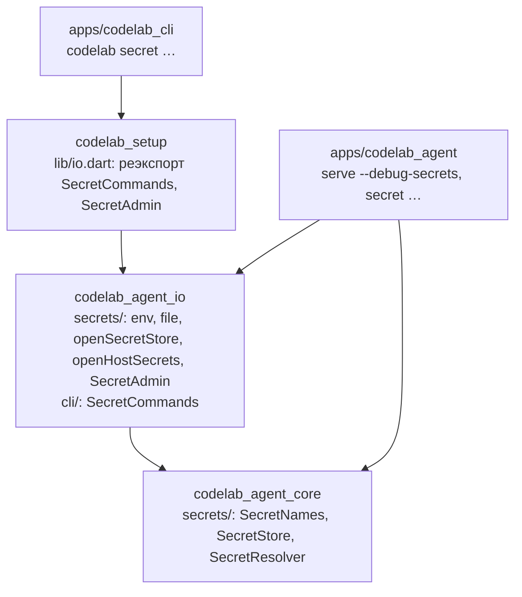

## Context

**Что есть в коде:**
- **Конфигурация (8.5).** `CoreConfig.fromLayers` (`codelab_agent_core/lib/src/config/resolve.dart`) — чистая синхронная функция.
  - `api_key_env` она разрешает из `environment` при загрузке прямо в `ProviderConfig.apiKey`; незаданная переменная даёт `config.provider.key_missing` и запись `providerProblems`.
  - `api_key_secret` и `${secret:<name>}` распознаются, но читать их нечем (D8 change `add-agent-configuration`). Провайдер получает запись `providerProblems` `API key secret <name> cannot be read: the secret store is not available yet`; MCP-сервер с `${secret:…}` пропускается с `config.secret.unavailable`.
  - Имя секрета проверяет временная `_validSecretName`: непустое, до 128 символов, без пробелов и управляющих символов.
  - `interpolate.dart` уже возвращает `Expansion.secretRefs`.
  - Ключ `api_key` и родственные дают `inlineSecret` и `ConfigInlineSecretException(issues, key)` без `suggestedSecretName`.
- **Провайдеры.** `createRoutedStreamFunction(providers, services, unavailable:)` (`llm/provider_factory.dart`) лениво строит цепочку на провайдера. Провайдер из `unavailable` отвечает ошибкой `auth` без HTTP-запроса. `ProviderConfig.secrets` (ключ и значения заголовков) уже вычищается из текстов ошибок провайдера (D7 change `add-agent-core-llm-contract`).
- **MCP.** `AgentRuntimeImpl` (`runtime/agent_runtime.dart`) сливает `CoreConfig.mcpServers` с серверами `session/new` и вызывает `services.mcp.connect(McpConnectRequest(…))`. Сбой сервера даёт `mcp.server.failed`, сессия создаётся.
- **Окружение дочерних процессов.** Команды `exec` и stdio-серверы MCP получают только `hostEnvironmentAllowlist` (`PATH`, `HOME`, …; `codelab_agent_io/lib/src/env/host_variables.dart`). Переменные `CODELAB_SECRET_*` и `api_key_env` дочерним процессам не видны.
- **Хранилища секретов нет.** В коде нет ни `SecretStore`, ни `SecretResolver`, ни порта запуска процесса для утилит. `AgentCoreServices` не имеет поля секретов. В `schema.dart` раздел `secrets` числится в разделах после MVP; `trust.dart` уже вырезает `secrets` из проектных слоёв с предупреждением.
- **Переменные.** `environment_layer.dart` уже знает `CODELAB_DEBUG_SECRETS` и семейство `CODELAB_SECRET_`: предупреждения `config.env.unknown` они не дают. `CODELAB_TEST_SECRET_STORE` он тоже знает, но безусловно, в любой сборке, — это расходится с agent-core §15.6 и исправляется задачей 0.3 (D14, «Тестовое хранилище в обычной сборке»).
- **Клиенты и мост.** `codelab_setup/lib/io.dart` реэкспортирует `ConfigCommands`. `apps/codelab_cli` регистрирует только `config check`, `codelab secret` даёт `Unknown command` (код `64`). `apps/codelab_agent` знает команды `serve` и `config`.

**Ограничения:**
- ACP не придумывается (`AGENTS.md` §3.4);
- ядро без `dart:io` (PKG-1), PKG-2 не расширяется, таймеры ожидания ядро само не создаёт (PKG-6);
- allowlist `codelab_agent_io` расширяется только через OpenSpec change (`codelab_agent_io/AGENTS.md` §2) — этот change его не расширяет (D1);
- клиенты не импортируют `codelab_agent_*` (PKG-4);
- CFG-10: значение секрета не попадает в лог, ошибки, argv дочерних процессов и файл конфига;
- `Redactor` ещё не существует (8.11).

## Goals / Non-Goals

**Объём после сужения (решение пользователя 2026-10-31).** В 1.0 секреты хранятся в переменных `CODELAB_SECRET_*` (бэкенд `env`) и, по явному выбору, в открытом файле `$CODELAB_HOME/secrets.yaml` (бэкенд `file`). Бэкенды хранилищ ОС (`keychain-macos`, `secret-service`, `wincred`), индекс имён, разведка утилит, `ffi` в allowlist, тест `os-keychain`, условие App Sandbox и OQ6 перенесены в `openspec/changes/add-agent-os-secret-backends/` (черновик, после 1.0). Порт `SecretStore` и все вызывающие устроены так, что бэкенды ОС подключаются позже без изменения вызывающих.

**Goals:**
- P-12 частично: ключ провайдера и токены MCP указываются в конфиге по имени и хранятся в `env` или `file`; хранилище ОС — после 1.0. Встроенный агент этапа 7 получает ключ через тот же резолвер.
- P-17: `--debug-secrets` показывает каждое обращение к секрету без значения.
- Один конфиг работает на рабочей машине (`secrets.yaml`, после 1.0 — хранилище ОС) и в CI (переменная `CODELAB_SECRET_<…>`) без правки файла.
- Значение секрета не появляется в argv, логах, журналах, конфиге, `profiles.json` и кадрах ACP.

**Non-Goals:** раздел «Не входит» в `proposal.md`.

## Decisions

### D1. Раскладка по пакетам, направление зависимостей, сторож



| Пакет | Что добавляется |
|---|---|
| `codelab_agent_core` | `lib/src/secrets/`: `SecretNames`, `SecretStore`, `DescribedSecretStore`, `SecretBackendInfo`, `SecretStoreUnavailableException`, `SecretLookup`, `SecretResolver`, `MemorySecretStore`. Правки: `config/` (D2, D4, D7, D9), `llm/provider_factory.dart` (D4), `runtime/agent_runtime.dart` (D4), `host/services.dart` (поле `secrets`) |
| `codelab_agent_io` | `lib/src/secrets/`: `SecretProcessRunner` и `IoSecretProcessRunner` (D5), `EnvSecretStore`, `FileSecretStore` (D14), `openSecretStore` (D7), `openHostSecrets` и `SecretAdmin` (D15). `lib/src/cli/`: `SecretCommands`, `SecretInput`, `StdinSecretInput`; правка `ConfigCommands.check` (D9) |
| `codelab_setup` | `lib/io.dart` — реэкспорт `SecretCommands`, `SecretCommandResult`, `SecretInput`, `StdinSecretInput`, `SecretAdmin`, `openSecretStore` |
| `apps/codelab_agent` | `AgentHost` создаёт резолвер через `openHostSecrets`; флаг `--debug-secrets`; `lib/src/cli/secret_cli.dart` |
| `apps/codelab_cli` | `CliCommand.secret` в `cli_args.dart`, вызов в `run.dart` |

Направление не меняется: приложения → мост → `_io` → ядро. Новых пакетов нет.

**Сторож и allowlist не меняются** (решение пользователя 2026-10-31 после сужения):
- ядро: `lib/src/secrets/` уже под PKG-1 (`webUnsafe`) и allowlist PKG-2 — нужны только `dart:async` и `meta`;
- `codelab_agent_io`: нужен только `dart:io` (файл, `Process.start` для `chmod`), он пакету разрешён; `ffi` не добавляется — он нужен только `wincred`, перенесённому в `openspec/changes/add-agent-os-secret-backends/` (черновик, после 1.0) вместе с правилом сторожа для FFI;
- `codelab_setup`: основной барель не меняется, `lib/io.dart` уже под исключением правила; `setupAllowlist` не меняется;
- `apps/codelab_cli`: `package:codelab_setup/io.dart` по-прежнему только из `run.dart`; `cliAllowlist` не меняется.

Граф в `README.md` не меняется.

**Web-безопасность.** Основной барель ядра экспортирует `lib/src/secrets/` — это чистый Dart, его покрывает `web_smoke` (`melos run web-compile`). `codelab_setup.dart` типы секретов пока не реэкспортирует: потребителя в клиентах нет до страницы настроек (§12.4), а реэкспорт без потребителя — «на вырост» (§13).

Альтернатива — отдельный пакет `codelab_agent_secrets` — отклонена: бэкенды — адаптеры `dart:io` того же рода, что журналы и конфиг.

### D2. Имена секретов: `SecretNames`

```dart
abstract final class SecretNames {
  static final RegExp pattern = RegExp(r'^[a-z0-9][a-z0-9._/-]{0,127}$');
  static String? problem(String name);      // null — имя годится; иначе английская причина без имени
  static String envOverride(String name);   // "codelab/anthropic" → "CODELAB_SECRET_CODELAB_ANTHROPIC"
  static String suggestFor(String configPath);
  static String forMcp(String server, String key);
}
```

- **Правило.** Имя подходит, если совпадает с `pattern`, не содержит `..` и не кончается на `/`. `problem` возвращает текст для `ConfigIssue` и для ошибки использования `secret`: `expected a secret name: lowercase letters, digits and . _ / -, up to 128 characters`. Вместо `ArgumentError` из §17.5.2 — значение: ошибка имени в конфиге — проблема загрузки, а не исключение.
- **`envOverride`.** Префикс `CODELAB_SECRET_`, затем имя в верхнем регистре; каждый символ вне `[A-Z0-9]` заменяется на `_`. Отображение необратимо: `codelab/a-b` и `codelab/a.b` дают одну переменную. Поэтому `secret set` отклоняет имя, чья переменная совпадает с переменной другого уже сохранённого имени (D8).
- **`suggestFor` и `forMcp`.** По §17.5.4:
  - `providers.<id>.*` → `codelab/<id>`;
  - `mcp.servers[<server>].env.<KEY>` и `….headers.<Key>` → `codelab/mcp/<server>/<key>`: обе части в нижнем регистре, символы вне `[a-z0-9._-]` → `-`;
  - `mcp.servers[<server>].<key>` вне `env`/`headers` (ключ `token` элемента, CFG-9 п. 1) → тоже `codelab/mcp/<server>/<key>`;
  - `tools.web.search.backends.<b>.*` → `codelab/search-<b>`;
  - любой другой путь → запасной вариант `codelab/<путь>`: путь нормализуется тем же правилом частей (нижний регистр, символы вне `[a-z0-9._-]` → `-`, `..` схлопывается). Подсказка `codelab secret set <name>` остаётся допустимым именем, даже если валидатор позже начнёт находить ключи в новых разделах.
  
  Результат всегда проходит `pattern`, это проверяет тест.
- **Совместимость.** Правило строже временной проверки 8.5: `Codelab/OpenAI`, `my key`, `a/../b` становятся проблемой `value` с путём ключа. В 8.5 такие ссылки не работали (секрет было нечем прочитать), поэтому работающий конфиг не ломается. Ошибка называет правило, а не значение: в поле имени часто вписывают сам ключ.

Альтернатива — оставить свободные имена и нормализовать их — отклонена. Нормализация давала бы два имени на один секрет и неоднозначную переменную `CODELAB_SECRET_*`.

### D3. Порт и резолвер в ядре

```dart
abstract interface class SecretStore {                 // §10.3, без изменений
  Future<String?> read(String name);
  Future<void> write(String name, String value);
  Future<void> delete(String name);
  Future<List<String>> names();
}
abstract interface class DescribedSecretStore implements SecretStore {
  SecretBackendInfo get backend;
}
final class SecretBackendInfo {
  final String id;                  // env | file | memory; после 1.0 — keychain-macos | secret-service | wincred
  final bool writable;              // env — false
  final String? unavailableReason;  // почему auto не выбрал хранилище ОС; иначе null
}
final class SecretStoreUnavailableException implements Exception {
  final String backend; final String reason;   // reason — наш текст, без значения и без stderr записи
}

sealed class SecretLookup { const SecretLookup(); }
final class SecretFound extends SecretLookup { final String value; final String source; }   // source: cache | env | <backend.id>
final class SecretMissing extends SecretLookup { final String backend; }
final class SecretUnavailable extends SecretLookup { final String backend; final String reason; }

final class SecretResolver {
  SecretResolver({required DescribedSecretStore store, required Map<String, String> environment,
      required Logger logger, bool debug = false});
  Future<SecretLookup> secret(String name, {required String purpose});
  SecretLookup env(String variable, {required String purpose});
}
```

**Отступления от §17.5.2 (вносятся в документ задачей 0.1):**
- **`SecretLookup` вместо `String?`.** «Хранилище недоступно» и «секрет не задан» требуют разных действий от человека. Первое — исправить хранилище (права `secrets.yaml`, после 1.0 — разблокировать хранилище ОС) или задать `CODELAB_SECRET_<…>`, второе — выполнить `codelab secret set`. Со `String?` текст ошибки хода был бы одинаковым и в первом случае вводил бы в заблуждение (приоритет 5 «наблюдаемость» выше простоты). `SecretFound.toString()` значение не печатает.
- **Без параметра `redactor`.** `Redactor` появится в 8.11 вместе со своим параметром конструктора (D10). Параметр без потребителя был бы абстракцией «на вырост».
- **`invalidate()`** не вводится: перезагрузки конфига в 8.9 нет (8.10).
- **Таймаут не в ядре.** Ядро не создаёт таймеры (PKG-6). Предел ожидания соблюдают бэкенды `codelab_agent_io` (в 8.9 — файл и переменные, ожидания нет; бэкенды ОС после 1.0 — 10 с), мобильные и web-хосты — свои реализации. Резолвер таймаут не накладывает.

**Порядок `secret(name, purpose)`:**

```text
1. SecretNames.problem(name) != null → SecretMissing (имя уже проверено загрузкой; защита в глубину)
2. кэш содержит name → SecretFound(source: cache)
3. v := environment[SecretNames.envOverride(name)]; v не пуст → кэш[name] := v; SecretFound(source: env)
4. идёт обращение к store по name → дождаться его (single-flight)
5. v := await store.read(name)
     SecretStoreUnavailableException(b, r) → warning secrets.backend.unavailable {backend: b, reason: r}
       (один раз на пару (b, r) за процесс) → SecretUnavailable(b, r)
     v == null или пусто → SecretMissing(store.backend.id)
     иначе → кэш[name] := v; SecretFound(source: store.backend.id)
debug: на каждом вызове — info secrets.lookup {name, purpose, source, found}; source у SecretMissing
  и SecretUnavailable — id бэкенда; значение, длина, префикс, хеш — никогда (CFG-10)
```

`env(variable, purpose)` синхронно читает `environment[variable]` и под `debug` пишет `secrets.lookup {name: <VAR>, purpose, source: "env", found}`. Это дорога для `api_key_env` (D4): P-17 называет окружение источником наравне с хранилищем.

**Кэш** живёт столько же, сколько резолвер, — до конца процесса хоста (OQ4). Кэшируются только найденные значения. Поэтому секрет, заданный командой `secret set` после старта агента, подхватывается следующим запросом без перезапуска. Смена значения уже прочитанного секрета требует перезапуска агента до 8.10 (`invalidate` при перезагрузке конфига). Резолвер один на процесс: его создаёт хост (D11).

**Почему резолвер, а не сам `SecretStore`, в `AgentCoreServices`.** §10.3 предлагал `SecretStore? secrets` и `bool debugSecrets`, чтобы ядро строило резолвер само. Но функцию модели строит хост: `createRoutedStreamFunction` вызывается до `buildAgentCore`. Резолвер нужен ему раньше ядра, а для переменной переопределения нужно ещё и окружение процесса, которого у ядра нет. Поэтому поле — `final SecretResolver? secrets;`, а `debugSecrets` — параметр резолвера. `null` — у хоста нет резолвера (web без хранилища, тесты без секретов). Тогда ключ провайдера не читается вовсе — ни из хранилища, ни из окружения: ошибка хода `… cannot be read: the host has no secret resolver` (D4), а MCP-сервер конфига со ссылкой не подключается с причиной `no secret store`. Поправка §10.3 — задача 0.1.

Альтернатива — синхронно прочитать все секреты при загрузке конфига — отклонена:
- загрузка — чистая синхронная функция (CFG-5), а хранилище асинхронное и медленное;
- хранилище трогалось бы для провайдеров, которыми пользователь сейчас не пользуется, — лишние процессы и лишние отказы на машине без связки ключей;
- §15.5, п. 7 и §17.5.4 прямо говорят «при подключении или запросе, а не при загрузке».

### D4. Где разрешаются ссылки

**Модель конфига.** `fromLayers` перестаёт подставлять значения ключей и запоминает ссылки.
- **Ключ провайдера.** `CatalogProvider` (элемент `CoreConfig.providers`, `llm/model_catalog.dart`) получает поле `key`:
  ```dart
  sealed class ProviderKeyRef { const ProviderKeyRef(); }
  final class EnvKeyRef extends ProviderKeyRef { final String variable; }   // api_key_env
  final class SecretKeyRef extends ProviderKeyRef { final String name; }    // api_key_secret
  ```
  `null` — провайдер без ключа. `ProviderConfig.apiKey` в результате загрузки — `null` у провайдера со ссылкой.
- **Заголовки и `env`.** Значение с `${secret:…}` хранится шаблоном `SecretTemplate`: список частей «литерал» и «ссылка на секрет», уже после раскрытия `${ENV}` и `$${`. Строкой его хранить нельзя: литерал `$${secret:x}` после раскрытия неотличим от ссылки и раскрылся бы повторно, а §15.5, п. 5 это запрещает.
  - У провайдера шаблоны лежат в `CatalogProvider.headerTemplates`; в `ProviderConfig.headers` попадают только заголовки без ссылок.
  - У MCP-сервера конфига шаблоны лежат в `McpServerConfig.secretValues` — неизменяемом отображении `env.<KEY>` / `headers.<Name>` → `SecretTemplate`, пустом у серверов клиента.
  
  Точная форма — на усмотрение исполнителя при условиях этого абзаца.
- **Публичные поля для раскрытия (итерация 1).**
  - `McpHttpServerConfig.secretHeaderPositions` — отображение «имя заголовка со ссылкой → индекс среди заголовков файла». Заполняет `resolve.dart`; `withSecrets` вставляет раскрытые заголовки на их места (абзац «Порядок заголовков MCP»); `sameConnection` учитывает поле, чтобы перестановка заголовков в конфиге считалась другим подключением.
  - `ProviderConfig.extraSecrets` — сырые найденные значения ссылок шаблонов; входят в `ProviderConfig.secrets` для вычистки текстов ошибок провайдера (шаг 5 ниже).
- **Ссылки только в значениях `env` и `headers`.** `${ENV}` допустим ещё в `providers.*.base_url`, `mcp.servers.*.args[*]` и `mcp.servers.*.url` (§15.5, п. 1), но `${secret:…}` там — проблема `value` с путём ключа: `secret references ${secret:…} are allowed only in env and headers values`; конфиг невалиден. Почему отказ, а не литерал или раскрытие: argv дочернего процесса виден через `ps`, а URL попадает в логи подключения, `mcp.server.*` и тексты ошибок HTTP-клиента. Молчаливый литерал дал бы неработающий сервер без объяснения (fail closed, CFG-10).
- **Порядок заголовков MCP.** После раскрытия шаблонов заголовки HTTP-сервера MCP идут в порядке файла конфига: заголовок со ссылкой остаётся на своём месте среди заголовков без ссылок, а не переносится в конец. Порядок заголовков наблюдаем сервером и тестами коннектора; перестановка из-за способа хранения шаблона была бы скрытым изменением поведения.
- **Предупреждение при загрузке.** `config.provider.key_missing` для незаданной переменной `api_key_env` остаётся: оно дешёвое и показывается при старте. Запись `providerProblems` о незаданной переменной тоже остаётся (быстрый отказ, сценарий «Переменная ключа не задана» не меняется).
- **Что снимается.** Записи `providerProblems` о секретах, предупреждение `config.secret.unavailable` и пропуск MCP-серверов (D8 change `add-agent-configuration`).

**Провайдер — при первом запросе.** `createRoutedStreamFunction(providers, services, {unavailable, keys, headerTemplates, secrets})`. Ключ к провайдеру `<id>`:
1. Провайдер в `unavailable` → прежний отказ `auth`.
2. Цепочка `<id>` уже построена → использовать её.
3. Разрешить ключ:
   - `EnvKeyRef` → `secrets.env(VAR, purpose: providers.<id>.api_key_env)`;
   - `SecretKeyRef` → `await secrets.secret(name, purpose: providers.<id>.api_key_secret)`;
   - шаблоны заголовков — так же, по одному вызову на ссылку.
   
   **Хост без резолвера ключа не получает** (решение оркестратора по ревью итерации 1). `secrets == null` при `EnvKeyRef` даёт отказ `auth` без HTTP-запроса `API key variable <VAR> cannot be read: the host has no secret resolver`, при `SecretKeyRef` — `API key secret <name> cannot be read: the host has no secret resolver`, при ссылке в заголовке — `secret <name> cannot be read (providers.<id>.headers.<H>): the host has no secret resolver`. Прямого чтения окружения в обход резолвера нет: иначе чтение ключа не попало бы в `secrets.lookup` (P-17), а в 8.11 — в `Redactor` (D10, п. 1). Поэтому каждый хост с провайдером, которому нужен ключ, ОБЯЗАН передать резолвер: настольные хосты — через `openHostSecrets` (D15), `--llm-script` — резолвер над `EnvSecretStore` (D11), тесты — над `MemorySecretStore`.
4. Результат:
   - `SecretMissing` → отказ `auth` без HTTP-запроса: `API key secret <name> is not set. Run: codelab secret set <name>`; для `api_key_env` — `API key variable <VAR> is not set`; для заголовка — `secret <name> is not set (providers.<id>.headers.<H>). Run: codelab secret set <name>`;
   - `SecretUnavailable` → отказ `auth`: `API key secret <name> cannot be read: <backend> is unavailable (<reason>). Set <envOverride(name)> or fix the secret store`.
   
   Цепочка не кэшируется: следующий запрос разрешает заново.
5. Всё найдено → `ProviderConfig` с `apiKey` и полными `headers` → `createStreamFunction` → кэш цепочки на процесс. В `ProviderConfig.secrets`, а значит в существующую вычистку текстов ошибок провайдера, попадают и собранные строки (`apiKey`, значение заголовка вроде `Bearer <v>`), и **сырые найденные значения** каждой ссылки шаблона (`ProviderConfig.extraSecrets`). Почему сырые отдельно: тело ответа `401` часто цитирует только сам токен без префикса `Bearer `, и вычистка по собранной строке его бы не нашла.

Ожидание секрета идёт внутри `runProvider`. Отмена хода во время ожидания завершает поток сразу, не дожидаясь хранилища: ошибка класса `aborted` и `StopReason.aborted` — тот же путь, что у любой отмены запроса к модели (LLM-7). Обращение к хранилищу при этом продолжается до своего таймаута, и его результат попадает в кэш — это безопасно (D3, single-flight). Два одновременных первых запроса к одному провайдеру ждут одного обращения к хранилищу. Цепочку строит тот, кто завершился первым, второй берёт её из кэша.

**MCP-сервер конфига — перед `connect`.** `AgentRuntimeImpl` перед `services.mcp.connect` раскрывает шаблоны каждого сервера конфига через `services.secrets` с `purpose` — путём ключа (`mcp.servers[gh].headers.Authorization`). Серверы раскрываются параллельно. Раскрытие идёт при `createSession`, `loadSession` и `AgentSession.setMcpServers` (серверы конфига входят в полный желаемый список замены).
- Секрет не найден или хранилище недоступно → сервер не подключается: `mcp.server.failed {server, transport, reason}` с причиной `secret <name> is not set` или `secret <name> cannot be read: <backend> is unavailable`. Причина называет имя секрета и бэкенд, но не значение. Сессия создаётся без его инструментов. Это шаг 3 требования «MCP-серверы сессии» (agent-runtime), новый вид сбоя; дельта — `specs/agent-runtime/spec.md`.
- Раскрытие идёт в токене отмены создания сессии (у `setMcpServers` — в токене уровня сессии): `dispose()` рантайма или `AgentSession.close()` во время ожидания отбрасывают результат, как у `ProjectFilesSource` (change `add-agent-project-files`, D6). Событие `mcp.server.failed` при этом не пишется: сервер не сбоил, его подключение отменил владелец.
- Заголовки после раскрытия — в порядке файла конфига (абзац «Порядок заголовков MCP» выше).
- Серверы клиента (`session/new.mcpServers`) шаблонов не имеют и не раскрываются: `${secret:…}` от клиента ACP — литерал. Иначе клиент мог бы вытянуть любой секрет хранилища на свой адрес.
- Значения после раскрытия живут только в `McpServerConfig`, переданном коннектору. В лог и журнал описания серверов не пишутся (требование «MCP-серверы сессии», п. 9).

**Доверие.** Новое правило доверия не нужно. `providers` и `mcp.servers` недоверенного проекта уже отбрасываются целиком (`trust.dart`, §15.3), поэтому `${secret:…}` из чужого репозитория до резолвера не доходит. У доверенного проекта ссылка работает (§17.5.9, столбец «Условие снятия ограничения»). Тест закрепляет это: недоверенный проект с `${secret:x}` в `mcp.servers` не вызывает резолвер.

### D5. Бэкенды 8.9: `env` и `file`; порт запуска процесса

| Бэкенд | Запись | Чтение | Удаление | `writable` |
|---|---|---|---|---|
| `env` | `SecretStoreUnavailableException("env backend is read-only")` | `CODELAB_SECRET_<…>` | то же исключение, что у записи | `false` |
| `file` | `$CODELAB_HOME/secrets.yaml`, атомарно, `0600` (D14) | тот же файл; права шире `0600` → отказ | ключ удаляется из файла | `true` |

Правила обоих бэкендов: значение с `\n` или `\r` отклоняется при записи; текст исключений не содержит значения.

**`SecretProcessRunner`** — узкий порт запуска процесса в `codelab_agent_io` (`run(executable, arguments, {stdin, timeout})`, реализация `IoSecretProcessRunner` на `Process.start` без оболочки). В 8.9 через него идёт только `/bin/chmod 600 <tmp>` бэкенда `file` (D14): в `dart:io` нет API смены прав, а фейк порта проверяет порядок «права до записи значения». Он же станет швом бэкендов утилит ОС в `openspec/changes/add-agent-os-secret-backends/` (черновик, после 1.0); это не абстракция «на вырост»: у порта есть потребитель и тест уже в 8.9.

**Перенесено** в `openspec/changes/add-agent-os-secret-backends/` (черновик, после 1.0): бэкенды `keychain-macos` (`security -i`, значение только в stdin), `secret-service` (`secret-tool`), их таймауты, разбор кодов и разведка утилит (прежние D5 и задача 0.2).

### D6. Список имён

| Бэкенд | Источник `names()` |
|---|---|
| `file` | ключи файла `secrets.yaml` (D14) |
| `env` | имён секретов нет: `envOverride` необратимо, поэтому `list` показывает имена переменных строкой `Environment overrides` (D8) |

Индекс `secret-names.json` нужен только бэкендам ОС и перенесён в `openspec/changes/add-agent-os-secret-backends/` (черновик, после 1.0).

### D7. Выбор бэкенда: ключ `secrets.backend`

Схема: `secrets: {backend: auto | keychain | env | file}`, по умолчанию `auto`; потребитель — хост (`HostSettings.secretsBackend`). Ключ читается из пользовательского слоя и из `--config`/`CODELAB_CONFIG`; проектные слои его уже не дают (`trust.dart`): репозиторий не может переключить агента на открытый файл. Другое значение — проблема `value` `expected one of: auto, keychain, env, file`.

`openSecretStore({choice, environment, home, runner, platform, logger})` (`codelab_agent_io`) возвращает `DescribedSecretStore` (решение пользователя 2026-10-31, вариант (а)):
- **`auto`** в 8.9 — `env` на всех ОС, без проб и процессов; `unavailableReason` — `OS keychain backends are not available in this version; set secrets.backend: file or CODELAB_SECRET_* variables`. Предупреждения при старте нет: подсказку получают те, кому секрет действительно нужен (D8, D9, ошибка хода D4). **`auto` никогда не выбирает `file`** — ни сразу, ни как запасной вариант (CFG-11, OQ2). После 1.0 `auto` выбирает хранилище ОС (`openspec/changes/add-agent-os-secret-backends/` (черновик, после 1.0)).
- **`keychain`** — проблема конфигурации `secrets.backend: keychain is not supported yet (supported: auto, env, file)`, код `64` у `serve` и `config check` (строка проблемы). Значение остаётся в схеме, чтобы будущий change не менял её.
- **`env`** — `EnvSecretStore`.
- **`file`** — `FileSecretStore` над `$CODELAB_HOME/secrets.yaml` (D14), предупреждение `secrets.backend.plaintext {path}` при каждом старте хоста.
- **Windows.** `file` на Windows — проблема конфигурации (D14), её добавляет `ConfigLoader` (ядро платформу не знает). **Поэтому на Windows в 1.0 доступен только `env`** (переменные `CODELAB_SECRET_*`); `wincred` — в `openspec/changes/add-agent-os-secret-backends/` (черновик, после 1.0).

Порядок резолвера (D3) от выбора не зависит: переменная `CODELAB_SECRET_<…>` побеждает хранилище при любом бэкенде.

### D8. Подкоманды `secret set|delete|list`

**Одна реализация** — `SecretCommands` в `codelab_agent_io/lib/src/cli/secret_commands.dart`, по образцу `ConfigCommands` (D13 change `add-agent-configuration`):

```dart
final class SecretCommands {
  SecretCommands({SecretProcessRunner? runner});                          // null → IoSecretProcessRunner
  Future<SecretCommandResult> set(SecretSetOptions o, SecretInput input); // name, environment
  Future<SecretCommandResult> delete(SecretDeleteOptions o);
  Future<SecretCommandResult> list(SecretListOptions o);
}
final class SecretCommandResult { final int exitCode; final List<String> stdout, stderr; }
abstract interface class SecretInput {          // stdin процесса; фейк — в тестах
  bool get hasTerminal;
  Future<String?> readHidden(String prompt);   // TTY: prompt в stderr, эхо выключено, до Enter; null — EOF/Ctrl+D
  Future<String> readAll();                     // без TTY: весь stdin
}
```

Аргументы разбирает каждое приложение своим `package:args`: `codelab-agent secret …` — `apps/codelab_agent/lib/src/cli/secret_cli.dart`, `codelab secret …` — `cli_args.dart` и `run.dart`. Тексты, правила и коды — только в `SecretCommands`. Поэтому stdout, stderr и код двух бинарей совпадают; это проверяет тест.

**Бэкенд у подкоманд.** `SecretCommands` читает `secrets.backend` из `$CODELAB_HOME/config.yaml` и из файла `CODELAB_CONFIG` (`codelabHomeOf`, `readYamlTree`) — и только этот ключ. Остальные проблемы конфига игнорируются. Почему не полная загрузка: подсказка ошибки `inlineSecret` велит выполнить `codelab secret set …` при невалидном конфиге (ключ вписан значением). Полная загрузка заблокировала бы ровно ту команду, которая чинит конфиг. Синтаксическая ошибка YAML в этих файлах — код `1` с проблемой в форме `ConfigIssue.toString()`. Флаг `serve --config` подкоманды не видят — это записано в справке.

**`set <name>`:**
1. Имя не проходит `SecretNames` → код `64`, `expected a secret name: …`.
2. Лишний позиционный аргумент → код `64`, `pass the secret value on stdin, not as an argument`. Сам аргумент не печатается.
3. Бэкенд не допускает записи (`env`) → код `1`, stdin не читается: `secret store env is read-only. Add 'secrets.backend: file' to <CODELAB_HOME>/config.yaml to store secrets in <CODELAB_HOME>/secrets.yaml (plaintext, 0600), or set <envOverride> in the environment`. На Windows вариант с `file` не предлагается (D7).
4. Переменная `envOverride(name)` совпадает с переменной другого имени из `names()` → код `64`: `secret name <name> collides with <other> (both map to <VAR>)`.
5. Значение:
   - TTY — `readHidden("Secret value for <name>: ")`; эхо восстанавливается в `finally` и по `SIGINT`;
   - без TTY — `readAll()`, отбрасывается один завершающий `\n` или `\r\n`.
   
   Пустое значение или EOF → код `64`, `empty secret value`. Перевод строки внутри значения → код `64`, `secret value must be a single line`.
6. `write`. Успех — код `0`, stdout `Stored secret <name> in <backend>`; имя уже было в `names()` — перезапись без вопроса и без `--force`, stdout `Updated secret <name> in <backend>` (OQ5, решение 2026-10-31). Ошибка хранилища — код `1`, `cannot store secret <name>: <reason>`. У бэкенда `file` `set` — единственный путь, который создаёт файл `secrets.yaml` (D14); stderr получает строку `warning: secrets are stored unencrypted in <path>`.

**`delete <name>`:** код `0` и `Deleted secret <name> from <backend>`. Отсутствующее имя — код `0` и `Secret <name> was not set in <backend>`: команда идемпотентна для скриптов. Бэкенд `env` — код `1`, как у `set`.

**`list`:**
- первая строка — `Backend: <id>` или `Backend: env (<unavailableReason>)`;
- затем имена по алфавиту, по одному в строке;
- если в окружении есть переменные `CODELAB_SECRET_*` — строка `Environment overrides: <VAR>, …` (только имена переменных).

Значения и длины не печатаются. Код `0`; хранилище недоступно — код `1` (в том числе файл `secrets.yaml` с правами шире `0600`: текст причины с командой `chmod 600 <path>`, D14). У бэкенда `file` `list` и `delete` тоже пишут в stderr предупреждение об открытом тексте.

**Общее.**
- Справка `secret` — в stderr с кодом `64`, если подкоманды нет, она неизвестна или в аргументах ошибка.
- Подкоманды не запускают агента и не читают stdin, кроме `set`.
- `codelab secret …` с флагами подключения — код `64`, как `config` (D14 change `add-agent-configuration`).
- Справки обоих бинарей называют `secret set|delete|list`.

Альтернативы:
- (а) Подкоманды только у `codelab`. Отклонена: `codelab-agent` ставится и отдельно (контейнер, сервер без CLI), а §17.5.4 называет обе.
- (б) Значение флагом `--value`. Отклонена: argv виден через `ps` и попадает в историю оболочки.

### D9. `config check` показывает состояние секретов

После валидной загрузки `ConfigCommands.check` собирает ссылки `CoreConfig` по порядку конфига:
- `SecretKeyRef` провайдеров;
- шаблоны заголовков;
- `secretValues` MCP-серверов.

Если ссылок нет, вывод не меняется: хранилище не трогается. Иначе каждое имя (без повторов) проверяется резолвером с `debug: false`. Хранилище — то же, что у подкоманд `secret` (D8); бэкенд — `secrets.backend` загруженного конфига. Перед последней строкой `Config: …` печатаются:
- `note: secrets backend: <id>` или `note: secrets backend: env (<reason>)`;
- на каждый ненайденный — `warning: <location>: <key>: secret <name> is not set; run: codelab secret set <name>`; при бэкенде `env` текст вместо этого — `secret <name> is not set; set <envOverride> or add 'secrets.backend: file' and run: codelab secret set <name>` (на Windows — только переменная);
- на недоступное хранилище — одна строка `warning: secrets: <backend> is unavailable (<reason>)`.

Найденный секрет строки не даёт. Значение читается в память и сразу отбрасывается. Код выхода не меняется: секрет может понадобиться только при выборе этой модели (та же логика, что `config.provider.key_missing`, §15.5, шаг 8). В 8.9 проверка читает только переменные и файл и не ждёт внешних процессов. Проверка наличия — решение пользователя 2026-10-31 (OQ3 (а)).

**Бэкенд `file`.** При `secrets.backend: file` `config check` печатает строку `warning: secrets: file backend stores secrets unencrypted in <path>` всегда, даже без ссылок на секреты (CFG-11: открытый текст должен быть виден при каждой проверке). Права файла шире `0600` дают ещё строку `warning: secrets: <path> has permissions <mode>; run: chmod 600 <path>`, а ссылки на секреты тогда считаются недоступными. Код выхода не меняется.

### D10. Наблюдаемость и что 8.9 передаёт 8.11

| Событие | Уровень | Поля | Когда |
|---|---|---|---|
| `secrets.lookup` | info | `name`, `purpose`, `source`, `found` | только `--debug-secrets` / `CODELAB_DEBUG_SECRETS=1` |
| `secrets.backend.selected` (новое) | info | `backend`, `path` (`secrets.yaml` или `null`), `reason` (у `auto` → `env`) | выбор бэкенда, один раз на процесс |
| `secrets.backend.unavailable` | warning | `backend`, `reason` | отказ хранилища при чтении (например, `file` по правам) — один раз на пару `(backend, reason)` |
| `secrets.backend.plaintext` | warning | `path` | бэкенд `file`, при каждом старте хоста |
| `secrets.file.refused` (новое) | warning | `path`, `mode` (восьмеричная строка) или `reason: symlink` | `secrets.yaml` с правами шире `0600` или символическая ссылка; один раз на процесс |
| `config.secret.unavailable` | — | — | снимается (D4) |

`CODELAB_DEBUG_SECRETS=1` включает режим так же, как флаг; другие значения — как не заданная переменная (без предупреждения: имя уже известно `environment_layer.dart`).

**Передача 8.11.** CFG-10 требует регистрировать каждое прочитанное значение в `Redactor` до первого использования. В 8.9 `Redactor` нет, поэтому:
1. Единственная дорога к значениям — `SecretResolver`; иных чтений `SecretStore` в ядре и хостах нет. Исключение — `config check` и `secret` (D8, D9): значения там не уходят ни в модель, ни в лог.
2. Change 8.11 добавляет в конструктор резолвера `Redactor redactor` и вызов `redactor.addExactSecret(v)` (API `Redactor`, agent-core §12.4) в шагах 3 и 5 до возврата `SecretFound`. Точка уже одна, и сигнатуры вызывающих не меняются.
3. До 8.11 значения ключа и заголовков провайдера защищены существующей вычисткой `ProviderConfig.secrets`. Значения MCP-заголовков и `env` до коннектора не логируются (требование «MCP-серверы конфигурации»). Остаточный риск — модель сама выведет секрет, прочитанный инструментом. Он тот же, что для `api_key_env` сегодня, и закрывается 8.11.
4. Тест `debug_secrets_test.dart` проверяет сырые `LogRecord` без редакции. 8.11 его не ослабляет.

### D11. Бинарь `codelab-agent`

- **`AgentHost.build`** создаёт резолвер через `openHostSecrets` (D15) по `HostSettings.secretsBackend` и окружению процесса. Резолвер передаётся в `createRoutedStreamFunction(…, secrets:)` и в `AgentCoreServices.secrets`.
- **`--debug-secrets`** — флаг `serve`, без значения; включает и `CODELAB_DEBUG_SECRETS=1`. Режим не меняет уровень лога: события `info` видны при уровне по умолчанию.
- **`--llm-script`** использует `EnvSecretStore` независимо от `secrets.backend`. Сценарий не читает `$CODELAB_HOME` (D16 change `add-agent-project-files`), а тесты не должны читать `secrets.yaml` разработчика. Секреты сценария задаются `CODELAB_SECRET_<…>`.
- **`serve --ws`** читает секреты так же, как `--stdio`: ключ провайдера нужен в обоих режимах. Capability `mcp` в `--ws` выключена, поэтому `${secret:…}` MCP там не раскрывается.
- **`secret set|delete|list`** — команда верхнего парсера рядом с `serve` и `config` (D8).

### D12. Тесты

- **Ядро** (`codelab_agent_core/test/secrets/`, `test/config/`, `test/llm/`, `test/runtime/`) — `MemorySecretStore` и фейковый `DescribedSecretStore`:
  - `secret_names_test.dart`;
  - `secret_resolver_test.dart`: порядок, кэш, single-flight, недоступность, переменная побеждает хранилище;
  - `debug_secrets_test.dart` — `core/debug-secrets-never-logs-value`;
  - `config_inline_secret_test.dart` — `core/config-rejects-inline-api-key` в части пункта 1 CFG-9;
  - тесты маршрутизации провайдеров, раскрытия шаблонов MCP, доверия и отмены.
- **`codelab_agent_io/test/secrets/`**:
  - `env_secret_store_test.dart`: чтение `CODELAB_SECRET_*`, запись и удаление — исключение только для чтения;
  - `file_secret_store_test.dart` во временном `CODELAB_HOME` на macOS и Linux CI: права `0644` → отказ чтения, записи и `names()` с текстом `chmod 600`; символическая ссылка → отказ; отсутствующий файл — `null`, файл не создаётся; запись атомарна, права `0600` выставлены до записи значения (фейковый `SecretProcessRunner`), значение с `"`, `\` и не-ASCII читается обратно; сбой между tmp и rename оставляет прежний файл; на Windows (подменённая платформа) — отказ;
  - `open_secret_store_test.dart`: `auto` = `env` на всех платформах без процессов, `auto` не выбирает `file` даже при существующем `secrets.yaml`, `file` и `env` по явному выбору;
  - `secret_admin_test.dart`, `host_secrets_test.dart` (D15), `secret_commands_test.dart` (все ветки D8 на фейковом `SecretInput`), `config_commands_test.dart` (строки D9).
- **Процессные тесты бинарей** (`apps/codelab_agent/test/`, `apps/codelab_cli/test/`) — с `env` или `file` во временном `CODELAB_HOME`; секреты — переменными `CODELAB_SECRET_*` или `secret set` с `file`. Совпадение вывода двух бинарей — на `list`, отказе `env` и ошибках использования. Все — Dart VM, в `melos run test`. Хранилища ОС тесты не трогают: в 8.9 их нет.
- **Фикстуры ACP не меняются**, задач `[protocol]` нет: ошибка хода с текстом про секрет идёт существующим путём `AgentError` → JSON-RPC ошибка (§13.8). Это проверяет тест ядра на уровне `createRoutedStreamFunction` и процессный тест бинаря.
- Тест настоящих хранилищ ОС (`os-keychain`) перенесён в `openspec/changes/add-agent-os-secret-backends/` (черновик, после 1.0).

### D13. Перенесено: бэкенды хранилищ ОС

По решению пользователя 2026-10-31 в `openspec/changes/add-agent-os-secret-backends/` (черновик, после 1.0) перенесены вместе с проработкой:
- прежний D5 — `keychain-macos` и `secret-service` (`security -i`, `secret-tool`, значение только в stdin, таймаут 10 с, разведка утилит);
- прежний D6 — индекс имён `$CODELAB_HOME/secret-names.json`;
- прежний D13 — `wincred` (порт `WinCredApi`, свои привязки `advapi32`, `ffi` в `ioAllowlist` и правило сторожа FFI; решение OQ1);
- из D7 — выбор хранилища ОС в `auto` и проба `keychain`;
- из D12 — тест `os-keychain`; из D15 — условие macOS App Sandbox и вызов `wincred` из isolate ядра; решение OQ6.

Порт `SecretStore`/`DescribedSecretStore`, `SecretBackendInfo.id`, `openSecretStore`, `SecretProcessRunner`, `SecretAdmin`, `SecretCommands` и `config check` в 8.9 устроены так, что эти бэкенды добавляются без изменения вызывающих: меняется только `openSecretStore`.

### D14. Бэкенд `file` (решение пользователя 2026-10-31, OQ2)

- **Файл.** `$CODELAB_HOME/secrets.yaml` (§17.5.4). Открытый текст: только по явному `secrets.backend: file` в пользовательском конфиге или `--config`; `auto` его не выбирает никогда и не использует как запасной вариант (D7, CFG-11). В 1.0 это единственный способ сохранить секрет командой `secret set` на macOS и Linux.
- **Формат.** YAML строгого профиля §15.5: отображение `"<name>": "<value>"`, по строке на секрет, ключи по алфавиту; значения пишутся в двойных кавычках с экранированием JSON (подмножество двойных кавычек YAML). Первая строка — комментарий `# CodeLab secrets in plaintext. Managed by: codelab secret set|delete`. Читается `readYamlTree`; структура не «имя → строка» или имя вне `SecretNames` → `SecretStoreUnavailableException(reason: "<path> is not a map of secret names to strings")` без строк файла. `yaml_edit` не нужен: файл целиком генерируется агентом.
- **Права (как у ssh).** Перед каждым чтением, записью и `names()`:
  - путь — символическая ссылка → отказ `<path> is a symbolic link; refusing to read secrets`;
  - `FileStat.mode & 0o077 != 0` → отказ `<path> has permissions <mode>; run: chmod 600 <path>` и предупреждение `secrets.file.refused` один раз на процесс.
  
  Владельца файла `dart:io` не сообщает, поэтому проверка владельца, которую делает ssh, не выполняется (Risks).
- **Создание.** Файл создаёт только `secret set` (`write`); чтение, `delete` и `names()` отсутствующего файла его не создают (`null`, «не было», пустой список).
- **Атомарная запись.** В том же каталоге: создать пустой `secrets.yaml.tmp-<pid>`, выставить права `0600` процессом `/bin/chmod 600 <tmp>` через `SecretProcessRunner` (в argv только путь), проверить `FileStat.mode`, затем записать содержимое, `flush`, `rename` поверх `secrets.yaml`. Значение попадает на диск только в файл, уже имеющий `0600`. Сбой до `rename` оставляет прежний файл; оставшийся tmp удаляется при следующей записи. Записи внутри процесса идут по очереди; две одновременные команды `secret set` разных процессов могут потерять одно обновление (Risks). Каталог `$CODELAB_HOME` создаётся, если его нет.
- **Windows.** `dart:io` не даёт ни прочитать, ни выставить ACL NTFS, поэтому проверить «только владелец» нельзя. `secrets.backend: file` на Windows — проблема конфигурации (D7), `FileSecretStore` на Windows отказывает (защита в глубину). Поэтому на Windows в 1.0 доступен только `env` (D7); `wincred` — после 1.0 (D13).
- **Предупреждения.** `secrets.backend.plaintext {path}` при каждом старте хоста; строка `warning:` в `config check` (D9) и в stderr подкоманд `secret` (D8).
- **Тестовое хранилище этапа 7.** `CODELAB_TEST_SECRET_STORE=<каталог>` (§12.4.13, задача 7.7) переиспользует этот бэкенд: `FileSecretStore(path: '<каталог>/secrets.yaml')` с теми же правилами прав, `backend.id == "file"`. Конструктор принимает явный путь; чтение переменной — этап 7 (задача 7.7), в 8.9 переменная не читается; список известных имён уже ограничен сборкой с `--dart-define=CODELAB_ALLOW_TEST_SECRETS=true` в задаче 0.3.
- **Тестовое хранилище в обычной сборке (решение пользователя 2026-10-31).** Agent-core §15.6 требует: в обычной сборке `CODELAB_TEST_SECRET_STORE` не читается и, как любая неизвестная `CODELAB_*`, даёт `config.env.unknown`. Код расходится с документом: `_knownVariables` в `environment_layer.dart` содержит имя безусловно, и предупреждения нет ни в одной сборке. Исправляется код, а не документ: имя известно только при `const bool.fromEnvironment('CODELAB_ALLOW_TEST_SECRETS')`, то есть в сборке с `--dart-define=CODELAB_ALLOW_TEST_SECRETS=true`. Почему так: переменная, молча принятая обычной сборкой, выглядит рабочей, хотя хранилище не подключено; предупреждение называет её сразу. Константа компиляции, а не переменная окружения: включить тестовое хранилище окружением нельзя (§12.4.13). Альтернатива — исправить §15.6 под код — отклонена пользователем. Чтение переменной по-прежнему — этап 7 (задача 7.7); здесь меняется только список известных имён. Задача 0.3 не зависит от итерации 1 и делается отдельной веткой.

### D15. Встроенные профили этапа 7 (`embedded-app-desktop`, `embedded-cli`)

**Кто строит резолвер.** Одна фабрика в `codelab_agent_io`, которой пользуются все настольные хосты:

```dart
/// codelab_agent_io/lib/src/secrets/host_secrets.dart
SecretResolver openHostSecrets({
  required String codelabHome,                 // codelabHomeOf(environment)
  required Map<String, String> environment,    // окружение процесса хоста
  required String? backend,                    // HostSettings.secretsBackend загруженного конфига; null → auto
  required bool debug,                         // --debug-secrets | CODELAB_DEBUG_SECRETS=1 | опция хоста
  required Logger logger,
  String platform,                             // по умолчанию Platform.operatingSystem
  SecretProcessRunner? runner,
});
```

- `apps/codelab_agent` (`AgentHost`, D11) и `desktopHostServices` пакета `codelab_embedded` (этап 7, `09-12-stage-7-embedded.md`) вызывают её одинаково. Своего хранилища у `codelab_embedded` нет.
- **Внутри isolate ядра** (`IsolateAcpLink`, решение 7.8). В isolate передаются только сериализуемые данные, поэтому `DesktopServicesSpec` получает поля `codelabHome`, `secretsBackend` и `debugSecrets`. `_agentMain` вызывает `openHostSecrets` уже в isolate; окружение isolate берёт из `Platform.environment` — это то же окружение процесса. `SecretResolver`, кэш и `SecretProcessRunner` живут в isolate ядра и через границу не передаются; значения секретов в сообщения `SendPort` не попадают.
- **Откуда настройки без флагов CLI (desktop).**
  - `CODELAB_HOME` — `codelabHomeOf(Platform.environment)`, как у CLI. Приложение, запущенное из Finder, обычно переменной не видит и получает `~/.codelab`, то есть тот же каталог, что CLI по умолчанию.
  - `secrets.backend` — из `HostSettings` результата `loadEmbeddedAgentConfig` (пользовательский `config.yaml`).
  - Режим отладки — `CODELAB_DEBUG_SECRETS=1` или опция хоста `debugSecrets`: её заполняет приложение (диагностический переключатель — этап 7/§12.4; OQ7 (а), 2026-10-31). Ключа конфига для этого режима нет.
- **`embedded-cli`** берёт `--debug-secrets` своего разбора аргументов и передаёт в `debug`.

**Программная запись для страницы настроек.** Логика `set`, `delete` и `list` — в классе `SecretAdmin` (`codelab_agent_io/lib/src/secrets/secret_admin.dart`); `SecretCommands` (D8) только форматирует его результаты для терминала.

```dart
final class SecretAdmin {
  SecretAdmin({required DescribedSecretStore store, required Map<String, String> environment});
  Future<SecretWriteOutcome> store(String name, String value);   // значение — только в памяти
  Future<SecretDeleteOutcome> delete(String name);
  Future<SecretListing> list();                                 // backend, имена, имена переменных переопределения
}
sealed class SecretWriteOutcome { … }   // Stored | Updated | InvalidName | InvalidValue | Collision | ReadOnly | Failed(reason)
```

- Те же проверки, что у CLI: `SecretNames`, однострочное непустое значение, коллизия `envOverride`, бэкенд только для чтения. Тот же список имён: в 1.0 у `file` это ключи `secrets.yaml`, у `env` имён секретов нет, только имена переменных переопределения (D6), поэтому CLI и страница настроек видят одни имена. Индекс имён для хранилищ ОС — в `openspec/changes/add-agent-os-secret-backends/` (черновик, после 1.0).
- Значение передаётся аргументом метода в памяти процесса: не через argv, stdin или файл (кроме самого бэкенда `file`), не в лог и не в журнал. Ни один тип результата значения не содержит, `toString` значения не печатает.
- `codelab_setup/lib/io.dart` реэкспортирует `SecretAdmin`, его результаты и `openSecretStore` рядом с `SecretCommands`. Основной web-безопасный барель `codelab_setup.dart` не меняется. Обёртка `SecretValue` и страница настроек (§12.4) — этап 7/12.4, поверх этого API.

**Общие записи с CLI.** Desktop ОБЯЗАН использовать те же бэкенды `codelab_agent_io`, что `codelab` и `codelab-agent`: в 1.0 — те же переменные и тот же `secrets.yaml`, после 1.0 — та же служба `codelab` в хранилищах ОС. Ключ, сохранённый `codelab secret set`, виден встроенному агенту приложения и наоборот. Поэтому `flutter_secure_storage` на desktop не используется: он хранит записи под идентификатором приложения, и CLI их бы не видел (D16).

**Кэш между процессами — известное ограничение до 8.10.** Кэш найденных значений живёт до конца процесса (OQ4). Ключ, заменённый `codelab secret set` или страницей настроек другого процесса, работающий desktop-агент или встроенный агент CLI увидит только после перезапуска. Новый, ещё не прочитанный секрет подхватывается сразу (ненайденное не кэшируется). Изменение через `SecretAdmin` в том же процессе тоже не сбрасывает кэш резолвера: сброс (`SecretResolver.invalidate`) появится в 8.10 вместе с перезагрузкой конфига. Ограничение пишется в документацию пользователя и в §17.5.4.

**Перенесено** в `openspec/changes/add-agent-os-secret-backends/` (черновик, после 1.0): условие пересмотра при включении macOS App Sandbox и вызов `wincred` из isolate ядра. В 8.9 desktop работает с `env` и `file`, процессов утилит ОС нет; `/bin/chmod` бэкенда `file` sandbox не затрагивает, пока sandbox выключен (сейчас `app-sandbox = false`).

### D16. Почему не готовая библиотека и что на других платформах

| Вариант | Почему не подходит |
|---|---|
| `flutter_secure_storage`, `simple_secure_storage` | Flutter-плагины: не работают в бинарях `dart compile exe` (`codelab-agent`, `codelab`); `packages/dart/*` не зависят от Flutter (`AGENTS.md` §5); на desktop разделили бы записи приложения и CLI (D15) |
| `keyring` (+ `keyring_native`/`keyring_core`, автор kingwill101, 1.0.0, около 16 загрузок, без подтверждённого издателя) | нативная часть на Rust собирается build hook-ом — новый toolchain в сборке; малоизвестный пакет на пути к секретам — риск цепочки поставок (`AGENTS.md` §2, приоритет 1) |
| `keybay` 0.3.2 (около 700 загрузок, без подтверждённого издателя) | своё зашифрованное хранилище, а не записи связки ключей ОС; тот же риск цепочки поставок |
| **Свой тонкий слой над утилитами и API ОС** (выбран) | как у `gh`, git credential helpers, AWS CLI: `security`, `secret-tool`, `advapi32`; своей криптографии нет. В 8.9 из этого слоя есть только порт `SecretProcessRunner` (`/bin/chmod` бэкенда `file`, D5); `ffi` в 8.9 не добавляется (D1), привязки `advapi32` и `ffi` — в `openspec/changes/add-agent-os-secret-backends/` (черновик, после 1.0) |

**Условие пересмотра:** появился зрелый пакет без Flutter от подтверждённого издателя, который даёт те же записи ОС (служба, учётная запись), не меньше трёх платформ и проверяемую поставку. Проверяется при старте `openspec/changes/add-agent-os-secret-backends/` (черновик, после 1.0) (его OQ2): если условие выполнено, бэкенды ОС берутся из пакета, а не пишутся; порт ядра не меняется в обоих случаях.

**Мобильные платформы (будущий профиль `mobile`).** Адаптер хоста — реализация порта ядра `DescribedSecretStore` поверх `flutter_secure_storage` (iOS Keychain, Android Keystore) внутри мобильного приложения, а не в `packages/dart`. Выбор библиотеки — в начале работ над мобильным профилем.

**Web.** Надёжного хранения секретов на клиенте нет: `flutter_secure_storage` для web — WebCrypto и `localStorage`, ключ лежит рядом с данными. Ключи провайдеров на web-клиенте не сохраняются: либо серверный прокси (например, LiteLLM Proxy), либо ключ только в памяти сессии. Продуктовое решение — при старте web-профиля.

## Risks / Trade-offs

- **[Значение в argv или логе]** → в argv `chmod` только путь; значения в процессы не передаются; у `SecretFound` нет `toString` со значением. Тесты на фейке проверяют каждый вызов, `debug_secrets_test` — сырые записи лога. Строки `sk-test-…` проверяются в stdout и stderr процессных тестов.
- **[Гонки и отмена]**
  - Одновременные первые обращения к одному имени — single-flight (D3).
  - Отмена хода во время ожидания хранилища — поток сразу завершается `aborted` (LLM-7, D4); позднее значение только наполняет кэш.
  - `dispose()` рантайма или `close()` сессии во время раскрытия MCP-шаблонов — результат отброшен, процессы серверов не запускаются, `mcp.server.failed` не пишется (D4).
  - Подписок и долгоживущих потоков нет.
- **[Устаревшее значение в кэше]** → смена ключа требует перезапуска агента до 8.10 (OQ4), в том числе работающего desktop-агента после `codelab secret set` в другом процессе (D15).
- **[Секрет на чужой адрес]** → ссылки работают только из глобального конфига, `--config` и доверенного проекта. Клиент ACP передать `${secret:…}` не может (D4).
- **[Секрет в argv или URL]** → `${secret:…}` вне значений `env`/`headers` (`args`, `url`, `base_url`) — проблема конфига, а не раскрытие (D4).
- **[Хост без резолвера]** → ключ провайдера не читается в обход резолвера, ошибка хода называет причину (D4); иначе чтение выпало бы из `secrets.lookup` и будущей регистрации в `Redactor`.
- **[Токен вместо имени секрета]** → токен, вписанный в `api_key_secret` (или в `${secret:…}`), который случайно проходит правило имени (например, строчные буквы, цифры и `-`), загрузку не останавливает. Он попадает как «имя» в текст ошибки хода (`API key secret <token> is not set…`), в подсказку `config check` и в поле `name` события `secrets.lookup` под `--debug-secrets`. Правило имени ловит только токены с заглавными буквами, пробелами и прочими символами вне `[a-z0-9._/-]` или длиннее 128 символов. Распознавание литералов по шаблонам §12.4 — пункты 2–3 CFG-9 — отложено в change `add-agent-core-secret-redaction` (8.11); до него риск принят.
- **[Forward compatibility ACP]** → ACP не меняется.
- **[Web-безопасность]** → ядро без `dart:io`, `web-compile` в проверках итерации 1; основной барель `codelab_setup` не меняется.
- **[Allowlist]** → PKG-2, `ioAllowlist`, `setupAllowlist`, `cliAllowlist` и правила сторожа не меняются (D1).
- **[P-12 частично]** → в 1.0 секреты хранятся в переменных или в открытом файле `0600`; хранилище ОС — после 1.0 (D13). На Windows — только переменные (D7). Подсказки `secret set` и `config check` называют оба пути (D8, D9).
- **[Открытый файл секретов]** → только явный выбор, предупреждения при старте, в `config check` и в подкомандах; права `0600` проверяются перед каждым доступом; владелец не проверяется (нет API в `dart:io`) — файл чужого владельца с `0600` будет прочитан. Потерянное обновление при двух одновременных `secret set` разных процессов — команда ручная, риск принят.

## Migration Plan

1. **Итерация 0** — документы (задачи 0.1 и 0.2).
2. **Итерация 1** — ядро: имена, порт, резолвер, ссылки в конфиге, ленивое разрешение у провайдеров и MCP. Хост передаёт резолвер над `EnvSecretStore` — переменные `CODELAB_SECRET_*` работают уже после этой итерации.
3. **Итерация 2** — бэкенды `env` и `file`, `SecretProcessRunner`, выбор бэкенда (`auto` = `env`, `keychain` — проблема конфига, `file` на Windows — проблема), `SecretAdmin`, `openHostSecrets`.
4. **Итерация 3** — бинарь: `AgentHost`, `--debug-secrets`, `codelab-agent secret`, `config check` с секретами.
5. **Итерация 4** — мост и `codelab secret`.
6. **Итерация 5** — матрица, сверка документов, DoD.

**Откат.** Каждая итерация — отдельный PR. Откат итераций 2–4 возвращает агента к бэкенду `env`; конфиг остаётся валидным. Файл `secrets.yaml` остаётся после отката; его удаляет `codelab secret delete` или удаление файла.

## Open Questions

Решены пользователем 2026-10-31 (сужение 8.9 — тоже 2026-10-31: `auto` = `env`, `keychain` — «not supported yet», бэкенды ОС — после 1.0):
- **OQ1** — решение «`wincred` в 8.9» пересмотрено при сужении (2026-10-31): `wincred` и все бэкенды ОС — в `openspec/changes/add-agent-os-secret-backends/` (черновик, после 1.0), решение о портe `WinCredApi` и `ffi` сохранено там.
- **OQ2** — бэкенд `file` делается в 8.9: D14; только явным `secrets.backend: file`, `auto` его не выбирает; права `0600` проверяются при чтении; на Windows не поддерживается; `CODELAB_TEST_SECRET_STORE` этапа 7 переиспользует его.
- **OQ3** — (а): `config check` проверяет наличие ссылочных секретов, строки `warning:` без влияния на код выхода (D9).
- **OQ4** — (а): кэш найденных значений до конца процесса; смена ключа — перезапуск до 8.10 (D3).
- **OQ5** — (а): `secret set` перезаписывает без `--force` и печатает `Updated secret <name> in <backend>` (D8).

- **OQ6** (2026-10-31) — ручной прогон `wincred` на Windows не обязателен; перенесён в `openspec/changes/add-agent-os-secret-backends/` (черновик, после 1.0) вместе с `wincred`.
- **OQ7** (2026-10-31) — (а): в 8.9 режим отладки включают только опция хоста `debugSecrets` и `CODELAB_DEBUG_SECRETS`; переключатель в диагностике приложения — этап 7/§12.4; ключа конфига нет.

Открытых вопросов нет.
