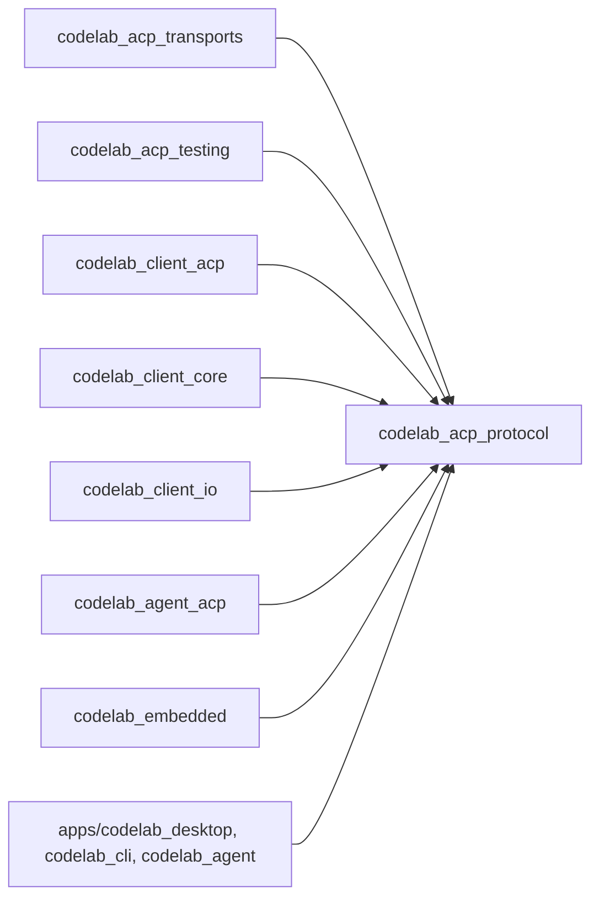

# codelab_acp_protocol

Типизированные модели ACP (Agent Client Protocol) поверх JSON-RPC 2.0: кодеки, проверка формы сообщений и типизированные ошибки. Пакет описывает только то, что идёт по проводу. Он ничего не знает о транспорте, сессиях, UI и политике разрешений, поэтому клиент, агент и тесты используют одни и те же модели.

## Место в архитектуре

Общий протокольный слой (сторона `acp`, ADR-0002). Чистый Dart без Flutter и без `dart:io`: пакет безопасен для web. Зависит только от `fpdart`, `freezed_annotation`, `json_annotation` и `meta` (`pubspec.yaml`).

Схема показывает, кто зависит от пакета (по `pubspec.yaml` каждого из них).



Граница ACP и роль пакета описаны в [`docs/architecture/acp-boundary.md`](../../../docs/architecture/acp-boundary.md) (§3). DTO этого пакета не должны жить долго в состоянии UI: слои выше переводят их в свои понятия.

## Что внутри

Публичное API экспортирует один барель, `lib/codelab_acp_protocol.dart`.

| Часть | Для чего |
|---|---|
| `JsonRpcMessage` (`JsonRpcRequest`, `JsonRpcNotification`, `JsonRpcResponse`), `JsonRpcId`, `JsonRpcError` | Кадр JSON-RPC 2.0 |
| `decodeJsonRpcMessage`, `encodeJsonRpcMessage` | Строка JSON ↔ `JsonRpcMessage` |
| `AcpMethodDefinition`, `acpMethodRegistry`, `requireAcpMethod` | Реестр ACP-методов: имя, кодеки параметров и результата |
| `encodeAcpRequest`, `encodeAcpNotification`, `encodeAcpResponse` | Типизированная модель → кадр |
| `decodeAcpRequestParams`, `decodeAcpNotificationParams`, `decodeAcpResponseResult`, а также `decodeAcpParams`/`decodeAcpResult` | Кадр → типизированная модель |
| Константы `initializeMethod`, `sessionPromptMethod` и др.; описания `acpInitialize`, `acpSessionPrompt` и др. | Имена и описания 17 методов |
| `InitializeRequest`, `ClientCapabilities`, `AgentCapabilities` и др. | Рукопожатие `initialize` |
| `NewSessionRequest`, `LoadSessionRequest`, `ListSessionsRequest`, `SetSessionModeRequest`, `SetSessionConfigOptionRequest` и ответы | Сессии |
| `PromptRequest`, `PromptResponse`, `ContentBlock`, `StopReason`, `CancelNotification` | Ход диалога |
| `SessionNotification`, `SessionUpdate` | Поток `session/update` от агента |
| `ToolCall`, `ToolCallUpdate`, `ToolCallContent`, `ToolKind`, `ToolCallStatus` | Вызовы инструментов |
| `RequestPermissionRequest`, `RequestPermissionOutcome`, `PermissionOption` | `session/request_permission` |
| `ReadTextFileRequest`, `WriteTextFileRequest` и ответы | `fs/read_text_file`, `fs/write_text_file` |
| `CreateTerminalRequest` и остальные модели `terminal/*` | `terminal/create`, `terminal/output`, `terminal/wait_for_exit`, `terminal/kill`, `terminal/release` |
| `AcpProtocolError`, `AcpProtocolErrorKind`, `JsonRpcProtocolException` | Ошибки протокола и их коды JSON-RPC |

Не экспортируются и остаются внутренними: `json_value.dart` (`JsonObject`, `requireJsonObject`) и `acp_validation.dart` (`requireAcpObject`, `tolerateUnknownRootFields`). Тип `JsonObject` — это `Map<String, Object?>`.

Методы `session/cancel` и `session/update` — уведомления (`AcpNotificationMethod`, ответа нет); остальные 15 — запросы (`AcpRequestMethod`). Полный список — `acpMethodRegistry` в `lib/src/acp/acp_method_codec.dart`. Определения сообщений сверяйте со схемой [`docs/protocols/acp/protocol/17-Schema.md`](../../../docs/protocols/acp/protocol/17-Schema.md).

## Как использовать

Кодировать запрос и разбирать входящий кадр:

```dart
import 'package:codelab_acp_protocol/codelab_acp_protocol.dart';

// Исходящий запрос: модель -> кадр -> строка.
final line = encodeJsonRpcMessage(
  encodeAcpRequest(
    id: const JsonRpcId.integer(1),
    method: initializeMethod,
    params: const InitializeRequest(
      protocolVersion: ProtocolVersion(1),
      clientInfo: Implementation(name: 'CodeLab', version: '0.1.0'),
    ),
  ),
);

// Входящий кадр: строка -> кадр -> модель.
try {
  final message = decodeJsonRpcMessage(line);
  if (message is JsonRpcRequest) {
    final params = decodeAcpRequestParams(message); // InitializeRequest
  }
} on JsonRpcProtocolException catch (error) {
  // Плохой JSON, плохая форма или неизвестный метод.
  final protocolError = AcpProtocolError.fromException(error);
  // protocolError.jsonRpcCode / jsonRpcMessage — код и текст для кадра-ошибки.
}
```

Что важно знать:

- Декодеры бросают `JsonRpcProtocolException` (`invalidJson`, `invalidShape`, `unknownMethod`). `AcpProtocolError` превращает её в код JSON-RPC: `-32700`, `-32600`, `-32601`, `-32602`, `-32603`, а для отсутствующего ресурса — `-32002`.
- Уведомление нельзя закодировать как запрос и наоборот: `encodeAcpRequest` для `session/update` бросит `invalidShape`.
- Декодер результата ответа (`decodeAcpResult`, `decodeAcpResponseResult`) и параметры `session/update` (`decodeAcpNotificationParams`) терпимы к лишним полям верхнего уровня. Остальные декодеры строгие — это граница безопасности (запросы `fs/*`, `terminal/*`, `session/request_permission`). См. следующий раздел.

## Как расширять и сохранять совместимость

Правила ниже взяты из кода; проверяйте их по существующим моделям (образец — `lib/src/acp/fs.dart`).

1. **Сверьтесь со схемой.** Поле или метод добавляется только если он есть в `docs/protocols/acp/` или утверждён спецификацией `openspec/specs/`. Выдумывать методы, поля и состояния ЗАПРЕЩЕНО (`AGENTS.md` §3.4).
2. **Модель — `@freezed sealed class` с ручными `fromJson`/`toJson`.** `fromJson(Object? value)` начинается с `requireAcpObject(value, path:, allowedKeys:)`; `toJson()` выводит только заданные поля. Идентификаторы — отдельные типы (`SessionId`, `ToolCallId`, `TerminalId`).
3. **`_meta` — единственное место для расширений.** У каждой модели есть поле `meta` (`@JsonKey(name: '_meta') JsonObject?`). Лишний ключ верхнего уровня вне `allowedKeys` — ошибка формы: `... contains unsupported root field "x"; use _meta for extensions.`
4. **Неизвестные значения.** Строгие `StopReason`, `ToolCallStatus` и дискриминатор `sessionUpdate` отклоняют незнакомое значение ошибкой `invalidShape`. `ToolKind` терпим: `ToolKind.fromJson` возвращает `ToolKind.other` для незнакомой строки, а `invalidShape` бросает только для не-строки; исходное значение доступно через `unrecognizedToolKind`. Новое значение схемы добавляйте в перечисление (или в `switch`) вместе с тестом в `toJson`/`fromJson`.
5. **Терпимость к лишним полям — только там, где это безопасно.** `tolerateUnknownRootFields` работает на ответах агента и на `session/update`: агент — внешний процесс, и потеря целого ответа из-за поля, которого клиент не знает, ничего не защищает. Возможности `initialize` (`agentCapabilities`) тоже читаются терпимо через `requireAcpCapabilityObject`. Запросы агента клиенту (`fs/*`, `terminal/*`, `session/request_permission`) остаются строгими. Расширять терпимость на них нельзя.
6. **Новый метод.** Добавьте константу имени, `AcpMethodDefinition.request`/`.notification` и запись в `acpMethodRegistry` в `acp_method_codec.dart`, экспортируйте файл модели из `lib/codelab_acp_protocol.dart`.
7. **Кодогенерация.** `*.freezed.dart` в git не лежат. После правки моделей или в новом worktree запустите шаг генерации из [`docs/user/run-from-source.md`](../../../docs/user/run-from-source.md).

Правка модели меняет контракт всех пакетов со схемы выше. Её предваряет OpenSpec change (`AGENTS.md` §17), а conformance-прогоны (см. «Тесты») проверяют обе стороны.

## Тесты

```bash
cd packages/dart/codelab_acp_protocol
fvm dart test
```

Набор — 15 файлов в `test/`: по одному на группу сообщений (`initialize_test.dart`, `session_test.dart`, `prompt_test.dart`, `session_update_test.dart`, `permission_test.dart`, `fs_test.dart`, `terminal_test.dart` и др.), кодеки (`json_rpc_codec_test.dart`, `acp_method_codec_test.dart`), ошибки (`protocol_error_test.dart`), терпимость к лишним полям (`response_tolerance_test.dart`, `session_update_tolerance_test.dart`) и `protocol_conformance_test.dart` (круговой проход модель → провод → модель).

Скрипты Melos из корневого `pubspec.yaml`:

| Команда | Что проверяет |
|---|---|
| `melos run protocol-conformance` | `fvm dart test packages/dart/codelab_acp_protocol/test` — этот пакет |
| `melos run conformance:client` | золотой корпус фикстур ACP против `AcpClientApplication` (клиентская роль) |
| `melos run conformance:agent` | тот же корпус против `AcpAgentServer` (роль агента) |
| `melos run conformance:embedded` | корпус против встроенного агента |
| `melos run guard` | границы зависимостей пакетов |

Изменение моделей или кодеков требует `protocol-conformance`, `conformance:client` и `conformance:agent` (`AGENTS.md` §21). Все три входят в `melos run check`.

## Правила пакета

У пакета нет собственного `AGENTS.md`: действуют правила корневого [`AGENTS.md`](../../../AGENTS.md). Главные: `codelab_acp_protocol` остаётся чистым Dart без Flutter, не содержит состояния UI, диалогов, навигации и прикладной логики (§5, §7), а модели ACP типизированы.

## Смотрите также

- [`docs/architecture/acp-boundary.md`](../../../docs/architecture/acp-boundary.md) — граница ACP и роли соседних пакетов
- [`docs/architecture/error-handling.md`](../../../docs/architecture/error-handling.md) — типизированные ошибки
- [`docs/architecture/testing.md`](../../../docs/architecture/testing.md) — уровни тестов
- [`docs/protocols/acp/`](../../../docs/protocols/acp/) — референсная спецификация ACP
- [`openspec/specs/acp-protocol-client`](../../../openspec/specs/acp-protocol-client/spec.md), [`openspec/specs/acp-golden-fixtures`](../../../openspec/specs/acp-golden-fixtures/spec.md) — спецификации
