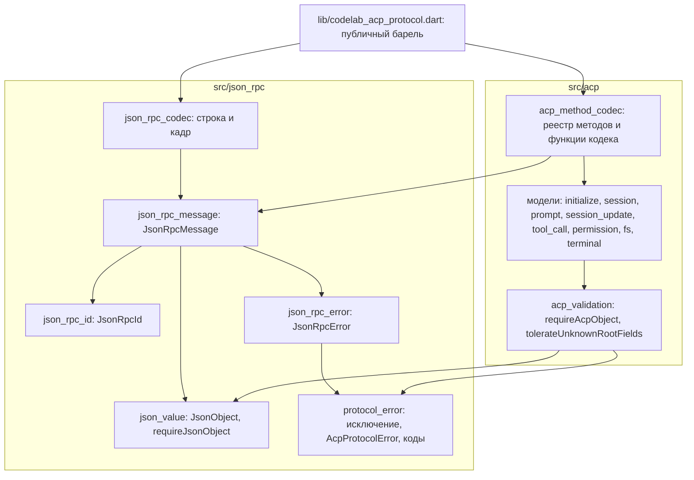
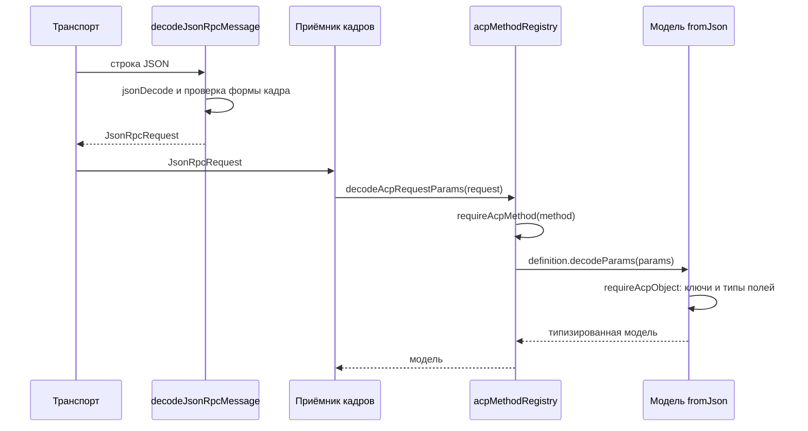

# Устройство пакета

Глава показывает, из чего состоит `codelab_acp_protocol` и как кадр проходит через него. Сначала карта модулей, затем путь кадра от строки до модели, затем слой JSON-RPC, слой ACP, реестр методов и ошибки. Правила совместимости (что разбирается строго, а что терпимо) вынесены в [главу 02](02-compatibility.md).

## Что пакет делает и чего не делает

Пакет отвечает только за провод: имена методов, типизированные модели сообщений, перевод строки в модель и обратно, проверку формы и ошибки уровня протокола. Он не знает про транспорт, сессии, состояние интерфейса, диалоги разрешений и переподключение. Список разрешённого и запрещённого — [`acp-boundary.md`, §3](../../../../docs/architecture/acp-boundary.md#3-ответственность-codelab_acp_protocol). Зависимости пакета — только `fpdart`, `freezed_annotation`, `json_annotation` и `meta` (`pubspec.yaml`); в `lib/` нет импортов `dart:io` и Flutter.

Практический вывод: модель из этого пакета описывает сообщение на проводе, а не то, что показывает интерфейс. Слои выше (`codelab_client_acp`, `codelab_agent_acp`) переводят её в свои понятия.

## Карта `lib/src`

Схема показывает, какой файл от какого зависит (стрелка — «использует»). Слой `json_rpc` ничего не знает об ACP; слой `acp` строится поверх него. Барель экспортирует все файлы, кроме `json_value.dart` и `acp_validation.dart` (они внутренние); на схеме от него показаны только входы двух слоёв.



| Файл | Строк | Ответственность |
|---|---|---|
| `json_rpc/json_value.dart` | 51 | тип `JsonObject` (`Map<String, Object?>`), проверка «это значение JSON», разбор `params` и `result` |
| `json_rpc/json_rpc_id.dart` | 44 | `JsonRpcId`: строка, целое или `null` |
| `json_rpc/json_rpc_error.dart` | 58 | `JsonRpcError` (`code`, `message`, `data`) и перевод `AcpProtocolError` в него |
| `json_rpc/json_rpc_message.dart` | 119 | `JsonRpcMessage` (запрос, уведомление, ответ), правила разбора кадра |
| `json_rpc/json_rpc_codec.dart` | 23 | `decodeJsonRpcMessage`, `encodeJsonRpcMessage` |
| `json_rpc/protocol_error.dart` | 179 | `JsonRpcProtocolException`, `AcpProtocolError`, коды JSON-RPC |
| `acp/acp_validation.dart` | 76 | проверка корневых ключей, терпимость к лишним полям |
| `acp/acp_method_codec.dart` | 497 | имена методов, `AcpMethodDefinition`, реестр, функции кодека |
| `acp/initialize.dart` | 468 | рукопожатие `initialize`, возможности клиента и агента |
| `acp/session.dart` | 953 | сессии, MCP-серверы, режимы, опции конфигурации |
| `acp/prompt.dart` | 504 | `session/prompt`, блоки содержимого, `StopReason`, `session/cancel` |
| `acp/session_update.dart` | 462 | `session/update`: десять видов обновлений |
| `acp/tool_call.dart` | 507 | вызовы инструментов, `ToolKind`, `ToolCallStatus` |
| `acp/permission.dart` | 227 | `session/request_permission` |
| `acp/fs.dart` | 198 | `fs/read_text_file`, `fs/write_text_file` |
| `acp/terminal.dart` | 506 | пять методов `terminal/*` |

Публичное API экспортирует один барель, `lib/codelab_acp_protocol.dart`. Внутри остаются `json_value.dart` и `acp_validation.dart`: их типы видны снаружи только через сигнатуры (`JsonObject` — это обычный `Map<String, Object?>`).

## Путь кадра

Кадр — одна строка JSON. Диаграмма показывает входящий запрос: транспорт разбирает строку в `JsonRpcMessage`, а приёмник по имени метода берёт определение из реестра и разбирает параметры в модель.



Транспорты вызывают `decodeJsonRpcMessage` сами (`StdioAcpTransport`, `WebSocketAcpTransport` в `codelab_acp_transports`). Серверные транспорты агента разбирают кадр иначе: через `decodeServerFrame`, который вызывает `jsonRpcMessageFromJson` и сам формирует ответ на плохой кадр (подробности — [кадрирование в руководстве по транспортам](../../codelab_acp_transports/doc/01-design.md#кадрирование)). Параметры разбирает приёмник: клиент — `AcpClientApplication`, агент — `AcpAgentServer`. Исходящий путь зеркальный: модель → `toJson()` → `encodeAcpRequest` (или `…Notification`, `…Response`) → `JsonRpcMessage` → `encodeJsonRpcMessage` → строка.

Любой шаг может бросить `JsonRpcProtocolException`. Что с ней делать, решает приёмник: например, клиент отвечает на запрос агента с плохими параметрами ошибкой `-32602` (`AcpProtocolError.invalidAcpParams`), а на запрос неизвестного метода — `-32601`.

## Слой JSON-RPC

Кадр описывает запечатанный класс `JsonRpcMessage` с тремя вариантами:

| Вариант | Поля | Признак на проводе |
|---|---|---|
| `JsonRpcRequest` | `id`, `method`, `params` | есть `method` и `id` |
| `JsonRpcNotification` | `method`, `params` | есть `method`, нет `id` |
| `JsonRpcResponse` | `id`, `result` или `error` | нет `method` |

`params` и `result` хранятся как `Object?`: пакет не знает, какой метод у кадра, пока не заглянет в реестр. `JsonRpcId` — тоже запечатанный класс: `JsonRpcId.string`, `JsonRpcId.integer`, `JsonRpcId.nullValue`.

`decodeJsonRpcMessage(String)` делает два шага: `jsonDecode` (ошибка → `invalidJson`) и `jsonRpcMessageFromJson`, который проверяет форму. Правила проверяют `json_rpc_codec_test.dart` и `protocol_conformance_test.dart`:

- верхний уровень — JSON-объект (массив, то есть пакетный запрос, отвергается: `JSON-RPC message must be a JSON object.`);
- `jsonrpc` равен строке `"2.0"`;
- `method`, если есть, — непустая строка; наличие `method` делает кадр запросом (с `id`) или уведомлением (без `id`);
- без `method` кадр — ответ: `id` обязателен, а ровно одно из `result` и `error` должно присутствовать;
- `id` — строка, целое или `null`; дробное число отвергается;
- `params` — объект, массив или `null`; `error` — объект с целым `code`, строковым `message` и необязательным `data`.

Кодирование `JsonRpcMessage.toJson()` пишет `params` только если он задан, а в ответе без ошибки всегда пишет `result`, даже `null`:

```text
{"jsonrpc":"2.0","id":1,"result":null}
```

## Слой ACP: модели

Все модели сообщений устроены одинаково, образец — `lib/src/acp/fs.dart`:

- класс `@freezed sealed class` с обязательными полями `required` и необязательными `T?`; значения по умолчанию заданы `@Default(...)` (например, `ToolCall.status` по умолчанию `pending`);
- `factory Name.fromJson(Object? value)` написан вручную: он начинается с `requireAcpObject(value, path:, allowedKeys:)`, затем читает поля;
- `JsonObject toJson()` пишет только заданные поля;
- поле расширений `meta` соответствует ключу `_meta` (`@JsonKey(name: '_meta')`);
- идентификаторы — отдельные типы с проверкой «непустая строка»: `SessionId`, `ToolCallId`, `PermissionOptionId`, `SessionModeId`, `SessionConfigId`, `SessionConfigValueId`, `TerminalId`;
- перечисления (`StopReason`, `ToolCallStatus`, `PermissionOptionKind`, `Role`, `PlanEntryStatus` …) хранят имя на проводе в `wireName` и имеют `fromJson`/`toJson`;
- объединения с дискриминатором (`ContentBlock` по `type`, `SessionUpdate` по `sessionUpdate`, `ToolCallContent` по `type`, `McpServer` по `type`, `RequestPermissionOutcome` по `outcome`) — запечатанные классы с `switch` в `fromJson` и в `toJson`.

Вспомогательные функции вроде `_requiredString` и `_optionalObject` каждый файл объявляет у себя: общего хелпера нет, и новый файл модели копирует нужные.

`ToolKind` — исключение из общего правила, он разбирается мягко ([глава 02](02-compatibility.md#неизвестный-вид-вызова-инструмента-toolkind)).

## Реестр методов

`acp_method_codec.dart` объявляет 17 методов: по константе имени (`initializeMethod`, `sessionPromptMethod`, `fsReadTextFileMethod` …) и по определению (`acpInitialize`, `acpSessionPrompt` …). Определение — объект `AcpMethodDefinition<TParams, TResult>` с четырьмя функциями: разбор и запись параметров, разбор и запись результата. У уведомления результата нет: это `AcpNotificationMethod` с `TResult = Never`, а попытка обратиться к результату бросает `invalidShape` («… does not have a result payload.»).

Реестр `acpMethodRegistry` — константная карта «имя → определение». В реестре нет понятия направления: клиент и агент используют один и тот же реестр. Колонка «обрабатывает» ниже взята из `17-Schema.md` (раздел `Agent` — запросы клиента к агенту, раздел `Client` — запросы агента к клиенту).

| Метод | Вид | Обрабатывает | Параметры | Результат |
|---|---|---|---|---|
| `initialize` | запрос | агент | `InitializeRequest` | `InitializeResponse` |
| `session/new` | запрос | агент | `NewSessionRequest` | `NewSessionResponse` |
| `session/load` | запрос | агент | `LoadSessionRequest` | `LoadSessionResponse` |
| `session/list` | запрос | агент | `ListSessionsRequest` | `ListSessionsResponse` |
| `session/prompt` | запрос | агент | `PromptRequest` | `PromptResponse` |
| `session/cancel` | уведомление | агент | `CancelNotification` | нет |
| `session/set_config_option` | запрос | агент | `SetSessionConfigOptionRequest` | `SetSessionConfigOptionResponse` |
| `session/set_mode` | запрос | агент | `SetSessionModeRequest` | `SetSessionModeResponse` |
| `session/request_permission` | запрос | клиент | `RequestPermissionRequest` | `RequestPermissionResponse` |
| `session/update` | уведомление | клиент | `SessionNotification` | нет |
| `fs/read_text_file` | запрос | клиент | `ReadTextFileRequest` | `ReadTextFileResponse` |
| `fs/write_text_file` | запрос | клиент | `WriteTextFileRequest` | `WriteTextFileResponse` |
| `terminal/create` | запрос | клиент | `CreateTerminalRequest` | `CreateTerminalResponse` |
| `terminal/output` | запрос | клиент | `TerminalOutputRequest` | `TerminalOutputResponse` |
| `terminal/wait_for_exit` | запрос | клиент | `WaitForTerminalExitRequest` | `WaitForTerminalExitResponse` |
| `terminal/kill` | запрос | клиент | `KillTerminalCommandRequest` | `KillTerminalCommandResponse` |
| `terminal/release` | запрос | клиент | `ReleaseTerminalRequest` | `ReleaseTerminalResponse` |

В схеме есть ещё метод `authenticate`. В реестр он не входит: `decodeAcpParams('authenticate', …)` даёт `unknownMethod`. Агент CodeLab отвечает на него `-32601` (спецификация [`agent-acp-server`](../../../../openspec/specs/agent-acp-server/spec.md)).

### Функции кодека

Есть два способа пользоваться реестром, и в репозитории встречаются оба.

**По имени метода.** Функции принимают строку и возвращают `Object`, поэтому вызывающий приводит тип сам. Так работает `AcpClientApplication` (`decodeAcpRequestParams(request) as ReadTextFileRequest`).

| Функция | Что делает | Разбор |
|---|---|---|
| `decodeAcpRequestParams(JsonRpcRequest)` | параметры запроса; для уведомления бросает `invalidShape` («… must be a notification.») | строгий |
| `decodeAcpNotificationParams(JsonRpcNotification)` | параметры уведомления; для запроса бросает `invalidShape` | `session/update` терпимо, `session/cancel` строго |
| `decodeAcpResponseResult(method:, response:)` | результат ответа; для ответа-ошибки бросает `invalidShape` | терпимый |
| `decodeAcpResult(method, result)` | то же, но по «сырому» `result` | терпимый |
| `decodeAcpParams(method, params)` | параметры без проверки направления | строгий |
| `encodeAcpRequest`, `encodeAcpNotification`, `encodeAcpResponse` | модель → `JsonRpcRequest`, `JsonRpcNotification`, `JsonRpcResponse`; не тот вид метода — `invalidShape` | — |
| `encodeAcpParams`, `encodeAcpResult` | модель → `JsonObject` | — |

**Через типизированное определение.** Константы `acpSessionNew`, `acpSessionPrompt` и другие возвращают модель нужного типа без приведения. Так работает `AcpAgentServer` (`acp.acpSessionNew.decodeParams(params)`). Важное отличие: терпимость к лишним полям включают функции `decodeAcpResult` и `decodeAcpNotificationParams`, а не определение. Прямой вызов `acpSessionNew.decodeResult(raw)` остаётся строгим.

Типы реестра ковариантны: `acpMethodRegistry` — `Map<String, AcpMethodDefinition<Object, Object>>`, поэтому передача модели не того типа в `encodeAcpRequest` падает во время выполнения (`TypeError`), а не как ошибка протокола. См. [частые проблемы](04-troubleshooting.md#typeerror-при-кодировании).

## Ошибки

Ошибок два уровня.

**`JsonRpcProtocolException`** — то, что бросают декодеры. Он реализует `FormatException` и несёт `kind` и `message`:

| `kind` | Когда |
|---|---|
| `invalidJson` | строка не разбирается как JSON |
| `invalidShape` | форма нарушена: не объект, нет поля, неверный тип, лишний корневой ключ, неизвестное значение дискриминатора |
| `unknownMethod` | метода нет в `acpMethodRegistry` |

**`AcpProtocolError`** — значение, которое приёмник собирает из исключения, чтобы ответить отправителю или записать в журнал. Конструктор `AcpProtocolError.fromException(exception, phase:, method:)` выбирает `AcpProtocolErrorKind` по `kind` исключения и фазе разбора:

| Исключение | Фаза (`AcpProtocolErrorPhase`) | `AcpProtocolErrorKind` | Код JSON-RPC | Текст кода |
|---|---|---|---|---|
| `invalidJson` | любая | `invalidJson` | `-32700` | `Parse error` |
| `invalidShape` | `jsonRpcMessage` (по умолчанию) | `invalidJsonRpcMessage` | `-32600` | `Invalid Request` |
| `unknownMethod` | любая | `unknownMethod` | `-32601` | `Method not found` |
| `invalidShape` | `params` | `invalidAcpParams` | `-32602` | `Invalid params` |
| `invalidShape` | `result` | `invalidAcpResult` | `-32602` | `Invalid params` |
| `invalidShape` | `internal` | `internalError` | `-32603` | `Internal error` |
| — (создаётся напрямую) | — | `resourceNotFound` | `-32002` | `Resource not found` |

Фаза нужна потому, что одно и то же `invalidShape` по-разному называется для кадра и для параметров. Фазу `result` приёмник использует, когда сам разбирает чужой ответ: такая ошибка не уходит по сети, а остаётся локальной.

Код `-32002` (ресурс не найден) — ACP-код из `ErrorCode` схемы; по нему агент отличает отсутствующий файл от остальных сбоев `fs/*`. Именованные конструкторы (`AcpProtocolError.unknownMethod(method)`, `.invalidAcpParams(method:, message:)`, `.resourceNotFound(message)` …) создают ошибку без исключения.

`AcpProtocolError.toJsonRpcError()` собирает `JsonRpcError`: `code` и `message` из таблицы, а в `data` кладёт `kind`, `message` и, если задан, `method`. Пример — вывод `encodeJsonRpcMessage` для ответа на запрос с неизвестным методом `foo/bar`:

```json
{"jsonrpc":"2.0","id":10,"error":{"code":-32601,"message":"Method not found","data":{"kind":"unknownMethod","message":"Method not found: foo/bar.","method":"foo/bar"}}}
```

Этот кадр совпадает по форме с тем, что ждёт фикстура `errors-bad-frame-survives` (код `-32601` на неизвестный метод `foo/bar`; текст сообщения в ней не проверяется). Про типизированные ошибки проекта в целом — [`error-handling.md`](../../../../docs/architecture/error-handling.md).

## Смотрите также

- [Совместимость](02-compatibility.md) — что разбирается строго, что терпимо, неизвестные методы и виды.
- [Расширение](03-extending.md) — как добавить метод, поле или вид обновления.
- [`acp-boundary.md`](../../../../docs/architecture/acp-boundary.md) — граница ACP и роли соседних пакетов.
