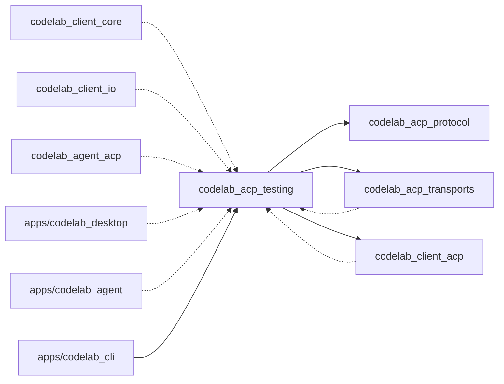

# codelab_acp_testing

Общая тестовая инфраструктура ACP (Agent Client Protocol): fake-транспорт и fake-запуск процессов, golden-фикстуры (корпус JSON-сценариев обмена клиента и агента) и драйверы, которые проигрывают их против клиента или агента. Пакет отдельный, потому что одни и те же фикстуры проверяют обе стороны протокола, а тестам нескольких пакетов нужны одни и те же двойники.

## Место в архитектуре

Тестовый пакет без стороны (`codelab_<назначение>`, ADR-0002). Чистый Dart, но не web-безопасен: загрузчик фикстур и скрипты агентов используют `dart:io`. В `lib/` приложений он не попадает, кроме одного исключения (см. ниже).

Схема показывает, от чего зависит пакет и кто его использует (по `pubspec.yaml`). Сплошная стрелка — обычная зависимость, пунктир — `dev_dependency`.



Правило пакета: он подключается только как `dev_dependency`. Единственное исключение — `apps/codelab_cli`. Команда `codelab test-scenario` проигрывает фикстуры в рабочем бинаре, поэтому пакет там — обычная зависимость, а импорт `package:codelab_acp_testing/` разрешён только из `apps/codelab_cli/lib/src/scenario/`. Правило проверяет `melos run guard` (`AGENTS.md` §5, [`docs/architecture/testing.md`](../../../docs/architecture/testing.md) §6–§7).

Пакет зависит от `codelab_client_acp` (обычная зависимость), поэтому `codelab_client_acp` подключает его только в `dev_dependencies`. Иначе получился бы цикл.

## Что внутри

Публичное API экспортирует один барель, `lib/codelab_acp_testing.dart`. Он же реэкспортирует из `codelab_acp_transports` типы транспорта (`AcpTransport`, `AcpTransportState`, `JsonRpcMessage` и связанные), чтобы тесту хватало одного импорта.

| Часть | Для чего |
|---|---|
| `FakeAcpTransport` | Транспорт в памяти. Тест сам подаёт входящие кадры (`emitInbound`), читает отправленные (`sentMessages`, `sent`, `drainSentMessages`), вызывает сбои (`fail`, `failNextSend`). На `initialize` отвечает совместимым ответом (`autoRespondToInitialize`) |
| `FakeTerminalProcessRunner`, `FakeTerminalProcessHandle` | Двойник запуска процессов для `terminal/*` клиента: настоящий процесс не стартует, вывод и завершение задаёт тест |
| `CodelabCompatibleStdioAgentMode`, `writeCodelabCompatibleStdioAgent`, `codelabCompatibleStdioAgentSource` | Скриптовый stdio-агент для тестов с реальным процессом: исходный код Dart-файла в одном из режимов (`normal`, `withPermissionRequest`, `withFsAccess`, `promptError` и других). Тест записывает файл и запускает его `dart <файл>` |
| `AcpFixture`, `FixtureSetup`, `FixtureFrame` и другие `Fixture*` | Модель фикстуры |
| `loadFixtureFile`, `loadFixtureCorpus`, `defaultFixtureCorpusDirectory` | Загрузчик. Неверная фикстура даёт `FixtureFormatException` с файлом и JSON-путём, а не ложный зелёный прогон |
| `FrameMatcher`, `FrameMismatch`, `FixtureMatchException` | Сравнение кадров с нормализацией и матчерами |
| `runClientFixture`, `ClientFixtureEnvironment`, `ClientFixtureStep`, `ClientFixtureResult`, `ClientFixtureFailure` | Драйвер проверки клиента: играет агента, сравнивает кадры клиента |
| `ClientFixtureUser` | Общий «пользователь» клиентских прогонов: по ожидаемому кадру вызывает нужный метод `AcpClientApplication` |
| `runAgentFixture`, `runAgentFixtureOver`, `AgentFixtureStarter`, `AgentFixtureConnector`, `AgentUnderTest`, `AgentFixtureSetup`, `AgentFixtureResult`, `AgentFixtureFailure` | Драйвер проверки агента: играет клиента, сравнивает кадры агента. Агента поднимает фабрика теста |
| `FixtureReplayAgent`, `serveFixtureReplay`, `writeFixtureReplayAgent` | Агент-повторитель: сам отвечает кадрами `a2c` фикстуры. Нужен, чтобы проверять драйверы и `codelab test-scenario` на всём корпусе без настоящего агента |

## Golden-фикстуры

Фикстура — JSON-файл с описанием одного сценария: начальные условия, скрипт модели и список кадров обмена. Один файл проверяет обе стороны: драйвер клиента играет агента, драйвер агента играет клиента. Формат принят в [`14-golden-fixtures.md`](../../../docs/architecture/proposals/agent-core/14-golden-fixtures.md), требования — в [`openspec/specs/acp-golden-fixtures/spec.md`](../../../openspec/specs/acp-golden-fixtures/spec.md).

Файлы лежат плоско в [`fixtures/acp/`](fixtures/acp) (без подкаталогов). Формально формат описывает [`fixtures/acp/_schema.json`](fixtures/acp/_schema.json); файлы с `_` в начале фикстурами не считаются.

Верхний уровень фикстуры:

| Поле | Смысл |
|---|---|
| `id` | `acp/<имя файла без .json>`, kebab-case |
| `spec` | Ссылки `<файл>.md#<якорь>` на `docs/protocols/acp/protocol/`; обязателен хотя бы один |
| `description` | Что проверяет сценарий |
| `roles` | `agent`, `client` или оба (по умолчанию оба) |
| `extensions`, `goals` | Используемые расширения ACP и цели паритета |
| `setup` | `cwd`, файлы, режим, конфигурация, возможности клиента, сценарные процессы терминала, журналы сессий, поддельные MCP-серверы, `transport` для транспортных фикстур |
| `llm` | Скрипт модели: шаги `expect` и `reply` / `error` |
| `frames` | Кадры `c2a` (клиент → агент) и `a2c` (агент → клиент) по порядку |
| `normalize`, `after` | Дополнительные замены перед сравнением; ожидаемое состояние файлов и вызовы MCP после сценария |

Сравнение точное: лишний ключ в кадре — расхождение. Отступления задаются матчерами на месте значения (`$any`, `$absent`, `$capture`, `$regex`, `$contains`, `$partial`, `$oneOf`, `$text`, `$repeat`) и переменными `${cwd}`, `${sessionId}`. Время заменяется на `<ts>`. Полный список и семантика — в §14.5–§14.6 документа выше, реализация — `lib/src/fixtures/matcher.dart`.

Пример кадра с `repeat` и `$text` (из `fixtures/acp/prompt-text-end-turn.json`): агент присылает один или больше `agent_message_chunk`, а склейка текста должна дать заданную строку.

```json
{
  "dir": "a2c",
  "frame": {
    "jsonrpc": "2.0",
    "method": "session/update",
    "params": {
      "sessionId": "${sessionId}",
      "update": {
        "sessionUpdate": "agent_message_chunk",
        "content": {"type": "text", "text": {"$any": true}}
      }
    }
  },
  "repeat": "+",
  "match": {"$text": "Привет! Чем помочь?"}
}
```

### Как добавить фикстуру

1. Выберите имя `<область>-<сценарий>[-<исход>]` в kebab-case и создайте `fixtures/acp/<имя>.json`. Поле `id` — `acp/<имя>`.
2. Возьмите за образец близкую фикстуру, например `prompt-text-end-turn.json`. Заполните `spec` существующими файлами и якорями из `docs/protocols/acp/protocol/`, `description`, `setup`, `llm` и `frames`. Поле `roles` укажите, если сценарий нужен только одной стороне.
3. Запустите тесты пакета: `fvm dart test`. Загрузчик отвергнет неверную структуру, а `fixtures_load_test.dart` проверит инварианты корпуса (в том числе существование ссылок `spec`).
4. Прогоните фикстуру против обеих сторон: `melos run conformance:client`, `conformance:agent`, `conformance:embedded` (таблица ниже).
5. Если фикстура закрывает метод или вид `sessionUpdate`, уберите его из `pendingCoverage` в `test/fixtures_coverage_test.dart` или `agentPendingCoverage` в `test/fixtures_agent_coverage_test.dart`: список только сокращается.
6. Если меняется формат (новое поле), правьте вместе `fixtures/acp/_schema.json` и загрузчик `lib/src/fixtures/fixture.dart`: `fixtures_schema_sync_test.dart` следит, чтобы они не разошлись.

### Кто проигрывает корпус

Корпус играют четыре места. Скрипты — из корневого `pubspec.yaml` (секция `melos`), запуск — `fvm dart run melos run <скрипт>`.

| Скрипт Melos | Что проверяет |
|---|---|
| `conformance:client` | `AcpClientApplication` против корпуса (`packages/dart/codelab_client_acp/test/fixtures`, драйвер `runClientFixture`) |
| `conformance:agent` | `AcpAgentServer` против корпуса (`packages/dart/codelab_agent_acp/test/conformance_test.dart`, драйвер `runAgentFixture`) |
| `conformance:embedded` | встроенный агент в процессе CLI: `codelab test-scenario packages/dart/codelab_acp_testing/fixtures/acp --agent embedded` |

Транспортные фикстуры (с `setup.transport`: stdio или WebSocket) играет бинарь агента: `apps/codelab_agent/test/transport_conformance_test.dart` через `runAgentFixtureOver`. `melos run protocol-conformance` корпус фикстур не проигрывает: он запускает только тесты `codelab_acp_protocol`. Все скрипты входят в `melos run check`.

Команда `codelab test-scenario` описана в [`apps/codelab_cli/doc/operations.md`](../../../apps/codelab_cli/doc/operations.md#проверка-агента-фикстурами-test-scenario), ограничения импорта — в [`apps/codelab_cli/doc/development.md`](../../../apps/codelab_cli/doc/development.md).

## Как использовать

Тест клиента: создайте `FakeAcpTransport`, передайте его клиенту, подавайте входящие кадры и читайте отправленные.

```dart
final transport = FakeAcpTransport();
// ... создать AcpClientApplication на transport и вызвать connect ...
transport.emitInbound(message); // кадр от «агента»
final sent = transport.drainSentMessages(); // что клиент отправил
```

Прогон корпуса против клиента (шаблон из `packages/dart/codelab_client_acp/test/fixtures/client_fixture_conformance_test.dart`): для каждой фикстуры вызовите `runClientFixture(fixture, clientFactory, onBeforeExpect: …)`. Действия пользователя (`session/prompt`, ответ на запрос разрешения) выполняет `ClientFixtureUser`.

Прогон корпуса против агента: `runAgentFixture(fixture, startAgent)`. `startAgent` — `AgentFixtureStarter`: он получает агентский конец `InProcessAcpLink` и поднимает на нём агента. Пакет не знает пакетов агента, поэтому фабрику пишет тест. Расхождение — `AgentFixtureFailure` с индексом кадра и diff. Фикстура без нужной роли пропускается с причиной.

Загрузка корпуса: `loadFixtureCorpus()` берёт каталог через конфигурацию пакетов, поэтому не зависит от текущей папки; другой каталог — параметр `directory`.

## Тесты

```bash
cd packages/dart/codelab_acp_testing
fvm dart test
```

Что проверяют тесты: загрузчик и схему (`fixture_loader_test.dart`, `fixtures_load_test.dart`, `fixtures_schema_sync_test.dart`), матчеры (`matcher_test.dart`), инварианты корпуса — ссылки на спецификацию и покрытие методов и видов `sessionUpdate` (`fixtures_coverage_test.dart`, `fixtures_agent_coverage_test.dart`), сами драйверы на заглушках агента и клиента (`client_conformance_test.dart`, `agent_conformance_test.dart`), агента-повторителя (`fixture_replay_agent_test.dart`) и скриптовые stdio-агенты (`*_agent_test.dart`).

## Правила пакета

Правила пакета — в его [`AGENTS.md`](AGENTS.md), он дополняет корневой [`AGENTS.md`](../../../AGENTS.md). Главные: пакет только `dev_dependency` (исключение — `apps/codelab_cli`), производственный код его не импортирует.

## Смотрите также

- [`codelab_acp_protocol`](../codelab_acp_protocol/README.md) — модели ACP, по которым собираются кадры.
- [`codelab_acp_transports`](../codelab_acp_transports/README.md) — транспорты; `InProcessAcpLink` соединяет клиента и агента в памяти.
- [`docs/architecture/testing.md`](../../../docs/architecture/testing.md) — стратегия тестирования.
- [`docs/architecture/proposals/agent-core/14-golden-fixtures.md`](../../../docs/architecture/proposals/agent-core/14-golden-fixtures.md) — формат, алгоритмы проигрывания, инварианты корпуса.
- [`openspec/specs/acp-golden-fixtures/spec.md`](../../../openspec/specs/acp-golden-fixtures/spec.md) — спецификация корпуса.
