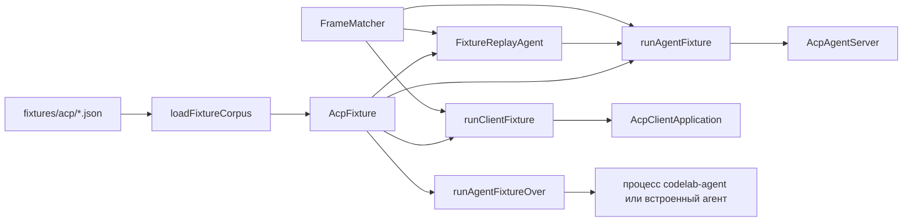
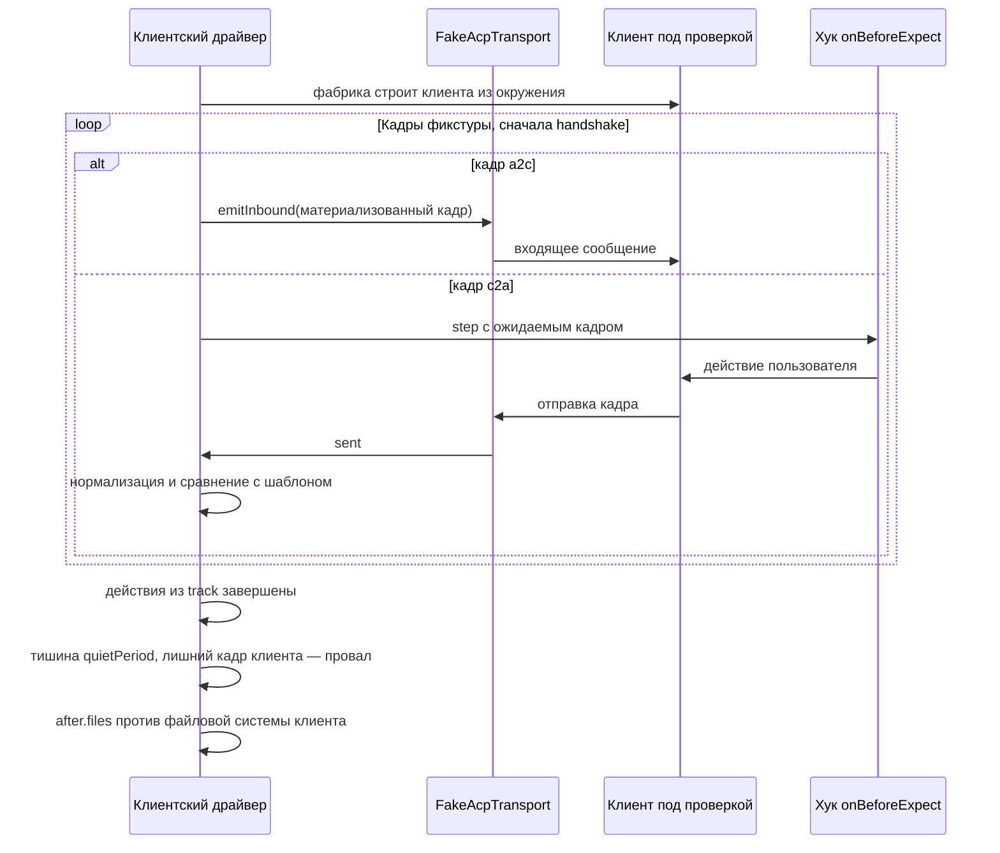
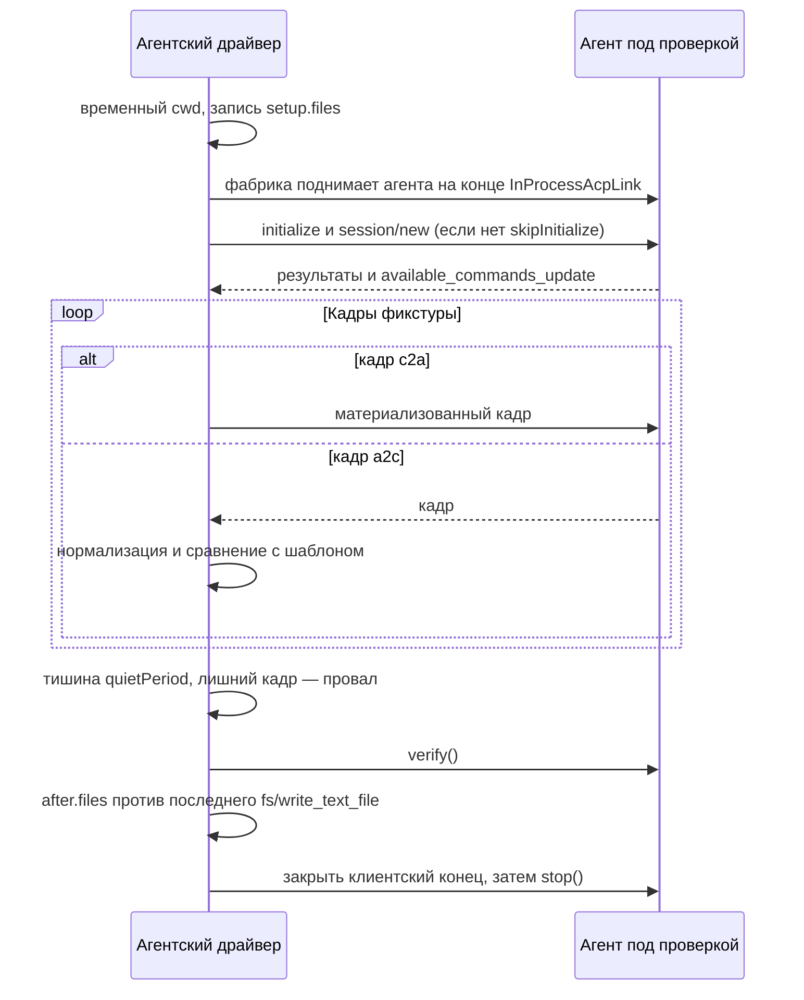
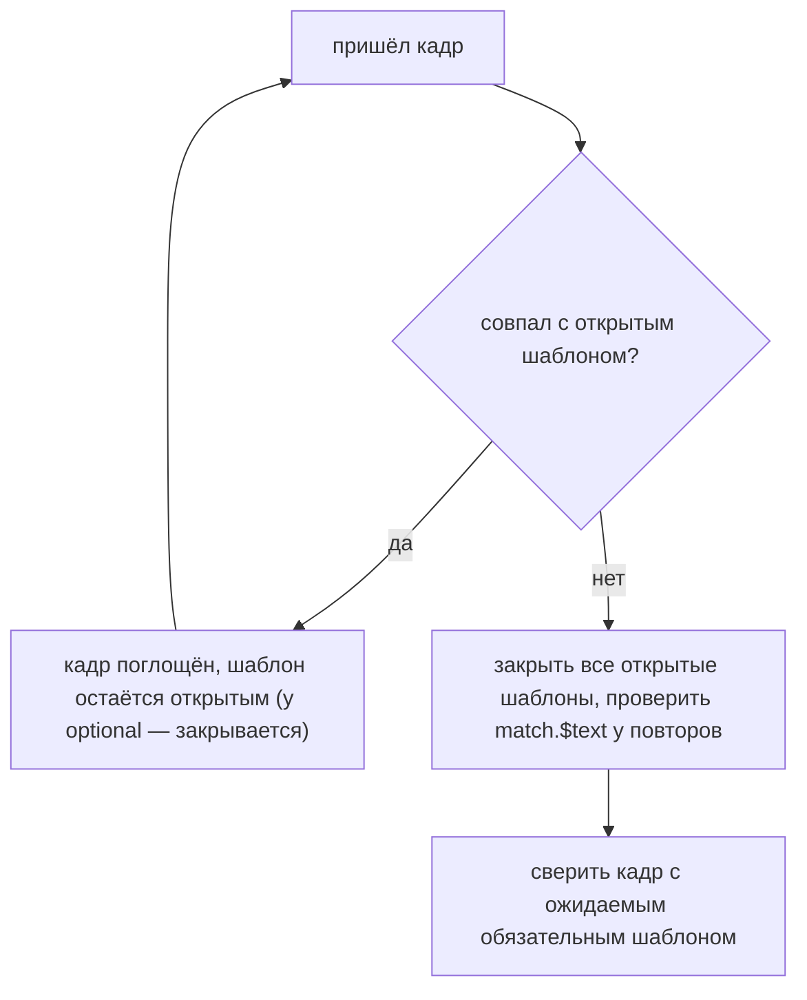

# Драйверы, матчер и двойники

Глава объясняет, как фикстура проигрывается против клиента и против агента: что делает каждый драйвер по шагам, как сравниваются кадры, что даёт агент-повторитель и какие двойники лежат в пакете. Формат файла — в [главе 1](01-fixture-format.md). Код лежит в `lib/src/`; барель `lib/codelab_acp_testing.dart` экспортирует всё нужное, кроме `OpenFrames` и `agentFixtureHandshake`.

## Карта

Схема показывает путь от файла до проверяемой стороны. Драйвер зависит только от пакетов протокола и транспортов (и клиента, для двойников); пакетов агента он не знает: агента поднимает фабрика, которую пишет тест.



| Файл `lib/src/` | Что внутри |
|---|---|
| `fixtures/fixture.dart` | модель фикстуры, загрузчик, `FixtureFormatException`, `fixtureFormatKeys` |
| `fixtures/matcher.dart` | `FrameMatcher`, `FrameMismatch`, `FixtureMatchException`, `repeatedText`, `expandRepeat` |
| `fixtures/client_conformance.dart` | `runClientFixture`, окружение клиента (`ClientFixtureEnvironment`, `InMemoryFixtureFileSystem`, `FixtureTerminalProcessRunner`), `ClientFixtureFailure` |
| `fixtures/client_fixture_user.dart` | `ClientFixtureUser`: действия пользователя для `AcpClientApplication` |
| `fixtures/agent_conformance.dart` | `runAgentFixture`, `runAgentFixtureOver`, `AgentFixtureSetup`, `AgentUnderTest`, `AgentFixtureFailure` |
| `fixtures/open_frames.dart` | `OpenFrames`: открытые шаблоны `optional` и `repeat` (внутренний тип) |
| `fixtures/fixture_replay_agent.dart` | `FixtureReplayAgent`, `serveFixtureReplay`, `writeFixtureReplayAgent` |
| `fake_acp_transport.dart` | `FakeAcpTransport` |
| `fake_terminal_process_runner.dart` | `FakeTerminalProcessRunner`, `FakeTerminalProcessHandle` |
| `codelab_compatible_stdio_agent.dart` | исходник скриптового stdio-агента и его режимы |

## Матчер

`FrameMatcher(cwd:, replace:)` хранит переменные одного прогона (`variables`: `sessionId` и захваты; `cwd` неявная) и сравнивает кадры. Драйвер создаёт по одному матчеру на прогон. Его методы:

| Метод | Когда вызывается |
|---|---|
| `match(ожидаемый, фактический)` | кадр с одним шаблоном: возвращает список `FrameMismatch(путь, сообщение)`; пустой список — совпало. Захваты попадают в `variables` только при совпадении |
| `matchText(текст, кадры)` | закрытие повтора с `match.$text`: склейка `params.update.content.text` всех кадров |
| `matchUnordered(шаблоны, кадры)` | кадр `unordered`: подбирает перестановку; при провале сообщает, какой кадр и с каким шаблоном разошёлся |
| `normalize(фактический)` | сторона «факт»: префикс `cwd` в строках становится `${cwd}`, `\` — `/` |
| `materialize(шаблон)` | кадр `a2c` у клиентского драйвера и кадр `c2a` у агентского: из шаблона получается настоящее сообщение (переменные подставлены, `$capture` порождает значение `fixture-<имя>`, `$any` — пример или `fixture-any`, `<ts>` — фиксированное время) |
| `substitute(шаблон)` | для отчёта: подставляет известные переменные и оставляет матчеры; неизвестные остаются как `${имя}` |

В отчёте о провале «ожидаемый» кадр — шаблон с подставленными переменными, матчеры в нём остаются. «Фактический» кадр показан так, как пришёл, без нормализации: путь `cwd` в нём настоящий, а не `${cwd}`.

Ошибка самой фикстуры — не расхождение, а `FixtureMatchException` (неизвестная переменная, неизвестный матчер, `$absent` не в объекте, `$regex` не строка). Если исключение возникло при `materialize` кадра, который драйвер отправляет сам, драйвер превращает его в провал с индексом кадра. Из `match` и матчеров при сравнении оно уходит без обёртки: тест видит само `FixtureMatchException`, а `test-scenario` печатает `the agent did not run the fixture: FixtureMatchException: …`.

## Клиентский драйвер

`runClientFixture<C>(fixture, clientFactory, {onBeforeExpect, frameTimeout, quietPeriod})` играет агента и проверяет клиента. Фабрика получает `ClientFixtureEnvironment` и возвращает клиента любого типа `C`: на практике это `AcpClientApplication`: его используют и тесты `codelab_client_acp`, и тесты `codelab_client_core` (`runClientFixture<AcpClientApplication>`).

Окружение, которое драйвер собирает из `setup`:

- `transport` — `FakeAcpTransport` с выключенным `autoRespondToInitialize`: на `initialize` отвечает драйвер;
- `fileSystem` — `InMemoryFixtureFileSystem`: файлы `setup.files` под `cwd`, чтение с `line` и `limit` (строки нумеруются с 1, результат — выбранные строки через `\n`, без завершающего перевода строки);
- `terminal` — `FixtureTerminalProcessRunner`: процессы из `setup.terminal`. Команда без `exitCode` не завершается сама и работает до `terminal/kill` или `terminal/release`; команды, которой нет в `setup.terminal`, клиент не запустит — `TerminalStartFailure` с перечнем известных.

Ход прогона:



Шаги подробнее:

1. Если нет `skipInitialize`, перед `frames` идут четыре кадра рукопожатия (`initialize` клиента сверяется как `$partial`, ответ — протокол версии 1; `session/new` и ответ с `sessionId` `fixture-session-1`). Переменная `sessionId` задана сразу.
2. Кадр `a2c` драйвер материализует и подаёт клиенту через `emitInbound`, затем уступает очередь (`Future.delayed(Duration.zero)`): клиент успевает обработать кадр до следующего действия.
3. Перед кадром `c2a` драйвер вызывает хук `onBeforeExpect(ClientFixtureStep)`. Кадр клиента появляется только после действия пользователя (`session/prompt`, ответ на запрос разрешения, `session/cancel`), поэтому действие выполняет хук. `step.expected` — ожидаемый кадр с подставленными переменными; `step.track(future)` регистрирует действие: драйвер не ждёт его до кадра (оно обычно завершается позже, после кадра `a2c`), но провалит прогон при его ошибке и дождётся в конце.
4. Драйвер ждёт кадр клиента `frameTimeout` (по умолчанию 5 с, реальные часы). Нет кадра — провал `timed out after 5000 ms waiting for a c2a frame`; если упало действие пользователя — `user action failed: …` сразу, без таймаута.
5. После последнего кадра: действия из `track` должны завершиться за `frameTimeout`; затем `quietPeriod` (по умолчанию 100 мс) тишины — лишний кадр клиента даёт `unexpected frames from the client after the scenario`; затем `after.files`.

Результат — `ClientFixtureResult` с полями `skipped`, `skipReason`, `client`, `environment`, `variables`. Фикстура без роли `client` не проигрывается, а возвращает `skipped: true` с причиной. Состояние клиента после прогона тест проверяет сам: фикстура закрепляет кадры, а не внутреннее состояние.

### `ClientFixtureUser`

Действия пользователя нужны всем тестам клиента, поэтому они вынесены в `ClientFixtureUser(env)`. Он строит `AcpClientApplication` на портах окружения и в `act(step)` смотрит на `method` ожидаемого кадра:

| Ожидаемый кадр | Что делает |
|---|---|
| `initialize` | `app.connect(env.transport)` |
| `session/new` | `app.createSession(...)` с `cwd` окружения |
| `session/prompt` | `app.sendPrompt(...)` с текстовыми блоками кадра; ошибку хода кладёт в `promptErrors` |
| `session/load` | `app.loadSession(...)` с `sessionId` из кадра |
| `session/cancel` | `app.cancelTurn(...)` |
| `session/set_config_option` | `app.setSessionConfigOption(...)`, итоги — в `configResults` |
| `_codelab/session/usage/ledger` | `app.requestUsageLedger(...)`, результаты — в `usageLedgerResults`, `usageLedgerErrors` |
| ответ с `result.outcome.outcome` | `app.respondToPermission(...)`: выбор варианта или отмена |

Остальные кадры клиента, например ответы на запросы агента `fs/*` и `terminal/*`, клиент порождает сам. Если новому сценарию нужен метод пользователя, которого нет в таблице, `act` его молча пропустит и прогон упадёт по таймауту `c2a`-кадра; метод добавляют в `act` ([рецепт](04-recipes-and-troubleshooting.md#как-добавить-действие-пользователя-или-новую-сторону)).

## Агентский драйвер

`runAgentFixture(fixture, startAgent, {frameTimeout, quietPeriod})` играет клиента и проверяет агента. Он не знает, как собрать агента: `startAgent` — функция теста типа `AgentFixtureStarter`.

```dart
typedef AgentFixtureStarter =
    Future<AgentUnderTest> Function(AcpTransport transport, AgentFixtureSetup setup);
```

Фабрика получает агентский конец пары `InProcessAcpLink` (из `codelab_acp_transports`) и `AgentFixtureSetup`:

| Свойство `AgentFixtureSetup` | Откуда |
|---|---|
| `fixture` | вся фикстура |
| `cwd` | временный каталог прогона (не `setup.cwd`); в нём лежат `setup.files` |
| `profile` | `setup.profile`, по умолчанию `agent-serve` |
| `mode` | `setup.mode`, `null` — режим профиля |
| `config` | `setup.config` или пустой объект |
| `llm` | блок `llm` как в файле, `null` — модель не нужна |
| `mcp` | `setup.mcp` |
| `after` | `after`, в том числе `mcpCalls` |
| `sessions` | `setup.sessions` с подставленным `${cwd}`: фабрика кладёт журналы в хранилище агента до старта |

Фабрика возвращает `AgentUnderTest` с двумя методами. `verify()` вызывается после сценария и бросает, если не все шаги модели использованы, были лишние запросы к модели или поддельный MCP-сервер получил не те вызовы. `stop()` вызывается всегда, и при провале. Образцовая фабрика — `startAgent` в `packages/dart/codelab_agent_acp/test/conformance_test.dart`: она собирает ядро через `buildAgentCore`, поднимает `AcpAgentServer` на переданном транспорте и строит `ScriptedStreamFunction` из `setup.llm`. Неизвестный ключ `config` или `mcp.servers` с настоящей командой она отвергает исключением: молча проигнорированная настройка сделала бы фикстуру ложно зелёной.

Ход прогона:



Что важно знать:

- Кадры `c2a` — это и промпты, и ответы клиента на запросы агента (`fs/*`, `terminal/*`, `session/request_permission`). Файлы и команды агент получает через ACP, а не из памяти: поэтому кадры `fs/read_text_file` и ответы на них — часть фикстуры.
- Ожидание кадра `a2c` ограничено `frameTimeout` (5 с). Тишина в конце — `quietPeriod` (по умолчанию 200 мс). Кадр после тишины — провал; запрос `fs/*` или `terminal/*` в хвосте даёт уточнение «агент сделал больше, чем закреплено фикстурой».
- При завершении драйвер сначала закрывает клиентский конец, потом останавливает агента: ожидания агента (`fs/*`, `terminal/*`, разрешения) завершаются разрывом, и остановка не ждёт таймаутов часов агента.
- `skipInitialize` сдвигает ответственность: фикстура сама содержит `initialize` и `session/new`.
- Фикстура без роли `agent` или с `setup.transport` пропускается: `AgentFixtureResult.skipped` и `skipReason`.

Провал — `AgentFixtureFailure` (поля `fixtureId`, `frameIndex`, `message`, `note`, `mismatches`, `expected`, `actual`). Индекс отрицателен у рукопожатия и равен `frames.length` у проверок после сценария. Примеры отчётов — в [главе 0](00-getting-started.md#отладка-падения-фикстуры).

## Открытые шаблоны: `optional` и `repeat`

Необязательный кадр и хвост повтора нельзя ограничить временем: на медленной машине кадр приходит позже окна и достаётся следующему обязательному кадру, а прогон падает при верном порядке. Поэтому граница определяется по содержимому. `OpenFrames` хранит открытые шаблоны:



- `optional`: драйвер не ждёт кадр. Шаблон остаётся открытым и поглотит совпавший кадр, когда тот придёт; если кадр не придёт, ничего не случится. Вместе с `repeat` в агентском прогоне это «ноль или больше подряд».
- `repeat: "+"` у обязательного кадра: первый кадр сверяется как обычно, хвост поглощается, пока кадры совпадают с шаблоном. Когда повтор закрывается, `match.$text` сверяется с склейкой всех кадров. У `optional` кадров `match` не проверяется.
- Перед кадром `c2a` открытые шаблоны получают окно тишины: агент успевает досылать дельты до действия клиента (например, до `session/cancel`). Кадр `c2a` шаблоны не закрывает: поздний кадр после него они ещё поглотят.
- Срок `frameTimeout` один на всё ожидание обязательного кадра, а не на каждый поглощённый: поток поглощаемых кадров не держит прогон вечно.
- В клиентском прогоне кадр `c2a` с `optional` поглощает не больше одного кадра, и `repeat` у него не учитывается.

## Транспортный драйвер и `test-scenario`

`runAgentFixtureOver(fixture, connect, {transportFixtures: true})` выполняет тот же алгоритм, что и агентский драйвер, но подключение берёт у теста: `AgentFixtureConnector` возвращает `AgentConnection(client, agent)` — клиентский транспорт и агента за ним. Флаг `transportFixtures` выбирает вид фикстур: `true` — только с `setup.transport`, `false` — только без него; остальные пропускаются с причиной.

Два потребителя:

- `apps/codelab_agent/test/transport_conformance_test.dart` играет фикстуры с `setup.transport` против процесса `codelab-agent` по настоящему stdio или WebSocket (`transportFixtures: true`, подключение — `connectAgentProcess` из `test/support/transport_starter.dart`). Для `ws` подключение сначала проигрывает `attempts` и сверяет HTTP-статус отказа с `expectStatus`, потом открывает основное соединение с верным токеном.
- `codelab test-scenario` играет остальные фикстуры против агента профиля (`transportFixtures: false`). Описание команды — [в руководстве по эксплуатации CLI](../../../../apps/codelab_cli/doc/operations.md#проверка-агента-фикстурами-test-scenario); код — `apps/codelab_cli/lib/src/scenario/`.

`test-scenario` не играет то, что агент по профилю принять не может, и пишет причину в `SKIP`. Правила — `ScenarioAgent.skipReason` в `agent_connector.dart`:

| Агент профиля | Пропускается, если в фикстуре |
|---|---|
| любой, кроме получающего `{fixture}` | непустой `setup.mcp` |
| встроенный (`embedded`) | `setup.sessions`, `setup.config`, `setup.web` или `setup.profile` не `agent-serve` и не `embedded-cli` |
| `codelab-agent` | `setup.sessions`, `setup.config`, `setup.web` или `setup.profile` не `agent-serve` |
| сторонний | есть блок `llm`: сценарий модели в чужой процесс не передать |
| с `{fixture}` в аргументах (повторитель) | пропусков нет: агент получает фикстуру целиком |

Порядок такой: сначала `skipReason` (таблица выше), потом `runAgentFixtureOver` пропускает фикстуры без роли `agent` и с `setup.transport`. Прогон, где не сыграно ни одной фикстуры, завершается кодом 1: пустой корпус ничего не доказывает.

## Агент-повторитель

`FixtureReplayAgent` — агент, который сам играет фикстуру: сверяет кадры клиента с шаблонами `c2a` тем же `FrameMatcher` и отвечает кадрами `a2c`, которые порождает `materialize`. Он нужен, чтобы проверять драйверы и `test-scenario` на всём корпусе без настоящего агента.

- Запуск в памяти: `FixtureReplayAgent.start(fixture, transport, cwd: …)` на агентском конце `InProcessAcpLink`. Он реализует `AgentUnderTest`, поэтому годится как результат фабрики `runAgentFixture`.
- Запуск процессом: `writeFixtureReplayAgent(directory)` пишет исходник, `fixtureReplayPackageConfig()` даёт `package_config.json`; процесс запускается как `dart --packages=<конфиг> <файл> <фикстура>` (`serveFixtureReplay` читает кадры из stdin). В CLI-тестах исходник один раз компилируется в kernel (`apps/codelab_cli/test/support/replay_agent.dart`).
- Кадр `repeat: "+"` с `match.$text` уходит одним кадром с этим текстом; необязательные кадры не отправляются.
- Кадр клиента, которого фикстура не ожидает, получает JSON-RPC ошибку `-32600` с текстом расхождения, и повтор останавливается.
- Без `cwd` папку берёт из `params.cwd` первого кадра клиента (`session/new`).

Тест `fixture_replay_agent_test.dart` проигрывает против повторителя весь агентский корпус и проверяет, что испорченная копия даёт расхождение с диффом.

## Двойники

### `FakeAcpTransport`

Транспорт в памяти для тестов клиента. Реализует `AcpTransport`.

| Член | Назначение |
|---|---|
| `emitInbound(message)` | подать клиенту входящий кадр |
| `sent`, `sentMessages`, `drainSentMessages()` | что отправил клиент: поток, список, список с очисткой |
| `fail(error)` | перевести транспорт в `failed` и выдать событие `failure` |
| `failNextSend(error)` | следующая отправка бросит эту ошибку |
| `emitEvent`, `emitDiagnostic` | события и диагностика транспорта |
| `autoRespondToInitialize` | по умолчанию `true`: на `initialize` транспорт отвечает совместимым ответом (`initializeProtocolVersion`, `initializeAgentInfo`, `initializeAgentCapabilities` настраиваются). Сценарные тесты выключают его и отвечают сами |

Особенности, о которые спотыкаются: потоки `inbound`, `events` и `sent` — синхронные broadcast-потоки, поэтому кадр, поданный до подписки, теряется; подписку делают до первого `emitInbound`. После `close()` любой вызов `start`, `send`, `emitInbound` бросает `AcpTransportException(closed)`, после `fail()` — `AcpTransportException(disconnected)`. Подать битый JSON нельзя: `emitInbound` принимает только типизированное сообщение.

### `FakeTerminalProcessRunner`

Замена запуска процессов для `terminal/*` клиента: процесс не стартует. `started` хранит вызовы `start`, `handles` — выданные дескрипторы, `nextStartFailure` задаёт сбой следующего запуска. Дескриптор `FakeTerminalProcessHandle` ведёт тест: `appendOutput(text)` добавляет вывод (при `outputByteLimit` отбрасывает начало и ставит `truncated`; считает символы, а не байты), `exit(exitCode: …, signal: …)` завершает процесс, `kill()` завершает его сигналом `SIGTERM` и считается в `killCallCount`.

Для фикстур вместо него работает `FixtureTerminalProcessRunner`, который строит дескрипторы по `setup.terminal`.

### Скриптовый stdio-агент

Для тестов с настоящим процессом пакет умеет породить исходник маленького агента: `writeCodelabCompatibleStdioAgent(directory, mode: …)` пишет файл, `codelabCompatibleStdioAgentSource(mode:)` возвращает текст. Тест запускает файл как `dart <файл> serve --stdio` (с другими аргументами агент завершается с кодом 64). Режим выбирает поведение:

| Группа | Режимы `CodelabCompatibleStdioAgentMode` |
|---|---|
| обычная работа | `normal`, `withConfigOptions`, `withPlan`, `withMarkdownReply`, `withAvailableCommands` |
| запросы агента клиенту | `withPermissionRequest`, `withCriticalPermission`, `withFsAccess`, `withFsPathEscape`, `withTerminalExecution`, `withTerminalPathEscape`, `withTerminalKill`, `withToolCalls` |
| сессии | `withSessionList`, `withConcurrentSessions`, `withQueuedPromptDrain`, `echoesCwd` |
| сбои | `exitOnStart`, `invalidStdout`, `crashMidPrompt`, `promptError`, `emptyResponse`, `hangsUntilCancel` |
| расширение usage | `withUsage`, `withUsageBudget` |

Назначение режима записано в doc-комментарии значения. Этот агент не проигрывает фикстуры: он нужен тестам клиента, CLI и desktop, которым нужен процесс с известным поведением. Образец разбора вывода — `test/support/agent_process.dart`.
