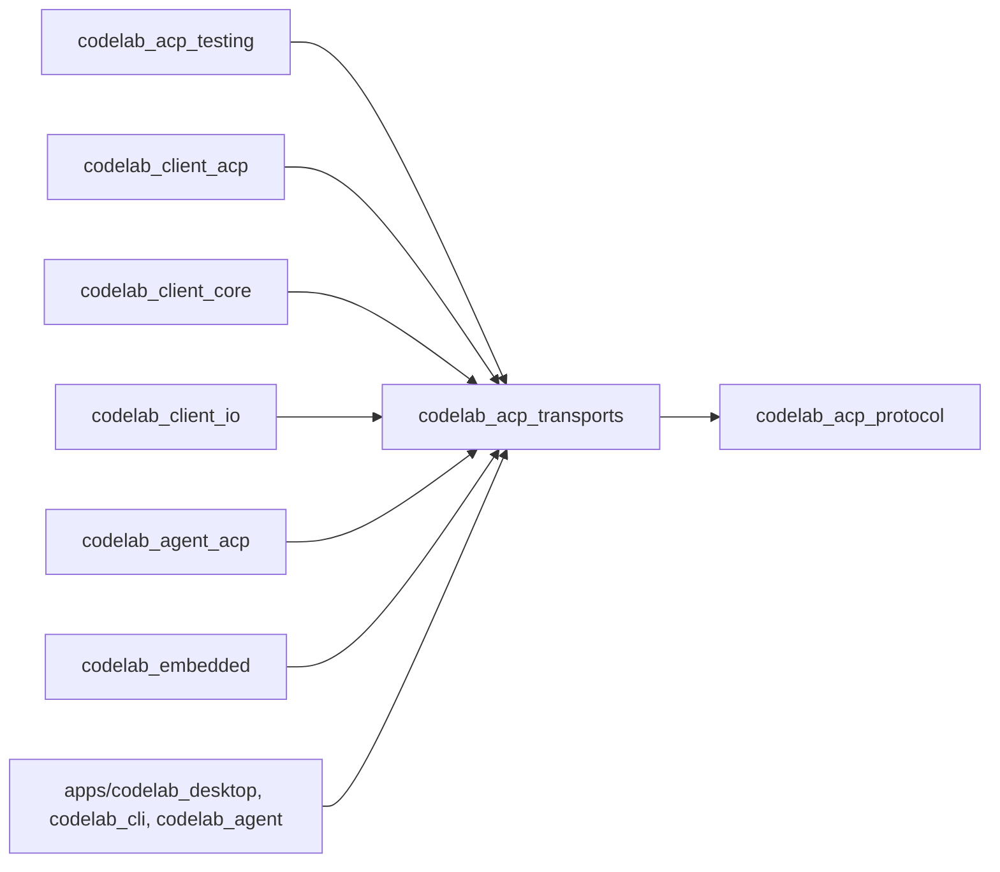
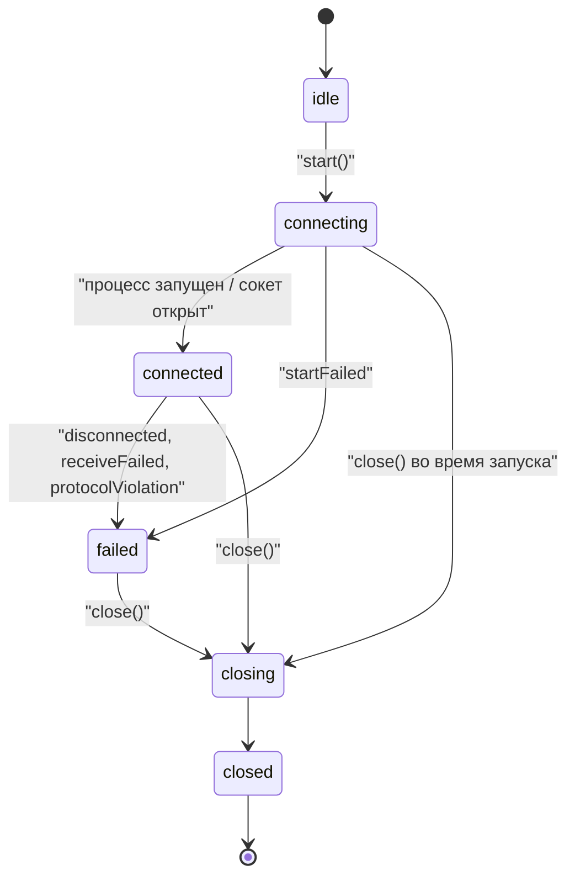

# codelab_acp_transports

Заменяемые транспорты ACP (Agent Client Protocol): stdio, WebSocket и пара в памяти. Пакет переносит сообщения JSON-RPC между клиентом и агентом и ничего не знает о сессиях, разрешениях и UI. Клиент и агент работают с одним портом `AcpTransport` и не видят, что под ним: процесс, сокет или память.

Типы сообщений (`JsonRpcMessage` и др.) приходят из [`codelab_acp_protocol`](../codelab_acp_protocol/README.md).

## Место в архитектуре

Общий протокольный слой (сторона `acp`, ADR-0002). Чистый Dart без Flutter. Основной барель web-безопасен: в нём нет `dart:io`. Транспорты на `dart:io` вынесены в отдельный барель `io.dart`.

Схема показывает зависимости пакета и тех, кто его подключает (по `pubspec.yaml`).



Транспорт решает только вопросы передачи: «процесс завершился» — событие транспорта, а «переподключить сессию» — решение прикладного слоя (`docs/architecture/acp-boundary.md`, §4).

## Что внутри

Основной барель `lib/codelab_acp_transports.dart` (web-безопасный):

| Часть | Для чего |
|---|---|
| `AcpTransport` | порт: `start`, `send`, `close`, потоки `inbound` и `events`, свойство `state` |
| `AcpTransportState` | состояния: `idle`, `connecting`, `connected`, `closing`, `closed`, `failed` |
| `AcpTransportEvent` | события: `stateChanged`, `diagnostic`, `failure` |
| `AcpTransportException`, `AcpTransportErrorCode` | типизированная ошибка и её код (`startFailed`, `sendFailed`, `receiveFailed`, `protocolViolation`, `closed`, `timeout`, `disconnected`, `unknown`) |
| `AcpWebSocketHandshakeRejected` | причина (`cause`) отказа рукопожатия WebSocket с HTTP-статусом; отличает 401/403 от недоступного агента |
| `InProcessAcpLink`, `InProcessAcpTransport` | пара соединённых концов в памяти для встроенного агента и тестов; `client` отдают клиенту, `agent` — серверу агента |
| `StdioAcpTransportConfig`, `StdioAcpAgentProfile`, `WebSocketAcpTransportConfig` | конфигурации транспортов; у WebSocket `effectiveHeaders` добавляет токен в заголовок |
| `codelabAgentStdioProfile` | профиль запуска `codelab-agent serve --stdio` |

Барель `lib/io.dart` (`dart:io`):

| Часть | Сторона | Для чего |
|---|---|---|
| `StdioAcpTransport` | клиент | запускает агента дочерним процессом, строка stdout — одно сообщение |
| `WebSocketAcpTransport` | клиент | подключается к `ws://…`, токен уходит заголовком |
| `StdioServerAcpTransport` | агент | читает stdin и пишет в stdout своего процесса |
| `WebSocketServerAcpTransport` | агент | переносит кадры по уже принятому `WebSocket` |

Серверные транспорты на плохой кадр отвечают ошибкой JSON-RPC (`-32700`, `-32600`) и не рвут соединение; клиентские при неразбираемом кадре переходят в `failed`.

Импортировать `io.dart` можно только в composition root и тестах: сторож запрещает его в web-безопасных пакетах (`packages/dart/codelab_architecture_tests/test/support/rules.dart`). Сейчас его подключают `apps/codelab_desktop` (`lib/app/app_scope.dart`), `apps/codelab_agent` (`serve_stdio.dart`, `serve_ws.dart`), `codelab_client_io` (`ioTransportResolver`) и `codelab_acp_testing` (проигрыватель фикстур). Правила — в корневом [`AGENTS.md`](../../../AGENTS.md), §5.

## Как использовать

Клиент создаёт транспорт из конфигурации, запускает его, читает `inbound` и `events`, в конце закрывает.

```dart
import 'package:codelab_acp_transports/codelab_acp_transports.dart';
import 'package:codelab_acp_transports/io.dart';

Future<void> main() async {
  final transport = StdioAcpTransport(
    codelabAgentStdioProfile.toTransportConfig(),
  );

  transport.events.listen((event) {
    if (event is AcpTransportFailure) {
      // Сбой соединения приходит событием, а не исключением из inbound.
    }
  });
  transport.inbound.listen((message) {
    // Разобранное сообщение JSON-RPC от агента.
  });

  await transport.start(); // при ошибке запуска бросает исключение
  // await transport.send(message);
  await transport.close(); // по умолчанию ждёт до 5 с
}
```

Для встроенного агента и тестов используют пару в памяти. Каждая сторона сама запускает свой конец и закрывает его:

```dart
final link = InProcessAcpLink();
final AcpTransport client = link.client;
final AcpTransport agent = link.agent;
```

Ошибки `send` приходят как `AcpTransportException` с кодом `sendFailed` или `closed`. Конец пары доставляет сообщения в следующей микрозадаче и в порядке `send`.

## Жизненный цикл

На схеме переходы `AcpTransportState` клиентских транспортов `StdioAcpTransport` и `WebSocketAcpTransport`. Каждый переход публикуется событием `AcpTransportStateChanged` в `events`.



- `close()` закрывает потоки `inbound` и `events`; после него `start()` бросает ошибку.
- `StdioAcpTransport.close()` действует по шагам: закрывает stdin, ждёт выхода процесса (по умолчанию 5 с), шлёт `SIGTERM`, ждёт до 2 с, затем `SIGKILL`. Повторный вызов возвращает то же закрытие и может только сократить срок ожидания.
- У `StdioServerAcpTransport` конец входа (EOF) закрывает только `inbound`: ответы на уже прочитанные запросы ещё уходят до `close()`.
- В паре в памяти закрытие одного конца переводит второй в `failed` с кодом `disconnected`. Недоставленные сообщения сбрасываются с диагностикой `warning`.

Переподключение транспорт не делает: после `failed` прикладной слой создаёт новый транспорт (`docs/architecture/session-lifecycle.md`, `docs/architecture/streaming.md`, `docs/architecture/concurrency.md`).

## Тесты

```bash
cd packages/dart/codelab_acp_transports
fvm dart test
```

Файлы `*.freezed.dart` не хранятся в репозитории: до первого запуска сгенерируйте код по [`docs/user/run-from-source.md`](../../../docs/user/run-from-source.md). Тесты stdio запускают настоящие процессы через `codelab_acp_testing`. `test/web_safe_barrel_test.dart` проверяет, что основной барель не тянет `dart:io`.

## Правила пакета

Основной барель остаётся web-безопасным, а IO-транспорты живут только в `io.dart`. Транспорт не принимает прикладных решений и не показывает диалоги. Правила пакета — в его [`AGENTS.md`](AGENTS.md), он дополняет корневой [`AGENTS.md`](../../../AGENTS.md) (§5, §7, §9).

## Смотрите также

- [`codelab_acp_protocol`](../codelab_acp_protocol/README.md) — типы сообщений и кодеки
- `openspec/specs/agent-transports/` — спецификация транспортов
- `docs/architecture/acp-boundary.md`, `docs/architecture/streaming.md`, `docs/architecture/concurrency.md`
