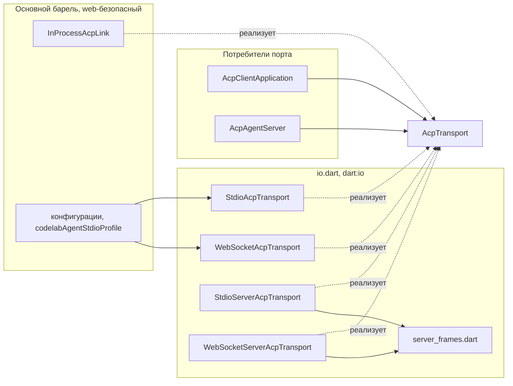
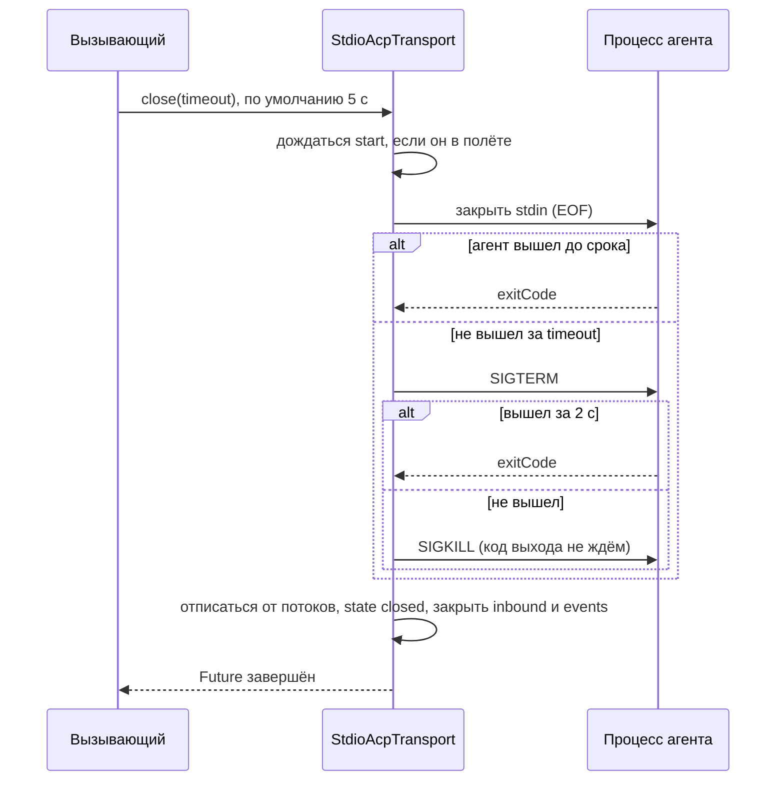
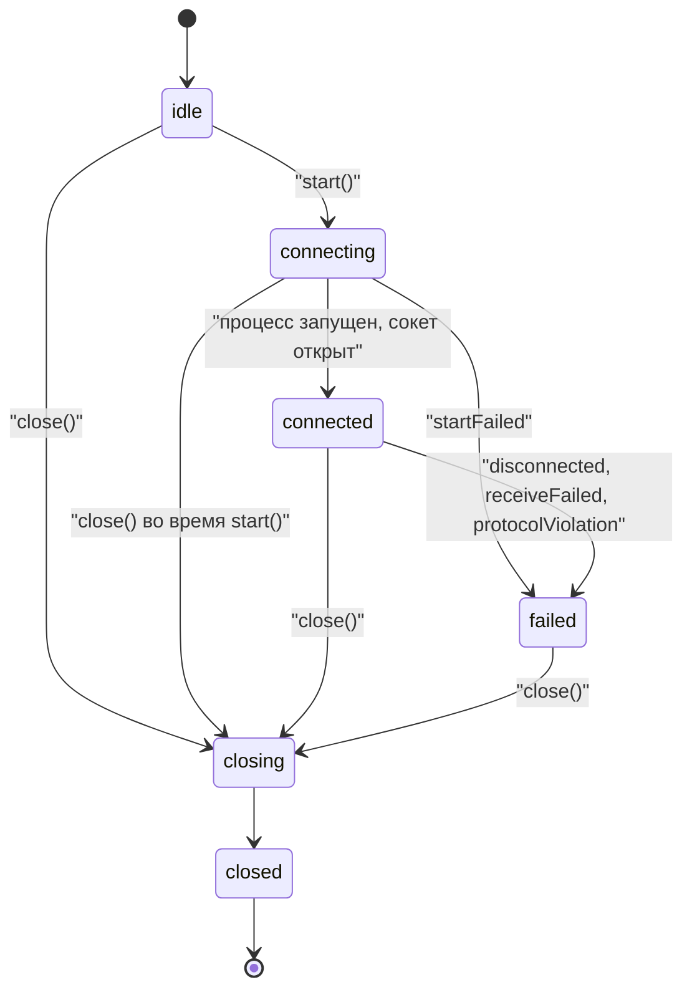
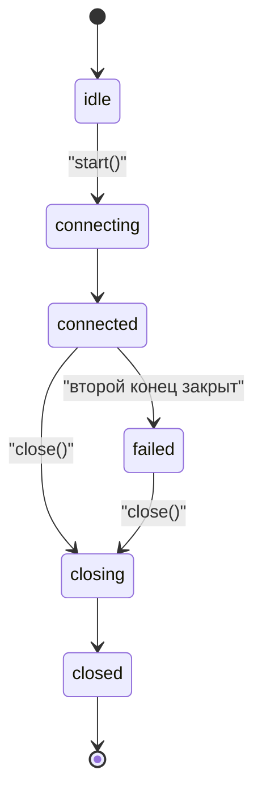

# Устройство транспортов

Глава описывает, как устроен пакет: порт, пять реализаций, два бареля, кадрирование и жизненный цикл. Как подготовить репозиторий и запустить тесты — в [главе 00](00-getting-started.md).

## Зачем нужен порт

ACP (Agent Client Protocol) — протокол JSON-RPC между клиентом и агентом. Как байты доходят до другой стороны — вопрос транспорта: дочерний процесс, сокет или память. Клиентский слой (`AcpClientApplication`) и ACP-сервер агента (`AcpAgentServer`) работают с одним интерфейсом `AcpTransport` и не знают, что под ним (`lib/src/acp_transport.dart`). Поэтому встроенный агент, агент в отдельном процессе и тест подменяют друг друга без правок логики.

Транспорт решает только передачу. «Процесс завершился» — событие транспорта. «Переподключиться» — решение прикладного слоя: он создаёт новый транспорт ([`docs/architecture/acp-boundary.md`](../../../../docs/architecture/acp-boundary.md#4-ответственность-codelab_acp_transports)).

Схема показывает, кто реализует порт и где лежит код. Клиентские транспорты создаёт composition root клиента: `ioTransportResolver` в `codelab_client_io` (`StdioAcpTransport.new`, `WebSocketAcpTransport.new`) и `apps/codelab_desktop/lib/app/app_scope.dart`. Серверные создаёт хост агента `apps/codelab_agent` (`serve_stdio.dart`, `serve_ws.dart`). Пару в памяти создаёт `codelab_embedded`. Как хост подключает транспорт к ядру — в [руководстве по ядру агента](../../codelab_agent_core/doc/02-assembly-and-hosts.md#что-меняет-транспорт); путь запроса после транспорта — в [03-request-flow.md](../../codelab_agent_core/doc/03-request-flow.md).

## Контракт `AcpTransport`

| Член | Что делает |
|---|---|
| `inbound` | разобранные сообщения `JsonRpcMessage` от другой стороны: от агента у клиента, от клиента у агента |
| `events` | `AcpTransportStateChanged`, `AcpTransportDiagnostic`, `AcpTransportFailure` |
| `state` | текущее `AcpTransportState`, синхронно: `idle`, `connecting`, `connected`, `closing`, `closed`, `failed` |
| `start()` | запускает процесс, открывает сокет или начинает чтение |
| `send(message)` | отправляет одно сообщение |
| `close({timeout})` | штатно завершает и освобождает ресурсы |

Типы сообщений приходят из [`codelab_acp_protocol`](../../codelab_acp_protocol/doc/README.md); основной барель реэкспортирует только `JsonRpcId`, `JsonRpcMessage` и `acpProtocolPackageName`. Остальные (`JsonRpcRequest`, `JsonRpcNotification`, `JsonRpcResponse`) импортируйте из `codelab_acp_protocol`.

### Коды ошибок

Любой сбой — `AcpTransportException(code, message, cause, stackTrace)`. Какой код где возникает (по коду реализаций):

| Код | Когда |
|---|---|
| `startFailed` | не запустился процесс; не открылся сокет; недопустимое значение заголовка |
| `sendFailed` | транспорт не в `connected`; ошибка записи; в памяти — значение, которое нельзя скопировать как JSON |
| `receiveFailed` | ошибка чтения потока stdout, stderr, stdin или сокета |
| `protocolViolation` | клиентская сторона получила строку или кадр, который не ACP JSON-RPC; кадр WebSocket не текстовый |
| `closed` | `start()` или `send()` после `close()`; `start()` прервал `close()` |
| `disconnected` | процесс агента вышел сам; сокет закрыт другой стороной; в памяти — закрыт второй конец |
| `timeout`, `unknown` | не использует ни один транспорт пакета |

`timeout` и `unknown` оставлены потребителям: `AcpClientApplication` разбирает все восемь значений исчерпывающим `switch` (`packages/dart/codelab_client_acp/lib/src/application/acp_client_application.dart`, `_connectionFailureReasonFor`). Новый код в перечисление добавляется только вместе с правкой всех таких `switch` — поэтому отказ рукопожатия WebSocket вынесен в отдельный тип `AcpWebSocketHandshakeRejected` в `cause`, а не в новый код.

Сообщения исключений составлены так, чтобы в них не попали секреты: ни аргументы команды, ни токен, ни содержимое сообщения (`AGENTS.md` репозитория, §10, §16). Это проверяют тесты (`stdio_acp_transport_start_failure_test.dart`, `websocket_handshake_rejection_test.dart`, `in_process_acp_transport_test.dart`).

## Два бареля

| Барель | `dart:io` | Что внутри |
|---|---|---|
| `package:codelab_acp_transports/codelab_acp_transports.dart` | нет | порт, состояния, события, ошибки, конфигурации, `codelabAgentStdioProfile`, `InProcessAcpLink` |
| `package:codelab_acp_transports/io.dart` | да | четыре транспорта на `dart:io` |

Причина разделения — web: встроенный агент и клиентский слой собираются в JavaScript и WebAssembly, а `dart:io` там нет. Основной барель должен оставаться чистым, поэтому пара в памяти живёт в нём, а процессы и сокеты — в `io.dart`.

Правила держат три механизма:

- **сторож** — запись `packages/dart/codelab_acp_transports` в `packages/dart/codelab_architecture_tests/test/support/rules.dart`: запрещает в `lib/` `dart:io`, `dart:isolate`, `dart:ffi`, `dart:html`, `dart:js_interop`, `package:web/`, `package:flutter/` и `package:codelab_acp_transports/io.dart`; из проверки исключены `lib/io.dart` и `lib/src/io/`;
- **`test/web_safe_barrel_test.dart`** — обходит `import`, `export` и `part` от `codelab_acp_transports.dart`, `transport_configs.dart` и `in_process_acp_transport.dart` и ищет `dart:io` и `package:web_socket_channel/io.dart`;
- **каталог `lib/src/io/`** — всё, что тянет `dart:io` или `web_socket_channel/io.dart`, лежит только здесь.

Импортировать `io.dart` вправе composition root клиента, хост агента и тесты (`AGENTS.md` репозитория, §5). Сейчас в `lib/` его импортируют `apps/codelab_desktop` (`lib/app/app_scope.dart`), `apps/codelab_agent` (`serve_stdio.dart`, `serve_ws.dart`), `codelab_client_io` (`io_transport_resolver.dart`) и `codelab_acp_testing` (`fixtures/fixture_replay_agent.dart`). Сторож запрещает `io.dart` только пакетам, у которых в `rules.dart` есть правило с `webUnsafe`; остальным он не закрыт, и границу держит ревью.

## Реализации

| Класс | Сторона | Среда | Кадр |
|---|---|---|---|
| `StdioAcpTransport` | клиент | процесс агента, `dart:io` | строка stdout и stdin |
| `WebSocketAcpTransport` | клиент | `ws://`, `web_socket_channel/io.dart` | текстовый кадр |
| `StdioServerAcpTransport` | агент | stdin и stdout своего процесса | строка |
| `WebSocketServerAcpTransport` | агент | принятый `WebSocket` | текстовый кадр |
| `InProcessAcpTransport` | любая | память, пара `InProcessAcpLink` | объект без кодирования |

### Кадрирование

stdio-кадрирование задаёт ACP (`docs/protocols/acp/protocol/16-Transports.md`): сообщения разделены `\n` и не содержат встроенных `\n`. Отдельной проверки на это в пакете нет, и она не нужна: `jsonEncode` экранирует переводы строки внутри строк JSON, а сообщения кодирует `encodeJsonRpcMessage` из `codelab_acp_protocol`. Длина строки не ограничена (тест читает строку размером 2 МиБ целиком).

| Транспорт | Чтение | Запись | Плохой кадр |
|---|---|---|---|
| `StdioAcpTransport` | `utf8.decoder` и `LineSplitter`; пустые строки пропускаются | `writeln` и `flush` | `JsonRpcProtocolException` → `failed`, `protocolViolation` |
| `WebSocketAcpTransport` | `String` → `decodeJsonRpcMessage`; не `String` → `protocolViolation` | `sink.add(text)` | `failed`, `protocolViolation` |
| серверные | `decodeServerFrame` из `lib/src/io/server_frames.dart` | stdio — цепочка записей; WebSocket — `socket.add` | ответ ошибкой JSON-RPC, соединение живо |
| `InProcessAcpTransport` | объект | глубокая копия | не-JSON значение → `sendFailed` у отправителя |

Серверные транспорты не рвут соединение из-за кадра клиента: плохой кадр не должен прерывать активные ходы (инвариант ACP-4, `docs/architecture/proposals/agent-core/13-acp-adapter.md`, 13.14; правила кадра — 13.10). Правила `decodeServerFrame`:

| Вход | Ответ | `id` ответа |
|---|---|---|
| не разбирается как JSON | `-32700`, `Parse error: unparsable JSON: …` | `null` |
| JSON, но не объект | `-32600`, `Invalid Request: a JSON-RPC message must be an object` | `null` |
| объект, но не JSON-RPC 2.0 (например, нет `jsonrpc`) | `-32600`, `Invalid Request: …` | `id` кадра, если это строка или целое; иначе `null` |
| бинарный кадр WebSocket | `-32600`, `Invalid Request: binary frames are not supported` | `null` |

Причина лежит в тексте `message`, а поле `data` не заполняется: оно было бы расширением ACP, не введённым OpenSpec change (комментарий в `server_frames.dart`, ACP-2). О каждом таком кадре транспорт публикует `diagnostic` с уровнем `warning`: `source` равен `stdin` или `websocket`, текст — `Rejected an ACP frame: <причина>`. Ответ уходит через `send`, поэтому проходит ту же очередь записи.

### `StdioAcpTransport`: клиент запускает агента

`start()` вызывает `Process.start(command, args, workingDirectory: cwd, environment: env)`; пустой `env` превращается в `null`. `env` дополняет окружение клиента, а не заменяет его (так работает `Process.start`). Затем транспорт подписывается на stdout (протокол) и stderr (диагностика, `info`, `source: 'stderr'`) и на `exitCode`.

Выход процесса вне `close()` — сбой `disconnected`: «Stdio ACP agent exited unexpectedly with code N». Код выхода лежит только в тексте.

Закрытие ограничено по времени и эскалирует сигналы. ACP описывает его одной фразой: «Close stdin, terminate subprocess» (`16-Transports.md`), а сроки выбраны в пакете.

Что важно:

- `close()` завершается не позже `timeout` плюс 2 с и отписки потоков. После `SIGKILL` код выхода не ждут: неограниченное ожидание вернуло бы зависший `close` (`stdio_acp_transport.dart`, `_waitForProcessExit`).
- Закрытие мемоизировано. Повторный `close()` возвращает тот же `Future` и сигналов не шлёт. Если срок повторного вызова короче оставшегося, ожидание EOF сокращается до него; более поздний срок его не продлевает; ожидание после `SIGTERM` не сокращает ничто. Зачем: переподключение закрывает транспорт со сроком по умолчанию, а выход приложения в этот момент вызывает `close` с коротким сроком.
- `close()` во время `start()` дожидается запуска процесса и закрывает его той же эскалацией. `start()` бросает `AcpTransportException(closed)`, подписок и события `connected` нет.
- Выход процесса, вызванный закрытием, сбоем не считается: `_handleProcessExit` ничего не делает при `_isClosed`.

### `WebSocketAcpTransport`: клиент подключается к агенту

`start()` собирает заголовки через `WebSocketAcpTransportConfig.effectiveHeaders` (токен кладётся в `tokenHeader` со значением `tokenPrefix + ' ' + token`; по умолчанию `Authorization: Bearer <token>`; при пустом `tokenPrefix` уходит только токен), проверяет их и вызывает `IOWebSocketChannel.connect`. Рукопожатие делает штатный `WebSocket.connect` из `dart:io`, своей реализации нет. Затем `await channel.ready`.

Проверка заголовков (`_validateHeaders`) строже, чем у `dart:io`: допускаются только коды от 32 (и табуляция) до 126. Иначе `dart:io` бросил бы `FormatException` с самим значением заголовка, и токен попал бы в ошибку и журналы. Вместо этого — `AcpTransportException(startFailed)` с текстом `Invalid header value for <имя>` и без `cause`.

При отказе рукопожатия (статус не 101) `dart:io` кладёт HTTP-статус в `WebSocketException.httpStatusCode`. `_unwrapConnectError` превращает его в `AcpWebSocketHandshakeRejected(statusCode)`. Текст исключения никто не разбирает: он зависит от SDK и ОС. Так вызывающий отличает 401 и 403 («нужен другой токен») от «агент недоступен» (`SocketException`). Заголовок `Authorization` на редиректе на другой origin SDK не переносит; это проверяет тест `websocket_handshake_rejection_test.dart`.

Подписка на поток канала создаётся после `ready`: при отказе рукопожатия поток тоже отдаёт ошибку, и ранняя подписка дала бы второй сбой `receiveFailed`. Если сервер успел закрыть сокет до этой строки, транспорт уже в `failed`, и `connected` его не затирает.

### `StdioServerAcpTransport` и `WebSocketServerAcpTransport`: агент принимает клиента

Серверные транспорты зеркальны клиентским: клиент уже есть, и транспорту остаётся читать и писать.

- `StdioServerAcpTransport({input, output})` по умолчанию берёт `stdin` и `stdout` процесса. Параметры `input` и `output` нужны тестам. `stdout` транспорт не закрывает: он принадлежит процессу. Записи идут цепочкой `_writes`, поэтому строки не перемешиваются даже при тысяче `send` подряд.
- EOF на входе закрывает только `inbound`, состояние остаётся `connected`, `send` работает до `close()`. Клиент вида `echo '<initialize>' | codelab-agent serve --stdio` закрывает stdin сразу, а ответ на уже прочитанный запрос должен уйти.
- `WebSocketServerAcpTransport(socket)` оборачивает сокет после `WebSocketTransformer.upgrade`. HTTP upgrade и проверка Bearer-токена происходят до транспорта, в хосте. Закрытие сокета клиентом закрывает `inbound` и переводит транспорт сразу в `closed`.

### `InProcessAcpLink`: пара в памяти

`InProcessAcpLink()` создаёт два связанных конца: `client` и `agent`. Публичного конструктора у конца нет. Сообщение из `send` одного конца приходит в `inbound` другого. Правила пары нужны, чтобы встроенный режим не прятал ошибки, которые видны на проводе (`openspec/specs/agent-transports/spec.md`, «Пара транспортов в памяти»):

- доставка идёт в следующей микрозадаче, по одному сообщению, в порядке `send`; обработчик получателя не вызывается изнутри `send` отправителя;
- `send` копирует дерево JSON в неизменяемые `List` и `Map` ещё у отправителя; `NaN`, бесконечность, ключ не строкой, `DateTime` и цикл дают `sendFailed` без значения в тексте ошибки;
- закрытие одного конца переводит второй в `failed` с кодом `disconnected`; сообщения, отправленные до `close()`, приходят раньше этого сбоя. Недоставленные сообщения сбрасываются с диагностикой `warning`, содержимое в неё не попадает;
- `close({timeout})` параметр `timeout` игнорирует: ждать нечего.

## Жизненный цикл

Переходы клиентских `StdioAcpTransport` и `WebSocketAcpTransport`. Каждый переход публикуется событием `AcpTransportStateChanged`.

Правила:

- `close()` клиентского транспорта кончается состоянием `closed`: потоки `inbound` и `events` закрыты, дальнейший `start()` и `send()` бросают `AcpTransportException(closed)`. Исключение — `WebSocketAcpTransport.close()`: он вызывает `sink.close().timeout(...)` без `onTimeout` (`websocket_acp_transport.dart`), поэтому при истечении срока (по умолчанию 5 с) бросает `TimeoutException`, остаётся в `closing`, а потоки не закрывает. Серверные транспорты срок глотают (`onTimeout: () {}`) и доходят до `closed`;
- `start()` в `connecting` или `connected` возвращается сразу;
- `failed` приходит вместе с событием `failure`, а `close()` после него обязателен: он освобождает процесс или сокет и закрывает потоки;
- у `StdioAcpTransport` `closing` публикуется после того, как закончился идущий `start()`: до этого контроллеры должны оставаться открытыми.

Серверные транспорты проще: `idle → connected` при `start()`, `connected → failed` при ошибке чтения или записи, `connected → closing → closed` при `close()`. Отличия: у stdio EOF входа состояние не меняет, а у WebSocket закрытие сокета клиентом ведёт сразу в `closed`.

Пара в памяти:

Здесь `connecting → connected` происходит синхронно внутри `start()`, а `start()` у конца в `failed`, `closing` или `closed` бросает `AcpTransportException(closed)`.

## Ошибки `start`: исходное исключение и событие

Одна ошибка запуска видна в двух местах: исключение из `start()` и событие `failure` в `events`. Они не всегда совпадают, и это важно для потребителя.

| Ситуация | Что бросает `start()` | Событие `failure` |
|---|---|---|
| stdio: команда не найдена | `ProcessException` без аргументов команды: сохранены тип, `message`, `errorCode`, `executable` | `startFailed`, `cause` — та же копия без аргументов |
| stdio: `close()` во время запуска | `AcpTransportException(closed)` | нет |
| WebSocket: статус отказа | `AcpWebSocketHandshakeRejected(statusCode)` | `startFailed`, `cause` — тот же `AcpWebSocketHandshakeRejected` |
| WebSocket: недопустимый заголовок | `AcpTransportException(startFailed)`, текст `Invalid header value for <имя>` | то же исключение |
| WebSocket: отказано в соединении, DNS и т. п. | исходное исключение (`SocketException`) | `startFailed`, `cause` — оно же |
| WebSocket: `close()` во время рукопожатия | возврат без ошибки, поздно открытый сокет закрывается | нет |

Аргументы команды вычищаются потому, что `ProcessException.toString()` печатает `Command: <exe> <args>`, а аргументы агента бывают ключами; вычистка в одном месте закрывает утечку для всех потребителей (решение D8 change `redact-cli-stdio-profile-args`). Поэтому `on ProcessException` и классификация «команда не найдена» по `errorCode` у потребителей работают как прежде.

Вывод: ловите из `start()` любое исключение (`on Object`) и, чтобы получить типизированную причину, читайте `cause` события `failure`, либо проверяйте тип брошенного исключения. Обе формы есть в тестах.

## Кто что буферизует

`inbound` реализован по-разному, и от этого зависит порядок «подписаться, потом `start()`».

| Транспорт | Контроллер `inbound` | Сообщение до первой подписки |
|---|---|---|
| `StdioAcpTransport`, `WebSocketAcpTransport` | `broadcast(sync: true)` | теряется |
| серверные stdio и WebSocket | обычный, одна подписка | копится до `listen`; вторая подписка бросит `StateError` |
| `InProcessAcpTransport` | `broadcast` с `onListen` | копится до первой подписки; после неё без подписчиков сообщение выбрасывается, а не копится |

`events` у всех — broadcast без буфера: событие до подписки пропадает, поэтому подписывайтесь на `events` до `start()`. У клиентских и серверных транспортов контроллер `events` синхронный (`sync: true`): обработчик выполняется внутри `add`. Следствие — в [главе 02](02-extending-and-troubleshooting.md#bad-state-cannot-fire-new-event-controller-is-already-firing-an-event).

Дальше: [тестирование, рецепт нового транспорта и частые проблемы](02-extending-and-troubleshooting.md).
