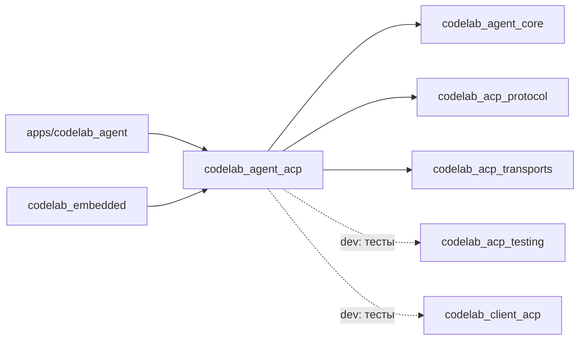
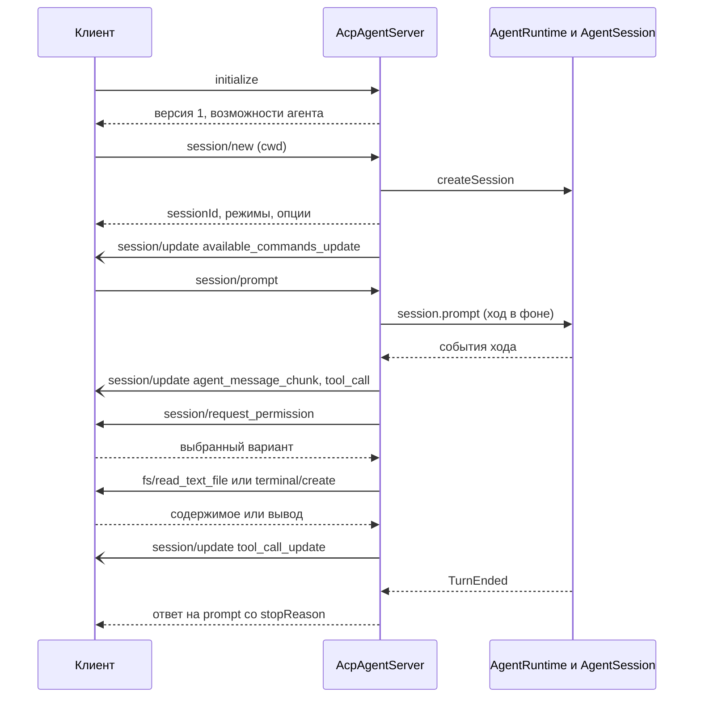

# codelab_agent_acp

ACP-сервер Dart-агента CodeLab. Пакет превращает ядро агента (`AgentRuntime`) в сторону агента протокола ACP (Agent Client Protocol — протокол, по которому клиент и агент обмениваются сообщениями JSON-RPC). Ядро не знает протокола, клиенты говорят с агентом только по ACP, поэтому перевод живёт в отдельном пакете.

## Место в архитектуре

Сторона `agent`, слой `acp` (ADR-0002): проекция стороны в протокол. Чистый Dart без Flutter и без `dart:io`; транспорты (stdio, WebSocket) сервер не создаёт — их передаёт хост.

Схема показывает зависимости пакета и тех, кто его подключает (по `pubspec.yaml` каждого пакета).



В `dependencies` разрешены только `codelab_agent_core`, `codelab_acp_protocol`, `codelab_acp_transports`, `meta` и `async`. Остальное — `dev_dependencies` (на схеме показаны не все): конформанс-тесты берут `codelab_acp_testing`, `codelab_agent_io`, `codelab_agent_mcp` и `codelab_client_acp`. Хосты — бинарь [`codelab-agent`](../../../apps/codelab_agent/README.md) и мост `codelab_embedded` (встроенный агент в процессе клиента) — собирают ядро через `buildAgentCore` и отдают его серверу. Границы ACP описаны в [`docs/architecture/acp-boundary.md`](../../../docs/architecture/acp-boundary.md); подробное устройство адаптера — в [`docs/architecture/proposals/agent-core/13-acp-adapter.md`](../../../docs/architecture/proposals/agent-core/13-acp-adapter.md).

## Что внутри

Публичное API экспортирует один барель, `lib/codelab_agent_acp.dart`.

| Тип | Для чего |
|---|---|
| `AcpAgentServer` | Принимает соединения: `serve(transport)` обслуживает один транспорт до его закрытия, `shutdown({grace})` отменяет ходы, закрывает сессии и транспорты |
| `AcpServerConfig` | Настройки хоста: `agentInfo` для `initialize`, `detachGrace` (сколько отсоединённая сессия ждёт переподключения, по умолчанию 30 с), `timeouts`, `localListing`, `localEnv` |
| `AcpTimeouts` | Таймауты запросов агента к клиенту: `fs`, `terminalCreate`, `terminalOutput`, `terminalKill`, `terminalRelease` |

Остальное — внутренности (`lib/src/`), в барель не выходит:

| Часть | Для чего |
|---|---|
| `connection/` | Маршрутизатор входящих кадров, очередь исходящих, сопоставление запросов агента с ответами клиента |
| `SessionBridge` | Мост одной сессии: подписка на события ядра, ход `session/prompt`, отмена, переподключение, реплей |
| `event_projection.dart` | Перевод событий ядра в `session/update` и итога хода в `stopReason` |
| `AcpClientExecutionEnv` | `ExecutionEnv` ядра поверх `fs/*` и `terminal/*` клиента |
| `AcpPermissionGate` | `PermissionGate` ядра поверх `session/request_permission` |
| `usage_accounting.dart` | Расширение `_codelab/session/usage` и `_codelab/session/usage/ledger` |

## Что сервер обслуживает

Запросы клиента (маршрутизация — `lib/src/agent_server.dart`, `_Connection._onRequest`). Любой `session/*` до `initialize` получает ошибку `invalid request`. Неизвестный метод — `-32601`.

| Метод | Что делает |
|---|---|
| `initialize` | Версия протокола всегда 1. `loadSession` и `sessionCapabilities.list` — если ядро включило сохранение сессий; `promptCapabilities`: `image`, `embeddedContext`; `mcpCapabilities.http` — по плану ядра. Повторный `initialize` — ошибка |
| `session/new` | Создаёт сессию в `AgentRuntime`, отвечает режимами и опциями, затем шлёт `available_commands_update` |
| `session/load` | Реплей истории, ответ, снимок usage; если сессия уже открыта, подключает её к новому соединению |
| `session/list` | Страница сессий хранилища (`cwd`, `cursor`) |
| `session/prompt` | Запускает ход; ответ с `stopReason` приходит по завершении хода. Второй `prompt` во время хода — `-32602` с `data.codelab.reason: "turnActive"` |
| `session/cancel` | Уведомление; отменяет идущий ход. Присланный запросом получает ответ `null` |
| `session/set_mode`, `session/set_config_option` | Смена режима, модели, уровня рассуждений, агента (`mode`, `model`, `effort` и опция агента) |
| `_codelab/session/usage/ledger` | Расширение CodeLab: история usage сессии |

Запросы агента к клиенту (все — через `ClientRequests`; таймауты `AcpTimeouts` есть у `fs/*`, `terminal/create`, `terminal/output`, `terminal/kill` и `terminal/release`, а `session/request_permission` и `terminal/wait_for_exit` таймаута не имеют — их прерывает отмена):

| Метод | Кто вызывает |
|---|---|
| `session/request_permission` | `AcpPermissionGate`: вопрос политики разрешений ядра. Любой сбой — отказ, не разрешение |
| `fs/read_text_file`, `fs/write_text_file` | `AcpClientExecutionEnv`, только если клиент объявил `fs.readTextFile` / `fs.writeTextFile` |
| `terminal/create`, `terminal/wait_for_exit`, `terminal/output`, `terminal/kill`, `terminal/release` | `AcpClientExecutionEnv` при выполнении команды, только если клиент объявил `terminal` |

Если хост задал `AcpServerConfig.localEnv` (встроенный агент), файлы, команды и листинг выполняет сам хост, а `fs/*` и `terminal/*` клиенту не уходят. `session/request_permission` остаётся.

Расширения сверх ACP живут в `_meta.codelab.*` и методах `_codelab/*`. Блок `agentCapabilities._meta.codelab` в `initialize` уходит только клиенту, приславшему `clientCapabilities._meta.codelab`. Каждое расширение вводит отдельный OpenSpec change (`AGENTS.md` пакета, §2).

## Как использовать

Хост сначала собирает ядро, затем создаёт сервер и отдаёт ему транспорт. Пример по `codelab_embedded/lib/src/assemble.dart` (там же — реальные значения `agentInfo` и `localEnv`):

```dart
final core = buildAgentCore(/* профиль, порты, провайдер модели */);
final server = AcpAgentServer(
  core: core,
  logger: logger,
  clock: clock,
  config: const AcpServerConfig(
    agentInfo: Implementation(name: 'codelab-agent', version: '0.1.0'),
  ),
);

final link = InProcessAcpLink();   // или stdio / WebSocket из codelab_acp_transports/io.dart
unawaited(server.serve(link.agent));
// … клиент работает через link.client …
await server.shutdown();
```

Правила сборки:

- Если ядро включило `fileListing`, нужен `localListing` (клиент и агент на одной машине) или `localEnv`, который реализует `DirectoryListing`. Иначе конструктор бросает `HostWiringException`.
- `serve` завершается, когда соединение закрыто. Вход закрыт — сервер дожидается ответов на уже принятые запросы и только потом закрывает транспорт.
- Закрытие соединения не убивает сессию: она ждёт переподключения `detachGrace`, затем закрывается. Второе соединение не может забрать сессию с идущим ходом: `session/load` получит `-32602` с `data.codelab.reason: "sessionBusy"`.
- `shutdown` отменяет ходы и ждёт `TurnEnded` не дольше `grace` (по умолчанию 5 с); новые запросы получают `-32603`.

## Ключевой поток

Один ход: от `initialize` до ответа на `session/prompt`. Схема показывает, что сервер идёт к клиенту за разрешением и файлами во время хода; точный набор кадров зависит от модели и инструментов.



Что неочевидно:

- Ход идёт в фоне: обработчик `session/prompt` ждёт `TurnEnded`, а кадры `session/update` и запросы агента уходят по пути. Все исходящие кадры проходят одну очередь соединения, поэтому порядок событий ядра сохраняется.
- `session/update` после `TurnEnded` (например, `session_info_update` с автозаголовком) уходит до ответа на `session/prompt`.
- Запрос разрешения не опережает `tool_call` своего вызова: gate ждёт, пока вызов попадёт в очередь.
- Отмена (`session/cancel`) прерывает токен хода, ожидающие разрешения, запросы `fs/*` и терминалы; ответ на `prompt` — `stopReason: cancelled`.

### Проекция событий ядра

Таблица по `lib/src/event_projection.dart`, функция `projectEvent`. Остальные события ядра (`TurnStarted`, `StepStarted`, `ModelRequested`, `MessageStarted`, `MessageEnded`, `StepEnded`, `AgentError`, `ContextCompacted`, `TurnEnded` и др.) в `session/update` не превращаются.

| Событие ядра | `session/update` |
|---|---|
| `MessageDelta` | `agent_message_chunk` |
| `ThoughtDelta` | `agent_thought_chunk` |
| `ToolCallStarted` | `tool_call` |
| `ToolCallProgress`, `ToolCallFinished` | `tool_call_update` |
| `TaskListChanged` | `plan` |
| `ModeChanged` | `current_mode_update` и `config_option_update` |
| `ModelOptionsChanged` | `config_option_update` |
| `SessionTitleChanged` | `session_info_update` |
| `SubagentActivity` | `tool_call` / `tool_call_update` цепочкой потомка — только клиенту с согласием `subagentToolCalls` |

Кроме проекции событий, сервер сам шлёт `available_commands_update` (после `session/new` и при реплее) и, при `session/load`, реплей истории: `user_message_chunk`, `agent_message_chunk`, `agent_thought_chunk`, `tool_call`. Итог хода переводится в `stopReason`: `end_turn`, `max_turn_requests`, `max_tokens`, `refusal`, `cancelled`.

## Тесты

```bash
cd packages/dart/codelab_agent_acp
fvm dart test
```

Сервер проверяется через пару транспортов в памяти (`InProcessAcpLink`): кадры идут тем же кодеком, что на проводе, без процессов и сокетов. Модель — `ScriptedStreamFunction`, время — `FakeClock`, идентификаторы — `SequentialIdGenerator`, поэтому тесты детерминированы. Набор `test/projection/` проверяет, что каждое событие ядра имеет проекцию. Тест с тегом `slow` замеряет журнал usage на 1 000 ходов; лимит времени для него вчетверо больше обычного (`dart_test.yaml`), из обычного прогона он не исключается.

Прогон golden-фикстур ACP на агентской роли (из корня репозитория):

```bash
melos run conformance:agent
```

Скрипт запускает `test/conformance_test.dart`: агент поднимается так же, как бинарь по stdio, и проигрывает корпус фикстур из [`codelab_acp_testing`](../codelab_acp_testing/README.md#golden-фикстуры). Расхождение с фикстурой — провал теста. С переменной `CODELAB_TEST_REPORT_DIR` скрипт пишет отчёт `dart/codelab_agent_acp.conformance.json`. Скрипт входит в `melos run check`.

## Руководство разработчика

Устройство пакета подробно описано в [`doc/README.md`](doc/README.md): модули `lib/src/`, мост сессии, проекция событий в `session/update`, запросы агента к клиенту, тестирование, рецепты расширения и частые проблемы.

## Правила пакета

Правила для изменений — в [`AGENTS.md`](AGENTS.md). Главное: пакет не импортирует `dart:io`, Flutter и `package:codelab_acp_transports/io.dart`; методы, поля и значения ACP берутся только из `codelab_acp_protocol`, всё остальное — расширения `_codelab`, и каждое вводится отдельным OpenSpec change. Границы проверяет `melos run guard`.

## Смотрите также

- [`codelab_acp_protocol`](../codelab_acp_protocol/README.md) — модели и кодеки сообщений;
- [`codelab_acp_transports`](../codelab_acp_transports/README.md) — транспорты, включая `InProcessAcpLink`;
- [`codelab_acp_testing`](../codelab_acp_testing/README.md) — фикстуры и поддержка тестов;
- [`codelab_agent_core`](../codelab_agent_core/README.md) — ядро агента;
- [`codelab_agent_io`](../codelab_agent_io/README.md) — `dart:io`-порты ядра, которые хост передаёт при сборке;
- [`apps/codelab_agent`](../../../apps/codelab_agent/README.md) — бинарь `codelab-agent`;
- [`docs/architecture/acp-boundary.md`](../../../docs/architecture/acp-boundary.md), [`agent-core/13-acp-adapter.md`](../../../docs/architecture/proposals/agent-core/13-acp-adapter.md);
- [`docs/architecture/permissions.md`](../../../docs/architecture/permissions.md) — политика разрешений.
