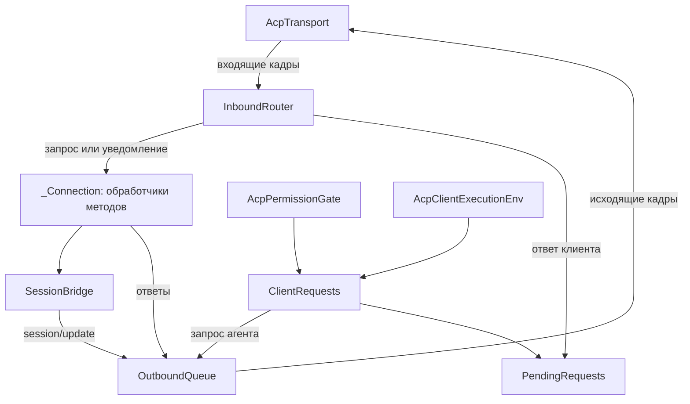

# Устройство пакета

Глава описывает, из чего состоит `codelab_agent_acp`, как живёт одно соединение и какой обработчик отвечает на каждый метод ACP. Сквозной путь запроса до модели — в [главе ядра](../../codelab_agent_core/doc/03-request-flow.md); здесь внутренности пакета.

## Публичное API

Барель `lib/codelab_agent_acp.dart` экспортирует ровно три типа (`show AcpAgentServer, AcpServerConfig, AcpTimeouts`). Всё остальное в `lib/src/` — внутренности. Тесты пакета импортируют их напрямую (`package:codelab_agent_acp/src/...`), хосты — нет.

| Тип | Что делает |
|---|---|
| `AcpAgentServer` | Принимает соединения. `serve(transport)` обслуживает один транспорт, пока он не закроется; `shutdown({grace})` отменяет ходы, закрывает сессии и транспорты |
| `AcpServerConfig` | Настройки хоста: `agentInfo`, `detachGrace`, `timeouts`, `localListing`, `localEnv` |
| `AcpTimeouts` | Таймауты запросов агента к клиенту |

Как хост создаёт сервер — [в README пакета](../README.md#как-использовать) и [в главе ядра о хостах](../../codelab_agent_core/doc/02-assembly-and-hosts.md). Конструктор проверяет согласованность: если профиль включил `fileListing`, нужен `localListing` или `localEnv`, который сам реализует `DirectoryListing`; иначе — `HostWiringException` с текстом `capability fileListing requires AcpServerConfig.localListing: ls and search have nowhere to go without it` (или `… requires the env from AcpServerConfig.localEnv to implement DirectoryListing: …`).

## Карта `lib/src/`

| Файл | Ответственность | Строк |
|---|---|---|
| `agent_server.dart` | `AcpAgentServer`, `AcpServerConfig`, `AcpTimeouts`, закрытый `_Connection`: все обработчики методов | 978 |
| `session_bridge.dart` | `SessionBridge`: состояние одной ACP-сессии над `AgentSession` | 1108 |
| `event_projection.dart` | `projectEvent`, `projectionTable`, `turnResponse`: чистые функции без состояния | 525 |
| `replay.dart` | `replayUpdates`: история сессии для `session/load` | 155 |
| `acp_permission_gate.dart` | `AcpPermissionGate`: `PermissionGate` ядра поверх `session/request_permission` | 225 |
| `acp_client_env.dart` | `AcpClientExecutionEnv`: `ExecutionEnv` ядра поверх `fs/*` и `terminal/*` | 402 |
| `config_options.dart` | режимы и `configOptions` сессии | 163 |
| `prompt_content.dart` | блоки `prompt` ACP в блоки ядра | 56 |
| `subagent_chain.dart` | цепочки `toolCallId` вызовов потомков, согласие клиента | 65 |
| `usage_accounting.dart` | расширение CodeLab `_codelab/session/usage` и `_codelab/session/usage/ledger` | 938 |
| `connection/inbound_router.dart` | `InboundRouter`: чтение кадров, ответы на запросы | 160 |
| `connection/outbound_queue.dart` | `OutboundQueue`: единая очередь исходящих кадров | 104 |
| `connection/pending_requests.dart` | `PendingRequests`: ожидание ответов клиента | 65 |
| `connection/client_requests.dart` | `ClientRequests`, `ClientLink`, виды отказа клиента | 145 |
| `connection/acp_error.dart` | `AcpRequestError`: ошибка обработчика с кодом JSON-RPC | 41 |

Зависимости между файлами идут в одну сторону: `agent_server.dart` собирает всё остальное; мост использует проекцию, реплей и учёт usage; шлюз и окружение используют `ClientLink` и `ClientRequests` и ничего не знают о мосте, кроме трёх функций, которые им передают (`announced`, `terminalShown`, `waitForReconnect`).

## Одно соединение

`AcpAgentServer.serve(transport)` создаёт для транспорта закрытый объект `_Connection` и вызывает его `run`. Транспорт приходит от хоста: stdio, WebSocket или пара в памяти. Пакет сам транспорты не создаёт и не импортирует `dart:io`.



Что делает каждая часть:

- **`InboundRouter`** слушает `transport.inbound`. Запрос он выполняет в отдельной задаче (`_answer`) и сразу идёт читать следующий кадр: во время хода соединение должно принимать `session/cancel` и ответы клиента на запросы агента. Ответ клиента (`JsonRpcResponse`) уходит в `PendingRequests`; если id никто не ждёт (поздний или чужой ответ), пишется `acp.frame.bad {reason: unknown response id, id: …}`. Ошибка потока входящих кадров пишется как `acp.inbound.error` и соединение не закрывает. Задачи запросов хранятся в `_inFlight`; `drained` ждёт их все.
- **`OutboundQueue`** — единственная очередь исходящих кадров. Ответы, уведомления моста и запросы агента встают в одну очередь, поэтому порядок задаёт конструкция, а не дисциплина обработчиков. Один цикл `_drain` отправляет кадры по одному; сбой `transport.send` пишется как `acp.send.failed`, очередь не останавливает. У очереди есть необязательный `onSendFailed`, но `_Connection` его не задаёт (см. [«Заметки о коде»](05-extending-and-troubleshooting.md#заметки-о-коде)). Почему не цепочка `then`: реплей ставит тысячи кадров синхронно, а цепочка такой длины под `--chain-stack-traces` работала за O(N²) (комментарий к классу: 8000 кадров за 28,6 с вместо 12 мс; тест `outbound_queue_test.dart`).
- **`PendingRequests`** выдаёт id запросов агента вида `perm-1`, `fs-2`, `term-3` (префикс и общий счётчик соединения; строки не пересекаются с id клиента) и хранит ожидающих. `failAll` при разрыве завершает всех ошибкой и закрывает реестр: новый запрос в закрытое соединение сразу получает ошибку, а не ждёт таймаута.
- **`ClientRequests`** ставит запрос агента в очередь, регистрирует ожидание, запускает таймер таймаута и ждёт ответ. Подробно — [глава 3](03-projection-and-client-requests.md#ожидание-ответа-клиента).
- **`SessionBridge`** держит состояние ACP-сессии; сервер хранит мосты в `_sessions` по `sessionId`, общем для всех соединений сервера. Подробно — [глава 2](02-session-bridge.md).

### Жизненный цикл

`_Connection.run`: `transport.start()`, затем `router.run()` — до конца входного потока. После этого `pending.failAll(ClientDisconnected)` будит всех ожидающих ответа клиента, а `AcpAgentServer._detach` отсоединяет сессии этого соединения от него (мост перестаёт слать кадры, ход получает окно `detachGrace`; [глава 2](02-session-bridge.md#отсоединение-и-переподключение)).

Потом `serve` вызывает `close`: ждёт ответы на уже принятые запросы (`router.drained`), отправку очереди (`outbound.idle`) и закрывает транспорт. Поэтому `echo '{…}' | codelab-agent serve --stdio` успевает ответить после EOF stdin. Повторный `close` — та же операция (`_closing`), потому что его вызывают и `serve`, и `shutdown`.

`shutdown({grace})` ставит флаг `_shuttingDown` (новые запросы получают `-32603 shutting down`), отменяет ходы всех мостов, ждёт их `idle` не дольше `grace` (по умолчанию 5 с), закрывает мосты и затем соединения.

## Какой обработчик отвечает на метод

Метод выбирает `_Connection._onRequest` (`agent_server.dart`). Сначала проверяется остановка сервера, затем — `initialize`, затем правило «любой `session/*` до `initialize` — `-32600 initialize required`». Уведомления (`_onNotification`) разбирают только `session/cancel`; остальные пишутся как `acp.notification.unknown {method}` и игнорируются.

| Метод ACP | Обработчик | Что вызывает в ядре |
|---|---|---|
| `initialize` | `_initialize` | ничего сессионного: читает план профиля (`BuiltAgentCore.plan.profile`) и геттер `AgentRuntime.subagents` |
| `session/new` | `_sessionNew` | `_checkCwd`, `_mapMcpServers`, `_wire`, затем `AgentRuntime.createSession(SessionSpec)`; `SessionBridge.attach`; после ответа — `available_commands_update` |
| `session/load` | `_sessionLoad` | открытая сессия: `SessionBridge.reattach` и `AgentSession.setMcpServers`; закрытая: `AgentRuntime.loadSession(id, ports, cwd:, mcpServers:)` и `SessionBridge.seedUsage`; затем `replayInto`; после ответа — снимок usage и `resume` |
| `session/list` | `_sessionList` | `AgentRuntime.listSessions(cwd:, cursor:)` |
| `session/prompt` | `_sessionPrompt` | `promptContent`, `SessionBridge.prompt` → `AgentSession.prompt(content, cancel:)` |
| `session/cancel` (уведомление) | `_onNotification` → `_cancel` | `SessionBridge.cancel` → `AgentSession.cancel()` |
| `session/cancel` (пришёл запросом) | `_cancelRequest` | то же, затем ответ `null` |
| `session/set_mode` | `_setMode` | `SessionBridge.setMode` → `AgentSession.setMode` |
| `session/set_config_option` | `_setConfigOption` | `setMode`, `setModel`, `setEffort` или `setAgent` моста — по `configId` |
| `_codelab/session/usage/ledger` | `_usageLedger` | `SessionBridge.usageLedgerResult` → `AgentSession.usageLedger(rebuild:)` |
| любой другой | — | `-32601 Method not found: <метод>` |

Ответ обработчика — `Reply(result, after:)`. `result` уже закодирован кодеком метода (`acp.acpSessionNew.encodeResult(…)`). `after` — действие, которое маршрутизатор выполняет сразу после постановки ответа в очередь. Оно нужно там, где уведомления обязаны идти после ответа: `available_commands_update` после `session/new` (до ответа клиент не знает `sessionId`, ACP-8) и снимок usage с возобновлением хода после `session/load`.

Параметры любого метода декодирует `acp.<метод>.decodeParams`. Если кодек отверг параметры (`JsonRpcProtocolException`), маршрутизатор отвечает `-32602 Invalid params: <причина>`.

### `session/new` по шагам

1. `_checkCwd`: путь абсолютный (`startsWith('/')`, только POSIX), а при локальном листинге (`localEnv`, иначе `localListing`) — существующий каталог. Если окружение умеет `realpath` (`PathResolver`), проверяется разрешённый путь: рабочая папка может быть ссылкой (`/tmp` на macOS). Без листинга (WebSocket) проверить каталог нечем: в ACP нет `stat`.
2. `_mapMcpServers`: серверы запроса в `McpServerConfig`. Транспорт `sse` и неизвестный `type` пропускаются, `http` с неразбираемым адресом — тоже; в лог идёт `mcp.server.skipped {session_id, server, transport, reason}` (имена обрезаны до 64 рун). Остальные правила (возможность `mcp`, дубликаты имён) применяет ядро.
3. `_wire(cwd)` создаёт `ClientLink`, `SessionBridge`, окружение и шлюз сессии ([глава 3](03-projection-and-client-requests.md#что-получает-ядро-при-создании-сессии)).
4. `createSession`. Ошибка конфигурации папки (`ProjectConfigException`) — `-32603` с `data.codelab.reason: "projectConfigInvalid"`, в лог `acp.session.project_config_invalid {cwd, issues}` (только число проблем: тексты могут содержать секреты).
5. `wiring.link.sessionId = id`, `bridge.attach(session)`, регистрация в `_sessions`; ответ — `sessionId`, `modes`, `configOptions`.

## `initialize` и возможности агента

`_initialize` отвечает один раз за соединение; повторный вызов — `-32600 already initialized`. Если в параметрах нет `clientCapabilities`, пишется `acp.client_capabilities.absent` (иначе пропажа инструментов выглядит как поведение модели). Возможности клиента сохраняются в `_client`; позже их читают окружение (`fs.readTextFile`, `fs.writeTextFile`, `terminal`) и мост (согласия на расширения).

Фактический ответ на `initialize` с `clientCapabilities._meta.codelab: {}` (сценарная модель, `codelab-agent serve --stdio --llm-script`; кадр целиком получен запуском):

```json
{"jsonrpc":"2.0","id":2,"result":{"protocolVersion":1,"agentCapabilities":{"loadSession":false,"mcpCapabilities":{"http":true,"sse":false},"promptCapabilities":{"audio":false,"embeddedContext":true,"image":true},"sessionCapabilities":{},"_meta":{"codelab":{"subagents":{"version":1,"maxDepth":3},"subagentToolCalls":{"version":1},"tasks":{"version":1},"usage":{"version":1},"usageLedger":{"version":1}}}},"agentInfo":{"name":"codelab-agent","version":"0.1.0","title":"CodeLab Agent"},"authMethods":[]}}
```

Откуда каждое поле (`agent_server.dart`, `_initialize`):

| Поле | Источник |
|---|---|
| `protocolVersion` | всегда `1` |
| `loadSession`, `sessionCapabilities.list` | `core.plan.profile.isOn(HostCapability.sessionPersistence)`; на сценарии выключено |
| `promptCapabilities` | `image` и `embeddedContext` — всегда `true`; `audio` — `false` (блок `audio` в `prompt` даёт `-32602 audio content is not supported`) |
| `mcpCapabilities.http` | в плане профиля возможность `mcp` допускает транспорт `http`; `sse` не объявляется никогда |
| `agentInfo` | `AcpServerConfig.agentInfo` |
| `authMethods` | пусто: методов аутентификации у агента нет, `authenticate` получает `-32601` (`robustness/bad_frames_test.dart`) |
| `_meta.codelab` | см. ниже |

Блок `_meta.codelab` (`_codelabExtensions`) уходит, только если клиент прислал объект `clientCapabilities._meta.codelab` (пусть пустой): сторонний клиент получает ровно поля стандарта (ACP-2). В блоке: `tasks`, `usage` и `usageLedger` — всегда; `subagents` (с `maxDepth`) и `subagentToolCalls` — только если ядро включило субагентов (`AgentRuntime.subagents != null`). Геттер читается в момент `initialize`, поэтому перезагрузка конфигурации меняет блок для следующих соединений.

Согласие клиента — отдельное правило. `codelabKeyAgreed(meta, key)` (`usage_accounting.dart`) считает ключ согласованным, только если значение — объект с целым `version: 1`; `2`, `'1'`, `1.5` и не-объект — согласия нет. Мост читает согласие из `ClientLink.capabilities` в момент каждого события, а не при создании: после переподключения объявление клиента может смениться. Какие ключи согласованы, видно в логе `acp.extensions.negotiated {keys: […]}` (уровень debug; проверяются `subagents`, `subagentToolCalls`, `tasks`, `usage`).

## Остальные методы

**`session/load`** различает два случая. Сессия уже открыта в сервере (`_sessions[id]`): если ход идёт и соединение не отсоединено — `-32602 the session is busy in another connection` с `data.codelab.reason: "sessionBusy"`; иначе мост переходит к новому владельцу (`reattach`), а набор MCP-серверов заменяется (`setMcpServers`; сбой пишется `mcp.servers.replace_failed`, `session/load` не падает). Сессия закрыта: `AgentRuntime.loadSession`, неизвестный id — `-32002 Session not found: <id>`. Дальше общая часть: `replayInto` ставит кадры истории, ответ несёт `modes` и `configOptions`, а в `after` уходят снимок usage (`sendLoadSnapshot`) и, при переподключении идущего хода, `resume`. Подробно — [глава 2](02-session-bridge.md#реплей-при-sessionload).

**`session/list`**: `cwd` (если задан) — абсолютный путь, `cursor` — как выдало хранилище; неверный курсор — `-32602 invalid cursor`. Ответ — `SessionInfo` с `sessionId`, `cwd`, `title`, `updatedAt` и `nextCursor`. Метод не проверяет `sessionCapabilities.list`: без хранилища (как на сценарии) он отвечает `{"sessions":[]}`.

**`session/prompt`**: `promptContent` переводит блоки ACP в блоки ядра (`prompt_content.dart`): `text` и `image` — как есть, встроенный текстовый ресурс — `<resource uri="…">текст</resource>`, бинарный — пометка `Binary resource <uri>, <N> bytes, not passed`, ссылка — `Resource link <uri> (<name>)`. Пустой список — `-32602 prompt must not be empty`; `audio` — `-32602`. Если ход уже идёт, ответ `-32602 a turn is already running` с `data.codelab.reason: "turnActive"` и запись `acp.prompt.rejected`. Дальше — `SessionBridge.prompt`.

**`session/set_config_option`**: сначала мост сессии (неизвестный id — `-32002`), затем ветка по `configId`:

| `configId` | Условие | Вызов |
|---|---|---|
| `mode` | значение разбирает `ModeId.tryParse` (с синонимами) | `bridge.setMode` |
| `model` | значение — id модели из `session.models.models` | `bridge.setModel` |
| `effort` | у текущей модели `supportsReasoning`; значение — `low`, `medium` или `high` | `bridge.setEffort` |
| `agent` | значение — имя из `session.agents` или `default`, если определения есть | `bridge.setAgent` |

Ответ — полный список `configOptions` после смены. Недопустимое значение `model` или `agent` — `-32602 unknown value: <значение>`; неизвестный `configId` (включая `effort` у модели без рассуждения) — `-32602 unknown config option: <configId>`; неизвестный режим — `-32602 unknown mode: <значение>`. `config_option_update` в ответ на запрос клиента не дублируется (ACP-11, [глава 2](02-session-bridge.md#смена-настроек-без-дубля-config_option_update)). Опции строит `sessionConfigOptions` ([`config_options.dart`](../lib/src/config_options.dart)) в порядке `mode`, `model`, `effort`, `agent`; режимов пять (`modeInfos`: `plan`, `ask`, `standard`, `accept-edits`, `bypass`).

**`_codelab/session/usage/ledger`** — расширение CodeLab (имя с `_`, `15-Extensibility.md`): запрос журнала usage сессии. Параметры `sessionId` (строка) и необязательный `rebuild` (булево) проверяются вручную, потому что кодека в протоколе нет. Сбой построения — `-32603 usage ledger failed` с `data.codelab.reason: "usageLedgerFailed"` и записью `acp.usage.ledger_failed`.

## Коды ошибок JSON-RPC

Обработчик бросает `AcpRequestError(code, message, data:)`; `InboundRouter._answer` превращает его в ответ. Свои коды в диапазоне `-32000…-32099` пакет не вводит: причину уточняет `data.codelab.reason`. Константы кодов — в `codelab_acp_protocol` (`json_rpc/protocol_error.dart`).

| Код | Когда | Текст и `data` из кода |
|---|---|---|
| `-32700`, `-32600` (кадр) | неразбираемый JSON, не JSON-RPC 2.0: отвечает серверный транспорт, а не пакет | `codelab_acp_transports`, `io/server_frames.dart`; ни одна из этих ошибок не закрывает соединение (ACP-4) |
| `-32600` | `session/*` до `initialize` | `initialize required` |
| `-32600` | повторный `initialize` | `already initialized` |
| `-32601` | неизвестный метод запроса, в том числе `authenticate` | `Method not found: <метод>` |
| `-32602` | параметры не декодируются | `Invalid params: <причина кодека>` |
| `-32602` | относительный `cwd`, пустой промпт, `audio`, неизвестный режим или значение опции, неверный курсор | тексты — в таблицах выше |
| `-32602` | ход уже идёт | `a turn is already running`, `data.codelab.reason: "turnActive"` |
| `-32602` | сессия занята другим соединением | `the session is busy in another connection`, `reason: "sessionBusy"` |
| `-32602` | `cwd` не существует (при локальном листинге) | `cwd does not exist: <путь>` |
| `-32002` | неизвестный `sessionId` | `Session not found: <id>` |
| `-32603` | сервер останавливается | `shutting down` |
| `-32603` | ход завершился причиной `failed` | `Turn failed: <сообщение>`, `data.codelab: {errorClass, message, retryable}` |
| `-32603` | ошибка конфигурации папки | сообщение `ProjectConfigException`, `reason: "projectConfigInvalid"` |
| `-32603` | сбой журнала usage | `usage ledger failed`, `reason: "usageLedgerFailed"` |
| `-32603` | любое другое исключение обработчика | `Internal error`, без `data`; детали в логе `acp.handler.failed {method}` со стеком |

Реальные ответы (сценарная модель, `serve --stdio`):

```text
{"jsonrpc":"2.0","id":1,"error":{"code":-32600,"message":"initialize required"}}
{"jsonrpc":"2.0","id":3,"error":{"code":-32600,"message":"already initialized"}}
{"jsonrpc":"2.0","id":4,"error":{"code":-32601,"message":"Method not found: foo/bar"}}
{"jsonrpc":"2.0","id":5,"error":{"code":-32602,"message":"cwd must be an absolute path"}}
{"jsonrpc":"2.0","id":6,"error":{"code":-32002,"message":"Session not found: nope"}}
{"jsonrpc":"2.0","id":8,"error":{"code":-32602,"message":"prompt must not be empty"}}
{"jsonrpc":"2.0","id":10,"error":{"code":-32602,"message":"unknown mode: nope"}}
```

Запросы агента к клиенту (`fs/*`, `terminal/*`, `session/request_permission`) тоже получают ошибки, но другие: это не коды сервера, а отказы клиента; их разбирает [глава 3](03-projection-and-client-requests.md#отказы-и-таймауты).

## Нормы и спецификации

| Что | Где |
|---|---|
| соединение, методы, проекция, реплей, отсоединение | [`agent-acp-server`](../../../../openspec/specs/agent-acp-server/spec.md) |
| отмена хода | [`agent-cancellation`](../../../../openspec/specs/agent-cancellation/spec.md) |
| локальное окружение встроенного агента | [`embedded-agent`](../../../../openspec/specs/embedded-agent/spec.md) |
| правила пакета: границы, расширения только через OpenSpec | [`AGENTS.md`](../AGENTS.md) |
| граница ACP в клиентах и агентах | [`docs/architecture/acp-boundary.md`](../../../../docs/architecture/acp-boundary.md) |

Дальше: [мост сессии](02-session-bridge.md).
