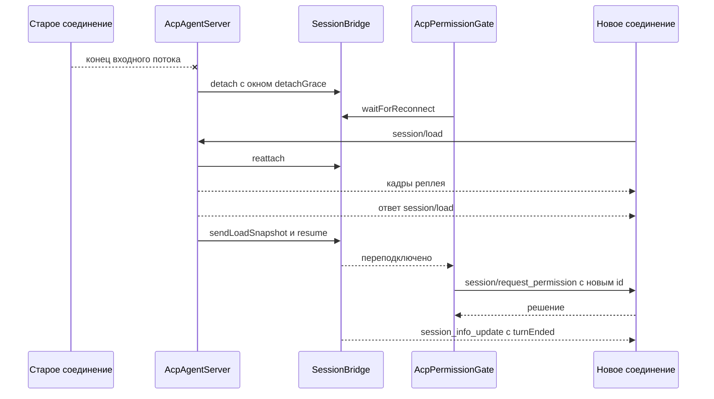

# Мост сессии

`SessionBridge` ([`session_bridge.dart`](../lib/src/session_bridge.dart)) — самый большой класс пакета. Глава объясняет, какое состояние он держит, как проводит ход и почему порядок кадров не ломается, как отменяет, меняет настройки, переживает разрыв соединения и отдаёт историю. Путь запроса от `session/prompt` до модели — в [главе ядра](../../codelab_agent_core/doc/03-request-flow.md#sessionprompt); здесь внутренности моста. Жизнь сессии целиком — от `session/new` до `session/load` после перезапуска — в [алгоритме сессий](../../codelab_agent_core/doc/algorithms/sessions.md).

## Зачем мост

У ACP-сессии есть состояние, которого нет в ядре: соединение-владелец, идущий `session/prompt`, флаг отмены, подписка проекции, отсоединение. `AgentSession` ядра ничего не знает о протоколе (`LOOP-6`), поэтому состояние держит мост. Сервер хранит мосты в `AcpAgentServer._sessions` по `sessionId`, общем для всех соединений: так новое соединение находит сессию и продолжает её (`session/load`).

Жизнь моста:

1. `_Connection._wire` создаёт мост до сессии: порты сессии (окружение, шлюз, хук `markInProgress`) нужны в `SessionSpec`, а сессии ещё нет.
2. `createSession` или `loadSession` возвращает `AgentSession`; `attach` запоминает её и подписывается на `session.events` (`_onEvent`).
3. Ход, отмена и смена настроек идут через мост.
4. `close` закрывает сессию и снимает подписку; его вызывает `AcpAgentServer.shutdown`.

## Состояние моста

Поля нужны, чтобы кадры уходили в правильном порядке и не уходили лишние. Таблица — по `session_bridge.dart`.

| Поле | Зачем |
|---|---|
| `owner`, `sink`, `usageSink` | соединение-владелец и его очередь; `sink` и `usageSink` меняются при переподключении и глохнут в `detach`; `owner` `detach` не трогает |
| `_turn` | `Completer<TurnEnded>` идущего хода; `turnActive` — `_turn != null` |
| `_ended`, `_failure` | `TurnEnded` и последний `AgentError` без повтора — из них строится ответ |
| `_cancelRequested`, `_turnCancel` | клиент прислал `session/cancel`; токен хода |
| `_turnEnded` | ход закончился, нового ещё нет: события потомков в это время запоздалые |
| `_announced` | вызовы, о которых клиент уже знает (`tool_call` в очереди) |
| `_earlyInProgress` | `in_progress` пришёл раньше `tool_call` и ждёт его |
| `_awaitingAnnounce` | шлюз ждёт `tool_call` своего вызова |
| `_shownTerminals`, `_awaitingTerminal` | терминал встроен в вызов, и `terminal/wait_for_exit` может идти |
| `_chains`, `_descendantOpen`, `_agentCalls`, `_closed`, `_nestedDone` | вызовы потомков: цепочки id, открытые, закрытые, итоги вложенных |
| `_configQueue`, `_clientChangeActive`, `_heldConfigUpdates` | очередь запросов смены настроек и подавление эха |
| `_effortNote` | заметка о смене на модель без рассуждения |
| `_detached`, `_grace`, `_reconnected`, `_turnMoved` | отсоединение и переподключение |
| `_replayHeld`, `_replayHolds` | кадры живого хода, придержанные на время реплея |
| `_usage` | агрегаты usage и счётчик `seq` |

## Ход: `prompt`

`SessionBridge.prompt` запускает `AgentSession.prompt(content, cancel: …)` в фоне (`unawaited`) и ждёт `_turn.future`. Обработчик ждёт `_turn.future`, а его `_finishTurn` завершает уже после возврата `prompt`, а не по событию `TurnEnded`: после `TurnEnded` сессия ещё пишет автозаголовок, и его `session_info_update` должен уйти до ответа на запрос. События хода доставляются подписчику раньше, чем `prompt` вернётся (их микрозадачи поставлены раньше), поэтому к `_finishTurn` `TurnEnded` уже в `_ended`.

Порядок внутри `prompt`:

1. Состояние хода сбрасывается: `_turnEnded = false`, `_closed.clear()`, `_failure`, `_ended`, `_cancelRequested`, `_turnMoved`. `_closed` чистится именно здесь: id вызова `agent` может повториться в новом ходе (ветки, импорт журнала), и потомки нового вызова не должны отбрасываться.
2. Если с прошлой смены модели осталась заметка `_effortNote`, она уходит первым `agent_message_chunk` хода.
3. Ход запускается в фоне. Если `AgentSession.prompt` бросает исключение, а не завершает ход через `TurnEnded`, пишется `acp.turn.failed {session_id}` и ошибка идёт в ответ как `-32603 Internal error`. Если `prompt` вернулся, а `TurnEnded` не пришёл, `_finishTurn` завершает ход `StateError('the turn ended without TurnEnded')` — тоже `Internal error`.
4. Ответ строит `turnResponse` ([глава 3](03-projection-and-client-requests.md#итог-хода)).
5. В `finally` `_turn = null`; если смена настроек придержала кадры, мост ждёт `_configQueue`, и они уходят до ответа на `session/prompt` (ACP-3).

### Как держится порядок кадров

Ответ на `session/prompt` должен встать после последнего `session/update` хода (ACP-3). Этого мало, у моста есть ещё четыре правила, и каждое построено на состоянии выше.

**`tool_call` раньше `session/request_permission`.** Событие `ToolCallStarted` ядро эмитит на фазе `announce`, до хуков, а вопрос политики может быть готов раньше, чем событие дойдёт до проекции (события приходят подписчику асинхронно). Поэтому шлюз зовёт `bridge.announced(toolCallId)`: если вызов уже в `_announced`, он завершается сразу, иначе ждёт `Completer` из `_awaitingAnnounce`, который `_onEvent` завершает при проекции `ToolCallStarted`.

**`in_progress` ставит хук, а не событие.** `markInProgress` — последний хук `beforeToolCall` (`session_bridge.dart`, `_wire` кладёт его в `extraBeforeToolCall`). Если вызов уже объявлен, хук шлёт `tool_call_update` со статусом `in_progress`; если нет — запоминает id в `_earlyInProgress`, и кадр уходит сразу после `tool_call`.

**`wait_for_exit` после показа терминала.** `exec` сообщает `terminalId` через `onTerminal`; ядро эмитит `ToolCallProgress` с терминалом, мост проецирует его в `tool_call_update` и вызывает `_terminalsShown` и только тогда отпускает `AcpClientExecutionEnv`, чтобы тот послал `terminal/wait_for_exit`. Так клиент успевает привязать терминал к вызову. `terminalShown(terminalId)` — одноразовый обмен: либо терминал уже показан (`_shownTerminals`), либо `exec` ждёт `Completer` из `_awaitingTerminal`.

**Конец хода чистит ожидания.** По `TurnEnded` мост завершает все `_awaitingAnnounce` и `_awaitingTerminal` исключением `CancelledException('turn ended')` и очищает `_announced`, `_earlyInProgress`, цепочки и открытые вызовы потомков. Шлюз превращает это исключение в решение `cancelled`, а не в запрос по завершённому ходу. `_closed` остаётся до следующего `prompt`, и поздний кадр потомка отсекает признак `_turnEnded`.

Что остаётся за очередью (`OutboundQueue`): все `_send` идут в `sink` — `_Connection._notify`, который ставит кадр в очередь соединения. Мост порядок не сортирует, он только не пускает кадр раньше времени.

## Отмена

`session/cancel` доходит до `SessionBridge.cancel` ([`agent_server.dart`](../lib/src/agent_server.dart), `_cancel`):

1. Нет хода (`_turn == null`) — `cancel` возвращает `false`, сервер пишет `acp.cancel.no_turn` и ничего не шлёт.
2. `_cancelRequested = true`: ответ на `session/prompt` будет `stopReason: cancelled`, даже если отмена вызвала ошибки провайдера или инструментов (ACP-5).
3. `_turnCancel.cancel()` отменяет токен хода, который мост передал в `AgentSession.prompt`. Он доходит до ожидания разрешений, блокировок путей и запроса к модели. Токен создаётся в `prompt` до старта цикла, поэтому `session/cancel`, пришедший раньше старта, не теряется: ход стартует уже отменённым.
4. `session.cancel()` — `Agent.abort` ядра.
5. `_clientEnv?.abortPending()` прекращает ожидание ещё не завершённых `fs/*`: у порта `ExecutionEnv` нет токена отмены для чтения и записи. Запрос клиенту не отзывается — в ACP нечем.

Терминалы прекращает не мост, а `AcpClientExecutionEnv`: токен отмены хода доходит до `terminal/wait_for_exit`, после чего окружение шлёт `terminal/kill`, `terminal/output` и `terminal/release` ([глава 3](03-projection-and-client-requests.md#терминал)). Кадры реального запуска (`exec` на `sleep 30`, клиент шлёт `session/cancel`, когда пришёл `terminal/wait_for_exit`; пути и id замаскированы):

```text
a2c {"jsonrpc":"2.0","id":"term-3","method":"terminal/wait_for_exit","params":{"sessionId":"<session-id>","terminalId":"term_1"}}
c2a {"jsonrpc":"2.0","method":"session/cancel","params":{"sessionId":"<session-id>"}}
a2c {"jsonrpc":"2.0","id":"term-4","method":"terminal/kill","params":{"sessionId":"<session-id>","terminalId":"term_1"}}
c2a {"jsonrpc":"2.0","id":"term-4","result":null}
a2c {"jsonrpc":"2.0","id":"term-5","method":"terminal/output","params":{"sessionId":"<session-id>","terminalId":"term_1"}}
c2a {"jsonrpc":"2.0","id":"term-5","result":{"output":"","truncated":false}}
a2c {"jsonrpc":"2.0","id":"term-6","method":"terminal/release","params":{"sessionId":"<session-id>","terminalId":"term_1"}}
c2a {"jsonrpc":"2.0","id":"term-6","result":null}
a2c {"jsonrpc":"2.0","method":"session/update","params":{"sessionId":"<session-id>","update":{"sessionUpdate":"tool_call_update","toolCallId":"call_1","status":"failed","_meta":{"codelab":{"outcome":"cancelled"}}}}}
a2c {"jsonrpc":"2.0","method":"session/update","params":{"sessionId":"<session-id>","update":{"sessionUpdate":"session_info_update","title":"hi","updatedAt":"2026-11-24T18:17:49.727Z"}}}
a2c {"jsonrpc":"2.0","id":3,"result":{"stopReason":"cancelled"}}
```

Клиент в этом прогоне на запрос `term-3` не ответил: ожидание прекращено отменой, а поздний ответ стал бы «неизвестным id» (`acp.frame.bad`). Эту трассу проверяет голден [`prompt-cancel-during-terminal.json`](../../codelab_acp_testing/fixtures/acp/prompt-cancel-during-terminal.json); там клиент присылает и запоздалый ответ на `wait_for_exit`, который сервер игнорирует (пишет `acp.frame.bad`).

Общая отмена ядра описана в [главе ядра о цикле](../../codelab_agent_core/doc/04-turn-loop.md) и спецификации [`agent-cancellation`](../../../../openspec/specs/agent-cancellation/spec.md).

## Смена настроек без дубля `config_option_update`

`session/set_config_option` и `session/set_mode` приходят параллельно (каждый запрос — своя задача маршрутизатора), а ядро в ответ на смену режима эмитит `ModeChanged`, который проецируется в `current_mode_update` и `config_option_update`. Клиент, который сам попросил смену, уже получит полный список опций в ответе (ACP-11), поэтому эхо надо подавить, но только эхо своего запроса: режим мог сменить и `/mode` из слэш-команды.

Как это решено:

- `_queued` ставит запросы смены в очередь `_configQueue`: не больше одного клиентского запроса за раз. Ошибка запроса очередь не останавливает.
- `_clientChange` перед вызовом ядра включает `_clientChangeActive`. Кадры `config_option_update` от `ModeChanged` с `changeId` попадают в `_heldConfigUpdates` по `changeId`, а не в очередь.
- `changeId` своего вызова мост узнаёт только из результата ядра (`ConfigChangeResult.changeId`). Если смена изменила режим, мост ждёт эха (`_echoWaiters`), чтобы `current_mode_update` уже стоял в очереди перед ответом.
- В `finally` придержанные кадры чужих смен уходят клиенту, а кадр с `changeId` своего запроса отбрасывается.
- `setEffort` проходит только через `_queued`: смена уровня рассуждения не эмитит `ModeChanged`.

Смена модели на ту, где нет рассуждения (`supportsReasoning == false`), оставляет заметку. Её текст — для пользователя клиента и поэтому английский (`session_bridge.dart`, `_noteEffort`): `Reasoning effort is not supported by <provider>/<id>; the setting is kept and applies again after switching to a model with reasoning.` Следующий ход начнётся с `agent_message_chunk` с этим текстом. Обратная смена заметку снимает. Команда `/model` в ходе меняет модель без запроса клиента: мост видит это по `ModelOptionsChanged` и сверяет с `_knownModel`.

## Отсоединение и переподключение

Если соединение закрылось, а ход идёт, сессия не закрывается сразу.

1. `_Connection.run` по концу входа зовёт `AcpAgentServer._detach`, который вызывает `bridge.detach(config.detachGrace)` у мостов этого соединения.
2. `detach` ставит `_detached = true` и подменяет `sink` и `usageSink` пустыми функциями: кадры больше некуда слать, события остаются в журнале ядра. Если хода нет, на этом всё: сессия ждёт следующего `session/load`. Если ход идёт, пишется `acp.session.detached {session_id, grace_ms}` и запускается таймер: при `detachGrace == Duration.zero` — отмена сразу.
3. Шлюз, чей запрос разрешения оборвался `ClientDisconnected`, зовёт `bridge.waitForReconnect(cancel)`: пока сессия отсоединена, он ждёт `Completer` `_reconnected`.
4. Новое соединение шлёт `session/load` с тем же id. Если ход идёт и владелец жив — `-32602 sessionBusy`. Иначе `reattach` отменяет таймер, снимает `_detached`, подставляет новых `owner`, `sink`, `usageSink`, а в `ClientLink` — запросы и возможности нового клиента. Если ход шёл, `_turnMoved = true` и пишется `acp.session.reconnected`.
5. `replayInto` отдаёт историю, затем уходит ответ на `session/load`, а в `after` — `sendLoadSnapshot` и, при переподключении, `resume`: `resume` завершает `_reconnected`, и шлюз повторяет вопрос новому соединению с новым id и тем же `toolCallId` (PERM-4: решение принимается один раз, поздний ответ старого соединения игнорируется).
6. Ход закончился после переподключения: `_finishTurn` видит `_turnMoved` и шлёт новому владельцу `session_info_update` с `_meta.codelab.turnEnded` — `{stopReason}` или `{error}`, чтобы клиент узнал итог хода, чей `session/prompt` остался у закрытого соединения.
7. Окно истекло (`_expire`): пишется `acp.session.grace_expired`, ход отменяется как обычно.



Что неочевидно:

- Оба хоста (`apps/codelab_agent`, `codelab_embedded`) ставят `detachGrace: Duration.zero`: окно по умолчанию (30 с) нужно только хостам, которые хотят переподключений. У хостов с нулём разрыв во время хода сразу отменяет его.
- Отсоединённая сессия без хода таймера не имеет: она остаётся в `_sessions`, пока её не загрузят или сервер не остановят.
- Кадры уходят «в пустоту» не из-за ошибок, а намеренно: `detach` подменяет `sink`. Журнал ядра остаётся полным, поэтому `session/load` восстановит всё, что клиент не получил.

## Реплей при `session/load`

`replayInto(emit)` собирает кадры истории и отдаёт их `emit` по одному; сервер ставит их в очередь до ответа на `session/load`. Клиенту с согласием `subagentToolCalls` реплей читает журналы потомков асинхронно, и живой ход (при переподключении) в это время придерживается: пока идёт реплей, `_send` кладёт кадры в `_replayHeld`, а `_replayHolds` считает идущие реплеи. Синхронный `replay()` ждать нечему, буфер не включается. Последний отпускает буфер в `finally`, в том числе при ошибке `emit`: двухшаговый «кадры, затем `finishReplay`» оставлял бы сессию молчащей при исключении между шагами.

Какие события берутся для истории:

- клиенту с согласием `subagentToolCalls` — `session.replayTree()` (с вызовами потомков из их журналов);
- остальным — `session.replay()` (журналы потомков не читаются).

Затем `replayUpdates(events)` ([`replay.dart`](../lib/src/replay.dart)) строит кадры. Реплей отличается от живой проекции: живой ход передаёт вызов несколькими кадрами и дельтами текста, а реплей — одним кадром на блок и на вызов, сразу с итоговым статусом ([таблица в главе 3](03-projection-and-client-requests.md#реплей)). После истории идёт хвост: последний `plan`, `current_mode_update`, `config_option_update`, `available_commands_update` и, если есть, `session_info_update` с заголовком.

## Вызовы потомков

Субагенты (инструмент `agent`) эмитят `SubagentActivity` — обёртку над событием потомка. Мост различает два уровня:

- **Состояние ведётся для всех клиентов.** `_announced`, `_awaitingTerminal` и открытые вызовы обновляются независимо от согласия: шлюз читает согласие в момент запроса, а `exec` потомка ждёт `terminalShown`.
- **Кадры уходят только клиенту с согласием `subagentToolCalls`** (SUB-12). Согласие `_consent` читается из `ClientLink.capabilities` при каждом событии.

Id вызова потомка на проводе — цепочка `<префикс>/<id вызова>`, где префикс — цепочка вызова `agent`, запустившего потомка. `SubagentChains.prefixOf` строит префикс: на глубине 1 это `parentToolCallId` как есть, глубже — `префикс(path.last) + "/" + parentToolCallId`. События ребёнка приходят раньше событий внука, поэтому префикс предка к этому времени уже запомнен; иначе кадр не отправляется, а пишется `acp.subagent.unknown_parent`. Строки цепочки никогда не разбираются: id провайдера может содержать `/`.

При завершении вызова `agent` `_closeSubtree` закрывает висящие вызовы его поддерева кадром `tool_call_update` со статусом `failed` и `_meta.codelab.outcome: "cancelled"` (рекурсивно, до итога самого вызова) и пишет `acp.subagent.subtree_closed {session_id, tool_call_id, closed_calls}`. Без этого у клиента остались бы вызовы в `pending` или `in_progress` навсегда: ядро после терминального состояния потомка его событий не переизлучает.

## Usage

Мост ведёт агрегаты usage на сессию сервера (`UsageAccounting`) и независимо от того, согласился ли текущий владелец: после `reattach` агрегаты и `seq` продолжаются без сброса. Кадр `_codelab/session/usage` строится и тратит `seq` только если он уйдёт: согласие `usage` читается в момент события, а у отсоединённой сессии кадр не строится. Триггеры снимков — `step` (по `StepEnded`), `turn` (по `TurnEnded`, до ответа на `session/prompt`), `compaction`, `compactionDiscarded` и `load`. Формат и правила расширения — спецификация [`agent-acp-server`](../../../../openspec/specs/agent-acp-server/spec.md) (разделы про `_codelab/session/usage`), код — [`usage_accounting.dart`](../lib/src/usage_accounting.dart). В лог идёт `acp.usage.sent {session_id, seq, trigger, turn_id}` без токенов и денег.

Сквозной разбор — от ответа провайдера до кадра, с примерами кадров, засевом при `session/load` и граничными случаями — в [алгоритме учёта usage](../../codelab_agent_core/doc/algorithms/usage.md).

Дальше: [проекция и запросы к клиенту](03-projection-and-client-requests.md).
