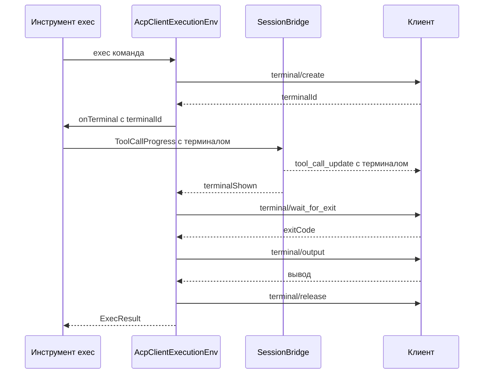

# Проекция и запросы к клиенту

Глава описывает две половины одной работы. Первая — как события ядра (`AgentEvent`) становятся кадрами `session/update`, а итог хода — ответом на `session/prompt`. Вторая — как агент просит клиента о разрешении, файлах и терминалах: `AcpPermissionGate` и `AcpClientExecutionEnv` поверх `ClientRequests`.

Краткая таблица проекции и порядок кадров в целом ходе уже даны в [главе ядра](../../codelab_agent_core/doc/03-request-flow.md#проекция-событий-в-sessionupdate). Здесь — поля кадров, статусы, `_meta` и реплей.

## Проекция событий

`projectEvent(event, configOptions:, replay:, subagentResult:, subagentPrefix:)` ([`event_projection.dart`](../lib/src/event_projection.dart)) — чистая функция: событие в список `acp.SessionUpdate`. Пустой список — событие клиенту не передаётся. `switch` исчерпывающий без `default` (ACP-6): новый подтип `AgentEvent` не скомпилируется, пока для него не выбрано соответствие. Параллельно `projectionTable` хранит то же соответствие текстом; тест сверяет её ключи с подтипами иерархии ([глава 4](04-testing.md#проекция)).

Мост вызывает `projectEvent` на каждое событие сессии и ставит кадры в очередь. Состояние (итоги потомков, цепочки) хранит мост, а не функция: он передаёт нужное параметрами.

### Что уходит клиенту

| Событие ядра | Кадр `session/update` | Поля |
|---|---|---|
| `MessageDelta` | `agent_message_chunk` | `content: {type: text, text: <дельта>}` |
| `ThoughtDelta` | `agent_thought_chunk` | то же |
| `ToolCallStarted` | `tool_call` | `toolCallId`, `title`, `kind`, `status: pending`, `rawInput`; `locations` — только если не пусты; `_meta.codelab.subagent {id, type}` — только у вызова `agent` |
| `ToolCallProgress` | `tool_call_update` | `status: in_progress`, `content`: текст, `diff` или `{type: terminal, terminalId}` |
| `ToolCallFinished` | `tool_call_update` | статус, содержимое и `_meta` — по таблице ниже |
| `TaskListChanged` | `plan` | `entries` и `_meta.codelab.taskChange` (см. ниже) |
| `ModeChanged` | `current_mode_update`, затем `config_option_update` | `currentModeId`; полный снимок опций |
| `ModelOptionsChanged` | `config_option_update` | полный снимок опций |
| `SessionTitleChanged` | `session_info_update` | `title`, `updatedAt` |
| `SubagentActivity` | `tool_call` / `tool_call_update` с цепочкой `toolCallId` | только клиенту с согласием; `_meta.codelab.parentToolCallId` |
| `TurnStarted`, `StepStarted`, `ModelRequested`, `MessageStarted`, `MessageEnded`, `ToolPairingRepaired`, `AgentError`, `SubagentStarted`, `SubagentProgress`, `SubagentFinished` | — | клиент их не видит |
| `StepEnded`, `ContextCompacted`, `CompactionDiscarded` | — | usage уходит уведомлением `_codelab/session/usage`, а не `session/update` |
| `TurnEnded` | — | итог хода — ответ на `session/prompt` |

Почему отдельные кадры не нужны:

- `MessageStarted` и `MessageEnded` не уходят: весь текст ответа уже отправлен дельтами.
- `AgentError` не уходит: сбой хода сообщает ответ на `session/prompt`. Мост запоминает последний `AgentError` без повтора в `_failure`.
- `kind` берётся как `acp.ToolKind.values.byName(event.kind.name)`. Названия видов ядра обязаны совпадать с названиями в протоколе; тест `tool_kind_mapping_test.dart` проверяет это по каждому виду. Вид `switchMode` в протоколе есть, а в ядре нет: агент такого вида не порождает.

Содержимое вызова (`acpContent`): текст и картинки идут как есть; рассуждение и вызов, если попали в содержимое, — текстом (`[tool call <имя>]`), а не потерей данных. Правка файла — один `diff` на каждый изменённый файл (`path`, `oldText`, `newText`).

### Статусы вызова

В ACP у вызова четыре статуса: `pending`, `in_progress`, `completed`, `failed`. Кадр `tool_call` всегда идёт со статусом `pending`. `in_progress` отправляет либо хук `markInProgress` (вызов прошёл разрешения и вот-вот исполняется), либо `ToolCallProgress`. Итог — `ToolCallFinished`.

Исходов у ядра больше, чем статусов у протокола, поэтому всё, кроме исполненного вызова, — `failed`, а подробность идёт в `_meta.codelab.outcome` (`finishedStatus`, `finishedMeta`):

| Исход ядра | `status` | `_meta.codelab.outcome` | `content` |
|---|---|---|---|
| `completed` | `completed` | нет | содержимое и diff результата |
| `failed` | `failed` | нет | содержимое результата (текст ошибки) |
| `rejected` | `failed` | `rejected` | содержимое результата |
| `cancelled` | `failed` | `cancelled` | ключа нет; у `agent` с итогом ребёнка — `[]` |
| вызов прерван (`interrupted`; так реплей показывает вызов без результата в оборванном ходе) | `failed` | `interrupted` | содержимое результата |

Пустой `content: []` у отменённого `agent` не случаен: клиент уже получил строку прогресса вида `explore · …`, и без ключа `content` она осталась бы в состоянии «выполняется». Пустой список по ACP означает «только изменённые поля» и снимает её.

Реальная трасса вызова `exec` (запуск `serve --stdio` на сценарной модели; режим `standard`; клиент разрешил вызов и сыграл терминал; `sessionId` и пути замаскированы, `params` запроса разрешения сокращён — целиком он ниже):

```text
a2c {"jsonrpc":"2.0","method":"session/update","params":{"sessionId":"<session-id>","update":{"sessionUpdate":"tool_call","toolCallId":"call_1","title":"echo hi","kind":"execute","status":"pending","rawInput":{"command":"echo hi"}}}}
a2c {"jsonrpc":"2.0","id":"perm-1","method":"session/request_permission","params":{ … }}
c2a {"jsonrpc":"2.0","id":"perm-1","result":{"outcome":{"outcome":"selected","optionId":"allow_once"}}}
a2c {"jsonrpc":"2.0","method":"session/update","params":{"sessionId":"<session-id>","update":{"sessionUpdate":"tool_call_update","toolCallId":"call_1","status":"in_progress"}}}
a2c {"jsonrpc":"2.0","method":"session/update","params":{"sessionId":"<session-id>","update":{"sessionUpdate":"tool_call_update","toolCallId":"call_1","status":"in_progress","content":[{"type":"terminal","terminalId":"term_1"}]}}}
a2c {"jsonrpc":"2.0","method":"session/update","params":{"sessionId":"<session-id>","update":{"sessionUpdate":"tool_call_update","toolCallId":"call_1","status":"completed","content":[{"type":"content","content":{"type":"text","text":"hi\n"}}]}}}
```

Видны три кадра `tool_call_update` и порядок: `tool_call` раньше запроса разрешения, `in_progress` после ответа клиента, терминал встроен в вызов до `terminal/wait_for_exit`.

### План и список задач

`TaskListChanged` проецируется в `plan`: `entries` — весь список (`content` — тема задачи, `priority`, `status`), у каждого пункта `_meta.codelab.task {id, owner, blockedBy}`. Описание задачи в ACP не уходит. У самого `plan` живой кадр несёт `_meta.codelab.taskChange {op, actor, toolCallId?, changed, deleted}` — привязку операции к вызову `task_*`; `toolCallId` пропускается у операций `restore`, `assign` и изменений не от вызова. При реплее `taskChange` нет: реплей показывает состояние, а не операцию.

### Вызовы потомков

`SubagentActivity` даёт кадры, только если мост передал `subagentPrefix` — а он передаёт его лишь клиенту с согласием `subagentToolCalls`. Проекция вложенного события идёт теми же правилами, что у вызова корня; меняются только `toolCallId` (цепочка `<префикс>/<id>`) и `_meta.codelab.parentToolCallId`. Текст и рассуждения потомка клиенту не уходят: проекция даёт для них пустой список. Итог вызова `agent` (`SubagentFinished`) приходит в ядре до `ToolCallFinished` вызова; мост запоминает его и передаёт параметром `subagentResult`, а в финальном кадре появляется `_meta.codelab.subagent {id, summary {toolCalls, tokens, durationMs}}` и, при `failed`, `failure`. Клиенту показывается тело отчёта без обёртки `<subagent-report>` и ограды `untrusted-content`, которые нужны только модели.

## Итог хода

`turnResponse(ended, failure:, cancelRequested:)` строит ответ на `session/prompt`. Таблица «`TurnEnded` → `stopReason`» уже есть [в главе ядра](../../codelab_agent_core/doc/03-request-flow.md#sessionprompt). Детали из кода:

- `cancelRequested` приоритетнее всего: ответ `cancelled`, даже если отмена вызвала ошибки (ACP-5).
- `completed` с исчерпанным лимитом — `max_turn_requests` и `_meta.codelab.budgetExceeded: <имя лимита>`.
- `failed` — исключение `AcpRequestError` `-32603` с сообщением `Turn failed: <сообщение>` и `data.codelab {errorClass, message, retryable}`. `errorClass` — `failure.errorClass?.name ?? failure.cls.name`, а при отсутствии `AgentError` — `unknown`; `message` — текст ошибки или `the turn failed`. `retryable` истинно для классов `network`, `timeout`, `rateLimited`, `server`: повтор хода может пройти; сбой хоста (`hook`, `storage`, `compaction`) повтором не лечится. Сбой не маскируется под `end_turn` (ACP-7).

Ответ строится дважды в двух разных местах: `SessionBridge.prompt` — для запроса, `_turnEndedInfo` — для итога хода, чей запрос остался у закрытого соединения ([глава 2](02-session-bridge.md#отсоединение-и-переподключение)).

## Реплей

`replayUpdates(events)` ([`replay.dart`](../lib/src/replay.dart)) строит историю для `session/load`. Отличия от живой проекции:

| Что в журнале | Живой ход | Реплей |
|---|---|---|
| сообщение пользователя | — (клиент его отправил сам) | `user_message_chunk` на каждый блок |
| ответ ассистента | дельтами `agent_message_chunk` и `agent_thought_chunk` | по одному кадру на блок: непустое рассуждение — `agent_thought_chunk`, текст и картинка — `agent_message_chunk` |
| вызов инструмента | `tool_call` → `in_progress` → `tool_call_update` | один `tool_call` сразу с итоговым статусом, `rawInput`, `locations`, `content`, `_meta`; заголовок — из `ToolCallStarted`, а если его нет — `toolCallId` |
| вызов `agent`, отклонённый проверкой | первый кадр несёт резерв id | `_meta.codelab.subagent.type` из аргументов вызова (`general`, если нет); id не выдумывается |
| вызов потомка | цепочка кадров | один `tool_call` с цепочкой `toolCallId` — только клиенту с согласием |

Служебные записи (сжатие, режим, план, заголовок) посреди истории не отправляются: последние значения идут хвостом в `SessionBridge.replayInto`: `plan` (без `taskChange`), `current_mode_update`, `config_option_update`, `available_commands_update`, `session_info_update`. Метаданные первого кадра и итога вызова реплей сливает в один объект (`_mergeMeta`), потому что вызов в реплее — один кадр.

## Запросы агента к клиенту

Все запросы агента к клиенту идут через `ClientRequests`. Её держат окружение и шлюз сессии, а не мост.

### Ожидание ответа клиента

`ClientRequests.request(method, params, prefix:, timeout:, cancel:)`:

1. Уже отменённый `cancel` — исключение без отправки кадра. Закрытое соединение (`PendingRequests.isClosed`) — `ClientDisconnected`.
2. Выдаёт id `<prefix>-<n>`, регистрирует ожидание, ставит кадр в `OutboundQueue`.
3. Если задан `timeout`, запускает таймер часов хоста; по истечении ожидание завершается `ClientTimedOut`.
4. Если задан `cancel`, отмена завершает ожидание `ClientCallCancelled`. Запрос клиенту не отзывается — в ACP нечем. Поздний ответ клиента попадёт в «неизвестный id» и будет проигнорирован (PERM-4: решение принимается один раз).
5. Ответ с ошибкой JSON-RPC — `ClientRejected`; иначе возвращается `result` как JSON, а типизированный `decodeResult` вызывает вызывающий.

### Отказы и таймауты

`ClientCallFailure` — запечатанный класс из четырёх случаев; `toString` идёт в лог шлюза и в `FileError` для случаев, кроме отказа клиента; при `ClientRejected` модель получает `error.message` клиента (`_describe`, `_fsRequest`).

| Случай | Когда | Текст |
|---|---|---|
| `ClientRejected(error)` | клиент ответил ошибкой JSON-RPC | `ClientRejected(<код>: <сообщение>)` |
| `ClientTimedOut(method, after)` | клиент не ответил за таймаут | `client did not answer <метод> in <N> s (timed out)` |
| `ClientCallCancelled` | ход отменён | `aborted` |
| `ClientDisconnected` | соединение закрыто до ответа | `client connection lost` |

Таймауты — `AcpTimeouts` из `AcpServerConfig.timeouts`. По умолчанию: `fs` — 30 с, `terminalCreate` — 30 с, `terminalOutput` — 30 с, `terminalKill` — 10 с, `terminalRelease` — 10 с. У `session/request_permission` таймаута нет: человек думает сколько нужно, ожидание прерывает отмена. У `terminal/wait_for_exit` собственного таймаута у `ClientRequests` тоже нет: срок команды задаёт `ExecOptions.timeout` инструмента.

### `AcpPermissionGate`

Шлюз реализует `PermissionGate` ядра ([глава ядра о разрешениях](../../codelab_agent_core/doc/07-permissions.md)): политика решает, спрашивать ли человека, шлюз только доставляет вопрос. Алгоритм `request(req, cancel)`:

1. **Ждёт объявления вызова.** Через `announced(waitFor)` моста: запрос не должен опередить `tool_call`. `waitFor` — id вызова; для запроса потомка у клиента без согласия на вызовы потомков — id вызова `agent` корня, потому что цепочку такой клиент не увидит никогда. Ожидание гоняется с отменой (`raceCancel`): отменённый ход не оставляет висящий `Future`. Исход при отмене — `cancelled`, на провод ничего не уходит.
2. **Отправляет `session/request_permission`** с `prefix: 'perm'`.
3. **Ждёт ответ в цикле.** `ClientDisconnected` — не отказ: если у моста есть `waitForReconnect`, шлюз ждёт переподключения и задаёт вопрос заново (новый id, тот же `toolCallId`). Если сессию не переподключили, а ход отменён, решение `cancelled`.
4. **Разбирает ответ** (`acpSessionRequestPermission.decodeResult`). Неразбираемый ответ — отказ с записью `acp.permission.failed {reason: invalid answer: …}`.
5. **Переводит решение**: `cancelled` клиента — `PermissionDecision.cancelled`; выбор варианта — по `optionId`.

Правило безопасности: любой сбой — отказ (`rejectOnce`), а не разрешение. Так сделаны все пути ошибки: ошибка клиента, таймаут, разрыв без переподключения, неразбираемый ответ. Вариант, которого агент не предлагал (в том числе `allow_always`, если политика его не разрешила), — тоже `rejectOnce` и запись `acp.permission.unknown_option {session_id, tool_call_id, option_id}`.

Вопрос самодостаточен: в нём `toolCall` (`ToolCallUpdate` со статусом `pending`, `rawInput`, `locations`, причина первым текстовым блоком, `diff` на каждый файл) и варианты. `optionId` совпадает с видом варианта; имена — для человека. Пустой `content` не отправляется. `_meta.codelab` в вопросе один объект: `critical: true` и `label` — для критичных команд, `subagent {id, type, description, depth, path, parentToolCallId}` — если спрашивает потомок. Раздельные ключи верхнего уровня затёрли бы друг друга. Кадр запроса из реального прогона (режим `standard`, вызов `exec`):

```json
{"jsonrpc":"2.0","id":"perm-1","method":"session/request_permission","params":{"sessionId":"<session-id>","toolCall":{"toolCallId":"call_1","title":"echo hi","kind":"execute","status":"pending","rawInput":{"command":"echo hi"}},"options":[{"optionId":"allow_once","name":"Allow once","kind":"allow_once"},{"optionId":"allow_always","name":"Always allow echo hi","kind":"allow_always"},{"optionId":"reject_once","name":"Reject","kind":"reject_once"},{"optionId":"reject_always","name":"Always reject echo hi","kind":"reject_always"}]}}
```

Ответ клиента `{"outcome":{"outcome":"selected","optionId":"allow_once"}}` шлюз переводит в `PermissionDecision.allowOnce`.

### `AcpClientExecutionEnv`

Окружение реализует `ExecutionEnv` ядра запросами к клиенту: встроенные инструменты пишутся один раз над `ExecutionEnv`, а клиент показывает пользователю правки и терминалы и держит ограничение рабочей папки (`AGENTS.md` §10). Если хост задал `AcpServerConfig.localEnv`, это окружение не создаётся: файлы и команды исполняет сам хост, а `fs/*` и `terminal/*` клиенту не уходят ([глава ядра: встроенный режим](../../codelab_agent_core/doc/03-request-flow.md#встроенный-режим)).

#### Что получает ядро при создании сессии

`_Connection._wire` собирает порты сессии. Различие двух вариантов:

| | Обычный (процесс `codelab-agent`) | Встроенный (`localEnv` задан) |
|---|---|---|
| окружение | `AcpClientExecutionEnv`; при `localListing` — `ListingOverlayEnv` поверх него | `localEnv(cwd)` |
| шлюз | `AcpPermissionGate` | `AcpPermissionGate` |
| хук `extraBeforeToolCall` | `bridge.markInProgress` | `bridge.markInProgress` |
| `execOnHost` | `false`: команды исполняет клиент, каталог навыка агента ему не виден | `true` |

#### Файлы

| Метод `ExecutionEnv` | Запрос ACP | Особенности |
|---|---|---|
| `readText(path, line:, limit:)` | `fs/read_text_file` | путь делается абсолютным и нормализуется от `cwd` сессии |
| `writeText(path, content)` | `fs/write_text_file` | таймаут не значит, что записи не было: к сообщению добавляется `; the write may have completed` |
| `stat(path)` | `fs/read_text_file` с `limit: 1` | в ACP нет `stat`; успешное чтение — файл без размера, каталоги через клиента не видны |
| `listDir`, `readBytes`, `realpath` | — | не реализованы: таких методов в ACP нет |

Если клиент не объявил `fs.readTextFile` или `fs.writeTextFile`, метод отвечает `FileError(FileErrorCode.unsupported, <путь>)` без кадра. Отказ клиента — значение `FileError`, а не исключение (ENV-1): ошибка `-32002` клиента — `FileErrorCode.notFound`, любая другая (или таймаут, отмена, разрыв) — `FileErrorCode.io` с текстом сбоя. Реальная трасса: модель читает несуществующий файл, клиент отвечает `-32002`:

```text
a2c {"jsonrpc":"2.0","id":"fs-1","method":"fs/read_text_file","params":{"sessionId":"<session-id>","path":"~/projects/demo/missing.txt","line":1,"limit":2001}}
c2a {"jsonrpc":"2.0","id":"fs-1","error":{"code":-32002,"message":"Resource not found"}}
a2c {"jsonrpc":"2.0","method":"session/update","params":{"sessionId":"<session-id>","update":{"sessionUpdate":"tool_call_update","toolCallId":"call_1","status":"failed","content":[{"type":"content","content":{"type":"text","text":"File not found: missing.txt"}}]}}}
```

Отмена хода прекращает идущие `fs/*` через `abortPending`: у порта нет токена, поэтому окружение держит по одному `CancelTokenSource` на запрос (`_fsInFlight`), а мост зовёт `abortPending` из `cancel()`.

#### Терминал

`exec(command, options)` идёт цепочкой `terminal/create` → `terminal/wait_for_exit` → `terminal/output` → `terminal/release`; `terminal/kill` добавляется при отмене или таймауте команды.



Подробности из кода (`acp_client_env.dart`):

- **Команда.** Всегда `/bin/sh -c <команда>`; `env`, `cwd` и `outputByteLimit` — из `ExecOptions` (в трассе — `1048576`).
- **Без `terminal` у клиента.** `ExecError(shellUnavailable, message: 'the client does not support terminals')` без кадра.
- **Ошибки.** Сбой `terminal/create` — `ExecError(spawnFailed)`; отмена до создания — `aborted`. Сбой `terminal/wait_for_exit` (не отмена) — `ExecError(unknown, message: 'terminal/wait_for_exit failed: …', outputTail: <вывод>)`.
- **Таймаут и отмена.** `ExecOptions.timeout` и токен отмены останавливают ожидание через общий источник `stop`. Дальше окружение шлёт `terminal/kill` (таймаут `terminalKill`), забирает `terminal/output` и возвращает `ExecError(timeout)` при таймауте команды или `aborted` при отмене; вывод — в `outputTail`.
- **Освобождение.** `terminal/release` вызывается в `finally` на любом пути (ENV-7, ACP-9). Сбой `kill`, `output`, `release` не ломает результат: пишется `acp.terminal.kill_failed`, `acp.terminal.output_failed`, `acp.terminal.release_failed` с `{session_id, terminal_id, reason}`.
- **Результат.** Код выхода — из ответа `wait_for_exit`, а если его нет — из `exitStatus` ответа `terminal/output`. Если вывод не получен, `output` — `[output unavailable]`.
- **Показ терминала.** Пока `terminalShown` моста не завершился, `wait_for_exit` не посылается; ожидание гоняется с отменой (`raceCancel`), чтобы `exec` не повис, если мост отбросил кадр.

Ответ клиента на `terminal/release` и `terminal/kill` может быть `null` или `{}`; окружение принимает оба.

## Нормы и спецификации

| Что | Где |
|---|---|
| проекция событий, статусы, реплей | [`agent-acp-server`](../../../../openspec/specs/agent-acp-server/spec.md): «session/prompt, проекция и итог хода», «session/load и реплей» |
| запросы агента к клиенту | там же: «Запросы агента к клиенту» |
| окружение и контейнмент путей | [`agent-execution-env`](../../../../openspec/specs/agent-execution-env/spec.md) |
| разрешения | [`agent-permissions`](../../../../openspec/specs/agent-permissions/spec.md), [`docs/architecture/permissions.md`](../../../../docs/architecture/permissions.md) |
| субагенты | [`agent-subagents`](../../../../openspec/specs/agent-subagents/spec.md) |
| исключение ACP `fs/*` и `terminal/*` из клиентского approval | корневой [`AGENTS.md`](../../../../AGENTS.md), раздел 10 |

Дальше: [тестирование](04-testing.md).
