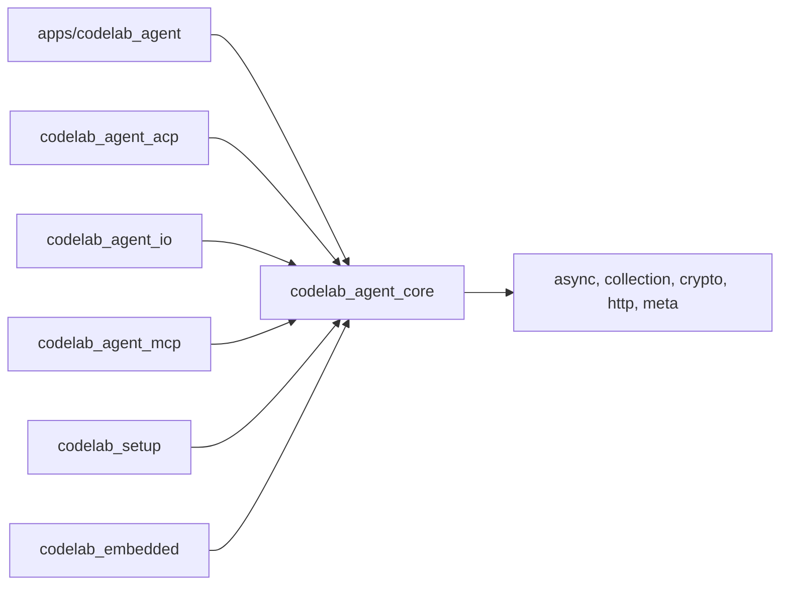

# codelab_agent_core

Встраиваемое ядро Dart-агента: вызов модели, цикл хода, инструменты, политика разрешений, журнал сессий, сжатие контекста, субагенты, MCP-проекция и конфигурация как чистые данные. Ядро не знает ни файловой системы, ни сети, ни протокола. Всё внешнее приходит от хоста через порты, поэтому одно ядро работает в процессе `codelab-agent`, во встроенном агенте клиентов и в web.

## Место в архитектуре

Сторона `agent`, слой `core` (ADR-0002). Чистый Dart, без Flutter и без `dart:io`: основной барель безопасен для web. Правило PKG-1 запрещает `dart:io`, `dart:isolate`, `dart:ffi`, `dart:html`, Flutter и протокольные пакеты ACP; его проверяет `melos run guard`, а `melos run web-compile` компилирует `test/web_smoke/main.dart` в JavaScript и WebAssembly.

Зависимости ограничены allowlist PKG-2 из `pubspec.yaml`: `async`, `collection`, `crypto`, `http`, `meta`. Схема показывает, кто зависит от ядра (по `pubspec.yaml` каждого пакета; везде это обычная зависимость).



Клиенты (`apps/codelab_desktop`, `apps/codelab_cli`) ядро напрямую не импортируют: агента они получают через мосты `codelab_setup` и `codelab_embedded` (PKG-4, AGENTS.md репозитория §5). Архитектура ядра — [`agent-core-architecture`](../../../docs/architecture/proposals/agent-core-architecture.md); разделы по частям лежат рядом, в `docs/architecture/proposals/agent-core/`.

## Что внутри

Устройство ядра подробно описывает [руководство по архитектуре](doc/README.md): путь запроса, цикл хода, инструменты, разрешения, сессии, конфигурация и рецепты расширения.

Публичное API экспортирует `lib/codelab_agent_core.dart`. Дополнительный барель `lib/testing.dart` не входит в основной: это детерминированные порты и модель-сценарий для тестов (`FakeClock`, `RecordingLogger`, `ScriptedStreamFunction`, `SequentialIdGenerator`).

| Часть | Для чего |
|---|---|
| `buildAgentCore`, `HostProfile`, `HostCapability`, `AgentCoreServices` | единственный способ собрать ядро: профиль возможностей и порты хоста на входе, `BuiltAgentCore` (план и `AgentRuntime`) на выходе |
| `AgentRuntime`, `AgentSession`, `SessionSpec` | создание, загрузка и список сессий; ход `prompt`, события `events`, смена режима, модели и агента |
| `AgentEvent` (sealed), `TurnResult` | события хода (`TurnStarted`, `MessageDelta`, `ToolCallStarted`, `TurnEnded` и др.), по которым строятся клиенты |
| `StreamFunction`, `createStreamFunction`, `createRoutedStreamFunction`, `ModelRef`, `ModelCatalog` | контракт вызова модели и фабрики адаптеров провайдеров; сами адаптеры наружу не экспортируются (PKG-5) |
| `ExecutionEnv`, `BoundedEnv`, `MemoryExecutionEnv` | порт файлов и процессов, ограничение рабочей папкой и реализация в памяти |
| `PermissionGate`, `PermissionRequest`, `PermissionDecision`, `ModeId`, `PermissionMode` | порт одобрения и режимы разрешений |
| `SessionStore`, `MemorySessionStore`, записи журнала | порт хранилища журнала сессий |
| `CoreConfig`, `ConfigSource`, `ConfigTree`, `ConfigIssue` | модель конфигурации и проверка без файлов и разборщиков (CFG-5) |
| `McpConnector`, `McpStatusPort`, `McpServerConfig` | порт подключения MCP-серверов и статус для хоста |
| `SecretStore`, `SecretResolver` | порт секретов и разбор ссылок `${secret:…}` |
| `Clock`, `IdGenerator`, `Logger`, `Result` | внедряемое время, идентификаторы и журнал: ядро само их не создаёт (PKG-6) |

Что внутри `lib/src/`: `loop/` (цикл), `tools/` (инструменты и единая точка исполнения), `permissions/` (политика), `session/` (журнал и ветки), `compaction/`, `subagents/`, `skills/`, `commands/`, `prompts/` (генерируемые константы), `usage/`, `config/`.

## Как использовать

Минимальная сборка из `test/web_smoke/main.dart`: профиль, порты в памяти, модель-сценарий, один ход с вызовом инструмента `read`.

```dart
import 'package:codelab_agent_core/codelab_agent_core.dart';
import 'package:codelab_agent_core/testing.dart';

final clock = FakeClock();
final env = MemoryExecutionEnv(cwd: '/web', clock: clock);
await env.writeText('/web/hello.txt', 'hello from memory\n');

final core = buildAgentCore(
  profile: HostProfile.of('agent-serve').narrowed(const {
    HostCapability.shellExec: CapabilityOff('браузер без shell'),
    HostCapability.sessionPersistence: CapabilityOff('журнал в памяти'),
  }),
  services: AgentCoreServices(
    baseEnv: env,
    logger: RecordingLogger(),
    clock: clock,
    ids: SequentialIdGenerator(),
    sessions: MemorySessionStore(),
  ),
  config: config,                 // CoreConfig с defaultModel
  streamFunction: model.call,     // ScriptedStreamFunction или фабрика провайдеров
);

final session = await core.runtime.createSession(
  SessionSpec(cwd: '/web', mode: ModeId.bypass),
);
session.events.listen(print);
final result = await session.prompt(const [TextContent('read hello.txt')]);
await core.runtime.dispose();
```

Порядок и ошибки:

1. Хост собирает порты и вызывает `buildAgentCore` один раз. Неверная связка портов (журнал в памяти при включённой `sessionPersistence`, `shellExec` с окружением в памяти, `ConfigSource` без `modelsFor`) даёт `HostWiringException` при сборке, а не посреди хода.
2. Для каждой сессии: `runtime.createSession(SessionSpec(cwd: …))` или `runtime.loadSession(…)`.
3. Подписка на `session.events` и `await session.prompt(…)`. Второй `prompt` во время хода — `StateError`; отмена — `session.cancel()` или `CancelToken`.
4. В конце — `session.close()` и `runtime.dispose()`; источник конфигурации закрывает хост после `dispose()`.

## Порты хоста

Ядро описывает порты, хост их реализует. Подробно — в [главе «Сборка ядра и хосты»](doc/02-assembly-and-hosts.md); коротко:

| Порт | Реализация в монорепо |
|---|---|
| `ExecutionEnv` | `LocalExecutionEnv` (`codelab_agent_io`); `AcpClientExecutionEnv` (`codelab_agent_acp`) — файлы и терминал через клиента |
| `SessionStore` | `JsonlSessionStore` (`codelab_agent_io`); `MemorySessionStore` (ядро) |
| `PermissionGate` | `AcpPermissionGate` (`codelab_agent_acp`); у встроенного агента тот же `AcpPermissionGate`: мост `codelab_embedded` передаёт ядру лишь заглушку, а вопросы идут клиенту по `session/request_permission` через `InProcessAcpLink` |
| `ConfigSource`, `ProjectConfigLoader` | `FileConfigSource` (`codelab_agent_io`) |
| `ProjectFilesSource`, `SkillFilesSource` | `ProjectFilesLoader` (`codelab_agent_io`) |
| `McpConnector` | `McpClientConnector` (`codelab_agent_mcp`) |
| `SecretStore` | `FileSecretStore`, `EnvSecretStore` (`codelab_agent_io`) |
| `UsageLedgerStore`, `LastModelStore` | `JsonlUsageLedgerStore`, `FileLastModelStore` (`codelab_agent_io`) |

## Ключевой поток

Ход с вызовом инструмента и запросом разрешения. Схема показывает реальные типы ядра; шаги исполнения инструмента — по `ToolCallExecutor` (`lib/src/tools/executor.dart`).

```mermaid
sequenceDiagram
  participant host as Хост
  participant session as AgentSession
  participant loop as runAgentLoop
  participant model as StreamFunction
  participant exec as ToolCallExecutor
  participant policy as PermissionPolicy
  participant gate as PermissionGate
  participant tool as AgentTool

  host->>session: prompt(content)
  session->>loop: ход (TurnStarted)
  loop->>model: запрос с историей и схемами инструментов
  model-->>loop: ответ с вызовом инструмента
  loop->>exec: announce(call) (ToolCallStarted)
  loop->>exec: complete(handle)
  exec->>exec: проверка аргументов по схеме
  exec->>policy: beforeToolCall (хук политики первым)
  policy->>gate: request(PermissionRequest, cancel)
  gate-->>policy: PermissionDecision
  policy-->>exec: разрешено или отказ
  exec->>tool: execute(args, ctx)
  tool-->>exec: результат
  exec-->>loop: ToolCallFinished
  loop->>model: следующий шаг с результатом
  model-->>loop: итоговый текст
  loop-->>session: TurnEnded
  session-->>host: TurnResult
```

Порядок решения такой. Сначала срабатывают запреты: конфигурация, `rejectAlways`, запреты режима `plan`. Затем вопрос задаётся при правке файлов конфигурации агента и при критических командах — даже в режимах bypass и yolo; в autopilot обе ветки дают отказ без вопроса. Для остальных вызовов политика `permissions.tools.<tool>: ask` или режим и уровень инструмента (`ToolTier`: `read`, `write`, `network`, `exec`, таблица `tierDecision`) решают, нужен ли вопрос к `gate`. Без шлюза любой вопрос превращается в отказ (PERM-5). Если вызов запретила политика, инструмент не выполняется, а модель получает текст отказа. Подробности — в главах [«Инструменты»](doc/06-tools.md) и [«Разрешения»](doc/07-permissions.md) [руководства](doc/README.md).

## Тесты

```bash
cd packages/dart/codelab_agent_core
fvm dart test
```

Папки `test/` повторяют `lib/src/`; `test/scenarios/` — сквозные сценарии на модели-сценарии, `test/web_smoke_turn_test.dart` проводит ход, который компилируется в web. Проверка того, что сгенерированные константы промптов совпадают с исходниками `prompts/**/*.md`:

```bash
melos run prompts:check
```

Скрипт выполняет `fvm dart run tool/gen_prompts.dart --check` в каталоге пакета и возвращает код 1 при расхождении. После правки промпта перегенерируйте константы: `fvm dart run tool/gen_prompts.dart` (из каталога пакета). Другие проверки границы: `melos run guard`, `melos run web-compile`. Ручной прогон адаптера провайдера (нужен ключ, в CI не запускается) — `tool/llm_smoke.dart`, команда в `AGENTS.md` пакета, §4.

## Правила пакета

Инварианты PKG-1…PKG-6, CFG-5, правила TDD и итераций — в [`AGENTS.md`](AGENTS.md). Главное для читателя: ядро не создаёт `http.Client`, время, случайность и идентификаторы само, а новый ключ конфигурации добавляется строкой схемы вместе со своим потребителем.

## Смотрите также

- [`docs/architecture/proposals/agent-core-architecture.md`](../../../docs/architecture/proposals/agent-core-architecture.md) — архитектура ядра;
- спецификации `openspec/specs/`: `agent-runtime`, `agent-loop`, `agent-tools`, `agent-permissions`, `agent-sessions`, `agent-core-ports`, `agent-subagents`;
- [`codelab_acp_protocol`](../codelab_acp_protocol/README.md) — протокол, который проецирует `codelab_agent_acp`;
- [`apps/codelab_agent`](../../../apps/codelab_agent/README.md) — бинарь Dart-агента, [разработка](../../../apps/codelab_agent/doc/development.md) и [эксплуатация](../../../apps/codelab_agent/doc/operations.md).
