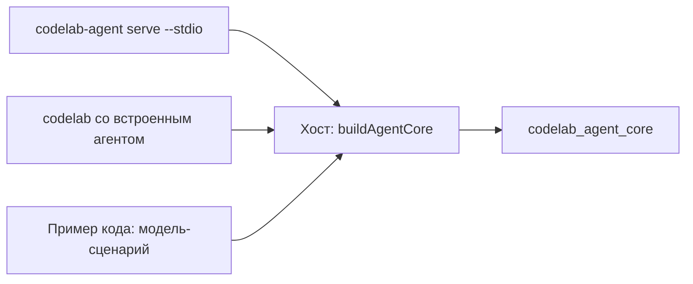

# Начало работы с кодом агента

Эта глава для разработчика, который впервые открыл ядро агента. Она отвечает на практические вопросы: как подготовить репозиторий, как запустить агента без живой модели, куда смотреть при отладке и в какой файл идти с задачей. Устройство ядра объясняют остальные главы; сюда они ссылаются по месту.

## Подготовка репозитория

Шаги подготовки описаны в [запуске из исходников](../../../../docs/user/run-from-source.md#1-подготовка). Здесь — конспект для разработчика; команды выполняются из корня репозитория.

1. Установите [FVM](https://fvm.app). Версия Flutter SDK лежит в `.fvmrc`; все команды Dart идут через `fvm`.
2. Поставьте SDK и свяжите пакеты:

   ```bash
   fvm install
   fvm flutter pub get
   fvm dart run melos bootstrap
   ```

3. Создайте сгенерированный код. В git его нет, без него бинари и часть тестов не соберутся:

   ```bash
   fvm dart run melos exec -c 1 --depends-on=build_runner -- "fvm dart run build_runner build --delete-conflicting-outputs"
   ```

Ядро — чистый Dart без Flutter и без `dart:io`. Его тесты запускаются в каталоге пакета командой `fvm dart test`, остальная сборка нужна, чтобы запускать бинари.

## Три способа запустить агента

На схеме — три входа в одно и то же ядро. Первые два собирают его через хост, третий — прямо из кода теста.



Хосты и сборку ядра описывает [глава 02](02-assembly-and-hosts.md).

### Отдельный процесс: `codelab-agent serve --stdio`

Агент как отдельная программа живёт в `apps/codelab_agent`. Запуск из исходников, без сборки бинаря:

```bash
fvm dart run apps/codelab_agent/bin/codelab_agent.dart
```

Без команды программа печатает справку (stdout несёт только протокол, поэтому справка идёт в stderr):

```text
codelab-agent: missing command: codelab-agent serve

Usage: codelab-agent serve (--stdio | --ws) [options]
       codelab-agent config check|path|get|set|unset ...
       codelab-agent provider add|list|remove ...
       codelab-agent mcp add|list|remove ...
       codelab-agent secret set|delete|list|migrate

Note: before 1.0, tool output, prompts and session logs are not redacted: secrets they contain reach the model provider and session files as is.

--stdio              Serve one client over stdin/stdout.
--ws                 Serve clients over WebSocket.
…
--log-level          trace, debug, info, warning or error, any case (CODELAB_LOG_LEVEL).
--log-file           JSON Lines log file (CODELAB_LOG_FILE).
--config             Extra config.yaml, above config.local.yaml (CODELAB_CONFIG).
--debug-secrets      Log secrets.lookup (name, source, found) for every secret lookup; never the value (CODELAB_DEBUG_SECRETS=1).
--max-steps          Model steps per turn, a positive integer (CODELAB_MAX_STEPS).
```

`serve --stdio` ждёт кадры ACP (Agent Client Protocol — протокол, по которому клиент и агент обмениваются сообщениями) в stdin и пишет ответы в stdout. Вручную им пользоваться неудобно: подключайте клиент (Zed, `codelab -a stdio:…`). Флаги и коды выхода — в [эксплуатации агента](../../../../apps/codelab_agent/doc/operations.md).

### Терминальный клиент со встроенным агентом

`codelab` по умолчанию запускает ядро внутри себя (пакет `codelab_embedded`). Ему нужна настроенная модель — [настройка агента](../../../../docs/user/configuration.md).

```bash
fvm dart run apps/codelab_cli/bin/codelab.dart -p "Объясни, что делает этот проект" -C <папка-проекта>
```

Без модели клиент останавливается с кодом `64` и подсказкой (пустой `CODELAB_HOME`):

```text
codelab: defaults: agent.default_model: no model is configured; add a provider with at least one model
Configure the embedded agent in ~/demo/home/config.yaml; check it with: codelab config check
```

Живого провайдера для разработки ядра не нужно: следующий способ даёт ход без него.

### Ход без провайдера: модель-сценарий

`ScriptedStreamFunction` из `package:codelab_agent_core/testing.dart` — модель, которая отвечает по заранее записанному сценарию. Она заменяет вызов провайдера, поэтому ход идёт детерминированно, без сети и ключей. Барель `testing.dart` нужен только тестам и тестовым хостам.

Пример ниже собирает ядро, проводит один ход и печатает события. Он повторяет `test/web_smoke/main.dart` (его же проверяет `test/web_smoke_turn_test.dart`). Сохраните файл как `packages/dart/codelab_agent_core/test/scratch/turn.dart` и не коммитьте его.

```dart
import 'package:codelab_agent_core/codelab_agent_core.dart';
import 'package:codelab_agent_core/testing.dart';

Future<void> main() async {
  final clock = FakeClock();
  final logger = RecordingLogger(clock: clock);
  final env = MemoryExecutionEnv(cwd: '/demo', clock: clock);
  await env.writeText('/demo/hello.txt', 'hello from memory\n');

  // Сценарий модели: два шага. Первый вызывает инструмент `read`,
  // второй проверяет результат вызова и отвечает текстом.
  final model = ScriptedStreamFunction.fromJson({
    'steps': [
      {
        'reply': [
          {
            'toolCall': {
              'id': 'c1',
              'name': 'read',
              'arguments': {'path': 'hello.txt'},
            },
          },
        ],
      },
      {
        'expect': {
          'toolResult': {'toolCallId': 'c1', 'isError': false},
        },
        'reply': [
          {'text': 'Файл прочитан: hello from memory'},
        ],
      },
    ],
  }, clock: clock);

  final core = buildAgentCore(
    profile: HostProfile.of('agent-serve').narrowed(const {
      HostCapability.shellExec: CapabilityOff('в примере нет shell'),
      HostCapability.sessionPersistence: CapabilityOff('журнал в памяти'),
    }),
    services: AgentCoreServices(
      baseEnv: env,
      logger: logger,
      clock: clock,
      ids: SequentialIdGenerator(),
      sessions: MemorySessionStore(),
      platform: 'example',
    ),
    config: CoreConfig(
      defaultModel: ModelRef(
        provider: 'scripted',
        id: 'scripted-1',
        api: ProviderApi.openaiChat,
        baseUrl: Uri.parse('http://localhost/'),
        contextWindow: 32768,
        maxOutputTokens: 4096,
      ),
    ),
    streamFunction: model.call,
  );

  final session = await core.runtime.createSession(
    SessionSpec(cwd: '/demo', mode: ModeId.bypass),
  );
  final subscription = session.events.listen((event) {
    print('event ${event.runtimeType}');
  });
  final result = await session.prompt(const [
    TextContent('прочитай hello.txt'),
  ]);
  await subscription.cancel();
  await core.runtime.dispose();
  model.verify();

  print('итог хода: ${result.reason.name}');
  for (final r in logger.records) {
    print('log ${r.level.name} ${r.event}');
  }
}
```

Запуск из каталога пакета:

```bash
cd packages/dart/codelab_agent_core
fvm dart run test/scratch/turn.dart
```

```text
event TurnStarted
event MessageStarted
event MessageEnded
event StepStarted
event ModelRequested
event MessageStarted
event MessageEnded
event ToolCallStarted
event ToolCallFinished
event MessageStarted
event MessageEnded
event StepEnded
event StepStarted
event ModelRequested
event MessageStarted
event MessageDelta
event MessageDelta
event MessageEnded
event StepEnded
event TurnEnded
event SessionTitleChanged
итог хода: completed
log info host.plan
log info session.model.selected
```

Как читать вывод:

- Первый шаг сценария — вызов `read`: после `ModelRequested` идут сообщение с вызовом, `ToolCallStarted` и `ToolCallFinished`. Второй шаг — текстовый ответ (`MessageDelta`) и `TurnEnded`. Что означает каждое событие — [глава 04](04-turn-loop.md).
- `expect` в сценарии проверяет, что модель получила результат вызова без ошибки. Если запросы модели разошлись со сценарием, `model.verify()` бросает `ScriptedLlmFailure` со списком всех расхождений.
- Режим `ModeId.bypass` пропускает вопросы о разрешениях: пример не передаёт `PermissionGate`. Как работает шлюз — [глава 07](07-permissions.md).
- `SessionStore` здесь `MemorySessionStore`, поэтому после выхода журнала не остаётся. Реальный журнал — в разделе «Журнал хода» ниже.
- Модель-сценарий подставляют и готовые хосты. Агент принимает скрытый флаг `--llm-script <файл>` (только для тестов): он берёт сценарий из JSON и не ходит к провайдеру. Фикстуры ACP проигрывает команда `codelab test-scenario` против встроенного агента:

  ```bash
  fvm dart run apps/codelab_cli/bin/codelab.dart test-scenario packages/dart/codelab_acp_testing/fixtures/acp --agent embedded --filter 'acp/prompt-anthropic-tool-call'
  ```

  ```text
  PASS acp/prompt-anthropic-tool-call (0.4s)
  1 passed, 0 failed, 0 skipped
  ```

  Подробности — в [эксплуатации `codelab`](../../../../apps/codelab_cli/doc/operations.md#проверка-агента-фикстурами-test-scenario).

## Отладка

### Подробный лог

Лог — это события вида `имя {поля}` с уровнем. Поля, уровни и маскирование описывает [глава 10](10-observability-and-errors.md#журнал-диагностики). Включается он так:

| Где | Как |
|---|---|
| `codelab-agent serve` | `--log-level debug` (или `trace`); `--log-file <файл>` пишет ещё и JSON Lines; `--debug-secrets` показывает поиск секретов |
| `codelab` со встроенным агентом | `-v` или `--verbose` — лог агента и соединения в stderr; `--debug-secrets` без `-v` пишет только поиск секретов |
| `codelab -a stdio:…` | `-v` показывает соединение клиента и всё, что агент пишет в stderr; уровень задаёт сам агент (`--log-level`) |

`--debug-secrets` пишет событие `secrets.lookup`: имя секрета, откуда он взят, найден ли. Значение секрета в лог не попадает. Тексты сообщений и аргументы инструментов видны только на уровне `debug`.

Пример: `codelab -p` ведёт один ход через внешнего агента на сценарии `hello.json`, а `-v` печатает всё, что видит клиент. Команда (пути заменены на `~/codelab` и `~/demo`):

```bash
fvm dart run apps/codelab_cli/bin/codelab.dart -p hi -C ~/demo/proj -v \
  -a "stdio:fvm dart run ~/codelab/apps/codelab_agent/bin/codelab_agent.dart serve --stdio --llm-script ~/codelab/apps/codelab_agent/test/llm_scripts/hello.json --log-level debug"
```

stdout:

```text
hello
```

stderr (строки сокращены, `host.plan` опущена):

```text
[info] connection_state_changed category=application component=client connection_generation=1 from=ClientConnectionInitializing to=ClientConnectionReady
[info] 2026-11-24T14:07:30.389519Z debug acp.extensions.negotiated {keys: [subagents, subagentToolCalls, tasks, usage]} category=application component=transport connection_generation=1 source=stderr
[info] 2026-11-24T14:07:30.420441Z info session.model.selected {session_id: <session-id>, model: scripted/scripted-1, source: config} category=application component=transport …
[info] 2026-11-24T14:07:30.508675Z debug acp.usage.sent {session_id: <session-id>, seq: 1, trigger: step, turn_id: <turn-id>} category=application component=transport …
[info] 2026-11-24T14:07:30.511822Z debug acp.usage.sent {session_id: <session-id>, seq: 2, trigger: turn, turn_id: <turn-id>} category=application component=transport …
[info] prompt: Prompt completed with stopReason endTurn.
```

Строки агента (`… debug acp.usage.sent {…}`) клиент оборачивает своим префиксом `[info]` и полями соединения; собственный уровень агента стоит после времени.

### Где лежат журнал сессии и конфигурация

Всё лежит в `CODELAB_HOME`: по умолчанию `~/.codelab`. Раскладку и общие файлы описывает [каталог `CODELAB_HOME`](../../../../docs/ops/codelab-home.md#общие-файлы), файлы агента как процесса — [эксплуатация `codelab-agent`](../../../../apps/codelab_agent/doc/operations.md#конфигурация). Коротко:

| Что | Где |
|---|---|
| глобальная конфигурация | `$CODELAB_HOME/config.yaml` |
| конфигурация проекта | `<проект>/.codelab/config.yaml`, `<проект>/.codelab/config.local.yaml` |
| журналы сессий | `$CODELAB_HOME/sessions/<слаг-папки>/<время>_<id>.jsonl` |

При разработке не трогайте настоящий `~/.codelab`: задайте отдельный каталог (`export CODELAB_HOME="$PWD/.codelab-dev"`) и убирайте ключи провайдеров из окружения командой `env -u <ПЕРЕМЕННАЯ>`. Проверка настроек без запуска агента — `codelab config check`.

### Журнал хода

Журнал сессии — JSON Lines: одна запись на строку, первая строка — заголовок. Формат и типы записей — [глава 08](08-sessions-and-compaction.md#формат-журнала).

Чтобы получить настоящий журнал без провайдера, запустите `serve --stdio` на сценарии. Скрытый флаг `--sessions-dir` (только вместе с `--llm-script`) включает запись на диск; без него сценарная сессия живёт в памяти. Клиент (здесь — несколько кадров ACP: `initialize`, `session/new`, `session/prompt` с текстом `Hi`) проводит один ход, после чего в каталоге появляется файл:

```text
<sessions-dir>/<слаг-папки>/2026-11-24T14-04-04-197Z_<session-id>.jsonl
```

Содержимое файла (источник — этот запуск; путь заменён, строка сообщения ассистента сокращена):

```text
{"type":"session","version":1,"id":"<session-id>","cwd":"~/.codelab-demo/proj","created":"2026-11-24T14:04:04.197Z","agent":{"name":"codelab-agent","version":"0.1.0"},"metadata":{"profile":"agent-serve"}}
{"type":"model_change","id":"<record-1>","parentId":null,"timestamp":"2026-11-24T14:04:04.232Z","provider":"scripted","modelId":"scripted-1","baseUrl":"http://scripted.invalid/v1"}
{"type":"message","id":"<record-2>","parentId":"<record-1>","timestamp":"2026-11-24T14:04:04.252Z","message":{"role":"user","content":[{"type":"text","text":"Hi"}],"timestamp":"2026-11-24T14:04:04.247007Z"}}
{"type":"message","id":"<record-3>","parentId":"<record-2>","timestamp":"2026-11-24T14:04:04.268Z","message":{"role":"assistant","content":[{"type":"text","text":"hello"}],"model":{"provider":"scripted","id":"scripted-1"},"usage":{"input":0,…},"stopReason":"stop","timestamp":"2026-11-24T14:04:04.262391Z"}}
{"type":"session_info","id":"<record-4>","parentId":"<record-3>","timestamp":"2026-11-24T14:04:04.276Z","title":"Hi","source":"auto"}
```

Как читать:

- Записи образуют цепочку: `parentId` каждой записи указывает на предыдущую (у первой он `null`). Так журнал хранит дерево записей (устройство — [глава 08](08-sessions-and-compaction.md#дерево-записей)).
- Сообщения `user` и `assistant` — это `message`; вызовы инструментов лежат внутри `content` ассистента, результаты — отдельными `message` с ролью `toolResult` (пример с вызовом `read` — [в главе 08](08-sessions-and-compaction.md#пример-журнала)). Смена модели и режима — `model_change` и `mode_change`, заголовок сессии — `session_info`.
- Поиск по типу: `grep '"type":"message"' <файл>.jsonl`; число записей — `wc -l`.
- Ход, оборванный на середине (вызов без результата), ядро чинит при открытии журнала — [глава 08](08-sessions-and-compaction.md#открытие-и-ремонт).

Журналы содержат тексты разговора и вывод инструментов. До 1.0 они не редактируются, поэтому не публикуйте их, не просмотрев.

### Один тест

Тесты ядра запускаются в каталоге пакета. Один файл:

```bash
cd packages/dart/codelab_agent_core
fvm dart test test/web_smoke_turn_test.dart
```

```text
00:00 +0: loading test/web_smoke_turn_test.dart
00:00 +0: the web-smoke turn reads a file and answers
00:00 +1: All tests passed!
```

Один тест из файла — по части названия: `fvm dart test test/web_smoke_turn_test.dart --name "reads a file"`. Каталог целиком: `fvm dart test test/loop`. Виды тестов и сценарные прогоны — в главе о тестировании [12-testing.md](12-testing.md); частые сбои — в [13-troubleshooting.md](13-troubleshooting.md).

## Быстрая ориентация

Все пути ниже — внутри `packages/dart/codelab_agent_core/lib/src/`, если не сказано иное.

| Я хочу изменить | Открой | Читай |
|---|---|---|
| набор встроенных инструментов или добавить новый | `tools/builtin/`, регистрация в `host/build_agent_core.dart` | [06](06-tools.md), [рецепт 1](11-extending.md#рецепт-1-встроенный-инструмент), [туториал](tutorial-new-tool.md) |
| ход: шаги, бюджет, повторы, события | `loop/agent_loop.dart`, `loop/agent_events.dart` | [04](04-turn-loop.md), [рецепт 8](11-extending.md#рецепт-8-событие-хода) |
| как событие хода уходит клиенту | `event_projection.dart` в `packages/dart/codelab_agent_acp/lib/src/` | [03](03-request-flow.md) |
| вызов провайдера модели | `llm/providers/`, `llm/provider_factory.dart` | [05](05-llm.md), [рецепт 2](11-extending.md#рецепт-2-провайдер-модели) |
| режимы и правила разрешений | `permissions/modes.dart`, `permissions/policy.dart`, `permissions/gate.dart` | [07](07-permissions.md), [рецепт 5](11-extending.md#рецепт-5-режим-разрешений-и-правила) |
| журнал сессии, типы записей | `session/records.dart`, `session/session_writer.dart` | [08](08-sessions-and-compaction.md) |
| сжатие контекста | `compaction/` | [08](08-sessions-and-compaction.md#сжатие-контекста) |
| ключ конфигурации | `config/schema.dart`, `config/settings_registry.dart` | [09](09-config-prompts-commands.md), [рецепт 6](11-extending.md#рецепт-6-ключ-конфигурации) |
| промпт | `prompts/**/*.md` в корне пакета и сгенерированный `prompts/prompts.g.dart` | [рецепт 7](11-extending.md#рецепт-7-промпт) |
| слэш-команду | `commands/builtin_commands.dart` | [09](09-config-prompts-commands.md), [рецепт 3](11-extending.md#рецепт-3-слэш-команда) |
| сборку ядра, профили хостов, порты | `host/build_agent_core.dart`, `host/host_profile.dart`, `host/services.dart` | [02](02-assembly-and-hosts.md) |
| лог и типизированные ошибки | `util/logger.dart` | [10](10-observability-and-errors.md) |

Новое событие журнала или новая запись — в `session/records.dart` вместе с golden-фикстурой; полный чек-лист изменений — [в конце главы 11](11-extending.md#чек-лист-перед-pull-request).

## Смотрите также

- [Обзор ядра](01-overview.md) — понятия и карта `lib/src/`.
- [Путь запроса](03-request-flow.md) — что происходит от `session/prompt` до ответа.
- [`AGENTS.md` пакета](../AGENTS.md) — правила, обязательные для изменений.
